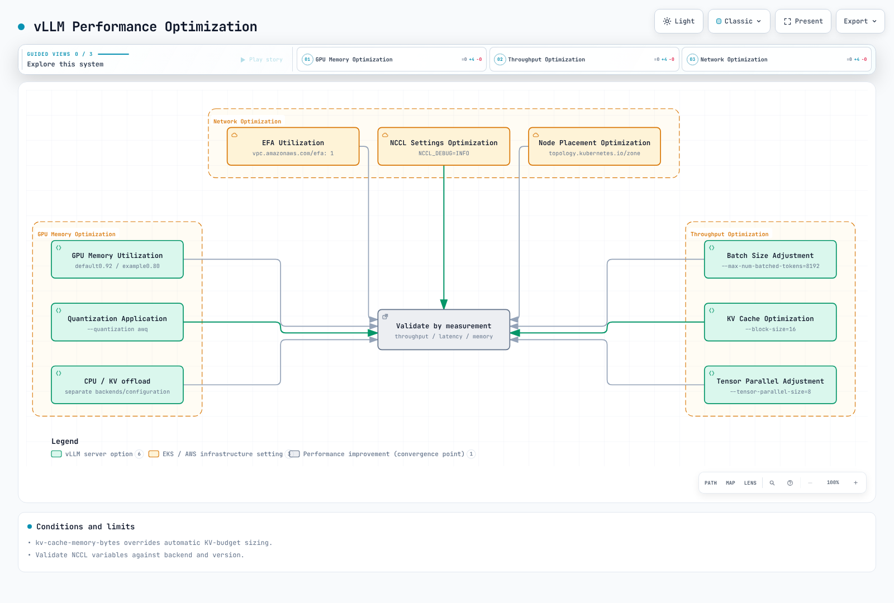
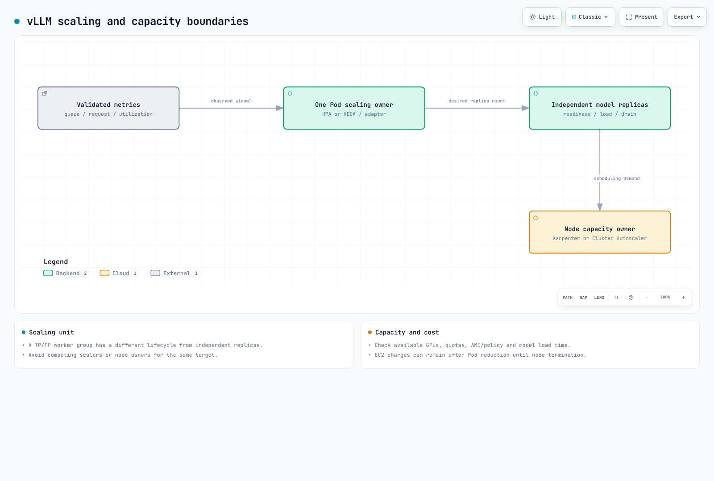

# vLLM デプロイと最適化

> **レビュー基準**: vLLM 0.29.0、CUDA 12.9 イメージバリアント。履歴上の 0.6.4.post1 ベンチマークは分離
> **確認した最新リリース**: vLLM 0.31.0（2026年10月5日）、2026年10月12日に確認
> **最終更新**: October 12, 2026

vLLM は、生成モデルおよびサポート対象のマルチモーダル／プーリングワークロード向けのオープンソース推論エンジンです。「Vector Language Model」と展開してはいけません。この章では、特定リリースと EKS の運用境界を扱い、普遍的な高速化やモデルサポートを保証するものではありません。

## ラボ環境のセットアップ

この章のマニフェストとローカルチェックでは、2026年9月9日にリリースされた [v0.29.0](https://github.com/vllm-project/vllm/releases/tag/v0.29.0) を使用します。後続のリリースは、v0.30.0（2026年9月22日）および [v0.31.0](https://github.com/vllm-project/vllm/releases/tag/v0.31.0)（2026年10月5日）です。

v0.31.0 では:

- リクエスト単位の `mm_processor_kwargs` と `media_io_kwargs` は、デフォルトで拒否されます。明示的な `--trust-request-mm-kwargs` オプションでのみ許可してください。
- `tokenizer_mode="slow"` は削除されました。

この章の 0.29.0 の例は、v0.30.0 または v0.31.0 で再実行されていません。アップグレード前に、[リリース変更](https://github.com/vllm-project/vllm/releases/tag/v0.31.0)と互換性を確認してください。

0.29.0 のデフォルトの PyPI/Docker パスでは CUDA 13.0 が使用され、v0.29.0-cu129 イメージは別途提供されます。一部のタグ付きインストール文書では依然として CUDA 12.9 をデフォルトと呼んでいます。実際のイメージバリアント／digest を確認してください。

PyPI には Python >=3.10、<3.15 が必要ですが、タグ付き GPU ガイドでは 3.10–3.13 が記載されています。これは、すべての Python/PyTorch/CUDA の組み合わせを保証するものではありません。NVIDIA パスには compute capability 7.5 以降が必要であり、V100（7.0）は除外されます。カーネル、dtype、量子化により、追加のデバイス要件が課される場合があります。

[AI/ML workloads](01-ai-ml-workloads.md) の AMI／driver／device-plugin 条件に従ってください。CUDA イメージは、そのまま使える Trainium/Inferentia デプロイではありません。Neuron またはその他のプラットフォームプラグインは個別に検証してください。g5.2xlarge や 50GB を普遍的な最小要件とみなすのではなく、モデル、キャッシュ、並行性に合わせて GPU、RAM、ディスクを選定してください。

## vLLM の概要

vLLM は次の特性を持つ LLM 推論エンジンです:


[🔍 インタラクティブな図を表示](https://www.atomai.click/kubernetes-docs/archmaps/en-ai-ml-02-vllm-deployment-0.html)

### 機能とサポート境界

| 機能 | 意味と条件 |
| --- | --- |
| PagedAttention / KV cache | token block を管理して無駄を削減します。kernel/cache layout は model/backend に依存します |
| Continuous batching | scheduler は各ステップで作業を調整します。即時受付、queueing、固定の高速化は保証されません |
| TP / PP / DP / EP | tensor、pipeline、data、expert の並列化は異なる軸であり、model/backend/network のサポートが必要です |
| Precision / quantization | FP16/BF16 dtype と FP8/INT8/INT4/AWQ format、ならびに weight quantization と KV-cache quantization を区別します |
| Prefix caching / chunked prefill | サポート対象 model のデフォルトと override を確認してください。完全な response caching や精度向上ではありません |
| Structured outputs | response_format または structured_outputs は format を制約します。真実性と業務上の有効性には別途チェックが必要です |
| Tool calling | model/chat template/parser と client の実行ループが必要です。server が自動的に tool を実行するわけではありません |
| LoRA | model のサポートと adapter の登録が必要です。request model の変更だけでは adapter はロードされません |

0.29.0 では Model Runner V2 がデフォルトの runner になります。これは OpenAI 互換 API のバージョンでも、別個の「vLLM Engine V2」でもありません。model-family 名は、すべてのサイズ、量子化、vision バリアントを保証するものではありません。architecture、artifact/tokenizer、chat template、kernel を検証してください。

### 現在の CLI 機能設定

非推奨の python -m vllm.entrypoints.openai.api_server ではなく、vllm serve を使用してください。以前の --speculative-model/--num-speculative-tokens オプションは、現在の CLI では --speculative-config に置き換えられています。

```bash
# Syntax when compatible target/draft models and sufficient memory are prepared.
vllm serve /models/target \
  --speculative-config '{"model":"/models/draft","method":"draft_model","num_speculative_tokens":5}'
```

これは構文を示すものであり、それらのモデルファイルを提供したり高速化を保証したりするものではありません。draft acceptance、追加メモリ、通信コストにより、利得が相殺される場合があります。

起動時の LoRA は --enable-lora --lora-modules adapter=/models/adapter で登録します。runtime のロード／アンロードには、別途 VLLM_ALLOW_RUNTIME_LORA_UPDATING の opt-in と制限された operator パスが必要です。--enable-auto-tool-choice には適切な --tool-call-parser が必要です。マルチモーダル URL にも SSRF 制御、許可ドメイン、download/decode 制限が必要です。

## システム要件

EKS で vLLM をデプロイするためのシステム要件:


[🔍 インタラクティブな図を表示](https://www.atomai.click/kubernetes-docs/archmaps/en-ai-ml-02-vllm-deployment-1.html)

weight memory の見積もりは、parameter count × stored bytes から始めます。70B の FP16/BF16 weight だけで約 140GB になるため、80GB は普遍的な 70B 要件ではありません。量子化 metadata と複製 tensor を考慮して、KV cache、activation、CUDA graph/workspace、通信 buffer を追加してください。

一般的な dense-attention の KV 見積もりを以下に示します。MHA 専用の式から hidden size を代入するのではなく、GQA/MQA には KV-head count を使用してください。

```text
KV bytes ≈ 2 × layers × KV_heads × head_dim × cached_tokens × bytes_per_element
```

cached_tokens は、並行 request 全体で保持される token を合計したものです。TP の sharding／replication、sliding window、MLA、hybrid architecture は別途扱う必要があります。現在の Qwen2.5-7B config は 28 layers、4 KV heads、head dimension 128 です。element あたり 2 bytes とすると約 56KiB/token、4096-token sequence 1本では 224MiB です。これは集計的な見積もりであり、実測の GPU あたりまたはモデル全体の memory ではありません。

p4d.24xlarge は 40GB A100 を使用します。80GB A100 の p4de instance と区別してください。p5/g6/g6e やその他の選択肢は、region の capacity、driver、workload 要件と照らし合わせて比較してください。GPU あたり CPU core を 4 個、または RAM を weight の 2 倍とする固定ルールは、測定の代わりにはなりません。

## EKS Infrastructure Configuration


[🔍 インタラクティブな図を表示](https://www.atomai.click/kubernetes-docs/archmaps/en-ai-ml-02-vllm-deployment-2.html)

## Storage と Model の準備

FSx for Lustre は選択肢の一つであり、必須でも普遍的に最適でもありません。ロード時間、コスト、並行性の観点から、local NVMe/EBS、再利用可能な cache、object storage、shared filesystem を比較してください。emptyDir は container restart 後には存続できますが、Pod の削除／再作成後には存続しません。

[静的 FSx PV/PVC と dynamic provisioning](01-ai-ml-workloads.md#storage-and-caching)を区別してください。Hugging Face snapshot_download は S3 ではなく Hugging Face から download します。repository revision、integrity、license、access permission を記録してください。gated model の場合は、token を file として mount し、file を読み取る download stage を使用してください。実行可能な remote code をデフォルトで信頼しないでください。

以下の例では、token を使わずに public Qwen3-0.6B の検証済み revision を使用します。emptyDir cache は Pod の再作成後に再度 download されます。multi-node worker には、同一の model revision/path が必要です。

## vLLM Deployment

### Deployment Architecture

次の図は、EKS で vLLM をデプロイする主な 2 つの architecture を示します:


[🔍 インタラクティブな図を表示](https://www.atomai.click/kubernetes-docs/archmaps/en-ai-ml-02-vllm-deployment-3.html)

### Single-GPU 設定例

これは **GPU 実行前にレビューするための template** です。namespace と GPU driver/plugin を準備してください。digest は v0.29.0-cu129 の amd64 artifact を識別し、model revision は確認済みの public Qwen3-0.6B snapshot を識別します。この audit では image pulling、non-root 実行、kernel compilation、inference は実行しておらず、環境での検証が必要です。

Recreate は追加の GPU replica を必要としませんが、更新時に downtime が発生します。startupProbe は起動に約 15 分を許容します。readiness は SLA ではありません。Service は ClusterIP であり、public ingress は作成しません。

```yaml
apiVersion: apps/v1
kind: Deployment
metadata:
  name: vllm-demo
  namespace: ml-inference
spec:
  replicas: 1
  strategy:
    type: Recreate
  selector:
    matchLabels:
      app: vllm-demo
  template:
    metadata:
      labels:
        app: vllm-demo
    spec:
      automountServiceAccountToken: false
      nodeSelector:
        kubernetes.io/arch: amd64
      securityContext:
        runAsNonRoot: true
        runAsUser: 1000
        runAsGroup: 1000
        fsGroup: 1000
        seccompProfile:
          type: RuntimeDefault
      containers:
        - name: vllm
          image: vllm/vllm-openai@sha256:3e10e8189823e0f7ae4620c271bcdaaf64127ec7d0edc351591a508498b7684a
          command: ["vllm", "serve"]
          args:
            - Qwen/Qwen3-0.6B
            - --revision=c1899de289a04d12100db370d81485cdf75e47ca
            - --served-model-name=qwen3-demo
            - --dtype=float16
            - --max-model-len=2048
            - --max-num-seqs=8
            - --gpu-memory-utilization=0.80
            - --host=0.0.0.0
            - --port=8000
          env:
            - name: HF_HOME
              value: /cache/huggingface
            - name: XDG_CACHE_HOME
              value: /cache
            - name: XDG_CONFIG_HOME
              value: /cache/config
            - name: VLLM_NO_USAGE_STATS
              value: "1"
            - name: VLLM_CACHE_ROOT
              value: /cache/vllm
            - name: TORCHINDUCTOR_CACHE_DIR
              value: /cache/torchinductor
            - name: TRITON_CACHE_DIR
              value: /cache/triton
          ports:
            - name: http
              containerPort: 8000
          resources:
            requests:
              cpu: "2"
              memory: 4Gi
              ephemeral-storage: 4Gi
            limits:
              cpu: "4"
              memory: 12Gi
              ephemeral-storage: 12Gi
              nvidia.com/gpu: 1
          securityContext:
            allowPrivilegeEscalation: false
            readOnlyRootFilesystem: true
            capabilities:
              drop: [ALL]
          startupProbe:
            httpGet:
              path: /health
              port: http
            periodSeconds: 10
            failureThreshold: 90
          readinessProbe:
            httpGet:
              path: /health
              port: http
            periodSeconds: 10
          volumeMounts:
            - name: cache
              mountPath: /cache
            - name: tmp
              mountPath: /tmp
            - name: shm
              mountPath: /dev/shm
      volumes:
        - name: cache
          emptyDir:
            sizeLimit: 8Gi
        - name: tmp
          emptyDir:
            sizeLimit: 1Gi
        - name: shm
          emptyDir:
            medium: Memory
            sizeLimit: 2Gi
---
apiVersion: v1
kind: Service
metadata:
  name: vllm-demo
  namespace: ml-inference
  labels:
    app: vllm-demo
spec:
  type: ClusterIP
  selector:
    app: vllm-demo
  ports:
    - name: http
      port: 8000
      targetPort: http
```

### Multi-Node Sharding と Independent Replica の比較

1つの model replica を sharding するには、TP/PP と Ray または multiprocessing の coordination が必要です。独立した API-server replica はそれぞれ model をロードして horizontal scaling を提供します。これらは異なる設計です。

0.29.0 は multiprocessing の --nnodes、--node-rank、--master-addr、--master-port をサポートします。古い --rank、--tensor-parallel-rank、--distributed-init-method の例は、これらの CLI option ではありません。それぞれ 8 GPU を提供する準備済みの 2 node では、command の形式は次のとおりです:

```bash
# node0: substitute an actual trusted head IP and identical prepared model path.
vllm serve /models/model --distributed-executor-backend mp \
  --tensor-parallel-size 8 --pipeline-parallel-size 2 \
  --nnodes 2 --node-rank 0 --master-addr 10.0.0.10 --master-port 29500
# node1: the worker does not start a duplicate API server.
vllm serve /models/model --distributed-executor-backend mp \
  --tensor-parallel-size 8 --pipeline-parallel-size 2 \
  --nnodes 2 --node-rank 1 --master-addr 10.0.0.10 --master-port 29500 --headless
```

これらの command は node、model file、connectivity を作成しません。Kubernetes には、適切な同時 worker 作成、readiness 前の DNS、Pod ごとの VLLM_HOST_IP、internal connectivity、shared memory が必要です。Ray では、--distributed-executor-backend ray を使用して API entry point を 1 つ起動する前に、機能する cluster と互換性のある Ray dependency が必要です。[Ray](ray/README.md) を参照してください。internal communication port は private に保ってください。

## Performance Optimization



[🔍 インタラクティブな図を表示](https://www.atomai.click/kubernetes-docs/archmaps/en-ai-ml-02-vllm-deployment-4.html)

### Memory、Scheduler、Communication のオプション

0.29.0 の CacheConfig は gpu_memory_utilization のデフォルトを 0.92 としています。これは process VRAM 全体の hard cap ではありません。例では明示的に 0.80 を選択しています。--kv-cache-memory-bytes は自動 KV-cache sizing を override するため、option の優先順位を確認してください。

--swap-space は現在の CLI にはありません。weight CPU offload と KV offload は別々の capability/configuration であり、host RAM が GPU 制限を解決する保証ではありません。prefix caching はサポート対象 model でデフォルトで有効になる場合があります。chunked prefill も model に依存します。queue limit、token budget、max-num-seqs、max-model-len は異なる制御です。

EFA には、サポート対象の EC2 device、AMI/plugin/network、AWS OFI NCCL/libfabric が必要です。架空の NCCL_IB_ENABLE_RDMA flag や任意の mlx5/GID 設定を、普遍的なデフォルトとしてコピーしないでください。現在の NVIDIA/PyTorch variable と実際の backend log を確認してください。single-node NCCL test は multi-node EFA performance を証明しません。

## 履歴上の測定: Single L4 GPU 上の Qwen2.5-7B

これは、[2026年9月4日の repository commit](https://github.com/Atom-oh/kubernetes-docs/commit/8622d388cb684dc4f68083af7be6d91f80b79106) で報告された履歴上の測定です。この audit では raw request result/server log または完全な client artifact は見つからず、experiment を再実行していません。報告された数値は保存されており、現在の 0.29.0 performance や独立して再現された結果として再分類していません。


[🔍 インタラクティブな図を表示](https://www.atomai.click/kubernetes-docs/archmaps/en-ai-ml-02-vllm-deployment-6.html)

### セットアップ

- **Cluster**: 専用 Karpenter NodePool（`bench-gpu`、on-demand `g6.2xlarge` — 1x NVIDIA L4、24GB GPU memory、8 vCPU、32 GiB RAM）。`nvidia.com/gpu=true:NoSchedule` の taint を付与し、既存の `nvidia-device-plugin` daemonset に参加する label を設定しました。実行直後に削除されています。
- **Server**: `vllm/vllm-openai:v0.6.4.post1`（2024-11-15 リリース — vLLM project はその後、prefix caching がデフォルトで有効な V1 engine をリリースしているため、現在の vLLM ではなくその release line の snapshot として扱ってください）、model `Qwen/Qwen2.5-7B-Instruct`、`--dtype bfloat16 --max-model-len 4096 --gpu-memory-utilization 0.90`。量子化、speculative decoding、prefix caching を使用しない 1 つの precision（bf16、model の native dtype）で、このページが他の場所で説明する素のデフォルトです。
- **Client**: cluster **内**（別の non-GPU node）で Job として実行された Python `ThreadPoolExecutor`。`vllm-server` ClusterIP Service を介して `/v1/chat/completions` にアクセスしました。non-streaming、`temperature=0`、`max_tokens=128`、8 個のローテーションする短い prompt（1～2文での回答を求める Kubernetes concept の質問）。実際には、すべての response は 1～2文で停止するのではなく 128-token cap 近くで実行されました（3つすべての concurrent batch で一貫した平均約 102-token）。concurrency level 間の throughput を同条件で比較するうえでは有用ですが、latency 数値を「短い質問への回答時間」として読む前に知っておくべき点です。
- **Cold start**: vLLM engine の startup log から `/health` endpoint が `200` を返すまで約 4.5 分でした。Pod の ephemeral cache に Hugging Face から約 15 GB の Qwen2.5-7B-Instruct weight を download することが支配的でした。image pull time は含まれておらず、個別には測定されていません。

### 再現

```yaml
# NodePool (Karpenter) - dedicated, deleted after the run — nodeClassRef points at the cluster's existing GPU EC2NodeClass (AMI/subnets/SG), not shown here
apiVersion: karpenter.sh/v1
kind: NodePool
metadata: { name: bench-gpu }
spec:
  limits: { cpu: "16", memory: 128Gi, nvidia.com/gpu: "1" }
  template:
    metadata:
      labels: { node-type: bench-gpu, nvidia.com/device-plugin.config: default }
    spec:
      expireAfter: 6h
      nodeClassRef: { group: karpenter.k8s.aws, kind: EC2NodeClass, name: gpu }
      requirements:
        - { key: node.kubernetes.io/instance-type, operator: In, values: [g6.2xlarge] }
      taints: [{ key: nvidia.com/gpu, value: "true", effect: NoSchedule }]
---
# vLLM server (namespace bench-gpu) + the ClusterIP Service the client calls
apiVersion: apps/v1
kind: Deployment
metadata: { name: vllm-server, namespace: bench-gpu }
spec:
  replicas: 1
  selector: { matchLabels: { app: vllm-server } }
  template:
    metadata: { labels: { app: vllm-server } }
    spec:
      nodeSelector: { node-type: bench-gpu }
      tolerations: [{ key: nvidia.com/gpu, value: "true", effect: NoSchedule }]
      containers:
        - name: vllm
          image: vllm/vllm-openai:v0.6.4.post1
          args: ["--model", "Qwen/Qwen2.5-7B-Instruct", "--max-model-len", "4096",
                 "--gpu-memory-utilization", "0.90", "--dtype", "bfloat16"]
          ports: [{ containerPort: 8000 }]
          resources:
            limits: { nvidia.com/gpu: "1" }
            requests: { nvidia.com/gpu: "1", cpu: "3", memory: 20Gi }
          readinessProbe: { httpGet: { path: /health, port: 8000 }, initialDelaySeconds: 30, periodSeconds: 10, failureThreshold: 60 }
---
apiVersion: v1
kind: Service
metadata: { name: vllm-server, namespace: bench-gpu }
spec:
  selector: { app: vllm-server }
  ports: [{ port: 8000, targetPort: 8000 }]
```

これらの manifest は、報告された環境の一部を示しています。namespace 作成、既存の EC2NodeClass、完全な client script を省略しているため、完全な再現を保証するものではありません。nvidia.com/device-plugin.config:default は、その共有 DaemonSet configuration の条件であり、普遍的な scheduling label 要件ではありません。報告された on-demand の主張にも、実際の履歴上の configuration が必要です。

### 結果

| Concurrency | Request | Wall time | Client latency p50 / p90 | Client aggregate throughput | Server 報告の peak generation throughput | GPU KV cache 使用率 |
|---|---|---|---|---|---|---|
| 1（serial） | 10 | ~53.2 s（request latency の合計） | 5.65 s / 7.43 s | request あたり約 17-18 tokens/s | 約 17 tokens/s | 0.1-0.2% |
| 4 | 16 | 27.78 s | 6.99 s / 7.88 s | 58.67 tokens/s | 65-66 tokens/s | 0.4-0.7% |
| 8 | 32 | 30.02 s | 7.18 s / 8.15 s | 109.04 tokens/s | 123-129 tokens/s | 0.8-1.4% |
| 16 | 64 | 31.35 s | 7.52 s / 8.74 s | 208.08 tokens/s | 最大 243 tokens/s | 1.5-2.6% |

Client aggregate throughput は、completion-token count を測定済み wall time で割ったものです。Server Avg generation throughput は interval average であり、最大の log 値は瞬間的な「真の peak」ではありません。time window、token accounting、HTTP boundary が異なるため、直接交換可能な metric ではありません。

### 解釈

報告された p50 は 5.65s から 7.52s に増加し、約 33.1% です。concurrency 4→8→16 の aggregate throughput は 58.67→109.04→208.08tokens/s でした。この batching の観測と、根本的な bottleneck の因果的証明を区別してください。

約 300GB/s の bandwidth を 15.2GB の weight で割ると、理想化した roofline は約 20 tokens/s になります。この audit には bandwidth または FLOP execution を直接測定する profiler evidence がないため、「間違いなく memory-bound」や「追加 request はほぼ無料」を立証するものではありません。KV-cache occupancy と total VRAM use は異なる量です。

### 注意事項

これは 1 つの model、1 つの precision（bf16）、1 つの GPU type、1 つの context length における単一実行（n=1）です。一般的な vLLM/L4 performance の主張ではなく、較正された 1 つの data point として扱ってください。client は cluster 内（別の non-GPU node）で実行されたため、network latency は external caller ではなく intra-cluster hop を反映します。ここでの latency は、time-to-first-token（TTFT）ではなく完全な end-to-end HTTP response time です。streaming はテストされていません。prefix caching、speculative decoding、FP8、multi-GPU tensor parallelism（いずれもこのページの前半で説明）は実施されていません。完全な再現には欠落している execution artifact と環境詳細が必要です。これらの数値を異なる model size、GPU、prompt length に外挿しないでください。

## Monitoring と Logging


[🔍 インタラクティブな図を表示](https://www.atomai.click/kubernetes-docs/archmaps/en-ai-ml-02-vllm-deployment-5.html)

### Metrics と Logs

デフォルトの /metrics endpoint は API の port 8000 を使用します。別の 8001 port や --enable-metrics=true を作り出さないでください。ServiceMonitor では Service label、named port、namespace selection を一致させてください。

```promql
# End-to-end p95 by model
histogram_quantile(0.95, sum by (le, model_name) (rate(vllm:e2e_request_latency_seconds_bucket[5m])))
# Generation-token throughput
sum by (model_name) (rate(vllm:generation_tokens_total[5m]))
# Queued requests
sum by (model_name) (vllm:num_requests_waiting)
```

vllm:kv_cache_usage_perc は、1 が 100% を意味する ratio であり、total GPU-memory bytes ではありません。gateway error/cancellation を success counter とともに観測し、healthy で idle な期間を low-throughput outage と呼ばないでください。実際の endpoint 名／label を検証してください。CRI framing と application log を区別し、無差別な prompt/output/token logging を避けてください。

## Autoscaling



[🔍 インタラクティブな図を表示](https://www.atomai.click/kubernetes-docs/archmaps/en-ai-ml-02-vllm-deployment-10.html)

### Autoscaling と Availability

HPA/KEDA で independent replica を scale することは、sharded model の worker group を scale することとは異なります。StatefulSet replica を増やしても、TP/PP は自動的に再設定されません。adapter request/queue signal を検証し、CPU request を設定せずに CPU-utilization HPA を使用しないでください。同じ capacity に対する Karpenter/Cluster Autoscaler の競合する ownership を避けてください。

PDB は一部の voluntary eviction を制約しますが、すべての failure を防ぐものではありません。independent replica は AZ をまたいで配置できます。communication-heavy な TP/PP group を AZ 間に配置することには、別途 latency/cost の影響があります。interruption-free update を主張する前に、model loading、warmup、draining、in-flight stream、spare GPU を検証してください。

## Security Configuration

--api-key はすべての endpoint を保護するわけではありません。この version の middleware は /v1、/v2、/inference、/cohere prefix を保護します。/invocations、/metrics、および一部の operational endpoint には追加の保護が必要です。認証済み gateway では、必要な path/method だけを許可してください。distributed communication は trusted network に制限してください。CORS は authentication ではありません。

runtime LoRA、remote model code、マルチモーダル URL はそれぞれ、trust/permission/SSRF の境界を導入します。「ignore instructions」を regex で block しても、すべての prompt injection を防止したり、PII の削除を保証したりすることはできません。model output とは独立して tool/data permission を強制してください。

secret は file として提供し、Pod/container securityContext field を正しく配置してください。NetworkPolicy selector、DNS、scrape direction、internal traffic を実際の configuration と一致させてください。Pod annotation で API-server auditing を有効にすることはできません。Secret の RequestResponse body を log に記録しないでください。EKS control-plane audit と application access log は別物です。

## Client Integration


[🔍 インタラクティブな図を表示](https://www.atomai.click/kubernetes-docs/archmaps/en-ai-ml-02-vllm-deployment-7.html)

### Client Request

デプロイ／readiness の検証後、認可された developer は kubectl port-forward -n ml-inference service/vllm-demo 8000:8000 を使用できます。デフォルトの localhost binding を維持してください。この local example は production gateway authentication の代替ではありません。

```python
import json
import urllib.request

payload = {
    "model": "qwen3-demo",
    "messages": [{"role": "user", "content": "Explain a Kubernetes Pod briefly."}],
    "max_tokens": 64,
    "temperature": 0,
    "chat_template_kwargs": {"enable_thinking": False},
}
request = urllib.request.Request(
    "http://127.0.0.1:8000/v1/chat/completions",
    data=json.dumps(payload).encode(),
    headers={"Content-Type": "application/json"},
    method="POST",
)
with urllib.request.urlopen(request, timeout=60) as response:
    result = json.load(response)
print(result["choices"][0]["message"]["content"])
```

request model は served-model-name または /v1/models と一致する必要があります。production client には、file-based gateway credential と timeout/error/stream handling が必要です。JSON body の model field は HTTP model header ではないため、header routing が自動的にそれを検査することはありません。

## 検証範囲

固定された source について、CLI argument、metric、authentication、artifact metadata を確認しました。Kubernetes schema/local HTTP fixture は、実際の vLLM parser/kernel/GPU 実行を検証しません。この audit では model weight の download、GPU server/cloud resource の作成は行っていません。

## 参考資料

- [vLLM 0.29.0 release（レビュー基準）](https://github.com/vllm-project/vllm/releases/tag/v0.29.0)
- [vLLM 0.31.0 release（確認した最新）](https://github.com/vllm-project/vllm/releases/tag/v0.31.0)
- [Parallelism と scaling](https://github.com/vllm-project/vllm/blob/v0.29.0/docs/serving/parallelism_scaling.md)
- [Security boundary](https://github.com/vllm-project/vllm/blob/v0.29.0/docs/usage/security.md)
- [Production metrics](https://github.com/vllm-project/vllm/blob/v0.29.0/docs/usage/metrics.md)
- [Structured outputs](https://github.com/vllm-project/vllm/blob/v0.29.0/docs/features/structured_outputs.md)
- [LoRA adapter](https://github.com/vllm-project/vllm/blob/v0.29.0/docs/features/lora.md)

## クイズ

この章で学んだ内容を確認するには、[トピッククイズ](../quizzes/ai-ml/04-vllm-deployment-quiz.md)に挑戦してください。
