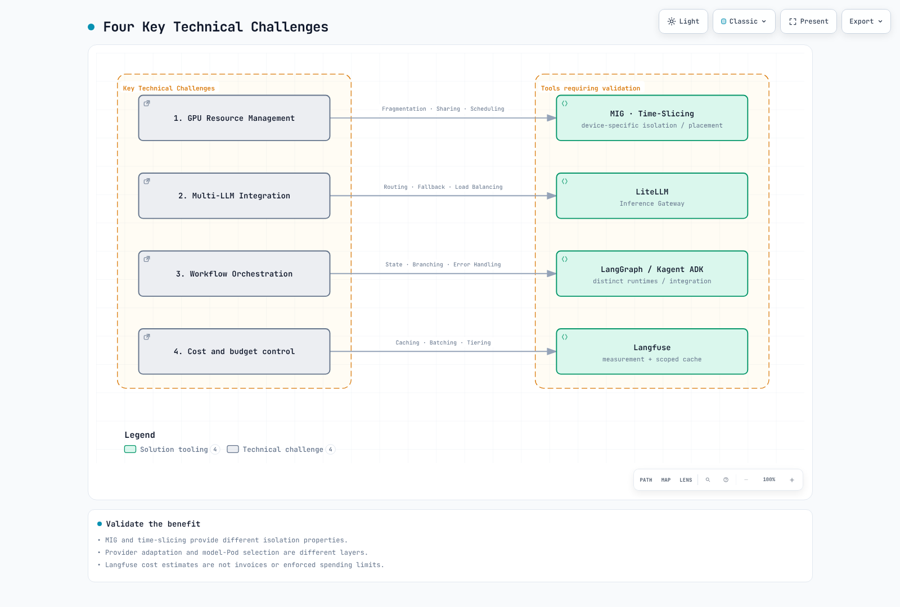
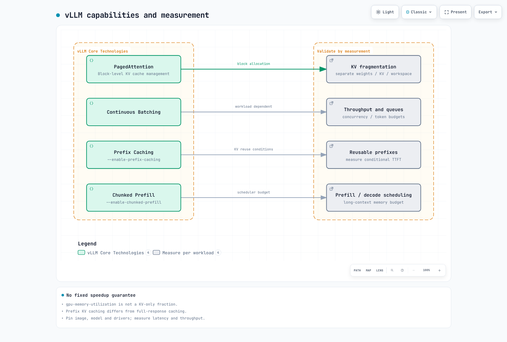
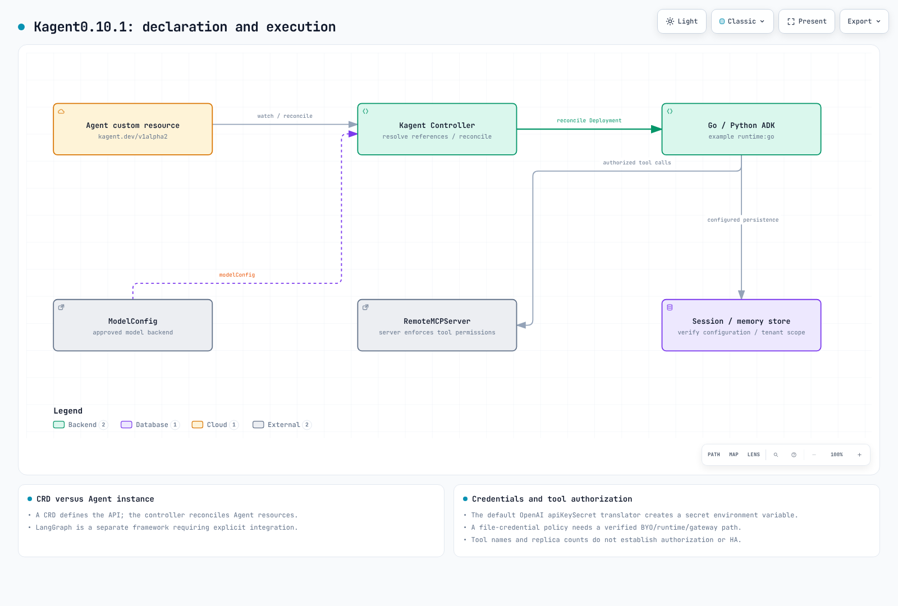

# EKS 上で Agentic AI プラットフォームを構築する

> **レビュー基準**: Kagent 0.10.1 / Gateway Inference Extension 1.6.1 / LangGraph 1.2.11 / Langfuse SDK 4.15.2
> **最終更新**: 2026年10月16日

Agentic AI は単純な質問応答にとどまらず、自律的に計画を立て、ツールを使い、反復しながら目標を達成します。この章では、EKS 上に Agentic AI プラットフォームを設計する方法と、その運用上の境界を説明します。

## 1. Agentic AI プラットフォームの概要

### Agentic AI とは

Agentic AI は、次の特性を持つ自律型 AI システムです。


[🔍 インタラクティブな図を表示](https://www.atomai.click/kubernetes-docs/archmaps/en-ai-ml-03-agentic-ai-platform-0.html)

1. **自律的な計画**: 複雑なタスクをサブタスクに分解し、実行順序を決定します。
2. **ツールベースの実行**: 外部 API、データベース、コード実行ツールなど、さまざまなツールを活用します。
3. **反復的な改善**: 実行結果を評価し、必要に応じて計画を修正します。
4. **状態管理**: 長時間実行されるタスクの状態とメモリを維持します。

### Kubernetes を選ぶ場面

Kubernetes は、Agentic AI プラットフォームに次の基本機能を提供します。

| 要件 | Kubernetes ソリューション |
|-------------|---------------------|
| GPU オーケストレーション | Device Plugin、GPU Operator、MIG |
| 自動スケーリング | HPA、VPA、Karpenter |
| マルチテナント分離 | RBAC、Namespace、NetworkPolicy の強制適用、ワークロードアイデンティティ |
| 高可用性 | レプリカ、プローブ、配置と復旧のテスト |
| サービスメッシュ | 設定済みのゲートウェイ/メッシュ実装 |
| コスト最適化 | Spot インスタンス、ノード集約 |

### 4 つの主要な技術課題

Agentic AI プラットフォームの構築では、次の技術課題に対処する必要があります。



[🔍 インタラクティブな図を表示](https://www.atomai.click/kubernetes-docs/archmaps/en-ai-ml-03-agentic-ai-platform-1.html)

---

## 2. GPU とコストの基準

外部モデル API を使うエージェントに GPU が必要とは限りません。推論をセルフホストする場合は、モデルの重みと精度、KV キャッシュ、同時実行数、CPU アーキテクチャ、ドライバーとの互換性を踏まえてデバイスを選びます。[確認済みの GPU ガイド](01-ai-ml-workloads.md)を参照し、AL2023 の NVIDIA AMI にドライバーやツールキットを重複してインストールしないでください。

MIG は対応 GPU を複数のインスタンスに分割します。1 つの MIG インスタンス内で time-slicing を行っても、同じインスタンスを共有するワークロード間にメモリ分離や障害分離は追加されません。ソフトウェア上のセキュリティ境界にもなりません。同様に、80 GB の GPU に 70B パラメーターの FP16 重みが一般に収まるわけではありません。

GPU Operator の Helm 値は ConfigMap や HelmRelease リソースとは形式が異なります。Flux の HelmRelease を `helm --values` に渡しても、意図した設定は適用されません。MIG Manager の ConfigMap 参照、プロファイル用ノードラベル、プラグインの方式を一致させてください。`device-plugin.config` のラベルが選ぶのは ConfigMap 名ではなく設定キーです。MIG の再構成はワークロードを中断させる可能性があるため、この監査では実行していません。

価格を比較するには、リージョン、OS、購入方式、日付、クォータを揃える必要があります。以前掲載されていた出典のない時間単価表や固定の節約率は、現在の価格を裏付けるものではありません。セルフホスト時の GPU のアイドル時間、ストレージと転送、運用、復旧の総コストを、実測した正常処理スループットと比較してください。

## 3. モデルサービング（vLLM）

### vLLM のアーキテクチャ

vLLM は、次の主要技術によって LLM の高性能な推論を実現します。



[🔍 インタラクティブな図を表示](https://www.atomai.click/kubernetes-docs/archmaps/en-ai-ml-03-agentic-ai-platform-2.html)

### 確認済みの推論構成

イメージとモデルの 0.29.0 向けリビジョン、起動プローブ、内部 Service、実際の CLI オプションについては、[最新の vLLM ガイド](02-vllm-deployment.md)を参照してください。単一 GPU の NodePool には、以前の 4 GPU・200 Gi の Pod を配置できません。Tensor Parallelism（TP）/Pipeline Parallelism（PP）のグループと独立したレプリカを区別し、必要なメモリを計算してください。

プレフィックスキャッシュが再利用するのは、対応する KV プレフィックスであり、応答全体ではありません。GPU メモリ使用率は KV キャッシュだけで決まるわけではなく、現在の CLI に `swap-space` オプションはありません。llm-d の分離構成は、role 引数を渡す架空の prefill/decode イメージを 2 つ用意すればよいものではありません。実際のリリースで使うモデルサーバー、KV コネクター、スケジューラー、ゲートウェイ、ハードウェアとネットワークの組み合わせを検証してください。

## 4. 推論ゲートウェイ

### Gateway API による AI ワークロードのルーティング

Kubernetes Gateway API を拡張し、AI 推論ワークロードを効率的にルーティングします。

### Kgateway + InferencePool アーキテクチャ


[🔍 インタラクティブな図を表示](https://www.atomai.click/kubernetes-docs/archmaps/en-ai-ml-03-agentic-ai-platform-3.html)

#### InferencePool v1

Gateway API と Gateway API Inference Extension は別の API です。Extension 1.6.1 の InferencePool は、`targetPorts` と `endpointPickerRef` を持つ `inference.networking.k8s.io/v1` を使います。以前の例にあった架空の EndpointPicker CRD/`endpointPickerConfig` は、このスキーマではありません。

このスキーマを確認した例を動かすには、ポート 9002 の EPP Service、モデル Pod、対応するゲートウェイコントローラーが必要です。InferencePool だけでは認証、レート制限、プレフィックスを考慮した選択アルゴリズムは設定されません。

```yaml
apiVersion: inference.networking.k8s.io/v1
kind: InferencePool
metadata:
  name: model-pool
  namespace: ai-inference
spec:
  selector:
    matchLabels:
      app: vllm-demo
  targetPorts:
    - number: 8000
  endpointPickerRef:
    name: model-epp
    kind: Service
    group: ""
    port:
      number: 9002
    failureMode: FailClose
```

セレクターが一致するのは同じ Namespace 内の Pod だけです。EndpointPickerRef はデフォルトで Service 参照となり、失敗時の動作は FailClose です。HTTPRoute、EPP の設定とバージョン対応、TLS、ゲートウェイの状態をまとめて検証してください。API 定義や Kgateway のインストールだけで、すべてのプラグイン機能が有効になるわけではありません。

### LiteLLM 1.100.1 によるプロバイダーゲートウェイ

LiteLLM によるプロバイダーごとの API 変換と、InferencePool によるエンドポイント選択は別の層です。プロバイダー API ではパス、認証、ペイロード、応答、ストリーミングの仕様が異なります。OpenAI の JSON をそのまま Anthropic のエンドポイントへ転送しても、正しいアダプターにはなりません。

以下は現在の Router のフォールバック設定例です。プロキシの command/args を実際の設定ファイルにつなぎ、必要に応じて Redis/データベース、認証情報、コールバックを別途指定してください。

```yaml
model_list:
  - model_name: local-primary
    litellm_params:
      model: openai/qwen3-demo
      api_base: http://vllm-demo.ml-inference:8000/v1
  - model_name: local-fallback
    litellm_params:
      model: openai/qwen3-demo
      api_base: http://vllm-secondary.ml-inference:8000/v1
router_settings:
  fallbacks:
    - local-primary: [local-fallback]
  num_retries: 0
```

この例は設定の形を示すもので、エンドポイントと認証は事前に準備する必要があります。アプリケーションクライアントには master key ではなく、用途を限定した認証情報を渡してください。外部モデルへのフォールバックはデータの外部送信経路になります。ルーティング前にテナントごとのプロバイダー/データポリシーを強制し、モデル名やクライアントヘッダーでその制御を回避できないようにしてください。


## 5. RAG データと検索の境界

確認した最新の Milvus リリースは 3.0.3（2026年10月14日）です。別途確認した Operator 1.3.9 のデフォルトは Milvus 2.6.11 です。両者は同じバージョンではありません。また、幅広い互換性一覧があっても、3.x へのアップグレードをテスト済みとは言えません。operator のリポジトリは https://zilliztech.github.io/milvus-operator/ で、通常の Milvus chart リポジトリとは別です。

ベクトルの次元数は、実際の埋め込み出力と一致させます。データ取り込みと検索の双方について、リビジョン、次元設定、トークナイザー、正規化方式、距離尺度を記録してください。インデックスごとにパラメーターは異なるため、HNSW の M や efConstruction を GPU_IVF_FLAT にそのまま流用できません。GPU インデックスには、互換性のあるイメージ、バージョン、デバイス、コンポーネントの役割が必要です。indexNode に GPU を要求しても、自動的に GPU 処理されるわけではありません。

`tenant_id` フィールドだけではテナント分離を強制できません。認証済みのアイデンティティから検索範囲を決め、サーバー側の検索フィルターを適用し、返却された文書を検証してください。文書の削除や変更、埋め込みバージョンのライフサイクルも管理してください。

### チャンク分割とハイブリッド検索

現在の分割器は `langchain_text_splitters` からインポートします。`RecursiveCharacterTextSplitter` の `chunk_size` の既定値はトークン数ではなく文字数です。トークン単位で分割する場合は、埋め込みモデルのトークナイザーと実際の入力上限に合わせてください。意味ベースの分割は埋め込み呼び出しとコストを増やしますが、品質向上を保証するものではありません。

ハイブリッド検索では検索を 2 回実行するだけでなく、RRF や較正済みスコアなどで結果を融合します。どちらの検索にも同じ認可フィルターを適用し、再現率、適合率、レイテンシを評価してください。再試行回数に上限を設け、上限に達した後も常に回答を生成するのではなく、根拠がなければ棄権してください。


## 6. AI エージェントのデプロイ（Kagent）

### Kagent の概要

Kagent は Kubernetes ネイティブの AI エージェント・ライフサイクル管理ツールです。



[🔍 インタラクティブな図を表示](https://www.atomai.click/kubernetes-docs/archmaps/en-ai-ml-03-agentic-ai-platform-4.html)

### Kagent 0.10.1 の Agent API

Kagent は kubectl を自動実行するだけのツールではありません。宣言型エージェントは Go/Python の ADK ランタイムを使い、BYO モードでは利用者が用意した A2A エージェントをホストします。LangGraph は別途統合するワークフローフレームワークであり、Kagent と同じランタイムではありません。

この Agent は、別途承認・設定した同じ Namespace 内の ModelConfig と RemoteMCPServer リソースを参照します。実際の MCP サービスと `search_documents` ツール、認証、TLS、データへのアクセス権を用意してください。この定義だけでツールが作成されたり、Kubernetes への書き込み権限が付与されたりするわけではありません。

```yaml
apiVersion: kagent.dev/v1alpha2
kind: Agent
metadata:
  name: research-agent
  namespace: ai-agents
spec:
  type: Declarative
  description: Retrieves authorized documents and cites their sources
  declarative:
    runtime: go
    modelConfig: approved-internal-model
    systemMessage: 'Use approved document tools. Cite retrieved sources.

      If evidence is missing, say so. Do not execute arbitrary code.

      '
    tools:
    - type: McpServer
      mcpServer:
        apiGroup: kagent.dev
        kind: RemoteMCPServer
        name: document-tools
        toolNames:
        - search_documents
    deployment:
      replicas: 1
      resources:
        requests:
          cpu: 250m
          memory: 256Mi
        limits:
          cpu: '1'
          memory: 1Gi
```

`ModelConfig.apiKeySecret` を指定しても、認証情報がファイルとして渡されるとは限りません。確認した OpenAI translator は、`OPENAI_API_KEY` を参照する SecretKeyRef 環境変数を作成します。Secret を環境変数に渡さないポリシーでは、検証済みのファイル認証情報に対応する BYO/ランタイムか、認証ゲートウェイを使用してください。トークン委譲と audience の設計なしに `apiKeyPassthrough` を有効化しても代替策にはなりません。

`eval()` を使う計算ツールや、実在しない権限フィールドはセキュリティ境界になりません。実際のツールサーバーに最小権限、入力検証、リソース上限、承認、冪等性を実装してください。Agent のレプリカを増やしても、共有メモリーやセッションストアが自動的に高可用になるわけではありません。

### 実行可能な LangGraph の制御フロー

このローカル例では、検索・クエリ書き換え・生成のコールバックを明示した実際の SDK を使います。デモから LLM やベクトルデータベースは呼び出しません。元の質問を保持し、書き換えは最大 2 回に制限し、文書が得られなければ回答を控えます。SQLite のコンテキストマネージャーを正しく使い、保存した状態を再オープン後に確認しています。

```python
from typing import Callable, TypedDict
from langgraph.graph import StateGraph, START, END
from langgraph.checkpoint.sqlite import SqliteSaver


class QAState(TypedDict):
    question: str
    search_query: str
    documents: list[str]
    answer: str
    retries: int


def build_graph(retrieve: Callable[[str], list[str]],
                rewrite: Callable[[str], str],
                generate: Callable[[str, list[str]], str]):
    def search(state: QAState):
        return {"documents": retrieve(state["search_query"])}

    def route(state: QAState):
        if state["documents"]:
            return "answer"
        return "rewrite" if state["retries"] < 2 else "abstain"

    def rewrite_query(state: QAState):
        return {"search_query": rewrite(state["search_query"]),
                "retries": state["retries"] + 1}

    def answer(state: QAState):
        return {"answer": generate(state["question"], state["documents"])}

    def abstain(state: QAState):
        return {"answer": "No supporting documents were found."}

    graph = StateGraph(QAState)
    graph.add_node("retrieve", search)
    graph.add_node("rewrite", rewrite_query)
    graph.add_node("answer", answer)
    graph.add_node("abstain", abstain)
    graph.add_edge(START, "retrieve")
    graph.add_conditional_edges("retrieve", route,
                               {"answer": "answer", "rewrite": "rewrite", "abstain": "abstain"})
    graph.add_edge("rewrite", "retrieve")
    graph.add_edge("answer", END)
    graph.add_edge("abstain", END)
    return graph


if __name__ == "__main__":
    # Deterministic local fixtures, not a vector database or LLM quality test.
    graph = build_graph(
        retrieve=lambda query: ["A Pod groups containers."] if query == "pod" else [],
        rewrite=lambda query: "pod",
        generate=lambda question, documents: documents[0],
    )
    initial = {"question": "What is a Pod?", "search_query": "unknown",
               "documents": [], "answer": "", "retries": 0}
    # Server-derived authorized tenant/session identity is required in a real app.
    config = {"configurable": {"thread_id": "tenant-a/session-1"}, "recursion_limit": 12}
    with SqliteSaver.from_conn_string("agent-state.sqlite") as saver:
        app = graph.compile(checkpointer=saver)
        print(app.invoke(initial, config)["answer"])
        print(app.get_state(config).values["retries"])
```

本番環境では `thread_id` を認証済みのテナント/セッション ID に結び付け、DB の認可、暗号化、同時実行制御、保持期間を設計してください。`:memory:` の内容はプロセス終了後に残りません。SqliteSaver は PostgreSQL の DSN を受け付けないため、対応する Postgres saver を使用してください。`get_state_history()` を読むだけでは実行状態を復元できません。checkpoint の設定と、実際の再開・再実行の仕様を使ってください。

supervisor の出力を許可された enum と照合し、未知の値や予算超過を処理してください。`COMPLETE` という部分文字列の検査で `INCOMPLETE` を成功と判定してはなりません。モデルにツールの使用を指示しても、それだけでツールが実行・検証されるわけではありません。

## 7. Langfuse による運用可観測性

Langfuse SDK 4.15.2 では、旧式の `trace()`/`generation()` API に代わり、`start_as_current_observation()`、`create_score()` などを使います。この監査ではインメモリー exporter を使用し、1 つの trace 内の検索・生成・親 span の計 3 つを確認しました。実際のサーバーへの取り込み、保存、認証は検証していません。

```python
from pathlib import Path
from langfuse import Langfuse

# Read existing Secret-volume files; do not put credentials in source.
client = Langfuse(
    public_key=Path("/run/secrets/langfuse/public-key").read_text().strip(),
    secret_key=Path("/run/secrets/langfuse/secret-key").read_text().strip(),
    base_url="https://langfuse.example.internal",
)
with client.start_as_current_observation(name="rag", as_type="span"):
    with client.start_as_current_observation(name="retrieve", as_type="span") as span:
        span.update(metadata={"document_count": 2})
    with client.start_as_current_observation(name="generate", as_type="generation",
                                           model="prepared-model-alias") as generation:
        # Supply actual provider usage; these values only illustrate the shape.
        generation.update(usage_details={"input": 10, "output": 5})
client.flush()
client.shutdown()
```

Langfuse chart 2.1.0 が参照するアプリは 4.24.0 で、確認済みの最新サーバー 4.60.0（2026年10月15日）とはバージョンが異なります。Web/worker、PostgreSQL、Redis/Valkey、オブジェクトストレージ、ClickHouse が必要です。chart は ClickHouse Operator と cert-manager の前提条件を確認します。オフラインレンダリングで得られたのは API 機能に関するシミュレーション情報であり、Operator をデプロイした結果ではありません。既定の chart は Secret を環境変数に渡すため、ファイルだけで認証情報を渡す構成として承認済みではありません。

DCGM の `FB_USED` は割合ではなく使用量です。単位と総メモリー容量を確認してください。GPU 使用率 80% や温度 85°C を一律の健全性しきい値にはできません。レイテンシ、キュー、エラー、スロットリングを、実際のデバイス上限と併せて監視してください。

### 応答キャッシュとコスト

キャッシュキーには、テナントと認可範囲、モデル/プロンプト/取得データのリビジョン、生成設定、関連ツールの状態を含めます。モデルとプロンプトだけに基づく共有キーでは、別の利用者の結果を再利用するおそれがあります。非公開のデータや変化する外部状態を扱う場合は、キャッシュを無効にするか、有効期限と無効化の条件を明示してください。

トークン単価による概算は請求額そのものではありません。キャッシュの読み書き、バッチ処理、再試行、ルーティング呼び出し、セルフホストの固定費を含めてください。予算、品質、プロバイダーポリシーに反する場合は、最安モデルへのフォールバックを拒否します。KEDA の cron トリガーだけでは、他のトリガーに対する夜間の低い上限を設定できません。CronJob のタイムゾーン、同時実行、期限、再試行、結果の永続化を定義してください。


## 8. 評価と品質管理

Ragas 0.4.3 は、削除済みの `vertexai` モジュールを import するため、解決済みの langchain-community 0.4.2 との組み合わせでは import に失敗しました。別環境で langchain 0.3.27、core 0.3.79、community 0.3.31、openai integration 0.3.35 に固定したところ、import と `SingleTurnSample`/`EvaluationDataset` の構築に成功しました。この構成が現在の LangGraph と同じ依存関係一式を共有すると考えないでください。

Faithfulness や AnswerRelevancy などの現行コレクション API には、LLM/埋め込みアダプターを明示的に指定する必要があります。旧式の `ragas.metrics` シングルトンを import すると非推奨の警告が出ます。評価設計では、モデル呼び出しの費用と失敗、データセット/評価者/プロンプトのリビジョン、欠損値や NaN の扱いを考慮してください。ここで確認したのはメトリクスの import とスキーマだけで、0.92 などの品質スコアは測定していません。

A/B 用の ConfigMap だけではトラフィックは振り分けられません。実際に読み取るコンシューマー/コントローラー、安定した割り当て、同等の認可とデータ条件、十分なサンプル数、ガードレール指標を用意してください。根拠のないモデル品質/価格表から 30～50% の節約を主張することもできません。

金融の例にある `compliance_check` 関数は、規制への準拠を証明するものではありません。認証済みアカウントの範囲、後から true を false に上書きできない単調な機微情報/承認条件、副作用の冪等性、監査、担当者へ引き継ぐ条件を設計してください。


## 9. 検証対象のベースラインと範囲

| コンポーネント | ベースライン | 検証した範囲 |
| --- | --- | --- |
| Kagent | 0.10.1 / v1alpha2 | 公式 Helm/CRD と Agent/ModelConfig/RemoteMCPServer のスキーマ |
| Inference Extension | 1.6.1 / v1 | InferencePool のスキーマ。稼働中の EPP/gateway は未検証 |
| LiteLLM | 1.100.1 | Router のフォールバック設定。プロバイダー呼び出しは未実施 |
| Milvus | server/SDK 3.0.1、Operator 1.3.9 | Operator の Helm と合成ベクトルスキーマ。データベースは未検証 |
| LangGraph | 1.2.11 + sqlite saver 3.1.1 | 上限付き検索、棄権、状態の復旧 |
| Langfuse | SDK 4.15.2 / chart 2.1.0 | ローカルの trace/span とオフラインでの chart 検査 |
| Ragas | 0.4.3 | 分離環境での互換 import/スキーマ。評価モデルの呼び出しは未実施 |

スキーマ、Helm、ローカル SDK の検査は、プラットフォーム全体のデプロイ、認証、高可用性、GPU 性能を証明するものではありません。クラウドリソースや有料のモデル呼び出しは使用していません。

## 10. 次のステップ

### 演習クイズ

Agentic AI プラットフォームへの理解を確認するため、次のクイズに取り組んでください。
- [Agentic AI プラットフォームのクイズ](../quizzes/ai-ml/08-agentic-ai-platform-quiz.md)

### 関連ドキュメント

- [vLLM デプロイの詳細ガイド](./02-vllm-deployment.md) - vLLM のインストールと最適化の詳細
- [AI/ML ワークロード](./01-ai-ml-workloads.md) - Kubernetes における AI/ML ワークロードの管理

### 参考資料

- [Kagent 0.10.1](https://github.com/kagent-dev/kagent/tree/v0.10.1)
- [InferencePool v1 API](https://github.com/kubernetes-sigs/gateway-api-inference-extension/blob/v1.6.1/api/v1/inferencepool_types.go)
- [Milvus Operator 1.3.9](https://github.com/zilliztech/milvus-operator/tree/milvus-operator-1.3.9)
- [Langfuse SDK 4.15.2](https://github.com/langfuse/langfuse-python/tree/v4.15.2)
- [Langfuse Helm2.1.0](https://github.com/langfuse/langfuse-k8s/releases/tag/langfuse-2.1.0)
- [LangGraph の永続化](https://docs.langchain.com/oss/python/langgraph/persistence)
- [LiteLLM Router](https://docs.litellm.ai/docs/routing)
- [Ragas 0.4.3](https://pypi.org/project/ragas/0.4.3/)
