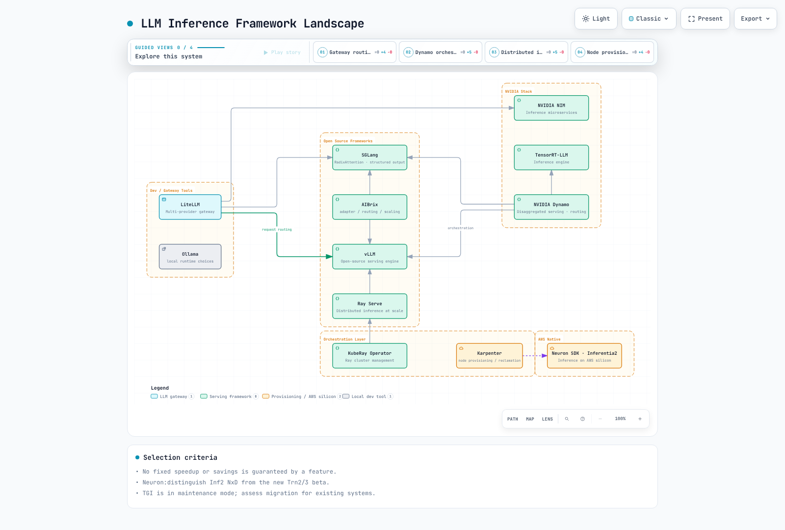
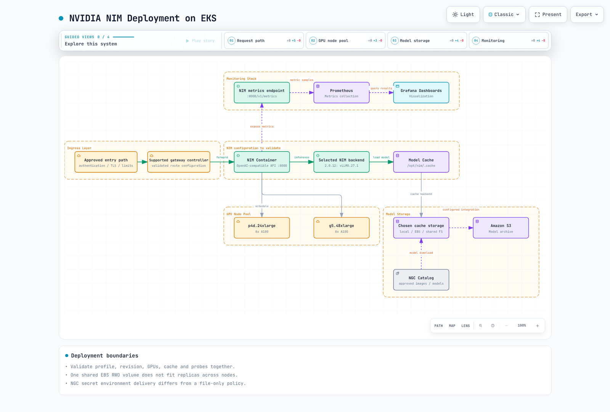
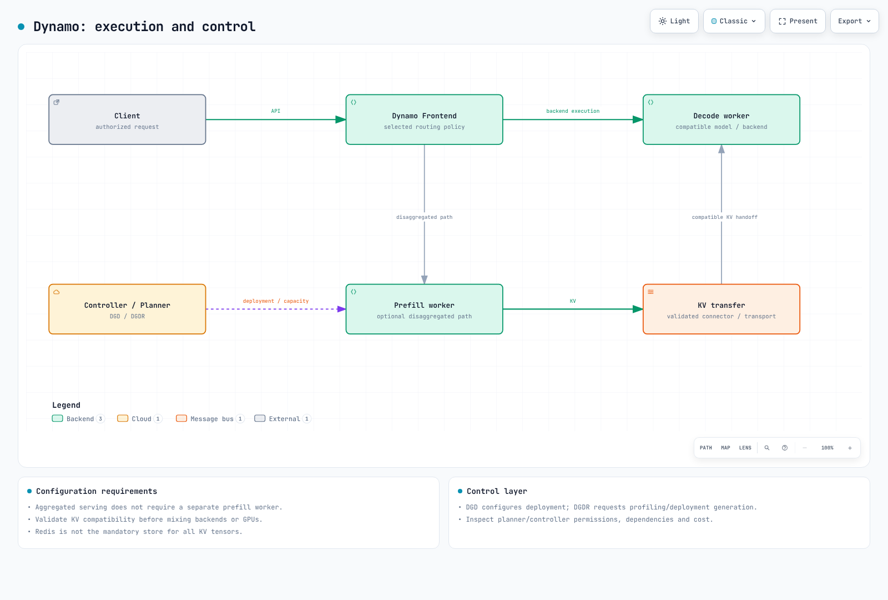

# LLM サービング向け推論フレームワーク

> **レビューのベースライン**: 公式リリース、API、chart、およびローカルチェックを 2026 年 9 月 12 日に確認。GPU/Neuron モデル実行は未実施。
> **最終更新**: October 12, 2026

推論エンジン、分散実行レイヤー、Kubernetes controller、プロバイダー gateway は別々に選定してください。「OpenAI 互換」は、endpoint、field、streaming、tool call、認証が同一であることを意味しません。

## 推論フレームワークの全体像



[インタラクティブ図を表示](https://www.atomai.click/kubernetes-docs/archmaps/en-ai-ml-04-inference-frameworks-0.html)

| コンポーネント | 確認したベースライン | 選定時の確認事項 |
| --- | --- | --- |
| NIM LLM/VLM | 2.0.12 のドキュメント、別個の 3.0 提供 | モデル、profile、hardware、support agreement、backend |
| Dynamo | 1.4.2 | 集約/分離サービング、KV transfer、planner、controller |
| AIBrix | 0.7.0 | Envoy Gateway、adapter/controller、autoscaling |
| SGLang | 0.5.19 | モデル、grammar backend、device、測定済み workload |
| vLLM / Ray Serve | vLLM 0.29.0 / Ray 2.58.0 / KubeRay 1.7.0 | 個別に検証済みの image/model/controller の組み合わせ |
| TGI | 3.3.7、maintenance mode | 既存システムの保守と移行計画 |
| Ollama | 0.34.0 | ローカル API アクセス、モデルストレージ、準備 |
| LiteLLM | 1.100.1 | プロバイダー適合、認証、fallback、コスト計測 |
| Neuron | SDK 2.32.0、Helm 1.10.0 | インスタンス固有の plugin/compiler/driver 互換性 |

vLLM 0.31.0 は、表にある既存の 0.29.0 ローカル検証ベースラインの後、2026 年 10 月 5 日にリリースされました。表のバージョンは確認済みの組み合わせを示すものであり、最新リリースや相互互換性のある一組であることを主張するものではありません。リクエスト単位のマルチモーダル引数をデフォルトで制限する 0.31.0 の変更については、[デプロイメント章の更新](02-vllm-deployment.md)を参照してください。

万能な yes/no の機能マトリクスは避けてください。Dynamo の計画と vLLM/SGLang の分離、CPU および GGUF のサポートは、リリース、backend、hardware に依存します。adapter loading とモデル alias はテナント認証の境界ではありません。

## NVIDIA NIM

container、モデル profile、GPU 互換性、support agreement をまとめて確認してください。NIM Operator 3.1.2 は、LLM/VLM 2.0.12 container とは別物です。確認した 2.0.12 リリースでは vLLM 0.27.1 が記載されています。NIM は常に TensorRT-LLM を使用するとは限りません。Dynamo ベースの 3.0 提供を 2.0 と同じデプロイメントパスとして扱わないでください。



[インタラクティブ図を表示](https://www.atomai.click/kubernetes-docs/archmaps/en-ai-ml-04-inference-frameworks-1.html)

### デプロイメントの準備と profile

AMI、driver/toolkit、device-plugin の要件については [GPU ガイド](01-ai-ml-workloads.md)を使用してください。driver installation を常に有効にすると、プロバイダー AMI と競合する可能性があります。Karpenter NodePool/EC2NodeClass、実際にスケジュール可能な CPU/RAM/GPU リソース、device 数を確認してください。8 GPU の Pod は 1/4 GPU node には収まらず、Custom AMI には明示的な EKS bootstrap 設定が必要です。

container の profile list にある、サポート対象 profile ID/name を NIM_MODEL_PROFILE で使用してください。古い NIM_MANIFEST_PROFILE や、架空の vllm-bf16-tp8 文字列が有効であると想定しないでください。image digest、モデル revision、profile、driver、実際の検証を一緒に記録してください。

NGC の image-pull credential と実行時のモデルダウンロード credential には異なる役割があります。ドキュメントにある NGC_API_KEY 環境変数パスは、file-only credential policy を満たしません。承認済みの prepared-model path または検証済みの credential adapter を使用してください。実際の key を shell 引数やソースに入れてはいけません。内部 Service だけでは推論リクエストを認証しません。

異なる node 上の replica 間で 1 つの EBS RWO PVC を共有することは避けてください。replica ごとの storage/local cache または適切な shared filesystem を選び、ダウンロード失敗、storage performance、startup probe、rollout をテストしてください。モデルは常に image に組み込まれているわけではなく、cache が FSx/S3 と自動同期することもありません。

### Metrics と GenAI-Perf

確認した NIM 2.0.12 のドキュメントは、native vLLM backend metrics を pass-through する `/v1/metrics` を公開しています。架空の nim_* 名や `/metrics` をコピーする代わりに、実際の名前、unit、label を調べてください。Grafana ConfigMap には対応する datasource/sidecar と Prometheus scraping が必要です。秒をそのまま millisecond panel に表示しないでください。

TTFT、ITL、end-to-end latency、成功 throughput、queueing について、workload 固有の SLO を定義してください。token 間隔が均一な場合、近似値は `TTFT + (output tokens - 1) × ITL` にネットワーク/postprocessing overhead を別途加えたものです。500ms や GPU80% といった目標は、普遍的な健全性基準ではありません。

GenAI-Perf 0.0.16 は profile subcommand と synthetic-input-tokens-mean/output-tokens-mean option を使用します。次の command は準備済み内部 endpoint に load をかけるものですが、この監査では実行していません。先に perf_analyzer、tokenizer、その他の distribution dependency を準備してください。

```bash
genai-perf profile   --endpoint-type chat   --service-kind openai   --url http://127.0.0.1:8000   --model approved-model-alias   --concurrency 2   --synthetic-input-tokens-mean 128   --output-tokens-mean 64   --num-prompts 20   --profile-export-file profile_export.json
```

analyze が JSON の postprocessing だけであるとは想定しないでください。sweep 設定では追加 profiling が実行される可能性があります。raw request、failure、tokenizer、warmup、concurrency、モデル/backend revision を保持してください。GPU utilization には実際の metrics 収集が必要です。

## NVIDIA Dynamo

公式の 1.4.2 Kubernetes path では、Dynamo platform、DynamoGraphDeployment (DGD)、DynamoGraphDeploymentRequest (DGDR) を使用します。旧来の架空の dynamo-router/dynamo-worker image、KV_CACHE_HOST、任意の router YAML では実装されません。DGDR は profiling と DGD 作成を要求するものであり、read-only の調査ではありません。



[インタラクティブ図を表示](https://www.atomai.click/kubernetes-docs/archmaps/en-ai-ml-04-inference-frameworks-2.html)

### 実際の DGD 構造

この**schema-checked configuration**は、公開モデルと制限付き execution 設定向けに、公式 1.4.2 v1beta1 の aggregated example を適合させたものです。platform/controller、namespace、GPU、モデルアクセス、networking が必要です。デプロイメント前にモデル/image digest を pin し、実際の hardware を検証してください。この監査ではモデルを実行していません。

```yaml
apiVersion: nvidia.com/v1beta1
kind: DynamoGraphDeployment
metadata:
  name: vllm-agg
  namespace: dynamo-system
spec:
  components:
  - name: Frontend
    podTemplate:
      spec:
        containers:
        - image: nvcr.io/nvidia/ai-dynamo/vllm-runtime:1.4.2
          name: main
          resources:
            requests:
              cpu: 250m
              memory: 512Mi
            limits:
              cpu: '1'
              memory: 2Gi
    replicas: 1
    type: frontend
  - name: VllmDecodeWorker
    podTemplate:
      spec:
        containers:
        - args:
          - --model
          - Qwen/Qwen3-0.6B
          - --max-model-len
          - '2048'
          - --max-num-seqs
          - '8'
          command:
          - python3
          - -m
          - dynamo.vllm
          image: nvcr.io/nvidia/ai-dynamo/vllm-runtime:1.4.2
          name: main
          resources:
            limits:
              nvidia.com/gpu: '1'
              cpu: '4'
              memory: 12Gi
            requests:
              ephemeral-storage: 2Gi
              cpu: '2'
              memory: 4Gi
          workingDir: /workspace/examples/backends/vllm
    replicas: 1
    type: worker
```

分離には、互換性のある prefill/decode role、KV connector/format、モデル revision、networking が必要です。backend や GPU の任意の混在は自動的に相互運用可能にはなりません。KV-aware routing は locality と load のバランスを取ります。固定の 0.7/0.3 式は普遍的な実装ではありません。Redis はすべての Dynamo デプロイメントで必須の KV tensor store ではありません。

確認した platform chart の cluster-wide operator は、crd-apply init container を通じて CRD を管理します。upgradeCRD=false は外部管理を選択するものであり、CRD の必要性をなくすものではありません。planner、discovery、NATS/etcd、Grove/KAI、その他のリリース固有設定を確認してください。chart rendering は CRD application、authorization、live discovery を検証しません。

## AIBrix

Version0.7.0 では Envoy Gateway、gateway plugin、controller-manager、metadata service を使用します。KubeRay は Ray ベース capability では任意です。以前のスタンドアロン aibrix-registry server と /v1/lora/register API は、確認した0.7.0 の installation path ではありません。

### ModelAdapter と PodAutoscaler

実際の ModelAdapter field には baseModel、podSelector、artifactURL があります。replica を省略すると、すべての一致する Pod に adapter が load されます。1 を指定すると 1 Pod が選択され、それ以外の値は拒否されます。example bucket/revision と base model を承認済みの値に置き換えてください。controller の download permission、runtime 互換性、adapter capacity/lifecycle、テナント authorization をそれぞれ確認してください。

```yaml
apiVersion: model.aibrix.ai/v1alpha1
kind: ModelAdapter
metadata:
  name: support-lora
  namespace: ai-inference
spec:
  baseModel: approved-base-model
  podSelector:
    matchLabels:
      model.aibrix.ai/name: approved-base-model
  artifactURL: s3://REPLACE_WITH_APPROVED_BUCKET/adapters/support/REVISION/
  replicas: 1
```

PodAutoscaler0.7.0 は、任意の autoscaler ConfigMap ではなく metricsSources と HPA/KPA/APA strategy を使用します。この CPU example には metrics-server、workload の CPU request、controller が必要です。GPU queue ベースの scaling は検証していません。同一 target に対し競合する scaler owner を避けてください。

```yaml
apiVersion: autoscaling.aibrix.ai/v1alpha1
kind: PodAutoscaler
metadata:
  name: model-cpu
  namespace: ai-inference
spec:
  scaleTargetRef:
    apiVersion: apps/v1
    kind: Deployment
    name: prepared-model-server
  minReplicas: 1
  maxReplicas: 3
  scalingStrategy: HPA
  metricsSources:
  - metricSourceType: resource
    targetMetric: cpu
    targetValue: '70'
```

## Ray Serve 統合

監査済みの [Ray Serve](ray/04-ray-serve.md) と [KubeRay](ray/02-kuberay-operator.md) API を使用してください。KubeRay reconciliation、Ray worker autoscaling、Serve replica autoscaling には異なる役割があります。RayCluster を通常の Deployment HPA scale target として使用したり、生成される cluster/Serve Service 名や selector を推測したりしないでください。

code と dependency は head だけでなく execution worker に届く必要があります。user_config は constructor argument を自動的に変更しません。適切な reconfigure path を実装してください。互換性のある API には、実際の chat template、streaming、cancellation、finish reason、usage、error が必要です。role string を連結して stream=true を無視するだけでは不十分です。古い Ray2.9/operator1.1 の example と無条件の trust_remote_code=True は削除されました。

## SGLang

Version0.5.19 の RadixAttention は共通 prefix に対して KV を再利用します。任意に重複する中間 substring は、交換可能な cached prefix ではありません。モデル、KV format、access policy は一致していなければなりません。現在の grammar backend にはデフォルトの XGrammar と、Outlines/Llguidance などの代替があります。「圧縮 FSM により常に 10 倍高速」は一般的な結論ではありません。


[インタラクティブ図を表示](https://www.atomai.click/kubernetes-docs/archmaps/en-ai-ml-04-inference-frameworks-3.html)

### Structured Request の例

この client は、SGLang の json_schema request shape をサポートする承認済み gateway を前提とします。通常の completion と output shape を確認します。検証では synthetic response と failure case を含むローカル HTTP fixture を使用します。モデル精度は測定しません。JSON の妥当性は、事実の正確さや tool authorization を確立するものではありません。

```python
from pathlib import Path
import json
from urllib.request import Request, urlopen

# Existing private gateway and a scoped credential mounted as a file.
base_url = "https://inference.example.internal/v1"
credential = Path("/run/secrets/inference/token").read_text().strip()
payload = {
    "model": "approved-model-alias",
    "messages": [{"role": "user", "content": "Return the city Seoul and country Korea."}],
    "temperature": 0,
    "max_tokens": 128,
    "response_format": {
        "type": "json_schema",
        "json_schema": {
            "name": "location",
            "schema": {
                "type": "object",
                "properties": {"city": {"type": "string"}, "country": {"type": "string"}},
                "required": ["city", "country"],
                "additionalProperties": False,
            },
        },
    },
}
request = Request(
    base_url + "/chat/completions",
    data=json.dumps(payload).encode(),
    headers={"Content-Type": "application/json", "Authorization": "Bearer " + credential},
    method="POST",
)
with urlopen(request, timeout=30) as response:
    result = json.load(response)
choice = result["choices"][0]
if choice["finish_reason"] != "stop":
    raise RuntimeError("Generation did not complete normally")
location = json.loads(choice["message"]["content"])
if set(location) != {"city", "country"} or not all(isinstance(v, str) for v in location.values()):
    raise ValueError("Unexpected output shape")
print(location)
```

SGLang の function/system/user/assistant/gen DSL API は、このリリースでも利用できます。function を宣言しても推論は実行されません。準備済みの RuntimeEndpoint/backend を接続して実行してください。installation 中に Torch、FlashInfer、hardware の互換性を検証してください。この監査では完全な GPU SDK のインストールも、DSL のモデルへの接続も行っていません。

## Hugging Face TGI

公式 repository は**maintenance mode**を宣言しています。確認した最新リリースは3.3.7(December19,2025)です。minor fix、documentation、maintenance を受け入れ、新規 engine の採用先として vLLM/SGLang などを案内しています。新規 project に対する汎用的なデフォルト推奨ではなくなりました。既存 deployment を移行する際は、モデル、template、streaming、metrics、SLO の互換性を検証してください。

--quantize=awq を追加しても、通常のモデルから AWQ weight が自動生成されるわけではありません。その format で準備されたサポート対象モデルを使用してください。floating tag、欠落した gated-model credential、短い liveness deadline は、再現性と正常な startup を損ないます。

## Ollama

0.34.0 では、モデルの pull と serving は別々の operation です。sleep10 を伴う postStart hook では readiness は保証されません。承認済みモデルを prestage するか、health check、制限付き retry、failure handling を備えた別の準備手順を使用してください。変更可能なモデル tag と storage permission を記録してください。

ローカル Ollama API は user authentication を提供しません。公開前に authorization と path control を前段に配置してください。Pod localhost のみに bind された server には、その Service 経由で到達できません。OLLAMA_HOST は listening scope を変更するものであり、authentication を変更するものではありません。model-management endpoint と inference endpoint を別々に scope してください。

Modelfile は base model、system prompt、generation setting を定義します。モデルを学習したり Kubernetes image を build したりするものではありません。大規模 multitenancy を想定するのではなく、モデル size、device、backend ごとの CPU/GPU support を検証してください。

## LiteLLM

[Agentic AI ガイド](03-agentic-ai-platform.md)にある監査済み1.100.1 の Router configuration を使用してください。プロバイダー gateway は推論 engine とは異なるレイヤーです。alias を gpt-4-equivalent と呼んでも、同等の quality が確立されるわけではありません。fallback はまず allowed-provider と data-egress policy を満たす必要があります。

実際の configuration file を proxy command に接続し、必要に応じて client credential、DB/Redis、callback を設定してください。dummy key や ClusterIP は authentication ではありません。drop_params=true は意味のある request condition を除去する可能性があります。request、success、failure、retry、cache cost を区別してください。

## AWS Neuron と Inferentia2

chip、NeuronCore、host RAM/HBM を区別してください。各 Inferentia2 chip には 2 つの NeuronCore-v2 core と32GiB HBM があります。

| インスタンス | Chip | NeuronCores-v2 | Device HBM (GiB) | Host RAM (GiB) | vCPU |
| --- | --- | --- | --- | --- | --- |
| inf2.xlarge | 1 | 2 | 32 | 16 | 4 |
| inf2.8xlarge | 1 | 2 | 32 | 128 | 32 |
| inf2.24xlarge | 6 | 12 | 192 | 384 | 96 |
| inf2.48xlarge | 12 | 24 | 384 | 768 | 192 |

### Device 割り当てと plugin path

aws.amazon.com/neuron は**device 全体**を割り当て、aws.amazon.com/neuroncore は**core**を割り当てます。以前の inf2.xlarge example は、1 device、4 vCPU、16Gi RAM の node に neuron:2、8 CPU、24Gi RAM を request していました。そのため schedule できません。NEURON_RT_VISIBLE_CORES は runtime scope を選択するもので、未割り当ての device を作成するものではありません。選択したリリースに対し、NUM_CORES と logical-core policy の優先順位を確認してください。

確認した公式 Helm1.10.0 には、device-plugin、scheduler、node-problem-detector の option が含まれます。installation 前に、render された DaemonSet、hostPath、RBAC、recovery behavior を確認してください。この command はローカル出力を生成するだけです。

```bash
helm template neuron-audit oci://public.ecr.aws/neuron/neuron-helm-chart   --version 1.10.0 --namespace kube-system --include-crds > neuron-rendered.yaml
```

SDK2.32.0 は 2 つの別個の path をドキュメント化しています。**Inf2/Trn1/Trn2 向けの NxD Inference plugin0.5.x と vLLM0.16**、および**Trn2/Trn3 専用の新しい vLLM Neuron beta0.24.0.1.1.0**です。詳細な NxD guide では依然として0.5.0/SDK2.29 を示す一方、overview では0.5.3 を示しています。選択した plugin tag、DLC、正確な dependency を検証してください。Inf2 に最新 beta を install したり、古い2.18 DLC に pip install を追加したりしても、互換性の検証にはなりません。

Neuron compilation には、サポート対象のモデル implementation、shape/batch/sequence bucket、TP、compiler/SDK、hardware、cache artifact が必要です。未使用の tp_degree dictionary を含めて、一般的な Transformers モデルで torch_neuronx.trace を呼び出しても、分散 causal-LM serving は実装されません。compiler output file と tokenizer directory は異なる artifact です。この監査では compiler も Neuron instance も実行していません。

## パフォーマンス、コスト、運用

出典のない A100 ranking table と、固定の40–70% savings claim は削除されました。同じモデル/revision/precision、input/output-token distribution、concurrency、success rate、SLO、warmup、日付付き price を比較してください。1 日 100 万 request を30日間実行すると3,000 万 request です。仮定上の月額48,000 dollar は 1,000 request 当たり1.60 dollar です。以前の0.80 という数値は算術的に誤っていました。この例は現在の AWS pricing ではありません。

engine を変更する際は、実際の payload、template、streaming、usage、failure behavior を regression してください。shard されたモデル group と独立した replica を区別し、StatefulSet の ordered readiness が相互に待機する worker を block しないか確認してください。StatefulSet だけでは TP/PP、rendezvous、NCCL は設定されません。

モデル size、restart/download concurrency、authorization、cost を使用して、local cache、EBS、EFS、FSx を比較してください。EFS は常に FSx より遅いわけではなく、過去の gp3 limit は現在の保証ではありません。[GPU/storage example](01-ai-ml-workloads.md)を参照してください。

運用前に、実際の環境で authentication、TLS、management path、probe、placement、quota、単一の scaler owner、metrics unit、pin 済みモデル revision、cache lifecycle、rollout/rollback、interruption recovery をテストしてください。

## 検証範囲

チェックは公式 chart/CRD、実際の SDK/CLI source、ローカル HTTP request/failure fixture、Markdown、image を対象としています。GPU/Neuron モデル実行、throughput/cost measurement、cloud deployment、モデル download は実施していません。schema/chart の成功は、admission、authorization、モデル互換性、production readiness を確立するものではありません。

## 参考資料

- [NIM 2.0 リリースノート](https://docs.nvidia.com/nim/large-language-models/2.0.12/about-nim-llm/release-notes.html)
- [NIM configuration](https://docs.nvidia.com/nim/large-language-models/2.0.12/reference/environment-variables.html)
- [NIM observability](https://docs.nvidia.com/nim/large-language-models/2.0.12/reference/logging-and-observability.html)
- [Dynamo 1.4.2](https://github.com/ai-dynamo/dynamo/tree/v1.4.2)
- [AIBrix 0.7.0](https://github.com/aibrix/aibrix/tree/v0.7.0)
- [SGLang 0.5.19 structured output](https://github.com/sgl-project/sglang/blob/v0.5.19/docs/docs/advanced_features/structured_outputs.mdx)
- [TGI maintenance notice](https://github.com/huggingface/text-generation-inference)
- [Ollama 0.34.0](https://github.com/ollama/ollama/tree/v0.34.0)
- [GenAI-Perf 0.0.16](https://pypi.org/project/genai-perf/0.0.16/)
- [Neuron SDK 2.32.0 inference path](https://github.com/aws-neuron/aws-neuron-sdk/blob/v2.32.0/libraries/vllm-neuron/neuron-inference-overview.rst)
- [Inf2 architecture](https://awsdocs-neuron.readthedocs-hosted.com/en/latest/about-neuron/arch/neuron-hardware/inf2-arch.html)
- [Neuron Kubernetes component](https://github.com/aws-neuron/neuron-helm-charts)

## クイズ

[Inference Frameworks クイズ](../quizzes/ai-ml/04-inference-frameworks-quiz.md)