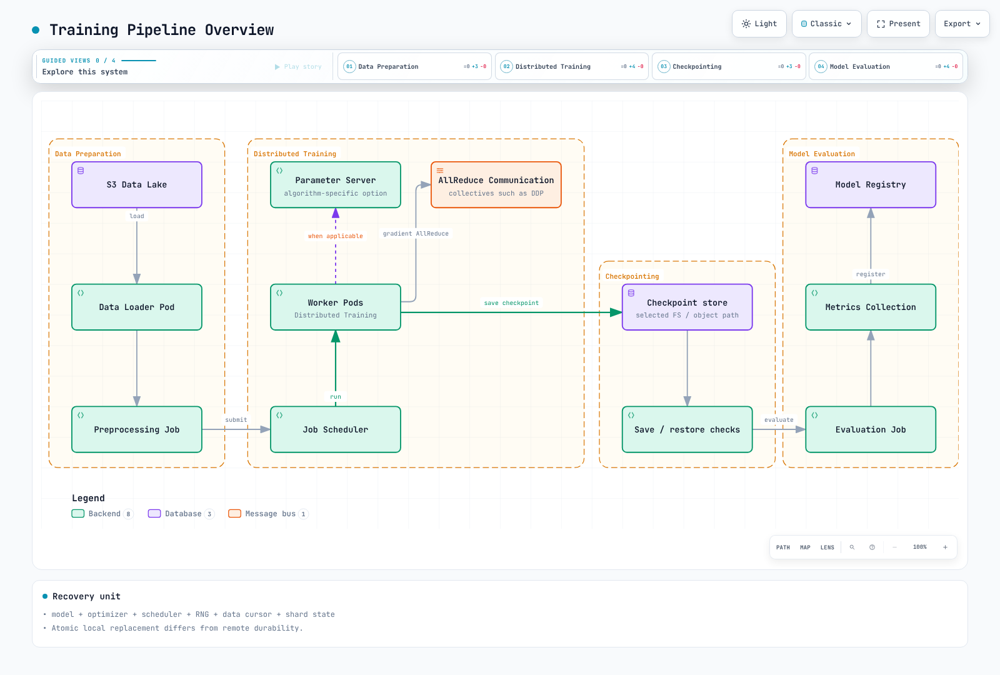

# EKS でのモデル学習

> **最終更新**: 2026年10月16日
> **ベースライン**: Slinky 1.2.3、MPI Operator 0.8.2、Volcano 1.15.2、PyTorch 2.14.0、Neuron SDK 2.32.0

分散学習には、互換性のあるモデルコード、データの分割、起動処理、デバイス割り当て、通信、チェックポイントが必要です。マニフェストが有効であることや Pod が Running 状態であることだけでは、学習や復旧が機能する証明にはなりません。

単一 GPU QLoRA と SageMaker AI/EKS の比較については、イメージのサポートライフサイクルと実行上の制約を含む [Qwen ガイド](sagemaker-ai/README.md)を参照してください。

## 学習パイプライン



[インタラクティブな図を表示](https://www.atomai.click/kubernetes-docs/archmaps/en-ai-ml-05-model-training-0.html)

## 分散学習戦略


[インタラクティブな図を表示](https://www.atomai.click/kubernetes-docs/archmaps/en-ai-ml-05-model-training-1.html)

| 戦略 | 分割単位 | 検証すべき制約 |
| --- | --- | --- |
| DDP | 異なるデータバッチとモデルレプリカ | 学習状態とアクティベーションのメモリ、勾配同期 |
| FSDP / ZeRO | パラメータ、勾配、オプティマイザー状態 | ステージごとの通信とチェックポイント形式 |
| TP | レイヤー内のテンソル演算 | Attention head と hidden の次元、バックエンド、トポロジー |
| PP | レイヤーの段階分割 | マイクロバッチ、パイプラインの停滞、アクティベーション転送 |
| エキスパート並列 | MoE のエキスパートとトークンの振り分け | 負荷の偏り、all-to-all 通信、ルーティング容量 |
| 組み合わせ | DP/TP/PP/コンテキスト/エキスパートの各グループ | サポートされるデバイスメッシュと総ランク数 |

1,000億パラメータを超えるモデルで、3D並列化が常に最適だと決めつけないでください。重みだけでなく、オプティマイザー状態、勾配、アクティベーション、通信に必要なメモリも見積もり、スループットと復旧コストを比較します。DDP の all-reduce にパラメータサーバーは必要ありません。

TP8×PP4×DP2 は64ランクを意味します。グローバルバッチサイズは **マイクロバッチサイズ × 勾配蓄積回数 × DP レプリカ数**で計算し、この例では1×32×2=64です。TP/PP のランク数を重ねて掛けて2048にするわけではありません。可変長のパッキングを使う場合は、サンプル数とトークン数を別々に追跡してください。

## Slurm と Slinky

公式リポジトリは SlinkyProject/slurm-operator です。タグ1.2.3と対応する OCI chart を検証しました。GitHub の releases/latest は404を返したため、GitHub の最新リリースとは記載していません。1.2のドキュメントには、最低要件として Kubernetes 1.29、Slurm 25.11（data parser 0.0.44）が記載されています。最低限の互換性は、運用上のサポート期間を保証するものではありません。


[インタラクティブな図を表示](https://www.atomai.click/kubernetes-docs/archmaps/en-ai-ml-05-model-training-2.html)

### 実際の API とライフサイクル

バージョン1.2.3では、`slinky.slurm.net/v1beta1` に Controller、NodeSet、Accounting、LoginSet、RestApi、Token が定義されています。以前の SlurmCluster/SlurmNodeSet の例は、この API の例ではありません。NodeSet は controllerRef と Pod template を使用します。デフォルトの scalingMode は StatefulSet に似た動作をします。DaemonSet モードでは一致する Kubernetes node ごとに Pod を1つ作成し、replicas は無視されます。これらは NodeSet コントローラーのモードであり、slurmd が常に Kubernetes の DaemonSet リソースとして動くことを示すものではありません。

slurmctld はジョブ、ノード、パーティションの状態とスケジューリングを管理します。StateSaveLocation を保持してください。slurmdbd はアカウンティングデータベースへのアクセスと記録を扱いますが、コントローラーの状態を保存するものではありません。ログイン、REST、ジョブの各 ID、ファイルシステム権限、Slurm の鍵/JWT、データベース認証情報の配布とローテーションを一体として設計してください。NLB 経由で SSH を公開することは、標準構成の前提条件ではありません。

まず実際の chart をレンダリングしてください。次のコマンドが生成するのはローカルファイルだけです。運用環境へのデプロイには、cert-manager、CRD、operator、Slurm の順序を守った導入、永続ストレージとデータベース、ユーザー ID、互換性のある Slurm イメージが別途必要です。

```bash
helm template slurm-api oci://ghcr.io/slinkyproject/charts/slurm-operator-crds   --version 1.2.3 > slurm-crds.yaml
helm template slurm-control oci://ghcr.io/slinkyproject/charts/slurm-operator   --version 1.2.3 --namespace slinky > slurm-operator.yaml
helm template slurm-example oci://ghcr.io/slinkyproject/charts/slurm   --version 1.2.3 --namespace slurm   --set-json 'nodesets={"cpu-example":{}}'   --set partitions.all.enabled=true > slurm-example.yaml
```

Argo CD Application では、実在する chart path/revision と実際の values を指定する必要があります。架空の compute.partitions/efa.enabled 設定では構成されません。pruning、CRD/PVC の削除、Slurm の drain/requeue、ジョブ終了のタイムアウトを確認してください。NodeSet の縮小と EC2 instance の終了は、別々の制御ループです。

### Slurm からの torchrun 起動

ノードごとに torchrun を1つ起動し、各ランチャーに GPU ごとのプロセスを作成させます。以前は Slurm task を8つ起動し、それぞれがさらに8プロセスを起動していたため、ノードあたり64プロセスになっていました。この例が想定するのは4ノード×各8プロセスです。この監査では実際の Slurm/GPU 割り当てを実行していません。

```bash
#!/bin/bash
#SBATCH --job-name=distributed-training
#SBATCH --nodes=4
#SBATCH --ntasks-per-node=1
#SBATCH --gpus-per-node=8
#SBATCH --cpus-per-task=16
#SBATCH --time=01:00:00
set -euo pipefail

: "${SLURM_NNODES:?Run within an approved Slurm allocation}"
: "${SLURM_JOB_ID:?}"
: "${SLURM_JOB_NODELIST:?}"
export MASTER_ADDR
MASTER_ADDR=$(scontrol show hostnames "$SLURM_JOB_NODELIST" | head -n 1)
export MASTER_PORT=29500

# One torchrun launcher per Slurm node, eight training processes per launcher.
# train.py, dependencies, data, credentials and checkpoints must be prepared.
srun --ntasks="$SLURM_NNODES" --ntasks-per-node=1 bash -c '
  exec torchrun \
    --nnodes="$SLURM_NNODES" \
    --nproc-per-node=8 \
    --node-rank="$SLURM_PROCID" \
    --rdzv-id="$SLURM_JOB_ID" \
    --rdzv-backend=c10d \
    --rdzv-endpoint="$MASTER_ADDR:$MASTER_PORT" \
    /workspace/train.py
'
```

Slurm が task ごとに GPU の可視性を制限する場合は、各ランチャーから想定した8つの GPU すべてが見えることを確認してください。train.py には LOCAL_RANK/RANK/WORLD_SIZE、デバイスの割り当て、DDP/sampler、バージョン管理されたデータとモデル、再開処理の実装が必要です。シェルの検証用テストでは、4つのランチャー、異なる node rank、共通の rendezvous endpoint を確認しました。

## GPU 通信と EFA

FI_PROVIDER=efa は libfabric のプロバイダーを選択する設定です。これだけでは EFA のインストールやネットワークインターフェイスの接続、NCCL との統合は行われません。EFA 対応インスタンス、ドライバーと libfabric、aws-ofi-nccl、デバイスプラグインと Pod への割り当て、セキュリティグループ、実際の通信経路をまとめて検証してください。RAID0 やサブネットタグを設定しても EFA は有効になりません。

通信するノードは同じ AZ に配置する必要があります。性能を重視する場合はクラスター配置グループを推奨します。学習 Pod が指定した NodePool を実際に使っていることを確認してください。帯域幅と EFA デバイス数はインスタンスタイプによって異なり、常に400 Gbpsを利用できるわけではありません。古い Ring/Simple、IB_DISABLE、SOCKET_IFNAME、FI_EFA_USE_DEVICE_RDMA の設定をむやみに強制すると、現在のプラグインと干渉する可能性があります。リリース資料やログを確認し、集合通信のテストを実施してください。

Karpenter の budgets.nodes=0 は、自発的な中断経路を制限します。Spot の回収、ノード障害、強制終了、すべての有効期限切れを防ぐものではありません。do-not-disrupt/PDB と terminationGracePeriod/expireAfter の相互作用を確認し、チェックポイントから復旧できるようにしてください。bootstrap のたびにバージョン固定されていないドライバーインストーラーを取得したり、異なるデバイスに同じ GPU クロックを固定設定したりしないでください。

## BioNeMo

確認した3.0.0は **BioNeMo Recipes** で、TransformerEngine ベースのモデルとチェックポイント、および PyTorch、Accelerate、Lightning 向けのレシピを提供します。ESM-2、AMPLIFY、Geneformer などは、レシピごとに対応状況を確認してください。BioNeMo 1.5 の MegaMolBART モジュールを、3.0の API として実行しないでください。生物学的な評価とモデル/データの利用許可は、別途満たす必要があります。GPU を割り当てただけではレシピを実行する準備は整いません。

## Trainium と Neuron

SDK 2.32.0 の torch-neuronx、NeuronX Distributed Training とモデル実装、Optimum Neuron の各経路を区別してください。transformers-neuronx が推論に対応していても、一般的な学習に対応するとは限りません。古い2.18 DLC に任意の pip パッケージを追加するのではなく、選択したハードウェアと SDK に合う TensorFlow/JAX/PyTorch のバージョンを確認してください。

Optimum Neuron 0.4.5 には NeuronTrainer/NeuronTrainingArguments と Neuron 用の専用学習モデル実装が含まれます。汎用の BertForPreTraining を読み込み、未定義の dataset/tokenizer 変数を渡すだけでは、テンソル並列学習として不十分です。対応するモデルと設定、ラベルと collator、tokenizer と revision、optimizer と checkpoint の形式、launcher を用意してください。CPU の例で使う PyTorch 2.14 が Neuron SDK と互換性があるという意味ではありません。

### マルチノード Job と事前コンパイル

Job の parallelism=4 は Pod を4つ起動するだけで、rank や rendezvous を構成しません。Indexed Job では completionMode/index と、全 Pod で共有する1つの master endpoint が必要です。各 Pod の MASTER_ADDR に自身の status.podIP を設定すると、worker ごとに異なる master を指してしまいます。coordinator/controller の構成と対応する launcher を使い、train_lora.py、データ、コンパイルキャッシュ、デバイスを準備してください。

neuron_parallel_compile は計算グラフを抽出・コンパイルするツールであり、実際の学習の代わりにはなりません。その後で学習を別途実行し、キャッシュのヒット、shape、compiler/SDK の revision を確認してください。コアとデバイスの違いについては、[Neuron の単位の違い](04-inference-frameworks.md)を参照してください。

## Ray Train、MPI、Volcano

検証済みの Ray 2.58/KubeRay 1.7 [Train ガイド](ray/03-ray-train-tune.md)を使用してください。全 worker で report 呼び出しの回数をそろえ、実際の Checkpoint object を report してください。get_checkpoint() は以前の復旧状態を取得する関数で、新しいチェックポイントを保存する context manager ではありません。resources_per_worker で GPU 8台を指定しても、1つの worker 内で DDP process が8つ自動的に起動するわけではありません。

MPI Operator 0.8.2 は kubeflow.org/v2beta1 を使用します。slotsPerWorker は hostfile の slot 数を宣言しますが、mpirun -np、プロセス配置、GPU の割り当てを個別に決めるものではありません。Launcher/Worker のコード、MPI/SSH の実装、対応イメージ、CRD/RBAC を準備してください。worker 4台×各8 slot だけでは、GPU process が32個起動する保証はありません。

Volcano 1.15.2 の minAvailable が数えるのは EC2 node ではなく **Pod/member** です。十分なリソースがあれば、3台の node に4つの Pod を配置できる場合があります。gang plugin は最小メンバー数とリソース条件を適用しますが、コンテナが同時に起動することや学習が成功することまでは保証しません。余分な worker、elastic-runtime の対応状況、RestartJob/requeue の動作を確認してください。

JupyterHub の GPU profile は、実際のイメージ、デバイスラベル、認可設定に合う必要があります。g5.xlarge は A10G 搭載で、A100 profile ではありません。設定を稼働中の Hub に反映し、ユーザーごとのストレージ、quota、ネットワーク、アイドル状態のユーザー停止処理を構成してください。

## 学習ストレージとチェックポイント

検証済みの CSI パスについては、[GPU/ストレージガイド](01-ai-ml-workloads.md)を参照してください。既存の FSx ファイルシステムを static PV でマウントする方法は、dynamic provisioning で新規作成する方法とは異なります。FileSystem の dataRepositoryAssociations field を創作したり、SCRATCH_2 と永続ストレージ専用の throughput 設定を混在させたりしないでください。DRA/import/export API、ポリシー、処理完了をそれぞれ確認してください。

EFS PVC の容量要求は、物理ストレージのクォータではありません。access point の UID/GID、ディレクトリ権限、CSI の ID、ネットワーク、mount target を確認してください。ローカルのチェックポイントは、S3 への転送が完了するまでリモート側に永続化されていません。

復旧にはモデル、オプティマイザー、スケジューラー、RNG、使用する場合は scaler、data/sampler cursor、すべての分割状態が必要です。複数の rank が同じファイルを上書きしないようにし、フレームワーク対応の分散保存を使用してください。以前の有効なチェックポイントを削除する前に、完了 manifest/checksum、リモート転送、復元を検証してください。架空の checkpoint-manager image や auto_resume=true ConfigMap を用意しても、これらの機能は実装されません。

### 実行可能な小規模 CPU 例

この合成データ16サンプル、CPU 1スレッドの例は、オプティマイザーを4回更新します。勾配蓄積、範囲を制限した cosine schedule、一時ファイルの置換、オプティマイザーと RNG の復元を実演します。PyTorch 2.14.0+cpu では、連続実行した場合と2 step 後に再開した場合で同一の結果が得られました。これは GPU、分散処理、リモート永続性のテストではありません。

```python
from pathlib import Path
import math
import os
import tempfile
import torch


def lr_factor(step, warmup_steps, total_steps, min_ratio=0.1):
    if not 0 <= warmup_steps < total_steps or not 0 <= min_ratio <= 1:
        raise ValueError("Invalid schedule bounds")
    if step < 0:
        raise ValueError("Step must be non-negative")
    if step < warmup_steps:
        return step / max(1, warmup_steps)
    progress = min(1.0, (step - warmup_steps) / (total_steps - warmup_steps))
    return min_ratio + (1 - min_ratio) * (1 + math.cos(math.pi * progress)) / 2


def save_checkpoint(path, state):
    path = Path(path)
    path.parent.mkdir(parents=True, exist_ok=True)
    temporary = None
    try:
        with tempfile.NamedTemporaryFile(dir=path.parent, delete=False) as output:
            temporary = output.name
            torch.save(state, output)
            output.flush()
            os.fsync(output.fileno())
        os.replace(temporary, path)
    finally:
        if temporary is not None and os.path.exists(temporary):
            os.unlink(temporary)


def train_toy(checkpoint_path, stop_after=4, resume=False):
    # Tiny deterministic CPU example; no GPU, dataset or model download.
    torch.set_num_threads(1)
    torch.manual_seed(17)
    model = torch.nn.Linear(2, 1)
    optimizer = torch.optim.SGD(model.parameters(), lr=0.05, momentum=0.9)
    scheduler = torch.optim.lr_scheduler.LambdaLR(
        optimizer, lambda step: lr_factor(step, 1, 4)
    )
    inputs = torch.arange(32, dtype=torch.float32).reshape(16, 2) / 32
    targets = inputs.sum(dim=1, keepdim=True)
    start = 0
    if resume:
        saved = torch.load(checkpoint_path, map_location="cpu", weights_only=True)
        model.load_state_dict(saved["model"])
        optimizer.load_state_dict(saved["optimizer"])
        scheduler.load_state_dict(saved["scheduler"])
        torch.set_rng_state(saved["torch_rng"])
        start = saved["optimizer_step"]
    if not start <= stop_after <= 4:
        raise ValueError("Invalid stopping point")
    for step in range(start, stop_after):
        optimizer.zero_grad(set_to_none=True)
        # Two equal-sized microbatches per optimizer update.
        for microbatch in range(2):
            offset = step * 4 + microbatch * 2
            prediction = model(inputs[offset:offset + 2])
            loss = torch.nn.functional.mse_loss(prediction, targets[offset:offset + 2]) / 2
            loss.backward()
        torch.nn.utils.clip_grad_norm_(model.parameters(), 1.0)
        optimizer.step()
        scheduler.step()
        save_checkpoint(checkpoint_path, {
            "model": model.state_dict(),
            "optimizer": optimizer.state_dict(),
            "scheduler": scheduler.state_dict(),
            "optimizer_step": step + 1,
            "torch_rng": torch.get_rng_state(),
        })
    return {name: value.detach().clone() for name, value in model.state_dict().items()}


if __name__ == "__main__":
    path = Path("toy-training.pt")
    train_toy(path, stop_after=2)
    train_toy(path, stop_after=4, resume=True)
    print("Completed four CPU optimizer updates, including checkpoint resume.")
```

この例が実演するのは、同一ファイルシステム上でのファイル置換の完了までです。ファイルシステム障害時やディレクトリメタデータの永続性、S3 トランザクション、分散チェックポイントプロトコルは実証していません。データ順序も固定されており、一般的な sampler 復旧には対応していません。一律に「500 step ごとに5 copy」と決めず、保存レイテンシー、障害率、許容できる作業損失、コストに基づいてチェックポイントの間隔と保持数を選んでください。

## 数値精度とメモリ最適化

現在の PyTorch API では torch.amp.autocast と torch.amp.GradScaler を使用します。BF16 は FP32 と指数部のビット数が同じですが、仮数部の精度や最大有限値は異なります。通常、FP16 のような loss scaling は不要ですが、ハードウェア、演算、収束を確認してください。Autocast を使っても、すべての重みやオプティマイザー状態が BF16 に変換されるわけではありません。

Activation checkpointing は backward 時にアクティベーションを再計算し、メモリ使用量を減らす代わりに計算量を増やします。ディスク上のチェックポイントとは異なり、メモリが3～4倍減ることも、速度低下が30%にとどまることも保証しません。use_reentrant を明示し、勾配、dropout/RNG、stateful layer を確認してください。

Flash Attention/SDPA のバックエンドは dtype、head size、device、mask に応じて選択されます。学習時と評価時の状態を設定し、評価中は dropout_p=0 を渡してください。明示的な mask と causal mask の組み合わせが API でサポートされるか確認してください。use_cache=False を指定するだけでは attention backend は有効になりません。

DeepSpeed 0.19.6 の ZeRO 1 はオプティマイザー状態を分割し、ZeRO 2 は勾配、ZeRO 3 はパラメータも分割します。CPU/NVMe への offload は別途構成する必要があり、Stage 3 によって自動的に有効になるものではありません。auto 値を置き換える上位レベルの統合設定と、DeepSpeed 単体の設定を区別してください。buffer、アクティベーション、最大レイヤーのメモリは、削減量に上限を設けます。

scheduler は勾配蓄積の各 microstep ではなく、オプティマイザーの更新ごとに進めてください。学習予定期間を過ぎた後に cosine が再び上昇しないよう progress を clamp し、例のように warmup/total-step の範囲を確認してください。

## 検証範囲

すべてのガイドとクイズの本文、および重複を除いた76個のコードブロックをレビューしました。検証対象には、公式の Slinky Helm/CRD、MPI/Volcano API と SDK のソース、小規模な CPU 学習と再開処理、シェルの起動テストが含まれます。GPU/Neuron/EFA、Slurm/MPI クラスター、実際の事前学習済みモデル、クラウドリソースは実行していません。ローカルでのコードやスキーマの検証は、本番デプロイの検証とは異なります。

## 参考資料

- [Slinky 1.2.3](https://github.com/SlinkyProject/slurm-operator/tree/v1.2.3)
- [Slurm controller](https://slurm.schedmd.com/slurmctld.html)
- [Slurm accounting daemon](https://slurm.schedmd.com/slurmdbd.html)
- [MPI Operator 0.8.2](https://github.com/kubeflow/mpi-operator/tree/v0.8.2)
- [Volcano 1.15.2 gang plugin](https://github.com/volcano-sh/volcano/blob/v1.15.2/pkg/scheduler/plugins/gang/gang.go)
- [EKS EFA networking](https://docs.aws.amazon.com/eks/latest/best-practices/aiml-networking.html)
- [BioNeMo 3.0.0 recipes](https://github.com/NVIDIA/bionemo-framework/tree/v3.0.0)
- [Optimum Neuron 0.4.5](https://github.com/huggingface/optimum-neuron/tree/v0.4.5)
- [Neuron SDK 2.32.0](https://github.com/aws-neuron/aws-neuron-sdk/tree/v2.32.0)
- [PyTorch 2.14 launcher](https://github.com/pytorch/pytorch/blob/v2.14.0/torch/distributed/run.py)
- [DeepSpeed 0.19.6 ZeRO configuration](https://github.com/deepspeedai/DeepSpeed/blob/v0.19.6/deepspeed/runtime/zero/config.py)

## クイズ

[モデル学習のクイズ](../quizzes/ai-ml/05-model-training-quiz.md)
