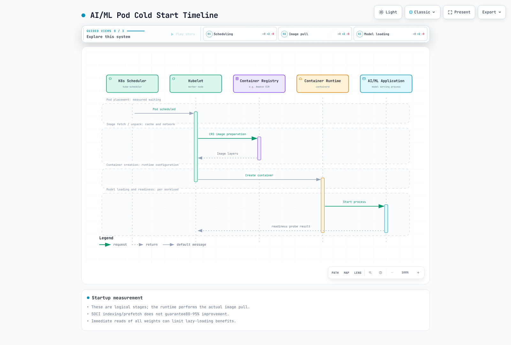

# EKS における AI/ML ベストプラクティス

> **最終更新日**: 2026年9月12日
> **ベースライン**: inference-perf0.6.1 / SOCI0.15.0 / Karpenter1.14.1 / External Secrets2.10.0

同じワークロードを使い、レイテンシー、成功率、スループット、コスト、復旧時間を測定して改善を評価してください。GPU、スナップショット機能、共有機能を使っても、速度やコストが一定の割合で改善するとは限りません。


[インタラクティブ図を表示](https://www.atomai.click/kubernetes-docs/archmaps/en-ai-ml-07-ai-ml-best-practices-0.html)

## LLM 推論のベンチマーク


[インタラクティブ図を表示](https://www.atomai.click/kubernetes-docs/archmaps/en-ai-ml-07-ai-ml-best-practices-1.html)

| 指標 | 定義と注意事項 |
| --- | --- |
| TTFT | 送信から最初の **空でない出力** を受信するまでの時間。最初の HTTP/SSE フレームにトークンが含まれるとは限りません |
| ITL | トークンまたはチャンク間の間隔。ネットワークチャンクに複数のトークンが含まれる場合があります |
| TPOT | 最初のトークン以降の平均値。算出方法はツールによって異なり、出力トークンが 1 個以下の場合は定義されません |
| E2E | リクエストから完了までの時間。キュー、ネットワーク、後処理のどこまでを含めたかを記録します |
| リクエストスループット | 指定した測定時間内に正常完了したリクエスト数 |
| トークンスループット | 測定時間内の出力トークン合計 ÷ 時間。リクエストごとの TPS を単純平均した値ではありません |
| Goodput | 成功条件とレイテンシー SLO の両方を満たすリクエストの処理率 |

トークンごとの実時刻がある場合、平均 ITL は (最後のトークン時刻 − 最初のトークン時刻) ÷ (トークン数 − 1) です。非ストリーミング応答では、実際の TTFT/ITL を測定できません。トークナイザー、出力が空または 1 トークンの場合の扱い、失敗とウォームアップを集計から除外する条件を明記してください。500ms/50ms があらゆる環境に適用できる SLO ではありません。

### inference-perf と GenAI-Perf

inference-perf は Kubernetes SIGs/wg-serving のベンチマークツールです。確認した PyPI パッケージのバージョンは 0.6.1 ですが、対応する Git タグの pyproject には 0.5.0 と記載されていました。このメタデータの不一致を記録しています。実際の CLI では `--config_file` や `--server.type` などの構造化オプションを使います。以前のベンチマーク用インターフェイスにあった `--endpoint` と `--prompt-length` は使いません。

この **内部モック** 設定はモデルサーバーに接続しません。0.6.1 の CLI で実行したところ、1 ワーカーで 3 件のリクエストが完了しました。モックではトークン数がゼロ、TTFT/TPOT が null になるため、モデル性能の測定結果ではありません。

```yaml
api:
  type: chat
  streaming: false
data:
  type: mock
load:
  type: concurrent
  stages:
    - concurrency_level: 1
      num_requests: 3
  num_workers: 1
  worker_max_concurrency: 1
  base_seed: 17
server:
  type: mock
  base_url: http://127.0.0.1:8000
report:
  request_lifecycle:
    summary: true
    per_stage: true
    per_request: true
storage:
  local_storage:
    path: ./benchmark-fixture-results
```

```bash
inference-perf --config_file benchmark-fixture.yaml
```

実際のエンドポイントに切り替える前に、サーバーと API の種類、モデルの別名、ストリーミング、トークナイザー、認証を確認してください。設定に機密情報を含むヘッダーがあると、統合後の設定がログに出力される場合があります。認証情報の安全な受け渡しとログでの秘匿を検証してください。データセットのプライバシーと利用許可を守り、出力ファイル、生のリクエスト／レスポンス、失敗情報を保存してください。

一定レートやポアソン到着率では 1 秒あたりの到着数を指定し、同時負荷では並列実行数を制御します。同じ数値を設定しても、負荷のかかり方は同じになりません。単一リクエストでの基準値を測り、上限を設けた段階的な負荷増加、バースト、実際に近い到着分布を試してください。飽和曲線だけでは CPU、GPU、メモリのどこがボトルネックか分かりません。プロファイリング、キュー、ネットワーク、負荷生成側の処理能力も確認してください。

存在しない `--backend vllm` の組み合わせを使わず、GenAI-Perf 0.0.16 で確認済みの [プロファイル／エンドポイント／サービス／トークンの各オプション](04-inference-frameworks.md) を使ってください。GPU メトリクスは別途収集する必要があります。負荷生成側の CPU とネットワークが制約になっていないか確認してください。ベンチマーク Job では、検証済みのイメージと設定キー、PVC、期限、重複負荷を考慮した再試行動作を指定します。

## コンテナ起動の最適化



[インタラクティブ図を表示](https://www.atomai.click/kubernetes-docs/archmaps/en-ai-ml-07-ai-ml-best-practices-2.html)

イメージの転送と展開、モデルのダウンロードと読み込み、Ready になるまでの時間を分けて測定してください。根拠のない「常に 5～15 分」「80～95% 削減」という表は削除しました。45GB ÷ 1Gbps ≈ 360 秒という値は理想的な転送時間の計算にすぎず、圧縮後のサイズ、プロトコル、ディスク、並列処理のオーバーヘッドを含まないため、実測のイメージ取得時間ではありません。

モデル成果物を外部から取得すれば、イメージの変更や取得を減らせますが、ダウンロードとキャッシュ管理のコストが増えます。環境によっては、成果物をあらかじめ含めたイメージが適しています。初期化処理では失敗を呼び出し元へ伝え、リビジョン、チェックサム、取得完了を検証してください。以前の「S3 sync の後で成功を示す echo を実行する」手順では、ダウンロード失敗を見逃すおそれがあるため削除しました。

マルチステージビルドでは、実行ファイルや共有ライブラリも含めて、Python のインタープリター／ABI と CUDA／ランタイムライブラリの互換性を保ってください。Ubuntu 22.04 の `python3.11` と `pip3` が同じインタープリターを使う、または `site-packages` だけコピーすれば十分だと決めつけないでください。サポート対象の配布パッケージや wheel を使い、イメージ内で import と entrypoint をテストしてください。書き込み可能なキャッシュ、一時領域、モデル用マウントを明示したうえで、root ファイルシステムは読み取り専用にすることを推奨します。

### SOCI 0.15

SOCI はイメージを必要に応じて読み込む機能を備えていますが、起動直後に重みやライブラリをすべて読む場合は効果が小さくなります。インデックスがあるだけでは、CRI が SOCI snapshotter を使う設定にはなりません。containerd と CRI の連携、イメージとインデックスの digest、レジストリとの互換性を確認してください。ホストの containerd ソケットを公開する、検証されていない特権付き DaemonSet の例は削除しました。

バージョン 0.15 の `create` と `push` は、`--ref` ではなく位置引数でイメージ参照を受け取ります。現行の Getting Started では、SOCI 対応イメージの作成に `convert` を使います。スタンドアロンモードは containerd や sudo を使わず、ローカルの OCI レイアウトを処理します。

```bash
soci convert --standalone --format oci-dir input-oci-layout output-soci-layout
```

入力は通常の `docker save` の tar ファイルではなく、OCI レイアウトである必要があります。すべてのレイヤーが `min-layer-size` 未満だと、変換に失敗する場合があります。この検証では、`min-layer-size=0` を明示し、合成レイヤー 1 個を変換して 8 個の blob digest を確認しました。コンテナ起動のベンチマークは実施していません。公開時は、変換後のイメージとインデックスを一緒に保持してください。

### Bottlerocket のブートストラップ

バージョン 1.64 では、`bootstrap-containers.<name>.user-data` はブートストラップコンテナがファイルとして読み込む **Base64 データ**です。設定に通常のシェルスクリプトを書いても、自動的には実行されません。指定するイメージが実在し、ホストのイメージストアと namespace を正しく使うことを確認してください。`images-prefetched=true` という固定ラベルだけでは、事前取得の成功を証明できません。

`mode=once` は実行後に `off` になります。`essential=true` のコンテナが失敗すると起動が停止し、`false` なら失敗しても続行します。ノードの準備要件に合わせて設定してください。`allowed-unsafe-sysctls` は特権コンテナを有効にする設定ではありません。イメージの事前取得がノードの準備時間に与える影響も測定してください。

## GPU、Neuron、ストレージの選択

パラメーター数 × 1 パラメーターあたりのバイト数で求められるのは、重みの必要容量の下限にすぎません。モデル構造に応じた KV キャッシュ、アクティベーション、ワークスペース、通信バッファー、メモリーの断片化、シャーディングの制約も考慮してください。13B の FP16 重みは約 26GB なので 24GB には収まりません。70B の FP16 重みは約 140GB で、24GB の GPU 4 台の合計容量を超えます。ホスト CPU を増やしても、GPU VRAM は増えません。

`p4d.24xlarge` の 40GB A100 8 基と、`p4de` の 80GB A100 8 基を区別してください。G5g は Arm と T4G を使用するため、イメージとカーネルのアーキテクチャを確認します。`inf2.48xlarge` の 192 vCPU／ホスト RAM 768GiB、Inferentia2 チップ 12 基／NeuronCore 24 基／HBM 384GiB については、[確認済みの Inf2 表](04-inference-frameworks.md)を参照してください。P5 のようなインスタンスファミリー名だけでは、すべてのサイズの GPU 数は決まりません。選定時には、利用できる世代、リージョン、クォータ、料金を再確認してください。

LoRA は学習可能なアダプターの状態量を減らしますが、ベースモデルの重みとアクティベーションは引き続き必要であり、QLoRA とは異なります。LoRA を使えばほとんどのモデルが 24GB に収まると仮定する計算式は使わないでください。ピークメモリー、レイテンシー、スループット、再起動時の挙動を測定してください。

データセットが 10TB を超えるかどうかだけでストレージを選ばないでください。アクセスパターン、同時実行数、メタデータ、レイテンシー、整合性の意味、耐久性、コストを比較します。現行の汎用 gp3 ドキュメントでは、ボリュームサイズ、IOPS、インスタンスタイプによる制約の範囲で、基準性能を 3000 IOPS／125MiB/s、最大性能を 80000 IOPS／2000MiB/s としています。Outposts では値が異なります。過去に示された 16000 IOPS／1GB/s という上限が、現在もすべての環境に適用されるとは限りません。

EFS Elastic throughput、FSx／CSI／S3 の連携、Mountpoint の POSIX 制限については、[インフラストラクチャガイド](06-ai-infrastructure.md)を参照してください。S3 のスループットは無制限ではなく、レイテンシーも一定ではありません。EFS が常に FSx より遅いわけでもありません。インスタンスストアと tmpfs のデータは一時的です。GPU の KV キャッシュは通常 GPU メモリー上にあり、自動的に SSD や tmpfs に置かれるわけではありません。

### モデルキャッシュの検証

`config.json` があるだけでは、重みのダウンロード完了を確認できません。変更不能な読み取り専用ストレージとして公開する前に、信頼できるリリースマニフェストとリビジョンに照らして **すべてのファイル** を検証してください。複数のダウンローダーによる競合や、書き込み途中のファイルを防いでください。

このローカル検証プログラムは、ダウンロードも削除もしません。テストでは、完全なファイル、誤ったリビジョン、部分的または欠落した重み、パストラバーサル、キャッシュ外を指すシンボリックリンクを確認します。マニフェストを信頼できることと、検証後にファイルが変更されないことは、別途満たす必要があります。

```python
from pathlib import Path
import hashlib
import re


def verify_model_cache(root, manifest, expected_revision):
    """Verify files against a separately trusted release manifest; no downloads/deletion."""
    root = Path(root).resolve(strict=True)
    if manifest.get("revision") != expected_revision:
        raise ValueError("Model revision mismatch")
    files = manifest.get("files")
    if not isinstance(files, dict) or not files:
        raise ValueError("Empty or invalid release manifest")
    for relative, expected_hash in files.items():
        name = Path(relative)
        if name.is_absolute() or ".." in name.parts or not name.parts:
            raise ValueError("Unsafe manifest path")
        if not isinstance(expected_hash, str) or not re.fullmatch(r"[0-9a-f]{64}", expected_hash):
            raise ValueError("Invalid SHA256")
        target = (root / name).resolve(strict=True)
        if not target.is_relative_to(root) or not target.is_file():
            raise ValueError("File escapes the cache or is not a regular file")
        digest = hashlib.sha256()
        with target.open("rb") as source:
            for chunk in iter(lambda: source.read(1024 * 1024), b""):
                digest.update(chunk)
        if digest.hexdigest() != expected_hash:
            raise ValueError("Incomplete or corrupt model file: " + relative)
    return root
```

チェックポイントには、[学習と復旧の例](05-model-training.md)と同様に、オプティマイザー、乱数生成器、データ読み取り位置、シャードの状態を含めてください。転送、チェックサム、完了マニフェストを確認する前に、以前の正常なコピーを削除しないでください。以前の `ls`／`xargs rm -rf` のループは、ディレクトリの中身とチェックポイントのパスを取り違え、読み取り専用マウント経由で削除しようとしていたため削除しました。最初の同期を 30 分遅らせたり、終了時のデータ書き出しを省いたりすると、作業を失うおそれが高まります。

## ネットワークとスケジューリング

EFA は適したワークロードの通信性能を高めますが、すべての DDP 実行に必要なわけではありません。ネットワークインターフェイス、同一 AZ への配置、ドライバー／libfabric／aws-ofi-nccl、Pod のリソース、セキュリティグループ、実際に使われる通信方式を確認してください。RAID0 やサブネットタグを設定しても EFA は有効になりません。未検証の `NCCL_TIMEOUT` や、意味を確認せずにコピーした Ring／Simple／IB_DISABLE の設定は避けてください。`torchrun --nnodes` が数えるのはノード数であり、全プロセス数を示す `WORLD_SIZE` ではありません。

Karpenter 1.14.1 が実際に備える `placementGroupSelector` を使ってください。`aws:ec2:placement-group` タグは配置 API ではなく、`aws:` はユーザーがタグに使う名前空間でもありません。この **スキーマ例**では、承認済みの AMI、サブネット、セキュリティグループ、ロールの ID と、既存の配置グループが必要です。例では `amiFamily: AL2023` を指定しているため、別の OS 用 AMI ではなく、検証済みの EKS AL2023 AMI に置き換えてください。この例だけでは EFA の `networkInterfaces` 設定は完了しません。

```yaml
apiVersion: karpenter.k8s.aws/v1
kind: EC2NodeClass
metadata:
  name: prepared-gpu-class
spec:
  role: REPLACE_WITH_APPROVED_NODE_ROLE
  amiSelectorTerms:
  - id: ami-0123456789abcdef0
  subnetSelectorTerms:
  - id: subnet-0123456789abcdef0
  securityGroupSelectorTerms:
  - id: sg-0123456789abcdef0
  placementGroupSelector:
    name: prepared-training-placement-group
  amiFamily: AL2023
```

### 中断予算と Spot

この予算は、月曜日から金曜日の **09:00～17:00 UTC** に適用されます。以前の `0 9-17 * * 1-5` は、17:00 まで毎時 8 時間の期間を開始するため、保護が翌日の 01:00 まで続いていました。複数の予算が同時に適用される場合は、より厳しい制限が優先されます。ローカルのタイムゾーンには自動で変換されません。

```yaml
apiVersion: karpenter.sh/v1
kind: NodePool
metadata:
  name: reviewed-gpu-pool
spec:
  template:
    spec:
      nodeClassRef:
        group: karpenter.k8s.aws
        kind: EC2NodeClass
        name: prepared-gpu-class
      requirements:
      - key: karpenter.sh/capacity-type
        operator: In
        values:
        - on-demand
        - spot
  disruption:
    consolidationPolicy: WhenEmptyOrUnderutilized
    consolidateAfter: 5m
    budgets:
    - nodes: '0'
      schedule: 0 9 * * 1-5
      duration: 8h
    - nodes: 30%
```

`budgets.nodes=0` が制限するのは自発的な中断であり、Spot の中断、ノード障害、強制的な有効期限切れは防げません。Spot のみを指定する要件は必須条件であり、オンデマンドへのフォールバックを伴う希望条件ではありません。`ScheduleAnyway` によるトポロジー分散はベストエフォートです。実際のレプリカ数、キャパシティ、AZ 間の配置を確認してください。

`terminationGracePeriodSeconds=120` を設定しても、EC2 が必ず 120 秒を与えるとは限りません。実際の終了処理で、ゲートウェイの Ready 状態とドレイン、エンドポイント情報の伝播、SIGTERM、処理中のストリーム、再試行、重複処理をテストしてください。存在しない vLLM の `/drain` API を作らないでください。推論キャッシュ、セッション、テンソル並列グループには状態があり、再起動時のコストが発生します。

## 可観測性とコスト

[現行の vLLM メトリクス](02-vllm-deployment.md)と [DCGM のルール](06-ai-infrastructure.md)を使ってください。KV の使用率は `vllm:kv_cache_usage_perc` で確認します。旧名の `gpu_cache_usage_perc` ではありません。キャッシュが満杯になれば即座にリクエストが拒否されると決めつけず、キュー、プリエンプション、バックエンドの挙動を観測してください。現在の hit/query カウンターから prefix hit 率を計算するときは、分母がゼロの場合も処理します。

DCGM の `FB_USED`／`FB_FREE` は MiB 単位のゲージで、`XID_ERRORS` が示すのは直近のコードです。存在しない `FB_TOTAL` や、ゲージに対する `increase()` は使わないでください。温度だけでは熱による性能制限を証明できません。クロック、電力、制限理由、ワークロードを比較してください。Prometheus ではラベルとヒストグラムの集計方法をそろえ、式に対する `avg_over_time` には有効なサブクエリー構文を使ってください。

VPA を `Off` にすると CPU とメモリーの推奨値は得られますが、GPU インスタンスタイプが自動選択されるわけではありません。以前のリソース適正化スクリプトは最初の系列しか確認せず、0～1 の比率を 50 や 90 と比較していたため削除しました。ワークロード全体について、リソース削減後のピーク、キュー、SLO、復旧状況を確認してください。

実際のリージョン、OS、購入条件、使用率、アイドル時間と障害時間、ストレージ、データ転送、運用コストを使って削減額を記録してください。Spot、Savings Plans、RI では割引とキャパシティ保証が異なります。固定の「60～90% 削減」表を使ったり、個々の最適化による削減率を単純に合算したりしないでください。実測した基準値と変動幅に基づいて判断し、長期利用契約の購入は別途評価してください。

## モデルへのアクセスとシークレット管理

S3 の `ListBucket` と `GetObject` では、それぞれバケットとオブジェクトの ARN、および対応する条件キーを使います。汎用バケットでは、ABAC を明示的に有効にした後で `aws:ResourceTag/Environment` のようなバケットタグ条件を使えます。ABAC は既定で無効です。タグ条件だけをコピーせず、バケットの状態、信頼できるタグ管理権限、ID ポリシーとバケットポリシー、アクションとリソースの組み合わせを確認してください。有効にしても必要な Allow が自動作成されることはなく、ほかの Deny ポリシーが無効になることもありません。信頼関係で指定した ServiceAccount の namespace と名前、SDK の認証情報取得順序、実際のリクエスト主体を確認してください。vLLM がすべての S3 モデル URI を自動ダウンロードするわけではありません。

確認した ESO 2.10.0 の CRD が提供するのは **v1** で、v1beta1 は提供されていません。この例では、同じ namespace にある承認済みの SecretStore を参照します。外部キー、権限、ローテーション、作成先 Secret のライフサイクルは別途準備してください。

```yaml
apiVersion: external-secrets.io/v1
kind: ExternalSecret
metadata:
  name: model-download-token
  namespace: ai-ml
spec:
  refreshPolicy: Periodic
  refreshInterval: 1h
  secretStoreRef:
    name: approved-secrets-manager
    kind: SecretStore
  target:
    name: model-download-credential
    creationPolicy: Owner
  data:
  - secretKey: token
    remoteRef:
      key: approved/model-download
      property: token
```

Kubernetes Secret はボリュームとしてマウントし、必要に応じてアプリケーションからファイルを再読み込みます。`subPath` マウントには自動更新が反映されません。環境変数や起動時に一度だけ読み込む値も、自動では再読み込みされません。ESO による同期は、上流の認証情報の発行やローテーションそのものではありません。プロバイダー側のローテーション、Secret へのアクセス、アプリケーションでの再読み込みを個別に検証してください。

CloudTrail の Secrets Manager API 記録では、ローカルの Secret ファイルをアプリケーションが読み取るたびに記録されるわけではありません。`kubectl describe` が通常 `SecretKeyRef` の値を表示すると説明してはいけません。一方、環境変数で値を渡すとプロセスやデバッグ機能から参照できる可能性があり、ファイルで認証情報を扱う方針とは性質が異なります。例やログに実際の Secret の値を決して出力しないでください。

NetworkPolicy の適用には CNI による強制が必要です。セレクターの AND／OR の意味、既定の namespace 名ラベル、DNS に必要な TCP と UDP の両方を確認してください。`10.0.0.0/8` からのヘルスチェック通信を許可する設定と、「インターネット向け 443 番ポートは S3 のみ」という誤ったルールは削除しました。準備済みのモデルを使う場合、実行時の送信通信を必要な宛先に絞り、ゲートウェイで推論 API と管理 API を区別してください。

監査ログには、必要に応じてプロンプトや Secret をマスキングしつつ、ユーザー／ワークロードの ID、モデルのリビジョン、操作、結果、リクエスト ID を記録してください。containerd の CRI ログを Docker 形式として解析したり、リクエストという文字列を含む行だけ残したりすると、監査イベントが失われることがあります。ConfigMap だけでなく、実際の収集器、パーサー、IAM、バッファー、保持期間、配信失敗時の動作を検証してください。

## 検証した範囲

元のガイドとクイズの文章、および重複を除く 87 個のコードブロックをすべて確認しました。検証では inference-perf のモックリクエスト 3 件、ローカルでの SOCI OCI 変換、キャッシュのテストケース 6 件、Karpenter と ESO のスキーマ 3 件、cron 式の計算を扱いました。GPU や実モデルのベンチマーク、コンテナ起動時間の測定、ホストへの SOCI インストール、クラウドリソースや Secret プロバイダーの実行は行っていません。

## 参考資料

- [inference-perf 0.6.1](https://github.com/kubernetes-sigs/inference-perf/tree/v0.6.1)
- [SOCI 0.15 CLI](https://github.com/awslabs/soci-snapshotter/blob/v0.15.0/docs/cli-usage.md)
- [Bottlerocket 1.64 のブートストラップ設定](https://bottlerocket.dev/en/os/1.64.x/api/settings/bootstrap-containers/)
- [Karpenter 1.14.1 の CRD](https://github.com/aws/karpenter-provider-aws/tree/v1.14.1/pkg/apis/crds)
- [Karpenter の中断処理](https://karpenter.sh/docs/concepts/disruption/)
- [ESO 2.10 ExternalSecret の CRD](https://github.com/external-secrets/external-secrets/blob/helm-chart-2.10.0/config/crds/bases/external-secrets.io_externalsecrets.yaml)
- [Kubernetes Secret の更新](https://kubernetes.io/docs/concepts/configuration/secret/)
- [S3 汎用バケットでの ABAC の有効化](https://docs.aws.amazon.com/AmazonS3/latest/userguide/buckets-tagging-enable-abac.html)
- [EBS gp3 の性能](https://docs.aws.amazon.com/ebs/latest/userguide/general-purpose.html)

## クイズ

[AI/ML ベストプラクティスのクイズ](../quizzes/ai-ml/07-ai-ml-best-practices-quiz.md)
