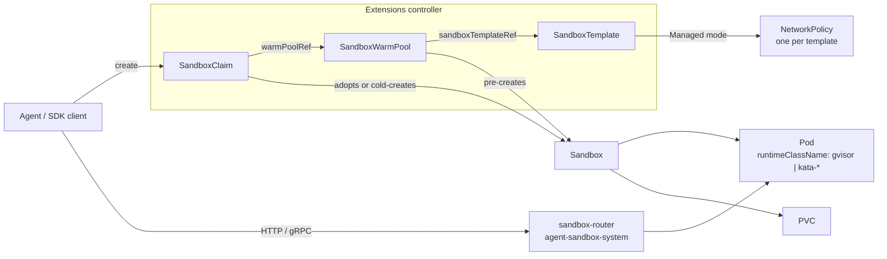

# EKS上のAgent Sandbox：AIエージェント向けの分離されたステートフルランタイム

> **サポート対象バージョン**: Agent Sandbox v1.0.6（API `v1beta1`）、Python SDK `k8s-agent-sandbox` 1.0.6、`cpuOptions.nestedVirtualization` 用の Karpenter v1.13.0+
> **最終更新日**: 2026年10月16日

[Agent Sandbox](https://github.com/kubernetes-sigs/agent-sandbox)（`kubernetes-sigs/agent-sandbox`）は、**分離されたステートフルな単一インスタンスのワークロード**向けに、`Sandbox` カスタムリソースとコントローラーを追加する Kubernetes SIG Apps のサブプロジェクトです。Sandbox は、安定した ID、任意の永続ストレージ、ライフサイクル制御（有効期限、一時停止、再開）を備えた単一の Pod です。これらは Deployment や StatefulSet では直接モデル化できません。一般的な利用者は、LLM が生成したコードを実行する AI エージェント、強化学習（RL）のロールアウト、ノートブック、ユーザーごとの開発環境です。

この章では、タグ `v1.0.6` 時点の API と、Amazon EKS で実行する際の違いについて説明します。具体的には、ランタイム分離の選択肢、Amazon VPC CNI でのデフォルト NetworkPolicy の動作、ルーターのプライベートな公開方法、IAM を取り上げます。

> この章の情報は、タグ `v1.0.6` のアップストリームソース（CRD 型、コントローラー、リリースノート、脅威モデル）、AWS ドキュメント、Karpenter のソースに基づいています。この章のマニフェストは EKS クラスターで実行していません。出発点として扱い、ご自身のノードおよびネットワーク構成でテストしてください。

---

## 1. 新しいワークロード API が必要な理由

| 要件 | Deployment | StatefulSet（replicas: 1）+ Service + PVC | Sandbox |
|------|------------|------------------------------------------|---------|
| 安定した名前を持つ Pod が厳密に1つ | いいえ（ランダムな接尾辞） | はい（`name-0`） | はい（Pod 名 = Sandbox 名） |
| Pod の再起動後も存続するインスタンスごとのストレージ | いいえ | はい | はい（`volumeClaimTemplates`） |
| オブジェクトとボリュームを保持したままコンピューティングを停止 | 0 にスケール（すべてのレプリカ） | 0 にスケール | `operatingMode: Suspended` |
| 絶対有効期限 | いいえ | いいえ | `shutdownTime` + `shutdownPolicy` |
| オンデマンドで提供する事前ウォームアップ済みインスタンス | いいえ | いいえ | `SandboxWarmPool` + `SandboxClaim` |
| 信頼できないコード向けのセキュアなデフォルト | いいえ | いいえ | `SandboxTemplate`（SA トークンなし、NetworkPolicy 管理） |

エージェントプラットフォームでは通常、数千もの短期間だけ使われる、または大半の時間アイドル状態にある環境が必要で、それぞれが1つのセッションまたはユーザーに属します。各環境をサイズ1の StatefulSet と Service、PVC の組み合わせでモデル化することはできますが、有効期限、ウォームプール、Claim のレイテンシ、分離のデフォルト設定は独自コードに委ねられます。

### プロジェクトの状況（2026年10月16日）

| 項目 | 値 |
|------|-------|
| リポジトリ作成日 | 2025年8月12日 |
| v1.0.0 | 2026年8月28日：`v1alpha1` と変換 Webhook を削除し、すべての CRD が `v1beta1` のみを提供 |
| 最新リリース | v1.0.7（2026年10月15日）。v1.0.0 以降、パッチリリースは毎週公開されています。この章は v1.0.6 に基づきます |
| API グループ | `agents.x-k8s.io/v1beta1`（コア）、`extensions.agents.x-k8s.io/v1beta1`（拡張機能） |
| コントローラーの Namespace | `agent-sandbox-system` |
| SDK | Python（`k8s-agent-sandbox`、Python ≥ 3.11）、Go（`sigs.k8s.io/agent-sandbox/clients/go/sandbox`）、TypeScript |
| 分離 | Pod の `RuntimeClass`（例：gVisor または Kata Containers）に委譲 |

プロジェクトのバージョンは 1.0 ですが、API バージョンは引き続き `v1beta1` です。リリースを固定し、各リリースの「Breaking Changes / Action Required」セクションを確認してください。いくつかのパッチリリース（v1.0.2、v1.0.5、v1.0.6、v1.0.7）には対応が必要な項目が含まれています。

---

## 2. アーキテクチャ



| 種類 | グループ | 短縮名 | 役割 |
|------|-------|-----------|------|
| `Sandbox` | `agents.x-k8s.io` | `sandbox` | 安定した ID、任意の PVC と headless Service、ライフサイクル制御、一時停止を備えた単一の Pod |
| `SandboxTemplate` | `extensions.agents.x-k8s.io` | `sandboxtemplate` | 再利用可能な設計図とプラットフォームポリシー（NetworkPolicy、環境変数とボリュームの挿入ルール） |
| `SandboxWarmPool` | `extensions.agents.x-k8s.io` | `swp` | テンプレートから未 Claim の Sandbox を N 個、利用可能な状態に保つ。HPA 用の scale サブリソースを持つ |
| `SandboxClaim` | `extensions.agents.x-k8s.io` | `sandboxclaim` | ウォームプールから Sandbox を要求し、引き継ぎ後はその Sandbox を所有する |

関連コンポーネント：

- **sandbox-router**（任意）：`X-Sandbox-ID` ヘッダー、または `--path-routing-prefix` を使う場合は URL パスに基づいてルーティングする Go 製 HTTP リバースプロキシ（`registry.k8s.io/agent-sandbox/sandbox-router-go`）。v1.0.2 以降、マニフェストは `agent-sandbox-system` に置かれています。また、Sandbox UID、ポート、メソッド、パスに紐付いた Ed25519 のスコープ付きトークン（v2）をサポートします。
- **sandboxd**：Sandbox 内で動作するランタイムデーモン（`:8080` の REST ファイルシステム、`:9090` の gRPC `ProcessService`）。SDK からコマンド、ファイル、対話型プロセスに利用できます。

---

## 3. コアの `Sandbox` リソース

```yaml
apiVersion: agents.x-k8s.io/v1beta1
kind: Sandbox
metadata:
  name: py-session-42           # also the Pod name; ≤ 63 chars when spec.service is true
  namespace: agents
spec:
  podTemplate:
    metadata:
      labels:
        team.example.com/owner: data-science
    spec:
      runtimeClassName: gvisor   # isolation comes from the runtime, not from Agent Sandbox
      automountServiceAccountToken: false
      containers:
      - name: runtime
        image: <your-registry>/python-runtime:<tag>
        ports:
        - containerPort: 8888
        resources:
          requests: { cpu: 250m, memory: 512Mi }
          limits:   { cpu: "1",  memory: 1Gi }
  volumeClaimTemplates:          # immutable after creation
  - metadata:
      name: workspace
    spec:
      accessModes: [ReadWriteOnce]
      storageClassName: gp3
      resources:
        requests:
          storage: 5Gi
  service: true                  # create a headless Service named after the Sandbox
  operatingMode: Running         # or Suspended
  shutdownTime: "2026-10-14T00:00:00Z"
  shutdownPolicy: Delete         # default Retain
```

`v1beta1` におけるフィールドの動作：

| フィールド | 動作 |
|-------|----------|
| `podTemplate` | 必須。`agents.x-k8s.io/` と `extensions.agents.x-k8s.io/` 配下のシステム予約キーはコントローラーによって除外されますが、それ以外のラベルとアノテーションは Pod に引き継がれます。 |
| `volumeClaimTemplates` | Sandbox ごとに PVC を作成します。不変です（CEL ルール）。 |
| `service` | 未設定：新しい Service は作成されません（後方互換性のため既存のものは保持されます）。`true`：Sandbox と同名の headless Service。`false`：Service を削除します。 |
| `operatingMode` | `Running`（デフォルト）は Pod を維持します。`Suspended` は Sandbox オブジェクトと PVC を保持したまま Pod を削除します。 |
| `shutdownTime` | 絶対有効期限。この時刻に Pod と Service が削除されます。 |
| `shutdownPolicy` | `Retain`（デフォルト）は `Ready=False, reason=SandboxExpired` の Sandbox オブジェクトを保持します。`Delete` は削除します。 |

ステータス条件は Gateway API の規約に従います。

| 条件 | 意味 |
|-----------|---------|
| `Ready` | Pod が Running かつ Ready で IP を持ち（必要な場合は Service も存在する）ときに限り True になります。False の理由には `DependenciesNotReady`、`SandboxSuspended`、`SandboxExpired`、`InvalidConfiguration`、`ReconcilerError` があります。 |
| `Suspended` | 一時停止の進行状況を示します：`PodTerminating` の後に `PodTerminated` となり、再び実行されると `NotSuspended` になります。 |
| `PodScheduled` | Pod の `PodScheduled` 条件を反映します（例：`Unschedulable`）。Pod を直接確認する必要はありません。 |
| `Finished` | Pod が `Succeeded` または `Failed` に達したときに設定されます。 |

`status` には `serviceFQDN`、`podIPs`、`nodeName` も含まれます。

> **v1.0.6 の対応事項**：CEL ルールにより、`spec.service` が `true` のときに名前が63文字を超える Sandbox は拒否されるようになりました（Service 名は DNS-1035 ラベルであるためです）。既存オブジェクトも例外ではないため、`spec.service` を未設定にするか、短い名前で再作成するまで、ステータス更新を含むすべての更新が失敗します。

---

## 4. 拡張機能：Template、Warm Pool、Claim

### SandboxTemplate：プラットフォームポリシーの設定場所

```yaml
apiVersion: extensions.agents.x-k8s.io/v1beta1
kind: SandboxTemplate
metadata:
  name: python-gvisor
  namespace: agents
spec:
  podTemplate:
    metadata:
      annotations:
        karpenter.sh/do-not-disrupt: "true"   # optional: keep consolidation away from live sessions
    spec:
      runtimeClassName: gvisor
      containers:
      - name: python-runtime
        image: <your-registry>/python-runtime-sandbox:<tag>
        ports:
        - containerPort: 8888
        readinessProbe:
          httpGet: { path: "/", port: 8888 }
          periodSeconds: 1
        resources:
          requests: { cpu: 250m, memory: 512Mi, ephemeral-storage: 512Mi }
          limits:   { cpu: "1",  memory: 1Gi }
  networkPolicyManagement: Managed      # default
  # networkPolicy: omitted -> controller applies its secure default (section 6)
  envVarsInjectionPolicy: Disallowed    # default; Allowed | Overrides
  volumeClaimTemplatesPolicy: Disallowed  # default; Allowed | Overrides
```

テンプレート経由（ウォームプールまたは Claim 経由）で作成される Sandbox に適用されるセキュアなデフォルト：

- PodSpec で `automountServiceAccountToken` が設定されていない場合、コントローラーが `false` に設定します。
- `networkPolicyManagement: Managed`（デフォルト）の場合、コントローラーは**テンプレートごとに共有 NetworkPolicy を1つ**作成します。そのルールを変更すると、そのテンプレートから作成された既存および今後のすべての Sandbox に対する適用内容が変わります。
- テンプレートで許可しない限り、Claim から環境変数やボリュームテンプレートを挿入することはできません。

通常の `Sandbox` には、これらのデフォルトは適用されません。ユーザーが `Sandbox` オブジェクトを直接作成できる場合は、Admission Control（ValidatingAdmissionPolicy、Kyverno、Gatekeeper）を使用するか、`SandboxClaim` のみを操作できる RBAC を付与してください。

### SandboxWarmPool：事前作成されたキャパシティ

```yaml
apiVersion: extensions.agents.x-k8s.io/v1beta1
kind: SandboxWarmPool
metadata:
  name: python-gvisor-pool
  namespace: agents
spec:
  replicas: 10                 # default 1; scale subresource, so an HPA can own it
  sandboxTemplateRef:
    name: python-gvisor
  updateStrategy:
    type: OnReplenish          # default; Recreate replaces stale unclaimed Sandboxes at once
```

テンプレートの設計図が変更されると、未 Claim の Sandbox は古い状態になります。`OnReplenish` は Claim または削除されるタイミングでのみ置き換えますが、`Recreate` は直ちに削除します。すでに Claim された Sandbox は、所有権が Claim に移っているため変更されません。

### SandboxClaim：エージェントセッションからの要求

```yaml
apiVersion: extensions.agents.x-k8s.io/v1beta1
kind: SandboxClaim
metadata:
  name: session-7f3a
  namespace: agents
spec:
  warmPoolRef:
    name: python-gvisor-pool
  lifecycle:
    shutdownTime: "2026-10-13T12:00:00Z"
    shutdownPolicy: Delete       # Delete | DeleteForeground | Retain (default)
    ttlSecondsAfterFinished: 600
```

- Claim は、プールから Ready 状態の Sandbox を引き継ぎます。`--sandbox-claim-warm-candidate-grace-period`（デフォルト `2s`、v1.0.6 で追加）の時間内に Pod IP を報告するウォーム候補がなければ、コールド起動に切り替えて作成します。
- `spec.env` または `spec.volumeClaimTemplates` を設定すると、Pod 作成前にこれらの値を反映する必要があるため、常にコールド起動になります。
- `additionalPodMetadata` のラベルには、許可されたドメインを使用する必要があります（デフォルトは `sandbox.users.io`。`agent-sandbox-config` ConfigMap で設定可能）。
- `status.sandbox` は、バインドされた Sandbox の `name`、`podIPs`、`serviceFQDN` を報告します。

---

## 5. EKS での分離：RuntimeClass の選択

Agent Sandbox はオーケストレーターです。その脅威モデルでは、`runtimeClassName` で選択した、より強固なランタイムで Pod を実行することでコンテナエスケープを緩和するとされています。ユーザーが無効化できないよう、`SandboxTemplate` で設定することが推奨されます。デフォルトの `runc` では、LLM が生成したコードはノード上の他のすべての Pod とノードカーネルを共有します。

| EKS での選択肢 | 分離境界 | ノード要件 | 備考 |
|---------------|-------------------|-------------------|-------|
| `runc`（デフォルト） | Linux namespace と cgroup | 任意 | 共有ノード上で信頼できないコードを実行するには不十分 |
| gVisor（`runsc`） | ユーザー空間のアプリケーションカーネル | `runsc` と `containerd-shim-runsc-v1` をインストールし、containerd にハンドラー `runsc` を登録 | 通常の仮想化インスタンスで動作します。一部の syscall やワークロードは挙動が異なるためテストしてください |
| Kata Containers | Pod ごとの軽量 VM | ハードウェア仮想化：ベアメタル（`*.metal`）インスタンス、またはネストされた仮想化を備えたインスタンス | これらの選択肢で最も強い分離境界ですが、Pod ごとのオーバーヘッドは大きくなります |
| テナントごとの専用ノード | EC2 インスタンス | Taint、Toleration、Node Selector | gVisor または Kata と組み合わせ可能 |

EKS 固有の注意点：

- **EKS Auto Mode**：AMI とコンテナランタイムは AWS が選択・管理し、インスタンスには SSH でアクセスできないため、そこに `runsc` や Kata を追加することはできません。Sandbox 用ノードプールには、マネージドノードグループ、セルフマネージドノード、またはカスタム AMI かユーザーデータを使う Karpenter を使用してください。
- **gVisor**：カスタム AMI または起動時にバイナリをインストールし、ランタイムハンドラーを登録します。AL2023 では、nodeadm の `NodeConfig` は `spec.containerd.config` にインライン TOML を指定できます。containerd 1.x は設定バージョン2（`plugins."io.containerd.grpc.v1.cri"`）を、2.x はバージョン3（`plugins."io.containerd.cri.v1.runtime"`）を使うため、ランタイムセクションを記述する前に AMI 上で `containerd --version` を確認してください。
- **Kata とネストされた仮想化**：EC2 は、M7i、M7i-flex、M8i、M8id、M8i-flex、C7i、C7i-flex、C8i、C8id、C8i-flex、R7i、R7iz、R8i、R8id、R8i-flex、X8i、I7i、I7ie で、CPU オプション `NestedVirtualization=enabled` によって有効化するネストされた仮想化（L1 として KVM または Hyper-V）をサポートします。性能が重要なワークロードには、AWS はベアメタルを推奨しています。
  - Karpenter v1.13.0 以降では、`EC2NodeClass` の `spec.cpuOptions.nestedVirtualization: enabled` が公開され、`nested-virtualization` を報告するインスタンスタイプに絞り込まれます。
  - マネージドノードグループについては、containers-roadmap の要望（[#2784](https://github.com/aws/containers-roadmap/issues/2784)）は、ユーザーから起動テンプレートの設定が反映されるとの報告があった後、2026年10月12日に対応済みとしてクローズされました。これを前提とする前に、テストノードで確認してください（`grep -cE 'vmx|svm' /proc/cpuinfo`）。
- **Fargate** は Pod ごとに独自の VM で実行されますが、VPC CNI は Fargate Pod にネットワークポリシーを適用できないため、テンプレートの管理対象 NetworkPolicy はそこで適用されません。選択する前に Fargate に関する考慮事項を確認してください。

Sandbox Pod がハンドラーのないノードに配置されないよう、準備済みノードに RuntimeClass を紐付けます。

```yaml
apiVersion: node.k8s.io/v1
kind: RuntimeClass
metadata:
  name: gvisor
handler: runsc
scheduling:
  nodeSelector:
    sandbox.example.com/runtime: gvisor
  tolerations:
  - key: sandbox.example.com/untrusted
    operator: Exists
    effect: NoSchedule
---
# Karpenter: a NodeClass for Kata nodes on nested-virtualization instances
apiVersion: karpenter.k8s.aws/v1
kind: EC2NodeClass
metadata:
  name: kata-nested
spec:
  cpuOptions:
    nestedVirtualization: enabled   # Karpenter >= v1.13.0
  # amiSelectorTerms, role, subnetSelectorTerms, securityGroupSelectorTerms,
  # and user data that installs Kata are omitted here.
```

---

## 6. EKS でのネットワーキング

### 管理対象のデフォルトポリシーの動作

テンプレートで `networkPolicy` を指定せず、`Managed` モードを維持すると、コントローラーは次のポリシーを生成します（v1.0.6 の `buildDefaultNetworkPolicySpec` に基づく）。

| 方向 | ルール |
|-----------|------|
| Ingress | Namespace `agent-sandbox-system` 内で `app: sandbox-router` ラベルを持つ Pod からのみ許可 |
| Egress（IPv4） | `0.0.0.0/0` から `10.0.0.0/8`、`172.16.0.0/12`、`192.168.0.0/16`、`169.254.0.0/16` を除外 |
| Egress（IPv6） | `::/0` から `fc00::/7`、`fe80::/10` を除外 |
| DNS | 許可されません。CoreDNS はプライベート IP を持ち、コードコメントでは内部サービスディスカバリーを防ぐため意図的な設定とされています。 |

EKS での影響：

1. **適用にはポリシーエンジンが必要です。** Amazon VPC CNI アドオン（バージョン 1.21.0 以降）でネットワークポリシーを有効にします（`enableNetworkPolicy: "true"`）。Auto Mode では、`kube-system` の `amazon-vpc-cni` ConfigMap で `enable-network-policy-controller: "true"` を設定します。NodeClass の `networkPolicy` 設定は任意です。適用が有効でない場合、NetworkPolicy オブジェクトは存在しても何もブロックしません。
2. **デフォルトではパブリックホスト名を名前解決できません。** DNS を許可するか、Pod に別のリゾルバーを指定するまで、`pip install` や名前を使ったパブリック API 呼び出しは失敗します。
3. **プライベート範囲の一覧は VPC のアドレス計画を反映したものではありません。** デフォルトで到達可能な範囲を確認してください。
   - RFC1918 の範囲外にある VPC CIDR（例：VPC CNI のカスタムネットワーキングで使われるセカンダリ CIDR `100.64.0.0/10`）は**除外されません**。
   - IPv4 クラスターでは、IMDS（`169.254.169.254`）と Route 53 Resolver（`169.254.169.253`）はブロックされます。これは意図された動作です。EKS Pod Identity Agent（`169.254.170.23`）もブロックされるため、デフォルトポリシーでは Pod Identity の認証情報は機能しません。
   - **IPv6 クラスター**では、VPC CNI は IPv4 ルールを無視し、IPv6 ルールのみを適用します。IMDS、Resolver、Pod Identity Agent の IPv6 アドレス（`fd00:ec2::254`、`fd00:ec2::253`、`fd00:ec2::23`）は `fc00::/7` に含まれ、ブロックされます。ただし、Pod とノードのアドレスは VPC の IPv6 CIDR に属するグローバルユニキャストアドレスであり、`::/0` ルールで許可されます。
   - IPv6 クラスターでは、VPC CNI は Pod のプライマリインターフェイス（`eth0`）にのみポリシーを適用します。IPv4 egress が有効（`ENABLE_V4_EGRESS=true`）な場合、IPv4 トラフィックはポリシーでフィルタリングされない追加インターフェイスを経由します。これには `169.254.169.254` や RFC1918 アドレス宛ての通信も含まれます。不要であれば Sandbox ノードでは IPv4 egress を無効にし、IMDS のホップ制限を1にしてください。
   - VPC インターフェイスエンドポイントはプライベート IP を持つためブロックされます。AWS API を呼び出す場合、NAT 経由でパブリックエンドポイントに接続します。
4. **クラスター内への直接接続はブロックされます。** Ingress はルーターからのみ許可されるため、in-cluster モードの SDK（Service DNS または Pod IP）を使うエージェント Pod には、その Namespace からの明示的な ingress ルールが必要です。

VPC が `10.0.0.0/16` と `100.64.0.0/16` の Pod CIDR を使う IPv4 クラスター向けのカスタムポリシーは、次のようになります。CoreDNS のみへの DNS を許可し、エージェント Namespace からの直接接続を許可し、パブリック egress からすべての VPC 範囲を除外します。

```yaml
spec:
  networkPolicyManagement: Managed
  networkPolicy:
    ingress:
    - from:
      - namespaceSelector:
          matchLabels: { kubernetes.io/metadata.name: agent-sandbox-system }
        podSelector:
          matchLabels: { app: sandbox-router }
      - namespaceSelector:
          matchLabels: { kubernetes.io/metadata.name: agent-orchestrator }
      ports:
      - { protocol: TCP, port: 8888 }
    egress:
    - to:
      - namespaceSelector:
          matchLabels: { kubernetes.io/metadata.name: kube-system }
        podSelector:
          matchLabels: { k8s-app: kube-dns }
      ports:
      - { protocol: UDP, port: 53 }
      - { protocol: TCP, port: 53 }
    - to:
      - ipBlock:
          cidr: 0.0.0.0/0
          except: [10.0.0.0/8, 172.16.0.0/12, 192.168.0.0/16, 169.254.0.0/16, 100.64.0.0/10]
```

CoreDNS を許可すると、Sandbox が内部 Service 名を名前解決できるようになります。それが問題になる場合は DNS をブロックしたまま、到達可能なリゾルバーを指定して Pod に明示的な Resolver を設定してください（`dnsPolicy: None` と `dnsConfig.nameservers` を使用します）。FQDN 単位の egress 許可リストには、それをサポートする CNI またはプロキシを使ってください。Kubernetes NetworkPolicy が照合できるのは IP ブロックと Selector のみです。VPC CNI がカウントするポートとプロトコルの組み合わせは、すべてのポリシーを通じて CIDR ごとに最大24個です。

### ルーターの公開

アップストリーム SDK の例には、パブリッククラウドロードバランサー経由でトラフィックを送る「Gateway mode」が含まれています。EKS ではデータプレーンをプライベートに保ちます。

| 呼び出し元 | 経路 |
|--------|------|
| 同じクラスター内のエージェント | SDK の in-cluster モードで Pod に直接接続（上記の ingress ルールを追加）、またはポート8080の `sandbox-router-svc` ClusterIP Service |
| 開発者のラップトップまたは CI | SDK の tunnel モード（ルーター Service への `kubectl port-forward`） |
| ブラウザーまたは外部クライアント | CloudFront → CloudFront VPC origin → **internal** ALB → router Service。internal ALB のセキュリティグループでは、CloudFront VPC origin のセキュリティグループまたは CloudFront 管理プレフィックスリストからの通信のみを許可します。経路上でインターネットに公開されるのは CloudFront のみです。 |

ルーターのデフォルトのオーソライザーは `AllowAll` です。脅威モデルによると、オーソライザーが設定されていない場合、`X-Sandbox-Pod-IP` に含まれるローカル IP とメタデータ IP のリテラルを拒否することが、唯一の SSRF 防御策です。クラスター外にルーターを公開する前に、スコープ付きトークン v2 による認可を有効にし（Ed25519 を使用し、Sandbox UID、ポート、メソッド、パスに紐付ける。v2 では Pod-IP の上書きは拒否されます）、ルーター自体が WebSocket に対して実施しないレート制限と接続数制限を ALB または Envoy 層で適用してください。

---

## 7. IAM と認証情報

- `automountServiceAccountToken: false` のままにしてください（テンプレートのデフォルト）。Kubernetes API にトークンでアクセスできるエージェントは、権限昇格を試みる可能性があります。
- デフォルトでは Sandbox Pod に AWS 認証情報を付与しないでください。IPv4 クラスターでは管理対象ポリシーによって IMDS と Pod Identity Agent がすでにブロックされていますが、IPv6 クラスターからの IPv4 egress には当てはまりません（セクション6）。第2の防御策として、Sandbox ノードでは IMDSv2 を必須にし、ホップ制限を1にしてください。
- Sandbox から AWS を呼び出す必要がある場合は、可能な限り権限を絞った専用 ServiceAccount を使い、1つの Namespace にスコープを限定したうえで、NetworkPolicy を意図的に変更してください（Pod Identity には `169.254.170.23/32`、IPv6 クラスターでは `fd00:ec2::23/128` のポート80が必要です。IRSA にはリージョナル STS エンドポイントが必要です）。これをポリシーの例外として記録してください。
- エンドユーザーには、自身の Namespace 内の `SandboxClaim` のみを操作できる RBAC を付与してください。`SandboxTemplate` と `SandboxWarmPool` はプラットフォームチームが管理します。

---

## 8. インストールとアップグレード

```bash
export VERSION=v1.0.6
# Core + extensions (recommended; works with Argo CD / Flux as plain manifests)
kubectl apply -f "https://github.com/kubernetes-sigs/agent-sandbox/releases/download/${VERSION}/sandbox-with-extensions.yaml"

kubectl get crd sandboxes.agents.x-k8s.io \
  sandboxclaims.extensions.agents.x-k8s.io \
  sandboxtemplates.extensions.agents.x-k8s.io \
  sandboxwarmpools.extensions.agents.x-k8s.io
kubectl -n agent-sandbox-system get deploy agent-sandbox-controller

# Optional router: apply the manifests from sandbox-router/deploy/ at the same tag,
# and pin the image to registry.k8s.io/agent-sandbox/sandbox-router-go:${VERSION}
```

- タグごとのリリースアセット：`sandbox.yaml`（コア）、`extensions.yaml`、`sandbox-with-extensions.yaml`。コントローラーとルーターのイメージは、対応する `v1.0.x` タグで `registry.k8s.io/agent-sandbox/` に公開されています。
- リポジトリには Helm Chart（`helm/`、v1.0.6 時点の Chart バージョンは 0.1.2）があります。チェックアウトしたリポジトリからインストールします（`helm install agent-sandbox ./helm/`）。Chart リポジトリは公開されていません。
- **v0.5.0 より前のバージョンからのアップグレード**：v1.x への直接アップグレードはサポートされていません。v0.5.2 以降にアップグレードし、保存済みオブジェクトを `v1beta1` に移行して、すべての CRD の `status.storedVersions` に `v1beta1` のみが記載されていることを確認してからアップグレードしてください。Helm ユーザーは `helm upgrade` の前に `helm/crds/` を適用してください。
- v1.0.0 以降のその他の対応事項：
  - v1.0.0 では `agents.x-k8s.io/pod-name` アノテーションの書き込みが停止されました。`.metadata.name` を使用してください。
  - v1.0.2 ではルーターマニフェストが `default` から `agent-sandbox-system` に移動し、Go の `Authorizer` インターフェイスが変更されました。
  - v1.0.6 では63文字の名前ルールが追加され、スコープ付きトークン v2 と `proxy.Lookup` の契約が変更されました。
- アンインストール：CRD を削除すると、クラスター内のすべての Sandbox、Claim、Template、Pool がカスケード削除されます。削除前に一覧表示してください。

---

## 9. Python SDK の使用

```bash
pip install k8s-agent-sandbox==1.0.6
```

```python
from k8s_agent_sandbox import SandboxClient
from k8s_agent_sandbox.models import SandboxLocalTunnelConnectionConfig

# Tunnel mode: port-forward to sandbox-router-svc in agent-sandbox-system
client = SandboxClient(connection_config=SandboxLocalTunnelConnectionConfig())

sandbox = client.create_sandbox(warmpool="python-gvisor-pool", namespace="agents")
try:
    result = sandbox.commands.run("python -c 'print(2 + 2)'")
    print(result.stdout)
finally:
    sandbox.terminate()
```

- `create_sandbox` は、指定されたウォームプールに対する `SandboxClaim` を作成します。`env=` を渡すとコールド起動になります。
- リトライ可能なワークフローでは、安定した `claim_name` を `adopt_existing=True` とともに渡してください。`409 Conflict` が発生すると、既存の Claim を引き継ぎます。`shutdown_after_seconds` で有効期限を設定すると、クライアントがクラッシュしても Sandbox が残りません。
- その他の接続設定：`SandboxInClusterConnectionConfig`（レガシーランタイム。Pod IP を先に使い、次にクラスター DNS を使用）、`SandboxdInClusterConnectionConfig`（v1.0.6 以降、`in-cluster-service` と `in-cluster-pod-ip` モード）、`SandboxDirectConnectionConfig`（明示的な URL、任意の mTLS）、asyncio 用の `AsyncSandboxClient`。
- リポジトリには、LangChain、OpenAI Agents、Deep Agents、NVIDIA NeMo Gym、Gymnasium、Ray RLlib のサンプルに加え、MCP サーバーとの統合例が含まれています。

---

## 10. 大規模運用

| 検討事項 | 対応方法 |
|---------|-----------|
| Claim のレイテンシ | 需要に応じてウォームプールのサイズを調整します。`launch_type`（warm または cold）ごとの `agent_sandbox_claim_controller_startup_latency_ms` を監視します。IPAM の遅いクラスターでコールド起動へのフォールバックが増加した場合は、`--sandbox-claim-warm-candidate-grace-period` を引き上げてください。 |
| プールのサイズ調整 | プールおよび Readiness ごとの `agent_sandbox_warmpool_size` と `agent_sandboxes` のゲージを使います。プールの scale サブリソースにより、HPA または KEDA から `replicas` を制御できます。 |
| API サーバーの負荷 | 補充の集中は Claim と競合します。プロジェクトのドキュメントには、APF の `FlowSchema` / `PriorityLevelConfiguration` マニフェストと、Helm Chart の `controller.*` 配下で公開されるコントローラーフラグ（`--api-connections`、`--sandbox-warm-pool-replenish-delay`、write-behind ウィンドウ）が記載されています。 |
| ノードの統合 | Karpenter は、アイドル状態のウォーム Pod や実行中のセッションがあるノードを統合する可能性があります。セッション Pod のテンプレートの Pod メタデータに `karpenter.sh/do-not-disrupt: "true"` を追加し、Sandbox ノードには別の NodePool を使用してください。 |
| 一時停止と再開 | `Suspended` は PVC を保持したまま Pod を削除します。EBS ボリュームはアベイラビリティーゾーンに紐付くため、再開した Pod はボリュームと同じ AZ にスケジュールされる必要があります。その場所にキャパシティを確保するか、再開パターンに合った StorageClass を使用してください。 |
| クリーンアップ | 常に `shutdownTime`（または SDK の `shutdown_after_seconds`）と Claim の `ttlSecondsAfterFinished` を設定してください。`Retain` は調査用にオブジェクトを残します。 |
| リソースの不正使用 | テンプレートに requests と limits を設定し、テナントの Namespace ごとに `LimitRange` と `ResourceQuota` を設定してください。 |

---

## 11. 適した用途

| 状況 | 推奨事項 |
|-----------|----------------|
| EKS 上のセルフホスト型エージェントプラットフォームで、セッションごとに信頼できないコードを実行する | テンプレート、gVisor または Kata ノード、プライベートルーターを使う Agent Sandbox |
| 数千もの短期間の分離環境を必要とする RL または評価のロールアウト | Agent Sandbox のウォームプールを使用し、プロジェクトの性能チューニングと APF のガイドに従う |
| 安定した名前を持つ、少数の長期間稼働する単一 Pod のサービス | StatefulSet の方がシンプルな場合があります。有効期限や一時停止が必要になった時点で Agent Sandbox が役立ちます |
| コード実行用のランタイムやノードを運用したくない | マネージドコード実行サービス（例：Amazon Bedrock AgentCore Code Interpreter）を検討し、その分離、ネットワーク、データレジデンシーモデルが要件に合うか比較してください |

### 本番前チェックリスト

- [ ] リリースを固定（`v1.0.6`）し、アップグレード前に各リリースの対応事項を確認済み
- [ ] すべてのテンプレートで `runtimeClassName` を設定し、RuntimeClass に準備済みノード向けの `scheduling` を設定済み
- [ ] ユーザーには `SandboxClaim` の RBAC のみを付与。通常の `Sandbox` 作成は Admission Policy で制限または検証済み
- [ ] VPC CNI のネットワークポリシー適用を有効化し、プローブ Pod でテスト済み（DNS、IMDS、VPC CIDR、他の Sandbox）。IPv6 クラスターでは IPv4 egress 経路も確認済み
- [ ] egress の例外で、RFC1918 以外および IPv6 の範囲を含むすべての VPC CIDR を考慮済み
- [ ] ルーターはプライベートな経路でのみ到達可能。スコープ付きトークン v2 の認可を有効化済み
- [ ] すべての Claim に `shutdownTime` または SDK の有効期限を設定し、Namespace ごとに Quota を設定済み
- [ ] コントローラーとウォームプールのメトリクスを収集し、アラートを設定済み

---

## 参考資料

- [kubernetes-sigs/agent-sandbox](https://github.com/kubernetes-sigs/agent-sandbox) および[ドキュメントサイト](https://agent-sandbox.sigs.k8s.io/docs/)
- [リリース v1.0.6](https://github.com/kubernetes-sigs/agent-sandbox/releases/tag/v1.0.6) · [リリース v1.0.0](https://github.com/kubernetes-sigs/agent-sandbox/releases/tag/v1.0.0) · [ロードマップ](https://github.com/kubernetes-sigs/agent-sandbox/blob/main/roadmap.md)
- [脅威モデル（v1.0.6）](https://github.com/kubernetes-sigs/agent-sandbox/blob/v1.0.6/docs/security/threat_model.md)
- [CRD 型：Sandbox](https://github.com/kubernetes-sigs/agent-sandbox/blob/v1.0.6/api/v1beta1/sandbox_types.go) · [拡張機能](https://github.com/kubernetes-sigs/agent-sandbox/tree/v1.0.6/extensions/api/v1beta1) · [デフォルトの NetworkPolicy](https://github.com/kubernetes-sigs/agent-sandbox/blob/v1.0.6/extensions/controllers/sandboxtemplate_controller.go)
- [Python SDK README（v1.0.6）](https://github.com/kubernetes-sigs/agent-sandbox/blob/v1.0.6/clients/python/agentic-sandbox-client/README.md) · [メトリクス](https://github.com/kubernetes-sigs/agent-sandbox/blob/v1.0.6/docs/metrics.md)
- [Amazon EC2 のネストされた仮想化](https://docs.aws.amazon.com/AWSEC2/latest/UserGuide/amazon-ec2-nested-virtualization.html)
- [Kubernetes ネットワークポリシーによる Pod トラフィックの制限（Amazon EKS）](https://docs.aws.amazon.com/eks/latest/userguide/cni-network-policy.html)
- [gVisor のインストール](https://gvisor.dev/docs/user_guide/install/) · [Kata Containers](https://katacontainers.io/)
- 関連する章：[EKS 上の Agentic AI プラットフォーム](03-agentic-ai-platform.md) · [LLM Gateway](08-llm-gateway.md) · [Pod Security Standards](../security/03-pod-security-standards.md)
