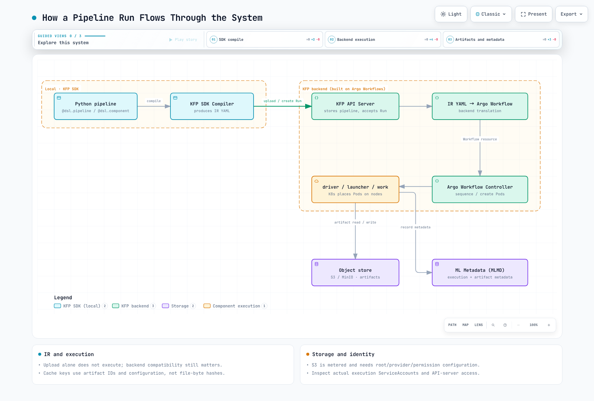

# パート 2: Kubeflow Pipelines

> **サポート対象バージョン**: Kubeflow Pipelines 2.16.1, Kubeflow Community Distribution 26.03.1
> **確認済みの最新独立リリース**: KFP 2.17.2（2026年9月4日、PyPI 上の最新 `kfp` SDK: 2.17.0）。2026年10月12日確認。例では 2.16.1 を使用
> **最終更新**: 2026年10月12日

## ラボ環境のセットアップ

ローカルコンパイルには Python と `kfp==2.16.1` が必要です。この章は Python 3.12 で確認しました。アップストリームの KFP 2.17.2 は利用可能です（PyPI 上の最新 `kfp` SDK パッケージは 2.17.0）が、この固定バージョンは Community Distribution 26.03.1 と一致します。新しい SDK/backend の組み合わせを検証するものではありません。

コンパイルは cluster に接続しません。リモート実行には、互換性のある KFP backend、認証済み client、および namespace 権限が必要です。S3 には、実行用 ServiceAccount の workload identity と、artifact にアクセスする component も必要です。

## Kubeflow Pipelines とは

KFP は、型付き parameter/artifact で component を接続し、Run を追跡します。ここで使用するオープンソースの KFP 2.16.1 backend は、IR を Argo Workflows に変換します。Argo は workflow の順序と Pod の作成を管理し、Kubernetes scheduler は Pod を node に配置します。キャッシュ済み task、importer、ネストした DAG があるため、すべての論理 task が個別の user-container 実行に対応するわけではありません。

## KFP v2 アーキテクチャ: IR YAML と Backend 実行

Community Distribution 26.03.1 には KFP 2.16.1 がバンドルされています。従来の v1 デフォルトコンパイルパスは Argo Workflow YAML を生成しましたが、v2 の `Compiler().compile(...)` は PipelineSpec ベースの IR YAML を生成します。pipeline の upload/storage と Run の作成は別の操作です。upload しただけでは実行されません。

IR を使用すると Argo object を直接記述する必要はありませんが、すべての backend への無制限の portability が保証されるわけではありません。IR/SDK のバージョン、サポートされる機能、Kubernetes platform extension、認証、および storage は、対象環境と一致している必要があります。`kfp` パッケージは client API と Python component の実行サポートも提供します。その役割はコンパイルで終わりません。

## コアコンセプト

| コンセプト | 役割と範囲 |
| --- | --- |
| Pipeline | `@dsl.pipeline` で作成する graph。upload された definition/version と execution は別です |
| Component / Task | 再利用可能な component definition と graph invocation。軽量 Python は container/importer/graph と並ぶ一形態です |
| Run / Experiment | input を伴う execution と、関連する Run のグループ。Katib の Experiment CRD とは異なります |
| Parameter | 文字列、数値、および小規模な構造化 input/output 値 |
| Artifact | URI、type、metadata を持つ Dataset/Model/Metrics スタイルの object。必ずしも単一ファイルではありません |
| MLMD | 登録された execution、artifact、および関係。すべての外部 side effect やファイル整合性を自動記録するものではありません |

metadata record と artifact の byte は別です。再現性とコンテンツ検証が重要な場合は、code/image/data の revision と hash を記録してください。

## Pipeline Run がシステムを流れる仕組み



[🔍 インタラクティブな図を表示](https://www.atomai.click/kubernetes-docs/archmaps/en-ai-ml-kubeflow-02-pipelines-0.html)

コンパイルはローカルで行われます。Run の作成後、API server、Argo、KFP driver/launcher、および user container が連携します。launcher/runtime は artifact の path、転送、および metadata を処理します。Kubernetes の node 配置は、Argo の workflow sequencing とは別です。

## EKS 固有の Artifact Storage

確認した distribution のデフォルトインストールには MinIO が含まれますが、すべての KFP インストールまたは artifact URI が MinIO を使用するわけではありません。pipeline root、import された URI、および provider 設定を確認してください。Metrics などの metadata 指向 artifact は、必ずしも metric file ではありません。

S3 では、[最新の object-store guide](https://www.kubeflow.org/docs/components/pipelines/operator-guides/configure-object-store/) を使用して `pipeline_root`、provider、および credential chain を設定してください。S3 には storage、request、および transfer の料金がかかります。無料のデフォルト artifact service ではありません。

すべての環境で `pipeline-runner` が実行用 ServiceAccount であると想定しないでください。Run で選択された account と実際の Pod、および API server/launcher に必要なアクセスを確認してください。IRSA は最新 guide に記載されています。Pod Identity では SDK、agent、association、および runtime support の検証が必要です。この章では AWS integration を実行していません。[パート 1](01-architecture-installation.md) では、これらの境界と従来の AWS distribution の installation limitation について説明しています。

## シンプルな 2 ステップ Pipeline

以下は、KFP v2 SDK の decorator を使用した最小限の `data-prep -> train` pipeline を示しています。最初の component から 2 番目へ型付き `Dataset` artifact を渡します。

```python
from kfp import dsl, compiler
from kfp.dsl import Dataset, Model, Output, Input

@dsl.component(base_image="python:3.12-slim", packages_to_install=["pandas==2.3.3"])
def prepare_data(output_dataset: Output[Dataset]):
    import pandas as pd

    # In a real pipeline this would read from S3 or another source
    df = pd.DataFrame({"feature": [1, 2, 3, 4], "label": [0, 1, 0, 1]})
    df.to_csv(output_dataset.path, index=False)

@dsl.component(base_image="python:3.12-slim", packages_to_install=["scikit-learn==1.7.2", "pandas==2.3.3"])
def train_model(input_dataset: Input[Dataset], output_model: Output[Model]):
    import pandas as pd
    from sklearn.linear_model import LogisticRegression
    import pickle

    df = pd.read_csv(input_dataset.path)
    clf = LogisticRegression().fit(df[["feature"]], df["label"])
    with open(output_model.path, "wb") as f:
        pickle.dump(clf, f)

@dsl.pipeline(name="data-prep-train-pipeline")
def data_prep_train_pipeline():
    prep_task = prepare_data()
    train_task = train_model(input_dataset=prep_task.outputs["output_dataset"])

compiler.Compiler().compile(
    pipeline_func=data_prep_train_pipeline,
    package_path="data_prep_train_pipeline.yaml",
)
```

`Output[Dataset]` から `Input[Dataset]` への接続は、graph dependency と artifact type を記録します。実際の `.path` の準備と転送は runtime で行われます。コンパイルでは storage や training を検証しません。

これらは軽量 Python component です。`@dsl.component` は function code を抽出します。image を自動的に build するわけではありません。`packages_to_install` は、base image 内で実行時に dependency を install します。以前の例では prepare_data に pandas を指定していませんでしたが、現在は両 component が dependency を宣言し、その function body をローカルで確認済みです。本番環境では、dependency を container に事前 build し、その digest を固定して、その container を個別に test してください。ここでの Python image tag と transitive dependency は、完全に lock された build ではありません。

この演習で生成された信頼できる pickle だけを読み込んでください。外部の pickle を読み込むと任意の code が実行される可能性があります。この小さな model は API を示すものであり、model quality の検証結果ではありません。

## Caching の動作

2.16.1 では、key には input parameter 値、input artifact の**名前/ID**、output specification、container image string、command/argument、および PVC 名が含まれます。cache lookup は pipeline 名と namespace の範囲に限定されます。各 lookup で input artifact file の byte を読み取り、hash 化することはありません。

同じ artifact ID の背後にある file、image tag、または外部 database/API state を変更しても、key は変わらない場合があります。既存のキャッシュ済み metadata も、削除された output object が downstream で読み取り可能なままであることを保証しません。data version/hash を明示的な parameter として渡し、変更可能な外部 state または side effect に対しては caching の無効化を検討してください。

```python
# Inside the pipeline function, disable caching for this task.
prep_task.set_caching_options(enable_caching=False)
```

認証済み client の `create_run_from_pipeline_package(..., enable_caching=False)` は、その Run の task caching を上書きします。`None` はコンパイル済み task 設定を維持します。CLI のデフォルトと `KFP_DISABLE_EXECUTION_CACHING_BY_DEFAULT` もコンパイルのデフォルトを変更できます。environment variable は KFP を import する前に設定してください。

## 検証とソース

IR は Python 3.12 / KFP 2.16.1 でコンパイルし、dependency、type、および caching 設定を確認しました。function body は pandas 2.3.3 / scikit-learn 1.7.2 を使用して CPU 上でローカル実行しました。Docker、Argo、cluster cache reuse、S3、および Pod Identity の実行はテストしていません。

- [2.16.1 の cache-key 実装](https://github.com/kubeflow/pipelines/blob/2.16.1/backend/src/v2/cacheutils/cache.go)
- [2.16.1 の cache lookup と reuse](https://github.com/kubeflow/pipelines/blob/2.16.1/backend/src/v2/driver/cache.go)
- [公式 caching guide](https://www.kubeflow.org/docs/components/pipelines/user-guides/core-functions/caching/)
- [軽量 Python component](https://www.kubeflow.org/docs/components/pipelines/user-guides/components/lightweight-python-components/)

## 次のステップ

pipeline を作成、コンパイル、実行した後、次に問われるのは、その pipeline component の背後にある対話的な開発作業がそもそもどこで行われるかです。[パート 3: Kubeflow Notebooks](./03-notebooks.md) では、team が pipeline component にパッケージ化される code を作成し反復する際に使用する、ユーザーごとの notebook environment を扱います。また、このシリーズの後半では、[パート 6: KServe — Kubernetes 上の Model Serving](./06-kserve.md) が、これらの pipeline が最終的に生成する model の serving を扱います。

[メインページに戻る](./README.md)

## クイズ

この章で学んだ内容を確認するには、[トピッククイズ](../../quizzes/ai-ml/kubeflow/02-pipelines-quiz.md) に挑戦してください。
