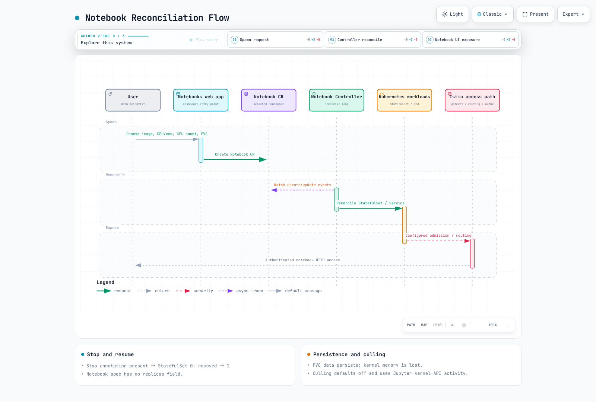

# パート 3: Kubeflow Notebooks

> **サポート対象バージョン**: Kubeflow Notebooks 1.11.0、Community Distribution 26.03.1
> **最終更新日**: 2026年9月12日

## ラボ環境のセットアップ

互換性のある Kubernetes クラスター、Notebooks 1.11.0 のコントローラーと Web アプリ、namespace のアクセス権、ストレージ、および認証済みのアクセス経路を用意してください。ディストリビューションとの互換性は[パート 1](01-architecture-installation.md)を参照してください。GPU ワークロードには、対応するドライバーとデバイスプラグイン、および十分な容量のノードが必要です。Karpenter は容量を確保するプロビジョナーの一つであり、Notebook を利用するための必須要件ではありません。

## Kubeflow Notebooks とは？

Notebooks の Web アプリは、イメージ、リソース、ボリュームの設定を含む `Notebook` リソースを作成します。コントローラーは StatefulSet と Service を管理し、設定されている場合は Istio VirtualService も管理します。StatefulSet コントローラーが Pod を作成し、Kubernetes が Pod をスケジュールします。ダッシュボードは Web アプリへの入口であり、Pod を作成するコンポーネントでも、すべての通信を中継する汎用プロキシでもありません。

namespace スコープの Notebook リソースには PodSpec が含まれており、GitOps または Kubernetes API を使って管理することもできます。コントローラーが管理する StatefulSet を直接編集すると、調整処理によって変更が元に戻される場合があります。

## バージョンの位置付け: Notebooks v1 と Workspaces

この章では、Community Distribution 26.03.1 に含まれる **Notebooks v1.11.0** とその `Notebook` API を扱います。Workspaces は `Workspace` と `WorkspaceKind` を使用する別設計の v2 であり、既存の CRD とそのまま置き換えられるものではありません。

26.03.1 のリリース説明では Workspaces は beta とされています。一方、タグ付けされたコントローラー、バックエンド、フロントエンドのマニフェストが参照するイメージは **v2.0.0-alpha.3** です。リリース説明の表現と、実際にデプロイされるイメージタグを区別してください。この調査は v2 の GA や v1 のサポート終了日を確認したものではありません。導入前に、実際のリリース、API、移行サポートを確認してください。

## マルチテナントモデル: Profile と個別の分離ポリシー

Kubeflow のフル UI では、選択した Profile の namespace に Notebook が作成されます。Profile はチームメンバー間で共有できます。また、Notebook CRD 自体は、すべての namespace に Profile が存在することを要件としていません。スタンドアロン構成とフルプラットフォームのアクセスモデルにも違いがあります。

Profile の所有者やメンバーの管理、RBAC、Istio AuthorizationPolicy は、アクセス制御の一部を担います。ただし、これらによって無関係な RBAC の許可が取り消されるわけではなく、すべての Pod 通信、ストレージアクセス、AWS アクセスが自動的に遮断されるわけでもありません。NetworkPolicy の適用状況、Pod の権限、ボリュームのアクセス権、ワークロード IAM、アプリケーション側の認可をそれぞれ評価してください。

### 永続ストレージ

デフォルト設定の UI は通常、workspace PVC を `/home/jovyan` にマウントします。Pod の置き換え後も保持されるのは、**このボリュームに保存されたデータだけ**です。`/opt/conda` やシステムディレクトリ、コンテナの書き込みレイヤーにインストールしたパッケージと、メモリ上のカーネル状態は、その PVC では保持されません。ホームディレクトリ内のユーザーパッケージは保持されることがありますが、新しいイメージと互換性がなくなる可能性があります。

PVC とボリュームのライフサイクル、バックアップ、回収ポリシーを確認してください。EBS の ReadWriteOnce は、**1つのノード**から読み書き可能な状態でマウントできることを意味し、使用する Pod が1つに制限されるという意味ではありません。Pod を1つに制限するには、CSI ReadWriteOncePod など別の仕組みが必要です。EBS には AZ とアタッチメントに関する制約があります。共有 EFS ストレージでは、POSIX 権限と同時アクセスの設計が必要です。

### アイドル状態の Notebook の停止

確認対象の v1.11.0 のデフォルト値は `ENABLE_CULLING=false`、`CULL_IDLE_TIME=1440`、`IDLENESS_CHECK_PERIOD=1` です。時間の単位はいずれも分です。インストールしただけでは、アイドル状態の Notebook 停止機能は有効になりません。

停止処理は Jupyter の `/api/kernels` と最終アクティビティを参照します。ブラウザーを閉じたことや、シェルプロセス内の GPU 処理を漏れなく検出する機能ではありません。RStudio や code-server が同じ API を公開しているとも限りません。リクエストに失敗した場合やカーネル一覧が空の場合、最終アクティビティの値は更新されません。そのため、古い値を基に Notebook が停止される可能性があります。有効化する前に、実際に使うイメージとアクセス制御の設定で検出動作を確認してください。

停止処理は stop annotation を追加し、PVC を削除せずに StatefulSet のレプリカ数を 0 にします。Pod のリソース要求が解放されても、EC2 ノードが必ず終了するわけではありません。他のワークロード、PDB、Karpenter のポリシーや予算設定も影響します。ノードが終了するまでインスタンス料金が発生し続ける場合があります。

## Notebook の調整フロー



[🔍 インタラクティブな図を表示](https://www.atomai.click/kubernetes-docs/archmaps/en-ai-ml-kubeflow-03-notebooks-0.html)

Notebook v1.11.0 に `spec.replicas` フィールドはありません。`kubeflow-resource-stopped` annotation が**存在する**場合、コントローラーは StatefulSet のレプリカ数を 0 にします。存在しない場合は 1 にします。値が `"false"` でも停止します。再開するには値を変更するのではなく、annotation を削除してください。

```bash
# Stop the selected notebook: active kernels/processes terminate.
kubectl annotate notebook -n team-a analysis \
  kubeflow-resource-stopped="2026-09-12T00:00:00Z" --overwrite
# Resume by removing the annotation.
kubectl annotate notebook -n team-a analysis kubeflow-resource-stopped-
```

この timestamp は annotation の形式例です。コマンドを実行する前に、実際の namespace と Notebook 名に置き換え、作業内容を保存してください。Istio の sidecar 注入は、Notebook コントローラーが直接行うのではなく、設定済みの admission webhook が行います。

## EKS 上の Notebook における GPU スケジューリング

GPU の要求には、`resources.limits["nvidia.com/gpu"]` などの標準的な拡張リソースを使用します。デバイスプラグイン、ドライバー、ノード容量、taint/toleration、affinity の設定を整合させる必要があります。GPU リソースを宣言しただけでは、適切なノードが確保されるとは限りません。

Karpenter は、条件を満たす Pending Pod と一致する NodePool に対してノードをプロビジョニングできます。ただし、EC2 の容量、クォータ、上限、ネットワーク設定、ブートストラップが正常に完了することが条件です。Notebook の停止と EC2 のスケールダウンは別の処理です。配置と中断の条件については[Karpenter](../../autoscaling/02-karpenter.md)を参照してください。

## Notebook イメージのカスタマイズ

確認した spawner のデフォルト値では `allowCustomImage` は `true` です。Notebook API を直接呼び出せるユーザーに対して、UI のドロップダウンを制限するだけではイメージを強制できません。必要な制約は RBAC と admission にも設定してください。

イメージは、サーバーポート、`/notebook/<namespace>/<name>/` のプレフィックスまたは書き換え設定、UID/GID、書き込み可能なホームディレクトリ、probe、実行時依存関係などの要件を満たす必要があります。Jupyter Docker Stacks のイメージに、Kubeflow のすべての規約や SDK が含まれているとは限りません。依存関係のバージョンを固定してイメージをビルドし、ECR などのレジストリにあるイメージ digest を参照してください。CPU アーキテクチャと GPU ドライバーの互換性も確認してください。

タグが同じでもイメージのバイト列が同じとは限りません。digest が同じでも、PVC 内のユーザーパッケージや設定、起動スクリプト、実行時のインストール内容が異なれば、実行環境は同一になりません。

## 検証と参照元

26.03.1 の notebook-controller overlay を Kustomize でローカルにレンダリングしました。v1.11.0 の CRD、停止処理、アイドル停止機能、spawner 設定を調査しました。実際の Notebook、GPU 実行、PVC の復旧、アイドル検出、EKS のプロビジョニングは試していません。

- [v1.11.0 Notebook controller](https://github.com/kubeflow/notebooks/blob/v1.11.0/components/notebook-controller/controllers/notebook_controller.go)
- [v1.11.0 culling implementation](https://github.com/kubeflow/notebooks/blob/v1.11.0/components/notebook-controller/controllers/culling_controller.go)
- [v1.11.0 spawner defaults](https://github.com/kubeflow/notebooks/blob/v1.11.0/components/crud-web-apps/jupyter/manifests/base/configs/spawner_ui_config.yaml)
- [26.03.1 Workspaces image tag](https://github.com/kubeflow/community-distribution/blob/26.03.1/applications/workspaces/upstream/controller/base/manager/kustomization.yaml)

## 次のステップ

[パート 4: Katib](04-katib.md)で、実験とハイパーパラメータ調整を続けます。

[メインページに戻る](./README.md)

## クイズ

この章の学習内容を確認するには、[トピック別クイズ](../../quizzes/ai-ml/kubeflow/03-notebooks-quiz.md)に挑戦してください。
