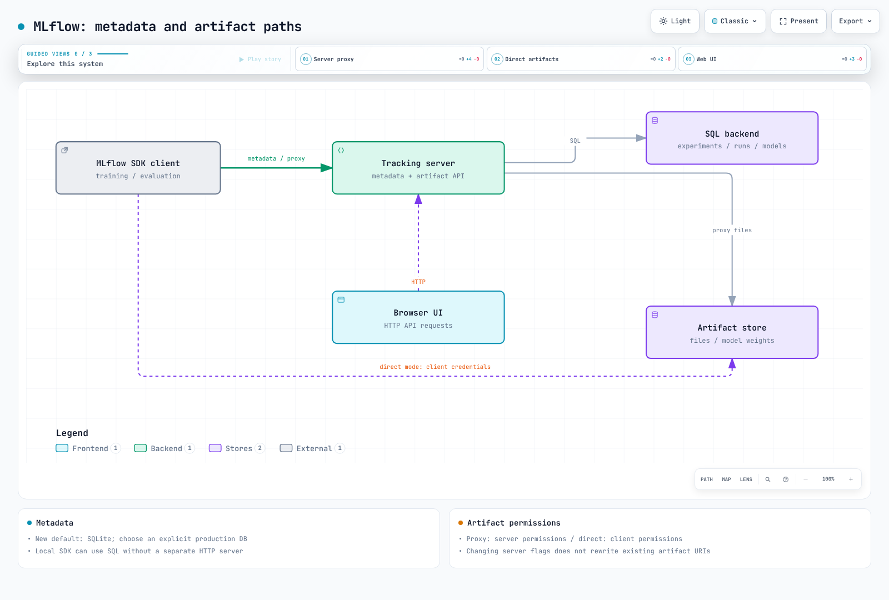

# パート1: MLflow Tracking

> **レビュー基準**: MLflow 3.16.0; 最新パッチ 3.16.1 を確認済み · 2026-10-12

## ラボ環境のセットアップ

Python 3.10 以降で `mlflow==3.16.0` をインストールします。以下の例は Python 3.12、SQLite、ローカル artifact store で確認されています。GPU、トレーニング済みモデル、リモートサーバーは必要ありません。

パッチ 3.16.1 は利用可能ですが、この例はまだそれで再実行されていません。[パート3](03-eks-deployment.md) ではチーム向け HTTP サーバーと EKS の運用を扱います。

## MLflow Tracking とは？

Tracking は、experiment、run、parameter、metric、artifact、記録済みモデル、trace 向けの API と UI を提供します。SDK は HTTP tracking server に接続することも、ローカルのファイル/SQL backend に直接接続することもできます。すべての用途で別個の server process が必要になるわけではありません。

リモートサーバーを使用する場合でも、metadata と artifact の転送は異なる経路をたどる可能性があります。metadata は tracking API を経由します。artifact はサーバーによってプロキシされるか、client と S3 などの store の間で直接転送されます。これらの構成は以下で区別します。

## 基本概念: Experiment と Run

**Experiment** は Run と関連する結果をグループ化します。**Run** はトレーニングだけでなく、評価、前処理、比較を表すこともできます。1 つの Run 内では、parameter key を異なる値に変更できません。metric には step を伴う複数のタイムスタンプ付き観測値を設定できます。現在の要約と完全な履歴を区別してください。

以下の値は**測定されたモデル精度ではなく、Tracking API fixture** です。この例では、未定義の image file に依存せず、JSON artifact を作成します。

```python
from pathlib import Path
import mlflow
from mlflow import MlflowClient

root = Path(".mlflow-demo").resolve()
root.mkdir(exist_ok=True)
mlflow.set_tracking_uri(f"sqlite:///{root / 'mlflow.db'}")
client = MlflowClient()
experiment = client.get_experiment_by_name("tracking-demo")
experiment_id = (
    experiment.experiment_id if experiment else
    client.create_experiment(
        "tracking-demo", artifact_location=(root / "artifacts").as_uri()
    )
)
mlflow.set_experiment(experiment_id=experiment_id)

with mlflow.start_run(run_name="demo") as run:
    mlflow.log_param("learning_rate", 0.01)
    mlflow.log_metric("demo_score", 0.92, step=0)
    mlflow.log_metric("demo_score", 0.95, step=1)
    mlflow.log_dict({"synthetic_example": True}, "summary.json")
    run_id = run.info.run_id

assert client.get_run(run_id).info.status == "FINISHED"
assert len(client.get_metric_history(run_id, "demo_score")) == 2
```

通常の context exit では Run は `FINISHED` で終了します。ブロック内で例外が発生すると `FAILED` で終了します。Run の終了は artifact のバックアップや、トレーニング process 全体の成功の検証を行いません。この例を繰り返すと、同じ Experiment に Run が追加されます。この条件分岐は既存の Experiment の artifact location を変更しません。

### Autologging

`mlflow.autolog()` はサポート対象の integration を構成します。キャプチャされる値、サポートされる framework version、モデル logging、input-example の収集は integration ごとに異なります。通常の PyTorch loop と Lightning workflow が同一の自動 instrumentation を受けると仮定しないでください。framework 固有の API と version support を確認し、追加の metric は手動で記録してください。

Autologging を有効にする前に、input、output、model、data sample が保存される場所を確認してください。この機能を有効にしても、PII が削除されるわけでも、すべての custom code path が instrumentation されるわけでもありません。

## MLflow 3 の変化: ファーストクラスエンティティとしての Model

`LoggedModel` には、独自の `model_id`、status、artifact location、metadata があります。`source_run_id` を通じてトレーニング Run を参照でき、ほかの評価 Run、metric、trace と関係を持つことができます。これは Registered Models や Model Versions とは異なります。

**明示的な `start_run()` ブロックなしで `log_model()` を呼び出すこと自体は、3.x の新機能ではありません。** 2.22.0 の `Model.log()` は必要に応じてすでに `_get_or_start_run()` を使用しており、3.16.0 の model-logging path でもこの挙動は継続しています。重要な変更は、独立したモデル ID と関係 tracking です。

上記の tracking setup の後、これにより active run なしで model metadata が作成されます。

```python
model = mlflow.initialize_logged_model(
    name="metadata-only", model_type="demo"
)
assert mlflow.active_run() is None
assert model.source_run_id is None
print(model.model_id, model.status)  # PENDING
```

この時点では、使用可能なモデル weights や model flavor はまだ含まれていません。使用前に、実際の model logging、artifact retention、finalization を完了してください。`READY` は deployment の承認、品質、または security review の証拠ではありません。

## GenAI と LLM の Observability: Tracing

MLflow Tracing は **2024-06-17 の 2.14.0** で導入されました。バージョン 3.x では model、evaluation、GenAI UI の integration が拡張され、3.16.0 では span link と再設計された trace UI が追加されました。Tracing が初めて可能になったのはバージョン 3 ではありません。

trace は、retrieval、tool execution、LLM call などの request step を span として表します。parent/child structure と span link を区別してください。token の収集は integration と provider response に依存します。retrieval または tool span に LLM token や cost field があるとは限りません。cost estimation には model identity、usage、price information が必要であり、照合済みの請求合計ではありません。

適切な場合は、自動 instrumentation と手動 span を組み合わせてください。input、output、exception、tool argument、reasoning には機密情報が含まれる可能性があります。収集範囲、access、マスキング、retention を定義してください。integration をインストールしても、完全な path coverage や cost accounting が保証されるわけではありません。

## Backend Store と Artifact Store

| Store またはデフォルト | 意味 |
|---|---|
| Backend | experiment/run/parameter/metric/model metadata; SQLite、PostgreSQL、MySQL、およびその他のサポートされる SQL store |
| Artifact | model file、plot、JSON、およびその他の file; local path、S3、およびその他の store |
| Default | 新しい 3.16.0 environment では `sqlite:///mlflow.db` を使用します。`./mlruns` がすでに存在する場合は互換性の挙動を確認してください |
| Legacy file backend | maintenance mode。新しい運用では明示的な SQL backend と migration plan を選択してください |

SQLite も relational database です。小規模なローカル演習には適しています。concurrent writer、複数の server replica、backup、高可用性には別途評価が必要です。metadata database の backup には artifact file が自動的に含まれません。

### リモートサーバーでの 2 つの Artifact Path

- **Proxy mode:** client は `mlflow-artifacts:` location を使用し、artifact-store permission を保持する server を介して file を送信します。client 自身には S3 access が不要な場合があり、tracking-server の authentication と authorization が重要になります。
- **Direct mode:** `--no-serve-artifacts` と直接の `s3://...` artifact root を使用すると、client は storage に直接 access します。関連する AWS permission、network access、library が必要です。

server flag を変更しても、既存の Experiment artifact URI が遡って書き換えられることはありません。実際の experiment/run URI を確認してください。browser UI は server HTTP API を query します。PostgreSQL に直接接続するわけではありません。



[インタラクティブ図](https://www.atomai.click/kubernetes-docs/archmaps/en-ai-ml-mlflow-01-tracking-0.html)

## 次のステップ

[パート2](02-model-registry.md) では registration、version、alias を扱います。[パート3](03-eks-deployment.md) では EKS storage と access control を扱います。alias の変更だけでは、すべての serving process が自動的に redeploy されるわけではありません。

## 主な情報源

- [MLflow 3.16.0 リリース](https://github.com/mlflow/mlflow/releases/tag/v3.16.0)
- [Backend store](https://mlflow.org/docs/3.16.0/self-hosting/architecture/backend-store/)
- [Artifact store](https://mlflow.org/docs/3.16.0/self-hosting/architecture/artifact-store/)
- [2.22.0 model logging 実装](https://github.com/mlflow/mlflow/blob/v2.22.0/mlflow/models/model.py)
- [3.16.0 Tracking API 実装](https://github.com/mlflow/mlflow/blob/v3.16.0/mlflow/tracking/fluent.py)
- [2.14.0 で導入された Tracing](https://github.com/mlflow/mlflow/releases/tag/v2.14.0)

[メインページに戻る](README.md) · [クイズ](../../quizzes/ai-ml/mlflow/01-tracking-quiz.md)