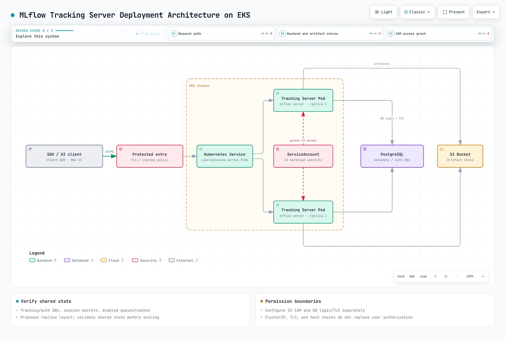

# パート 3: EKS への MLflow のデプロイ

> **レビュー基準**: MLflow 3.16.0 · community chart 1.11.7; latest patch 3.16.1 checked · 2026-10-12

## Lab 環境のセットアップ

サポート対象の EKS Kubernetes バージョン、互換性のある kubectl、Helm 3、メタデータデータベース、Artifact ストレージを準備します。`kubectl >=1.34` のような下限値だけでは、すべての API server との互換性は確立されません。実際の cluster の client/server version-skew policy を確認してください。

この章は、ダウンロードした chart、native Helm rendering、MLflow 3.16.0 server source に基づいています。**AWS provisioning、RDS 接続、S3 upload、または EKS deployment が成功することを確立するものではありません。**ローカルの SQLite/API チェックについては[パート 1](01-tracking.md)を、Registry チェックについては[パート 2](02-model-registry.md)を参照してください。

## MLflow の Tracking Server を EKS で実行する理由

server、database、artifact、access control、backup、upgrade に対する責任を負う代わりに、Kubernetes の deployment、observability、IAM のパターンを再利用できます。SageMaker MLflow Apps やその他の managed registry は代替手段ですが、サポートされる version、authentication、機能、コストは必ずしも同一ではありません。

team で共有するからといって、個別の新しい RDS および S3 resource の provision が自動的に必要になるわけではありません。小規模な SQLite/PVC 演習も可能です。production architecture は concurrency、durability、recovery の要件から選択してください。

## アーキテクチャ

| レイヤー | 確認すべき責務と state |
|---|---|
| HTTP server | SDK API、UI、artifact proxy、authentication、authorization、host/CORS policy、worker |
| メタデータ database | experiment/run/metric/model/registry metadata、pool、migration、backup |
| Artifact store | model/data/plot file、bucket/prefix、IAM、encryption、retention |
| Authentication store | user/permission database、session/signing secret、選択した auth mechanism 用 cache |
| Optional feature state | 有効化された job、tracing/evaluation、gateway feature が使用する queue、cache、temporary file |

PostgreSQL と S3 を使用しても、すべての機能が stateless になるわけではありません。たとえば、Pod-local の basic-auth SQLite database では、replica ごとに異なる user や permission が残る可能性があります。OIDC-plugin の cache と job storage は別途確認してください。

SQLite は relational database であり、書き込みを直列化しながら複数の process をサポートします。2 人目の user が接続したときに直ちに失敗するわけではありません。ただし、Pod-local の個別 SQLite file は共有 database ではありません。共有 file にも writer、filesystem-locking、recovery の制約があります。production で PostgreSQL を選択するかは、それらの要件に関連付けて判断してください。



[インタラクティブ図](https://www.atomai.click/kubernetes-docs/archmaps/en-ai-ml-mlflow-03-eks-deployment-0.html)

## インストール方法と Version Pin

| 方法 | 検証した内容 |
|---|---|
| Community chart | `community-charts/mlflow` 1.11.7 を download/render しました。appVersion 3.16.0、default image は `burakince/mlflow` です。 |
| MLflow repository chart | `v3.16.0/charts` には appVersion 3.15.2 の chart 0.1.1 が含まれます。source tag、chart version、image version は異なります。 |
| Direct manifest | file-based credential delivery、networking、authentication、migration policy に direct control が必要な場合の選択肢です。 |

upstream repository の source が存在しても、同じ version の OCI package が公開されていることは証明されません。レビュー中に official OCI chart 0.1.1 の pull は `not found` を返したため、ここでは検証済みの installation command として示していません。

これらの command は discovery、download、rendering により chart の default を確認します。production values は、以下のチェックを使用して別途準備してください。

```bash
helm repo add community-charts https://community-charts.github.io/helm-charts
helm repo update community-charts
helm show chart community-charts/mlflow --version 1.11.7
helm pull community-charts/mlflow --version 1.11.7 --untar --untardir ./vendor
helm show values community-charts/mlflow --version 1.11.7 > values.reference.yaml
helm template mlflow ./vendor/mlflow --namespace mlflow -f values.reference.yaml > rendered.yaml
```

適用前に、render された image/digest、ServiceAccount、credential delivery、CLI argument、probe、Service、Ingress を確認してください。この chart は upstream MLflow image ではなく community image を default としています。その database driver、AWS SDK、authentication plugin も検証してください。

### 重要な Chart 1.11.7 の Default

- Default には `replicaCount: 1`、`auth.enabled: false`、`ingress.enabled: false` が含まれます。
- `backendStore.defaultSqlitePath: ":memory:"` は in-memory metadata を設定します。**これは upstream CLI の新しい SQLite-file default とは異なります。**default chart installation は durable な production service ではありません。
- External PostgreSQL には `backendStore.postgres.*` を使用し、credential reference には `backendStore.existingDatabaseSecret.*` を使用します。
- `artifactRoot.s3.*` は `artifactRoot.proxiedArtifactStorage: true` とともに確認してください。native rendering は `--artifacts-destination=s3://...` と `--serve-artifacts` を生成しました。
- Basic-auth database setting は `auth.postgres.*` 配下で別に設定します。tracking database を変更しても authentication state が自動的に共有されるわけではありません。
- `backendStore.databaseMigration: true` は Pod init-container path を追加します。複数の replica による同時 migration を許可する前に、backup、1 回の coordinated migration phase、compatibility check を計画してください。

実際の value や Secret なしで name を埋めても、production setup は完了しません。この chart の一部の database/authentication reference は、**container environment variable** を介して配信されます。SecretKeyRef は Git 内の plaintext value を避けられますが、process-environment exposure を取り除くものではありません。policy により environment 内の secret value が禁止される場合は、Secrets Manager/SSM または同等の store から提供される credential file と、それらの file を消費する deployment を準備してください。static AWS key を Helm value や image に置かないでください。

## IAM と Database Authentication

S3 permission は意図した bucket/prefix に scope してください。実際の operation に応じて、`GetObject`、`PutObject`、listing、multipart、KMS permission を確認してください。proxy mode は server AWS permission を使用し、direct artifact mode は client permission を使用します。既存の experiment URI は、server flag を変更しただけでは書き換えられません。

EKS Pod Identity には Agent、association、サポート対象の SDK が必要であり、Linux EC2 worker を対象とします。Fargate や Windows Pod で普遍的に利用できるものではありません。IRSA も、サポート対象の configuration 内での別の選択肢です。ServiceAccount name または annotation を 1 つ指定しても、IAM trust、association、SDK setup は完了しません。

S3 用の IAM role があっても、PostgreSQL login が自動的に認可されるわけではありません。database network access、TLS validation、user/credential、または個別に設定した IAM database authentication を確認してください。意図しない node-role credential fallback を防ぐため、IMDS と SDK configuration をレビューしてください。

## Server Access と Health Check

ClusterIP、private ALB、TLS は networking または transport control を提供しますが、user ごとの MLflow permission を置き換えるものではありません。direct public ALB exposure を前提とするのではなく、組織の保護された ingress architecture を使用してください。

実際の caller 向けに、MLflow 3.16.0 の `allowed_hosts` と CORS origin を設定してください。この community chart では、対応する CLI argument を `extraArgs.allowedHosts` および `extraArgs.corsAllowedOrigins` で設定します。Host/CORS restriction は login や authorization を置き換えるものではありません。

basic-auth は 3.16.0 で default により fail-closed authorization へ変更されました。version 3.16.1 では同梱の default administrator password が削除されたため、default credential に依存しないでください。startup 前に、承認済みの administrator password と auth setting を明示的に設定してください。この章の chart と MLflow 3.16.0 の組み合わせは、3.16.1 では再検証されていません。

検証済みの health endpoint は **`/health`** で、`"OK", 200` を返すよう実装されています。これは HTTP process の応答性をチェックするものであり、継続的な RDS/S3 connectivity や user authorization を確認するものではありません。この release では health endpoint は host validation から除外されます。`static-prefix`、ingress rewrite、plugin を使用する場合は、実際の service path を確認してください。

## 運用上の注意

replica を scale する前に、metadata/auth database、session secret、有効化された queue/cache を共有または externalize し、failover をテストしてください。その後、topology spread、PDB、readiness、resource limit を適用してください。Pod が 2 つあるだけでは high availability は保証されません。

1 回の API call が常に 1 回の SQL write とは限りません。batch logging、transaction、trace payload、metric history、worker ごとの connection pool をまとめて測定してください。replica/worker 間の pool は合計されます。1 つの pool の configuration だけでは、database connection demand の合計は説明できません。

Aurora Serverless v2 は、設定された capacity range および connection、I/O、transaction の制約内で動作します。無制限の burst を吸収するものでも、より低い cost を保証するものでもありません。測定した load と recovery requirement に照らして、provisioned RDS/Aurora と比較してください。

metadata/auth database と artifact を一緒に backup し、restore をテストしてください。`mlflow gc` のような permanent deletion tool は routine cleanup として追加するのではなく、retention policy に照らしてレビューしてください。model alias の変更と serving redeployment も別個の operation です。

## 主なソース

- [MLflow 3.16.1 patch release](https://github.com/mlflow/mlflow/releases/tag/v3.16.1)
- [MLflow 3.16.0 レビュー基準](https://github.com/mlflow/mlflow/releases/tag/v3.16.0)
- [Tracking server アーキテクチャ](https://mlflow.org/docs/3.16.0/self-hosting/architecture/tracking-server/)
- [Community chart](https://github.com/community-charts/helm-charts/tree/main/charts/mlflow)
- [MLflow repository chart](https://github.com/mlflow/mlflow/tree/v3.16.0/charts)
- [Server health 実装](https://github.com/mlflow/mlflow/blob/v3.16.0/mlflow/server/__init__.py)
- [EKS Pod Identity の制限](https://docs.aws.amazon.com/eks/latest/userguide/pod-identities.html)
- [SQLite のユースケースと concurrency](https://www.sqlite.org/whentouse.html)
- [Aurora Serverless v2 capacity configuration](https://docs.aws.amazon.com/AmazonRDS/latest/AuroraUserGuide/aurora-serverless-v2.setting-capacity.html)

[メインページ](README.md) · [クイズ](../../quizzes/ai-ml/mlflow/03-eks-deployment-quiz.md)
