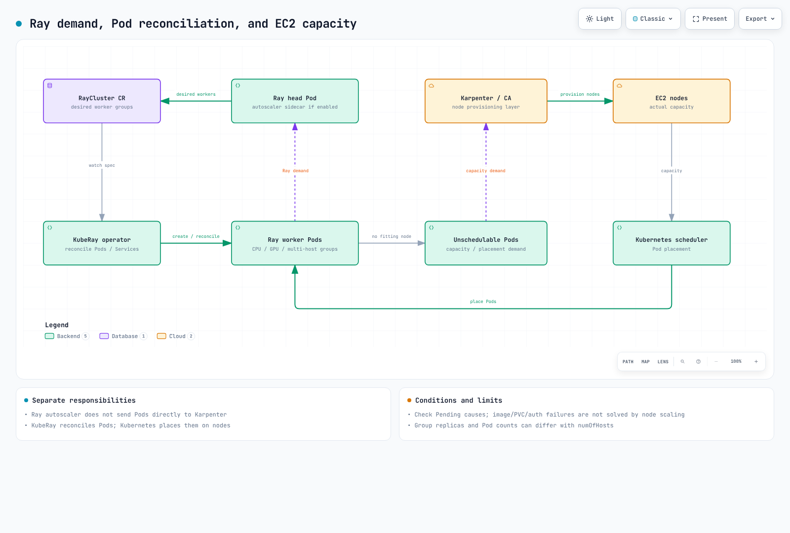

# Part 2: KubeRay Operator

> **レビュー時の基準**: KubeRay 1.7.1 · Ray 2.58.0 · 2026-10-16

## ラボ環境のセットアップ

サポート対象の Kubernetes バージョン、互換性のある kubectl バージョン、Helm 3 を用意してください。CPU 構成をレビューするだけであれば、GPU ハードウェアと Karpenter は前提条件ではありません。実際の EKS キャパシティは、既存のマネージドノードグループ、Karpenter、Cluster Autoscaler、またはクラスターで採用しているプロビジョニング構成から供給できます。

ここでの検証範囲には、公式 chart のダウンロードと Helm によるネイティブレンダリング、CRD スキーマの確認、Ray 2.58.0 の autoscaler 設定ジェネレーターの検証が含まれます。**API server による admission/CEL 検証、controller の reconciliation、実際の autoscaling、GPU の実行を確認したものではありません。**

## KubeRay の役割

KubeRay は Ray の CR を Pod、Service などの関連リソースに調整します。一般的な RayCluster の worker group が必ず Deployment または StatefulSet であるとは限りません。通常、Ray ノードは Ray Pod に対応します。これは、その Pod をホストする Kubernetes/EC2 ノードとは別のものです。

operator をインストールしただけでは Ray ワークロードは開始されません。RayCluster、RayJob、RayService などのリソースは別途作成してください。また、spec を変更するたびに既存 Pod がその場で自動更新されるわけでもありません。更新経路を確認してください。

## CRD と Feature Gate

1.7.1 の chart には **RayCluster、RayJob、RayService、RayCronJob** の CRD が含まれます。いずれも `ray.io/v1` を提供します。最初の 3 種類は非推奨の `v1alpha1` も引き続き提供しますが、新しい例では `v1` を使用します。

| リソース | 役割と適用範囲 |
|---|---|
| RayCluster | head Pod と worker group を管理する。head のみの構成も可能 |
| RayJob | バッチジョブを送信し、必要に応じて RayCluster のライフサイクルも管理する。既存クラスターの利用とクリーンアップポリシーを区別する |
| RayService | RayCluster と Serve アプリケーションを管理する。アップグレードとトラフィック移行の条件を確認する |
| RayCronJob | スケジュールに従って RayJob を作成する。CRD はインストールされるが、controller の feature gate はデフォルトで無効 |

chart のデフォルトでは beta の `RayServiceIncrementalUpgrade` gate が有効です。mTLS、RayCluster NetworkPolicy、History collector の自動注入に関する alpha gate は無効です。History Server の beta ステータスと、alpha 機能である collector の自動注入は別のものです。feature gate が利用可能であっても、リソース側でその機能が設定されているとは限りません。

### RayJob のクリーンアップ

`shutdownAfterJobFinishes` のデフォルトは false です。`ttlSecondsAfterFinished: 0` もクリーンアップを有効にしません。クリーンアップ、再試行、実行前と実行中の期限は明示的に設定してください。バージョン 1.7 には `deletionStrategy` もあり、従来の onSuccess/onFailure ポリシーと deletionRules を併用できないなどの制約があります。

共有クラスターの選択と、controller が作成したクラスターのクリーンアップを区別してください。先に結果、チェックポイント、ログを保全します。RayCluster を削除しても、外部アーティファクトや PVC、EC2 のすべての料金が自動的に解消されるわけではありません。

### RayService のアップグレード

`NewCluster` と `NewClusterWithIncrementalUpgrade` は新しいクラスターを作成します。後者は Kubernetes Gateway API と適切な GatewayClass 実装を使って、トラフィックを段階的に移行します。これは、少数の Pod をその場でローリング更新するだけの操作とは異なります。

1.7 では incremental upgrade の gate がデフォルトで有効ですが、strategy、Gateway の構成、予備キャパシティ、readiness、draining の要件も引き続き重要です。ゼロダウンタイムは目標であり、すべてのアプリケーションで保証されるものではありません。Serve の動作については [Part 4](04-ray-serve.md) で詳しく説明します。

## Autoscaling のレイヤー

`enableInTreeAutoscaling: true` を設定して Ray autoscaling を有効にします。KubeRay は head Pod に autoscaler sidecar と必要な権限を構成します。この例では、バージョンによって異なる可能性のあるデフォルトに依存せず、`autoscalerOptions.version: v2` を明示しています。

Ray autoscaler は task、actor、placement/リソース要求、worker group の目標サイズを調べ、KubeRay が Pod 数を調整します。`numOfHosts` を使うと、1 つの group replica が複数の Ray Pod に対応する場合があります。そのため、`replicas == Pod 数` が常に成り立つわけではありません。

Kubernetes は Pod を配置し、Karpenter などのプロビジョナーはスケジュールできない要件を満たす EC2 キャパシティを供給します。イメージの取得、PVC、権限、クォータが原因の Pending Pod は、ノードを追加しても必ず解決するわけではありません。Karpenter の統合と drift の処理も、別々の制御動作です。

Ray 2.58.0 の設定ジェネレーターでは、グローバルな idle timeout のデフォルトは 60 秒です。group 単位の idle timeout で動作を上書きできます。最小/最大 replica 数、アクティビティ、ポーリング、draining の条件も関係するため、60 秒後に Pod が必ず削除されるという意味ではありません。



[インタラクティブ図](https://www.atomai.click/kubernetes-docs/archmaps/en-ai-ml-ray-02-kuberay-operator-0.html)

## CPU/GPU リソースの宣言

**Pod の GPU limit だけが常に設定元になるとは限りません。** レビュー対象のコードでは、構造化された group の `resources`、`rayStartParams`、最初の Ray コンテナの limits/requests の間に優先順位があります。明示的な `num-gpus` がコンテナの GPU limit で必ず上書きされるわけではありません。

Ray 2.58.0 のネイティブ設定チェックでは、GPU limit が 1 の場合は GPU 1、`rayStartParams.num-gpus=2` の場合は GPU 2、構造化された group の `resources.GPU=3` の場合は GPU 3 が生成されました。これは**物理 GPU を増やすものではありません**。Kubernetes の limit、device plugin、ドライバー、Ray の論理リソース、実際に認識されているハードウェアを整合させてください。

最小 replica 数と CPU/配置要件も GPU group のサイズに影響することがあります。GPU Pod が GPU task の pending 時にだけ作成されるとは限りません。Ray の論理 CPU 設定とコンテナ側の制限も区別してください。

## Operator のインストールとアップグレード

```bash
helm repo add kuberay https://ray-project.github.io/kuberay-helm/
helm repo update kuberay
helm pull kuberay/kuberay-operator --version 1.7.1 --untar --untardir ./vendor
helm template kuberay-operator ./vendor/kuberay-operator \
  --namespace kuberay-system --include-crds > operator.rendered.yaml
```

CRD、RBAC、namespace の監視範囲、feature gate を確認してください。chart のデフォルトでは leader election が有効で、クラスター全体を監視します。監視範囲を絞る場合は、`singleNamespaceInstall`、`watchNamespace`、関連する RBAC 設定をまとめて確認してください。

context と管理者権限を確認してから、実際のインストールを行ってください。

```bash
helm upgrade --install kuberay-operator kuberay/kuberay-operator \
  --version 1.7.1 --namespace kuberay-system --create-namespace
kubectl rollout status deployment/kuberay-operator -n kuberay-system
```

Helm の `crds/` の仕組みでは、**既存の CRD は自動でアップグレードも削除もされません**。chart をアップグレードしただけでスキーマが更新されたと考えないでください。保存済み CR と API バージョンの互換性を確認し、リリースに応じた CRD 更新を別途行ってください。CRD を削除すると、カスタムリソースも削除される可能性があります。

## 最小構成の CPU 設定

この例は `ray-demo` namespace がすでにあることを前提としています。CRD スキーマは検証済みですが、controller の実行、イメージの起動、autoscaling は試していません。

```yaml
apiVersion: ray.io/v1
kind: RayCluster
metadata:
  name: ray-cpu-demo
  namespace: ray-demo
spec:
  rayVersion: '2.58.0'
  enableInTreeAutoscaling: true
  autoscalerOptions:
    version: v2
    idleTimeoutSeconds: 60
  headGroupSpec:
    serviceType: ClusterIP
    rayStartParams:
      num-cpus: '0'
    template:
      spec:
        containers:
          - name: ray-head
            image: rayproject/ray:2.58.0-py312
            resources:
              requests:
                cpu: '1'
                memory: 2Gi
              limits:
                cpu: '1'
                memory: 2Gi
  workerGroupSpecs:
    - groupName: cpu
      replicas: 0
      minReplicas: 0
      maxReplicas: 2
      rayStartParams: {}
      template:
        spec:
          containers:
            - name: ray-worker
              image: rayproject/ray:2.58.0-py312
              resources:
                requests:
                  cpu: '1'
                  memory: 2Gi
                limits:
                  cpu: '1'
                  memory: 2Gi
```

スキーマ全体の fixture では、head と worker の両方に `rayproject/ray:2.58.0-py312` を使用し、CPU 1、メモリ 2 GiB の requests と limits を設定しています。`rayVersion` を指定しただけではコンテナイメージはアップグレードされません。ランタイム、Python、イメージの互換性も確認してください。

dashboard、Ray Client、job 送信のエントリポイントは信頼できる利用者に限定してください。トークン認証は別途設定するものであり、すべてのアプリケーションエンドポイントに TLS やアクセス制御を提供するものではありません。secret の配布方法を組織のポリシーに照らして確認し、機密トークンを公開マニフェストやログに残さないでください。

## 主な情報源

- [KubeRay 1.7.1 リリース](https://github.com/ray-project/kuberay/releases/tag/v1.7.1)
- [1.7.1 chart の values](https://github.com/ray-project/kuberay/blob/v1.7.1/helm-chart/kuberay-operator/values.yaml)
- [Pod/リソースの構築](https://github.com/ray-project/kuberay/blob/v1.7.1/ray-operator/controllers/ray/common/pod.go)
- [Ray 2.58.0 autoscaler の設定](https://github.com/ray-project/ray/blob/ray-2.58.0/python/ray/autoscaler/_private/kuberay/autoscaling_config.py)
- [RayJob API](https://github.com/ray-project/kuberay/blob/v1.7.1/ray-operator/apis/ray/v1/rayjob_types.go)
- [RayService API](https://github.com/ray-project/kuberay/blob/v1.7.1/ray-operator/apis/ray/v1/rayservice_types.go)
- [Helm における CRD のライフサイクル](https://helm.sh/docs/chart_best_practices/custom_resource_definitions/)

[次へ: Train/Tune](03-ray-train-tune.md) · [メインページ](README.md) · [クイズ](../../quizzes/ai-ml/ray/02-kuberay-operator-quiz.md)
