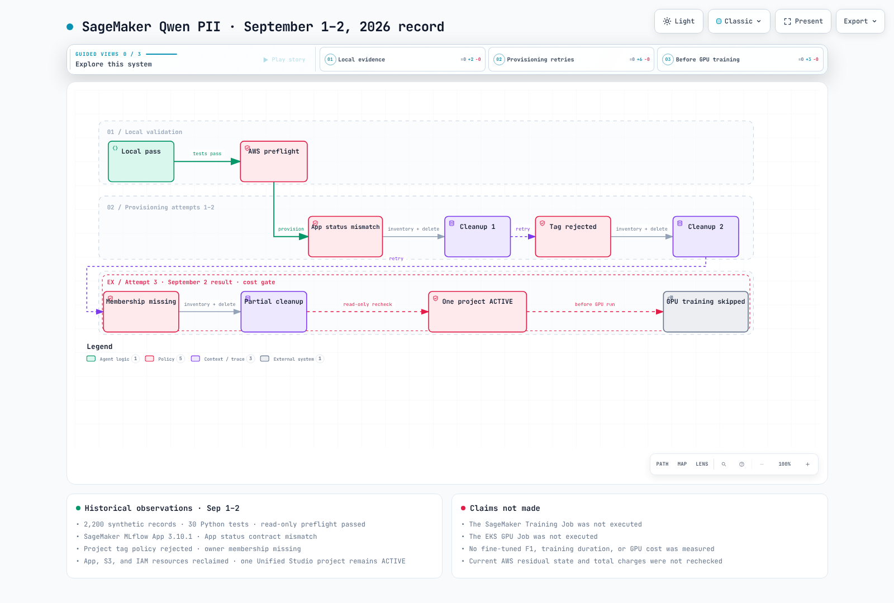

# パート 5：SageMaker Qwen PII の検証結果

> **最終更新日**: September 12, 2026
> **AWS 検証日**: September 1, 2026
> **過去のステータス**: GPU トレーニング前に停止。残存リソースの記録日は September 2

## 結論

この章では、リポジトリに記録された**2026年9月1～2日の実験記録**について説明します。当時確認されたローカルチェック、AWS のプロビジョニング試行、一部のクリーンアップを記録したものであり、現在のアカウント状態を新たに照会したものではありません。9月12日のソースレビューで、当初の30件のテストでは検出できなかった、トークン化、評価、実行、クリーンアップに関する追加の不具合が見つかりました。

3回目のプロビジョニング試行ではプロジェクトのメンバーシップが設定されず、呼び出し元は作成されたプロジェクトを削除できない状態になりました。それ以上のリソース作成は停止したため、**SageMaker Training Job も EKS GPU Job も実行されていません**。

## 検証済みの事実

| 項目 | 結果 |
|---|---|
| ベースモデル | `Qwen/Qwen3-30B-A3B-Instruct-2507` |
| 合成レコード | 2,200 |
| Train / Validation / Test | 1,600 / 200 / 400 |
| 韓国語 / 英語 | 80% / 20% |
| 過去の Python コントラクトと回帰テスト | 30件合格。GPU 実行の証拠でも、すべての不具合がないことの証明でもない |
| 抽出コントラクト | `TYPE<TAB>ORIGINAL` |
| 観測された SageMaker MLflow App のバージョン | `3.10.1` |
| SageMaker トレーニング実行済み | `false` |
| EKS トレーニング実行済み | `false` |
| 2026年9月2日時点で残っていたプロジェクト | 1、`ACTIVE` |

## 実際の実行記録

この図は、記録に残された**ローカルチェック、AWS の事前確認、3回のプロビジョニング試行、クリーンアップ、停止地点**を示しています。GPU トレーニングが始まる前に終了しています。GPU が実行されていないことは、実験の総コストがゼロであることを意味しません。

[🔍 インタラクティブな検証ワークフローを見る](https://www.atomai.click/kubernetes-docs/archmaps/en-ai-ml-sagemaker-ai-04-validation-results-0.html)

## 3回のプロビジョニング試行

| 試行 | 実際の結果 | GPU トレーニング | クリーンアップ |
|---|---|---|---|
| 1 | MLflow App は `Created` に達したが、初期スクリプトは存在しない App の `ACTIVE` 状態を待ち続けた | 未開始 | App、S3、IAM を削除。残存数 0 |
| 2 | Unified Studio ドメインでカスタムのプロジェクトリソースタグが拒否された | 未開始 | App、S3、IAM を削除。残存数 0 |
| 3 | 呼び出し元のロールグループプロファイルにプロジェクトメンバーシップを設定しないままプロジェクトが作成された | 未開始 | App、S3、IAM を削除。残存プロジェクト 1 |

## 適用した修正

過去の報告では、App の準備完了判定、プロジェクトタグの処理、オーナーのメンバーシップ、リトライに関する変更が記録されています。ただし、その記述は現在の自動化が完全であることを証明するものではありません。

9月12日のフォローアップでは、既存リソースを誤って削除する可能性、権限エラーをリソース不在として扱う問題、誤った設定パス、EKS アダプターの消失、中断時の処理漏れが見つかりました。修正版の実行およびエクスポート手順については、[実行の章](03-sagemaker-mlflow-execution.md)を参照してください。新しいチェックではローカルのフィクスチャとモック API を使用しています。AWS で再実行したものではありません。

`ListProjects` に表示されないことだけでは、削除されたとは証明できません。表示範囲、フィルター、ページネーションを確認し、認可された直接照会または管理者による確認を行ってください。権限エラーやタイムアウトの場合は、引き続き**不明**です。

## 2026年9月2日時点のクリーンアップ状態

9月2日に読み取り専用で再確認した際の記録：

| リソースタイプ | 状態 |
|---|---|
| SageMaker MLflow App | 残存なし |
| 実験用 S3 バケット | 残存なし |
| 実験用 IAM ロール | 残存なし |
| EKS クラスター / GPU インスタンス | 作成されていない |
| Unified Studio `qwen-pii-*` プロジェクト | 1つ、`ACTIVE` |

この状態が現在も続いている場合は、クリーンアップの前にドメイン管理者と既存のプロジェクトオーナーが権限と所有権を確認する必要があります。新しいロール名から、過去のメンバーシップや所有権を推測しないでください。

## 測定されていない項目

| 項目 | 結果が公表されていない理由 |
|---|---|
| ファインチューニング後のエンティティ F1 | アダプタートレーニングとチューニング済みモデルの評価が実行されていない |
| ベースラインに対する改善 | 同じ GPU 環境でのベースラインとチューニング済みモデルの組み合わせがない |
| トレーニング時間 | SageMaker または EKS のトレーニング Job が実行されていない |
| GPU メモリのピーク使用量 | GPU プロセスが実行されていない |
| GPU コスト | GPU Job が開始されていないため、比較可能な測定結果がない |
| 実験の総コスト | MLflow App や S3 など、その他のリソースについて請求レポートを照合していない |

設定した最大実行時間やステップ数は設計上の入力値であり、観測結果ではありません。

## 再実行の条件

次の条件を順番にすべて満たしてください。

1. 過去のインベントリと実際のリソースを照合し、残存または状態不明の**実験専用リソース**を解決します。名前のプレフィックスが共有されているだけでは、削除する根拠になりません。
2. 現在のアカウント、リージョン、クォータ、イメージ、ドメイン、プロファイル、オーナーのメンバーシップを再確認します。
3. レビュー済みの設定、ソース、データセットのハッシュを確定し、アップロード済みオブジェクトを検証します。
4. 課金対象となる SageMaker のスモークジョブを実行し、結果ファイルを保存します。
5. CloudWatch と MLflow を確認して、生データの漏えいがないか調べます。ステータスが成功であることや、許可されたファイル名だけでは、この確認を満たしません。
6. 検証済みのスモークテストの証拠をもとに、フル Job を実行するか判断します。

SageMaker のスモークテスト結果とデータセットのハッシュを確定してから、別のスモークテスト／フル実行手順として EKS の比較を実施してください。

## エビデンスの場所

- 構造化された結果：`examples/ai-ml/qwen-pii-finetuning/results/provisioning-validation.json`
- 詳細な検証記録：`docs/superpowers/reports/2026-09-01-sagemaker-qwen-pii-validation.md`
- 実行可能なパッケージ：`examples/ai-ml/qwen-pii-finetuning/`

前へ：[パート 4：Unified Studio のガバナンス](../../data-on-eks/sagemaker-unified-studio/01-domains-projects-governance.md)

最初から読む：[SageMaker Qwen PII ガイドブック](README.md)
