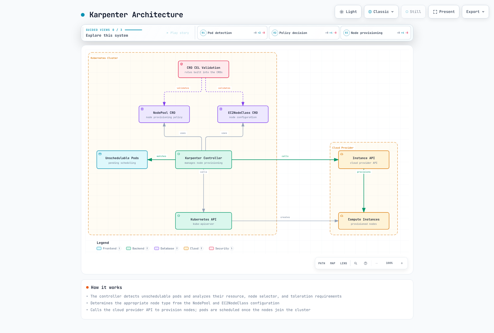
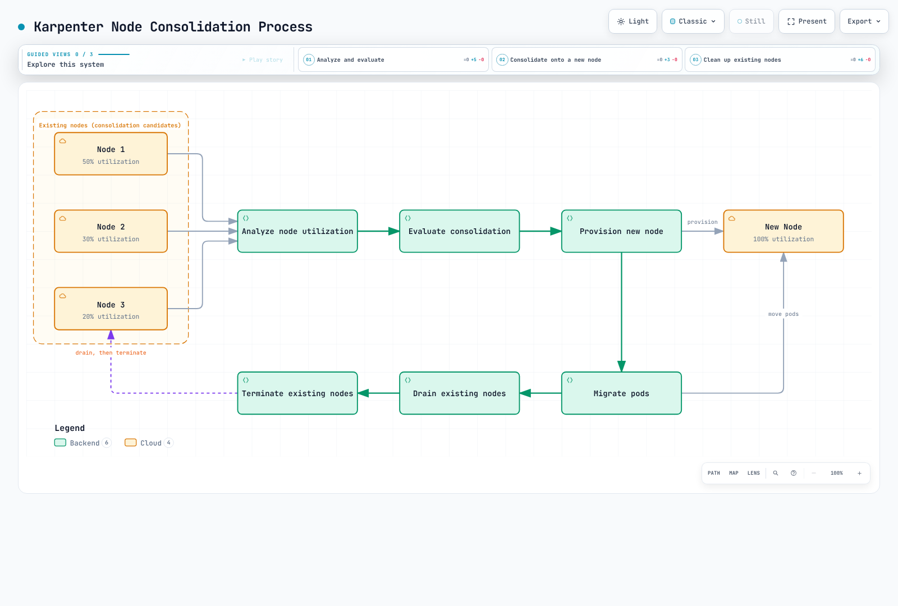
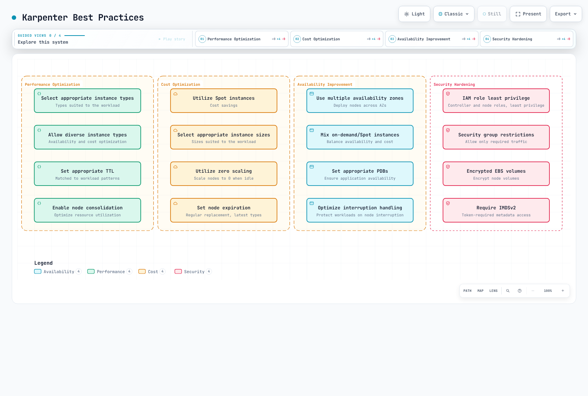

# Karpenter

> **対応バージョン**: Karpenter 1.14 LTS（例: 1.14.1）。Kubernetes/EKS のバージョンは互換性表とプロバイダーのサポート表を確認して選択してください。
> **最終更新日**: 2026年10月16日

## 目次
- [概要](#introduction)
- [アーキテクチャ](#architecture)
- [インストールと設定](#installation-and-configuration)
- [NodePool](#nodepool)
- [ノードクラス](#node-classes)
- [中断への対応](#interruption-handling)
- [連携](#integration)
- [Amazon EKS との連携](#integration-with-amazon-eks)
- [ベストプラクティス](#best-practices)
- [トラブルシューティング](#troubleshooting)
- [まとめ](#conclusion)

## 概要 {#introduction}

Karpenter はオープンソースのノードオートスケーラーです。この章では、互換性のある Kubernetes ワークロード向けに EC2 キャパシティをプロビジョニングする AWS プロバイダーを扱います。可用性と効率は、制約、クラウド側のキャパシティ、ノードの初期化、アプリケーションの設計によって変わります。

### Karpenter の主な利点

1. **迅速なスケーリング**: スケジュールできないワークロードの需要に応じてプロビジョニングを開始します。ノードやアプリケーションが利用可能になるまでの時間は保証されません。
2. **コスト最適化**: ワークロードに適したインスタンスタイプを選択します。
3. **簡単な設定**: 宣言型 API で設定できます。
4. **ワークロード中心の設計**: Pod の要件に基づいてノードをプロビジョニングします。
5. **クラウドとの統合**: クラウドプロバイダーの機能を活用します。
6. **効率的なビンパッキング**: リソースの利用率を最適化します。
7. **柔軟なノード管理**: ノードのライフサイクル管理と中断への統合的な対応を提供します。

### 既存のオートスケーラーとの比較

| 項目 | Karpenter | Cluster Autoscaler | クラウドプロバイダーのマネージドノードグループ |
|---------|-----------|-------------------|---------------------------|
| スケーリング速度 | スケジューリング、EC2 キャパシティ、初期化に依存 | ノードグループのスケーリングと初期化に依存 | スケーリングポリシー、キャパシティ、初期化に依存 |
| インスタンスタイプの選択 | 動的 | ノードグループ単位 | ノードグループ単位 |
| ビンパッキング効率 | ワークロードと制約に依存 | ワークロードとノードグループに依存 | スケジューラーとスケーリングコントローラーに依存 |
| 設定の複雑さ | 低い | 中程度 | 低い |
| クラウドとの統合 | プロバイダーごとの実装 | 複数のクラウドプロバイダーに対応 | プロバイダー標準の機能 |
| ノードグループ管理 | 不要 | 必要 | 必要 |
| 中断への対応 | 設定したイベント処理とノードライフサイクル | プラットフォームや連携方式に依存 | プラットフォーム固有の処理 |

> **注**: EKS は2026年4月8日、マネージドノードグループのウォームプール対応を追加しました。初期化済みインスタンスを使うと、初期化作業の繰り返しを減らせます。Stopped モードと Running モードでは遷移時間とコストが異なり、スケールイン時の再利用は任意です。AWS によると、Cluster Autoscaler との連携に追加設定は不要です。再開後もノードの準備とアプリケーションの起動には時間がかかります。これは EKS マネージドノードグループと Auto Scaling の機能であり、Karpenter が管理するプールの機能ではありません。

## アーキテクチャ {#architecture}

Karpenter は Kubernetes コントローラーとして動作し、スケジュールできない Pod を検出して適切なノードをプロビジョニングします。



[🔍 インタラクティブ図を表示](https://www.atomai.click/kubernetes-docs/archmaps/en-autoscaling-02-karpenter-0.html)

### Karpenter のワークフロー

次の図は、EKS クラスターで Karpenter が動作する流れを示しています。


[🔍 インタラクティブ図を表示](https://www.atomai.click/kubernetes-docs/archmaps/en-autoscaling-02-karpenter-1.html)

### 主なコンポーネント

1. **Karpenter コントローラー**: スケジューリングに必要なリソースをシミュレーションし、NodeClaim を作成してノードのライフサイクルを管理します。実際に Pod をノードへバインドするのは Kubernetes スケジューラーです。
2. **CRD の CEL 検証**: NodePool と EC2NodeClass は CRD 内の CEL ルールで検証されます（アドミッション/変換 Webhook は Karpenter 1.1 で削除されました）。
3. **NodePool と NodeClaim の CRD**: NodePool はポリシーを定義し、NodeClaim は個々にプロビジョニングされたノードの要件とライフサイクルを記録します。
4. **EC2NodeClass CRD**: プロビジョニングするノードの設定を定義します。
5. **クラウドプロバイダー連携**: クラウドプロバイダーの API と連携してコンピューティングリソースを管理します。

### 動作の流れ

1. Karpenter コントローラーがスケジュールできない Pod を検出します。
2. リソース、ノードセレクター、許容設定など、Pod の要件を分析します。
3. NodePool と EC2NodeClass の設定に基づいて適切なノードタイプを決定します。
4. クラウドプロバイダーの API を呼び出してノードをプロビジョニングします。
5. ノードが登録されて準備完了になると、Kubernetes スケジューラーが条件を満たす Pod をバインドできます。Karpenter は kube-scheduler を置き換えません。
6. Consolidation、ドリフト、有効期限、手動削除、クラウド中断にはそれぞれ異なるトリガーと保護策があります。すべてが SQS の中断イベントというわけではありません。

## インストールと設定 {#installation-and-configuration}

apiVersion/kind を含まない YAML ブロックは、説明対象の NodePool または EC2NodeClass の仕様の一部を示す断片です。単独で kubectl apply に渡せるマニフェストではありません。

以下は既存クラスターを対象とする個別の学習用例であり、そのまま本番環境へ展開できる一式ではありません。同じオブジェクト名が繰り返される箇所は、別々の選択肢を示します。インストール前に IAM/OIDC、ノードアクセス、承認済みサブネットとセキュリティグループ、ブートストラップ用キャパシティ、中断通知キューを準備して確認してください。YAML 内の `my-cluster` などは文字どおりの例示名です。保存した YAML 内の `${CLUSTER_NAME}` を kubectl が展開することはありません。この監査では AWS リソースの作成、Karpenter のインストール、スケーリング計測は行っていません。新規インストール用コマンドは、同じリリースがすでに存在すると失敗します。既存環境では、バージョンに対応したアップグレードと CRD 移行の手順に従ってください。

### 前提条件

- 利用するプラットフォームと Karpenter の互換性表でサポートされる Kubernetes バージョンを使います。公開されている表では、Kubernetes 1.34 に対する Karpenter の最小バージョンは 1.6、1.35 では 1.9、1.36 では 1.13 です。これらの最小値は、古い Karpenter のすべてのマイナーバージョンが引き続き保守されることを意味しません。v1.14 の表には 1.37 が含まれず、v1.15 の表では Kubernetes 1.37 に Karpenter 1.15.x が必要です。EKS の各バージョンの提供状況とサポートは別途確認してください。
- kubectl の設定
- クラウドプロバイダーの認証情報と権限
- Helm（任意）

### AWS EKS へのインストール

#### 1. IAM ロールとポリシーの設定

コマンドは、既存のコントローラーロールとノードロール、および API ベースの EKS 認証（API または API_AND_CONFIG_MAP）を前提とします。CONFIG_MAP のみを使うクラスターでは、list-access-entries の代わりに既存の aws-auth ノードマッピングを確認してください。この手順に便乗して認証モードを変更しないでください。ノードロールは EC2 を信頼し、ワーカーノードと ECR からのイメージ取得に必要な権限（例: AmazonEKSWorkerNodePolicy、AmazonEC2ContainerRegistryPullOnly）を持つ必要があります。対応している場合、VPC CNI には専用のアイデンティティを割り当てます。SSM 権限は任意で、エージェントの設定が必要です。AmazonEKSClusterPolicy は Karpenter コントローラーポリシーの代わりにはなりません。

```bash
# Set the existing cluster and Region; these commands only inspect AWS/Kubernetes.
export CLUSTER_NAME="my-cluster"
export AWS_REGION="us-west-2"
export KARPENTER_VERSION="1.14.1"
ACCOUNT_ID=$(aws sts get-caller-identity --query Account --output text)
CLUSTER_ENDPOINT=$(aws eks describe-cluster --region "$AWS_REGION" --name "$CLUSTER_NAME" --query cluster.endpoint --output text)
export ACCOUNT_ID CLUSTER_ENDPOINT
kubectl config current-context
aws iam get-role --role-name "KarpenterControllerRole-${CLUSTER_NAME}" --query Role.AssumeRolePolicyDocument
aws iam get-role --role-name "KarpenterNodeRole-${CLUSTER_NAME}" --query Role.AssumeRolePolicyDocument
aws eks list-access-entries --region "$AWS_REGION" --cluster-name "$CLUSTER_NAME"
```

#### 2. Helm を使ったインストール

参照先のキューとブートストラップ用キャパシティを準備したうえで、新規インストール用の例を一度だけ実行してください。アップグレード時は、バージョン別の移行ガイドを確認し、対応する CRD も更新します（例: 別管理の karpenter-crd チャート）。コントローラーチャートだけを更新しても、通常 CRD は更新されません。既存 CRD の移行前に所有者を確認してください。

```bash
# Run only after the prerequisites and the current kubectl context are verified.
: "${CLUSTER_NAME:?Set the existing cluster name}"
: "${ACCOUNT_ID:?Set the AWS account ID}"
: "${CLUSTER_ENDPOINT:?Set the matching EKS endpoint}"
KARPENTER_VERSION="1.14.1"
helm install karpenter oci://public.ecr.aws/karpenter/karpenter \
  --version "$KARPENTER_VERSION" \
  --namespace karpenter --create-namespace \
  --set-string 'serviceAccount.annotations.eks\.amazonaws\.com/role-arn'="arn:aws:iam::${ACCOUNT_ID}:role/KarpenterControllerRole-${CLUSTER_NAME}" \
  --set-string settings.clusterName="$CLUSTER_NAME" \
  --set-string settings.clusterEndpoint="$CLUSTER_ENDPOINT" \
  --set-string settings.interruptionQueue="$CLUSTER_NAME" \
  --wait --timeout 5m
```

#### 3. インストールの確認

```bash
kubectl get deployments,pods -n karpenter
kubectl rollout status deployment/karpenter -n karpenter --timeout=180s
kubectl get nodepools,ec2nodeclasses,nodeclaims
```

コントローラーのレプリカが既定の2個の場合の出力例です（この監査で実行した結果ではありません）。
```
NAME                         READY   STATUS    RESTARTS   AGE
karpenter-<hash>-<id-1>      1/1     Running   0          1m
karpenter-<hash>-<id-2>      1/1     Running   0          1m
```

### NodePool と EC2NodeClass の基本設定

```yaml
apiVersion: karpenter.sh/v1
kind: NodePool
metadata:
  name: default
spec:
  disruption:
    consolidationPolicy: WhenEmpty
    consolidateAfter: 30s
  limits:
    cpu: '1000'
    memory: 1000Gi
  template:
    spec:
      requirements:
      - key: karpenter.sh/capacity-type
        operator: In
        values:
        - on-demand
      - key: kubernetes.io/arch
        operator: In
        values:
        - amd64
      - key: node.kubernetes.io/instance-type
        operator: In
        values:
        - m5.large
        - m5.xlarge
        - m5.2xlarge
      nodeClassRef:
        group: karpenter.k8s.aws
        kind: EC2NodeClass
        name: default
---
apiVersion: karpenter.k8s.aws/v1
kind: EC2NodeClass
metadata:
  name: default
spec:
  role: KarpenterNodeRole-my-cluster
  amiSelectorTerms:
  - alias: al2023@latest
  subnetSelectorTerms:
  - tags:
      karpenter.sh/discovery: my-cluster
  securityGroupSelectorTerms:
  - tags:
      karpenter.sh/discovery: my-cluster
  tags:
    karpenter.sh/discovery: my-cluster
  blockDeviceMappings:
  - deviceName: /dev/xvda
    ebs:
      volumeSize: 100Gi
      volumeType: gp3
      deleteOnTermination: true
      encrypted: true
```

## NodePool

NodePool は、Karpenter がノードをどのようにプロビジョニングするかを定義する Kubernetes カスタムリソースです。以前の Provisioner を置き換えます。

### NodePool の基本設定

以下の特別な taint は、対応する toleration を持つワークロードだけを受け入れるためのものです。これを削除する初期化処理が検証できるまでは startupTaints を空にしてください。担当コントローラーがない startup taint を設定すると、ノードを利用できなくするおそれがあります。limits、初期化、中断の各例は個別の選択肢であり、稼働中の本番 NodePool にすべて加える変更ではありません。

```yaml
apiVersion: karpenter.sh/v1
kind: NodePool
metadata:
  name: default
spec:
  template:
    metadata:
      labels:
        environment: training
        app: web
    spec:
      requirements:
      - key: karpenter.sh/capacity-type
        operator: In
        values:
        - on-demand
      - key: kubernetes.io/arch
        operator: In
        values:
        - amd64
      - key: node.kubernetes.io/instance-type
        operator: In
        values:
        - m5.large
        - m5.xlarge
        - m5.2xlarge
      nodeClassRef:
        group: karpenter.k8s.aws
        kind: EC2NodeClass
        name: default
      expireAfter: 720h
      taints:
      - key: example.com/special-taint
        value: 'true'
        effect: NoSchedule
      startupTaints: []
  limits:
    cpu: '1000'
    memory: 1000Gi
  disruption:
    consolidationPolicy: WhenEmpty
    consolidateAfter: 30s
```

### 要件の設定

要件は相互に、EC2NodeClass と、さらに Pod の制約とも突き合わせて評価されます。amd64 と arm64 の両方を許可しても、対象インスタンスタイプ、AMI、コンテナイメージが両方に対応している場合に限って意味があります。利用可能なゾーンやキャパシティタイプを列挙しても、均等な分散が保証されるわけではありません。分散が必要な場合はワークロードのトポロジー制約を使ってください。

要件は Karpenter がプロビジョニングするノードの特性を定義します。

```yaml
template:
  spec:
    requirements:
    - key: karpenter.sh/capacity-type
      operator: In
      values:
      - on-demand
      - spot
    - key: kubernetes.io/arch
      operator: In
      values:
      - amd64
      - arm64
    - key: node.kubernetes.io/instance-type
      operator: In
      values:
      - m5.large
      - m5.xlarge
      - c5.large
      - m6g.large
      - c6g.large
    - key: topology.kubernetes.io/zone
      operator: In
      values:
      - us-west-2a
      - us-west-2b
      - us-west-2c
    - key: kubernetes.io/os
      operator: In
      values:
      - linux
```

### 上限の設定

`spec.limits` はプロビジョニングするリソース全体の上限を設定します。ただし、並列プロビジョニング時の確認には結果整合性が使われるため、一時的に上限を超えることがあります。厳密な請求上限ではありません。数量を文字列で指定すると、API と GitOps の間で型が異なる問題を避けられます。

```yaml
limits:
  cpu: '1000'
  memory: 1000Gi
  nvidia.com/gpu: '10'
```

### 実験的な DRA 割り当て追跡（v1.13）

Karpenter コア v1.13 は DRA デバイスの割り当て追跡を追加しました。これは、本番環境で DRA によるプロビジョニングが保証されたという意味ではありません。AWS 1.14.1 チャートでは `settings.ignoreDRARequests: true` が既定値であり、上流では正式な DRA サポートはまだ GA ではないとされています。Kubernetes 1.29 以上という最低要件だけでは互換性を判断できません。Kubernetes リソース API、DRA ドライバー、ResourceClaims/ResourceSlices、Karpenter の設定を個別に検証してください。DRA の要求を、後述するデバイスプラグインの拡張リソース例と同一視しないでください。

### ノードの有効期限の設定

`expireAfter` は、有効期限によるドレインを開始する時点を定義します。ノードの置き換えが完了する時刻を保証する設定ではありません。任意の `terminationGracePeriod` はドレインの期限を制限しますが、PDB によって退避できない Pod を含め、残った Pod を強制削除することがあります。アプリケーションの終了処理と復旧要件を確認してから期限を選んでください。

```yaml
spec:
  template:
    spec:
      expireAfter: 720h
      terminationGracePeriod: 30m
  disruption:
    consolidationPolicy: WhenEmpty
    consolidateAfter: 30s
```

### NodeReadinessController の taint の認識（v1.13）

Karpenter コア v1.13 は、初期化中の管理対象ノードについて、スケジューリングのシミュレーション時に別の NodeReadinessController が設定する `readiness.k8s.io/` taint を一時的なものとして認識します。初期化完了と判断する前に、これらの taint が消えるのを待ちます。Karpenter が taint を削除したり、Kubernetes スケジューラーに taint を無視させたりするわけではありません。ほかの初期化用 taint には、正しい `startupTaints` 設定と、それを削除するコントローラーが引き続き必要です。

### 2026年7月の更新: v1.14 のリリース

2026年7月11日にリリースされた Karpenter v1.14 には、次の変更が含まれます。

- **CapacityBuffers API のサポート**: 容量バッファーとのアルファ版連携です。`CapacityBuffer` は既定で無効で、対応する CRD とコントローラー設定が必要です。予約済みの余力は無料のキャパシティではなく、待ち時間の保証でもありません。
- **プレビューインスタンスタイプのサポート**: 条件を満たすプレビュー提供タイプを認識します。実際のプロビジョニングには、アカウントとリージョンでの利用資格およびキャパシティが必要です。
- **Nitro Enclaves のサポート**: プロバイダーは生成する起動テンプレートで `EnclaveOptions.Enabled` を設定します。これは NodeClaim のリソース要求に `eks.amazonaws.com/nip-slots` が含まれる場合に行われます。対応インスタンス、AMI、デバイスプラグインの準備は引き続き必要です。1.14.1 に `EC2NodeClass.spec.enclaveOptions` フィールドはありません。
- バグ修正: セカンダリ ENI のプライマリ IP の計上、Zonal Shift キャッシュの初期化、AWS SDK クライアントのタイムアウトをオペレーター設定に反映する処理など

詳細は [v1.14.0 リリースノート](https://github.com/aws/karpenter-provider-aws/releases/tag/v1.14.0)を参照してください。

2026年7月17日には、1.3.8 や 1.11.3 など、古いブランチにもパッチが提供されました。この過去のバックポートは、その間のすべてのマイナーバージョンが継続サポートされることを意味しません。現在のサポートポリシーでは、LTS 1.9 は2027年2月まで、LTS 1.14 は2027年7月までサポートされ、通常のマイナーバージョンは次のマイナーリリースまでのみサポートされます。古い系列が保守され続けると想定せず、サポート対象の系列を選び、移行ガイドに従ってください。

AWS は2026年7月22日、Karpenter/Amazon EKS Auto Mode 向け EFA ネットワークインターフェイスとプレイスメントグループの設定を発表しました。AWS Karpenter 1.14.1 では、該当するフィールドは NodePool ではなく `EC2NodeClass.spec.networkInterfaces` と `spec.placementGroupSelector` です。EFA 専用インターフェイスは VPC IP アドレスを消費しませんが、デバイス/カードインデックス 0 にプライマリ `interface` が必要です。名前または ID で既存のプレイスメントグループを選択します。クラスター、スプレッド、パーティションの各配置戦略と対応インスタンスタイプが配置先を制約します。ここで示す例は HPC ワークロードを設定または検証するものではありません。

### 2026年8月の更新: v1.14.1 パッチリリース

v1.14 系列で最初のパッチとなる [v1.14.1](https://github.com/aws/karpenter-provider-aws/releases/tag/v1.14.1) は、2026年8月21日に公開されました。上流の `sigs.k8s.io/karpenter` バージョンを更新し、v1.14.0 以降の修正を取り込んだ保守リリースです。

### 2026年10月の更新: v1.15.0 標準リリース

標準（LTS ではない）マイナーリリースである [v1.15.0](https://github.com/aws/karpenter-provider-aws/releases/tag/v1.15.0) は、2026年10月10日に公開されました。主な変更は次のとおりです。

- **ノード修復が任意の中断処理に統合**: キャパシティに制約のある NodePool で先に置き換えノードを用意できない場合、ノード修復では終了を先行させます。修復アクションとして `ec2:RebootInstances` による再起動が追加されました（AWS 機能ゲート `RebootForRepair` の背後で有効化）。従来の修復コントローラーは `--legacy-node-repair` フラグで引き続き利用できます。
- **KubeletConfiguration での CEL サポート**: `maxPodsExpression`、`kubeReserved`、`systemReserved` で CEL 式を使えます。EC2NodeClass の KubeletConfiguration フィールドも拡張されました。
- **DRA サポートの拡大**: 優先順位付き代替デバイスに加え、NVIDIA と EFA のドライバーによる DRA をサポートします。
- そのほか: `--aws-feature-gates` フラグ、既定での Pod トポロジー分散の考慮、プロビジョニング時のインスタンスタイプ別ボリューム上限の計上、`karpenter_pods_disrupted_total` などの中断メトリクス、機能ゲートで有効にする Pod 削除コスト管理コントローラー

サポートポリシーでは通常のマイナーバージョンは次のマイナーまでしかサポートされません。v1.15.0 のリリースに伴い、v1.14 が継続されるのは LTS 系列としてのみで、期限は2027年7月です。そのため、この章の例は 1.14 LTS（1.14.1）を引き続き使用します。Kubernetes 1.37 には Karpenter 1.15.x が必要です。Kubernetes 1.37 を使う場合や 1.15 に移行する場合は、先に [v1.15 互換性表](https://karpenter.sh/v1.15/upgrading/compatibility/)とアップグレード手順を確認してください。詳細は [v1.15.0 リリースノート](https://github.com/aws/karpenter-provider-aws/releases/tag/v1.15.0)を参照してください。

## ノードクラス {#node-classes}

ノードクラスは、Karpenter がプロビジョニングするノードの設定を定義します。AWS では EC2NodeClass CRD を使います。

### AWS EC2NodeClass の設定

```yaml
apiVersion: karpenter.k8s.aws/v1
kind: EC2NodeClass
metadata:
  name: default
spec:
  subnetSelectorTerms:
  - tags:
      karpenter.sh/discovery: my-cluster
  securityGroupSelectorTerms:
  - tags:
      karpenter.sh/discovery: my-cluster
  tags:
    karpenter.sh/discovery: my-cluster
    environment: training
  blockDeviceMappings:
  - deviceName: /dev/xvda
    ebs:
      volumeSize: 100Gi
      volumeType: gp3
      deleteOnTermination: true
      encrypted: true
  role: KarpenterNodeRole-my-cluster
  amiSelectorTerms:
  - alias: al2023@latest
  userData: '#!/bin/bash

    echo "Hello from Karpenter node!"

    '
  metadataOptions:
    httpEndpoint: enabled
    httpProtocolIPv6: disabled
    httpPutResponseHopLimit: 1
    httpTokens: required
```

### サブネットとセキュリティグループの選択

サブネットとセキュリティグループは selector terms で選択します（複数の term は OR 条件、各 term 内のタグは AND 条件です）。

```yaml
subnetSelectorTerms:
- tags:
    karpenter.sh/discovery: my-cluster
    Name: private-*
securityGroupSelectorTerms:
- tags:
    karpenter.sh/discovery: my-cluster
```

### AMI の設定

Karpenter は `amiSelectorTerms` で AMI を選択します。エイリアスはファミリーとバージョンを指定します。**`@latest` はバージョン固定ではありません**。解決される AMI が変わり、ドリフトが発生する可能性があります。`@latest` の例は学習用です。本番展開前に、実在するリリース日を使った `al2023@vYYYYMMDD` など、サポート対象の明示的な AMI リリース、または承認済み AMI ID を選び、テストしてください。Kubernetes 1.33 以降向けの AL2 EKS AMI は公開されていません。以下のバリエーションは代替案です。カスタム AMI には、正常なブートストラップ、登録 taint、kubelet、CNI/ランタイム、アイデンティティの設定が必要です。

```yaml
# Amazon Linux 2023
amiSelectorTerms:
  - alias: al2023@latest
---
# Bottlerocket
amiSelectorTerms:
  - alias: bottlerocket@latest
---
# Custom AMI (by ID): amiFamily is required when no alias term is used
amiFamily: Custom
amiSelectorTerms:
  - id: "ami-0123456789abcdef0"
# Ubuntu: no v1 alias; use amiFamily: Custom with an id/tags/name term
```

### ブロックデバイスの設定

デバイスマッピングは AMI ファミリーごとに異なります。以下の AL2023 の例では /dev/xvda をルートデバイスに使います。他の AMI では実際のレイアウトを確認してください。追加ボリュームには、ファイルシステムとマウント、またはアプリケーション側のストレージ計画を明示する必要があります。カスタマーマネージド KMS キーにも適切なキー権限と IAM 権限が必要です。

ノードのストレージ設定は次のように定義できます。

```yaml
blockDeviceMappings:
- deviceName: /dev/xvda
  ebs:
    volumeSize: 100Gi
    volumeType: gp3
    iops: 3000
    throughput: 125
    deleteOnTermination: true
    encrypted: true
    kmsKeyID: arn:aws:kms:us-west-2:111122223333:key/1234abcd-12ab-34cd-56ef-1234567890ab
- deviceName: /dev/xvdb
  ebs:
    volumeSize: 500Gi
    volumeType: gp3
    deleteOnTermination: true
    encrypted: true
```

### ユーザーデータの設定

以下のシェル形式のユーザーデータ断片は AL2023 を前提としています。Karpenter は AL2023 が生成するブートストラップ/nodeadm 設定にカスタムデータをマージします。汎用的な Bottlerocket/Windows のブートストラップとしては使えません。起動のたびに制限のないパッケージ更新を実行するのではなく、AMI にパッケージを含めてテストしてください。CloudWatch Agent を設定なしでインストールまたは起動しても、IAM とネットワーク経路が用意されていなければテレメトリー収集は確立されません。

```yaml
userData: |
  #!/bin/bash
  set -euo pipefail
  # Only for a workload that requires this setting; keep node packages in a tested AMI.
  cat > /etc/sysctl.d/99-workload-map-count.conf <<'EOF'
  vm.max_map_count=262144
  EOF
  sysctl -p /etc/sysctl.d/99-workload-map-count.conf
```

### ノードの Consolidation プロセス

次の図は Karpenter のノード Consolidation の流れを示しています。クラスターの効率を高め、コストを抑えるうえで重要な機能です。



[🔍 インタラクティブ図を表示](https://www.atomai.click/kubernetes-docs/archmaps/en-autoscaling-02-karpenter-2.html)

## 中断への対応 {#interruption-handling}

設定された中断処理は、キャパシティを失う前に対応しようとします。通知、置き換えキャパシティ、シャットダウン期限、アプリケーションの復旧方法によって結果が変わります。中断のない可用性は保証されません。

### 統合された中断処理

クラウド中断への対応は Consolidation/有効期限による処理とは別です。次のような通知を扱います。

1. **Spot 中断警告**: 可能な場合はドレインを開始し、置き換えキャパシティを要求します。通知からの猶予時間は復旧 SLA の保証ではありません。
2. **スケジュール済みのヘルス/メンテナンスイベント**: 対象インスタンスに対応します。
3. **インスタンスの停止/終了イベント**: サービスから離脱するキャパシティを調整します。
4. **EC2 インスタンスステータスの障害**: 必要な EC2 API 権限を使ってヘルスを確認します。Rebalance recommendation はイベントとして通知されるだけで、自動的な taint、ドレイン、終了処理は行われません。

### 中断処理の設定

```yaml
apiVersion: karpenter.sh/v1
kind: NodePool
metadata:
  name: default
spec:
  template:
    spec:
      requirements:
        - key: karpenter.sh/capacity-type
          operator: In
          values: ["on-demand"]
      nodeClassRef:
        group: karpenter.k8s.aws
        kind: EC2NodeClass
        name: default

      # Node expiration settings
      expireAfter: 720h  # 30 days
  disruption:
    consolidationPolicy: WhenEmpty
    consolidateAfter: 30s
```

### ドレインの設定

Karpenter は通常、正常なドレイン中に eviction を使います。Helm の設定はコントローラーを構成します。NodePool の disruption budget は、任意の Consolidation/ドリフト処理の開始を制限しますが、同時に失われるすべてのノード数を制限するものではありません。30% の budget は切り上げた後、削除中または未準備のノード数を差し引きます。厳密な30%上限ではありません。有効期限、中断、修復では異なる強制処理が行われることがあります。`interruptionQueue` を有効にする前に、指定した SQS キュー、EventBridge ルール/ターゲット、キューポリシー、コントローラー権限を設定してください。Helm のフィールドだけではそれらは作成されません。

```yaml
settings:
  clusterName: my-cluster
  interruptionQueue: my-cluster
  batchMaxDuration: 10s
  batchIdleDuration: 1s
  featureGates:
    spotToSpotConsolidation: false
controller:
  resources:
    requests:
      cpu: 1
      memory: 1Gi
    limits:
      cpu: '1'
      memory: 1Gi
logLevel: info
```

```yaml
apiVersion: karpenter.sh/v1
kind: NodePool
metadata:
  name: default
spec:
  template:
    spec:
      requirements:
        - key: karpenter.sh/capacity-type
          operator: In
          values: ["on-demand"]
      nodeClassRef:
        group: karpenter.k8s.aws
        kind: EC2NodeClass
        name: default
      expireAfter: 720h
  disruption:
    consolidationPolicy: WhenEmpty
    consolidateAfter: 30s
    budgets:
      - nodes: "30%"   # Voluntary budget: round up, then subtract deleting/not-ready nodes
```

### PDB（PodDisruptionBudget）との連携

PDB は正常なレプリカ数に応じて任意の eviction を制限します。レプリカを作成する機能でも、アプリケーションの可用性を保証する機能でもありません。以下で `minAvailable: 2` を設定する場合、eviction を許可するには一致する正常な Pod が十分に必要です。インスタンスの喪失や強制終了の期限によって、Pod が中断されることはあります。

```yaml
apiVersion: policy/v1
kind: PodDisruptionBudget
metadata:
  name: app-pdb
  namespace: default
spec:
  minAvailable: 2
  selector:
    matchLabels:
      app: my-app
```

## 連携 {#integration}

Karpenter は Kubernetes のさまざまな機能やクラウドサービスと連携します。

### Kubernetes との連携

#### 1. Pod のトポロジー分散制約

Karpenter はノードのプロビジョニング時に Pod のトポロジー分散制約を考慮します。

```yaml
apiVersion: apps/v1
kind: Deployment
metadata:
  name: web-server
  namespace: default
spec:
  replicas: 10
  template:
    spec:
      topologySpreadConstraints:
      - maxSkew: 1
        topologyKey: topology.kubernetes.io/zone
        whenUnsatisfiable: DoNotSchedule
        labelSelector:
          matchLabels:
            app: web-server
      containers:
      - name: web-server
        image: nginx:1.30.6
        ports:
        - containerPort: 80
        resources:
          requests:
            cpu: 100m
            memory: 128Mi
          limits:
            memory: 256Mi
    metadata:
      labels:
        app: web-server
  selector:
    matchLabels:
      app: web-server
```

#### 2. Pod のアフィニティ/アンチアフィニティ

Karpenter は Pod のアフィニティ/アンチアフィニティルールを考慮します。

```yaml
apiVersion: apps/v1
kind: Deployment
metadata:
  name: web-server
  namespace: default
spec:
  replicas: 10
  template:
    spec:
      affinity:
        podAntiAffinity:
          requiredDuringSchedulingIgnoredDuringExecution:
          - labelSelector:
              matchExpressions:
              - key: app
                operator: In
                values:
                - web-server
            topologyKey: kubernetes.io/hostname
      containers:
      - name: web-server
        image: nginx:1.30.6
        ports:
        - containerPort: 80
        resources:
          requests:
            cpu: 100m
            memory: 128Mi
          limits:
            memory: 256Mi
    metadata:
      labels:
        app: web-server
  selector:
    matchLabels:
      app: web-server
```

#### 3. taint と toleration

GPU の例を動かすには、互換性のあるアクセラレーテッド AMI、NVIDIA ドライバー、GPU taint を許容し nvidia.com/gpu を公開するデバイスプラグイン DaemonSet が必要です。BusyBox Pod は GPU を予約する方法を示すだけで、CUDA の実行やベンチマークは行いません。実際の GPU アプリケーションイメージで別途検証してください。

Karpenter はノードをプロビジョニングする際に taint と toleration を考慮します。

```yaml
apiVersion: karpenter.sh/v1
kind: NodePool
metadata:
  name: gpu
spec:
  template:
    spec:
      requirements:
      - key: node.kubernetes.io/instance-type
        operator: In
        values:
        - g4dn.xlarge
        - g4dn.2xlarge
      taints:
      - key: nvidia.com/gpu
        value: 'true'
        effect: NoSchedule
      nodeClassRef:
        group: karpenter.k8s.aws
        kind: EC2NodeClass
        name: default
---
apiVersion: apps/v1
kind: Deployment
metadata:
  name: gpu-app
  namespace: default
spec:
  replicas: 3
  template:
    spec:
      tolerations:
      - key: nvidia.com/gpu
        operator: Exists
        effect: NoSchedule
      nodeSelector:
        karpenter.sh/nodepool: gpu
      containers:
      - name: gpu-allocation-demo
        image: busybox:1.38.0
        command:
        - sh
        - -c
        - sleep 3600
        resources:
          requests:
            cpu: 100m
            memory: 64Mi
          limits:
            memory: 128Mi
            nvidia.com/gpu: 1
    metadata:
      labels:
        app: gpu-app
  selector:
    matchLabels:
      app: gpu-app
```

### AWS との連携

#### 1. EC2 Spot インスタンス

Karpenter はコスト最適化のため EC2 Spot インスタンスをサポートします。

```yaml
apiVersion: karpenter.sh/v1
kind: NodePool
metadata:
  name: spot
spec:
  template:
    spec:
      requirements:
      - key: karpenter.sh/capacity-type
        operator: In
        values:
        - spot
      nodeClassRef:
        group: karpenter.k8s.aws
        kind: EC2NodeClass
        name: spot
---
apiVersion: karpenter.k8s.aws/v1
kind: EC2NodeClass
metadata:
  name: spot
spec:
  role: KarpenterNodeRole-my-cluster
  amiSelectorTerms:
  - alias: al2023@latest
  subnetSelectorTerms:
  - tags:
      karpenter.sh/discovery: my-cluster
  securityGroupSelectorTerms:
  - tags:
      karpenter.sh/discovery: my-cluster
```

#### 2. EC2 インスタンスプロファイル

role と instanceProfile は同時に指定できません。role を使うと、Karpenter がインスタンスプロファイルを管理し、対応する IAM API 権限と接続経路を必要とします。クラスターから IAM エンドポイントへ接続できない場合は、事前作成した instanceProfile を使ってください。IAM には PrivateLink エンドポイントがありません。コントローラーにはノードロールを渡す PassRole 権限も必要です。また、EC2 認証情報があるだけでは EKS ノードアクセスが許可されたことにはなりません。

Karpenter は EC2 インスタンスプロファイルを使ってノードに IAM 権限を付与します。

```yaml
apiVersion: karpenter.k8s.aws/v1
kind: EC2NodeClass
metadata:
  name: default
spec:
  instanceProfile: KarpenterNodeInstanceProfile-my-cluster
  amiSelectorTerms:
  - alias: al2023@latest
  subnetSelectorTerms:
  - tags:
      karpenter.sh/discovery: my-cluster
  securityGroupSelectorTerms:
  - tags:
      karpenter.sh/discovery: my-cluster
```

#### 3. 起動テンプレートの置き換え（EC2NodeClass）

Karpenter v1 はユーザー指定の EC2 起動テンプレートを受け付けません（旧 `launchTemplate` フィールドは削除されました）。Karpenter は EC2NodeClass から起動テンプレートを生成して管理するため、起動テンプレートに設定していた項目は EC2NodeClass に直接指定します。

```yaml
apiVersion: karpenter.k8s.aws/v1
kind: EC2NodeClass
metadata:
  name: node-config
spec:
  role: KarpenterNodeRole-my-cluster
  subnetSelectorTerms:
  - tags:
      karpenter.sh/discovery: my-cluster
  securityGroupSelectorTerms:
  - tags:
      karpenter.sh/discovery: my-cluster
  amiSelectorTerms:
  - alias: al2023@latest
  userData: '#!/bin/bash

    echo "Hello from Karpenter node!"

    '
  blockDeviceMappings:
  - deviceName: /dev/xvda
    ebs:
      volumeSize: 100Gi
      volumeType: gp3
      deleteOnTermination: true
      encrypted: true
  metadataOptions:
    httpEndpoint: enabled
    httpProtocolIPv6: disabled
    httpPutResponseHopLimit: 1
    httpTokens: required
```

## Amazon EKS との連携 {#integration-with-amazon-eks}

アイデンティティ、ネットワーク、ノードアクセス、ブートストラップを設定すれば、Karpenter の AWS プロバイダーは EKS 管理のコンピューティング環境と並行して EC2 キャパシティをプロビジョニングできます。


[🔍 インタラクティブ図を表示](https://www.atomai.click/kubernetes-docs/archmaps/en-autoscaling-02-karpenter-3.html)

### EKS クラスターの準備

すべての例示名を一貫して置き換えてください。ワーカー用途に適したサブネットとセキュリティグループだけを選択します。コントロールプレーン用サブネットすべてにタグを付けて検出させる方法は安全ではありません。ノードの起動を許可する前に、サブネットのルート、セキュリティルール、CNI の IP 容量、必要なプライベートエンドポイントを確認してください。

#### 1. クラスタータグの設定

インフラストラクチャー設定で、承認済みのワーカー用サブネットとセキュリティグループだけにタグを付けてください。VPC にタグを付けても、対象リソースは選択されません。検出値は例の値（ここでは `my-cluster`）に一致させます。タグが付いているだけでは、プライベートルーティング、適切なセキュリティルール、十分な空きアドレスを証明できません。NodePool を適用する前に、実際のリソースとルートを調べてください。

```bash
# Inspect resources that your infrastructure configuration has tagged for this cluster.
: "${CLUSTER_NAME:?Set the existing cluster name}"
: "${AWS_REGION:?Set the cluster Region}"
aws ec2 describe-subnets --region "$AWS_REGION" \
  --filters "Name=tag:karpenter.sh/discovery,Values=${CLUSTER_NAME}" \
  --query 'Subnets[].{ID:SubnetId,AZ:AvailabilityZone,FreeIPs:AvailableIpAddressCount,PublicIPOnLaunch:MapPublicIpOnLaunch,VPC:VpcId}'
aws ec2 describe-security-groups --region "$AWS_REGION" \
  --filters "Name=tag:karpenter.sh/discovery,Values=${CLUSTER_NAME}" \
  --query 'SecurityGroups[].{ID:GroupId,VPC:VpcId,Name:GroupName}'
# Inspect explicit and main route-table associations for the intended subnets.
aws ec2 describe-route-tables --region "$AWS_REGION" \
  --filters "Name=vpc-id,Values=$(aws eks describe-cluster --region "$AWS_REGION" --name "$CLUSTER_NAME" --query cluster.resourcesVpcConfig.vpcId --output text)"
```

#### 2. IAM ロールの設定

以前の不完全な手書きの全許可ポリシーではなく、バージョンに対応するコントローラーポリシーと以下のインフラストラクチャーリファレンスを使ってください。コントローラーの認証情報（ここでは IRSA）、ノードの認証情報、VPC CNI/ワークロードのアイデンティティはそれぞれ別です。コントローラーの信頼ポリシーは、クラスター OIDC プロバイダー、`system:serviceaccount:karpenter:karpenter`、`aud: sts.amazonaws.com` に一致する必要があります。このバージョンと有効にする機能に必要なアクション、リソース、条件だけを許可してください。API ベースの認証を有効にした EKS でノードロールが参加するには、通常 `EC2_LINUX` アクセスエントリで許可します。確認用コマンドが IAM ロールやアクセスエントリを作成することはありません。

```bash
# Download a versioned reference for review; this does not create a CloudFormation stack.
KARPENTER_VERSION="1.14.1"
curl --fail --show-error --location \
  "https://raw.githubusercontent.com/aws/karpenter-provider-aws/v${KARPENTER_VERSION}/website/content/en/preview/getting-started/getting-started-with-karpenter/cloudformation.yaml" \
  --output karpenter-cloudformation-reference.yaml
# Inspect the existing role's attached and inline policies.
: "${CLUSTER_NAME:?Set the existing cluster name}"
aws iam list-attached-role-policies --role-name "KarpenterControllerRole-${CLUSTER_NAME}"
aws iam list-role-policies --role-name "KarpenterControllerRole-${CLUSTER_NAME}"
```

### EKS クラスターへの Karpenter のインストール

```bash
# Run only after the prerequisites and the current kubectl context are verified.
: "${CLUSTER_NAME:?Set the existing cluster name}"
: "${ACCOUNT_ID:?Set the AWS account ID}"
: "${CLUSTER_ENDPOINT:?Set the matching EKS endpoint}"
KARPENTER_VERSION="1.14.1"
helm install karpenter oci://public.ecr.aws/karpenter/karpenter \
  --version "$KARPENTER_VERSION" \
  --namespace karpenter --create-namespace \
  --set-string 'serviceAccount.annotations.eks\.amazonaws\.com/role-arn'="arn:aws:iam::${ACCOUNT_ID}:role/KarpenterControllerRole-${CLUSTER_NAME}" \
  --set-string settings.clusterName="$CLUSTER_NAME" \
  --set-string settings.clusterEndpoint="$CLUSTER_ENDPOINT" \
  --set-string settings.interruptionQueue="$CLUSTER_NAME" \
  --wait --timeout 5m
```

### EKS マネージドノードグループとの併用

Karpenter は EKS マネージドノードグループと共存できます。以下の NodePool は別個の EC2 ノードをプロビジョニングし、マネージドノードグループを管理するものではありません。コントローラーは信頼できるブートストラップ用キャパシティで稼働させてください（既定のチャートでは Karpenter ノードを除外し、異なるホストに2つのレプリカを要求します）。

```yaml
apiVersion: karpenter.sh/v1
kind: NodePool
metadata:
  name: managed-ng
spec:
  template:
    metadata:
      labels:
        managed-by: karpenter
    spec:
      requirements:
      - key: karpenter.sh/capacity-type
        operator: In
        values:
        - on-demand
      - key: node.kubernetes.io/instance-type
        operator: In
        values:
        - m5.large
        - m5.xlarge
      taints:
      - key: managed-by
        value: karpenter
        effect: NoSchedule
      nodeClassRef:
        group: karpenter.k8s.aws
        kind: EC2NodeClass
        name: managed-ng
  disruption:
    consolidationPolicy: WhenEmpty
    consolidateAfter: 30s
---
apiVersion: karpenter.k8s.aws/v1
kind: EC2NodeClass
metadata:
  name: managed-ng
spec:
  role: KarpenterNodeRole-my-cluster
  amiSelectorTerms:
  - alias: al2023@latest
  subnetSelectorTerms:
  - tags:
      karpenter.sh/discovery: my-cluster
  securityGroupSelectorTerms:
  - tags:
      karpenter.sh/discovery: my-cluster
  tags:
    karpenter.sh/discovery: my-cluster
```

### EKS Fargate との併用

Fargate は Kubernetes の topologySpreadConstraints を実装しておらず、Kubernetes の affinity/anti-affinity ルールも適用されません。既定のチャートにある EC2 配置制約によって Fargate Pod が AZ 間で分散されると考えないでください。プロファイルとサブネットの配置は別途設計・検証してください。

対象を絞った Fargate プロファイルでコントローラー Pod を実行し、Karpenter で EC2 ワーカーをプロビジョニングできます。Karpenter は Fargate キャパシティやプロファイルを作成・管理しません。`karpenter` 名前空間とコントローラーのラベルを対象とするプロファイルを用意し、`default`/`kube-system` 全体を選択しないようにします。JSON の selector は `[{"namespace":"karpenter","labels":{"app.kubernetes.io/name":"karpenter"}}]` です。プロファイルには専用の Pod 実行ロールとプライベートサブネットが必要です。コントローラーの AWS 権限には引き続き IRSA が必要です（EKS Pod Identity は Fargate でサポートされません）。以下のコマンドは既存プロファイルを確認するだけです。

```bash
# Inspect an existing, narrowly selected controller Fargate profile.
: "${CLUSTER_NAME:?Set the existing cluster name}"
: "${AWS_REGION:?Set the cluster Region}"
aws eks describe-fargate-profile --region "$AWS_REGION" \
  --cluster-name "$CLUSTER_NAME" --fargate-profile-name karpenter-controller
```

```yaml
apiVersion: karpenter.sh/v1
kind: NodePool
metadata:
  name: ec2
spec:
  template:
    spec:
      requirements:
      - key: karpenter.sh/capacity-type
        operator: In
        values:
        - on-demand
      nodeClassRef:
        group: karpenter.k8s.aws
        kind: EC2NodeClass
        name: ec2
  disruption:
    consolidationPolicy: WhenEmpty
    consolidateAfter: 30s
---
apiVersion: karpenter.k8s.aws/v1
kind: EC2NodeClass
metadata:
  name: ec2
spec:
  role: KarpenterNodeRole-my-cluster
  amiSelectorTerms:
  - alias: al2023@latest
  subnetSelectorTerms:
  - tags:
      karpenter.sh/discovery: my-cluster
  securityGroupSelectorTerms:
  - tags:
      karpenter.sh/discovery: my-cluster
```

### AZ 障害への対応: Amazon ARC Zonal Shift との連携（2026年5月）

有効化済みの EKS ARC zonal shift リソースと Karpenter を連携できます。手動の zonal shift、または設定済みの自動シフトが開始されると、Karpenter はシフト対象 AZ への新規キャパシティ追加を避けます。すべての AZ 障害を独立して検出する機能ではなく、その AZ に固定する Pod/PV 要件を上書きするものでもありません。

シフト中は、対象 AZ 内の任意の中断処理が停止します。また、その AZ へ Pod を移動する必要がある健全な AZ 内の中断処理も阻止されます。健全な AZ での任意の中断がすべて無条件に停止するわけではありません。EKS/ARC の前提条件、`eks:DescribeCluster`/ARC 権限、`settings.enableZonalShift: true`（環境変数 `ENABLE_ZONAL_SHIFT`）を設定してください。自動シフトには、それぞれのオプトイン設定と演習も必要です。独自の ARC CRD は不要で、シフトが終了すると処理が再開します。

### EKS のコスト最適化

Karpenter を使って EKS クラスターのコストを最適化できます。


[🔍 インタラクティブ図を表示](https://www.atomai.click/kubernetes-docs/archmaps/en-autoscaling-02-karpenter-4.html)

#### 1. Spot インスタンスの使用

```yaml
apiVersion: karpenter.sh/v1
kind: NodePool
metadata:
  name: spot
spec:
  template:
    spec:
      requirements:
      - key: karpenter.sh/capacity-type
        operator: In
        values:
        - spot
      - key: kubernetes.io/arch
        operator: In
        values:
        - amd64
        - arm64
      nodeClassRef:
        group: karpenter.k8s.aws
        kind: EC2NodeClass
        name: spot
  disruption:
    consolidationPolicy: WhenEmpty
    consolidateAfter: 30s
---
apiVersion: karpenter.k8s.aws/v1
kind: EC2NodeClass
metadata:
  name: spot
spec:
  role: KarpenterNodeRole-my-cluster
  amiSelectorTerms:
  - alias: al2023@latest
  subnetSelectorTerms:
  - tags:
      karpenter.sh/discovery: my-cluster
  securityGroupSelectorTerms:
  - tags:
      karpenter.sh/discovery: my-cluster
```

#### 2. 多様なインスタンスタイプの使用

```yaml
apiVersion: karpenter.sh/v1
kind: NodePool
metadata:
  name: flexible
spec:
  template:
    spec:
      requirements:
      - key: karpenter.sh/capacity-type
        operator: In
        values:
        - on-demand
        - spot
      - key: kubernetes.io/arch
        operator: In
        values:
        - amd64
        - arm64
      - key: node.kubernetes.io/instance-type
        operator: In
        values:
        - m5.large
        - m5.xlarge
        - m5.2xlarge
        - m6g.large
        - m6g.xlarge
        - m6g.2xlarge
        - c5.large
        - c5.xlarge
        - c5.2xlarge
        - c6g.large
        - c6g.xlarge
        - c6g.2xlarge
        - r5.large
        - r5.xlarge
        - r5.2xlarge
        - r6g.large
        - r6g.xlarge
        - r6g.2xlarge
      nodeClassRef:
        group: karpenter.k8s.aws
        kind: EC2NodeClass
        name: default
  disruption:
    consolidationPolicy: WhenEmpty
    consolidateAfter: 30s
```

#### 3. ノード Consolidation の有効化

```yaml
apiVersion: karpenter.sh/v1
kind: NodePool
metadata:
  name: default
spec:
  template:
    spec:
      requirements:
        - key: karpenter.sh/capacity-type
          operator: In
          values: ["on-demand"]
      nodeClassRef:
        group: karpenter.k8s.aws
        kind: EC2NodeClass
        name: default
  disruption:
    consolidationPolicy: WhenEmptyOrUnderutilized
    consolidateAfter: 1m
```

## ベストプラクティス {#best-practices}



[🔍 インタラクティブ図を表示](https://www.atomai.click/kubernetes-docs/archmaps/en-autoscaling-02-karpenter-5.html)

### パフォーマンスの最適化

1. **適切なインスタンスタイプを選ぶ**: ワークロードに適したインスタンスタイプを選択します。
2. **多様なインスタンスタイプを許可する**: 可用性とコストを考慮し、複数のインスタンスタイプを許可します。
3. **適切な TTL を設定する**: ワークロードのパターンに合う TTL を設定します。
4. **ノード Consolidation を有効にする**: リソース利用率の最適化に役立ちます。

```yaml
apiVersion: karpenter.sh/v1
kind: NodePool
metadata:
  name: optimized
spec:
  template:
    spec:
      requirements:
      - key: node.kubernetes.io/instance-type
        operator: In
        values:
        - m5.large
        - m5.xlarge
        - m5.2xlarge
        - c5.large
        - c5.xlarge
        - c5.2xlarge
        - r5.large
        - r5.xlarge
        - r5.2xlarge
      nodeClassRef:
        group: karpenter.k8s.aws
        kind: EC2NodeClass
        name: default
      expireAfter: 720h
  disruption:
    consolidationPolicy: WhenEmpty
    consolidateAfter: 30s
```

### コストの最適化

1. **Spot インスタンスを活用する**: コスト削減のため Spot インスタンスを使います。
2. **適切なインスタンスサイズを選ぶ**: ワークロードに適したサイズを選択します。
3. **空のノードの削除を評価する**: 条件を満たすワーカーノードの NodePool はゼロまでスケールできます。コントローラー/ブートストラップ用コンピューティングやクラスターのその他のコストは残ります。
4. **ノードの更新を計画する**: 有効期限によって現在の制約に沿って対象キャパシティを入れ替えられますが、インスタンスタイプが自動的に新しくなるわけでも、固定した AMI がパッチされるわけでもありません。

```yaml
apiVersion: karpenter.sh/v1
kind: NodePool
metadata:
  name: cost-optimized
spec:
  template:
    spec:
      requirements:
      - key: karpenter.sh/capacity-type
        operator: In
        values:
        - spot
      nodeClassRef:
        group: karpenter.k8s.aws
        kind: EC2NodeClass
        name: default
      expireAfter: 168h
  disruption:
    consolidationPolicy: WhenEmpty
    consolidateAfter: 30s
```

### 可用性の向上

1. **複数のアベイラビリティーゾーンを使う**: 複数の AZ にノードを配置します。
2. **オンデマンドと Spot を組み合わせる**: 可用性とコストのバランスを取ります。
3. **適切な PDB を設定する**: 健全なレプリカ数の上限内で任意の退避を保護し、冗長性と復旧設計を組み合わせます。
4. **中断への対応を設定してテストする**: 通知経路、シャットダウン期限、置き換えキャパシティを検証し、サービスが途切れないと想定しないでください。

```yaml
apiVersion: karpenter.sh/v1
kind: NodePool
metadata:
  name: high-availability
spec:
  template:
    spec:
      requirements:
      - key: topology.kubernetes.io/zone
        operator: In
        values:
        - us-west-2a
        - us-west-2b
        - us-west-2c
      - key: karpenter.sh/capacity-type
        operator: In
        values:
        - on-demand
        - spot
      nodeClassRef:
        group: karpenter.k8s.aws
        kind: EC2NodeClass
        name: default
      expireAfter: 720h
  disruption:
    consolidationPolicy: WhenEmptyOrUnderutilized
    consolidateAfter: 60s
```

## トラブルシューティング {#troubleshooting}

### よくある問題

#### 1. ノードのプロビジョニングに失敗する

**症状**: Pod が Pending のままで、ノードがプロビジョニングされない。

**対処方法**:
- Karpenter のログを確認する
- IAM 権限を確認する
- NodePool の設定を確認する

```bash
# Check Karpenter logs
kubectl logs -n karpenter -l app.kubernetes.io/name=karpenter -c controller

# Check NodePool status
kubectl describe nodepool <name>

# Check pod events
kubectl describe pod <name>
```

#### 2. ノードが削除されない

**症状**: 想定どおりにノードが削除されない。

**対処方法**:
- TTL の設定を確認する
- ノード Consolidation の設定を確認する
- Pod のドレイン状況を確認する

```bash
# Check node status
kubectl describe node <name>

# Check node labels
kubectl get node <name> --show-labels

# Check Karpenter logs
kubectl logs -n karpenter -l app.kubernetes.io/name=karpenter -c controller --since=30m
```

#### 3. インスタンスタイプの選択に関する問題

**症状**: 想定と異なるインスタンスタイプがプロビジョニングされる。

**対処方法**:
- NodePool の要件を確認する
- Pod のリソース要求を確認する
- アベイラビリティーゾーンの制約を確認する

```bash
# Check NodePool requirements
kubectl get nodepool <name> -o yaml

# Check pod resource requests
kubectl describe pod <name>

# Check node information
kubectl describe node <name>
```

### デバッグツール

```bash
# Check Karpenter version
kubectl get deployment -n karpenter karpenter -o jsonpath="{.spec.template.spec.containers[0].image}"

# Check Karpenter logs
kubectl logs -n karpenter -l app.kubernetes.io/name=karpenter -c controller

# Check NodePool list
kubectl get nodepools

# Check EC2NodeClass list
kubectl get ec2nodeclasses

# Check events
kubectl get events --sort-by='.lastTimestamp'

# Inspect the installed chart version and values before any optional log-level change.
helm list --namespace karpenter --filter '^karpenter$'
helm get values karpenter --namespace karpenter
kubectl get nodeclaims -o wide
```

## まとめ {#conclusion}

Karpenter は、ワークロードとインフラストラクチャーの制約に応じてノードのプロビジョニングとライフサイクルを自動化します。キャパシティ管理を改善できますが、可用性、パフォーマンス、コストへの効果はワークロードごとに検証する必要があります。

この章では、Karpenter の基本概念、インストール方法、NodePool と EC2NodeClass の設定、中断への対応、各種連携、Amazon EKS との連携、ベストプラクティス、トラブルシューティングを扱いました。

Karpenter を使うと、クラスター管理を簡素化し、リソース利用率を最適化して、コストを抑えられる可能性があります。Amazon EKS のようなクラウド管理型 Kubernetes 環境では、Karpenter の利点を活用できます。

### 次のステップ

- Karpenter を使ったコスト最適化策を実装する
- さまざまなワークロード向けに NodePool を設定する
- ハイブリッドクラスターのアーキテクチャーを設計する
- Karpenter をほかの Kubernetes ツールと連携させる
- 高度なノードライフサイクル管理の方法を策定する

## 参考資料

- [Karpenter 公式ドキュメント](https://karpenter.sh/)
- [Karpenter AWS プロバイダーリポジトリ](https://github.com/aws/karpenter-provider-aws)
- [Amazon EKS Workshop - Karpenter](https://www.eksworkshop.com/docs/autoscaling/compute/karpenter/)
- [AWS ブログ - Karpenter](https://aws.amazon.com/blogs/aws/introducing-karpenter-an-open-source-high-performance-kubernetes-cluster-autoscaler/)
- [Karpenter のベストプラクティス](https://aws.github.io/aws-eks-best-practices/karpenter/)
- [Karpenter GitHub リリース](https://github.com/aws/karpenter-provider-aws/releases)
- [AWS What's New - Karpenter の ARC Zonal Shift サポート](https://aws.amazon.com/about-aws/whats-new/2026/05/karpenter-arc-zonal-shift/)
- [AWS What's New - Amazon EKS マネージドノードグループのウォームプール対応](https://aws.amazon.com/about-aws/whats-new/2026/04/amazon-eks-managed-node-groups-ec2-warm-pools/)

## クイズ

この章の内容を確認するには、[トピック別クイズ](../quizzes/autoscaling/06-karpenter-quiz.md)に挑戦してください。

この改訂で確認した一次資料: [互換性](https://karpenter.sh/v1.14/upgrading/compatibility/)、[NodePool](https://karpenter.sh/v1.14/concepts/nodepools/)、[EC2NodeClass](https://karpenter.sh/v1.14/concepts/nodeclasses/)、[Disruption](https://karpenter.sh/v1.14/concepts/disruption/)、[サポートポリシー](https://github.com/aws/karpenter-provider-aws/blob/main/SUPPORT.md)、[固定した Helm values](https://github.com/aws/karpenter-provider-aws/blob/v1.14.1/charts/karpenter/values.yaml)、[Readiness taint](https://github.com/kubernetes-sigs/karpenter/commit/05431485c90c76a3a662b678a46c1a8da330038d)、[固定した DRA オプション](https://github.com/kubernetes-sigs/karpenter/blob/6e7eab7a0f48/pkg/operator/options/options.go)、[EKS ノード IAM](https://docs.aws.amazon.com/eks/latest/userguide/create-node-role.html)、[Fargate プロファイル](https://docs.aws.amazon.com/eks/latest/userguide/fargate-profile.html)。
