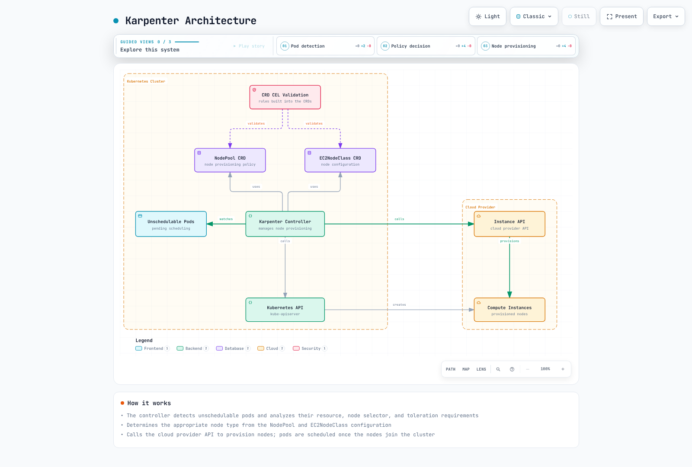
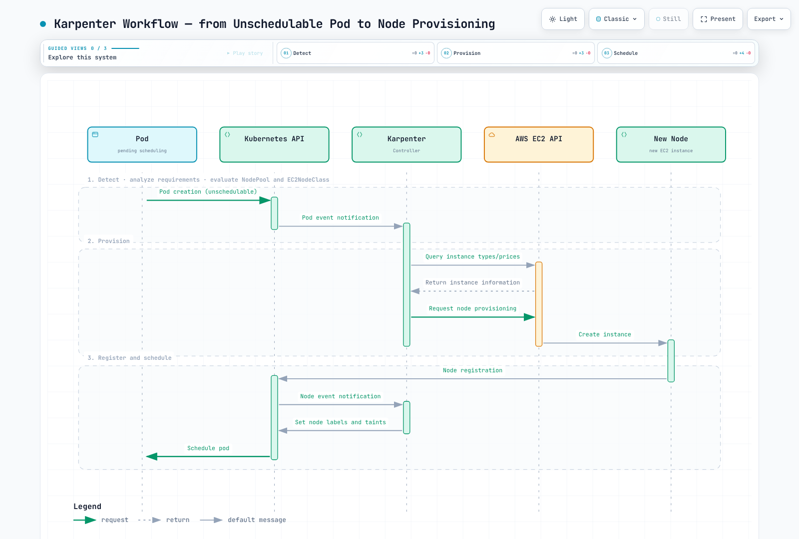
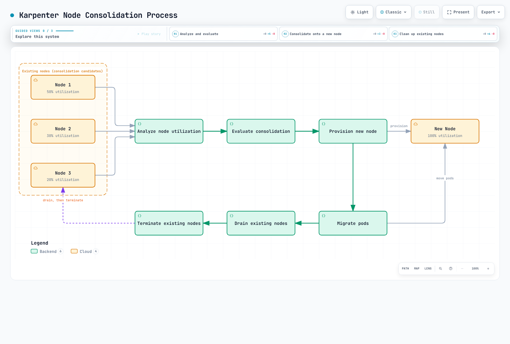
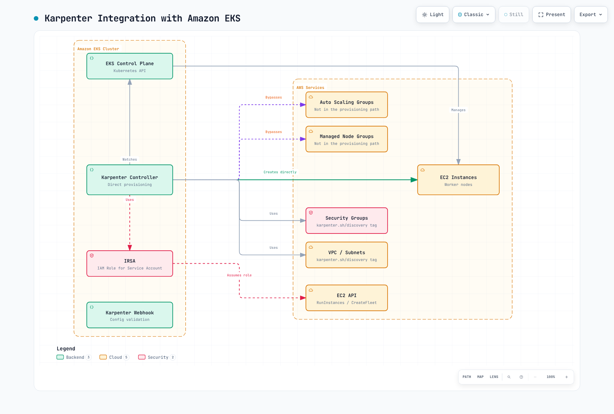
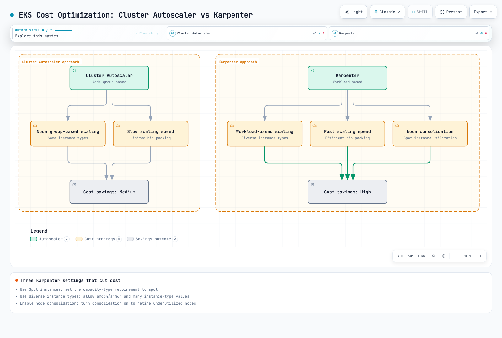
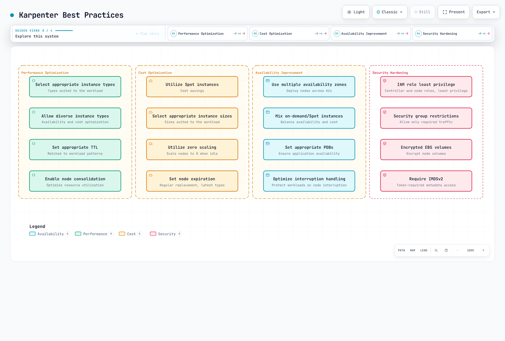

# Karpenter

> **サポート対象バージョン**: Karpenter 1.14 LTS（例: 1.14.1）。互換性およびプロバイダーのサポート表を使って、Kubernetes/EKS のバージョンを選択してください。
> **最終更新日**: 2026年11月16日

## 目次
- [はじめに](#introduction)
- [アーキテクチャ](#architecture)
- [インストールと構成](#installation-and-configuration)
- [NodePool](#nodepool)
- [Node Class](#node-classes)
- [中断への対応](#interruption-handling)
- [統合](#integration)
- [Amazon EKS との統合](#integration-with-amazon-eks)
- [ベストプラクティス](#best-practices)
- [トラブルシューティング](#troubleshooting)
- [まとめ](#conclusion)

## はじめに

Karpenter はオープンソースのノードオートスケーラーです。この章では、互換性のある Kubernetes ワークロード向けに EC2 キャパシティをプロビジョニングする AWS プロバイダーを使用します。可用性と効率は、制約、クラウドのキャパシティ、ノードの初期化、アプリケーションの設計によって左右されます。

### Karpenter の主な利点

1. **応答性の高いスケーリング**: スケジュールできないワークロードの需要に応じてプロビジョニングを開始します。ノードとアプリケーションの準備完了までの固定レイテンシは保証されません。
2. **コストの最適化**: ワークロードに最も適したインスタンスタイプを選択
3. **シンプルな構成**: 宣言型 API による簡単な構成
4. **ワークロード中心の設計**: Pod の要件に基づくノードのプロビジョニング
5. **クラウドとの統合**: クラウドプロバイダーの機能を活用
6. **効率的なビンパッキング**: リソース利用率を最適化
7. **柔軟なノード管理**: ノードのライフサイクル管理と中断対応の統合

### 既存のオートスケーラーとの比較

| 機能 | Karpenter | Cluster Autoscaler | クラウドプロバイダー管理のノードグループ |
|---------|-----------|-------------------|---------------------------|
| スケーリング速度 | スケジューリング、EC2 キャパシティ、初期化に依存 | ノードグループのスケーリングと初期化に依存 | スケーリングポリシー、キャパシティ、初期化に依存 |
| インスタンスタイプの選択 | 動的 | ノードグループベース | ノードグループベース |
| ビンパッキング効率 | ワークロードと制約に依存 | ワークロードとノードグループに依存 | スケジューラーとスケーリングコントローラーに依存 |
| 構成の複雑さ | 低 | 中 | 低 |
| クラウドとの統合 | プロバイダー固有の実装 | 複数のクラウドプロバイダーとの統合 | プロバイダー標準 |
| ノードグループの管理 | 不要 | 必要 | 必要 |
| 中断への対応 | 構成されたイベント処理とノードライフサイクル | プラットフォーム/統合に依存 | プラットフォーム固有の処理 |

> **注**: EKS は2026年4月8日に Managed Node Group のウォームプールサポートを追加しました。初期化済みのインスタンスを使うと、初期化作業の繰り返しを減らせます。Stopped モードと Running モードでは、状態遷移にかかる時間とコストが異なり、スケールイン時の再利用は任意です。AWS によると、Cluster Autoscaler との統合に追加の構成は必要ありません。再開、ノードの準備完了、アプリケーションの起動には、引き続き時間がかかります。これは EKS Managed Node Group/Auto Scaling の機能であり、Karpenter が管理するプールではありません。

## アーキテクチャ

Karpenter は Kubernetes コントローラーとして動作し、スケジュールできない Pod を検出して、適切なノードをプロビジョニングします。



[🔍 インタラクティブな図を表示](https://www.atomai.click/kubernetes-docs/archmaps/en-autoscaling-02-karpenter-0.html)

### Karpenter のワークフロー

次の図は、EKS クラスターで Karpenter がどのように動作するかを示しています。



[🔍 インタラクティブな図を表示](https://www.atomai.click/kubernetes-docs/archmaps/en-autoscaling-02-karpenter-1.html)

### 主なコンポーネント

1. **Karpenter コントローラー**: スケジューリングの必要性をシミュレートし、NodeClaim を作成してノードのライフサイクルを管理します。実際の Pod のバインドは Kubernetes スケジューラーが行います。
2. **CRD の CEL 検証**: NodePool と EC2NodeClass は CRD 内の CEL ルールによって検証されます（アドミッション/変換 Webhook は Karpenter 1.1 で削除されました）。
3. **NodePool および NodeClaim CRD**: NodePool はポリシーを定義し、NodeClaim はプロビジョニングされた個々のノードの要件とライフサイクルを記録します。
4. **EC2NodeClass CRD**: プロビジョニングするノードの構成を定義します。
5. **クラウドプロバイダーとの統合**: クラウドプロバイダーの API と統合し、コンピューティングリソースを管理します。

### 動作の仕組み

1. Karpenter コントローラーがスケジュールできない Pod を検出します。
2. Pod の要件（リソース、ノードセレクター、toleration など）を分析します。
3. NodePool と EC2NodeClass の構成に基づいて、適切なノードタイプを決定します。
4. クラウドプロバイダーの API を呼び出してノードをプロビジョニングします。
5. ノードが登録されて準備完了になると、Kubernetes スケジューラーは条件を満たす Pod をバインドできます。Karpenter は kube-scheduler を置き換えるものではありません。
6. Consolidation、drift、expiration、手動削除、クラウド中断にはそれぞれ異なるトリガーと保護策があります。これらすべてが SQS の中断イベントというわけではありません。

## インストールと構成

apiVersion/kind のない YAML ブロックは、説明対象の NodePool または EC2NodeClass の spec に対する構成断片です。単独で kubectl apply できるドキュメントではありません。

ここに示すのは既存クラスター向けの独立した学習例であり、本番環境ですぐに使えるデプロイ一式ではありません。同じオブジェクト名が繰り返されている場合、それらは選択肢です。インストール前に、IAM/OIDC、ノードアクセス、承認済みのサブネット/セキュリティグループ、ブートストラップ用キャパシティ、中断キューを準備して確認してください。すべての YAML では `my-cluster` などの例示名をそのまま使用しています。保存済みの YAML ファイル内で kubectl が `${CLUSTER_NAME}` を展開することはありません。この監査では AWS リソースのプロビジョニング、Karpenter のインストール、スケーリングの測定は実施していません。新規インストール用コマンドは、そのリリースがすでにインストールされている場合は失敗します。既存環境のインストールでは、バージョン別のアップグレード/CRD 移行ガイドに従ってください。

### 前提条件

- プラットフォームと Karpenter の互換性マトリクスでサポートされる Kubernetes バージョンを使用してください。公開されているマトリクスでは、Kubernetes 1.34 には Karpenter 1.6、1.35 には 1.9、1.36 には 1.13 がそれぞれ最小バージョンとして記載されています。これらの最小バージョンは、古い Karpenter のすべてのマイナーバージョンが引き続き保守されることを意味しません。v1.14 のマトリクスには 1.37 が含まれておらず、v1.15 のマトリクスでは Kubernetes 1.37 に Karpenter 1.15.x が必要です。EKS のバージョンの提供状況/サポートは別途確認してください。
- kubectl の構成
- クラウドプロバイダーの認証情報と権限
- Helm（任意）

### AWS EKS へのインストール

#### 1. IAM ロールとポリシーの設定

以下のコマンドは、既存のコントローラーロール、ノードロール、および API ベースの EKS 認証（API または API_AND_CONFIG_MAP）を前提としています。CONFIG_MAP のみを使用するクラスターでは、list-access-entries の代わりに既存の aws-auth ノードマッピングを確認してください。セットアップのついでに認証モードを変更しないでください。ノードロールは EC2 を信頼し、ワーカーノード/ECR の pull 権限（たとえば AmazonEKSWorkerNodePolicy と AmazonEC2ContainerRegistryPullOnly）を必要とします。サポートされている場合は、VPC CNI に独自の ID を付与してください。SSM 権限は任意であり、構成済みのエージェントが必要です。AmazonEKSClusterPolicy は Karpenter コントローラーポリシーの代替にはなりません。

```bash
# Set the existing cluster and Region; these commands only inspect AWS/Kubernetes.
export CLUSTER_NAME="my-cluster"
export AWS_REGION="us-west-2"
export KARPENTER_VERSION="1.14.1"
ACCOUNT_ID=$(aws sts get-caller-identity --query Account --output text)
CLUSTER_ENDPOINT=$(aws eks describe-cluster --region "$AWS_REGION" --name "$CLUSTER_NAME" --query cluster.endpoint --output text)
export ACCOUNT_ID CLUSTER_ENDPOINT
kubectl config current-context
aws iam get-role --role-name "KarpenterControllerRole-${CLUSTER_NAME}" --query Role.AssumeRolePolicyDocument
aws iam get-role --role-name "KarpenterNodeRole-${CLUSTER_NAME}" --query Role.AssumeRolePolicyDocument
aws eks list-access-entries --region "$AWS_REGION" --cluster-name "$CLUSTER_NAME"
```

#### 2. Helm を使ったインストール

参照先のキューとブートストラップ用キャパシティを準備した後、新規インストールの例を一度だけ使用してください。アップグレードの場合は、バージョン別の移行ガイドを確認し、対応する CRD を更新してください（たとえば、別途管理される karpenter-crd chart を使用します）。コントローラーの chart だけをアップグレードしても、通常は CRD はアップグレードされません。既存の CRD インストールを移行する前に、所有権を確認してください。

```bash
# Run only after the prerequisites and the current kubectl context are verified.
: "${CLUSTER_NAME:?Set the existing cluster name}"
: "${ACCOUNT_ID:?Set the AWS account ID}"
: "${CLUSTER_ENDPOINT:?Set the matching EKS endpoint}"
KARPENTER_VERSION="1.14.1"
helm install karpenter oci://public.ecr.aws/karpenter/karpenter \
  --version "$KARPENTER_VERSION" \
  --namespace karpenter --create-namespace \
  --set-string 'serviceAccount.annotations.eks\.amazonaws\.com/role-arn'="arn:aws:iam::${ACCOUNT_ID}:role/KarpenterControllerRole-${CLUSTER_NAME}" \
  --set-string settings.clusterName="$CLUSTER_NAME" \
  --set-string settings.clusterEndpoint="$CLUSTER_ENDPOINT" \
  --set-string settings.interruptionQueue="$CLUSTER_NAME" \
  --wait --timeout 5m
```

#### 3. インストールの確認

```bash
kubectl get deployments,pods -n karpenter
kubectl rollout status deployment/karpenter -n karpenter --timeout=180s
kubectl get nodepools,ec2nodeclasses,nodeclaims
```

デフォルトのコントローラーレプリカ数 2 に対する出力例（この監査での実行結果ではありません）:
```
NAME                         READY   STATUS    RESTARTS   AGE
karpenter-<hash>-<id-1>      1/1     Running   0          1m
karpenter-<hash>-<id-2>      1/1     Running   0          1m
```

### 基本的な NodePool と EC2NodeClass の構成

```yaml
apiVersion: karpenter.sh/v1
kind: NodePool
metadata:
  name: default
spec:
  disruption:
    consolidationPolicy: WhenEmpty
    consolidateAfter: 30s
  limits:
    cpu: '1000'
    memory: 1000Gi
  template:
    spec:
      requirements:
      - key: karpenter.sh/capacity-type
        operator: In
        values:
        - on-demand
      - key: kubernetes.io/arch
        operator: In
        values:
        - amd64
      - key: node.kubernetes.io/instance-type
        operator: In
        values:
        - m5.large
        - m5.xlarge
        - m5.2xlarge
      nodeClassRef:
        group: karpenter.k8s.aws
        kind: EC2NodeClass
        name: default
---
apiVersion: karpenter.k8s.aws/v1
kind: EC2NodeClass
metadata:
  name: default
spec:
  role: KarpenterNodeRole-my-cluster
  amiSelectorTerms:
  - alias: al2023@latest
  subnetSelectorTerms:
  - tags:
      karpenter.sh/discovery: my-cluster
  securityGroupSelectorTerms:
  - tags:
      karpenter.sh/discovery: my-cluster
  tags:
    karpenter.sh/discovery: my-cluster
  blockDeviceMappings:
  - deviceName: /dev/xvda
    ebs:
      volumeSize: 100Gi
      volumeType: gp3
      deleteOnTermination: true
      encrypted: true
```

## NodePool

NodePool は、Karpenter がノードをどのようにプロビジョニングするかを定義する Kubernetes カスタムリソースです。以前の Provisioner に代わるものです。

### 基本的な NodePool の構成

以下の特別な taint は、対応する workload toleration を意図的に要求します。構成した taint を削除する初期化処理が確認できるまでは、startupTaints は空のままにしてください。担当コントローラーを用意せずに startup taint を設定すると、ノードが使用不能になる場合があります。Limits、初期化、中断の例はそれぞれ別の選択肢であり、稼働中の本番 NodePool に追加で適用する変更ではありません。

```yaml
apiVersion: karpenter.sh/v1
kind: NodePool
metadata:
  name: default
spec:
  template:
    metadata:
      labels:
        environment: training
        app: web
    spec:
      requirements:
      - key: karpenter.sh/capacity-type
        operator: In
        values:
        - on-demand
      - key: kubernetes.io/arch
        operator: In
        values:
        - amd64
      - key: node.kubernetes.io/instance-type
        operator: In
        values:
        - m5.large
        - m5.xlarge
        - m5.2xlarge
      nodeClassRef:
        group: karpenter.k8s.aws
        kind: EC2NodeClass
        name: default
      expireAfter: 720h
      taints:
      - key: example.com/special-taint
        value: 'true'
        effect: NoSchedule
      startupTaints: []
  limits:
    cpu: '1000'
    memory: 1000Gi
  disruption:
    consolidationPolicy: WhenEmpty
    consolidateAfter: 30s
```

### 要件の構成

要件は互いに、EC2NodeClass と、Pod の制約との間で交差されます。amd64 と arm64 の両方を許可しても、条件を満たすインスタンスタイプ、AMI、コンテナイメージが両方をサポートしていなければ役に立ちません。使用可能なゾーン/キャパシティタイプを列挙しても、均等な分散は保証されません。その目的にはワークロードのトポロジー制約を使用してください。

要件は、Karpenter がプロビジョニングするノードの特性を定義します。

```yaml
template:
  spec:
    requirements:
    - key: karpenter.sh/capacity-type
      operator: In
      values:
      - on-demand
      - spot
    - key: kubernetes.io/arch
      operator: In
      values:
      - amd64
      - arm64
    - key: node.kubernetes.io/instance-type
      operator: In
      values:
      - m5.large
      - m5.xlarge
      - c5.large
      - m6g.large
      - c6g.large
    - key: topology.kubernetes.io/zone
      operator: In
      values:
      - us-west-2a
      - us-west-2b
      - us-west-2c
    - key: kubernetes.io/os
      operator: In
      values:
      - linux
```

### Limits の構成

`spec.limits` はプロビジョニング済みリソースの合計を制限しますが、並列プロビジョニングでは結果整合性のあるチェックが使われるため、一時的に上限を超える場合があります。厳密な請求上限ではありません。文字列形式の数量を使うと、API/GitOps 間の型の違いを避けられます。

```yaml
limits:
  cpu: '1000'
  memory: 1000Gi
  nvidia.com/gpu: '10'
```

### 実験的な DRA 割り当ての追跡（v1.13）

Karpenter コア v1.13 では DRA デバイス割り当ての追跡が追加されました。これは、本番環境の DRA プロビジョニング全般を保証するものではありません。AWS 1.14.1 chart では `settings.ignoreDRARequests: true` がデフォルトであり、upstream は正式な DRA サポートをまだ GA ではないとしています。Kubernetes 1.29 以上であることだけでは、互換性の根拠として十分ではありません。実際に使用する Kubernetes リソース API、DRA ドライバー、ResourceClaims/ResourceSlices、Karpenter の構成を検証してください。DRA claim を、以下のデバイスプラグインの拡張リソース例と同等のものとして扱わないでください。

### ノードの有効期限の構成

`expireAfter` は、有効期限による drain が始まるタイミングを定義するもので、置き換えの完了時刻を保証するものではありません。以下の任意設定 `terminationGracePeriod` は drain の期限を設定しますが、PDB によってブロックされている Pod を含め、残っている Pod を強制削除する場合があります。この期限を設定するのは、アプリケーションのシャットダウンと復旧の要件を検証した後にしてください。

```yaml
spec:
  template:
    spec:
      expireAfter: 720h
      terminationGracePeriod: 30m
  disruption:
    consolidationPolicy: WhenEmpty
    consolidateAfter: 30s
```

### NodeReadinessController の taint の認識（v1.13）

Karpenter コア v1.13 は、初期化されていない管理対象ノードのスケジューリングをシミュレートする際、別の NodeReadinessController が設定する `readiness.k8s.io/` taint を一時的なものとして認識します。ただし、初期化完了と判断するには、引き続きこれらの taint が消えるのを待ちます。taint を削除したり、Kubernetes スケジューラーによる taint の迂回を許可したりするものではありません。その他の初期化 taint には、引き続き正確な `startupTaints` 構成と、それを削除するコントローラーが必要です。

### 2026年7月の更新: v1.14 リリース

2026年7月11日にリリースされた Karpenter v1.14 では、次の機能が追加されました。

- **CapacityBuffers API のサポート**: alpha 版のキャパシティバッファ統合です。`CapacityBuffer` はデフォルトで無効で、対応する CRD/コントローラーの構成が必要です。予約済みの余裕は、空きキャパシティでもレイテンシの保証でもありません。
- **プレビューインスタンスタイプのサポート**: 条件を満たすプレビュー提供のインスタンスタイプを認識します。実際のプロビジョニングには、引き続きアカウント/Region でのアクセス権と提供状況が必要です。
- **Nitro Enclaves のサポート**: NodeClaim のリソース要求に `eks.amazonaws.com/nip-slots` が含まれる場合、プロバイダーは生成する起動テンプレートの `EnclaveOptions.Enabled` を設定します。対応インスタンス、AMI、デバイスプラグインのセットアップは引き続き前提条件です。1.14.1 に `EC2NodeClass.spec.enclaveOptions` フィールドはありません。
- バグ修正: セカンダリ ENI のプライマリ IP の考慮、Zonal Shift キャッシュの確実な初期化、AWS SDK クライアントのタイムアウトをオペレーター設定に組み込み、その他

詳細については、[v1.14.0 リリースノート](https://github.com/aws/karpenter-provider-aws/releases/tag/v1.14.0)を参照してください。

2026年7月17日には、1.3.8 や 1.11.3 を含む古いブランチにパッチがリリースされました。この過去のバックポートは、その間にあるすべてのマイナーバージョンが引き続きサポートされることを示すものではありません。現在のサポートポリシーでは、LTS 1.9 は2027年2月まで、LTS 1.14 は2027年7月までサポートされます。通常のマイナーバージョンは次のマイナーバージョンがリリースされるまでのみサポートされます。古い系統が引き続き保守されると想定せず、サポート対象の系統を選び、その移行ガイダンスに従ってください。

2026年7月22日の AWS の発表では、Karpenter/EKS Auto Mode 向けに EFA ネットワークインターフェイスとプレイスメントグループの構成が追加されました。AWS Karpenter 1.14.1 で使用するフィールドは `EC2NodeClass.spec.networkInterfaces` と `spec.placementGroupSelector` です（NodePool のフィールドではありません）。EFA 専用インターフェイスは VPC IP アドレスを消費しませんが、デバイス/カードインデックス 0 にはプライマリの `interface` が必要です。名前または ID で既存のプレイスメントグループを選択してください。そのクラスター/スプレッド/パーティション戦略および対応インスタンスが配置を制約します。ここに示す例は HPC ワークロードの構成や検証を行うものではありません。

### 2026年8月の更新: v1.14.1 パッチリリース

v1.14 系列で最初のパッチとなる [v1.14.1](https://github.com/aws/karpenter-provider-aws/releases/tag/v1.14.1) は、2026年8月21日に公開されました。upstream の `sigs.k8s.io/karpenter` のバージョンを更新し、v1.14.0 以降に行われた修正を cherry-pick したメンテナンスリリースです。

### 2026年10月の更新: v1.15.0 通常リリース

通常（非 LTS）のマイナーバージョンである [v1.15.0](https://github.com/aws/karpenter-provider-aws/releases/tag/v1.15.0) は、2026年10月10日に公開されました。主な変更点は次のとおりです。

- **ノード修復が任意の中断として扱われるように変更**: ノード修復が中断処理の仕組みに統合されました。キャパシティが制約された NodePool で、置き換えノードを先に用意できない場合は、先に終了してから修復します。修復アクションとして `ec2:RebootInstances` による再起動が追加されました（`RebootForRepair` AWS feature gate の背後にあります）。以前の修復コントローラーは `--legacy-node-repair` フラグを使うと引き続き利用できます。
- **KubeletConfiguration での CEL サポート**: `maxPodsExpression`、`kubeReserved`、`systemReserved` が CEL 式を受け付けるようになり、EC2NodeClass の KubeletConfiguration フィールドが拡張されました。
- **DRA サポートの拡大**: 優先順位付き代替案に加え、NVIDIA および EFA ドライバーの DRA サポートが追加されました。
- その他: `--aws-feature-gates` フラグ、デフォルトの Pod トポロジー分散の認識、プロビジョニング時のインスタンスタイプのボリューム上限の考慮、`karpenter_pods_disrupted_total` などの新しい中断メトリクス、feature gate で有効化される Pod 削除コスト管理コントローラー

サポートポリシーでは、通常のマイナーバージョンは次のマイナーバージョンがリリースされるまでのみサポートされます。そのため v1.15.0 のリリース後は、v1.14 は LTS 系列としてのみ継続されます（2027年7月まで）。したがって、この章の例は 1.14 LTS（1.14.1）のままです。Kubernetes 1.37 には Karpenter 1.15.x が必要です。Kubernetes 1.37 が必要な場合、または 1.15 に移行する場合は、まず [v1.15 互換性マトリクス](https://karpenter.sh/v1.15/upgrading/compatibility/)とアップグレードガイダンスを確認してください。詳細については、[v1.15.0 リリースノート](https://github.com/aws/karpenter-provider-aws/releases/tag/v1.15.0)を参照してください。

### 2026年10月の更新: v1.15.1 および LTS パッチリリース

2026年10月20日から23日にかけて、サポート対象の系列でパッチリリースが公開されました。[v1.15.1](https://github.com/aws/karpenter-provider-aws/releases/tag/v1.15.1)（1.15 系列で最初のパッチ。互換性のあるすべてのキャパシティ予約が満杯の場合に延期するのではなく選好条件を緩和する修正や、作成後にラベルが同期された場合のノード修復のキュー投入など）、1.14 LTS 系列の [v1.14.2](https://github.com/aws/karpenter-provider-aws/releases/tag/v1.14.2) と [v1.14.3](https://github.com/aws/karpenter-provider-aws/releases/tag/v1.14.3)（`SpotMaxPriceTooLow` を ICE エラーとして分類し、回収中の中断可能なキャパシティ予約を利用不可のキャパシティとして扱うなど）、および 1.9 LTS 系列の [v1.9.3](https://github.com/aws/karpenter-provider-aws/releases/tag/v1.9.3) です。3 系列すべてで Go ツールチェーンが 1.26.10 に更新されました。これは、侵害された eMudhra 中間 CA 証明書を信頼しなくなる Go のパッチリリースです（CVE-2026-111943）。

### 2026年11月の更新: EKS Auto Mode と Karpenter 向け DRA サポートの発表

2026年11月9日、AWS は EKS Auto Mode と Karpenter における NVIDIA GPU および Elastic Fabric Adapter（EFA）ネットワークデバイス向け Kubernetes Dynamic Resource Allocation（DRA）サポートを発表しました。ワークロードは DRA を通じて必要なデバイス属性を宣言でき、Pod 間で GPU デバイスを共有できます。Karpenter はすべての Kubernetes バージョンで DRA をサポートします。EKS Auto Mode は Kubernetes 1.36 以降をサポートしますが、AWS GovCloud (US) および中国の Region は対象外です。詳細については[発表](https://aws.amazon.com/about-aws/whats-new/2026/11/amazon-eks-auto-mode-karpenter-dra/)を参照してください。

### 2026年11月の更新: v1.15.2 パッチリリース

2026年11月12日に公開された [v1.15.2](https://github.com/aws/karpenter-provider-aws/releases/tag/v1.15.2) は、DRA インスタンスタイプのメタデータのみを更新します。alpha の `settings.awsFeatureGates.draNVIDIAGPU` または `settings.awsFeatureGates.draEFA` gate（または `settings.enableDRA`）が有効でなければ、変更の影響はありません。`g7` と `g7e` の NVIDIA GPU DRA メタデータを追加し、既存の GPU インスタンスタイプの GPU メモリ属性を更新する一方、分数 GPU の `g6f` と `gr6f` タイプには NVIDIA DRA メタデータが付かなくなりました。そのため、Karpenter はこれらを `gpu.nvidia.com` claim の候補に選びません。EFA DRA メタデータの対象は 29 タイプから 302 タイプに増えました。新たに追加されたエントリーで設定されるのは `dra.net/pciDevice`、`dra.net/pciVendor`、`dra.net/rdma` のみです。ソースからビルドするには Go 1.26.11 以降が必要になりました。

## Node Class

Node Class は、Karpenter がプロビジョニングするノードの構成を定義します。AWS では EC2NodeClass CRD を使用します。

### AWS EC2NodeClass の構成

```yaml
apiVersion: karpenter.k8s.aws/v1
kind: EC2NodeClass
metadata:
  name: default
spec:
  subnetSelectorTerms:
  - tags:
      karpenter.sh/discovery: my-cluster
  securityGroupSelectorTerms:
  - tags:
      karpenter.sh/discovery: my-cluster
  tags:
    karpenter.sh/discovery: my-cluster
    environment: training
  blockDeviceMappings:
  - deviceName: /dev/xvda
    ebs:
      volumeSize: 100Gi
      volumeType: gp3
      deleteOnTermination: true
      encrypted: true
  role: KarpenterNodeRole-my-cluster
  amiSelectorTerms:
  - alias: al2023@latest
  userData: '#!/bin/bash

    echo "Hello from Karpenter node!"

    '
  metadataOptions:
    httpEndpoint: enabled
    httpProtocolIPv6: disabled
    httpPutResponseHopLimit: 1
    httpTokens: required
```

### サブネットとセキュリティグループの選択

サブネットとセキュリティグループは selector terms を使って選択します（複数の term は OR 条件で評価され、1 つの term 内のタグは AND 条件で評価されます）。

```yaml
subnetSelectorTerms:
- tags:
    karpenter.sh/discovery: my-cluster
    Name: private-*
securityGroupSelectorTerms:
- tags:
    karpenter.sh/discovery: my-cluster
```

### AMI の構成

Karpenter は `amiSelectorTerms` を通じて AMI を選択します。alias はファミリー/バージョンを選択します。**`@latest` はバージョンを固定する指定ではありません**。解決される AMI が変わり、drift が発生する場合があります。`@latest` を使った例は学習用です。本番環境では、ロールアウト前に、サポートされている明示的な AMI リリース（実在するリリース日を指定した `al2023@vYYYYMMDD`）または承認済みの AMI ID を解決してテストしてください。Kubernetes 1.33 以降向けの AL2 EKS AMI は公開されていません。以下のバリアントは選択肢です。Custom AMI には、動作するブートストラップ、登録 taint、kubelet、CNI/ランタイム、ID の設定が必要です。

```yaml
# Amazon Linux 2023
amiSelectorTerms:
  - alias: al2023@latest
---
# Bottlerocket
amiSelectorTerms:
  - alias: bottlerocket@latest
---
# Custom AMI (by ID): amiFamily is required when no alias term is used
amiFamily: Custom
amiSelectorTerms:
  - id: "ami-0123456789abcdef0"
# Ubuntu: no v1 alias; use amiFamily: Custom with an id/tags/name term
```

### ブロックデバイスの構成

デバイスマッピングは AMI ファミリーごとに異なります。以下の AL2023 の例ではルートデバイスに /dev/xvda を使用しています。他の AMI では実際のレイアウトを確認してください。追加ボリュームには、明示的なファイルシステム/マウント、またはアプリケーション用ストレージの計画が必要です。カスタマーマネージドの KMS キーにも、適切なキー/IAM 権限が必要です。

ノードのストレージ構成を定義できます。

```yaml
blockDeviceMappings:
- deviceName: /dev/xvda
  ebs:
    volumeSize: 100Gi
    volumeType: gp3
    iops: 3000
    throughput: 125
    deleteOnTermination: true
    encrypted: true
    kmsKeyID: arn:aws:kms:us-west-2:111122223333:key/1234abcd-12ab-34cd-56ef-1234567890ab
- deviceName: /dev/xvdb
  ebs:
    volumeSize: 500Gi
    volumeType: gp3
    deleteOnTermination: true
    encrypted: true
```

### User Data の構成

以下の shell user-data スニペットは AL2023 を前提としています。AL2023 では、Karpenter が生成する bootstrap/nodeadm 構成にカスタムデータがマージされます。これらは Bottlerocket/Windows に共通して使えるブートストラップではありません。起動のたびに無制限のパッケージ更新を実行するのではなく、AMI にパッケージを組み込んでテストしてください。構成、IAM、ネットワーク経路を用意せずに CloudWatch Agent をインストール/起動しても、テレメトリ収集が確立するわけではありません。

```yaml
userData: |
  #!/bin/bash
  set -euo pipefail
  # Only for a workload that requires this setting; keep node packages in a tested AMI.
  cat > /etc/sysctl.d/99-workload-map-count.conf <<'EOF'
  vm.max_map_count=262144
  EOF
  sysctl -p /etc/sysctl.d/99-workload-map-count.conf
```

### ノードの Consolidation プロセス

次の図は、Karpenter のノード Consolidation プロセスを示しています。この機能は、クラスターの効率を高め、コストを削減するうえで重要です。



[🔍 インタラクティブな図を表示](https://www.atomai.click/kubernetes-docs/archmaps/en-autoscaling-02-karpenter-2.html)

## 中断への対応

構成された中断処理は、キャパシティが失われる前に対応しようとします。結果は、通知、置き換えキャパシティ、シャットダウン期限、アプリケーションの復旧によって決まります。途切れない可用性は保証されません。

### 統合された中断処理

クラウド中断への対応は、Consolidation/expiration とは別の機能です。次のようなシグナルを対象とします。

1. **Spot 中断警告**: drain を開始し、可能であれば置き換えキャパシティを要求します。通知の猶予時間は、復旧 SLA を保証するものではありません。
2. **スケジュール済みのヘルス/メンテナンスイベント**: 影響を受けるインスタンスに対応します。
3. **インスタンスの停止/終了イベント**: サービスから離れるキャパシティを調整します。
4. **EC2 インスタンスステータスの失敗**: 必要な EC2 API 権限を使ってヘルスを確認します。Rebalance recommendation はイベントとして発行されるだけで、自動的に taint/drain/terminate 操作が行われるわけではありません。

### 中断処理の構成

```yaml
apiVersion: karpenter.sh/v1
kind: NodePool
metadata:
  name: default
spec:
  template:
    spec:
      requirements:
        - key: karpenter.sh/capacity-type
          operator: In
          values: ["on-demand"]
      nodeClassRef:
        group: karpenter.k8s.aws
        kind: EC2NodeClass
        name: default

      # Node expiration settings
      expireAfter: 720h  # 30 days
  disruption:
    consolidationPolicy: WhenEmpty
    consolidateAfter: 30s
```

### Drain の構成

Karpenter は通常、graceful drain 中に eviction を使用します。Helm の設定はコントローラーを構成します。NodePool の disruption budget が制限するのは、任意の Consolidation/drift の開始であり、同時に失われるすべてのノードではありません。30% の budget は切り上げた後、削除中/準備未完了のノードを差し引きます。厳密な 30% の上限ではありません。expiration、中断、修復では、異なる強制動作が発生する場合があります。`interruptionQueue` を有効にする前に、指定した SQS キュー、EventBridge ルール/ターゲット、キューポリシー、コントローラーの権限を設定してください。Helm フィールドだけでは、これらは作成されません。

```yaml
settings:
  clusterName: my-cluster
  interruptionQueue: my-cluster
  batchMaxDuration: 10s
  batchIdleDuration: 1s
  featureGates:
    spotToSpotConsolidation: false
controller:
  resources:
    requests:
      cpu: 1
      memory: 1Gi
    limits:
      cpu: '1'
      memory: 1Gi
logLevel: info
```

```yaml
apiVersion: karpenter.sh/v1
kind: NodePool
metadata:
  name: default
spec:
  template:
    spec:
      requirements:
        - key: karpenter.sh/capacity-type
          operator: In
          values: ["on-demand"]
      nodeClassRef:
        group: karpenter.k8s.aws
        kind: EC2NodeClass
        name: default
      expireAfter: 720h
  disruption:
    consolidationPolicy: WhenEmpty
    consolidateAfter: 30s
    budgets:
      - nodes: "30%"   # Voluntary budget: round up, then subtract deleting/not-ready nodes
```

### PDB（PodDisruptionBudget）との統合

PDB は正常なレプリカ数に基づいて任意の eviction を制約します。レプリカを作成したり、アプリケーションの可用性を保証したりするものではありません。以下の `minAvailable: 2` の場合、eviction を許可するには、十分な数の正常な一致 Pod が必要です。インスタンスの喪失や強制終了の期限によって、それらの Pod が中断される場合はあります。

```yaml
apiVersion: policy/v1
kind: PodDisruptionBudget
metadata:
  name: app-pdb
  namespace: default
spec:
  minAvailable: 2
  selector:
    matchLabels:
      app: my-app
```

## 統合

Karpenter は、さまざまな Kubernetes サービスやクラウドサービスと統合されます。

### Kubernetes との統合

#### 1. Pod Topology Spread Constraints

Karpenter はノードのプロビジョニング時に Pod Topology Spread Constraints を考慮します。

```yaml
apiVersion: apps/v1
kind: Deployment
metadata:
  name: web-server
  namespace: default
spec:
  replicas: 10
  template:
    spec:
      topologySpreadConstraints:
      - maxSkew: 1
        topologyKey: topology.kubernetes.io/zone
        whenUnsatisfiable: DoNotSchedule
        labelSelector:
          matchLabels:
            app: web-server
      containers:
      - name: web-server
        image: nginx:1.30.6
        ports:
        - containerPort: 80
        resources:
          requests:
            cpu: 100m
            memory: 128Mi
          limits:
            memory: 256Mi
    metadata:
      labels:
        app: web-server
  selector:
    matchLabels:
      app: web-server
```

#### 2. Pod Affinity/Anti-Affinity

Karpenter は Pod Affinity と Anti-Affinity のルールを考慮します。

```yaml
apiVersion: apps/v1
kind: Deployment
metadata:
  name: web-server
  namespace: default
spec:
  replicas: 10
  template:
    spec:
      affinity:
        podAntiAffinity:
          requiredDuringSchedulingIgnoredDuringExecution:
          - labelSelector:
              matchExpressions:
              - key: app
                operator: In
                values:
                - web-server
            topologyKey: kubernetes.io/hostname
      containers:
      - name: web-server
        image: nginx:1.30.6
        ports:
        - containerPort: 80
        resources:
          requests:
            cpu: 100m
            memory: 128Mi
          limits:
            memory: 256Mi
    metadata:
      labels:
        app: web-server
  selector:
    matchLabels:
      app: web-server
```

#### 3. Taint と Toleration

GPU の例には、互換性のあるアクセラレーテッド AMI、NVIDIA ドライバー、GPU taint を許容して nvidia.com/gpu をアドバタイズするデバイスプラグイン DaemonSet が必要です。BusyBox Pod は GPU を予約する例にすぎず、CUDA を実行したりベンチマークしたりするものではありません。実際の GPU アプリケーションイメージを使って別途検証してください。

Karpenter はノードのプロビジョニング時に taint と toleration を考慮します。

```yaml
apiVersion: karpenter.sh/v1
kind: NodePool
metadata:
  name: gpu
spec:
  template:
    spec:
      requirements:
      - key: node.kubernetes.io/instance-type
        operator: In
        values:
        - g4dn.xlarge
        - g4dn.2xlarge
      taints:
      - key: nvidia.com/gpu
        value: 'true'
        effect: NoSchedule
      nodeClassRef:
        group: karpenter.k8s.aws
        kind: EC2NodeClass
        name: default
---
apiVersion: apps/v1
kind: Deployment
metadata:
  name: gpu-app
  namespace: default
spec:
  replicas: 3
  template:
    spec:
      tolerations:
      - key: nvidia.com/gpu
        operator: Exists
        effect: NoSchedule
      nodeSelector:
        karpenter.sh/nodepool: gpu
      containers:
      - name: gpu-allocation-demo
        image: busybox:1.38.0
        command:
        - sh
        - -c
        - sleep 3600
        resources:
          requests:
            cpu: 100m
            memory: 64Mi
          limits:
            memory: 128Mi
            nvidia.com/gpu: 1
    metadata:
      labels:
        app: gpu-app
  selector:
    matchLabels:
      app: gpu-app
```

### AWS との統合

#### 1. EC2 Spot インスタンス

Karpenter は、コストを最適化するために EC2 Spot インスタンスをサポートします。

```yaml
apiVersion: karpenter.sh/v1
kind: NodePool
metadata:
  name: spot
spec:
  template:
    spec:
      requirements:
      - key: karpenter.sh/capacity-type
        operator: In
        values:
        - spot
      nodeClassRef:
        group: karpenter.k8s.aws
        kind: EC2NodeClass
        name: spot
---
apiVersion: karpenter.k8s.aws/v1
kind: EC2NodeClass
metadata:
  name: spot
spec:
  role: KarpenterNodeRole-my-cluster
  amiSelectorTerms:
  - alias: al2023@latest
  subnetSelectorTerms:
  - tags:
      karpenter.sh/discovery: my-cluster
  securityGroupSelectorTerms:
  - tags:
      karpenter.sh/discovery: my-cluster
```

#### 2. EC2 Instance Profile

role と instanceProfile は相互に排他的です。role を使用する場合、Karpenter が instance profile を管理するため、対応する IAM API の権限/接続が必要です。クラスターから IAM エンドポイントへの経路がない場合は、事前にプロビジョニングした instanceProfile を使用してください。IAM に PrivateLink エンドポイントはありません。コントローラーには、引き続きノードロールに対する PassRole が必要です。また、EC2 認証情報を持っていることと EKS ノードアクセスは別のものです。

Karpenter は EC2 instance profile を使ってノードに IAM 権限を付与します。

```yaml
apiVersion: karpenter.k8s.aws/v1
kind: EC2NodeClass
metadata:
  name: default
spec:
  instanceProfile: KarpenterNodeInstanceProfile-my-cluster
  amiSelectorTerms:
  - alias: al2023@latest
  subnetSelectorTerms:
  - tags:
      karpenter.sh/discovery: my-cluster
  securityGroupSelectorTerms:
  - tags:
      karpenter.sh/discovery: my-cluster
```

#### 3. 起動テンプレートの置き換え（EC2NodeClass）

Karpenter v1 は、ユーザー指定の EC2 起動テンプレートを受け付けません（従来の `launchTemplate` フィールドは削除されました）。Karpenter は EC2NodeClass から起動テンプレートを生成して管理します。そのため、起動テンプレートに設定する項目は EC2NodeClass に直接記述します。

```yaml
apiVersion: karpenter.k8s.aws/v1
kind: EC2NodeClass
metadata:
  name: node-config
spec:
  role: KarpenterNodeRole-my-cluster
  subnetSelectorTerms:
  - tags:
      karpenter.sh/discovery: my-cluster
  securityGroupSelectorTerms:
  - tags:
      karpenter.sh/discovery: my-cluster
  amiSelectorTerms:
  - alias: al2023@latest
  userData: '#!/bin/bash

    echo "Hello from Karpenter node!"

    '
  blockDeviceMappings:
  - deviceName: /dev/xvda
    ebs:
      volumeSize: 100Gi
      volumeType: gp3
      deleteOnTermination: true
      encrypted: true
  metadataOptions:
    httpEndpoint: enabled
    httpProtocolIPv6: disabled
    httpPutResponseHopLimit: 1
    httpTokens: required
```
## Amazon EKS との統合

Karpenter の AWS プロバイダーは、ID、ネットワーク、ノードアクセス、ブートストラップを構成すれば、EKS 管理のコンピューティングと並行して EC2 キャパシティをプロビジョニングできます。



[🔍 インタラクティブな図を表示](https://www.atomai.click/kubernetes-docs/archmaps/en-autoscaling-02-karpenter-3.html)

### EKS クラスターの準備

すべての例示名を一貫して置き換えてください。ワーカーに適したサブネット/セキュリティグループだけを選択してください。すべてのコントロールプレーン用サブネットにタグを付ける方法は、安全なリソース検出手段ではありません。ノードの起動を許可する前に、サブネットのルート、セキュリティルール、CNI の IP キャパシティ、必要なプライベートエンドポイントを確認してください。

#### 1. クラスタータグの設定

インフラストラクチャ構成で、承認済みのワーカー用サブネットとセキュリティグループだけにタグを付けてください。VPC へのタグ付けで、それらのリソースが選択されるわけではありません。検出用の値は例（ここでは `my-cluster`）と一致させる必要があります。タグを付けただけでは、プライベートルーティング、適切なセキュリティルール、十分な空きアドレスは保証されません。NodePool を適用する前に、実際のリソースとルートを調べてください。

```bash
# Inspect resources that your infrastructure configuration has tagged for this cluster.
: "${CLUSTER_NAME:?Set the existing cluster name}"
: "${AWS_REGION:?Set the cluster Region}"
aws ec2 describe-subnets --region "$AWS_REGION" \
  --filters "Name=tag:karpenter.sh/discovery,Values=${CLUSTER_NAME}" \
  --query 'Subnets[].{ID:SubnetId,AZ:AvailabilityZone,FreeIPs:AvailableIpAddressCount,PublicIPOnLaunch:MapPublicIpOnLaunch,VPC:VpcId}'
aws ec2 describe-security-groups --region "$AWS_REGION" \
  --filters "Name=tag:karpenter.sh/discovery,Values=${CLUSTER_NAME}" \
  --query 'SecurityGroups[].{ID:GroupId,VPC:VpcId,Name:GroupName}'
# Inspect explicit and main route-table associations for the intended subnets.
aws ec2 describe-route-tables --region "$AWS_REGION" \
  --filters "Name=vpc-id,Values=$(aws eks describe-cluster --region "$AWS_REGION" --name "$CLUSTER_NAME" --query cluster.resourcesVpcConfig.vpcId --output text)"
```

#### 2. IAM ロールの設定

不完全な手書きの全許可ポリシーを使うのではなく、以下のバージョン固有のコントローラーポリシーとインフラストラクチャのリファレンスを使用してください。コントローラーの認証情報（ここでは IRSA）は、ノードの認証情報、および VPC CNI/ワークロードの ID とは別です。コントローラーの信頼関係は、クラスターの OIDC プロバイダー、`system:serviceaccount:karpenter:karpenter`、`aud: sts.amazonaws.com` と一致させてください。このバージョンと選択した機能に必要なアクション/リソース/条件のみを許可してください。ノードロールは EKS への参加を許可される必要があります。API ベースの認証が有効な場合、通常は `EC2_LINUX` アクセスエントリーを使います。以下の確認コマンドでは IAM ロールやアクセスエントリーは作成されません。

```bash
# Download a versioned reference for review; this does not create a CloudFormation stack.
KARPENTER_VERSION="1.14.1"
curl --fail --show-error --location \
  "https://raw.githubusercontent.com/aws/karpenter-provider-aws/v${KARPENTER_VERSION}/website/content/en/preview/getting-started/getting-started-with-karpenter/cloudformation.yaml" \
  --output karpenter-cloudformation-reference.yaml
# Inspect the existing role's attached and inline policies.
: "${CLUSTER_NAME:?Set the existing cluster name}"
aws iam list-attached-role-policies --role-name "KarpenterControllerRole-${CLUSTER_NAME}"
aws iam list-role-policies --role-name "KarpenterControllerRole-${CLUSTER_NAME}"
```

### EKS クラスターへの Karpenter のインストール

```bash
# Run only after the prerequisites and the current kubectl context are verified.
: "${CLUSTER_NAME:?Set the existing cluster name}"
: "${ACCOUNT_ID:?Set the AWS account ID}"
: "${CLUSTER_ENDPOINT:?Set the matching EKS endpoint}"
KARPENTER_VERSION="1.14.1"
helm install karpenter oci://public.ecr.aws/karpenter/karpenter \
  --version "$KARPENTER_VERSION" \
  --namespace karpenter --create-namespace \
  --set-string 'serviceAccount.annotations.eks\.amazonaws\.com/role-arn'="arn:aws:iam::${ACCOUNT_ID}:role/KarpenterControllerRole-${CLUSTER_NAME}" \
  --set-string settings.clusterName="$CLUSTER_NAME" \
  --set-string settings.clusterEndpoint="$CLUSTER_ENDPOINT" \
  --set-string settings.interruptionQueue="$CLUSTER_NAME" \
  --wait --timeout 5m
```

### EKS Managed Node Group との併用

Karpenter は EKS Managed Node Group と共存できます。以下の NodePool は別個の EC2 ノードをプロビジョニングするものであり、Managed Node Group を管理するものではありません。コントローラーは信頼性の高いブートストラップ用キャパシティ上で稼働させてください（デフォルトの chart は Karpenter ノードを除外し、異なるホスト上に 2 つのレプリカを要求します）。

```yaml
apiVersion: karpenter.sh/v1
kind: NodePool
metadata:
  name: managed-ng
spec:
  template:
    metadata:
      labels:
        managed-by: karpenter
    spec:
      requirements:
      - key: karpenter.sh/capacity-type
        operator: In
        values:
        - on-demand
      - key: node.kubernetes.io/instance-type
        operator: In
        values:
        - m5.large
        - m5.xlarge
      taints:
      - key: managed-by
        value: karpenter
        effect: NoSchedule
      nodeClassRef:
        group: karpenter.k8s.aws
        kind: EC2NodeClass
        name: managed-ng
  disruption:
    consolidationPolicy: WhenEmpty
    consolidateAfter: 30s
---
apiVersion: karpenter.k8s.aws/v1
kind: EC2NodeClass
metadata:
  name: managed-ng
spec:
  role: KarpenterNodeRole-my-cluster
  amiSelectorTerms:
  - alias: al2023@latest
  subnetSelectorTerms:
  - tags:
      karpenter.sh/discovery: my-cluster
  securityGroupSelectorTerms:
  - tags:
      karpenter.sh/discovery: my-cluster
  tags:
    karpenter.sh/discovery: my-cluster
```

### EKS Fargate との併用

Fargate は Kubernetes の topologySpreadConstraints を実装しておらず、Kubernetes の Affinity/Anti-Affinity ルールも適用されません。デフォルトの chart にある EC2 配置制約で Fargate の AZ 分散が保証されるとは考えず、プロファイル/サブネットの配置を別途設計して検証してください。

対象を絞った Fargate profile でコントローラー Pod を実行しながら、Karpenter で EC2 ワーカーをプロビジョニングできます。Karpenter は Fargate キャパシティを作成せず、Fargate profile を管理することもありません。`default`/`kube-system` 全体ではなく、namespace `karpenter` とコントローラーのラベルを選択する profile を準備してください。JSON の selector の形式は `[{"namespace":"karpenter","labels":{"app.kubernetes.io/name":"karpenter"}}]` です。profile には独自の Pod execution role/プライベートサブネットが必要です。また、コントローラーの AWS 権限には引き続き IRSA が必要です（EKS Pod Identity は Fargate ではサポートされていません）。以下のコマンドは既存の profile の確認のみを行います。

```bash
# Inspect an existing, narrowly selected controller Fargate profile.
: "${CLUSTER_NAME:?Set the existing cluster name}"
: "${AWS_REGION:?Set the cluster Region}"
aws eks describe-fargate-profile --region "$AWS_REGION" \
  --cluster-name "$CLUSTER_NAME" --fargate-profile-name karpenter-controller
```

```yaml
apiVersion: karpenter.sh/v1
kind: NodePool
metadata:
  name: ec2
spec:
  template:
    spec:
      requirements:
      - key: karpenter.sh/capacity-type
        operator: In
        values:
        - on-demand
      nodeClassRef:
        group: karpenter.k8s.aws
        kind: EC2NodeClass
        name: ec2
  disruption:
    consolidationPolicy: WhenEmpty
    consolidateAfter: 30s
---
apiVersion: karpenter.k8s.aws/v1
kind: EC2NodeClass
metadata:
  name: ec2
spec:
  role: KarpenterNodeRole-my-cluster
  amiSelectorTerms:
  - alias: al2023@latest
  subnetSelectorTerms:
  - tags:
      karpenter.sh/discovery: my-cluster
  securityGroupSelectorTerms:
  - tags:
      karpenter.sh/discovery: my-cluster
```

### AZ 障害への対応: Amazon ARC Zonal Shift との統合（2026年5月）

Karpenter は、有効化された EKS ARC の zonal-shift リソースと統合できます。手動の zonal shift または構成済みの autoshift が有効になると、Karpenter はシフト対象 AZ の新しいキャパシティを回避します。これは、あらゆる AZ 障害を個別に検出する機能ではありません。また、その AZ にワークロードを固定する Pod/PV 要件を上書きするものでもありません。

シフト中は、シフト対象 AZ での任意の中断が停止します。また、Pod をその AZ に移動する必要がある場合は、正常な AZ での中断も防止されます。正常な AZ すべてにおける任意の中断が無条件にすべて停止するわけではありません。EKS/ARC の前提条件、`eks:DescribeCluster`/ARC の権限、`settings.enableZonalShift: true`（環境変数のオプション `ENABLE_ZONAL_SHIFT`）を設定してください。autoshift には、独自の opt-in/運用設定も必要です。カスタム ARC CRD は不要です。シフトが終了すると、処理が再開されます。

### EKS のコスト最適化

Karpenter を使って、EKS クラスターのコストを最適化できます。



[🔍 インタラクティブな図を表示](https://www.atomai.click/kubernetes-docs/archmaps/en-autoscaling-02-karpenter-4.html)

#### 1. Spot インスタンスの使用

```yaml
apiVersion: karpenter.sh/v1
kind: NodePool
metadata:
  name: spot
spec:
  template:
    spec:
      requirements:
      - key: karpenter.sh/capacity-type
        operator: In
        values:
        - spot
      - key: kubernetes.io/arch
        operator: In
        values:
        - amd64
        - arm64
      nodeClassRef:
        group: karpenter.k8s.aws
        kind: EC2NodeClass
        name: spot
  disruption:
    consolidationPolicy: WhenEmpty
    consolidateAfter: 30s
---
apiVersion: karpenter.k8s.aws/v1
kind: EC2NodeClass
metadata:
  name: spot
spec:
  role: KarpenterNodeRole-my-cluster
  amiSelectorTerms:
  - alias: al2023@latest
  subnetSelectorTerms:
  - tags:
      karpenter.sh/discovery: my-cluster
  securityGroupSelectorTerms:
  - tags:
      karpenter.sh/discovery: my-cluster
```

#### 2. 多様なインスタンスタイプの使用

```yaml
apiVersion: karpenter.sh/v1
kind: NodePool
metadata:
  name: flexible
spec:
  template:
    spec:
      requirements:
      - key: karpenter.sh/capacity-type
        operator: In
        values:
        - on-demand
        - spot
      - key: kubernetes.io/arch
        operator: In
        values:
        - amd64
        - arm64
      - key: node.kubernetes.io/instance-type
        operator: In
        values:
        - m5.large
        - m5.xlarge
        - m5.2xlarge
        - m6g.large
        - m6g.xlarge
        - m6g.2xlarge
        - c5.large
        - c5.xlarge
        - c5.2xlarge
        - c6g.large
        - c6g.xlarge
        - c6g.2xlarge
        - r5.large
        - r5.xlarge
        - r5.2xlarge
        - r6g.large
        - r6g.xlarge
        - r6g.2xlarge
      nodeClassRef:
        group: karpenter.k8s.aws
        kind: EC2NodeClass
        name: default
  disruption:
    consolidationPolicy: WhenEmpty
    consolidateAfter: 30s
```

#### 3. ノード Consolidation の有効化

```yaml
apiVersion: karpenter.sh/v1
kind: NodePool
metadata:
  name: default
spec:
  template:
    spec:
      requirements:
        - key: karpenter.sh/capacity-type
          operator: In
          values: ["on-demand"]
      nodeClassRef:
        group: karpenter.k8s.aws
        kind: EC2NodeClass
        name: default
  disruption:
    consolidationPolicy: WhenEmptyOrUnderutilized
    consolidateAfter: 1m
```

## ベストプラクティス



[🔍 インタラクティブな図を表示](https://www.atomai.click/kubernetes-docs/archmaps/en-autoscaling-02-karpenter-5.html)

### パフォーマンスの最適化

1. **適切なインスタンスタイプを選択する**: ワークロードに適したインスタンスタイプを選択します。
2. **多様なインスタンスタイプを許可する**: 可用性とコストの最適化のため、さまざまなインスタンスタイプを許可します。
3. **適切な TTL を設定する**: ワークロードのパターンに合った TTL を設定します。
4. **ノード Consolidation を有効にする**: リソース利用率を最適化するため、ノード Consolidation を有効にします。

```yaml
apiVersion: karpenter.sh/v1
kind: NodePool
metadata:
  name: optimized
spec:
  template:
    spec:
      requirements:
      - key: node.kubernetes.io/instance-type
        operator: In
        values:
        - m5.large
        - m5.xlarge
        - m5.2xlarge
        - c5.large
        - c5.xlarge
        - c5.2xlarge
        - r5.large
        - r5.xlarge
        - r5.2xlarge
      nodeClassRef:
        group: karpenter.k8s.aws
        kind: EC2NodeClass
        name: default
      expireAfter: 720h
  disruption:
    consolidationPolicy: WhenEmpty
    consolidateAfter: 30s
```

### コストの最適化

1. **Spot インスタンスを活用する**: コスト削減のため Spot インスタンスを使用します。
2. **適切なインスタンスサイズを選択する**: ワークロードに適したインスタンスサイズを選択します。
3. **空ノードの削除を評価する**: 条件を満たすワーカー NodePool はゼロまで縮小できます。コントローラー/ブートストラップ用のコンピューティングと、クラスター内のその他のコストは残ります。
4. **ノードの更新を計画する**: expiration は現在の制約に従って条件を満たすキャパシティを入れ替えます。より新しいインスタンスタイプを自動的に選択したり、固定された AMI にパッチを適用したりするものではありません。

```yaml
apiVersion: karpenter.sh/v1
kind: NodePool
metadata:
  name: cost-optimized
spec:
  template:
    spec:
      requirements:
      - key: karpenter.sh/capacity-type
        operator: In
        values:
        - spot
      nodeClassRef:
        group: karpenter.k8s.aws
        kind: EC2NodeClass
        name: default
      expireAfter: 168h
  disruption:
    consolidationPolicy: WhenEmpty
    consolidateAfter: 30s
```

### 可用性の向上

1. **複数のアベイラビリティゾーンを使用する**: 複数のアベイラビリティゾーンにノードをデプロイします。
2. **On-demand と Spot インスタンスを組み合わせる**: 可用性とコストのバランスを取ります。
3. **適切な PDB を設定する**: 冗長性と復旧の設計に加えて、実際の正常なレプリカ数の範囲内で任意の eviction を保護します。
4. **中断処理を構成してテストする**: サービスが中断しないと想定せず、通知経路、シャットダウン期限、置き換えキャパシティを検証します。

```yaml
apiVersion: karpenter.sh/v1
kind: NodePool
metadata:
  name: high-availability
spec:
  template:
    spec:
      requirements:
      - key: topology.kubernetes.io/zone
        operator: In
        values:
        - us-west-2a
        - us-west-2b
        - us-west-2c
      - key: karpenter.sh/capacity-type
        operator: In
        values:
        - on-demand
        - spot
      nodeClassRef:
        group: karpenter.k8s.aws
        kind: EC2NodeClass
        name: default
      expireAfter: 720h
  disruption:
    consolidationPolicy: WhenEmptyOrUnderutilized
    consolidateAfter: 60s
```

## トラブルシューティング

### よくある問題

#### 1. ノードのプロビジョニング失敗

**症状**: Pod が Pending のままで、ノードがプロビジョニングされない

**解決策**:
- Karpenter のログを確認する
- IAM 権限を確認する
- NodePool の構成を確認する

```bash
# Check Karpenter logs
kubectl logs -n karpenter -l app.kubernetes.io/name=karpenter -c controller

# Check NodePool status
kubectl describe nodepool <name>

# Check pod events
kubectl describe pod <name>
```

#### 2. ノード削除の問題

**症状**: 期待どおりにノードが削除されない

**解決策**:
- TTL の設定を確認する
- ノード Consolidation の設定を確認する
- Pod の drain 状況を確認する

```bash
# Check node status
kubectl describe node <name>

# Check node labels
kubectl get node <name> --show-labels

# Check Karpenter logs
kubectl logs -n karpenter -l app.kubernetes.io/name=karpenter -c controller --since=30m
```

#### 3. インスタンスタイプ選択の問題

**症状**: 想定外のインスタンスタイプがプロビジョニングされる

**解決策**:
- NodePool の要件を確認する
- Pod のリソース要求を確認する
- アベイラビリティゾーンの制約を確認する

```bash
# Check NodePool requirements
kubectl get nodepool <name> -o yaml

# Check pod resource requests
kubectl describe pod <name>

# Check node information
kubectl describe node <name>
```

### デバッグツール

```bash
# Check Karpenter version
kubectl get deployment -n karpenter karpenter -o jsonpath="{.spec.template.spec.containers[0].image}"

# Check Karpenter logs
kubectl logs -n karpenter -l app.kubernetes.io/name=karpenter -c controller

# Check NodePool list
kubectl get nodepools

# Check EC2NodeClass list
kubectl get ec2nodeclasses

# Check events
kubectl get events --sort-by='.lastTimestamp'

# Inspect the installed chart version and values before any optional log-level change.
helm list --namespace karpenter --filter '^karpenter$'
helm get values karpenter --namespace karpenter
kubectl get nodeclaims -o wide
```

## まとめ

Karpenter は、ワークロードとインフラストラクチャの制約に従って、ノードのプロビジョニングとライフサイクルを自動化します。キャパシティ管理を改善できますが、可用性、パフォーマンス、コストの成果を得るには、ワークロードに応じた検証が必要です。

このドキュメントでは、Karpenter の基本概念、インストール方法、NodePool と EC2NodeClass の構成、中断への対応、各種統合、Amazon EKS との統合、ベストプラクティス、トラブルシューティングについて説明しました。

Karpenter を使うと、クラスター管理を簡素化し、リソース利用率を最適化して、コストを削減できます。特に Amazon EKS のようなクラウド管理の Kubernetes 環境では、Karpenter の利点を最大限に活用できます。

### 次のステップ

- Karpenter を使ったコスト最適化戦略を実装する
- さまざまなワークロードタイプ向けに NodePool を構成する
- ハイブリッドクラスターアーキテクチャを設計する
- Karpenter を他の Kubernetes ツールと統合する
- 高度なノードライフサイクル管理戦略を策定する

## 参考資料

- [Karpenter 公式ドキュメント](https://karpenter.sh/)
- [Karpenter AWS Provider リポジトリ](https://github.com/aws/karpenter-provider-aws)
- [Amazon EKS Workshop - Karpenter](https://www.eksworkshop.com/docs/autoscaling/compute/karpenter/)
- [AWS Blog - Karpenter](https://aws.amazon.com/blogs/aws/introducing-karpenter-an-open-source-high-performance-kubernetes-cluster-autoscaler/)
- [Karpenter のベストプラクティス](https://aws.github.io/aws-eks-best-practices/karpenter/)
- [Karpenter の GitHub リリース](https://github.com/aws/karpenter-provider-aws/releases)
- [AWS What's New - Karpenter ARC Zonal Shift サポート](https://aws.amazon.com/about-aws/whats-new/2026/05/karpenter-arc-zonal-shift/)
- [AWS What's New - Amazon EKS Managed Node Group の Warm Pool サポート](https://aws.amazon.com/about-aws/whats-new/2026/04/amazon-eks-managed-node-groups-ec2-warm-pools/)

## クイズ

この章で学んだ内容を確認するには、[トピック別クイズ](../quizzes/autoscaling/06-karpenter-quiz.md)に挑戦してください。

この改訂版で確認した一次資料: [互換性](https://karpenter.sh/v1.14/upgrading/compatibility/)、[NodePool](https://karpenter.sh/v1.14/concepts/nodepools/)、[EC2NodeClass](https://karpenter.sh/v1.14/concepts/nodeclasses/)、[Disruption](https://karpenter.sh/v1.14/concepts/disruption/)、[サポートポリシー](https://github.com/aws/karpenter-provider-aws/blob/main/SUPPORT.md)、[固定バージョンの Helm values](https://github.com/aws/karpenter-provider-aws/blob/v1.14.1/charts/karpenter/values.yaml)、[Readiness taint](https://github.com/kubernetes-sigs/karpenter/commit/05431485c90c76a3a662b678a46c1a8da330038d)、[固定バージョンの DRA オプション](https://github.com/kubernetes-sigs/karpenter/blob/6e7eab7a0f48/pkg/operator/options/options.go)、[EKS ノード IAM](https://docs.aws.amazon.com/eks/latest/userguide/create-node-role.html)、[Fargate profile](https://docs.aws.amazon.com/eks/latest/userguide/fargate-profile.html)。
