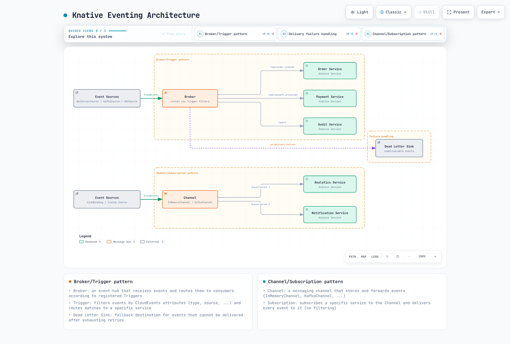
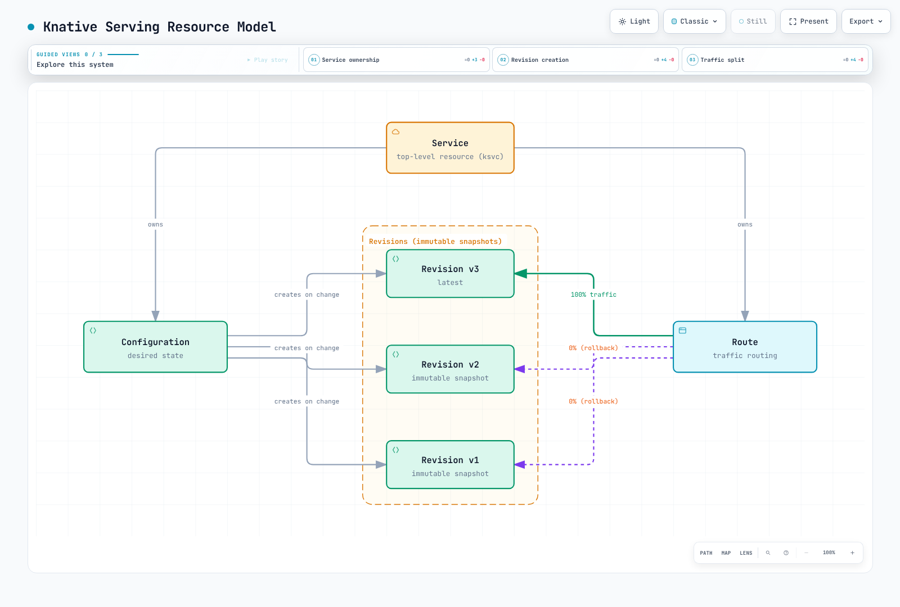
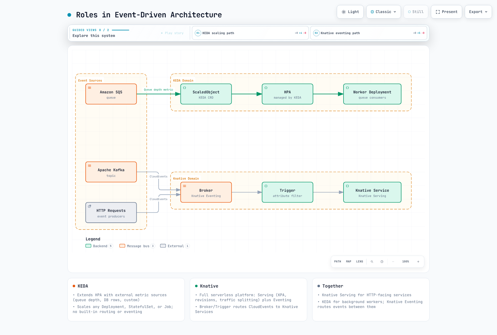

# Knative

> **バージョン例**: Serving/Eventing/Kourier 1.23.0、Operator 1.23.1。インストール前に Kubernetes/EKS との互換性を確認してください。
> **最終更新日**: 2026年10月16日

## 目次

- [概要と学習目標](#overview-and-learning-objectives)
- [Knative のアーキテクチャ](#knative-architecture)
- [EKS へのインストールと設定](#eks-installation-and-configuration)
- [Knative Serving の詳細](#knative-serving-deep-dive)
- [Knative Eventing の詳細](#knative-eventing-deep-dive)
- [KEDA と Knative の比較](#keda-vs-knative-comparison)
- [本番運用](#production-operations)
- [ベストプラクティス](#best-practices)
- [参考資料](#references)

---

## 概要と学習目標 {#overview-and-learning-objectives}

### Knative とは

Knative は Kubernetes を拡張し、最新のサーバーレスワークロードを構築、デプロイ、管理するためのミドルウェアコンポーネントを提供する **CNCF Graduated** プロジェクトです。Kubernetes の基本リソースを置き換えるのではなく、その上に構築され、リクエスト駆動型の自動スケーリング、イベント配信、トラフィック管理などの一般的なパターンを簡素化する高レベルの抽象化を提供します。

このプロジェクトは、CNCF により 2022 年 3 月 2 日に Incubating として受け入れられ、2025 年 9 月 11 日に Graduated へ昇格しました。プロジェクトの成熟度は、個々のデプロイが本番利用に適していることを保証するものではありません。

Knative は、個別にインストールできる 2 つのコンポーネントで構成されています。

- **Knative Serving** -- サーバーレスワークロードのライフサイクルを管理します。デプロイ、スケーリング（ゼロへのスケールを含む）、Revision の追跡、トラフィックのルーティングを自動化します。
- **Knative Eventing** -- CloudEvents 仕様に準拠したイベントの生成、ルーティング、消費のための基盤を提供します。イベントプロデューサーとコンシューマーを分離し、疎結合なイベント駆動型アーキテクチャを実現します。

### Kubernetes 上のサーバーレス

従来の Kubernetes Deployment では、運用担当者がレプリカ数、HPA のしきい値、リソース予算を事前に設定する必要があります。Knative は次の方法でこの負担を軽減します。

1. ワークロードは、受信リクエストの同時実行数または RPS に基づき、ゼロから多数のレプリカまで自動的にスケールします。
2. Revision の仕様にはワークロードテンプレートのスナップショットが保存され、保持されている Ready 状態の Revision にトラフィックを切り替えられます。ただし、参照先の Secret/ConfigMap、レジストリアクセス、外部状態は固定されません。また、ルーティングやロールバックには調整の時間がかかります。
3. Source/adapter と Trigger を使ってイベントの取り込みと配信を分離できます。一部の adapter は外部システムをポーリングします。アプリケーションの処理、認証、障害対応は別途実装する必要があります。

その結果、Kubernetes のスケジューリング、RBAC、ネットワーキング、ストレージの機能を維持しながら、フルマネージドのサーバーレスプラットフォームに近い開発者体験を提供できます。

### Knative Serving と Eventing の比較

| 比較項目 | Knative Serving | Knative Eventing |
|--------|----------------|-----------------|
| 主な目的 | リクエスト駆動型ワークロードのライフサイクル管理 | イベントのルーティングと配信 |
| スケーリングの契機 | HTTP リクエストの同時実行数 / RPS | コンシューマー/アダプターによって異なる。Broker/Trigger がすべての subscriber を一般的にスケールするわけではない |
| ゼロへのスケール | 対応（組み込み） | コンシューマーによる（Serving を使うコンシューマーでは対応可能） |
| 主なリソース | Service、Configuration、Revision、Route | Broker、Trigger、Channel、Subscription、Source |
| 代表的な用途 | API、Web アプリ、マイクロサービス | 非同期パイプライン、webhook、CDC ストリーム |

### Knative、AWS Lambda、AWS Fargate の比較

| 機能 | EKS 上の Knative Serving | AWS Lambda（標準コンピューティング） | AWS Fargate |
|---|---|---|---|
| ランタイム | Serving のランタイム契約に適合するコンテナ | サポート対象の Lambda ランタイム、またはランタイム API を実装するイメージ | サポート対象の ECS タスク/EKS Pod。プラットフォーム上の制約あり |
| リクエスト/実行時間 | 設定可能なリクエストタイムアウト。デフォルトは 300 秒、再設定しない場合の上限は 600 秒 | 標準関数のタイムアウトは最大 900 秒 | タスク/Pod のライフサイクルに従い、Lambda のような呼び出し時間上限はない |
| ゼロへのスケーリング | KPA により、アイドル状態の Revision をゼロまでスケール可能 | オンデマンド実行 | ECS desired task 数や Kubernetes replica 数を 0 にできる。起動には適切な controller/metric が必要 |
| コールドスタート | ベースライン replica、イメージ、起動、readiness の調整 | ランタイム固有の最適化、Provisioned Concurrency | タスク/Pod の起動、イメージ、ネットワーク設定。固定時間での比較はできない |
| メモリ | Node の割り当て可能容量、コンテナリクエスト、sidecar | 128～10,240 MB に設定可能 | EKS Fargate の枠は最大 120 GB。プラットフォームのオーバーヘッドとサポート対象の CPU/メモリ組み合わせが適用される |
| GPU | 適切な node、device plugin、resource request、有効化した PodSpec 機能が必要 | 標準コンピューティングの Lambda では GPU を利用できない | Fargate では GPU を利用できない |
| ネットワーキング | Kubernetes/CNI と gateway の設定 | 顧客 VPC への接続は任意 | VPC ネットワーキング。EKS Fargate にはプラットフォーム上の制約あり |
| 移植性 | Kubernetes/Knative API を使用するが、クラウド ID/ストレージ連携も考慮が必要 | AWS 固有のランタイム/サービス API | ECS または EKS との連携、サポート対象のプラットフォーム API |
| イベント入力 | HTTP/CloudEvents と設定済み adapter | サポート対象の AWS イベント連携 | アプリケーション/controller との連携。汎用イベントルーティングサービスではない |
| ローカルテスト | ローカル Kubernetes を利用できるが、クラウド動作の検証は別途必要 | ローカルツール/エミュレーターは任意で、再現性に限界がある | コンテナロジックはローカルでテストできるが、プラットフォーム動作は異なる |
| オブザーバビリティ | メトリクス、ログ、トレースの exporter を設定 | CloudWatch とサポート対象のトレース連携 | サポート対象の AWS/OpenTelemetry 収集を設定 |
| コストの基準 | 割り当てたクラスター、ストレージ、ロードバランサー、関連リソース | リクエスト/実行時間と選択した機能 | 割り当てたタスク/Pod の CPU・メモリと関連リソース |

この表では Lambda の対象を標準コンピューティングに限定しています。条件を満たす Lambda Managed Instances の非同期/イベントソース呼び出しは、サービス固有の例外を除き、最大 90 分まで実行できます。これらには異なる運用上の制約があります。Pod をゼロにスケールしても、EC2 node、永続ストレージ、ロードバランサーの料金はなくなりません。

### 学習目標

このドキュメントを読み終えると、次のことができるようになります。

1. Knative のアーキテクチャと Serving/Eventing の補完関係を説明する。
2. Kourier、DNS、TLS を使用して Amazon EKS 上に Knative をインストールし、設定する。
3. 同時実行数に基づくきめ細かな自動スケーリングを使用してサーバーレスワークロードをデプロイする。
4. Revision と Route を使用してトラフィック分割（カナリア、ブルーグリーン）を実装する。
5. Broker、Trigger、CloudEvents を使用してイベント駆動型パイプラインを構築する。
6. KEDA と Knative を比較し、それぞれ（または両方）をいつ使うべきか判断する。
7. 監視、高可用性、ガベージコレクションのポリシーを使って Knative を本番環境で運用する。

---

## Knative のアーキテクチャ {#knative-architecture}

### Serving のアーキテクチャ

Serving のコントロールプレーンコンポーネントは `knative-serving` に配置され、Queue Proxy は各 Revision Pod の workload namespace に配置されます。それぞれの役割には調整、ルーティング、admission、スケーリングが含まれます。5 つすべての Deployment が同じ namespace にあるわけではありません。


[🔍 インタラクティブな図を表示](https://www.atomai.click/kubernetes-docs/archmaps/en-autoscaling-03-knative-0.html)


**コンポーネントの役割:**

| コンポーネント | 役割 |
|-----------|------|
| **Activator** | Revision がゼロまでスケールしたときにリクエストを受け取ります。リクエストをバッファーし、スケールアップを開始して、Pod の準備完了後にバッファーしたリクエストを転送します。「バースト容量」モードではロードバランサーとしても動作します。 |
| **Autoscaler** | Queue Proxy sidecar から同時実行数と RPS のメトリクスを収集します。KPA とその調整処理が目標スケールを決めます。任意の HPA 連携では Kubernetes HPA リソースを管理します。Serving Controller はワークロードリソースを調整しますが、すべてのスケーリング判断に必ず介在するわけではありません。 |
| **Queue Proxy** | すべての Knative Pod に sidecar として挿入されます。`containerConcurrency` の上限を適用し、実行時の同時実行数を Autoscaler に報告し、ヘルスチェックとスケールダウン時の正常終了処理を行います。 |
| **Controller** | Knative CRD（Service、Configuration、Revision、Route）を基盤となる Kubernetes リソース（Deployment、Service、Ingress オブジェクト）に調整します。Revision の作成とガベージコレクションを管理します。 |
| **Webhook** | admission 時に Knative リソース仕様を検証し、既定値を設定します。不正な構成が Controller に到達する前に拒否されるようにします。 |

### Eventing のアーキテクチャ

Knative Eventing は、イベントソースとコンシューマーを宣言的に接続する方法を提供します。**Broker/Trigger**（コンテンツベースのルーティング）と **Channel/Subscription**（直接的な pub/sub）の 2 つの配信パターンをサポートします。


[🔍 インタラクティブな図を表示](https://www.atomai.click/kubernetes-docs/archmaps/en-autoscaling-03-knative-1.html)


**Eventing の主要概念:**

| 概念 | 説明 |
|---------|-------------|
| **Event Source** | イベントを生成または取り込むリソースです。Knative には ApiServerSource や PingSource が組み込まれており、コミュニティは Kafka、AWS SQS、GitHub などのソースを保守しています。 |
| **Broker** | 選択した実装を通じてイベントを受け取り、一致する Trigger に配信します。バッファリング、永続化、障害時の動作は、Broker のクラスや基盤の転送方式によって異なります。 |
| **Trigger** | Broker に関連付けるフィルターです。各 Trigger は CloudEvent の属性（type、source、extension）でイベントを選択し、一致したイベントをサブスクライバーにルーティングします。 |
| **Channel** | 永続型またはインメモリ型のイベント転送手段です。Broker と異なり、Channel はフィルタリングを行わず、すべての Subscription にすべてのイベントを配信します。 |
| **Subscription** | Channel をサブスクライバーに接続し、任意で返信先も指定します。 |
| **Dead Letter Sink** | 再試行ポリシーを使い切っても配信できないイベントのフォールバック先です。 |
| **CloudEvents** | すべての Knative Eventing コンポーネントで使われる CNCF 標準のエンベロープ形式（v1.0）です。イベントソースとコンシューマー間の相互運用性を提供します。 |

---

## EKS へのインストールと設定 {#eks-installation-and-configuration}

インストール例は分離されたテスト環境を対象とし、プレースホルダーを含みます。Serving を LoadBalancer で適用すると、導入済みコントローラーを通じて AWS リソースが作成される場合があります。このレビューではその操作を実行していません。Operator が管理する ConfigMap、Service、ワークロードは KnativeServing/KnativeEventing リソースから設定します。マージパッチを作成するときは、特にリスト形式の項目で既存の設定を保持してください。後続の例で参照するアプリケーション namespace、ServiceAccount、Secret、イメージ、Kafka/SQS リソース、IAM ロールを事前に作成します。スキーマ検査だけでは本番利用への適合性は確認できません。

### 前提条件

- 選択した Knative コンポーネントで検証済みの、プロバイダーがサポートする EKS バージョン。例では Serving/Eventing/Kourier 1.23.0、Operator 1.23.1 を使います。Kubernetes 1.28 以降なら無条件に互換性があるという意味ではありません。
- クラスター管理者権限で設定した `kubectl`。
- （任意）Helm を使ってインストールする場合は `helm` v3.12 以降。

### 手順 1: Knative Operator のインストール

Knative Operator は Knative Serving と Eventing のコンポーネントのインストールとライフサイクルを管理します。Operator を使うと、バージョンアップグレードや設定管理を簡素化できます。

```bash
# Fresh installation on the intended test cluster; review versioned upgrade guidance for existing installs.
kubectl config current-context
kubectl apply --server-side -f https://github.com/knative/operator/releases/download/knative-v1.23.1/operator.yaml
kubectl wait --for=condition=Established crd/knativeservings.operator.knative.dev crd/knativeeventings.operator.knative.dev --timeout=120s
kubectl wait --for=condition=Available deployment/knative-operator deployment/operator-webhook -n knative-operator --timeout=300s
```

### 手順 2: Operator を使った Knative Serving のインストール

Serving コンポーネントをデプロイするため、`KnativeServing` カスタムリソースを作成します。

```yaml
apiVersion: operator.knative.dev/v1beta1
kind: KnativeServing
metadata:
  name: knative-serving
  namespace: knative-serving
spec:
  version: 1.23.0
  ingress:
    kourier:
      enabled: true
  config:
    network:
      ingress-class: kourier.ingress.networking.knative.dev
    autoscaler:
      pod-autoscaler-class: kpa.autoscaling.knative.dev
      container-concurrency-target-percentage: '70'
      enable-scale-to-zero: 'true'
    defaults:
      revision-timeout-seconds: '300'
      max-revision-timeout-seconds: '600'
    deployment:
      queue-sidecar-cpu-request: 25m
      queue-sidecar-memory-request: 400Mi
      queue-sidecar-memory-limit: 800Mi
  services:
  - name: kourier
    annotations:
      service.beta.kubernetes.io/aws-load-balancer-type: external
      service.beta.kubernetes.io/aws-load-balancer-nlb-target-type: ip
      service.beta.kubernetes.io/aws-load-balancer-scheme: internet-facing
```

```bash
kubectl create namespace knative-serving --dry-run=client -o yaml | kubectl apply -f -
kubectl create namespace knative-demo --dry-run=client -o yaml | kubectl apply -f -
kubectl apply -f knative-serving.yaml
kubectl wait --for=condition=Ready knativeserving/knative-serving -n knative-serving --timeout=600s
kubectl get deployments,pods,services -n knative-serving
```

### 手順 3: Kourier のインストール（軽量 Ingress）

Kourier は Envoy ベースの Knative ネットワーク実装です。ワークロードの要件を満たす機能があれば選択肢になります。リソース使用量やレイテンシの利点は実測して確認してください。

この手順では、選択した Serving バンドルに含まれる Kourier を Operator がインストールします。ゲートウェイ Service は `knative-serving` に作成されます。単独で使う Kourier のマニフェストは通常 `kourier-system` を使うため、Operator 管理のインストールに重ねて適用しないでください。管理対象リソースを確認します。

```bash
# Operator-managed Kourier uses the KnativeServing namespace.
kubectl get deployment net-kourier-controller 3scale-kourier-gateway -n knative-serving
kubectl get service kourier -n knative-serving -o yaml
```

上記のベースとなる KnativeServing リソースでは、Kourier Service に AWS Load Balancer Controller が管理する **NLB 用**のアノテーションを設定しています。コントローラー、IAM、対象サブネットを事前に準備してください。Service のアノテーションだけでは ALB は作成されません。ALB には適切な L7 コントローラーとルーティング設計が必要です。EKS Auto Mode ではロードバランサーの管理方法が異なります。すべての EKS LoadBalancer Service が既定で NLB になると決めつけず、実際のクラスとアノテーションを確認してください。

```bash
kubectl get service kourier -n knative-serving -o jsonpath='{.spec.loadBalancerClass}{"\n"}{.metadata.annotations}{"\n"}'
```

### 手順 4: DNS の設定

Knative は各 Service に対し、`<service>.<namespace>.<domain>` 形式の URL を生成します。これらの URL が Ingress ゲートウェイに解決されるよう、DNS を設定してください。

#### 選択肢 A: Magic DNS（sslip.io）— 開発専用

sslip.io は対応する IP アドレス埋め込み形式のホスト名を解決し、条件を満たす開発環境で便利です。AWS ロードバランサーのホスト名や変わり得るバックエンド IP アドレスは、本番用の永続的な DNS マッピングには適しません。この Operator 構成では明示的なドメインを使います。単独利用向けの既定ドメイン設定ヘルパーを、Operator 管理の設定と競合させないでください。

```bash
# Inspect the address type; this Operator workflow uses an explicitly configured domain.
kubectl get service kourier -n knative-serving -o jsonpath='{.status.loadBalancer.ingress}'
kubectl get ksvc -n knative-demo
```

#### 選択肢 B: Amazon Route 53 を使った実 DNS（本番環境）

自分で管理するドメインとホストゾーンを用意し、変更を適用する前に生成された DNS 変更内容を確認してください。以下のコマンドを実行するとホストゾーンが更新されますが、このレビューでは実行していません。各レコードの管理者は手動/IaC と ExternalDNS のどちらか一方にしてください。ExternalDNS には `knative-serving` ソースと適切な権限が必要で、ホスト名は実際の Route または DomainMapping と一致させます。ホスト名アノテーションだけでは新しい Knative Route は作成されません。

```bash
# Review the intended zone/domain and wait for the NLB hostname before preparing a DNS change.
set -euo pipefail
export KOURIER_HOST
KOURIER_HOST=$(kubectl get service kourier -n knative-serving -o jsonpath='{.status.loadBalancer.ingress[0].hostname}')
: "${KOURIER_HOST:?Wait for the load-balancer hostname}"
export KNATIVE_DOMAIN="knative.example.com"
export HOSTED_ZONE_ID="REPLACE_WITH_HOSTED_ZONE_ID"
python3 - <<'PYDNS'
import json, os
from pathlib import Path
host = os.environ["KOURIER_HOST"].strip()
if not host or any(c.isspace() for c in host):
    raise SystemExit("Invalid load-balancer hostname")
change = {"Changes": [{"Action": "UPSERT", "ResourceRecordSet": {
    "Name": "*." + os.environ["KNATIVE_DOMAIN"], "Type": "CNAME", "TTL": 300,
    "ResourceRecords": [{"Value": host}]
}}]}
Path("knative-dns-change.json").write_text(json.dumps(change, indent=2))
patch = {"spec": {"config": {"domain": {os.environ["KNATIVE_DOMAIN"]: ""}}}}
Path("knative-domain.patch.json").write_text(json.dumps(patch))
PYDNS
# These commands change the selected DNS zone and Operator configuration when run.
aws route53 change-resource-record-sets --hosted-zone-id "$HOSTED_ZONE_ID" --change-batch file://knative-dns-change.json
kubectl patch knativeserving knative-serving -n knative-serving --type merge --patch-file knative-domain.patch.json
```

### 手順 5: cert-manager による TLS

Serving 1.23 には cert-manager 連携がコントローラーに含まれています。以前の net-certmanager リポジトリはアーカイブ済みです。そこから存在しない 1.16/1.23 リリースをインストールしないでください。連携を有効にする前に互換性のある cert-manager を別途インストールして設定します。Route 53 DNS01 用の ID と最小権限のゾーンアクセスも cert-manager 側で準備してください。

```bash
kubectl get deployments -n cert-manager
kubectl get crd certificates.cert-manager.io clusterissuers.cert-manager.io
```

既存の KnativeServing リソースに適用するマージパッチとして `serving-tls.patch.yaml` に保存します。Operator 管理の状態に重ねて適用する独立した ConfigMap ではありません。

```yaml
spec:
  config:
    network:
      certificate-class: cert-manager.certificate.networking.knative.dev
      external-domain-tls: Enabled
      http-protocol: Redirected
    certmanager:
      issuerRef: |
        group: cert-manager.io
        kind: ClusterIssuer
        name: letsencrypt-staging
```

最初の DNS/IAM 検証ではステージング用 ClusterIssuer を使います。連絡先、ホストゾーン、リージョンを確認済みの値に置き換えてください。ステージング証明書は公開環境で信頼されません。DNS チャレンジのフローと証明書のライフサイクルを検証してから、本番用 Issuer に切り替えてください。

```yaml
apiVersion: cert-manager.io/v1
kind: ClusterIssuer
metadata:
  name: letsencrypt-staging
spec:
  acme:
    server: https://acme-staging-v02.api.letsencrypt.org/directory
    email: REPLACE_WITH_CERTIFICATE_CONTACT_EMAIL
    privateKeySecretRef:
      name: letsencrypt-staging-key
    solvers:
    - dns01:
        route53:
          region: us-west-2
          hostedZoneID: REPLACE_WITH_HOSTED_ZONE_ID
```

Issuer を `cluster-issuer.yaml`、前述の Operator パッチを `serving-tls.patch.yaml` として保存し、次の順序で適用します。

```bash
# cert-manager and its Route 53 identity must already be configured.
kubectl apply -f cluster-issuer.yaml
kubectl wait --for=condition=Ready clusterissuer/letsencrypt-staging --timeout=180s
kubectl patch knativeserving knative-serving -n knative-serving --type merge --patch-file serving-tls.patch.yaml
# The integration starts in the Serving controller after the setting is effective.
kubectl get configmap config-network -n knative-serving -o yaml
kubectl rollout restart deployment/controller -n knative-serving
kubectl rollout status deployment/controller -n knative-serving --timeout=300s
```

### 手順 6: HPA と KPA のオートスケーラー選択

Knative は 2 種類のオートスケーラー実装をサポートしており、選択によってスケーリングの挙動が大きく変わります。

| 項目 | KPA（Knative Pod Autoscaler） | HPA（Kubernetes HPA） |
|---|---|---|
| ゼロへのスケール | 対応 | 非対応 |
| メトリクス | 同時実行数、RPS | CPU、メモリ、カスタムメトリクス |
| スケーリング速度 | 高速（panic/stable ウィンドウ） | 標準的な HPA の間隔 |
| 設定 | Knative アノテーション | 標準の HPA spec |
| 適した用途 | HTTP ワークロード、レイテンシ重視 | CPU/メモリ負荷が支配的なワークロード |

既定のオートスケーラークラスは Operator 経由で設定します。HPA クラスの Revision には、任意の HPA 拡張機能と、動作する Kubernetes Resource Metrics API が必要です。以下のパッチにはバージョンを固定した HPA マニフェストが含まれます。ディストリビューションにすでに含まれている場合は、管理を重複させないでください。

```yaml
spec:
  additionalManifests:
  - URL: https://github.com/knative/serving/releases/download/knative-v1.23.0/serving-hpa.yaml
  config:
    autoscaler:
      pod-autoscaler-class: kpa.autoscaling.knative.dev
      stable-window: 60s
      panic-window-percentage: '10'
      panic-threshold-percentage: '200'
      scale-to-zero-grace-period: 30s
      scale-to-zero-pod-retention-period: 0s
      target-burst-capacity: '211'
      requests-per-second-target-default: '200'
      container-concurrency-target-default: '100'
```

既存の Operator リソースにマージするパッチとして `serving-autoscaler.patch.yaml` に保存します。パッチ作成時は、ほかの `additionalManifests` 項目も保持してください。

```bash
kubectl patch knativeserving knative-serving -n knative-serving --type merge --patch-file serving-autoscaler.patch.yaml
kubectl get deployment autoscaler-hpa -n knative-serving
```

`Knative Service` の `spec.template.metadata.annotations` で Revision ごとに上書きします（以下はテンプレートの一部です）。

```yaml
metadata:
  annotations:
    autoscaling.knative.dev/class: "hpa.autoscaling.knative.dev"
    autoscaling.knative.dev/metric: "cpu"
    autoscaling.knative.dev/target: "70"
```

### 手順 7: Knative Eventing のインストール

```yaml
apiVersion: operator.knative.dev/v1beta1
kind: KnativeEventing
metadata:
  name: knative-eventing
  namespace: knative-eventing
spec:
  version: 1.23.0
  defaultBrokerClass: MTChannelBasedBroker
  config:
    default-ch-webhook:
      default-ch-config: "clusterDefault:\n  apiVersion: messaging.knative.dev/v1\n\
        \  kind: InMemoryChannel\n"
  sinkBindingSelectionMode: inclusion
```

```bash
kubectl create namespace knative-eventing --dry-run=client -o yaml | kubectl apply -f -
kubectl apply -f knative-eventing.yaml
kubectl wait --for=condition=Ready knativeeventing/knative-eventing -n knative-eventing --timeout=600s
kubectl get deployments,pods -n knative-eventing
kubectl get crd inmemorychannels.messaging.knative.dev integrationsources.sources.knative.dev
```

---

## Knative Serving の詳細 {#knative-serving-deep-dive}

### リソースモデル

Knative Serving は、サーバーレスワークロードのライフサイクル全体を管理するため、相互に連携する 4 つの主要なカスタムリソースを提供します。


[🔍 インタラクティブな図を表示](https://www.atomai.click/kubernetes-docs/archmaps/en-autoscaling-03-knative-2.html)


| リソース | 説明 |
|----------|-------------|
| **Service** (`ksvc`) | 最上位のリソースです。Configuration と Route を所有して、ワークロードのライフサイクル全体を管理します。通常、利用者が操作するのは Service だけです。 |
| **Configuration** | ワークロードテンプレートを記述します。テンプレートに関わる変更によって Revision が作成されますが、メタデータやトラフィックだけの変更では必ずしも作成されません。 |
| **Revision** | 不変のワークロード仕様です。ただし、外部参照先は変化することがあります。古い Revision を利用可能な状態で保持するかどうかは、保持設定とガベージコレクションによって決まります。 |
| **Route** | ネットワークトラフィックを 1 つ以上の Revision に割り当てます。カナリアデプロイ、ブルーグリーンリリース、割合指定のトラフィック分割を可能にします。 |

### Knative Service の完全な YAML 例

参照するイメージ、ServiceAccount、Secret を先に用意してください。Serving controller はレジストリのタグや digest を解決する必要があり、ノードにも別途イメージを pull する権限が必要です。EKS ノードの認証情報があっても、controller のレジストリアクセスは保証されません。readiness/liveness のパスは実際のアプリケーションに合わせ、下流サービスの停止によって再起動が連鎖しないようにしてください。

以下は設定例であり、本番環境での動作を検証したデプロイではありません。オートスケーリング、リソース制限、ヘルスチェック、スケーリング範囲を明示した Knative Service を定義します。

```yaml
apiVersion: serving.knative.dev/v1
kind: Service
metadata:
  name: order-api
  namespace: knative-demo
  labels:
    app.kubernetes.io/name: order-api
    app.kubernetes.io/part-of: ecommerce
    app.kubernetes.io/managed-by: knative
spec:
  template:
    metadata:
      annotations:
        autoscaling.knative.dev/class: kpa.autoscaling.knative.dev
        autoscaling.knative.dev/metric: concurrency
        autoscaling.knative.dev/target: '100'
        autoscaling.knative.dev/target-utilization-percentage: '70'
        autoscaling.knative.dev/min-scale: '2'
        autoscaling.knative.dev/max-scale: '50'
        autoscaling.knative.dev/initial-scale: '3'
        autoscaling.knative.dev/scale-down-delay: 15m
        autoscaling.knative.dev/window: 60s
      name: order-api-v1
    spec:
      containerConcurrency: 0
      timeoutSeconds: 300
      containers:
      - image: 123456789012.dkr.ecr.us-west-2.amazonaws.com/order-api:v1.2.3
        ports:
        - containerPort: 8080
          protocol: TCP
        env:
        - name: DB_HOST
          valueFrom:
            secretKeyRef:
              name: db-credentials
              key: host
        - name: LOG_LEVEL
          value: info
        resources:
          requests:
            cpu: 250m
            memory: 512Mi
          limits:
            cpu: 1000m
            memory: 1Gi
        readinessProbe:
          httpGet:
            path: /healthz
            port: 8080
          initialDelaySeconds: 5
          periodSeconds: 10
        livenessProbe:
          httpGet:
            path: /healthz
            port: 8080
          initialDelaySeconds: 15
          periodSeconds: 20
      serviceAccountName: order-api-sa
```

### トラフィック分割: カナリアデプロイ

トラフィック分割では、Revisions 間でトラフィックを段階的に移行できます。カナリアデプロイやブルーグリーンデプロイの基礎となる機能です。

#### カナリアデプロイ

以下は、上記の基本 Service と Ready 状態の `order-api-v1` Revision から始める別々の演習例です。イメージと名前は検証済みの成果物に置き換えてください。テンプレートを変更するたびに、未使用の新しい Revision 名が必要です。JSON パッチは containers リスト全体を置き換えず、環境変数、ServiceAccount、probe、リソース設定を保持します。基本例の ingress コンテナが index 0 にあることを前提とします。0% の tag を指定するとテスト用の Route が作られますが、十分にウォームアップされた容量を保証するものではありません。

`canary-template.patch.json` として保存します。

```json
[
  {
    "op": "add",
    "path": "/spec/traffic",
    "value": [
      {
        "revisionName": "order-api-v1",
        "percent": 100
      },
      {
        "revisionName": "order-api-v2",
        "percent": 0,
        "tag": "canary"
      }
    ]
  },
  {
    "op": "add",
    "path": "/spec/template/metadata/name",
    "value": "order-api-v2"
  },
  {
    "op": "replace",
    "path": "/spec/template/spec/containers/0/image",
    "value": "123456789012.dkr.ecr.us-west-2.amazonaws.com/order-api:v1.3.0"
  }
]
```

canary traffic を段階的に増やします。

```bash
kubectl wait --for=condition=Ready revision/order-api-v1 -n knative-demo --timeout=300s
kubectl patch ksvc order-api -n knative-demo --type json --patch-file canary-template.patch.json
kubectl wait --for=jsonpath='{.status.latestCreatedRevisionName}'=order-api-v2 ksvc/order-api -n knative-demo --timeout=180s
kubectl wait --for=condition=Ready revision/order-api-v2 -n knative-demo --timeout=300s
kubectl get ksvc order-api -n knative-demo -o jsonpath='{.status.traffic}'

# Route10%, then50%, then100% only after validating each stage.
kubectl patch ksvc order-api -n knative-demo --type merge --patch '{"spec":{"traffic":[{"revisionName":"order-api-v1","percent":90},{"revisionName":"order-api-v2","percent":10,"tag":"canary"}]}}'
kubectl patch ksvc order-api -n knative-demo --type merge --patch '{"spec":{"traffic":[{"revisionName":"order-api-v1","percent":50},{"revisionName":"order-api-v2","percent":50,"tag":"canary"}]}}'
kubectl patch ksvc order-api -n knative-demo --type merge --patch '{"spec":{"traffic":[{"revisionName":"order-api-v1","percent":0},{"revisionName":"order-api-v2","percent":100,"tag":"canary"}]}}'
```

`status.traffic` から実際のタグ URL を取得してください。URL はドメイン/タグのテンプレートと TLS 設定によって異なります。各変更の間に Route の Ready 状態、反映済みの設定、アプリケーションのシグナルを確認してください。割合はルーティングポリシーに適用される値であり、少数のリクエスト標本での実際の件数と一致するとは限りません。

#### ブルーグリーンデプロイ

これは基本の `order-api-v1` とは別の演習として使うか、安定版を示す名前を、検証済みの基準環境を提供する Revision に置き換えてください。次の内容を `green-template.patch.json` として保存します。

```json
[
  {
    "op": "add",
    "path": "/spec/traffic",
    "value": [
      {
        "revisionName": "order-api-v1",
        "percent": 100
      },
      {
        "revisionName": "order-api-green",
        "percent": 0,
        "tag": "green"
      }
    ]
  },
  {
    "op": "add",
    "path": "/spec/template/metadata/name",
    "value": "order-api-green"
  },
  {
    "op": "replace",
    "path": "/spec/template/spec/containers/0/image",
    "value": "123456789012.dkr.ecr.us-west-2.amazonaws.com/order-api:v2.0.0"
  }
]
```

```bash
kubectl patch ksvc order-api -n knative-demo --type json --patch-file green-template.patch.json
kubectl wait --for=jsonpath='{.status.latestCreatedRevisionName}'=order-api-green ksvc/order-api -n knative-demo --timeout=180s
kubectl wait --for=condition=Ready revision/order-api-green -n knative-demo --timeout=300s
kubectl get ksvc order-api -n knative-demo -o jsonpath='{.status.traffic}'
# Validate the green tag URL and capacity before requesting this switch.
kubectl patch ksvc order-api -n knative-demo --type merge --patch '{"spec":{"traffic":[{"revisionName":"order-api-v1","percent":0},{"revisionName":"order-api-green","percent":100,"tag":"green"}]}}'
```

トラフィックの変更は非同期に調整されるため、以前の Revision に接続中のリクエストが残ることがあります。ロールバックに備えて古い Revision と外部依存先を保持し、実際の反映時間と Ready 状態を計測してください。ここに示したコマンドはクラスターに対して実行していません。

### ゼロへのスケーリング

ゼロへのスケーリングは Knative Serving の主要な機能です。Revision がゼロスケールの対象になると、アイドル時間、スケールダウン遅延、保持期間、内部ルーティングの準備状況によって最後の Pod が削除されるタイミングが決まります。新しいリクエストが届くと、Activator がバッファーし、スケールアップを開始します。Pod の準備ができるとリクエストをプロキシします。


[🔍 インタラクティブな図を表示](https://www.atomai.click/kubernetes-docs/archmaps/en-autoscaling-03-knative-3.html)


ゼロスケールを制御する主なパラメーター:

| アノテーション / 設定 | 既定値 | 説明 |
|---------------------|---------|-------------|
| `scale-to-zero-grace-period`（グローバル） | 30s | 最後のレプリカを削除する前に、ゼロからのスケールに備えて内部ルーティングを準備する最長時間です。アイドル状態の保持タイマーではありません。 |
| `scale-to-zero-pod-retention-period`（グローバル） | 0s | オートスケーラーがゼロスケールを決定した後、最後の Pod を保持する最短時間です。 |
| `autoscaling.knative.dev/scale-to-zero-pod-retention-period`（Revision ごと） | 継承 | グローバルの保持期間を Revision ごとに上書きします。 |
| `enable-scale-to-zero`（グローバル） | true | 全体の有効/無効を切り替えます。false にするとクラスター全体でゼロスケールを無効にします。 |

### 同時実行数に基づくスケーリング

Knative の KPA は、観測された同時実行数（処理中のリクエスト）または requests per second（RPS）に基づいてスケールします。このアルゴリズムは 2 つの時間ウィンドウを維持します。

- **Stable window**（既定値 60s）: この期間の平均同時実行数が、定常状態のスケーリング判断を決めます。
- **Panic window**（既定値 6s、つまり stable の 10%）: この期間の平均同時実行数が panic threshold（既定値は target の 200%）を超えると、システムは積極的にスケールアウトします。

**主なアノテーション:**

| アノテーション | 例 | 説明 |
|------------|---------|-------------|
| `autoscaling.knative.dev/metric` | `"concurrency"` または `"rps"` | スケーリングの指標を指定します。 |
| `autoscaling.knative.dev/target` | `"100"` | 指標の目標値です（例: Pod あたり同時リクエスト 100 件）。 |
| `autoscaling.knative.dev/target-utilization-percentage` | `"70"` | Autoscaler は、目標値に対してこの割合となる平均使用率を維持しようとします。有効な目標値 = target × utilization / 100。 |
| `spec.template.spec.containerConcurrency` | `0` | Pod に転送する同時リクエスト数の上限です。0 はこのハード上限を無効にします。上限がない場合も、待機や拒否には限度があり、オートスケーリングは引き続き適用されます。1 を設定しても、アプリケーションのスレッドや全レプリカが全体で直列実行されるわけではありません。 |

**スケーリングの計算式:**

```
desiredReplicas = ceil( observedConcurrency / (target * targetUtilization / 100) )
```

たとえば、`target=100`、`targetUtilization=70%`、観測された同時実行リクエスト数が 350 の場合:

```
desiredReplicas = ceil(350 / (100 * 0.70)) = ceil(350 / 70) = ceil(5.0) = 5
```

### コールドスタートの最適化

ゼロからスケールするときに発生するレイテンシ上の不利益、つまりコールドスタートは一般的な課題です。Knative にはこれを軽減する仕組みが複数あります。

| 方法 | 設定 | 効果と注意点 |
|----------|---------------|-----------|
| **minScale** | `autoscaling.knative.dev/min-scale: "2"` | 通常のアイドル時にもベースラインの容量を維持します。ただし、新しい Revision、再起動、スケールアウト時にコールドスタートが発生する可能性は残ります。 |
| **initialScale** | `autoscaling.knative.dev/initial-scale: "3"` | 新しい Revision の初回デプロイ時に作成する Pod 数です。後でゼロまでスケールすることを防ぐものではありません。 |
| **scale-down-delay** | `autoscaling.knative.dev/scale-down-delay: "15m"` | スケールダウンの判断を遅らせます。トラフィックがバーストするワークロードで、頻繁なコールドスタートを避けるのに役立ちます。 |
| **コンテナイメージのキャッシュ** | EKS ノードレベルのイメージキャッシュ、または事前 pull 用 DaemonSet | コールドスタート時のコンテナ pull 時間を短縮します。 |
| **軽量なベースイメージ** | distroless または Alpine ベースのイメージを使用 | イメージサイズと pull 時間を削減します。 |
| **アプリケーションのウォームアップ** | 実際の準備完了条件を確認する readiness probe を実装 | 十分な速度でトラフィックを処理できるようになる前に Pod が Ready と報告されることを防ぎます。 |

```yaml
apiVersion: serving.knative.dev/v1
kind: Service
metadata:
  name: latency-critical-api
  namespace: knative-demo
spec:
  template:
    metadata:
      annotations:
        autoscaling.knative.dev/min-scale: '3'
        autoscaling.knative.dev/initial-scale: '5'
        autoscaling.knative.dev/scale-down-delay: 10m
        autoscaling.knative.dev/target: '50'
        autoscaling.knative.dev/window: 30s
    spec:
      containerConcurrency: 100
      containers:
      - image: 123456789012.dkr.ecr.us-west-2.amazonaws.com/api:v1.0.0
        ports:
        - containerPort: 8080
        readinessProbe:
          httpGet:
            path: /ready
            port: 8080
          initialDelaySeconds: 3
          periodSeconds: 5
```

### 内部向けサービスと外部公開サービス

既定では、Knative Service は ingress gateway を通じて外部公開されます。Service をクラスター内からのみ利用できるようにも設定できます。

```yaml
apiVersion: serving.knative.dev/v1
kind: Service
metadata:
  name: internal-processor
  namespace: knative-demo
  labels:
    networking.knative.dev/visibility: cluster-local
spec:
  template:
    spec:
      containers:
      - image: 123456789012.dkr.ecr.us-west-2.amazonaws.com/processor:v1.0.0
```

`cluster-local` label は Knative のルーティング可視性と生成される内部 URL を変更します。これは認証ポリシーでも、完全なネットワーク分離境界でもありません。プライベートネットワーク経路、NetworkPolicy、アプリケーション認可も引き続き重要です。

選択したリリースには `config-network.visibility` 設定はありません。各 Service に visibility label を設定するか、適切な admission policy で強制してください。`default-external-scheme` は生成される外部 URL の scheme だけに影響します。これだけで Service がプライベートになったり TLS が設定されたりするわけではありません。以下は Service metadata の一部です。

```yaml
metadata:
  labels:
    networking.knative.dev/visibility: cluster-local
```

---

## Knative Eventing の詳細 {#knative-eventing-deep-dive}

### イベントソース

Event Source は外部システムをイベントメッシュに接続する Knative リソースです。各 Source は、設定済みの sink（Broker、Channel、または Knative Service）へ CloudEvents を送信します。

#### ApiServerSource

Kubernetes API server のリソースイベントを監視し、CloudEvents として転送します。

```yaml
apiVersion: v1
kind: ServiceAccount
metadata:
  name: k8s-events-sa
  namespace: knative-demo
---
apiVersion: rbac.authorization.k8s.io/v1
kind: Role
metadata:
  name: k8s-events-reader
  namespace: knative-demo
rules:
- apiGroups:
  - ''
  resources:
  - pods
  verbs:
  - get
  - list
  - watch
- apiGroups:
  - apps
  resources:
  - deployments
  verbs:
  - get
  - list
  - watch
---
apiVersion: rbac.authorization.k8s.io/v1
kind: RoleBinding
metadata:
  name: k8s-events-reader
  namespace: knative-demo
subjects:
- kind: ServiceAccount
  name: k8s-events-sa
  namespace: knative-demo
roleRef:
  apiGroup: rbac.authorization.k8s.io
  kind: Role
  name: k8s-events-reader
---
apiVersion: rbac.authorization.k8s.io/v1
kind: ClusterRole
metadata:
  name: knative-demo-namespace-discovery
rules:
- apiGroups:
  - ''
  resources:
  - namespaces
  verbs:
  - get
  - list
  - watch
---
apiVersion: rbac.authorization.k8s.io/v1
kind: ClusterRoleBinding
metadata:
  name: knative-demo-namespace-discovery
subjects:
- kind: ServiceAccount
  name: k8s-events-sa
  namespace: knative-demo
roleRef:
  apiGroup: rbac.authorization.k8s.io
  kind: ClusterRole
  name: knative-demo-namespace-discovery
---
apiVersion: sources.knative.dev/v1
kind: ApiServerSource
metadata:
  name: k8s-events
  namespace: knative-demo
spec:
  serviceAccountName: k8s-events-sa
  mode: Reference
  resources:
  - apiVersion: v1
    kind: Pod
  - apiVersion: apps/v1
    kind: Deployment
  sink:
    ref:
      apiVersion: eventing.knative.dev/v1
      kind: Broker
      name: default
  namespaceSelector:
    matchLabels:
      kubernetes.io/metadata.name: knative-demo
```

#### SinkBinding

選択した Eventing 設定では inclusion モードを使います。binding の注入対象はデモ namespace だけにし、subject の Deployment がその namespace にあり、metadata のラベル/名前が一致することを確認してください。すでに実行中のワークロードで注入された環境変数を使うには、通常のロールアウトが必要になる場合があります。

```bash
kubectl label namespace knative-demo bindings.knative.dev/include=true --overwrite
```

任意の Kubernetes ワークロードに環境変数（特に `K_SINK`）を注入し、宛先をハードコードせずに sink へイベントを送信できるようにします。

```yaml
apiVersion: sources.knative.dev/v1
kind: SinkBinding
metadata:
  name: order-producer-binding
  namespace: knative-demo
spec:
  subject:
    apiVersion: apps/v1
    kind: Deployment
    name: order-producer
  sink:
    ref:
      apiVersion: eventing.knative.dev/v1
      kind: Broker
      name: default
  ceOverrides:
    extensions:
      producer: order-system
```

アプリケーションは `K_SINK` を読み取り、`K_CE_OVERRIDES` を適用する必要があります。SinkBinding が任意の Python の送信リクエストを書き換えるわけではありません。以下の producer は structured HTTP encoding（対応する Content-Type を設定した CloudEvent 全体の本文）、上限付きタイムアウト、ステータス確認を使います。同じ論理イベントの再試行では `event_id` を変えないでください。

```python
import json
import os
import re

import requests
from cloudevents.http import CloudEvent
from cloudevents.conversion import to_structured

CORE_ATTRIBUTES = {"specversion", "id", "source", "type", "time", "subject", "datacontenttype", "dataschema"}


def emit_order_event(order_id, event_type, data, event_id):
    """Use one stable event_id for retries of the same logical event."""
    attributes = {
        "specversion": "1.0", "id": event_id,
        "type": f"com.example.order.{event_type}",
        "source": "/orders/api", "subject": f"order/{order_id}",
        "datacontenttype": "application/json",
    }
    overrides = json.loads(os.environ.get("K_CE_OVERRIDES", "{}"))
    for key, value in overrides.get("extensions", {}).items():
        if key in CORE_ATTRIBUTES or not re.fullmatch(r"[a-z0-9]+", key):
            raise ValueError("Only valid extension attributes may be overridden")
        attributes[key] = value
    event = CloudEvent(attributes, data)
    headers, body = to_structured(event)
    response = requests.post(
        os.environ["K_SINK"], data=body, headers=headers, timeout=(3, 10)
    )
    response.raise_for_status()
    return response.status_code
```

#### KafkaSource

KafkaSource/KafkaChannel には対応する Kafka 拡張機能と、設定済み Kafka クラスターが必要です。クラスターには bootstrap/TLS/SASL の設定と、要求するレプリケーション係数を満たす数の broker を用意してください。KnativeEventing リソースに既存の additionalManifests がある場合は、以下の 1.23.2 アドオン URL をそこにマージします。同じアドオンを別の管理方法で同時に有効にしないでください。`eventing-kafka.patch.yaml` として保存します。

```yaml
spec:
  additionalManifests:
  - URL: https://github.com/knative-extensions/eventing-kafka-broker/releases/download/knative-v1.23.2/eventing-kafka-controller.yaml
  - URL: https://github.com/knative-extensions/eventing-kafka-broker/releases/download/knative-v1.23.2/eventing-kafka-source.yaml
  - URL: https://github.com/knative-extensions/eventing-kafka-broker/releases/download/knative-v1.23.2/eventing-kafka-channel.yaml
```

```bash
kubectl patch knativeeventing knative-eventing -n knative-eventing --type merge --patch-file eventing-kafka.patch.yaml
GENERATION=$(kubectl get knativeeventing knative-eventing -n knative-eventing -o jsonpath='{.metadata.generation}')
kubectl wait --for=jsonpath='{.status.observedGeneration}'="$GENERATION" knativeeventing/knative-eventing -n knative-eventing --timeout=600s
kubectl wait --for=condition=Ready knativeeventing/knative-eventing -n knative-eventing --timeout=600s
kubectl get crd kafkasources.sources.knative.dev kafkachannels.messaging.knative.dev
```

Apache Kafka topic からメッセージを取得し、CloudEvents として配信します。

```yaml
apiVersion: sources.knative.dev/v1
kind: KafkaSource
metadata:
  name: payment-events
  namespace: knative-demo
spec:
  consumerGroup: knative-payment-consumer
  bootstrapServers:
  - kafka-bootstrap.kafka.svc.cluster.local:9092
  topics:
  - payment-events
  sink:
    ref:
      apiVersion: eventing.knative.dev/v1
      kind: Broker
      name: default
  net:
    sasl:
      enable: true
      type:
        secretKeyRef:
          name: kafka-credentials
          key: sasl-type
      user:
        secretKeyRef:
          name: kafka-credentials
          key: username
      password:
        secretKeyRef:
          name: kafka-credentials
          key: password
    tls:
      enable: true
```

#### SQSSource（AWS）

Knative 1.23 の IntegrationSource は SQS に対応し、ここで以前紹介していたアーカイブ済みの TriggerMesh 例に代わるものです。これは alpha API なので、インストール済み CRD と adapter イメージを確認してください。専用キューとその IAM ロールを事前に用意します。この Source は実行するとメッセージを受信して削除します。このレビューでは Source をデプロイしていません。

```bash
# Verify the core IntegrationSource CRD
kubectl get crd integrationsources.sources.knative.dev
```

```yaml
apiVersion: v1
kind: ServiceAccount
metadata:
  name: sqs-event-source
  namespace: knative-demo
  annotations:
    eks.amazonaws.com/role-arn: arn:aws:iam::123456789012:role/KnativeSqsSourceRole
---
apiVersion: sources.knative.dev/v1alpha1
kind: IntegrationSource
metadata:
  name: sqs-order-events
  namespace: knative-demo
spec:
  aws:
    sqs:
      arn: arn:aws:sqs:us-west-2:123456789012:knative-demo-orders
      region: us-west-2
      autoCreateQueue: false
      deleteAfterRead: true
      visibilityTimeout: 120
    auth:
      serviceAccountName: sqs-event-source
  sink:
    ref:
      apiVersion: eventing.knative.dev/v1
      kind: Broker
      name: default
```

この例では、既存の IRSA ロールを持つ専用 ServiceAccount を使います。ReceiveMessage/DeleteMessage/GetQueueAttributes/GetQueueUrl の権限をテストキューに限定し、確認応答、visibility timeout、障害時の動作を検証してください。autoCreateQueue は false です。出力される CloudEvent の type/source は adapter が決めるため、手動の order-event Trigger filter を流用する前に内容を確認してください。選択した EKS コンピューティング環境、agent、SDK がサポートする場合は EKS Pod Identity も認証情報の選択肢です。Fargate は EKS Pod Identity をサポートしません。

### Broker/Trigger パターン

Broker/Trigger パターンはコンテンツベースのイベントルーティングを提供します。Broker はイベントハブとして機能し、Trigger は CloudEvent 属性でイベントをフィルタリングして subscriber にルーティングします。

#### Broker/Trigger の完全な例

```yaml
apiVersion: v1
kind: ConfigMap
metadata:
  name: demo-broker-channel
  namespace: knative-demo
data:
  channel-template-spec: |
    apiVersion: messaging.knative.dev/v1
    kind: InMemoryChannel
---
apiVersion: eventing.knative.dev/v1
kind: Broker
metadata:
  name: default
  namespace: knative-demo
  annotations:
    eventing.knative.dev/broker.class: MTChannelBasedBroker
spec:
  config:
    apiVersion: v1
    kind: ConfigMap
    name: demo-broker-channel
    namespace: knative-demo
  delivery:
    retry: 5
    backoffPolicy: exponential
    backoffDelay: PT2S
    deadLetterSink:
      ref:
        apiVersion: serving.knative.dev/v1
        kind: Service
        name: dead-letter-handler
---
apiVersion: eventing.knative.dev/v1
kind: Trigger
metadata:
  name: order-created-trigger
  namespace: knative-demo
spec:
  broker: default
  filter:
    attributes:
      type: com.example.order.created
      source: /orders/api
  subscriber:
    ref:
      apiVersion: serving.knative.dev/v1
      kind: Service
      name: order-processor
---
apiVersion: eventing.knative.dev/v1
kind: Trigger
metadata:
  name: payment-processed-trigger
  namespace: knative-demo
spec:
  broker: default
  filter:
    attributes:
      type: com.example.payment.processed
  subscriber:
    ref:
      apiVersion: serving.knative.dev/v1
      kind: Service
      name: payment-reconciler
  delivery:
    retry: 10
    backoffPolicy: exponential
    backoffDelay: PT5S
    deadLetterSink:
      ref:
        apiVersion: serving.knative.dev/v1
        kind: Service
        name: payment-dead-letter
---
apiVersion: eventing.knative.dev/v1
kind: Trigger
metadata:
  name: analytics-trigger
  namespace: knative-demo
spec:
  broker: default
  subscriber:
    ref:
      apiVersion: serving.knative.dev/v1
      kind: Service
      name: analytics-collector
```

### CloudEvents 標準

Knative Eventing のイベント配信では [CloudEvents](https://cloudevents.io/) 仕様（v1.0）を使用します。Kubernetes コントロールプレーンの操作には、それぞれ独自の API があります。CloudEvents は必須および任意の属性からなる共通エンベロープを定義します。

| 属性 | 必須 | 例 | 説明 |
|-----------|----------|---------|-------------|
| `specversion` | 必須 | `"1.0"` | CloudEvents 仕様のバージョンです。 |
| `type` | 必須 | `"com.example.order.created"` | イベントの種類です。Trigger によるルーティングに使います。 |
| `source` | 必須 | `"/orders/api"` | イベントの発生元です。type と組み合わせてフィルタリングします。 |
| `id` | 必須 | `"evt-abc123"` | source 内で一意の識別子です。重複排除には `(source, id)` を使います。 |
| `time` | 任意 | `"2025-06-15T10:30:00Z"` | イベントが発生した時刻です。 |
| `datacontenttype` | 任意 | `"application/json"` | `data` 属性のコンテンツタイプです。 |
| `subject` | 任意 | `"order-12345"` | source の文脈におけるイベントの対象です。 |
| `data` | 任意 | `{"orderId": "12345"}` | イベントのペイロードです。 |

#### 受信確認のみを行う consumer の例

この Flask アプリケーションを別ファイルの `app.py` として保存し、WSGI サーバーで実行します。CloudEvents を検証して受信を確認するだけで、注文/決済トランザクションや永続的な処理は実装しません。実際のアプリケーション consumer は、確認応答を返す前に必要なトランザクションや冪等性処理を完了してください。

```python
import json

from flask import Flask, request
from cloudevents.http import from_http


def create_app():
    app = Flask(__name__)
    app.config["MAX_CONTENT_LENGTH"] = 1024 * 1024

    @app.post("/")
    def receive_event():
        try:
            event = from_http(request.headers, request.get_data())
            metadata = {key: event[key] for key in ("source", "id", "type")}
        except Exception:
            # This boundary converts malformed input into a client error.
            return "invalid CloudEvent", 400
        app.logger.info("Received CloudEvent metadata: %s", json.dumps(metadata))
        # Receipt-only demo. Real consumers must commit processing before acknowledging.
        return "", 204

    return app
```

### Channel/Subscription パターン

参照する subscriber と返信先 Channel をすべて先に作成してください。返信先には subscriber が返す有効な CloudEvent が届きます。空の 204 応答では返信イベントは生成されません。Kafka の耐久性は、KafkaChannel という種類だけで決まるものではなく、broker のレプリケーション/保持/acknowledgement と障害処理にも依存します。

Channel/Subscription パターンは、コンテンツベースのフィルタリングを行わない直接 pub-sub を提供します。Channel 上の各 Subscription はすべてのイベントを受信します。

```yaml
apiVersion: messaging.knative.dev/v1
kind: KafkaChannel
metadata:
  name: audit-events
  namespace: knative-demo
spec:
  numPartitions: 6
  replicationFactor: 3
  retentionDuration: PT168H
---
apiVersion: messaging.knative.dev/v1
kind: Subscription
metadata:
  name: audit-log-subscription
  namespace: knative-demo
spec:
  channel:
    apiVersion: messaging.knative.dev/v1
    kind: KafkaChannel
    name: audit-events
  subscriber:
    ref:
      apiVersion: serving.knative.dev/v1
      kind: Service
      name: audit-logger
  reply:
    ref:
      apiVersion: serving.knative.dev/v1
      kind: Service
      name: audit-response-handler
---
apiVersion: messaging.knative.dev/v1
kind: Subscription
metadata:
  name: compliance-subscription
  namespace: knative-demo
spec:
  channel:
    apiVersion: messaging.knative.dev/v1
    kind: KafkaChannel
    name: audit-events
  subscriber:
    ref:
      apiVersion: serving.knative.dev/v1
      kind: Service
      name: compliance-checker
  delivery:
    deadLetterSink:
      ref:
        apiVersion: serving.knative.dev/v1
        kind: Service
        name: dead-letter-handler
    retry: 3
    backoffPolicy: linear
    backoffDelay: PT10S
```

### Dead Letter Sink

設定した配信ポリシーを使い切っても subscriber にイベントを配信できない場合、実装は構成済みの DLS への配信を試みます。ハンドラーは確認応答を返す前に、イベントを処理または永続化する必要があります。DLS Service 名や S3_BUCKET 変数だけでは、保存処理、権限、損失防止は実現しません。

```yaml
apiVersion: v1
kind: ServiceAccount
metadata:
  name: dead-letter-writer
  namespace: knative-demo
  annotations:
    eks.amazonaws.com/role-arn: arn:aws:iam::123456789012:role/KnativeDeadLetterWriterRole
---
apiVersion: serving.knative.dev/v1
kind: Service
metadata:
  name: dead-letter-handler
  namespace: knative-demo
  labels:
    networking.knative.dev/visibility: cluster-local
spec:
  template:
    metadata:
      annotations:
        autoscaling.knative.dev/min-scale: '1'
    spec:
      containers:
      - image: 123456789012.dkr.ecr.us-west-2.amazonaws.com/dead-letter:v1.0.0
        env:
        - name: S3_BUCKET
          value: REPLACE_WITH_EXISTING_BUCKET
        - name: AWS_REGION
          value: us-west-2
        ports:
        - containerPort: 8080
        command:
        - gunicorn
        args:
        - --bind
        - 0.0.0.0:8080
        - --workers
        - '1'
        - --threads
        - '4'
        - --timeout
        - '90'
        - --graceful-timeout
        - '60'
        - app:create_app()
      serviceAccountName: dead-letter-writer
      timeoutSeconds: 60
```

配信設定は Broker、Trigger、Subscription の各レベルに指定できますが、対応状況や継承方法は実装によって異なります。選択したクラスとステータスを確認し、DLS の解決先も検証してください。設定済みの DLS 自体が失敗する可能性もあるため、損失防止を保証するものではありません。

#### S3 を使った Dead Letter ハンドラーの例

Flask、CloudEvents、boto3、Gunicorn を使って、別ファイルの `app.py` を作成します。保護済みの既存バケットを使い、`s3:PutObject` を必要な範囲に限定した専用 workload ServiceAccount、必要な KMS 権限、検証済みのネットワーク経路を用意してください。`S3_BUCKET` と `AWS_REGION` を設定し、静的 AWS 認証情報を埋め込まないでください。コンテナは `gunicorn --bind 0.0.0.0:8080 --workers 1 --threads 4 --timeout 90 --graceful-timeout 60 app:create_app()` で起動する必要があります。この例のタイムアウトを Knative、プロキシ、Pod の終了設定と整合させてください。

```python
import base64
import hashlib
import json
import os

import boto3
from botocore.config import Config
from botocore.exceptions import BotoCoreError, ClientError
from cloudevents.http import from_http
from flask import Flask, request


def create_app(s3_client=None):
    app = Flask(__name__)
    app.config["MAX_CONTENT_LENGTH"] = 1024 * 1024
    bucket = os.environ["S3_BUCKET"]
    if s3_client is None:
        # Create once per application worker; IRSA/Pod Identity uses the credential chain.
        s3_client = boto3.client(
            "s3", region_name=os.environ["AWS_REGION"],
            config=Config(connect_timeout=3, read_timeout=10,
                          retries={"mode": "standard", "total_max_attempts": 2}),
        )

    @app.post("/")
    def store_dead_letter():
        raw_body = request.get_data()
        try:
            event = from_http(request.headers, raw_body)
            source, event_id = str(event["source"]), str(event["id"])
        except Exception:
            return "invalid CloudEvent", 400
        identity = json.dumps([source, event_id], ensure_ascii=False,
                              separators=(",", ":")).encode("utf-8")
        key = "dead-letters/" + hashlib.sha256(identity).hexdigest() + ".json"
        record = {
            "source": source, "id": event_id,
            "content_type": request.headers.get("Content-Type", "application/octet-stream"),
            # Preserve CloudEvents transport attributes, never Authorization/Cookie headers.
            "ce_headers": {k.lower(): v for k, v in request.headers.items()
                           if k.lower().startswith("ce-")},
            "body_base64": base64.b64encode(raw_body).decode("ascii"),
        }
        try:
            s3_client.put_object(
                Bucket=bucket, Key=key,
                Body=json.dumps(record, ensure_ascii=False).encode("utf-8"),
                ContentType="application/json", IfNoneMatch="*",
            )
        except ClientError as exc:
            # HTTP boundary: acknowledge a stored duplicate; retry other storage failures.
            status = exc.response.get("ResponseMetadata", {}).get("HTTPStatusCode")
            if status == 412:
                return "", 204
            app.logger.error("DLS storage failed: %s", exc.response.get("Error", {}).get("Code"))
            return "storage unavailable", 503
        except BotoCoreError as exc:
            app.logger.error("DLS storage unavailable: %s", type(exc).__name__)
            return "storage unavailable", 503
        return "", 204

    return app
```

ハンドラーは元の本文を Base64 で保存し、CloudEvents の転送ヘッダーだけを保持します。そのためバイナリーイベントを保持しながら Authorization/Cookie ヘッダーを除外できます。`(source, id)` から決定的なキーを作り、条件付き put を行うことで既存イベントの上書きを避けます。既存キーに対する 412 には確認応答を返し、409 やその他の保存エラーでは配信ポリシーによる再試行のため 503 を返します。保持/削除設定と producer による ID 再利用は重複排除に影響します。業務処理の exactly-once 保証ではありません。1 MiB を超えるリクエストは拒否します。このコードはローカル mock でテストしたものであり、実際のバケットや Eventing デプロイでは検証していません。

### イベントのフィルタリング

Trigger は CloudEvent 属性と extension によるフィルタリングをサポートします。

#### 属性によるフィルタリング

```yaml
spec:
  filter:
    attributes:
      type: com.example.order.created
      source: /orders/api
```

この Trigger は `type` と `source` の両方が一致した場合にのみ発火します（論理 AND）。

#### Extension によるフィルタリング

producer が設定するカスタム CloudEvent extension でもフィルタリングできます。

```yaml
spec:
  filter:
    attributes:
      type: com.example.order.created
      myextension: priority-high
```

#### OR 条件に対する複数の Trigger

従来の `spec.filter.attributes` は属性を AND 条件で結合します。現在の `spec.filters` は `any`、`all`、`not` などの式に対応します。複数の Trigger を使う方法もありますが、条件が重複するとイベントが重複配信される可能性があります。一度に使う filter 形式は 1 つにして、Broker がサポートするか確認してください。

```yaml
apiVersion: eventing.knative.dev/v1
kind: Trigger
metadata:
  name: order-created
  namespace: knative-demo
spec:
  broker: default
  filter:
    attributes:
      type: com.example.order.created
  subscriber:
    ref:
      apiVersion: serving.knative.dev/v1
      kind: Service
      name: notification-service
---
apiVersion: eventing.knative.dev/v1
kind: Trigger
metadata:
  name: order-cancelled
  namespace: knative-demo
spec:
  broker: default
  filter:
    attributes:
      type: com.example.order.cancelled
  subscriber:
    ref:
      apiVersion: serving.knative.dev/v1
      kind: Service
      name: notification-service
```

---

## KEDA と Knative の比較 {#keda-vs-knative-comparison}

KEDA と Knative はどちらも Kubernetes 上でイベント駆動型のスケーリングを実現しますが、抽象化のレベルが異なり、相互に補完する役割を担います。

### スケーリングモデルの違い

| 比較項目 | KEDA | Knative |
|--------|------|---------|
| **抽象化レベル** | カスタムメトリクスソースで HPA を拡張 | デプロイ、ルーティング、スケーリングを備えたサーバーレスプラットフォーム |
| **スケーリング方式** | ScaledObject は Operator によるアクティベーションと HPA を使い、ScaledJob は Job を直接作成 | KPA、またはオプションの HPA 拡張 |
| **主なメトリクス** | 外部メトリクス（キュー深度、DB 行数、カスタムメトリクスなど） | HTTP 同時実行数 / RPS |
| **ワークロードの種類** | 任意の Deployment、StatefulSet、Job | Knative Service（Deployment を管理） |
| **CRD** | ScaledObject、ScaledJob、TriggerAuthentication | Service、Configuration、Revision、Route |
| **組み込みルーティング** | なし | あり（トラフィック分割、Revision、カナリア） |
| **組み込みイベント機能** | なし（スケーリングに特化） | あり（Broker/Trigger、Channel/Subscription） |

### ゼロへのスケーリング動作の違い

| 動作 | KEDA | Knative（KPA） |
|----------|------|---------------|
| ゼロへのスケーリング条件 | ゼロへのスケーリングを有効にした設定済みアクティベーショントリガーが非アクティブになること。クールダウンやエラー時の動作も関係する | アイドル状態など、スケールダウン条件を満たし、保持期間とルーティング準備が整うこと |
| アクティベーション | トリガー、最小レプリカ数、アイドル設定に応じて Operator が 0 より大きいレプリカ数へ戻す | Activator が上限の範囲内でリクエストをバッファーし、アクティベーションを開始 |
| リクエストのバッファリング | コア KEDA は HTTP リクエストをバッファーしない（別途 HTTP add-on がある） | Activator が容量とタイムアウトの範囲内でバッファー |
| クールダウン期間 | ScaledObject の `cooldownPeriod` | `scale-to-zero-grace-period` と `stable-window` |
| Job の扱い | ScaledJob は非アクティブ時に新しい Job の作成を止めるが、実行中の Job は継続する場合がある | Serving は HTTP ワークロードの Revision を管理し、バッチ Job のライフサイクルは管理しない |

### イベント駆動型アーキテクチャにおける役割


[🔍 インタラクティブな図を表示](https://www.atomai.click/kubernetes-docs/archmaps/en-autoscaling-03-knative-4.html)


### KEDA と Knative の使い分け

| 用途 | 推奨 | 理由 |
|----------|-------------|--------|
| SQS キュー深度に応じてワーカーをスケールする | **KEDA** | KEDA には SQS 専用の scaler があり、HTTP ルーティングは不要です。 |
| 自動スケーリングとトラフィック分割を備えた HTTP API をデプロイする | **Knative** | Serving は Revision 管理、トラフィック分割、HTTP を考慮した自動スケーリングを提供します。 |
| Prometheus メトリクスに基づいてスケールする | **KEDA** | KEDA の Prometheus scaler は十分に成熟し、広く検証されています。 |
| CloudEvents を使うイベント駆動型マイクロサービス | **Knative** | Eventing は Broker/Trigger、デッドレター処理、CloudEvents をサポートします。 |
| スケジュール実行の Job / イベント駆動型バッチ | **CronJob / KEDA** | スケジュール実行には Kubernetes CronJob を使い、イベント需要に応じた Job 作成には ScaledJob を使います。KEDA の Cron trigger は時間帯に基づくレプリカ数を設定するもので、CronJob 自体をスケールするものではありません。 |
| CPU/メモリとゼロからのアクティベーション | **外部アクティベーション信号が必要** | CPU/メモリだけでは停止中のワーカーを検知できません。これらのメトリクスだけでゼロから起動できると想定せず、適切なイベントトリガーと組み合わせてください。 |
| 開発者向けサーバーレスプラットフォーム | **Knative** | より高い抽象化レベルを提供し、開発者は `kn service create` でデプロイできます。 |

### KEDA と Knative の併用

KEDA と Knative は相互排他的ではありません。一般的な構成では、次のように使い分けます。

- **Knative Serving**: API や Web アプリケーションなど、HTTP を受け付けるサービスに対して、同時実行数に基づく自動スケーリングを提供します。
- **KEDA**: キューコンシューマーやバッチプロセッサーなどのバックグラウンドワーカーを、外部メトリクスに基づいてスケーリングします。
- **Knative Eventing**: サービス間でイベントをルーティングします。SinkBinding はプロデューサーの送信先や環境変数などのオーバーライドを設定しますが、任意のゼロレプリカ HTTP ワーカーを起動可能にするものではありません。適切なキューまたはアダプター経路を使い、各ワークロードのスケーリングを担当する仕組みを 1 つにしてください。

```yaml
apiVersion: keda.sh/v1alpha1
kind: TriggerAuthentication
metadata:
  name: keda-aws-credentials
  namespace: knative-demo
spec:
  podIdentity:
    provider: aws
    identityOwner: keda
---
apiVersion: serving.knative.dev/v1
kind: Service
metadata:
  name: event-enricher
  namespace: knative-demo
spec:
  template:
    spec:
      containers:
      - image: event-enricher:v1
---
apiVersion: keda.sh/v1alpha1
kind: ScaledObject
metadata:
  name: sqs-worker-scaler
  namespace: knative-demo
spec:
  scaleTargetRef:
    name: sqs-worker
  minReplicaCount: 0
  maxReplicaCount: 100
  triggers:
  - type: aws-sqs-queue
    metadata:
      queueURL: https://sqs.us-west-2.amazonaws.com/123456789012/enriched-events
      queueLength: '5'
      awsRegion: us-west-2
    authenticationRef:
      name: keda-aws-credentials
```

---

## 本番運用 {#production-operations}

### リソース制限と QoS

アプリケーションコンテナと Queue Proxy の requests/limits は、ワークロードを計測した結果に基づいて計画します。QoS は関連するすべてのコンテナで決まります。Guaranteed には CPU/メモリの requests と limits が同じ正の値で必要です。それ以外で予算を指定した場合は、多くが Burstable になります。どちらのクラスも OOM、退避、リソース干渉を防ぐものではなく、メモリ limit 自体が OOM kill の原因になることもあります。

```yaml
spec:
  config:
    deployment:
      queue-sidecar-cpu-request: 50m
      queue-sidecar-cpu-limit: 500m
      queue-sidecar-memory-request: 400Mi
      queue-sidecar-memory-limit: 800Mi
```

`serving-deployment.patch.yaml` として保存し、Operator リソースにマージします。単独で適用する ConfigMap ではありません。

```bash
kubectl patch knativeserving knative-serving -n knative-serving --type merge --patch-file serving-deployment.patch.yaml
```

### Revision のガベージコレクション

時間とともに古い Revision が蓄積します。保持する Revision 数を制限するため、ガベージコレクションを設定します。

```yaml
spec:
  config:
    gc:
      min-non-active-revisions: '2'
      max-non-active-revisions: '10'
      retain-since-create-time: 48h
      retain-since-last-active-time: 24h
```

`serving-gc.patch.yaml` として保存し、Operator リソースにマージします。単独で適用する ConfigMap ではありません。

```bash
kubectl patch knativeserving knative-serving -n knative-serving --type merge --patch-file serving-gc.patch.yaml
```

### 高可用性の設定

本番ワークロードでは、Knative Serving コンポーネントを高可用性向けに設定します。

```yaml
spec:
  version: 1.23.0
  high-availability:
    replicas: 3
  ingress:
    kourier:
      enabled: true
  workloads:
  - name: activator
    replicas: 3
    resources:
    - container: activator
      requests:
        cpu: 300m
        memory: 256Mi
      limits:
        cpu: 1000m
        memory: 512Mi
  - name: controller
    replicas: 2
  - name: webhook
    replicas: 2
```

この Operator マージパッチを `serving-ha.patch.yaml` として保存し、既存の workloads/list 項目を保持します。レプリカ数だけで高可用性が確保されると仮定せず、配置、リソース、障害時の動作を検証してください。

```bash
kubectl patch knativeserving knative-serving -n knative-serving --type merge --patch-file serving-ha.patch.yaml
```

さらに、Knative システムコンポーネントの Pod Disruption Budget を設定します。

```yaml
spec:
  podDisruptionBudgets:
  - name: activator-pdb
    minAvailable: 2
  - name: webhook-pdb
    minAvailable: 1
```

`serving-pdb.patch.yaml` として保存し、KnativeServing リソースにパッチを適用します。既存の Operator 管理 PDB は上書きされます。これらの設定は自発的な退避を制限しますが、サービス可用性を保証しません。

```bash
kubectl patch knativeserving knative-serving -n knative-serving --type merge --patch-file serving-pdb.patch.yaml
```

トポロジー制約を使い、システム Pod を複数の Availability Zone に分散します。

```yaml
spec:
  workloads:
  - name: activator
    topologySpreadConstraints:
    - maxSkew: 1
      topologyKey: topology.kubernetes.io/zone
      whenUnsatisfiable: DoNotSchedule
      labelSelector:
        matchLabels:
          app: activator
      minDomains: 3
```

この Operator 設定には、対象となる 3 つのゾーンと十分な容量が必要です。DoNotSchedule によって Pod が Pending のままになることがあります。適用前に既存の workloads 上書き設定へマージします。

### Prometheus による監視

Knative 1.23 は OpenTelemetry を使用し、メトリクスのエクスポートは既定で無効です。この例では Prometheus/Prometheus Operator がすでに稼働しているものとします。OTLP receiver（`--web.enable-otlp-receiver` または Operator がサポートする同等の設定）を有効にし、適切にアクセスを制限して、resource attribute の昇格を設定します。以下は Helm values ではなく、**Prometheus ネイティブの設定断片**です。インストール済み Prometheus のバージョンでサポートされるか確認してください。

```yaml
otlp:
  translation_strategy: UnderscoreEscapingWithSuffixes
  convert_histograms_to_nhcb: false
  promote_resource_attributes:
  - k8s.namespace.name
  - k8s.pod.name
  - kn.service.name
  - kn.configuration.name
  - kn.revision.name
```

このマージパッチを `serving-metrics.patch.yaml` として保存し、Operator 管理の Serving リソースを設定します。エンドポイントは実際の OTLP receiver に置き換えてください。すでに存在することが保証された Service 名ではありません。この設定ではコントロールプレーンのメトリクスを scrape し、リクエストメトリクスを push します。そのため Queue Proxy の admin port は scrape しません。

```yaml
spec:
  config:
    observability:
      metrics-protocol: prometheus
      request-metrics-protocol: http/protobuf
      request-metrics-endpoint: http://prometheus-operated.monitoring.svc.cluster.local:9090/api/v1/otlp/v1/metrics
      request-metrics-export-interval: 10s
```

```bash
kubectl patch knativeserving knative-serving -n knative-serving --type merge --patch-file serving-metrics.patch.yaml
kubectl patch knativeeventing knative-eventing -n knative-eventing --type merge --patch '{"spec":{"config":{"observability":{"metrics-protocol":"prometheus"}}}}'
kubectl get service prometheus-operated -n monitoring
```

以下の ServiceMonitor selector はリリース済みコントロールプレーン Service と `http-metrics` Service port に一致します。namespace/label も Prometheus リソースの monitor selector と一致させる必要があります。設定後、または必要なロールアウト後に、実際のエンドポイントを確認してください。

```yaml
apiVersion: monitoring.coreos.com/v1
kind: ServiceMonitor
metadata:
  name: knative-serving-control-plane
  namespace: monitoring
  labels:
    release: prometheus
spec:
  namespaceSelector:
    matchNames:
    - knative-serving
  selector:
    matchExpressions:
    - key: app
      operator: In
      values:
      - controller
      - webhook
      - autoscaler
      - activator
  endpoints:
  - port: http-metrics
    path: /metrics
    interval: 30s
    honorLabels: true
```

**現在のメトリクス用語**（OTel instrument 名。選択した Prometheus 変換方式ではドットが置き換えられ、実際の単位サフィックスが追加されます。）

| 計測項目 | 意味 |
|---|---|
| `kn.serving.invocation.duration` | リクエスト完了時間のヒストグラム（秒）。count から完了リクエストのレートを算出できます。 |
| `kn.serving.queue.depth` | Queue Proxy のキュー/処理中リクエストのサンプル。常に最新のグローバル同時実行数を正確に示す値ではありません。 |
| `kn.revision.pods.desired` / `kn.revision.pods.requested` / `kn.revision.pods.count` | Autoscaler が希望する Pod 数、要求した Pod 数、現在割り当てられている Pod 数の gauge です。 |
| `kn.revision.pods.not_ready.count` / `kn.revision.pods.pending.count` | Ready でない Pod 数、Pending の Pod 数の gauge です。 |
| `kn.revision.concurrency.stable` / `kn.revision.concurrency.panic` | 2 つのウィンドウにおける、観測された Pod ごとの平均同時実行数です。Pod 数で再度割らないでください。 |
| `kn.revision.request.concurrency` | Activator 経由でルーティングされたリクエスト数。Activator のトラフィックはコールドスタート回数と同じではありません。 |
| `kn.workqueue.depth` / `kn.workqueue.process.duration` | Controller のキュー深度と処理時間です。 |

Eventing の broker/source/backend メトリクスは実装によって異なります。公式メトリクスページでは、以前の OpenCensus 表の一部がまだ移行されていないと説明されています。`broker_event_count` や `trigger_filter_event_count` が存在すると仮定せず、選択した実装が出力するメトリクスと配信ステータスを確認してください。このレビューでは実環境での scrape や trace export は行っていません。

### Grafana ダッシュボード

これはダッシュボードの JSON 定義であり、HTTP API の `dashboard` wrapper ではありません。インポート前に datasource UID を置き換えてください。クエリは前述の変換方式、classic histogram buckets、昇格済み属性を前提としています。エンドポイント/scrape label と集計方法をデプロイ環境で確認してください。panic-window の系列は panic モードを示す Boolean 値ではなく、レプリカがゼロでない場合にも Activator が動作することがあります。

```json
{
  "id": null,
  "uid": "knative-demo-overview",
  "title": "Knative Demo Overview",
  "schemaVersion": 39,
  "version": 1,
  "refresh": "30s",
  "time": {
    "from": "now-1h",
    "to": "now"
  },
  "panels": [
    {
      "id": 1,
      "title": "Completed Request Rate",
      "type": "timeseries",
      "gridPos": {
        "x": 0,
        "y": 0,
        "w": 12,
        "h": 8
      },
      "datasource": {
        "type": "prometheus",
        "uid": "REPLACE_WITH_PROMETHEUS_DATASOURCE_UID"
      },
      "fieldConfig": {
        "defaults": {
          "unit": "reqps"
        },
        "overrides": []
      },
      "targets": [
        {
          "refId": "A",
          "expr": "sum by (k8s_namespace_name, kn_revision_name) (rate(kn_serving_invocation_duration_seconds_count{k8s_namespace_name=\"knative-demo\"}[5m]))",
          "legendFormat": "{{kn_revision_name}}"
        }
      ]
    },
    {
      "id": 2,
      "title": "Request Duration P99",
      "type": "timeseries",
      "gridPos": {
        "x": 12,
        "y": 0,
        "w": 12,
        "h": 8
      },
      "datasource": {
        "type": "prometheus",
        "uid": "REPLACE_WITH_PROMETHEUS_DATASOURCE_UID"
      },
      "fieldConfig": {
        "defaults": {
          "unit": "s"
        },
        "overrides": []
      },
      "targets": [
        {
          "refId": "A",
          "expr": "histogram_quantile(0.99, sum by (le, k8s_namespace_name, kn_revision_name) (rate(kn_serving_invocation_duration_seconds_bucket{k8s_namespace_name=\"knative-demo\"}[5m])))",
          "legendFormat": "{{kn_revision_name}}"
        }
      ]
    },
    {
      "id": 3,
      "title": "Queue Depth Sample",
      "type": "timeseries",
      "gridPos": {
        "x": 0,
        "y": 8,
        "w": 12,
        "h": 8
      },
      "datasource": {
        "type": "prometheus",
        "uid": "REPLACE_WITH_PROMETHEUS_DATASOURCE_UID"
      },
      "fieldConfig": {
        "defaults": {
          "unit": "short"
        },
        "overrides": []
      },
      "targets": [
        {
          "refId": "A",
          "expr": "max by (k8s_namespace_name, kn_revision_name) (kn_serving_queue_depth{k8s_namespace_name=\"knative-demo\"})",
          "legendFormat": "{{kn_revision_name}}"
        }
      ]
    },
    {
      "id": 4,
      "title": "Desired and Actual Pods",
      "type": "timeseries",
      "gridPos": {
        "x": 12,
        "y": 8,
        "w": 12,
        "h": 8
      },
      "datasource": {
        "type": "prometheus",
        "uid": "REPLACE_WITH_PROMETHEUS_DATASOURCE_UID"
      },
      "fieldConfig": {
        "defaults": {
          "unit": "short"
        },
        "overrides": []
      },
      "targets": [
        {
          "refId": "A",
          "expr": "max by (k8s_namespace_name, kn_revision_name) (kn_revision_pods_desired{k8s_namespace_name=\"knative-demo\"})",
          "legendFormat": "{{kn_revision_name}}"
        },
        {
          "refId": "B",
          "expr": "max by (k8s_namespace_name, kn_revision_name) (kn_revision_pods_count{k8s_namespace_name=\"knative-demo\"})",
          "legendFormat": "actual {{kn_revision_name}}"
        }
      ]
    },
    {
      "id": 5,
      "title": "Stable and Panic Window Concurrency",
      "type": "timeseries",
      "gridPos": {
        "x": 0,
        "y": 16,
        "w": 12,
        "h": 8
      },
      "datasource": {
        "type": "prometheus",
        "uid": "REPLACE_WITH_PROMETHEUS_DATASOURCE_UID"
      },
      "fieldConfig": {
        "defaults": {
          "unit": "short"
        },
        "overrides": []
      },
      "targets": [
        {
          "refId": "A",
          "expr": "max by (k8s_namespace_name, kn_revision_name) (kn_revision_concurrency_stable{k8s_namespace_name=\"knative-demo\"})",
          "legendFormat": "{{kn_revision_name}}"
        },
        {
          "refId": "B",
          "expr": "max by (k8s_namespace_name, kn_revision_name) (kn_revision_concurrency_panic{k8s_namespace_name=\"knative-demo\"})",
          "legendFormat": "panic window {{kn_revision_name}}"
        }
      ]
    },
    {
      "id": 6,
      "title": "Requests Through Activator",
      "type": "timeseries",
      "gridPos": {
        "x": 12,
        "y": 16,
        "w": 12,
        "h": 8
      },
      "datasource": {
        "type": "prometheus",
        "uid": "REPLACE_WITH_PROMETHEUS_DATASOURCE_UID"
      },
      "fieldConfig": {
        "defaults": {
          "unit": "short"
        },
        "overrides": []
      },
      "targets": [
        {
          "refId": "A",
          "expr": "max by (k8s_namespace_name, kn_revision_name) (kn_revision_request_concurrency{k8s_namespace_name=\"knative-demo\"})",
          "legendFormat": "{{kn_revision_name}}"
        }
      ]
    }
  ]
}
```

`knative-overview.json` として保存します。Grafana sidecar が ConfigMap から読み込むには、label/namespace の選択設定が必要です。余分な `dashboard` wrapper を含めないでください。Grafana での描画と実際のメトリクス取り込みは検証していません。

```bash
kubectl create configmap knative-serving-dashboard -n monitoring --from-file=knative-serving.json=knative-overview.json --dry-run=client -o yaml | kubectl apply -f -
kubectl label configmap knative-serving-dashboard -n monitoring grafana_dashboard=1 --overwrite
```

### トラブルシューティング

Revision 単位のアノテーションを変更するときは、既存の `spec.template.metadata.name` をクリア（JSON マージパッチでは `null` を指定）するか、未使用の新しい Revision 名を使ってください。デモ Service 全体に新しい設定を適用するには、`spec.traffic` を `[{"latestRevision": true, "percent": 100}]` に設定します。これは既存のカナリア分割や特定 Revision への固定ルーティングを置き換えます。既存ルートを維持する必要がある場合は、トラフィックを切り替える前に別のテストルートで新しい Revision を検証してください。

#### コールドスタートのレイテンシが高すぎる

**症状:** アイドル期間後の最初のリクエストに数秒かかります。

**診断:**

```bash
# Check if the Revision is scaled to zero
kubectl get ksvc order-api -n knative-demo -o jsonpath='{.status.conditions}' | jq .

# Check Activator logs for buffering duration
kubectl logs -l app=activator -n knative-serving --tail=50

# Check pod startup time
kubectl get pods -l serving.knative.dev/service=order-api -n knative-demo \
  -o jsonpath='{range .items[*]}{.metadata.name}{"\t"}{.status.conditions}{"\n"}{end}'
```

**対処方法:**
1. 少なくとも 1 つの Pod を起動状態に保つため、`autoscaling.knative.dev/min-scale: "1"` を設定します。
2. コンテナイメージを小さくします。
3. 実際の準備状態に合わせた readiness probe を、短い間隔で実行します。
4. DaemonSet を使ってノードにイメージを事前取得します。

#### スケーリングが遅い、または振動する

**症状:** Pod 数が負荷に追いつかない、またはスケールアップとスケールダウンを繰り返します。

**診断:**

```bash
# Check Autoscaler metrics
kubectl logs -l app=autoscaler -n knative-serving --tail=100

# View current scale decisions
kubectl get podautoscaler -n knative-demo
kubectl describe podautoscaler order-api-00001 -n knative-demo
```

**対処方法:**
1. より速く反応させるには `stable-window` を短くします（例: `30s`）。
2. 余裕容量を増やすには `target-utilization-percentage` を下げます。値を上げると通常、スケールする前に各 Pod がより多くの負荷を処理する設定になります。
3. バーストへの対応に合わせて `panic-window-percentage` と `panic-threshold-percentage` を調整します。
4. HPA の同期は別のコントロールプレーン設定です。期間を長くするとサンプリングが遅くなります。このフラグが EKS で公開されているとは限らないため、サポートされる HPA の動作、メトリクスの可用性、ワークロードの制限を確認してください。

#### イベントが配信されない

**症状:** イベントは生成されていますが、Trigger が発火しません。

**診断:**

```bash
# Verify Broker is ready
kubectl get broker default -n knative-demo -o yaml

# Check Trigger status
kubectl get triggers -n knative-demo
kubectl describe trigger order-created-trigger -n knative-demo

# Inspect Eventing controller logs
kubectl logs -l app=eventing-controller -n knative-eventing --tail=100

# Check dead letter sink for failed events
kubectl logs -l serving.knative.dev/service=dead-letter-handler -n knative-demo --tail=50
```

**対処方法:**
1. Trigger のフィルター属性が CloudEvent の属性と大文字・小文字も含めて正確に一致することを確認します。
2. subscriber の Service が Ready で、到達可能なことを確認します。
3. Broker の基盤となる Channel が正常であることを確認します。
4. Source がリソースを読むための Kubernetes API 権限と、Broker で必要となる HTTP/Eventing 認証・認可を区別してください。実際の HTTP エラーと EventPolicy/ID の設定を調べます。

#### DNS 名前解決の失敗

**症状:** Knative Service の URL が `NXDOMAIN` を返すか、接続がタイムアウトします。

**診断:**

```bash
# Verify Kourier service has an external address
kubectl get svc kourier -n kourier-system

# Check config-domain
kubectl get cm config-domain -n knative-serving -o yaml

# Test DNS resolution
nslookup order-api.knative-demo.knative.example.com

# Check the Knative Service URL
kubectl get ksvc order-api -n knative-demo -o jsonpath='{.status.url}'
```

**対処方法:**
1. sslip.io の場合は、外部 IP へ到達でき、ポート 80/443 がセキュリティグループで遮断されていないことを確認します。
2. Route 53 の場合は、ワイルドカード CNAME レコードが Kourier のロードバランサーへ解決されることを確認します。
3. `config-domain` に正しいドメインエントリーがあることを確認します。

---

## ベストプラクティス {#best-practices}

### サービス設計パターン

1. **Knative Service ごとにコンテナを 1 つにする。** Knative Service は、単一のアプリケーションコンテナと Queue Proxy sidecar を前提に設計されています。絶対に必要な場合を除き、複数コンテナの Pod は避けてください（Knative は複数コンテナもサポートしますが、スケーリングモデルは単一の主要コンテナを前提とします）。

2. **`containerConcurrency` を意図に合わせて設定する。** 多数の同時リクエストを処理できるスレッドセーフなアプリケーションでは `0`（上限なし）にします。同時リクエストによって性能が低下する単一スレッドのプロセッサー（例: 1 基の GPU で行う ML 推論）では `1` にします。

3. **読み取り経路と書き込み経路を分ける。** 読み取り中心の API と書き込み中心のプロセッサーを、異なるスケーリング設定の Knative Service としてデプロイします。読み取りサービスでは高い `target`（同時実行数 100 以上）を設定できますが、書き込みサービスではデータベースへの過負荷を避けるため、低い `target`（10～20）が必要な場合があります。

4. **ロールバック対象を保持する。** 動作確認済みの Revision を必要に応じて参照/保持し、その依存先も利用可能か確認します。トラフィックの切り替えには調整時間がかかります。

```bash
kn service update order-api --namespace knative-demo --tag order-api-v1=stable --tag @latest=canary
```

5. **内部ルーティングの公開範囲を制御する。** 適切な Service に cluster-local ラベルを設定し、別途ネットワークとアプリケーションの認可を適用します。Knative の共有ゲートウェイ/ロードバランサーは引き続き存在する場合があるため、このラベルだけで専用ロードバランサーの料金がなくなるとは限りません。

### イベント駆動型マイクロサービスのパターン

CQRS/イベントソーシングでは、コマンドを確認応答する前に、正となるイベントを確定するか、トランザクショナルアウトボックスへ書き込む必要があります。Broker は配信レイヤーであり、正本となるイベントストアではありません。非同期のアーカイブコンシューマーだけではコマンド処理のトランザクション性は得られません。順序、冪等性、再生、障害が起きるタイミングを検証してください。

1. **複数コンシューマーへのルーティングには Broker を使う。** 複数のサービスが同じイベント種別に反応する場合、イベントソースを複製せず、単一の Broker と複数の Trigger を使います。

2. **Dead Letter Sink を設定する。** 配信できないイベントを黙って破棄しないでください。Broker レベルに DLS を設定して安全策とし、重要な経路では個別の Trigger にも設定します。

3. **CloudEvents の命名規則を定める。** イベント種別には逆 DNS 形式 `com.<company>.<domain>.<action>`（例: `com.example.order.created`）を使います。名前の衝突を防ぎ、Trigger のフィルターを明確にできます。

4. **コンシューマーを冪等にする。** 再試行でイベントが重複配信されることがあります。CloudEvent の `(source, id)` ペアを使い、永続性のあるアプリケーションのトランザクション/重複排除方式を設計してください。`id` が必ずしもグローバルに一意とは限らず、Eventing は業務処理の exactly-once を保証しません。

5. **取り込み前に永続的な転送方式を計画する。** InMemoryChannel は永続化されません。適切に構成した Kafka ベースの転送方式ならイベントを保持できますが、稼働中の Broker の基盤設定を変えることはデータ移行ではありません。新しい設定/Broker を作成して検証し、切り替え時の再生や排出を計画してください。次は新しい設定で使う Channel テンプレートの一部です。

```yaml
# config-br-default-channel ConfigMap
data:
  channel-template-spec: |
    apiVersion: messaging.knative.dev/v1
    kind: KafkaChannel
    spec:
      numPartitions: 6
      replicationFactor: 3
```

### ゼロスケールによるコスト最適化

1. **重要度の低いサービスではゼロスケールを有効にします。** 開発、ステージング、トラフィックの少ない本番サービスは、アイドル時にゼロまでスケールするようにします。以前の 60～80% という数値は出典のない過去の推定値として残しているだけで、実測結果や現在の削減保証ではありません。割り当て済みノード、ストレージ、ロードバランサー、コミットメントのコストは別途評価してください。

2. **バーストするワークロードでは `scale-down-delay` を使います。** 短いアイドル期間を挟んでトラフィックがバーストする場合、スケールダウン遅延（例: 5～15 分）を設定すると、Pod を無期限に起動したままにせず、繰り返しコールドスタートする事態を避けられます。

3. **Karpenter と組み合わせてノードの効率を高めます。** Knative が Pod をゼロにスケールすると、空いた容量を使って Karpenter が使用率の低いノードを統合または終了できます。

| レイヤー | ツール | 動作 |
|---|---|---|
| アプリケーション（Pod） | Knative Serving | アイドル時に Pod をゼロまでスケール |
| インフラストラクチャ（ノード） | Karpenter | 空きノードを統合して終了 |
| コストの可視化 | AWS Cost Explorer / Kubecost | ゼロスケールによる削減額を追跡 |

4. **`minScale` は必要な場合に限って設定します。** `minScale > 0` はレイテンシが重要な経路だけに使い、それ以外は Pod がゼロまでスケールできるようにします。

### 過去のコスト例（未検証）

以下の数値例は、実測値や現在の料金として扱わず、元の参考値をそのまま記載しています。Pod 時間と課金対象のノード時間は同じではありません。また、制御プレーン、ストレージ、ロードバランサー、コミットメントのコストは含まれていません。

| 環境 | サービス数 | 常時稼働の想定 | ゼロスケールの想定 | 元の削減率 |
|---|---|---|---|---|
| 開発 | 30 | 30 Pod × 24 時間 | 平均 5 Pod × 8 時間 | 約 83% |
| ステージング | 20 | 20 Pod × 24 時間 | 平均 3 Pod × 12 時間 | 約 92% |
| 夜間の本番環境 | 10 | 10 Pod × 24 時間 | 夜間に 2 Pod × 8 時間 | 約 33% |

記載された削減率は、表示された前提からすべて導けるわけではありません。残りの時間を Pod ゼロと仮定すると、開発は 720→40 Pod 時間（94.4%）、ステージングは 480→36（92.5%）です。本番環境を日中 16 時間は 10 Pod、夜間 8 時間は 2 Pod と解釈すると、240→176（26.7%）になります。これらは条件付きの算術確認であり、ベンチマークを再実行した結果ではありません。

元の GPU 例では、p3.2xlarge を 1 時間あたり 3.06 ドルとして、24 時間で 1 日 73.44 ドル、4 時間で 12.24 ドル、約 83% 削減としています。ここでは料金のリージョンや日付を検証できず、現在の見積もりではありません。レプリカ数ゼロの Service でも GPU ノードがすぐ終了するとは限りません。保持遅延、ベースラインレプリカ、モデルストレージ、ノードやコミットメントのコストを含めてください。

### GPU ワークロードでの Knative 利用

モデル用 PVC は事前にデータを格納し、Pod、ノード、AZ 間の同時利用に対応する CSI/アクセスモード（適切な ReadOnlyMany/ReadWriteMany ストレージなど）を使うか、Pod ごとにコピーします。RWO は Pod が 1 つだけという意味ではありませんが、ノードをまたいだアタッチを妨げる場合があります。この例ではモデルを読み取り専用でマウントするため、persistent-volume-write 機能は有効にしません。min-scale 0 ではコールド起動が可能です。正のベースラインはレイテンシ/コストの方針に必要な場合だけ選択してください。平均化ウィンドウはリクエストのタイムアウトではありません。

ノードセレクター、toleration、任意の読み取り専用 PVC の例を使うには、以下の PodSpec 拡張機能を有効にします。`serving-gpu-features.patch.yaml` に保存し、既存の Operator リソースにマージしてください。参照する gpu NodePool には、システムと Queue Proxy の使用量を差し引いた後も十分な割り当て可能 CPU/メモリ/GPU 容量があり、必要なドライバーとデバイスプラグインが用意されている必要があります。これらは未検証のモデル提供例であり、GPU サイズの実測結果ではありません。

```yaml
spec:
  config:
    features:
      kubernetes.podspec-nodeselector: enabled
      kubernetes.podspec-tolerations: enabled
      kubernetes.podspec-persistent-volume-claim: enabled
```

```bash
kubectl patch knativeserving knative-serving -n knative-serving --type merge --patch-file serving-gpu-features.patch.yaml
```

Knative は Pod を GPU ノードにスケジュールすることで、ML 推論などの GPU アクセラレーションを使うワークロードを実行できます。次の点を考慮してください。

```yaml
apiVersion: serving.knative.dev/v1
kind: Service
metadata:
  name: llm-inference
  namespace: knative-demo
spec:
  template:
    metadata:
      annotations:
        autoscaling.knative.dev/class: kpa.autoscaling.knative.dev
        autoscaling.knative.dev/metric: concurrency
        autoscaling.knative.dev/target: '1'
        autoscaling.knative.dev/min-scale: '1'
        autoscaling.knative.dev/max-scale: '4'
    spec:
      containerConcurrency: 1
      timeoutSeconds: 600
      containers:
      - image: 123456789012.dkr.ecr.us-west-2.amazonaws.com/llm-server:v1
        ports:
        - containerPort: 8080
        resources:
          requests:
            cpu: '4'
            memory: 16Gi
            nvidia.com/gpu: '1'
          limits:
            cpu: '6'
            memory: 24Gi
            nvidia.com/gpu: '1'
      nodeSelector:
        karpenter.sh/nodepool: gpu
      tolerations:
      - key: nvidia.com/gpu
        operator: Exists
        effect: NoSchedule
```

**GPU 固有のヒント:**
- モデルが同時リクエストをバッチ処理できない場合は、`containerConcurrency: 1` を設定します。vLLM や Triton Inference Server などのサービングフレームワークが動的バッチ処理に対応している場合は、値を増やせます。
- 起動済みのベースラインを保つため、正の min-scale を検討してください。新しい Revision、再起動、GPU レプリカの追加ではコールドロードが発生することがあるため、イメージとモデルの起動時間を測定します。
- Knative のスケールアップに合わせて GPU ノードを動的に用意するには、GPU NodePool を持つ Karpenter を使います。
- DCGM Exporter と NVIDIA GPU Operator のメトリクスで GPU 使用率を監視します。

---

## 参考資料 {#references}

### 公式ドキュメント

- [Knative Official Documentation](https://knative.dev/docs/)
- [Knative GitHub Organization](https://github.com/knative)
- [Knative Serving API Reference](https://knative.dev/docs/reference/api/serving-api/)
- [Knative Eventing API Reference](https://knative.dev/docs/reference/api/eventing-api/)
- [Kourier GitHub Repository](https://github.com/knative-extensions/net-kourier)
- [CloudEvents Specification](https://cloudevents.io/)
- [CNCF Knative Project Page](https://www.cncf.io/projects/knative/)

### AWS と EKS のリソース

- [AWS Blog: Serverless Containers with Knative and EKS](https://aws.amazon.com/blogs/containers/)
- [EKS Best Practices Guide](https://aws.github.io/aws-eks-best-practices/)
- [Amazon Route 53 Developer Guide](https://docs.aws.amazon.com/Route53/latest/DeveloperGuide/)
- [cert-manager on EKS](https://cert-manager.io/docs/installation/compatibility/)

### 関連する内部ドキュメント

- [KEDA -- Kubernetes Event-driven Autoscaling](./01-keda.md)
- [Karpenter -- Cluster Autoscaler](./02-karpenter.md)
- [EKS Cost Optimization](../eks/07-eks-cost-optimization.md)

---

**前:** [Karpenter](./02-karpenter.md) | **次:** なし

この改訂で確認した主な参照先: [Serving 1.23](https://github.com/knative/serving/releases/tag/knative-v1.23.0)、[Operator 1.23.1](https://github.com/knative/operator/releases/tag/knative-v1.23.1)、[CNCF の節目](https://www.cncf.io/projects/knative/)、[Operator の設定](https://knative.dev/docs/install/operator/configuring-serving-cr/)、[ゼロスケールの仕様](https://knative.dev/docs/serving/autoscaling/scale-to-zero/)、[HPA の実装](https://github.com/knative/serving/blob/knative-v1.23.0/pkg/reconciler/autoscaling/hpa/resources/hpa.go)、[SQS IntegrationSource](https://knative.dev/docs/eventing/sources/integration-source/aws_sqs/)、[CloudEvents HTTP binding](https://github.com/cloudevents/spec/blob/v1.0.2/cloudevents/bindings/http-protocol-binding.md)、[S3 条件付き PutObject](https://boto3.amazonaws.com/v1/documentation/api/latest/reference/services/s3/client/put_object.html)、[Serving メトリクス](https://knative.dev/docs/serving/observability/metrics/serving-metrics/)、[Prometheus OTLP 設定](https://github.com/prometheus/prometheus/blob/main/docs/configuration/configuration.md)。
