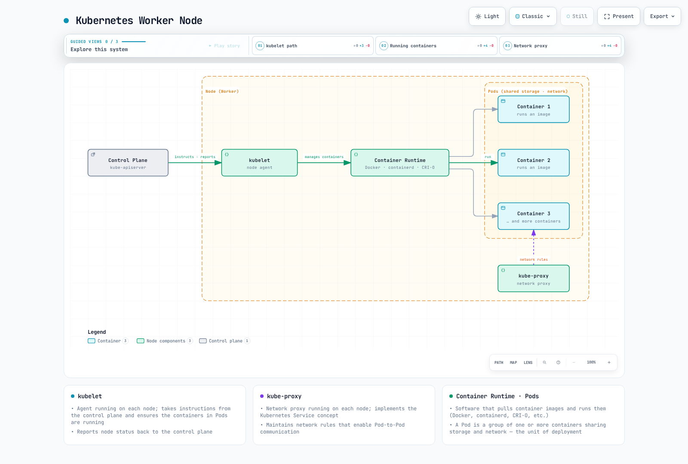
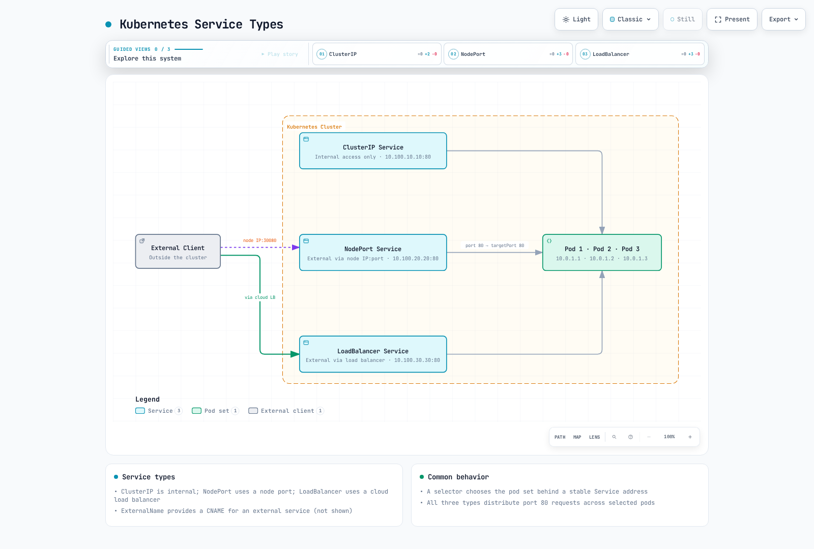
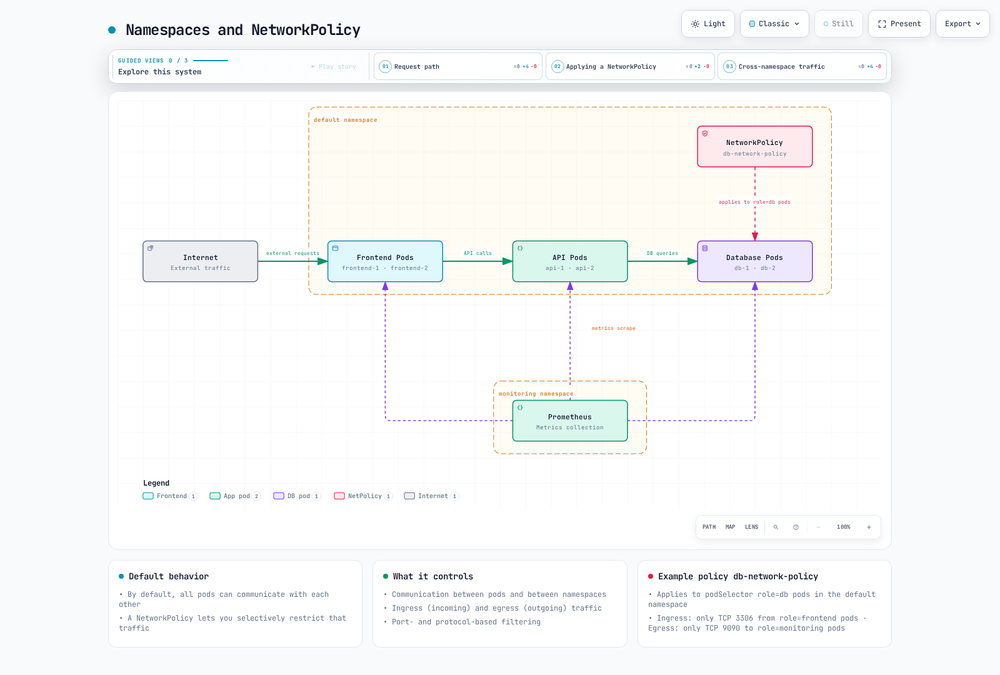

# Kubernetes の概要

> **サポート対象バージョン**: Upstream Kubernetes 1.35–1.37、EKS の標準サポート対象は 1.34–1.37（2026 年 10 月 12 日時点）
> **最終更新**: 2026 年 10 月 16 日

Kubernetes プロジェクトは、直近 3 つのマイナーリリース（1.35–1.37）のリリースブランチを維持しています。Upstream 1.34 はメンテナンスモードであり、2026 年 10 月 27 日の EOL までパッチリリースを受け取ります。この日は AWS の EKS サポート終了日とは別です。EKS の対象範囲と日付については、[AWS EKS lifecycle](https://docs.aws.amazon.com/eks/latest/userguide/kubernetes-versions.html) を確認してください。

Kubernetes（K8s）は、コンテナ化されたアプリケーションのデプロイ、スケーリング、管理を自動化するオープンソースのコンテナオーケストレーションプラットフォームです。このドキュメントでは、Kubernetes の基本概念、アーキテクチャ、主要コンポーネント、機能を説明します。

これらの独立した学習用サンプルは、スキーマおよび公式ドキュメントに対して静的にレビューされています。デプロイによって検証された本番設定ではありません。対象環境でカスタムイメージ、名前/ラベル、TLS、IAM/RBAC、CNI、ストレージの前提条件を確認し、プレースホルダーを置き換えてください。

## ラボ環境のセットアップ

このドキュメントの例に沿って進めるには、以下のツールと環境が必要です。

### 必要なツール

* **kubectl**: Kubernetes クラスターと対話するためのコマンドラインツール
* **ローカルクラスタードライバー**: minikube/kind がサポートするコンテナエンジンまたは VM ドライバー。Kubernetes ノードは CRI v1 ランタイムを使用します。
* **minikube** または **kind**: ローカル Kubernetes クラスター（開発および学習用）

### インストール方法

**kubectl のインストール**:

```bash
# macOS: use a kubectl version within one minor of the API server.
brew install kubectl
```

```bash
# Linux: select an explicit compatible version and architecture.
set -euo pipefail
: "${KUBECTL_VERSION:?Set a cluster-compatible version, e.g. v1.37.1}"
case "$(uname -m)" in
  x86_64) KUBECTL_ARCH=amd64 ;;
  aarch64|arm64) KUBECTL_ARCH=arm64 ;;
  *) echo "Choose a supported kubectl architecture" >&2; exit 1 ;;
esac
curl --fail --location --output kubectl "https://dl.k8s.io/release/$KUBECTL_VERSION/bin/linux/$KUBECTL_ARCH/kubectl"
curl --fail --location --output kubectl.sha256 "https://dl.k8s.io/release/$KUBECTL_VERSION/bin/linux/$KUBECTL_ARCH/kubectl.sha256"
echo "$(cat kubectl.sha256)  kubectl" | sha256sum --check
sudo install -m 0755 kubectl /usr/local/bin/kubectl
```

```powershell
$ErrorActionPreference = "Stop"
$KubectlVersion = Read-Host "Cluster-compatible kubectl version (vX.Y.Z)"
$KubectlArch = Read-Host "Architecture (amd64 or arm64)"
if ($KubectlVersion -notmatch '^v\d+\.\d+\.\d+$' -or $KubectlArch -notin @('amd64','arm64')) { throw "Invalid version/architecture" }
$BaseUrl = "https://dl.k8s.io/release/$KubectlVersion/bin/windows/$KubectlArch"
Invoke-WebRequest "$BaseUrl/kubectl.exe" -OutFile kubectl.exe
Invoke-WebRequest "$BaseUrl/kubectl.exe.sha256" -OutFile kubectl.exe.sha256
if ((Get-FileHash kubectl.exe -Algorithm SHA256).Hash -ne (Get-Content kubectl.exe.sha256).Trim()) { throw "Checksum mismatch" }
# Move the verified binary to a directory included in PATH.
```

**minikube のインストール**:

minikube の公式スタートガイドを使用して、OS/アーキテクチャに適したバイナリ、チェックサム、ドライバーを選択してください。Linux と Windows の手順はそれぞれのシェルで実行し、検証済みのバイナリを PATH に追加してください。macOS の場合:

```bash
brew install minikube
minikube version
```

### ローカルクラスターの開始

```bash
minikube start
```

## 目次

* [Kubernetes とは？](04-kubernetes-introduction.md#what-is-kubernetes)
* [Kubernetes の歴史](04-kubernetes-introduction.md#history-of-kubernetes)
* [Kubernetes アーキテクチャ](04-kubernetes-introduction.md#kubernetes-architecture)
* [Kubernetes の主要コンポーネント](04-kubernetes-introduction.md#kubernetes-main-components)
* [Kubernetes の基本オブジェクト](04-kubernetes-introduction.md#kubernetes-basic-objects)
* [Kubernetes のワークロードリソース](04-kubernetes-introduction.md#kubernetes-workload-resources)
* [Kubernetes の Service とネットワーキング](04-kubernetes-introduction.md#kubernetes-services-and-networking)
* [Kubernetes ストレージ](04-kubernetes-introduction.md#kubernetes-storage)
* [Kubernetes の設定とセキュリティ](04-kubernetes-introduction.md#kubernetes-configuration-and-security)
* [Kubernetes と Amazon EKS](04-kubernetes-introduction.md#kubernetes-vs-amazon-eks)
* [Kubernetes を始める](04-kubernetes-introduction.md#getting-started-with-kubernetes)

## Kubernetes とは？ {#what-is-kubernetes}

Kubernetes はギリシャ語で「舵取り」または「操縦士」を意味し、コンテナ化されたアプリケーションのデプロイ、スケーリング、運用を自動化するオープンソースシステムです。Google の社内 Borg システムから着想を得て、2014 年にオープンソースとして公開されました。

### Kubernetes の主な機能

1. **Service Discovery と負荷分散**: コンテナを外部に公開し、トラフィックを分散
2. **ストレージオーケストレーション**: ローカルまたはクラウドのストレージシステムを自動的にマウント
3. **ロールアウトとロールバック**: アプリケーションを段階的に更新し、オペレーターまたはツールによるロールバックをサポート。失敗した Deployment が自動的にロールバックされるわけではありません。
4. **自動ビンパッキング**: リソース要件に基づいてコンテナをノードに配置
5. **自己修復**: 失敗したコンテナを再起動し、応答しないコンテナを置換
6. **Secret と設定の管理**: 機密情報を保存し、設定を更新
7. **水平スケーリング**: 簡単なコマンドまたは UI でアプリケーションをスケール
8. **バッチ実行**: バッチおよび CI ワークロードを管理

### Kubernetes が解決する課題

* **コンテナオーケストレーション**: 数百または数千のコンテナを効率的に管理
* **高可用性**: レプリカ、配置、Probe、容量による回復力のあるアプリケーション設計をサポート
* **スケーラビリティ**: トラフィック増加に基づく自動スケーリング
* **復旧**: 失敗したワークロードを調整。災害復旧には、テスト済みのバックアップと復元計画も必要です。
* **リソース効率**: ハードウェアリソースを効率的に活用
* **宣言的設定**: Infrastructure as Code としてインフラストラクチャを管理
* **マルチクラウドとハイブリッドクラウド**: さまざまな環境で一貫したデプロイと管理

## Kubernetes の歴史 {#history-of-kubernetes}

### 背景

* **2003-2013**: Google は Borg というコンテナオーケストレーションシステムを社内で使用
* **2014 年 6 月**: Google が Kubernetes をオープンソースとして公開
* **2015 年 7 月**: Kubernetes 1.0 がリリースされ、Cloud Native Computing Foundation（CNCF）に寄贈
* **2016-2017**: 主要クラウドプロバイダーがマネージド Kubernetes サービスを開始
* **2018 年以降**: コンテナオーケストレーションの事実上の標準として確立

### 名前の由来

Kubernetes（κυβερνήτης）はギリシャ語で「舵取り」または「操縦士」を意味します。これはコンテナ化されたアプリケーションを導く役割を象徴しています。「K」と「s」の間に 8 文字あるため、略称として K8s が使用されます。

### ロゴの意味

Kubernetes のロゴは 7 本のスポークを持つ舵輪（船の操舵輪）を描いており、コンテナ化されたアプリケーションの進路を導く Kubernetes の役割を象徴しています。

## Kubernetes アーキテクチャ {#kubernetes-architecture}

Kubernetes はマスター・ノードアーキテクチャに従います。マスターノード（control plane）はクラスターを管理し、ワーカーノードは実際のアプリケーションワークロードを実行します。

### Control Plane（Master）コンポーネント


[🔍 インタラクティブ図を表示](https://www.atomai.click/kubernetes-docs/archmaps/en-basics-04-kubernetes-introduction-0.html)

1. **kube-apiserver**: Kubernetes API を公開する control plane のフロントエンド
2. **etcd**: Kubernetes API オブジェクトとクラスター状態を格納する、一貫性と高可用性を備えたキーバリューストア（アプリケーションボリュームの内容は含まない）
3. **kube-scheduler**: Pod をノードに割り当てるコンポーネント
4. **kube-controller-manager**: Controller プロセスを実行するコンポーネント
   * Node Controller: ノード停止時の通知と応答
   * Replication Controller: 正しい数の Pod レプリカを維持
   * EndpointSlice Controller: Service のエンドポイントレコードを維持（従来の Endpoints は非推奨）
   * ServiceAccount controller はデフォルトアカウントを作成。投影された Pod トークンは TokenRequest と kubelet ローテーションを使用
5. **cloud-controller-manager**: クラウド固有の制御ロジックを含むコンポーネント
   * Node Controller: クラウドプロバイダーにノードが削除されたかを確認
   * Route Controller: クラウドインフラストラクチャ内にルートを設定
   * Service Controller: クラウドプロバイダーのロードバランサーを作成、更新、削除

### ノードコンポーネント



[🔍 インタラクティブ図を表示](https://www.atomai.click/kubernetes-docs/archmaps/en-basics-04-kubernetes-introduction-1.html)

1. **kubelet**: 各ノードで実行され、Pod 内のコンテナが実行中であることを保証するエージェント
2. **kube-proxy**: Kubernetes Service の概念を実装する、各ノードで実行されるネットワークプロキシ
3. **Container Runtime**: containerd や CRI-O など、CRI v1 を実装するソフトウェア。Docker Engine には別途 CRI アダプターが必要

### 完全なアーキテクチャ


[🔍 インタラクティブ図を表示](https://www.atomai.click/kubernetes-docs/archmaps/en-basics-04-kubernetes-introduction-2.html)

## Kubernetes の主要コンポーネント {#kubernetes-main-components}

### API Server（kube-apiserver）

API server は Kubernetes API を公開する control plane のフロントエンドです。Kubernetes API リクエストはこれを通過しますが、アプリケーショントラフィックとストレージ I/O は API server を通りません。

**主な機能**:

* REST API を提供
* 認証と認可
* リクエスト検証
* etcd との通信
* 水平スケーラブル

### etcd

etcd は、Kubernetes API オブジェクトとクラスター状態（アプリケーションボリュームの内容を除く）を格納する、一貫性と高可用性を備えたキーバリューストアです。

**主な特徴**:

* 分散システム
* 強い一貫性
* 高可用性
* 安全なデータストレージ
* 変更を監視する Watch 機能

### Scheduler（kube-scheduler）

Scheduler は、新しく作成された Pod を実行するノードを選択する control plane コンポーネントです。

**スケジューリングプロセス**:

1. **フィルタリング**: Pod を実行可能なノードを特定
2. **スコアリング**: 適切なノードにスコアを割り当て
3. **バインディング**: Pod を最適なノードに割り当て

**考慮事項**:

* リソース要件（CPU、メモリ）
* ハードウェア/ソフトウェア/ポリシー制約
* Affinity/anti-affinity の指定
* データ局所性
* ワークロードの干渉

### Controller Manager（kube-controller-manager）

Controller Manager は複数の Controller プロセスを実行する control plane コンポーネントです。

**主要な Controller**:

* **Node Controller**: ノード状態を監視して応答
* **Replication Controller**: Pod レプリカ数を維持
* **EndpointSlice Controller**: Service のエンドポイントレコードを維持（従来の Endpoints は非推奨）
* **ServiceAccount controller**: デフォルトアカウントを作成。最新の Pod トークンは TokenRequest 経由で要求され、kubelet によりローテーションされます。
* **Job Controller**: 1 回限りのタスクを管理
* **CronJob Controller**: スケジュールされたタスクを管理
* **DaemonSet Controller**: 対象となる各ノード上の Pod を調整
* **StatefulSet Controller**: ステートフルアプリケーションを管理
* **PV Controller**: PersistentVolume を管理

### Cloud Controller Manager（cloud-controller-manager）

Cloud Controller Manager にはクラウド固有の制御ロジックが含まれます。CSI controller sidecar/driver と kubelet/node plugin がストレージのプロビジョニング、アタッチ、マウントを処理します。これは CCM のボリューム Controller ではありません。

**主要な Controller**:

* **Node Controller**: クラウドプロバイダー API を通じてノード状態を確認
* **Route Controller**: クラウド環境にルートを設定
* **Service Controller**: クラウドロードバランサーを作成、更新、削除

### kubelet

kubelet は各ノードで実行され、Pod 内のコンテナが実行中であることを保証するエージェントです。

**主な機能**:

* PodSpec に従ってコンテナを実行
* コンテナ状態を報告
* コンテナのヘルスチェックを実行
* コンテナライフサイクルを管理
* ノード状態を報告

### kube-proxy

kube-proxy は Kubernetes Service の概念を実装する、各ノードで実行されるネットワークプロキシです。

**主な機能**:

* Service IP とポートのネットワークルールを維持
* 接続を転送
* 負荷分散を実装

**動作モード**:

* **nftables mode**: 1.33 から安定。カーネルおよびネットワークプラグインの互換性を確認
* **iptables mode**: Linux iptables を使用する NAT 実装（デフォルト）
* **IPVS mode**: 1.35 から非推奨。移行を計画してください。従来の userspace mode は削除されました。

## Kubernetes の基本オブジェクト {#kubernetes-basic-objects}

Kubernetes オブジェクトは、クラスターの状態を表す永続エンティティです。これらのオブジェクトは、クラスター内で実行されているアプリケーション、利用可能なリソース、ポリシーなどを記述します。

### Pod

Pod は Kubernetes でデプロイ可能な最小単位であり、1 つ以上のコンテナのグループを表します。Pod 内のコンテナはネットワーキングを共有し、明示的にマウントされたボリュームを共有できます。同じノードで実行されますが、root filesystem を自動的に共有するわけではありません。

**主な特徴**:

* 一意の IP アドレスを持つ
* ネットワーク名前空間を共有（同じ IP とポート空間）
* IPC 名前空間を共有
* hostname を共有
* コンテナ間で localhost 通信が可能

**Pod の例**:

```yaml
apiVersion: v1
kind: Pod
metadata:
  name: nginx-pod
  labels:
    app: nginx
spec:
  containers:
  - name: nginx
    image: nginx:1.30.6
    ports:
    - containerPort: 80
    volumeMounts:
    - name: logs
      mountPath: /var/log/nginx
  - name: log-sidecar
    image: busybox:1.38.0
    command:
    - /bin/sh
    - -c
    - until [ -f /var/log/nginx/access.log ]; do sleep 1; done; tail -F /var/log/nginx/access.log
    volumeMounts:
    - name: logs
      mountPath: /var/log/nginx
      readOnly: true
  volumes:
  - name: logs
    emptyDir: {}
```

### Namespace

Namespace は、単一クラスター内でリソースグループを分離する方法を提供します。チーム/プロジェクトの整理に役立ちますが、Namespace 単独ではネットワークまたは認可の分離を強制しません。

**デフォルト Namespace**:

* **default**: デフォルト Namespace
* **kube-system**: Kubernetes システムにより作成されるオブジェクト用 Namespace
* **kube-public**: 慣例として公開情報に使用される Namespace。実際のオブジェクトアクセスは引き続き RBAC に依存
* **kube-node-lease**: ノード heartbeat 用 Namespace

**Namespace の例**:

```yaml
apiVersion: v1
kind: Namespace
metadata:
  name: development
```

### Labels と Selectors

Labels はオブジェクトに付与するキーと値のペアで、オブジェクトの識別および選択に使用します。Selectors は Labels に基づいてオブジェクトをフィルタリングする方法を提供します。

**Labels の例**:

```yaml
metadata:
  labels:
    app: nginx
    environment: production
    tier: frontend
```

**Selector の種類**:

* **等価ベース**: `=`, `!=`
* **集合ベース**: `in`, `notin`, `exists`

**Selector の例**:

```yaml
selector:
  matchLabels:
    app: nginx
  matchExpressions:
    - {key: tier, operator: In, values: [frontend, middleware]}
    - {key: environment, operator: NotIn, values: [dev]}
```

### Annotations

Annotations は、オブジェクトに関する識別以外のメタデータを格納するキーと値のペアです。Annotations はツールやライブラリで使用する情報の格納に役立ちます。

**Annotations の例**:

```yaml
metadata:
  annotations:
    example.com/created-by: "admin"
    example.com/last-modified: "2023-07-01T12:00:00Z"
    prometheus.io/scrape: "true"
    prometheus.io/port: "9090"
```

### Node

Node は Pod を実行する Kubernetes クラスター内のワーカーマシンです。Node は物理マシンまたは仮想マシンです。

**Node の状態**:

* **Addresses**: Hostname、Internal IP、External IP
* **Conditions**: Ready、DiskPressure、MemoryPressure、PIDPressure、NetworkUnavailable
* **Capacity**: CPU、Memory、最大 Pod 数
* **Info**: Kernel version、Container runtime version、kubelet version

**説明用の Node 状態（ノードプロビジョニング manifest ではなく、node/controllers により報告されるもの）**:

```yaml
apiVersion: v1
kind: Node
metadata:
  name: worker-1
  labels:
    kubernetes.io/hostname: worker-1
    node-role.kubernetes.io/worker: ""
    topology.kubernetes.io/zone: us-east-1a
status:
  capacity:
    cpu: "4"
    memory: 8Gi
    pods: "110"
  conditions:
    - type: Ready
      status: "True"
  # ...
```

## Kubernetes のワークロードリソース {#kubernetes-workload-resources}

ワークロードリソースは Pod を管理および実行するために使用するオブジェクトです。これらのリソースは、Pod の作成、スケーリング、更新、終了を管理します。

### ReplicaSet

ReplicaSet は、望ましい数の Pod オブジェクトを調整します。Ready 状態は容量、有効な設定、アプリケーションにも依存します。Pod が失敗または削除されると、ReplicaSet は自動的に置換 Pod を作成します。

**主な機能**:

* 指定した数の Pod レプリカを維持
* Pod テンプレートを定義
* Selector を通じて Pod を識別

**ReplicaSet の例**:

```yaml
apiVersion: apps/v1
kind: ReplicaSet
metadata:
  name: nginx-replicaset
  labels:
    app: nginx
spec:
  replicas: 3
  selector:
    matchLabels:
      app: nginx
  template:
    metadata:
      labels:
        app: nginx
    spec:
      containers:
      - name: nginx
        image: nginx:1.30.6
        ports:
        - containerPort: 80
```

### Deployment

Deployment は ReplicaSet をさらに 1 層抽象化し、アプリケーションの宣言的更新を提供します。Deployment は rolling update、rollback、scaling などの機能を提供します。

**主な機能**:

* 宣言的なアプリケーション更新
* Rolling update と rollback
* Deployment 履歴の管理
* スケーリング

**Deployment の例**:

```yaml
apiVersion: apps/v1
kind: Deployment
metadata:
  name: nginx-deployment
  labels:
    app: nginx
spec:
  replicas: 3
  selector:
    matchLabels:
      app: nginx
  strategy:
    type: RollingUpdate
    rollingUpdate:
      maxSurge: 1
      maxUnavailable: 0
  template:
    metadata:
      labels:
        app: nginx
    spec:
      containers:
      - name: nginx
        image: nginx:1.30.6
        ports:
        - containerPort: 80
        resources:
          requests:
            cpu: 100m
            memory: 128Mi
          limits:
            cpu: 200m
            memory: 256Mi
        livenessProbe:
          httpGet:
            path: /
            port: 80
          initialDelaySeconds: 30
          periodSeconds: 10
        readinessProbe:
          httpGet:
            path: /
            port: 80
          initialDelaySeconds: 5
          periodSeconds: 5
```

MySQL の例は単一の永続インスタンスです。StatefulSet はデータベースのレプリケーション、フェイルオーバー、バックアップを設定しません。先に mysql-secret/password を用意し、StorageClass のプレースホルダーを置き換えてください。レプリカ数を増やすだけでは独立したデータベースが作成されます。HA にはテスト済みの database operator/replication 設定が必要です。

### StatefulSet

StatefulSet は、状態の維持を必要とするアプリケーションのためのワークロードリソースです。各 Pod に一意の識別子を割り当て、安定したネットワーク識別子と永続ストレージを提供します。

**主な機能**:

* 安定かつ一意のネットワーク識別子
* 安定した永続ストレージ
* 順次デプロイおよびスケーリング
* 順次更新

**StatefulSet の例**:

```yaml
apiVersion: v1
kind: Service
metadata:
  name: mysql
spec:
  clusterIP: None
  selector:
    app: mysql
  ports:
  - name: mysql
    port: 3306
    targetPort: 3306
---
apiVersion: apps/v1
kind: StatefulSet
metadata:
  name: mysql
spec:
  selector:
    matchLabels:
      app: mysql
  serviceName: mysql
  replicas: 1
  template:
    metadata:
      labels:
        app: mysql
        role: db
    spec:
      containers:
      - name: mysql
        image: mysql:8.4
        env:
        - name: MYSQL_ROOT_PASSWORD
          valueFrom:
            secretKeyRef:
              name: mysql-secret
              key: password
        ports:
        - containerPort: 3306
          name: mysql
        volumeMounts:
        - name: data
          mountPath: /var/lib/mysql
        readinessProbe:
          tcpSocket:
            port: 3306
          initialDelaySeconds: 10
          periodSeconds: 5
  volumeClaimTemplates:
  - metadata:
      name: data
    spec:
      accessModes:
      - ReadWriteOnce
      storageClassName: replace-with-storage-class
      resources:
        requests:
          storage: 10Gi
```

Linux の Fluent Bit 例は、デモンストレーションのために CRI ログを stdout に送信します。フィードバックループを防ぐため自身のログを除外し、その position DB を別に永続化します。同じログを stdout に再公開する別の collector と併用してデプロイしないでください。本番環境では外部送信先と、レビュー済みの host path、権限、PSS 例外が必要です。

### DaemonSet

DaemonSet は、対象となる各ノードに Pod を作成します。node selector、taint、容量、admission policy は引き続き適用されます。ノードがクラスターに追加されると Pod も自動的に追加され、ノードが削除されると Pod も削除されます。

**主なユースケース**:

* ログ collector（Fluentd、Logstash）
* 監視エージェント（Prometheus Node Exporter）
* ネットワークプラグイン（Calico、Cilium）
* ストレージデーモン（Ceph）

**DaemonSet の例**:

```yaml
apiVersion: v1
kind: ConfigMap
metadata:
  name: intro-log-agent-config
  namespace: kube-system
data:
  fluent-bit.conf: |
    [SERVICE]
        Flush 5
        Parsers_File /fluent-bit/etc/parsers.conf
    [INPUT]
        Name tail
        Path /var/log/containers/*.log
        Exclude_Path /var/log/containers/intro-log-agent-*_kube-system_fluent-bit-*.log
        Parser cri
        Tag kube.*
        DB /var/lib/fluent-bit/tail.db
        Mem_Buf_Limit 5MB
        Skip_Long_Lines On
    [OUTPUT]
        Name stdout
        Match *
---
apiVersion: apps/v1
kind: DaemonSet
metadata:
  name: intro-log-agent
  namespace: kube-system
spec:
  selector:
    matchLabels:
      app: intro-log-agent
  template:
    metadata:
      labels:
        app: intro-log-agent
    spec:
      automountServiceAccountToken: false
      tolerations:
      - key: node-role.kubernetes.io/control-plane
        operator: Exists
        effect: NoSchedule
      containers:
      - name: fluent-bit
        image: cr.fluentbit.io/fluent/fluent-bit:5.1.3
        securityContext:
          runAsUser: 0
          allowPrivilegeEscalation: false
          readOnlyRootFilesystem: true
          capabilities:
            drop: [ALL]
        args:
        - -c
        - /fluent-bit/custom/fluent-bit.conf
        resources:
          requests:
            cpu: 100m
            memory: 100Mi
          limits:
            memory: 200Mi
        volumeMounts:
        - name: varlog
          mountPath: /var/log
          readOnly: true
        - name: config
          mountPath: /fluent-bit/custom
          readOnly: true
        - name: state
          mountPath: /var/lib/fluent-bit
      volumes:
      - name: varlog
        hostPath:
          path: /var/log
          type: Directory
      - name: config
        configMap:
          name: intro-log-agent-config
      - name: state
        hostPath:
          path: /var/lib/intro-log-agent
          type: DirectoryOrCreate
      nodeSelector:
        kubernetes.io/os: linux
```

### Job

Job は 1 つ以上の Pod を作成し、指定数の Pod が正常に終了するまで実行を継続します。バッチ処理タスクに適しています。

**主な機能**:

* 1 回限りのタスク実行
* 並列タスク実行
* 正常完了を追跡。失敗/期限の制限によって Job が失敗する場合もあります。
* 失敗時の再試行

**Job の例**:

```yaml
apiVersion: batch/v1
kind: Job
metadata:
  name: pi-calculator
spec:
  completions: 5
  parallelism: 2
  backoffLimit: 3
  template:
    spec:
      containers:
      - name: pi
        image: perl
        command: ["perl", "-Mbignum=bpi", "-wle", "print bpi(2000)"]
      restartPolicy: Never
```

Job は再試行/期限の制限により失敗する可能性があり、同じ作業を再度実行することもあるため、タスクは冪等であるべきです。CronJob のスケジューリングは厳密に 1 回ではありません。Forbid はその CronJob の重複する Job のみを制御します。

### CronJob

CronJob は指定されたスケジュールに従って定期的に Job を実行します。Linux cron job と同様に機能します。

**主な機能**:

* スケジュールに従ったタスク実行
* Cron 式のサポート
* 同時実行ポリシー設定
* 履歴制限

**CronJob の例**:

```yaml
apiVersion: batch/v1
kind: CronJob
metadata:
  name: database-backup
spec:
  timeZone: Etc/UTC
  schedule: "0 2 * * *"  # Run at 02:00 daily
  concurrencyPolicy: Forbid
  successfulJobsHistoryLimit: 3
  failedJobsHistoryLimit: 1
  jobTemplate:
    spec:
      template:
        spec:
          containers:
          - name: backup
            image: database-backup:v1
            env:
            - name: DB_HOST
              value: "db.example.com"
          restartPolicy: OnFailure
```

## Kubernetes の Service とネットワーキング {#kubernetes-services-and-networking}

Kubernetes ネットワーキングモデルは、互換性のある CNI が Pod ネットワーキングを提供するという前提に基づきます。到達可能性は NetworkPolicy、firewall、トポロジーに左右されます。Service は Pod のセットに安定したエンドポイントを提供します。

### Service

Service は一連の Pod に単一のエンドポイントと負荷分散を提供します。Pod は動的に作成および削除されるため、Service はこれらの変更にもかかわらず安定したネットワークアドレスを提供します。

**Service の種類**:

* **ClusterIP**: クラスター内からのみアクセス可能な Service（デフォルト）
* **NodePort**: 各ノードの IP と特定のポートを通じて外部からアクセス可能
* **LoadBalancer**: クラウドプロバイダーのロードバランサーを使用して外部からアクセス可能
* **ExternalName**: 外部 Service の CNAME レコードを作成



[🔍 インタラクティブ図を表示](https://www.atomai.click/kubernetes-docs/archmaps/en-basics-04-kubernetes-introduction-3.html)

**Service の例**:

```yaml
apiVersion: v1
kind: Service
metadata:
  name: nginx-service
spec:
  selector:
    app: nginx
  ports:
  - port: 80
    targetPort: 80
  type: ClusterIP
```

**NodePort Service の例**:

```yaml
apiVersion: v1
kind: Service
metadata:
  name: nginx-nodeport
spec:
  selector:
    app: nginx
  ports:
  - port: 80
    targetPort: 80
    nodePort: 30080
  type: NodePort
```

この AWS の例には AWS Load Balancer Controller と、その IAM/ネットワーク前提条件が必要です。EKS Auto Mode は異なる loadBalancerClass を使用します。ローカルクラスターには独自の LoadBalancer 実装が必要です。

**LoadBalancer Service の例**:

```yaml
apiVersion: v1
kind: Service
metadata:
  name: nginx-lb
  annotations:
    service.beta.kubernetes.io/aws-load-balancer-scheme: internet-facing
    service.beta.kubernetes.io/aws-load-balancer-nlb-target-type: ip
spec:
  selector:
    app: nginx
  ports:
  - port: 80
    targetPort: 80
  type: LoadBalancer
  loadBalancerClass: service.k8s.aws/nlb
```

この例には、インストール済みの Traefik、その traefik IngressClass、app1/app2 Service、TLS Secret が必要です。パス /app1 と /app2 は保持され、backend が提供する必要があります。Ingress リソースは Controller をインストールしません。

### Ingress

Ingress は、クラスター外部から内部 Service への HTTP および HTTPS ルーティングを管理する API オブジェクトです。Ingress は負荷分散、SSL termination、名前ベースの virtual hosting などを提供します。

**Ingress Controller**:

* **ingress-nginx（2026 年 3 月に終了）**: 過去のコミュニティ Controller。新規インストールには保守されている Controller を選択してください。F5 NGINX Ingress Controller は別プロジェクトです。
* **AWS Load Balancer Controller**: AWS Application Load Balancer ベースの Ingress Controller
* **Traefik**: クラウドネイティブな edge router
* **Istio Ingress**: Service mesh ベースの Ingress

**Ingress の例**:

```yaml
apiVersion: networking.k8s.io/v1
kind: Ingress
metadata:
  name: example-ingress
spec:
  ingressClassName: traefik
  rules:
  - host: example.com
    http:
      paths:
      - path: /app1
        pathType: Prefix
        backend:
          service:
            name: app1-service
            port:
              number: 80
      - path: /app2
        pathType: Prefix
        backend:
          service:
            name: app2-service
            port:
              number: 80
  tls:
  - hosts:
    - example.com
    secretName: example-tls
```

### NetworkPolicy

NetworkPolicy は Pod 間の通信を制御する方法を提供します。デフォルトではすべての Pod が相互に通信できますが、ネットワークポリシーを使用して制限できます。&#x20;



[🔍 インタラクティブ図を表示](https://www.atomai.click/kubernetes-docs/archmaps/en-basics-04-kubernetes-introduction-4.html)

**主な機能**:

* Pod 間の通信を制御
* Namespace 間の通信を制御
* Ingress（受信）および Egress（送信）トラフィックを制御
* ポートおよびプロトコルベースのフィルタリング

**NetworkPolicy の例**:

```yaml
apiVersion: networking.k8s.io/v1
kind: NetworkPolicy
metadata:
  name: db-network-policy
  namespace: default
spec:
  podSelector:
    matchLabels:
      role: db
  policyTypes:
  - Ingress
  - Egress
  ingress:
  - from:
    - podSelector:
        matchLabels:
          role: api
    ports:
    - protocol: TCP
      port: 3306
  - from:
    - namespaceSelector:
        matchLabels:
          kubernetes.io/metadata.name: monitoring
      podSelector:
        matchLabels:
          app: prometheus
    ports:
    - protocol: TCP
      port: 9104
  egress:
  - to:
    - namespaceSelector:
        matchLabels:
          kubernetes.io/metadata.name: kube-system
      podSelector:
        matchLabels:
          k8s-app: kube-dns
    ports:
    - protocol: UDP
      port: 53
    - protocol: TCP
      port: 53
```

NetworkPolicy の許可は加算的です。このポリシーは、role=api から DB の port3306、および monitoring の app=prometheus から個別にインストールされた DB exporter の port9104 を許可します。DB から Prometheus9090 への接続を可能にするものではありません。実際のクラスター DNS/NodeLocal DNS 設定に合わせて DNS Egress Selector を調整してください。

### DNS

Kubernetes ディストリビューションは通常、Service discovery のために CoreDNS をデプロイします。その ConfigMap を編集する際は、ディストリビューションで管理される設定を保持してください。以下の pods insecure mode は Pod の存在を検証せずに従来の IP ベースレコードを提供します。そのレコードが不要な場合は disabled を使用するか、追加の watch/メモリコストを伴う verified を使用してください。

**DNS 名の形式**:

* **Service**: `<service-name>.<namespace>.svc.cluster.local`
* **Pod**: `<pod-ip-with-dashes>.<namespace>.pod.cluster.local`（IPv4 レコード。CoreDNS の pods mode に依存）

**DNS 設定例**:

```yaml
apiVersion: v1
kind: ConfigMap
metadata:
  name: coredns
  namespace: kube-system
data:
  Corefile: |
    .:53 {
        errors
        health
        ready
        kubernetes cluster.local in-addr.arpa ip6.arpa {
          pods insecure
          fallthrough in-addr.arpa ip6.arpa
        }
        prometheus :9153
        forward . /etc/resolv.conf
        cache 30
        loop
        reload
        loadbalance
    }
```

### Service Mesh

Service mesh は、マイクロサービス間の通信を管理するインフラストラクチャ層です。Service mesh はトラフィック管理、セキュリティ、可観測性を提供します。

**主な Service Mesh**:

* **Istio**: 最も広く使用されている Service mesh
* **Linkerd**: 軽量な Service mesh
* **AWS App Mesh**: サポートは 2026-09-30 に終了。AWS によると console とリソースにはもうアクセスできません。

**Istio VirtualService の例**:

```yaml
apiVersion: networking.istio.io/v1
kind: VirtualService
metadata:
  name: reviews-route
spec:
  hosts:
  - reviews
  http:
  - match:
    - headers:
        end-user:
          exact: jason
    route:
    - destination:
        host: reviews
        subset: v2
  - route:
    - destination:
        host: reviews
        subset: v1
---
apiVersion: networking.istio.io/v1
kind: DestinationRule
metadata:
  name: reviews-subsets
spec:
  host: reviews
  subsets:
  - name: v1
    labels:
      version: v1
  - name: v2
    labels:
      version: v2
```

## Kubernetes ストレージ {#kubernetes-storage}

Kubernetes はコンテナ化されたアプリケーションにさまざまなストレージオプションを提供します。Pod が再起動または再スケジュールされた場合でもデータを永続化する方法を提供します。


[🔍 インタラクティブ図を表示](https://www.atomai.click/kubernetes-docs/archmaps/en-basics-04-kubernetes-introduction-5.html)

### Volume

Volume は Pod 内のコンテナにマウントできるディレクトリであり、Pod のライフサイクル中データを永続化します。Volume は Pod 内のコンテナ間でデータを共有するためにも使用されます。

**主な Volume 種類**:

* **emptyDir**: 空のディレクトリとして開始し、Pod の削除時に削除
* **hostPath**: ホストノードの file system から Pod にマウント
* **configMap**: ConfigMap を Volume としてマウント
* **secret**: Secret を Volume としてマウント
* **persistentVolumeClaim**: PersistentVolume を Pod にマウント

**emptyDir Volume の例**:

```yaml
apiVersion: v1
kind: Pod
metadata:
  name: test-pd
spec:
  containers:
  - name: test-container
    image: nginx:1.30.6
    volumeMounts:
    - mountPath: /cache
      name: cache-volume
  volumes:
  - name: cache-volume
    emptyDir: {}
```

### PersistentVolume（PV）

PersistentVolume は、クラスター内のストレージリソースを表す API オブジェクトです。Pod から独立して存在し、管理者が静的に、またはストレージ provisioner が動的にプロビジョニングします。

**アクセスモード**:

* **ReadWriteOnce（RWO）**: 単一ノードに read/write でマウント可能
* **ReadOnlyMany（ROX）**: 複数ノードに read-only でマウント可能
* **ReadWriteMany（RWX）**: 複数ノードに read/write でマウント可能
* **ReadWriteOncePod（RWOP）**: 対応する CSI Volume での単一 Pod アクセス。RWO 単独では、同一ノード上の複数 Pod を依然として許可します。

EBS CSI ドライバーがインストール済みで、IAM 権限が設定済みである必要があります。既存の volume ID と実際の Availability Zone を使用してください。別の場所でまだ使用中の volume を再利用しないでください。これらのストレージ例は AWS 固有です。ローカルクラスターには独自の provisioner が必要です。

**PersistentVolume の例**:

```yaml
apiVersion: v1
kind: PersistentVolume
metadata:
  name: pv-example
spec:
  capacity:
    storage: 10Gi
  accessModes:
  - ReadWriteOnce
  persistentVolumeReclaimPolicy: Retain
  storageClassName: ebs-gp3
  csi:
    driver: ebs.csi.aws.com
    volumeHandle: vol-0123456789abcdef0
    fsType: ext4
  nodeAffinity:
    required:
      nodeSelectorTerms:
      - matchExpressions:
        - key: topology.kubernetes.io/zone
          operator: In
          values:
          - replace-with-volume-az
```

### PersistentVolumeClaim（PVC）

PersistentVolumeClaim は、ユーザーのストレージ要求を表す API オブジェクトです。Pod は PVC を通じて PV にアクセスします。

**PersistentVolumeClaim の例**:

```yaml
apiVersion: v1
kind: PersistentVolumeClaim
metadata:
  name: pvc-example
spec:
  accessModes:
  - ReadWriteOnce
  resources:
    requests:
      storage: 5Gi
  storageClassName: ebs-gp3
```

**PVC を使用する Pod の例**:

```yaml
apiVersion: v1
kind: Pod
metadata:
  name: mypod
spec:
  containers:
    - name: myfrontend
      image: nginx:1.30.6
      volumeMounts:
      - mountPath: "/var/www/html"
        name: mypd
  volumes:
    - name: mypd
      persistentVolumeClaim:
        claimName: pvc-example
```

### StorageClass

StorageClass は、管理者が提供するストレージの「クラス」を記述します。異なるサービス品質レベル、バックアップポリシー、またはクラスター管理者が決定する任意のポリシーを提供できます。

**StorageClass の例**:

```yaml
apiVersion: storage.k8s.io/v1
kind: StorageClass
metadata:
  name: ebs-gp3
provisioner: ebs.csi.aws.com
parameters:
  type: gp3
  csi.storage.k8s.io/fstype: ext4
  encrypted: 'true'
reclaimPolicy: Delete
allowVolumeExpansion: true
volumeBindingMode: WaitForFirstConsumer
```

### 動的プロビジョニング

動的プロビジョニングは、StorageClass を使用して PVC が要求されたときに PV を自動作成する機能です。

**動的プロビジョニングの例**:

```yaml
apiVersion: v1
kind: PersistentVolumeClaim
metadata:
  name: dynamic-pvc
spec:
  accessModes:
  - ReadWriteOnce
  resources:
    requests:
      storage: 10Gi
  storageClassName: ebs-gp3
```

### CSI（Container Storage Interface）

CSI は Kubernetes とストレージシステムの間に標準インターフェースを提供します。これにより、ストレージプロバイダーは Kubernetes コードを変更せずに独自のストレージ driver を開発できます。

**主な CSI Driver**:

* **AWS EBS CSI Driver**: Amazon EBS volume 管理
* **AWS EFS CSI Driver**: Amazon EFS file system 管理
* **AWS FSx for Lustre CSI Driver**: FSx for Lustre file system 管理
* **GCE PD CSI Driver**: Google Compute Engine persistent disk 管理
* **Azure Disk CSI Driver**: Azure disk 管理

**インストール済み CSI driver を使用する StorageClass**:

```yaml
apiVersion: storage.k8s.io/v1
kind: StorageClass
metadata:
  name: ebs-sc
provisioner: ebs.csi.aws.com
parameters:
  type: gp3
  encrypted: 'true'
  csi.storage.k8s.io/fstype: ext4
volumeBindingMode: WaitForFirstConsumer
```

## Kubernetes の設定とセキュリティ {#kubernetes-configuration-and-security}

Kubernetes は、アプリケーション設定とセキュリティを管理するためのさまざまなオブジェクトとメカニズムを提供します。

### ConfigMap

ConfigMap は、設定データをキーと値のペアとして格納する API オブジェクトです。Pod は ConfigMap データを環境変数、コマンドライン引数、設定ファイルとして使用できます。

**ConfigMap の例**:

```yaml
apiVersion: v1
kind: ConfigMap
metadata:
  name: app-config
data:
  app.properties: |
    app.name=MyApp
    app.version=1.0.0
    app.environment=production
  log-level: INFO
  max-connections: "100"
```

環境変数の値は自動更新されません。変更後に Pod を再作成してください。Volume 更新は結果整合的であり、アプリケーションのリロードが必要です。subPath mount は更新を受け取りません。

**ConfigMap を使用する Pod の例**:

```yaml
apiVersion: v1
kind: Pod
metadata:
  name: config-pod
spec:
  containers:
  - name: app
    image: myapp:1.0
    env:
    - name: LOG_LEVEL
      valueFrom:
        configMapKeyRef:
          name: app-config
          key: log-level
    volumeMounts:
    - name: config-volume
      mountPath: /etc/config
  volumes:
  - name: config-volume
    configMap:
      name: app-config
```

### Secret

Secret は、password、token、key などの機密情報を格納する API オブジェクトです。ConfigMap に似ていますが、機密データ向けに設計されています。

**Secret の種類**:

* **Opaque**: 任意のユーザー定義データ（デフォルト）
* **kubernetes.io/service-account-token**: 手動で要求する長期間有効な従来 token Secret。TokenRequest/projected token を推奨
* **kubernetes.io/dockercfg**: シリアル化された \~/.dockercfg ファイル
* **kubernetes.io/dockerconfigjson**: シリアル化された \~/.docker/config.json ファイル
* **kubernetes.io/basic-auth**: basic authentication 用認証情報
* **kubernetes.io/ssh-auth**: SSH authentication 用認証情報
* **kubernetes.io/tls**: TLS client または server 用データ

データフィールドは暗号化ではなく base64 encoding を使用します。クラスターに適した RBAC と保存時の暗号化で Secret を保護してください。EKS は 1.28+ でデフォルトで全 Kubernetes API データを暗号化します。以下の値はデモ専用であり、置き換える必要があります。

**Secret の例**:

```yaml
apiVersion: v1
kind: Secret
metadata:
  name: db-credentials
type: Opaque
data:
  username: YWRtaW4=  # base64 encoded "admin"
  password: cGFzc3dvcmQxMjM=  # base64 encoded "password123"
```

**Secret を使用する Pod の例**:

```yaml
apiVersion: v1
kind: Pod
metadata:
  name: secret-pod
spec:
  containers:
  - name: db-client
    image: db-client:1.0
    env:
    - name: DB_USERNAME
      valueFrom:
        secretKeyRef:
          name: db-credentials
          key: username
    - name: DB_PASSWORD
      valueFrom:
        secretKeyRef:
          name: db-credentials
          key: password
```

### RBAC（Role-Based Access Control）

RBAC は Kubernetes API へのアクセスを制御するメカニズムです。Role および RoleBinding を使用して、ユーザーまたは ServiceAccount に特定の権限を付与します。

**主な RBAC オブジェクト**:

* **Role**: Namespace 内の権限セットを定義
* **ClusterRole**: クラスター/Namespace リソースに再利用可能なルール。binding がその有効スコープを決定
* **RoleBinding**: Role をユーザー、グループ、または ServiceAccount にバインド
* **ClusterRoleBinding**: ClusterRole をユーザー、グループ、または ServiceAccount にバインド

**Role の例**:

```yaml
apiVersion: rbac.authorization.k8s.io/v1
kind: Role
metadata:
  namespace: default
  name: pod-reader
rules:
- apiGroups: [""]
  resources: ["pods"]
  verbs: ["get", "watch", "list"]
```

**RoleBinding の例**:

```yaml
apiVersion: rbac.authorization.k8s.io/v1
kind: RoleBinding
metadata:
  name: read-pods
  namespace: default
subjects:
- kind: User
  name: jane
  apiGroup: rbac.authorization.k8s.io
roleRef:
  kind: Role
  name: pod-reader
  apiGroup: rbac.authorization.k8s.io
```

### ServiceAccount

ServiceAccount は Pod 内で実行されるプロセスに identity を提供します。Pod は ServiceAccount を使用して Kubernetes API と通信します。

**ServiceAccount の例**:

```yaml
apiVersion: v1
kind: ServiceAccount
metadata:
  name: app-sa
  namespace: default
```

**ServiceAccount を使用する Pod の例**:

```yaml
apiVersion: v1
kind: Pod
metadata:
  name: sa-pod
spec:
  serviceAccountName: app-sa
  containers:
  - name: app
    image: myapp:1.0
```

### NetworkPolicy

NetworkPolicy は Pod 間の通信を制御する方法を提供します。デフォルトではすべての Pod が相互に通信できますが、ネットワークポリシーを使用して制限できます。

**NetworkPolicy の例**:

```yaml
apiVersion: networking.k8s.io/v1
kind: NetworkPolicy
metadata:
  name: db-network-policy
  namespace: default
spec:
  podSelector:
    matchLabels:
      role: db
  policyTypes:
  - Ingress
  - Egress
  ingress:
  - from:
    - podSelector:
        matchLabels:
          role: api
    ports:
    - protocol: TCP
      port: 3306
  - from:
    - namespaceSelector:
        matchLabels:
          kubernetes.io/metadata.name: monitoring
      podSelector:
        matchLabels:
          app: prometheus
    ports:
    - protocol: TCP
      port: 9104
  egress:
  - to:
    - namespaceSelector:
        matchLabels:
          kubernetes.io/metadata.name: kube-system
      podSelector:
        matchLabels:
          k8s-app: kube-dns
    ports:
    - protocol: UDP
      port: 53
    - protocol: TCP
      port: 53
```

### Pod Security Admission と SecurityContext

PodSecurityPolicy は 1.25 で削除されました。Pod Security Admission は Namespace Label を使用して Pod Security Standards を強制します。SecurityContext はワークロード自体を設定しますが、admission enforcement を置き換えるものではありません。

**Pod SecurityContext の例**:

```yaml
apiVersion: v1
kind: Pod
metadata:
  name: security-context-pod
spec:
  securityContext:
    runAsUser: 1000
    runAsGroup: 3000
    fsGroup: 2000
    runAsNonRoot: true
    seccompProfile:
      type: RuntimeDefault
  containers:
  - name: app
    image: myapp:1.0
    securityContext:
      allowPrivilegeEscalation: false
      capabilities:
        drop:
        - ALL
```

### Pod Security Standards

Pod Security Standards は、Pod のセキュリティ要件を定義する 3 つのポリシーレベルを提供します:

1. **Privileged**: 制限なし。すべての機能を許可
2. **Baseline**: 既知の権限昇格を防止
3. **Restricted**: ベストプラクティスを適用する強い制限

**Pod Security Standards の適用例**:

```yaml
apiVersion: v1
kind: Namespace
metadata:
  name: my-namespace
  labels:
    pod-security.kubernetes.io/enforce: restricted
    pod-security.kubernetes.io/audit: restricted
    pod-security.kubernetes.io/warn: restricted
```

## Kubernetes と Amazon EKS {#kubernetes-vs-amazon-eks}

Amazon EKS（Elastic Kubernetes Service）は AWS が提供するマネージド Kubernetes サービスです。EKS は AWS 統合を備えた標準 Kubernetes API を公開します。以下の比較は従来の EC2 node group を前提としています。Auto Mode、Fargate、Hybrid Nodes では責任範囲とサポートされる機能が異なります。

### 主な違い

| 特性           | 自己管理 Kubernetes                         | Amazon EKS                                                        |
| ------------------------ | ----------------------------------------------- | ----------------------------------------------------------------- |
| Control Plane 管理 | ユーザーが直接管理                           | AWS が管理                                                    |
| 高可用性        | ユーザーが設定する必要がある                             | デフォルトで提供（複数の Availability Zone にデプロイ） |
| アップグレード                 | ユーザーが直接実行                          | Control plane のアップグレードは AWS が管理。node/add-on のアップグレードを調整                                |
| セキュリティパッチ         | ユーザーが直接適用                           | AWS が control plane にパッチを適用。managed-node AMI のロールアウトは引き続きユーザーの責任（Auto Mode は異なる）                                      |
| 認証           | さまざまなオプションの設定が必要              | AWS IAM と統合                                           |
| ネットワーキング               | CNI plugin の選択と設定が必要 | Amazon VPC CNI をデフォルトで提供                                |
| 負荷分散           | 手動設定が必要                   | AWS Load Balancer Controller 統合                          |
| ストレージ                  | ストレージ driver の設定が必要           | EBS、EFS、FSx CSI driver 統合                              |
| 監視               | 手動セットアップが必要                           | CloudWatch Container Insights 統合                         |
| コスト                     | インフラストラクチャと運用労力                       | Control plane のコスト + インフラストラクチャコスト                         |

### EKS の追加機能

1. **AWS IAM Integration**: Kubernetes RBAC と AWS IAM の統合
2. **AWS Load Balancer Controller**: ALB および NLB と Kubernetes Service/Ingress の統合
3. **EKS Managed Node Groups**: Node lifecycle 管理の自動化
4. **Fargate Profiles**: サーバーレス Kubernetes Pod 実行
5. **VPC CNI Plugin**: AWS VPC networking との統合
6. **CloudWatch Container Insights**: コンテナの監視とログ記録
7. **AWS App Mesh**: サポートは 2026-09-30 に終了。AWS によると console とリソースにはもうアクセスできません。
8. **AWS Distro for OpenTelemetry**: 分散トレーシングと監視
9. **EKS Console and CLI**: 管理インターフェース
10. **EKS Blueprints**: ベストプラクティスに基づくクラスター設定

### EKS 固有のコンポーネント

1. **EKS Control Plane**: 複数の Availability Zone にまたがる高可用性
2. **EKS Node AMI**: AWS 提供の AL2023/Bottlerocket/Windows オプションと、Ubuntu など別途提供される互換 AMI
3. **EKS Managed Node Groups**: Node group 更新ワークフロー。ワークロード起因の Node scaling には autoscaler が必要
4. **EKS Fargate**: サーバーレスコンテナ実行環境
5. **EKS Connector**: 外部 Kubernetes クラスターを AWS console に接続
6. **EKS Anywhere**: オンプレミス環境で EKS 互換クラスターを実行
7. **EKS Distro**: AWS 管理の Kubernetes ディストリビューション

### AWS サービス統合

EKS は次の AWS サービスと統合します:

1. **Amazon VPC**: ネットワークインフラストラクチャ
2. **AWS IAM**: 認証と認可
3. **Amazon ECR**: コンテナイメージリポジトリ
4. **AWS Load Balancer**: アプリケーショントラフィックの分散
5. **Amazon EBS/EFS/FSx**: 永続ストレージ
6. **AWS CloudWatch**: 監視とログ記録
7. **AWS CloudTrail**: AWS API audit。Kubernetes API audit には EKS audit logging が必要
8. **AWS KMS**: 暗号化キー管理
9. **AWS WAF**: ALB など、サポートされる application front door にアタッチ。EKS API endpoint には直接アタッチ不可
10. **AWS Shield**: DDoS protection
11. **AWS X-Ray**: 分散トレーシング
12. **AWS App Mesh**: サポートは 2026-09-30 に終了。既存ワークロードには移行が必要
13. **AWS SageMaker**: 機械学習ワークロード
14. **AWS Bedrock**: 生成 AI ワークロード

## Kubernetes を始める {#getting-started-with-kubernetes}

Kubernetes を始める方法はいくつかあります。ここでは、ローカル開発環境および AWS EKS で Kubernetes を開始する方法を簡単に紹介します。

### ローカル開発環境

#### Minikube

Minikube はローカル Kubernetes クラスターを実行し、single-node と multi-node の両方の構成をサポートします。

**インストールと開始**:

```bash
# Install
brew install minikube

# Start
minikube start

# Check status
minikube status

# Inspect workloads; see the maintained Headlamp UI section below.
kubectl get pods -A
```

#### Kind（Kubernetes in Docker）

Kind は、コンテナを Node として使用してローカルクラスターを実行し、サポートされる Docker/Podman/nerdctl provider を使用します。

**インストールと開始**:

```bash
# Install
brew install kind

# Create cluster
kind create cluster --name my-cluster

# Check cluster
kind get clusters
kubectl cluster-info --context kind-my-cluster
```

#### Docker Desktop

Docker Desktop は Mac および Windows で Kubernetes を容易に実行する機能を提供します。

**セットアップ**:

1. Docker Desktop をインストール
2. Settings > Kubernetes > 「Enable Kubernetes」をチェック
3. 「Apply & Restart」をクリック

### AWS EKS

#### eksctl による EKS クラスターの作成

eksctl は EKS クラスターを作成および管理するためのシンプルな CLI ツールです。

**インストールとクラスター作成**:

```bash
# Install a reviewed eksctl release from the official eksctl-io GitHub releases,
# verify eksctl_checksums.txt, and place the binary in PATH.
eksctl version
# Use an existing short-lived AWS login/SSO profile with required permissions.
aws sts get-caller-identity
# This example provisions real AWS resources. Choose the intended account/Region,
# supported EKS version, networking and IAM configuration before running it.
: "${EKS_VERSION:?Set a version supported by EKS, not upstream latest}"
eksctl create cluster \
  --name my-cluster \
  --region ap-northeast-2 \
  --version "$EKS_VERSION" \
  --nodegroup-name standard-workers \
  --node-type t3.medium \
  --node-ami-family AmazonLinux2023 \
  --node-private-networking \
  --nodes 3 --nodes-min 1 --nodes-max 4 --managed
kubectl get nodes
```

#### AWS Management Console による EKS クラスターの作成

AWS Management Console からも EKS クラスターを作成できます。

**手順**:

1. AWS Management Console にログイン
2. EKS service に移動
3. 「Create cluster」をクリック
4. クラスター名、IAM role、VPC、subnet を設定
5. Security group を設定
6. Logging option を設定
7. クラスターを作成
8. Node group を追加

### kubectl のインストールと設定

kubectl は Kubernetes クラスターと対話するためのコマンドラインツールです。

**インストール**:

```bash
# macOS: use a kubectl version within one minor of the API server.
brew install kubectl
```

```bash
# Linux: select an explicit compatible version and architecture.
set -euo pipefail
: "${KUBECTL_VERSION:?Set a cluster-compatible version, e.g. v1.37.1}"
case "$(uname -m)" in
  x86_64) KUBECTL_ARCH=amd64 ;;
  aarch64|arm64) KUBECTL_ARCH=arm64 ;;
  *) echo "Choose a supported kubectl architecture" >&2; exit 1 ;;
esac
curl --fail --location --output kubectl "https://dl.k8s.io/release/$KUBECTL_VERSION/bin/linux/$KUBECTL_ARCH/kubectl"
curl --fail --location --output kubectl.sha256 "https://dl.k8s.io/release/$KUBECTL_VERSION/bin/linux/$KUBECTL_ARCH/kubectl.sha256"
echo "$(cat kubectl.sha256)  kubectl" | sha256sum --check
sudo install -m 0755 kubectl /usr/local/bin/kubectl
```

```powershell
$ErrorActionPreference = "Stop"
$KubectlVersion = Read-Host "Cluster-compatible kubectl version (vX.Y.Z)"
$KubectlArch = Read-Host "Architecture (amd64 or arm64)"
if ($KubectlVersion -notmatch '^v\d+\.\d+\.\d+$' -or $KubectlArch -notin @('amd64','arm64')) { throw "Invalid version/architecture" }
$BaseUrl = "https://dl.k8s.io/release/$KubectlVersion/bin/windows/$KubectlArch"
Invoke-WebRequest "$BaseUrl/kubectl.exe" -OutFile kubectl.exe
Invoke-WebRequest "$BaseUrl/kubectl.exe.sha256" -OutFile kubectl.exe.sha256
if ((Get-FileHash kubectl.exe -Algorithm SHA256).Hash -ne (Get-Content kubectl.exe.sha256).Trim()) { throw "Checksum mismatch" }
# Move the verified binary to a directory included in PATH.
```

**基本コマンド**:

```bash
# Check cluster info
kubectl cluster-info

# List nodes
kubectl get nodes

# Check pods in all namespaces
kubectl get pods --all-namespaces

# Create deployment
kubectl create deployment nginx --image=nginx:1.30.6

# Expose service
kubectl expose deployment nginx --port=80 --type=ClusterIP
# Run port-forward in a separate terminal; stop it when finished.
kubectl port-forward service/nginx 8080:80

# Check logs
kubectl logs <pod-name>

# Execute command in pod container
kubectl exec -it <pod-name> -- /bin/bash
```

### Headlamp UI の使用

Kubernetes Dashboard はアーカイブ済みで保守されていません。既存の RBAC で制限された identity を使用して Headlamp を利用してください。Helm の例では自動 cluster-admin binding を無効化し、安全でない共有 service-account-token mode を有効化していません。管理者は別途、狭いスコープの権限を付与できます。

```bash
helm repo add headlamp https://kubernetes-sigs.github.io/headlamp/
helm repo update headlamp
: "${HEADLAMP_CHART_VERSION:?Set a reviewed chart version}"
helm upgrade --install headlamp headlamp/headlamp \
  --namespace kube-system --version "$HEADLAMP_CHART_VERSION" \
  --set clusterRoleBinding.create=false \
  --set config.unsafeUseServiceAccountToken=false
kubectl -n kube-system port-forward service/headlamp 8080:80
```

ローカルで `http://localhost:8080` を開き、インストールした Headlamp バージョンのログインフローに従ってください。Public Ingress には別途設定した TLS と認証が必要です。

## 結論

Kubernetes は、コンテナ化されたアプリケーションのデプロイ、スケーリング、管理を自動化する強力なプラットフォームです。このドキュメントで扱った主な内容のまとめ:

### コアアーキテクチャ

* **Control Plane**: クラスターの頭脳（API Server、etcd、Scheduler、Controller Manager）
* **Worker Nodes**: 実際のアプリケーションを実行するノード（kubelet、kube-proxy、Container Runtime）
* **宣言的設定**: 望ましい状態を定義し、Kubernetes が現在の状態を望ましい状態に一致させる

### 主なオブジェクトとリソース

* **基本オブジェクト**: Pod、Service、Volume、Namespace
* **ワークロードリソース**: Deployment、StatefulSet、DaemonSet、Job、CronJob
* **設定とセキュリティ**: ConfigMap、Secret、RBAC、ServiceAccount
* **ネットワーキング**: Service、Ingress、NetworkPolicy
* **ストレージ**: PersistentVolume、PersistentVolumeClaim、StorageClass

### 推奨学習パス

**ステップ 1: ローカル環境の構築**

* minikube または kind でローカルクラスターを作成
* kubectl コマンドを学習
* 基本オブジェクト（Pod、Deployment、Service）を練習

**ステップ 2: コア概念の習得**

* ワークロードリソースを理解して実践
* ConfigMap と Secret による設定管理
* Service と Ingress でネットワーキングを設定
* PV と PVC でストレージを管理

**ステップ 3: 高度な機能の学習**

* RBAC とセキュリティポリシー
* 自動スケーリング（HPA、VPA、Cluster Autoscaler）
* 監視とログ記録（Prometheus、Grafana）
* Service mesh（Istio、Linkerd）

**ステップ 4: 本番運用**

* Amazon EKS またはその他のマネージド Kubernetes を使用
* CI/CD pipeline 統合
* 災害復旧とバックアップ戦略
* コスト最適化とリソース管理

### 次のステップ

* **EKS の詳細**: EKS 固有の機能（Fargate、VPC CNI、ALB Controller）
* **高度なネットワーキング**: CNI plugin（Calico、Cilium）
* **可観測性**: Metrics、logs、tracing
* **GitOps**: ArgoCD、Flux
* **セキュリティ強化**: Pod Security Standards、Network Policies、OPA/Gatekeeper

Kubernetes は進化を続け、クラウドネイティブなアプリケーション開発および運用の中核要素になっています。このドキュメントが Kubernetes の学習を始める助けになることを願っています。

### 追加の学習リソース

* **公式ドキュメント**: [Kubernetes 公式ドキュメント](https://kubernetes.io/docs/) は最も正確で最新の情報を提供します
* **インタラクティブチュートリアル**: [Kubernetes Tutorials](https://kubernetes.io/docs/tutorials/) でハンズオン練習を利用可能
* **コミュニティ**: [Kubernetes Slack](https://slack.k8s.io/)、[Reddit r/kubernetes](https://reddit.com/r/kubernetes)
* **認定資格**: CKA（Certified Kubernetes Administrator）、CKAD（Certified Kubernetes Application Developer）
* **韓国コミュニティ**: Kubernetes Korea User Group、AWS Korea User Group

## クイズ

この章で学んだ内容をテストするには、[Kubernetes の概要クイズ](../quizzes/basics/04-kubernetes-introduction-quiz.md) を受けてください。

## 参考資料

* [Kubernetes 公式ドキュメント](https://kubernetes.io/docs/)
* [Amazon EKS ドキュメント](https://docs.aws.amazon.com/eks/)
* [Kubernetes GitHub リポジトリ](https://github.com/kubernetes/kubernetes)
* [CNCF（Cloud Native Computing Foundation）](https://www.cncf.io/)
* [Kubernetes The Hard Way](https://github.com/kelseyhightower/kubernetes-the-hard-way)
* [Kubernetes Patterns](https://www.oreilly.com/library/view/kubernetes-patterns/9781492050278/)

## 検証用参考資料

- https://kubernetes.io/releases/version-skew-policy/
- https://kubernetes.io/docs/tasks/tools/install-kubectl-windows/
- https://kubernetes.io/docs/setup/production-environment/container-runtimes/
- https://kubernetes.io/docs/concepts/workloads/controllers/deployment/
- https://kubernetes.io/docs/concepts/workloads/controllers/statefulset/
- https://kubernetes.io/docs/concepts/storage/persistent-volumes/
- https://kubernetes.io/docs/reference/networking/virtual-ips/
- https://kubernetes.io/docs/concepts/services-networking/network-policies/
- https://kubernetes.io/blog/2025/11/11/ingress-nginx-retirement/
- https://coredns.io/plugins/kubernetes/
- https://github.com/fluent/fluent-bit/releases/tag/v5.1.3
- https://github.com/fluent/fluent-bit/blob/v5.1.3/conf/parsers.conf
- https://docs.aws.amazon.com/app-mesh/latest/userguide/what-is-app-mesh.html
- https://docs.aws.amazon.com/eks/latest/userguide/managed-node-groups.html
- https://docs.aws.amazon.com/eks/latest/userguide/kubernetes-versions-standard.html
- https://docs.aws.amazon.com/eks/latest/userguide/envelope-encryption.html
- https://docs.aws.amazon.com/eks/latest/userguide/lbc-helm.html
- https://eksctl.io/installation/
- https://minikube.sigs.k8s.io/docs/tutorials/multi_node/
- https://kind.sigs.k8s.io/docs/user/quick-start/
- https://github.com/kubernetes/dashboard/blob/master/README.md
- https://headlamp.dev/docs/latest/installation/in-cluster/
- https://github.com/kubernetes-sigs/headlamp/blob/main/charts/headlamp/values.yaml
