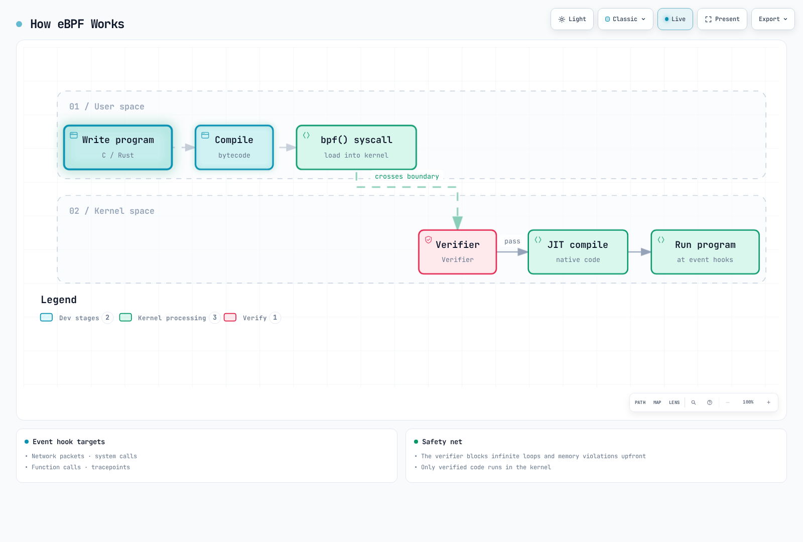
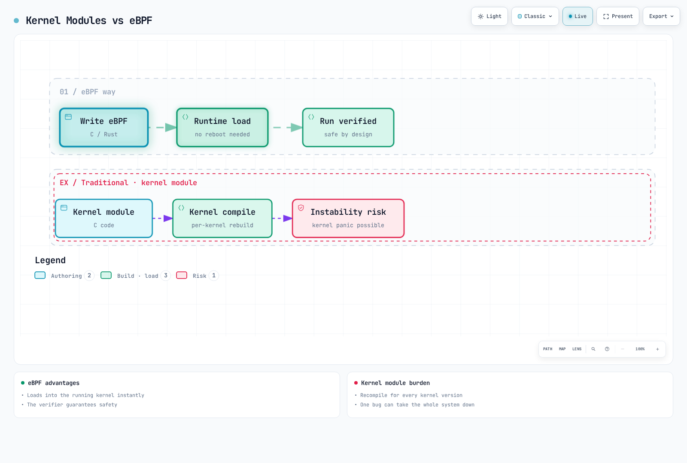
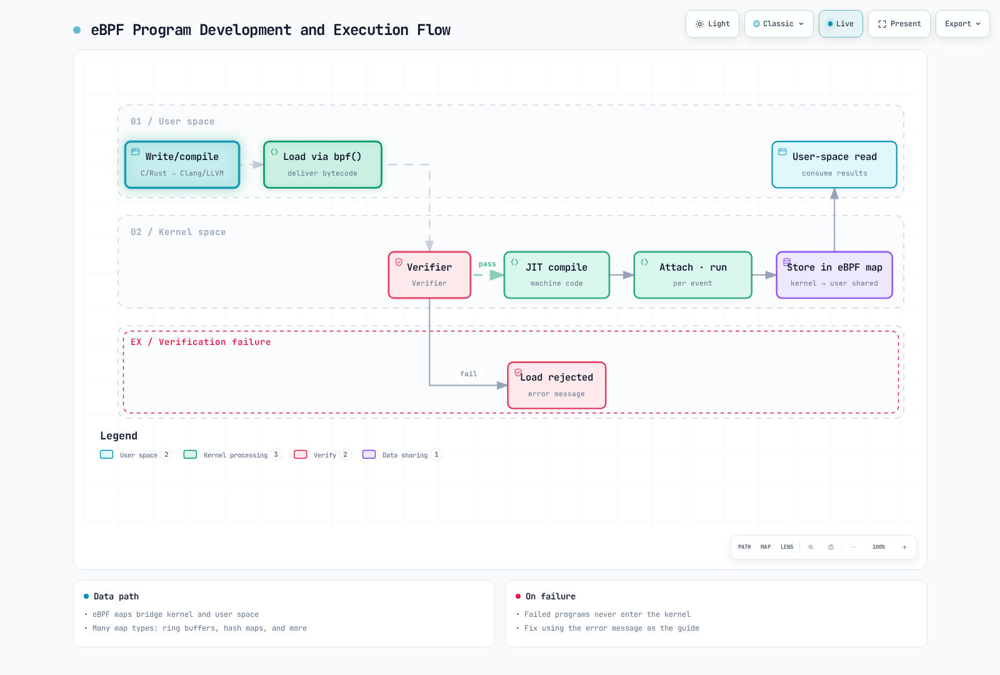
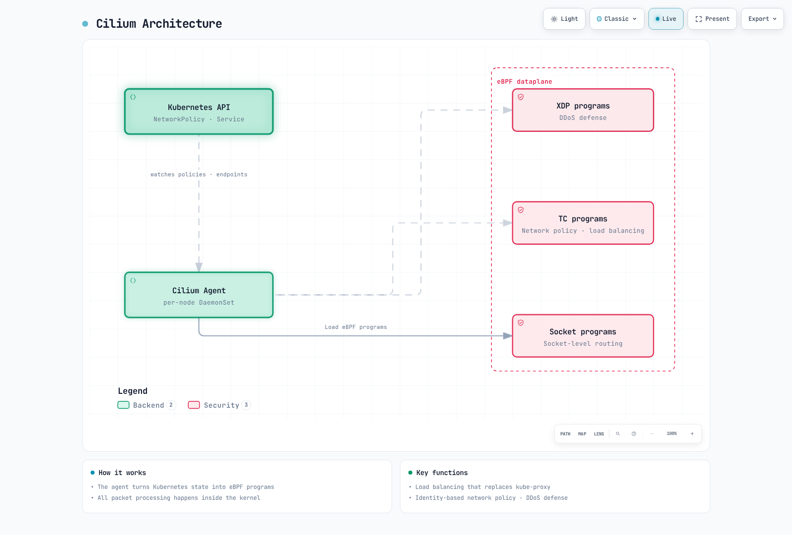

# eBPFの基礎とKubernetesでの活用

> **対応バージョン**: 機能ごとに必要なカーネル、BTF、ヘルパーを確認し、各ツールおよびKubernetesの互換性マトリクスと照合してください。
> **最終更新日**: 2026年10月16日

eBPFは、サンドボックス化されたプログラムをLinuxカーネル内で実行できる技術です。このドキュメントでは、eBPFの基本概念からKubernetes環境での実用例までを説明します。

## 目次

* [1. eBPFの概要](#1-introduction-to-ebpf)
* [2. eBPFのアーキテクチャ](#2-ebpf-architecture)
* [3. eBPFプログラムの種類](#3-ebpf-program-types)
* [4. eBPF開発ツール](#4-ebpf-development-tools)
* [5. eBPFとKubernetesネットワーキング](#5-ebpf-and-kubernetes-networking)
* [6. eBPFによるオブザーバビリティ](#6-ebpf-based-observability)
* [7. eBPFによるセキュリティ](#7-ebpf-based-security)
* [8. eBPFの実践例](#8-practical-ebpf-examples)
* [9. eBPFの制約と考慮事項](#9-ebpf-limitations-and-considerations)
* [10. 次のステップ](#10-next-steps)

## ラボ環境のセットアップ

このドキュメントの例を試すには、次の環境が必要です。

### 前提条件
- 各例で必要となるBTF、ヘルパー、アタッチ種別を備えた、保守対象のディストリビューションカーネル
- bpftool、bcc-tools
- Kubernetesクラスター（任意）

bpftraceの例は公式0.27の言語構文（args.field）に照らして確認しています。ディストリビューションのパッケージは古い場合があるため、そのバージョンに対応した構文と機能を使用してください。トレースポイントのフィールドはbpftrace -lvまたはtracefsのformatファイルで確認します。関数プローブの利用可否はカーネル、ライブラリのバージョン、アーキテクチャによって異なります。このレビューではトレースやアタッチを実行していません。

### 環境のセットアップ

```bash
# Install required packages on Ubuntu/Debian
sudo apt-get update
sudo apt-get install -y bpfcc-tools python3-bpfcc bpftrace
# Install bpftool for this distribution/kernel separately:
# Debian provides the bpftool package; Ubuntu uses matching linux-tools packages.

# Check kernel version
uname -r

# Verify eBPF feature support
sudo bpftool feature probe kernel
```

---

<span id="1-introduction-to-ebpf"></span>

## 1. eBPFの概要

### 1.1 eBPFとは

**eBPF（extended Berkeley Packet Filter）** は、ユーザー定義プログラムをLinuxカーネル内で安全に実行するための技術です。もともとBPFとしてネットワークパケットのフィルタリング用に設計されましたが、その後拡張され、ネットワーキング、セキュリティ、トレーシング、パフォーマンス分析などに使われています。

> **重要な概念**: eBPFを使うと、カーネルのソースコードを変更したりカーネルモジュールをロードしたりせずに、カーネルの動作を拡張・観察できます。



[🔍 インタラクティブな図を見る](https://www.atomai.click/kubernetes-docs/archmaps/en-basics-05-ebpf-fundamentals-0.html)

### 1.2 従来のBPFからeBPFへの進化

**従来のBPF（1992年）**:
- カリフォルニア大学バークレー校で開発
- ネットワークパケットのキャプチャとフィルタリングに特化
- 32ビットレジスタを2個使用
- Linuxのclassic BPFでは、プログラムの命令数を4096に制限するのが一般的です。これはBPFの歴史全体に共通する仕様ではありません。

**eBPF（2014年以降）**:
- 64ビットアーキテクチャに対応
- レジスタを11個使用
- Mapによる状態保存
- さまざまなフックポイントに対応
- JITコンパイルによるネイティブコード実行

| 項目 | 従来のBPF | eBPF |
|---------|-----------------|------|
| レジスタ | 2個（32ビット） | 11個（64ビット） |
| 命令数の制限 | Linuxで一般的な上限は4096 | カーネルと権限によって異なる。プログラムサイズと検証器が処理する複雑さは別の指標 |
| Mapのサポート | なし | さまざまなMap型 |
| 用途 | パケットフィルタリング | 汎用的なカーネルプログラミング |
| 呼び出し機能 | なし | ヘルパー関数、BPF-to-BPF呼び出し |
| 永続状態 | 永続Mapはない（1回の実行中に使う一時領域はある） | Mapを通じて保存可能 |

### 1.3 eBPFが革新的とされる理由

eBPFには次の特長があります。

1. **カーネルを変更せず機能を拡張**: カーネルのソースコードを変更せずに機能を追加できます。
2. **安全な実行**: 検証器が、定められたメモリと制御フローの安全性を確認します。
3. **高いパフォーマンス**: JITコンパイルによってネイティブコードとして実行できます。
4. **動的なロード**: 再起動せずにプログラムをロード・アンロードできます。
5. **本番環境での安定性**: 実行量の上限確認でリスクを抑えられますが、プログラムの正しさ、カーネルやJITの不具合、運用への影響は別途検証が必要です。



[🔍 インタラクティブな図を見る](https://www.atomai.click/kubernetes-docs/archmaps/en-basics-05-ebpf-fundamentals-1.html)

### 1.4 eBPFとカーネルモジュールの比較

| 項目 | eBPF | カーネルモジュール |
|--------|------|---------------|
| **安全性** | 検証器のモデル内で安全性を確認 | カーネルをクラッシュさせる可能性がある |
| **移植性** | CO-REは互換性のあるカーネル型を再配置しますが、ヘルパー、フック、意味論、BTFによる制約は残ります | カーネルのバージョンごとに再コンパイルが必要 |
| **ロード** | 動的にロード・アンロード可能 | insmod/rmmodが必要 |
| **権限** | CAP_BPF/CAP_SYS_ADMINに加え、フック固有の権限が必要 | root権限が必要 |
| **デバッグ** | 制約がある | カーネル全体のデバッグが可能 |
| **パフォーマンス** | JITコンパイルで最適化 | ネイティブ実行 |
| **機能範囲** | 指定されたフックポイントのみ | 制限なし |
| **開発の難易度** | 比較的容易 | 高度な専門知識が必要 |

---

<span id="2-ebpf-architecture"></span>

## 2. eBPFのアーキテクチャ

### 2.1 eBPFの実行フロー



[🔍 インタラクティブな図を見る](https://www.atomai.click/kubernetes-docs/archmaps/en-basics-05-ebpf-fundamentals-2.html)

### 2.2 検証器

検証器はeBPFの中核となるセキュリティ機構です。プログラムをカーネル内で実行する前に、次の点を確認します。

**検証項目**:
- 終了性と制御フローの上限。対応するカーネルでは上限付きループを利用できます。
- 範囲外のメモリアクセスがないこと
- 初期化されていない変数を使用していないこと
- ヘルパー関数を適切に呼び出していること
- プログラムが終了することを保証できること

```c
// XDP fragments; compile as separate programs with linux/bpf.h and bpf_helpers.h.
SEC("xdp")
int bad_example(struct xdp_md *ctx) {
    unsigned char *data = (void *)(long)ctx->data;
    // No data_end check: the verifier cannot prove this packet byte exists.
    return data[0] == 0 ? XDP_DROP : XDP_PASS;
}

SEC("xdp")
int good_example(struct xdp_md *ctx) {
    unsigned char *data = (void *)(long)ctx->data;
    void *data_end = (void *)(long)ctx->data_end;
    if ((void *)(data + 1) > data_end)
        return XDP_PASS;
    return data[0] == 0 ? XDP_DROP : XDP_PASS;
}
```

### 2.3 JITコンパイラ

JIT（Just-In-Time）コンパイラは、eBPFバイトコードをネイティブのマシンコードに変換します。

```bash
# Check JIT compiler status
cat /proc/sys/net/core/bpf_jit_enable

# Enable JIT compiler (0: disabled, 1: enabled, 2: debug mode)
echo 1 | sudo tee /proc/sys/net/core/bpf_jit_enable
```

カーネルによってはCONFIG_BPF_JIT_ALWAYS_ONが有効です。このsysctlが存在するか、書き込み可能かはカーネルの設定によって異なります。debug mode 2はカーネルログにトレース情報を書き込むため、本番環境での既定値として使用しないでください。

**JITコンパイルの利点**:
- 元の「4～5倍高速化」という主張には、この文書内に出典がありません。実際の高速化の度合いはプログラム、アーキテクチャ、カーネルによって異なります。
- CPUのネイティブ命令として直接実行
- アーキテクチャ固有の最適化を適用

### 2.4 eBPF Map

eBPF Mapは、カーネルとユーザー空間の間でデータを共有し、状態を保存するためのデータ構造です。

**主なMap型**:

| Map型 | 説明 | 用途 |
|----------|-------------|----------|
| `BPF_MAP_TYPE_HASH` | ハッシュテーブル | キーと値の保存、コネクショントラッキング |
| `BPF_MAP_TYPE_ARRAY` | 固定サイズの配列 | インデックスによるアクセス、設定値 |
| `BPF_MAP_TYPE_PERF_EVENT_ARRAY` | イベント配列 | ユーザー空間へのイベント送信 |
| `BPF_MAP_TYPE_RINGBUF` | リングバッファ | 高スループットのイベントストリーミング |
| `BPF_MAP_TYPE_LRU_HASH` | LRUハッシュ | キャッシュ、自動的なエントリ削除 |
| `BPF_MAP_TYPE_PERCPU_ARRAY` | CPUごとの配列 | 統計情報でCPU間の競合を軽減 |
| `BPF_MAP_TYPE_LPM_TRIE` | LPMトライ | IPアドレスの照合、ルーティング |

```c
// Hash map definition example
struct {
    __uint(type, BPF_MAP_TYPE_HASH);
    __uint(max_entries, 1024);
    __type(key, __u32);      // Key: Process ID
    __type(value, __u64);    // Value: Counter
} packet_count SEC(".maps");
```

### 2.5 ヘルパー関数

eBPFプログラムは、カーネルが提供するヘルパー関数を通じてカーネル機能を利用します。

**主なヘルパー関数**:

以下はAPI参照用に簡略化したシグネチャです。実際のプログラムでは再宣言せず、libbpfのbpf_helpers.hをインクルードしてください。使用できるヘルパーはプログラム型とカーネルによって異なります。

```text
// Map manipulation
void *bpf_map_lookup_elem(void *map, const void *key);
long bpf_map_update_elem(void *map, const void *key, const void *value, u64 flags);
long bpf_map_delete_elem(void *map, const void *key);

// Time-related
u64 bpf_ktime_get_ns(void);  // Monotonic nanoseconds since boot, excluding suspend; not wall-clock time

// Packet manipulation
long bpf_skb_load_bytes(const void *skb, u32 offset, void *to, u32 len);
long bpf_xdp_adjust_head(struct xdp_md *xdp_md, int delta);

// Tracing
long bpf_probe_read_kernel(void *dst, u32 size, const void *src);
long bpf_probe_read_user(void *dst, u32 size, const void *src);
long bpf_trace_printk(const char *fmt, u32 fmt_size, ...);

// Process information
u64 bpf_get_current_pid_tgid(void);    // Get PID/TGID
u64 bpf_get_current_uid_gid(void);     // Get UID/GID
long bpf_get_current_comm(void *buf, u32 size);  // Process name
```

### 2.6 プログラムのライフサイクル


[🔍 インタラクティブな図を見る](https://www.atomai.click/kubernetes-docs/archmaps/en-basics-05-ebpf-fundamentals-3.html)

---

Cの例は独立したプログラムまたは断片です。必要に応じてvmlinux.hまたは該当するUAPI型と、libbpfのbpf_helpers.h、bpf_endian.h、bpf_tracing.h、bpf_core_read.hを用意してください。BPF_KPROBEとBPF_UPROBEには、対象アーキテクチャと実際のアタッチABIに合った定義が必要です。ロードとアタッチは隔離環境で検証してください。このレビューではどちらも実行していません。パスベースのLSM例は読み取りエラー時に許可側へ倒れ、別名、ハードリンク、その他のプロトコルを網羅しません。学習用の例であり、完全なアクセス制御ではありません。

<span id="3-ebpf-program-types"></span>

## 3. eBPFプログラムの種類

### 3.1 XDP（eXpress Data Path）

XDPはネットワークドライバーレベルでパケットを最速で処理する手段です。実際の性能は実装モード、ドライバー、ハードウェア、ワークロードによって異なります。


[🔍 インタラクティブな図を見る](https://www.atomai.click/kubernetes-docs/archmaps/en-basics-05-ebpf-fundamentals-4.html)

**XDPの動作モード**:
| モード | 説明 | パフォーマンス |
|------|-------------|-------------|
| Native XDP | 対応ドライバーの受信パスで実行 | オーバーヘッドは小さいものの、ドライバーとワークロードに依存 |
| Offloaded XDP | 対応するNICハードウェア上で実行 | ハードウェアと命令の制約があるため、対象ワークロードで測定が必要 |
| Generic XDP | ネットワークスタック内でskbを使うフォールバック | 一般にNative XDPよりオーバーヘッドが大きい |

```c
#include <linux/bpf.h>
#include <linux/if_ether.h>
#include <linux/ip.h>
#include <linux/tcp.h>
#include <linux/in.h>
#include <bpf/bpf_helpers.h>
#include <bpf/bpf_endian.h>

// Demonstration only: untagged, non-fragmented IPv4 TCP.
// VLAN, IPv6 and fragments pass through; this is not a complete firewall.
static __always_inline int packet_action(void *data, void *data_end) {
    struct ethhdr *eth = data;
    if ((void *)(eth + 1) > data_end || eth->h_proto != bpf_htons(ETH_P_IP))
        return XDP_PASS;
    struct iphdr *ip = (void *)(eth + 1);
    if ((void *)(ip + 1) > data_end || ip->version != 4 || ip->ihl < 5)
        return XDP_PASS;
    __u32 ihl = (__u32)ip->ihl * 4;
    __u32 ip_len = bpf_ntohs(ip->tot_len);
    if ((void *)ip + ihl > data_end || ip_len < ihl || (void *)ip + ip_len > data_end)
        return XDP_PASS;
    if (ip->protocol != IPPROTO_TCP || (bpf_ntohs(ip->frag_off) & 0x3fffU))
        return XDP_PASS;
    if (ip_len < ihl + sizeof(struct tcphdr))
        return XDP_PASS;
    struct tcphdr *tcp = (void *)ip + ihl;
    if ((void *)(tcp + 1) > data_end || tcp->doff < 5)
        return XDP_PASS;
    __u32 tcp_len = (__u32)tcp->doff * 4;
    if (ihl + tcp_len > ip_len || (void *)tcp + tcp_len > data_end)
        return XDP_PASS;
    return tcp->dest == bpf_htons(8080) ? XDP_DROP : XDP_PASS;
}

SEC("xdp")
int xdp_drop_port(struct xdp_md *ctx) {
    return packet_action((void *)(long)ctx->data, (void *)(long)ctx->data_end);
}
char LICENSE[] SEC("license") = "GPL";
```

### 3.2 TC（Traffic Control）

TCプログラムはネットワークスタックのトラフィック制御層で実行されます。

```bash
# TC program attachment example
set -e
: "${LAB_IFACE:?Select an isolated test veth interface, never a production interface}"
tc qdisc show dev "$LAB_IFACE"
# This assumes a fresh lab interface with no clsact qdisc.
sudo tc qdisc add dev "$LAB_IFACE" clsact
sudo tc filter add dev "$LAB_IFACE" ingress pref 49152 bpf da obj tc_prog.o sec classifier
sudo tc filter add dev "$LAB_IFACE" egress pref 49152 bpf da obj tc_prog.o sec classifier
# Cleanup only the filters created by this example, after the exercise:
# sudo tc filter del dev "$LAB_IFACE" ingress pref 49152
# sudo tc filter del dev "$LAB_IFACE" egress pref 49152
```

**TCとXDPの比較**:
| 項目 | XDP | TC |
|---------|-----|-----|
| 実行場所 | ドライバーレベル | ネットワークスタック |
| パフォーマンス | 最も高い | 高い |
| SKBへのアクセス | 不可 | 可能 |
| 方向 | ingressのみ | ingressとegressの両方 |
| パケットの変更 | 限定的 | 柔軟 |

### 3.3 Kprobes/Uprobes

KprobesとUprobesは、関数呼び出しを動的にトレースします。

```c
// Kprobe example: Trace tcp_connect function
SEC("kprobe/tcp_connect")
int BPF_KPROBE(trace_tcp_connect, struct sock *sk) {
    u32 pid = bpf_get_current_pid_tgid() >> 32;

    // Get destination IP address
    u32 daddr = BPF_CORE_READ(sk, __sk_common.skc_daddr);
    u16 dport = BPF_CORE_READ(sk, __sk_common.skc_dport);

    bpf_printk("PID %d connecting to %pI4:%d\n", pid, &daddr, bpf_ntohs(dport));
    return 0;
}

// Uprobe example: Trace malloc function
// The userspace loader must select the real libc path, PID and malloc symbol.
SEC("uprobe")
int BPF_UPROBE(trace_malloc, size_t size) {
    u32 pid = bpf_get_current_pid_tgid() >> 32;
    bpf_printk("PID %d malloc(%zu)\n", pid, size);
    return 0;
}
```

### 3.4 Tracepoint

Tracepointはカーネル内にあらかじめ定義された静的なトレースポイントです。

```bash
# Check available tracepoints
sudo ls /sys/kernel/tracing/events/

# Tracepoints in specific categories
sudo ls /sys/kernel/tracing/events/sched/
sudo ls /sys/kernel/tracing/events/syscalls/
```

```c
// Tracepoint example: Trace process execution
SEC("tracepoint/sched/sched_process_exec")
int handle_exec(struct trace_event_raw_sched_process_exec *ctx) {
    char comm[16];
    bpf_get_current_comm(&comm, sizeof(comm));

    u32 pid = bpf_get_current_pid_tgid() >> 32;
    bpf_printk("Process started: %s (PID: %d)\n", comm, pid);

    return 0;
}
```

### 3.5 LSM（Linux Security Module）BPF

LSM BPFはセキュリティポリシーを動的に適用します。

```c
// LSM BPF example: Restrict file opening
SEC("lsm/file_open")
int BPF_PROG(restrict_file_open, struct file *file, int ret) {
    if (ret != 0)
        return ret;

    char path[256];
    if (bpf_d_path(&file->f_path, path, sizeof(path)) < 0)
        return 0;  // Demo fails open on unresolved paths; not a complete access policy.

    // Block access to /etc/shadow
    if (bpf_strncmp(path, 11, "/etc/shadow") == 0)
        return -EACCES;

    return 0;
}
```

### 3.6 Socket Filter

ソケットレベルでパケットをフィルタリングします。

```c
// Socket Filter example
SEC("socket")
int socket_filter(struct __sk_buff *skb) {
    // Allow only IPv4 packets
    if (skb->protocol != bpf_htons(ETH_P_IP))
        return 0;  // Drop

    return skb->len;  // Return packet length (allow)
}
```

### 3.7 Cgroupプログラム

コンテナのリソースとネットワーキングを制御します。

```c
// Cgroup socket program example: Block external connections
SEC("cgroup/connect4")
int restrict_connect(struct bpf_sock_addr *ctx) {
    // Block connections that are not to local network
    __u32 dst = bpf_ntohl(ctx->user_ip4);

    // Allow only 10.0.0.0/8 range
    if ((dst & 0xff000000U) != 0x0a000000U)
        return 0;  // Deny connection

    return 1;  // Allow connection
}
```

---

<span id="4-ebpf-development-tools"></span>

## 4. eBPF開発ツール

### 4.1 bpftool

bpftoolはBPFプログラムとMapを管理します。このラボ用に作成したMapだけを更新してください。稼働中のCNIやセキュリティ機能が使うMapを変更すると、ワークロードに影響します。以下の16進数による更新例は、前述のMap例と同じ、リトルエンディアンのu32キーとu64値を前提としています。

```bash
# List loaded eBPF programs
sudo bpftool prog list

# Program details
sudo bpftool prog show id <ID>

# Program dump (bytecode)
sudo bpftool prog dump xlated id <ID>

# JIT compiled code dump
sudo bpftool prog dump jited id <ID>

# Map list
sudo bpftool map list

# Query map contents
sudo bpftool map dump id <MAP_ID>

# Add value to map
sudo bpftool map update id <MAP_ID> key hex 01 00 00 00 value hex ff 00 00 00 00 00 00 00

# Check kernel eBPF features
sudo bpftool feature probe kernel

# BTF (BPF Type Format) information
sudo bpftool btf list
```

### 4.2 bpftrace

bpftraceはDTraceスタイルの高水準トレーシング言語です。

```bash
# Installation
sudo apt-get install -y bpftrace

# System call count
sudo bpftrace -e 'tracepoint:raw_syscalls:sys_enter { @[comm] = count(); }'

# Read bytes per process
sudo bpftrace -e 'tracepoint:syscalls:sys_exit_read /args.ret > 0/ { @bytes[comm] = sum(args.ret); }'

# File open tracing
sudo bpftrace -e 'tracepoint:syscalls:sys_enter_openat { printf("%s opened %s\n", comm, str(args.filename)); }'

# TCP connection tracing
sudo bpftrace -e 'kprobe:tcp_connect { printf("%s -> %s\n", ntop(((struct sock *)arg0)->__sk_common.skc_rcv_saddr), ntop(((struct sock *)arg0)->__sk_common.skc_daddr)); }'

# Latency histogram
sudo bpftrace -e 'kprobe:vfs_read { @start[tid] = nsecs; } kretprobe:vfs_read /@start[tid]/ { @ns = hist(nsecs - @start[tid]); delete(@start[tid]); }'
```

**便利なbpftraceワンライナー**:

```bash
# Top CPU-consuming processes
sudo bpftrace -e 'profile:hz:99 { @[comm] = count(); }'

# Block I/O latency
sudo biolatency-bpfcc 1 10  # Maintained request correlation; avoids dev/sector collisions

# New process tracing
sudo bpftrace -e 'tracepoint:sched:sched_process_exec { printf("%-10d %-16s\n", pid, comm); }'

# Memory allocation tracing
sudo bpftrace -e 'tracepoint:kmem:kmalloc { @bytes = hist(args.bytes_alloc); }'
```

### 4.3 BCC（BPF Compiler Collection）

BCCはBPF Cのコンパイルとロードを行います。一般に、Python製のトレーシングツールにBPF Cコードを組み込んで使用します。

```bash
# Installation
sudo apt-get install -y bpfcc-tools python3-bpfcc

# Included tools
dpkg -L bpfcc-tools | head -40
```

**主なBCCツール**:

| ツール | 説明 |
|------|-------------|
| `execsnoop` | 新しいプロセスの実行をトレース |
| `opensnoop` | ファイルのオープンをトレース |
| `biolatency` | ブロックI/Oのレイテンシー |
| `tcpconnect` | TCP接続をトレース |
| `tcpaccept` | TCPの着信接続をトレース |
| `tcpretrans` | TCPの再送をトレース |
| `runqlat` | CPU実行キューのレイテンシー |
| `profile` | CPUプロファイリング |
| `funccount` | 関数呼び出し回数 |
| `trace` | 汎用的な関数トレーシング |

```bash
# Usage examples
sudo execsnoop-bpfcc    # Trace process execution
sudo tcpconnect-bpfcc   # Trace TCP connections
sudo biolatency-bpfcc   # Disk I/O latency
sudo profile-bpfcc -F 99 10  # CPU profiling for 10 seconds
```

### 4.4 libbpfとCO-RE

libbpfはeBPFプログラムをロードするためのCライブラリで、CO-RE（Compile Once, Run Everywhere）をサポートします。

**CO-REの利点**:
- コンパイル済みのeBPFプログラムをさまざまなカーネルバージョンで実行
- BTF（BPF Type Format）を使った構造体の再配置
- カーネルヘッダーへの依存を軽減

```c
// Independent tracing program. Generate vmlinux.h from the target kernel's BTF.
#include "vmlinux.h"
#include <bpf/bpf_helpers.h>
#include <bpf/bpf_core_read.h>

SEC("tracepoint/syscalls/sys_enter_openat")
int trace_openat(struct trace_event_raw_sys_enter *ctx) {
    const char *filename = (const char *)BPF_CORE_READ(ctx, args[1]);
    char fname[256];
    if (bpf_probe_read_user_str(fname, sizeof(fname), filename) < 0)
        return 0;
    __u32 tgid = bpf_get_current_pid_tgid() >> 32;
    bpf_printk("TGID %u opened: %s", tgid, fname);
    return 0;
}
char LICENSE[] SEC("license") = "GPL";
```

**BTFの生成と確認**:

```bash
# Check BTF support
ls /sys/kernel/btf/vmlinux

# Generate vmlinux.h (for CO-RE development)
bpftool btf dump file /sys/kernel/btf/vmlinux format c > vmlinux.h

# Check program BTF information
bpftool prog show id <ID> --pretty
```

---

<span id="5-ebpf-and-kubernetes-networking"></span>

## 5. eBPFとKubernetesネットワーキング

### 5.1 Cilium：eBPFベースのCNI

CiliumはeBPFを活用する代表的なKubernetes CNI（Container Network Interface）です。



[🔍 インタラクティブな図を見る](https://www.atomai.click/kubernetes-docs/archmaps/en-basics-05-ebpf-fundamentals-5.html)

#### kube-proxyの置き換え

Ciliumは、サポートされる構成でkube-proxyを置き換えられます。以下の図は新規フローのバックエンド選択を示しています。確立済みのフローではコネクショントラッキングが使われることがあります。ルーティング、トンネリング、NATの動作は、選択したデータパスにも依存します。

**従来のkube-proxy（iptablesモード）**:
```
Packet → Netfilter → iptables rule evaluation → DNAT → Routing
```

**Cilium eBPFモード**:
```
New flow → eBPF backend lookup → Configured routing/tunneling/NAT
```

```bash
# New, isolated self-managed lab only: configure the cluster for the selected
# CNI/proxy mode before bootstrap. Do not delete kube-proxy on a live cluster.
helm repo add cilium https://helm.cilium.io
helm repo update cilium
: "${CILIUM_CHART_VERSION:?Select a chart compatible with this Kubernetes/kernel}"
: "${CILIUM_VALUES_FILE:?Provide reviewed IPAM/routing/platform values}"
: "${API_SERVER_IP:?Set a directly reachable API endpoint, not the Service IP}"
: "${API_SERVER_PORT:?Set the API endpoint port}"
helm install cilium cilium/cilium --version "$CILIUM_CHART_VERSION" \
  --namespace kube-system -f "$CILIUM_VALUES_FILE" \
  --set kubeProxyReplacement=true \
  --set k8sServiceHost="$API_SERVER_IP" --set k8sServicePort="$API_SERVER_PORT"
cilium status --wait
# Existing clusters require the Cilium migration procedure and a tested rollback plan.

```

#### ネットワークポリシー

CiliumはL3/L4の適用にeBPFを使用します。HTTP/L7ポリシーには、Envoyなど、サポート対象のプロキシ処理が必要です。DNSの可視化にはDNSプロキシを使用します。HubbleでHTTP/DNSの記録を取得するには、それぞれに対応した可視化設定が必要です。

```yaml
# Cilium network policy example
apiVersion: cilium.io/v2
kind: CiliumNetworkPolicy
metadata:
  name: allow-http-only
spec:
  endpointSelector:
    matchLabels:
      app: web
  ingress:
    - fromEndpoints:
        - matchLabels:
            app: frontend
      toPorts:
        - ports:
            - port: "80"
              protocol: TCP
          rules:
            http:
              - method: GET
                path: "/api/.*"
```

#### ロードバランシング

```yaml
# Cilium LoadBalancer service example
apiVersion: v1
kind: Service
metadata:
  name: my-service
  annotations:
    lbipam.cilium.io/ips: "192.168.1.100"
spec:
  type: LoadBalancer
  selector:
    app: my-app
  ports:
    - port: 80
      targetPort: 8080
```

要求するIPアドレスは、管理者が所有するCiliumLoadBalancerIPPoolに属している必要があります。LB IPAMが行うのはアドレスの割り当てだけです。外部から到達可能にするには、BGP/L2広告または別のロードバランサー構成が必要です。

### 5.2 Calico eBPFモード

CalicoはeBPFデータプレーンをサポートします。以下のパッチは、互換性のあるCalico Operatorがすでにインストールされていることを前提としており、移行手順の一部にすぎません。Serviceプロキシを変更する前に、APIへの直接アクセスを設定し、ルーティングとロールバックを検証してください。

```bash
# Enable Calico eBPF mode
kubectl patch installation.operator.tigera.io default --type merge -p '{"spec":{"calicoNetwork":{"linuxDataplane":"BPF"}}}'
```

**Calico eBPFモードの機能**:
- 送信元IPアドレスの維持
- Direct Server Return（DSR）のサポート
- ホストエンドポイントポリシー
- 別途設定され、環境がサポートする場合のWireGuard暗号化。eBPFを選択しただけでは有効になりません。

### 5.3 iptablesとeBPFのパフォーマンス比較

| 項目 | iptables | eBPF |
|--------|----------|------|
| **スケーラビリティ** | O(n)：Service数に比例 | ハッシュ検索では平均O(1)。Map型によって異なる |
| **レイテンシー** | ルール構成とワークロードに依存 | Map型、ワークロード、データパスに依存 |
| **CPU使用率** | ワークロードと構成に依存 | ワークロードと構成に依存 |
| **更新** | 現行のkube-proxyは変更されたService/エンドポイントのルールを更新可能 | Mapを更新。コストは実装に依存 |
| **可観測性** | 限定的 | Hubbleと連携 |
| **メモリ** | ルール、エンドポイント、conntrack状態 | Map、エンドポイント、conntrack状態 |

**ベンチマーク結果**（Service 1,000個の場合）:

以下の元の数値には、出典、ハードウェア、カーネル/CNIのバージョン、測定方法が記載されていません。再測定もしていないため、現在の性能や一般的な高速化を示す根拠にはなりません。再現するには、元の測定方法と環境が必要です。

```
| Metric                  | iptables    | eBPF      | Improvement |
|------------------------|-------------|-----------|-------------|
| Connection setup time  | 2.5ms       | 0.3ms     | 8.3x        |
| CPU usage              | 15%         | 3%        | 5x          |
| Memory usage           | 256MB       | 32MB      | 8x          |
| Connections per second | 50,000      | 250,000   | 5x          |
```

```bash
# Check Cilium status
cilium status

# Check eBPF maps
kubectl -n kube-system exec ds/cilium -c cilium-agent -- cilium-dbg bpf lb list
kubectl -n kube-system exec ds/cilium -c cilium-agent -- cilium-dbg bpf ct list global

# Network policy status
kubectl get ciliumnetworkpolicies,ciliumclusterwidenetworkpolicies -A
```

---

<span id="6-ebpf-based-observability"></span>

## 6. eBPFによるオブザーバビリティ

eBPFを使うと、システムやアプリケーションの動作を詳細に観察できます。従来のエージェント型監視とは異なり、カーネルレベルでデータを収集するため、より豊富な情報を少ないオーバーヘッドで得られる場合があります。

### 6.1 Hubble：Ciliumのネットワーク可観測性

HubbleはCiliumのネットワーク可観測性を提供します。CLIの例を実行する前に、互換性のあるHubble CLIをインストールし、Relayを有効にしてポートフォワードを確立してください。L7を可視化するには、該当するプロキシ設定が必要です。


[🔍 インタラクティブな図を見る](https://www.atomai.click/kubernetes-docs/archmaps/en-basics-05-ebpf-fundamentals-6.html)

```bash
# Use the installed, reviewed chart version; this is not a chart-version upgrade.
: "${CILIUM_CHART_VERSION:?Set the installed compatible chart version}"
# Install Hubble
helm upgrade cilium cilium/cilium --version "$CILIUM_CHART_VERSION" \
  --namespace kube-system \
  --reuse-values \
  --set hubble.enabled=true \
  --set hubble.relay.enabled=true \
  --set hubble.ui.enabled=true

# First run cilium hubble port-forward in a separate terminal.
# Use Hubble CLI
hubble observe --pod my-pod
hubble observe --namespace default
hubble observe --protocol http
hubble observe --verdict DROPPED

# Observe traffic between specific services
hubble observe --from-pod default/frontend --to-pod default/backend

# Real-time network flow monitoring
hubble observe -f --type trace

# Generate service map
# Service maps are provided by Hubble UI; use the UI port-forward below.
```

**Hubble UIへのアクセス**:

```bash
# Port forwarding
kubectl port-forward -n kube-system svc/hubble-ui 12000:80

# Access http://localhost:12000 in browser
```

### 6.2 Pixie：自動計装によるオブザーバビリティ

PixieはeBPFを使い、アプリケーションコードを変更せずにテレメトリを自動収集します。

**Pixieの機能**:
- プロトコルの自動解析（HTTP、gRPC、MySQL、PostgreSQL、Kafkaなど）
- サービスマップの自動生成
- 分散トレーシング
- CPUプロファイリング
- 動的ロギング

```bash
# Install Pixie
px deploy

# Pixie CLI query examples
# HTTP request latency
px run px/http_data

# Traffic between services
px run px/service_stats

# Slow request analysis
px run px/slow_http_requests --help
# Use the parameters advertised by the installed script bundle.

# Pod resource usage
px run px/pods
```

**PxL（Pixie Query Language）の例**:

```python
# Find slow HTTP requests
import px

df = px.DataFrame(table='http_events', start_time='-5m')
df.namespace = df.ctx['namespace']
df.pod = df.ctx['pod']
df = df[df.latency > 100000000]  # Over 100ms
df = df.groupby(['namespace', 'pod', 'req_path']).agg(
    count=('latency', px.count),
    avg_latency=('latency', px.mean),
    latency_quantiles=('latency', px.quantiles)
)
df.p99_latency_ns = px.pluck_float64(df.latency_quantiles, 'p99')
px.display(df)
```

### 6.3 Coroot：「ノーコード」監視

Corootは、エージェント、ストレージ、権限、データソースを設定した後、サポート対象アプリケーションのシステムをeBPFで自動監視します。

```bash
# Install Coroot with Helm
helm repo add coroot https://coroot.github.io/helm-charts
# The old coroot/coroot chart is deprecated; use the operator and CE resource chart.
: "${COROOT_OPERATOR_VERSION:?Select a reviewed operator chart version}"
: "${COROOT_CE_VERSION:?Select a compatible CE chart version}"
helm install coroot-operator coroot/coroot-operator -n coroot --create-namespace \
  --version "$COROOT_OPERATOR_VERSION"
helm install coroot coroot/coroot-ce -n coroot --version "$COROOT_CE_VERSION"
```

**Corootの機能**:
- サービスの自動検出
- 依存関係マップの自動生成
- SLO監視
- 異常検知
- 根本原因分析

### 6.4 Kepler：エネルギー消費の監視

初期のKeplerはeBPFを使用していましたが、**0.10.0から再設計**され、読み取り専用のホスト/proc・/sysアクセス、RAPL/powercap、CPU使用率に基づく電力配分を中心とする構成になりました。CAP_BPFは不要となっており、現在のKeplerはeBPF計装に依存する例ではありません。0.9以前は、メトリクスやデプロイ方法の異なる旧コードとして凍結されています。

ハードウェアまたはVMから電力センサーを参照できることを確認してください。コンテナ/Podの値は、電力計で各コンテナを直接測定したものではなく、ノードで測定したエネルギーを配分したものです。ネストしたRAPLゾーンの値を合算すると二重計上になります。GPU、HWMon、プラットフォームに関する実験的なサポートは、バージョンごとに確認してください。

```bash
: "${KEPLER_CHART_VERSION:?Select a reviewed current Kepler chart}"
helm install kepler oci://quay.io/sustainable_computing_io/charts/kepler \
  --version "$KEPLER_CHART_VERSION" --namespace kepler --create-namespace
kubectl get pods -n kepler
# Run port-forward in a separate terminal; then query metrics from this machine.
kubectl port-forward -n kepler service/kepler 28282:28282
# curl --fail http://localhost:28282/metrics | grep kepler_node_cpu_watts
```

現在のCPUメトリクスの例：`kepler_node_cpu_joules_total`、`kepler_container_cpu_joules_total`、`kepler_pod_cpu_watts`。実際に取得できるセンサーとゾーンのラベルを確認してください。

### 6.5 従来のエージェントとeBPF計装の比較

5～15%および1%未満という値は出典のない元の主張を残したもので、検証済みのオーバーヘッド範囲ではありません。eBPFでもユーザー空間エージェント、バッファー、プロトコルパーサーが必要です。従来型エージェントがすべてコード変更を必要とするわけではなく、eBPFツールがあらゆるアプリケーションやプロトコルを自動的に網羅するわけでもありません。

| 項目 | 従来のエージェント | eBPF計装 |
|--------|-------------------|---------------------|
| **オーバーヘッド** | 大（5～15%） | 小（1%未満） |
| **コード変更** | SDK/エージェントの方式による | 対応するデータソースでは不要なことが多い |
| **カバレッジ** | 計装方式とエージェントによる | 対応フック、プロトコル、可視化設定に依存し、自動的に完全網羅されるわけではない |
| **デプロイ** | アプリケーション、ノード、コレクターによる | 通常はノードエージェントを使用。アプリケーションとの互換性も必要 |
| **権限** | エージェントによる | プログラム/フックに応じたCapabilityとホストアクセス |
| **データの詳細度** | アプリケーション/ホストによる | カーネルとサポート対象のユーザー空間プローブ |
| **プロトコルのサポート** | ツールによる | サポートされるパーサー、ライブラリ、可視化設定の範囲でのみ自動化 |


[🔍 インタラクティブな図を見る](https://www.atomai.click/kubernetes-docs/archmaps/en-basics-05-ebpf-fundamentals-7.html)

---

<span id="7-ebpf-based-security"></span>

## 7. eBPFによるセキュリティ

### 7.1 Tetragon：ランタイムセキュリティ

TetragonはCiliumプロジェクトが提供する、eBPFベースのランタイムセキュリティソリューションです。


[🔍 インタラクティブな図を見る](https://www.atomai.click/kubernetes-docs/archmaps/en-basics-05-ebpf-fundamentals-8.html)

```bash
# Install Tetragon
helm repo add cilium https://helm.cilium.io
: "${TETRAGON_CHART_VERSION:?Select a compatible reviewed chart version}"
helm install tetragon cilium/tetragon -n kube-system --version "$TETRAGON_CHART_VERSION"

# Observe events
kubectl logs -n kube-system -l app.kubernetes.io/name=tetragon -c export-stdout -f | tetra getevents -o compact
```

テスト用Namespaceとしてebpf-labを作成し、app=ebpf-demoラベルを付けたテストPodを作成してください。ここでの例はPostアクションによる観測のみを使い、ホスト全体にSIGKILLを送信しません。予防的な拒否には、サポートされるLSM/Overrideの動作を別途テストする必要があります。

**TracingPolicyの例**:

```yaml
apiVersion: cilium.io/v1alpha1
kind: TracingPolicyNamespaced
metadata:
  name: sensitive-file-access
  namespace: ebpf-lab
spec:
  kprobes:
  - call: security_file_open
    syscall: false
    args:
    - index: 0
      type: file
    selectors:
    - matchArgs:
      - index: 0
        operator: Prefix
        values:
        - /etc/shadow
        - /etc/passwd
        - /etc/sudoers
      matchActions:
      - action: Post
  podSelector:
    matchLabels:
      app: ebpf-demo
```

```yaml
apiVersion: cilium.io/v1alpha1
kind: TracingPolicyNamespaced
metadata:
  name: observe-outbound
  namespace: ebpf-lab
spec:
  kprobes:
  - call: tcp_connect
    syscall: false
    args:
    - index: 0
      type: sock
    selectors:
    - matchArgs:
      - index: 0
        operator: NotDAddr
        values:
        - 10.0.0.0/8
      matchActions:
      - action: Post
  podSelector:
    matchLabels:
      app: ebpf-demo
```

### 7.2 Falco：eBPFベースの異常検知

FalcoはeBPFを使って実行時の異常な動作を検知するCNCFプロジェクトです。

```bash
# Install Falco (eBPF driver)
helm repo add falcosecurity https://falcosecurity.github.io/charts
# Save the following Falco rule examples as ./ebpf-lab-rules.yaml before installation.
: "${FALCO_CHART_VERSION:?Select a compatible reviewed chart version}"
helm install falco falcosecurity/falco --version "$FALCO_CHART_VERSION" \
  --namespace falco --create-namespace \
  --set driver.kind=modern_ebpf \
  --set-file 'customRules.ebpf-lab-rules\.yaml=./ebpf-lab-rules.yaml'
```

**Falcoルールの例**:

```yaml
# Detect reading of /etc/shadow
- rule: eBPF lab read sensitive file
  desc: Detect reading of sensitive files
  condition: >
    open_read and
    fd.name in (/etc/shadow, /etc/sudoers) and
    not proc.name in (systemd, sudo, login)
  output: >
    Sensitive file opened (file=%fd.name user=%user.name
    process=%proc.name container=%container.name)
  priority: WARNING

# Detect shell execution in container
- rule: eBPF lab shell in container
  desc: Detect shell execution in container
  condition: >
    spawned_process and
    container and
    proc.name in (bash, sh, zsh, dash) and
    proc.pname != containerd-shim
  output: >
    Shell spawned in container (container=%container.name
    shell=%proc.name parent=%proc.pname)
  priority: NOTICE

# Detect privilege escalation
- rule: eBPF lab privilege escalation
  desc: Detect privilege escalation attempts
  condition: >
    spawned_process and
    proc.name in (sudo, su, doas) and
    container
  output: >
    Privilege escalation attempt (user=%user.name
    command=%proc.cmdline container=%container.name)
  priority: WARNING
```

### 7.3 seccomp-bpf：システムコールのフィルタリング

seccompフィルターが使うのはclassic BPFのユーザー空間ABIであり、通常のeBPFプログラム用ヘルパーやMapではありません。OCI JSONプロファイルをコンテナランタイムが解釈し、システムコールフィルターを構築します。

```yaml
# Apply seccomp profile in Kubernetes Pod
apiVersion: v1
kind: Pod
metadata:
  name: secure-pod
spec:
  securityContext:
    seccompProfile:
      type: RuntimeDefault  # or Localhost
  containers:
    - name: app
      image: nginx:1.30.6
```

**カスタムseccompプロファイル**:

以下は最小限のx86-64例を示す**形式上のスケッチ**であり、NGINXや一般的なアプリケーションを実行できるプロファイルではありません。RuntimeDefaultを優先してください。カスタムの許可リストを使う場合は、実際のアーキテクチャ、ランタイム、ワークロードに合わせて作成し、回帰テストを行ってください。mount、reboot、module、BPF関連のシステムコールを広く許可することは、安全な既定値ではありません。

```json
{
  "defaultAction": "SCMP_ACT_ERRNO",
  "architectures": [
    "SCMP_ARCH_X86_64"
  ],
  "syscalls": [
    {
      "names": [
        "read",
        "write",
        "exit",
        "exit_group",
        "rt_sigreturn"
      ],
      "action": "SCMP_ACT_ALLOW"
    }
  ]
}
```

### 7.4 LSM BPF：動的なセキュリティポリシー

LSM BPFはLinux Security ModuleとeBPFを組み合わせ、セキュリティポリシーを動的に適用します。

```c
// LSM BPF example: Restrict executable files
SEC("lsm/bprm_check_security")
int BPF_PROG(restrict_exec, struct linux_binprm *bprm, int ret) {
    if (ret != 0)
        return ret;
    char filename[256];
    if (bpf_probe_read_kernel_str(filename, sizeof(filename), bprm->filename) < 0)
        return 0;  // Demo fails open on read error; define a real policy explicitly.

    // Block execution from /tmp
    if (bpf_strncmp(filename, 5, "/tmp/") == 0)
        return -EPERM;

    return 0;
}

// LSM BPF example: Restrict network sockets
SEC("lsm/socket_connect")
int BPF_PROG(restrict_connect, struct socket *sock, struct sockaddr *address, int addrlen, int ret) {
    if (ret != 0)
        return ret;

    if (addrlen < sizeof(struct sockaddr_in) || address->sa_family != AF_INET)
        return 0;  // This example handles IPv4 only.
    struct sockaddr_in *addr = (struct sockaddr_in *)address;

    // Block connection to specific port
    if (bpf_ntohs(addr->sin_port) == 6666)
        return -EACCES;

    return 0;
}
```

---

<span id="8-practical-ebpf-examples"></span>

## 8. eBPFの実践例

### 8.1 bpftraceによるシステムパフォーマンス分析

**TCP接続のトレーシング**:

```bash
# TCP connection tracing
sudo bpftrace -e '
tracepoint:sock:inet_sock_set_state /args.protocol == 6 && args.newstate == 1/ {
    if (args.family == 2) {
        printf("IPv4 %s:%d -> %s:%d established\n", ntop(args.saddr), args.sport, ntop(args.daddr), args.dport);
    } else if (args.family == 10) {
        printf("IPv6 %s:%d -> %s:%d established\n", ntop(args.saddr_v6), args.sport, ntop(args.daddr_v6), args.dport);
    }
}'
```

**システムコールのレイテンシー分析**:

```bash
# Read system call latency histogram
sudo bpftrace -e '
tracepoint:syscalls:sys_enter_read { @start[tid] = nsecs; }
tracepoint:syscalls:sys_exit_read /@start[tid]/ {
    @latency = hist((nsecs - @start[tid]) / 1000);
    delete(@start[tid]);
}'
```

**ディスクI/Oの分析**:

```bash
# Block I/O request tracing
sudo bpftrace -e '
tracepoint:block:block_rq_issue {
    printf("%s %s %d\n",
        comm,
        str(args.rwbs),
        args.nr_sector / 2);
}'

# I/O latency histogram
sudo biolatency-bpfcc 1 10
```

### 8.2 Cilium Hubbleによるネットワークフローの観察

```bash
# Real-time network flow observation
hubble observe -f

# Specific namespace traffic
hubble observe --namespace production

# Filter HTTP traffic only
hubble observe --protocol http

# Analyze dropped packets
hubble observe --verdict DROPPED

# DNS query tracing
hubble observe --protocol dns

# Traffic between specific Pods
hubble observe --from-pod default/frontend --to-pod default/backend

# Detailed analysis with JSON output
hubble observe --namespace default -o json | jq '.flow.destination.pod_name'

# Count retained flow observations, not unique connections or all traffic.
# Relay returns up to the requested count per Hubble instance.
hubble observe --namespace default --last 1000 -o jsonpb | \
  jq -r '.flow | "\(.source.pod_name // .source.identity) -> \(.destination.pod_name // .destination.identity)"' | \
  sort | uniq -c | sort -rn | head -20
```

### 8.3 Tetragonによるプロセスセキュリティの監視

```bash
# Real-time Tetragon event monitoring
kubectl logs -n kube-system -l app.kubernetes.io/name=tetragon -c export-stdout -f | \
  tetra getevents -o compact

# Filter process execution events only
kubectl logs -n kube-system -l app.kubernetes.io/name=tetragon -c export-stdout -f | \
  tetra getevents -o compact --event-types PROCESS_EXEC

# Events from specific namespace
kubectl logs -n kube-system -l app.kubernetes.io/name=tetragon -c export-stdout -f | \
  tetra getevents -o json | jq 'select(.process_exec.process.pod.namespace == "default")'
```

**ファイルアクセス監視ポリシー**:

```yaml
apiVersion: cilium.io/v1alpha1
kind: TracingPolicyNamespaced
metadata:
  name: file-access-monitor
  namespace: ebpf-lab
spec:
  kprobes:
  - call: security_file_open
    syscall: false
    return: false
    args:
    - index: 0
      type: file
    selectors:
    - matchArgs:
      - index: 0
        operator: Prefix
        values:
        - /etc/
        - /var/run/secrets/
      matchActions:
      - action: Post
  podSelector:
    matchLabels:
      app: ebpf-demo
```

### 8.4 eBPFによるレイテンシー分析

**関数、接続、名前解決のレイテンシー**:

```bash
# libc read() function duration; this is not an HTTP-request latency metric
sudo funclatency-bpfcc 'c:read' -i 1

# TCP handshake latency
sudo tcpconnlat-bpfcc  # Active TCP connection establishment latency

# DNS lookup latency
sudo gethostlatency-bpfcc  # libc name-resolution latency; includes cache/NSS work
```

以下はx86-64 glibc環境のパスの例です。最初に対象プロセスやライブラリのパスを特定してください（コンテナのマウント名前空間によって異なる場合があります）。mallocやtcp_sendmsgの処理時間は関数のレイテンシーであり、リクエスト全体のレイテンシーではありません。

**アプリケーションのパフォーマンス分析スクリプト**:

```bash
#!/bin/bash
# app-latency-analysis.bt

sudo bpftrace -e '
BEGIN {
    printf("Tracing application latency... Hit Ctrl-C to end.\n");
}

uprobe:/usr/lib/x86_64-linux-gnu/libc.so.6:malloc {
    @malloc_start[tid] = nsecs;
}

uretprobe:/usr/lib/x86_64-linux-gnu/libc.so.6:malloc /@malloc_start[tid]/ {
    @malloc_ns = hist(nsecs - @malloc_start[tid]);
    delete(@malloc_start[tid]);
}

kprobe:tcp_sendmsg {
    @send_start[tid] = nsecs;
}

kretprobe:tcp_sendmsg /@send_start[tid]/ {
    @tcp_send_ns = hist(nsecs - @send_start[tid]);
    delete(@send_start[tid]);
}

END {
    printf("\n=== Malloc Latency ===\n");
    print(@malloc_ns);
    printf("\n=== TCP Send Latency ===\n");
    print(@tcp_send_ns);
}
'
```

---

<span id="9-ebpf-limitations-and-considerations"></span>

## 9. eBPFの制約と考慮事項

### 9.1 技術的な制約

| 制約 | 値 | 説明 |
|------------|-------|-------------|
| **スタックサイズ** | 512バイト | ローカル変数の保存領域の上限 |
| **命令数の制限** | 権限とカーネルによる | プログラム長と検証器が処理する命令数の上限は別です。upstreamの複雑さ予算は100万です。 |
| **最大ネスト呼び出し数** | 8階層 | BPF-to-BPF関数呼び出しの深さ |
| **Mapエントリ数** | Map型による | メモリ上限に依存 |
| **プログラムサイズ** | カーネル、検証器、JITの制限による | Map型によって決まるものではない |

**スタックサイズ制限への対処**:

```c
// Bad example: Exceeds stack size
int bad_function(void *ctx) {
    volatile char buffer[1024] = {};  // Exceeds stack size!
    buffer[0] = 1;
    return buffer[1023];
}

// Good example: Use map
struct {
    __uint(type, BPF_MAP_TYPE_PERCPU_ARRAY);
    __uint(max_entries, 1);
    __type(key, __u32);
    __type(value, char[1024]);
} buffer_map SEC(".maps");

int good_function(void *ctx) {
    __u32 key = 0;
    char *buffer = bpf_map_lookup_elem(&buffer_map, &key);
    if (!buffer)
        return 0;
    // Use buffer
    return 0;
}
```

### 9.2 ループの制約

eBPF検証器はプログラムの終了性を保証するため、ループの実行範囲を制限します。

```c
// Potential verifier-complexity problem if n has no small proven bound.
for (int i = 0; i < n; i++) {  // Runtime values can still have provable bounds
    // ...
}

// Allowed by verifier: Bounded loop (kernel 5.3+)
#pragma clang loop unroll(disable)
for (int i = 0; i < 100 && i < n; i++) {  // Upper bound specified
    // ...
}

// Allowed by verifier: Compile-time unrolling
#pragma unroll
for (int i = 0; i < 10; i++) {
    // ...
}

// Using bpf_loop helper (kernel 5.17+)
static int callback(u32 index, void *ctx) {
    // Iteration work
    return 0;
}

int main_prog(void *ctx) {
    bpf_loop(1000, callback, NULL, 0);
    return 0;
}
```

### 9.3 カーネルバージョンの互換性

| 機能 | 最小カーネルバージョン |
|---------|----------------------|
| 基本的なeBPF | 3.18 |
| XDP | 4.8 |
| BTF | 4.18 |
| CO-RE | 互換性のあるBTF/libbpf/ヘルパーが必要。カーネルだけで決まる共通の最小バージョンはない |
| BPFリングバッファ | 5.8 |
| BPFループ | 5.3 |
| LSM BPF | 5.7 |
| bpf_loopヘルパー | 5.17 |

```bash
# Check kernel version
uname -r

# Check eBPF feature support
sudo bpftool feature probe kernel

# Check BTF support
ls /sys/kernel/btf/vmlinux
```

### 9.4 デバッグ上の課題

eBPFプログラムのデバッグ方法は、従来の方法とは異なります。

**デバッグ方法**:

```c
// bpf_printk (for debugging, impacts performance)
bpf_printk("value = %d\n", value);

```

```bash
# Read tracefs (mount/location is distribution-specific).
sudo cat /sys/kernel/tracing/trace_pipe
```

```bash
# Check verifier log (on load failure)
sudo bpftool prog load my_prog.o /sys/fs/bpf/my_prog -d

# Check program statistics
sudo bpftool -j prog show id <ID> | jq '.run_time_ns, .run_cnt'
# Runtime statistics require kernel.bpf_stats_enabled or a BPF stats FD; disabled by default and adds overhead.

# Dump map contents
sudo bpftool map dump id <MAP_ID>
```

### 9.5 必要な権限

| 権限 | 用途 |
|-----------|---------|
| `CAP_BPF` | eBPFプログラムのロード（カーネル5.8以降） |
| `CAP_SYS_ADMIN` | 従来のeBPF関連権限 |
| `CAP_PERFMON` | パフォーマンス監視イベントへのアタッチ |
| `CAP_NET_ADMIN` | XDP/TCプログラムへのアタッチ |

```bash
# Check privileges
capsh --print

# Run program with specific privileges
sudo setcap cap_bpf,cap_perfmon+ep ./my_bpf_loader
```

以下のPodはCapabilityフィールドの例であり、検証済みの完全なエージェントではありません。カーネル/BTF/プログラム型、bpfとperf_event_openに対するseccompの許可、LSM/lockdown、hostPathのマウントと所有権、PSS、必要なRBACを個別に確認してください。Capabilityを追加するだけですべてのプログラムをロードできるわけではありません。

**Kubernetesでの権限設定**:

```yaml
apiVersion: v1
kind: Pod
metadata:
  name: ebpf-pod
spec:
  containers:
    - name: ebpf-container
      image: my-ebpf-app
      securityContext:
        capabilities:
          add:
            - BPF
            - PERFMON
            - NET_ADMIN
        privileged: false
      volumeMounts:
        - name: bpf-maps
          mountPath: /sys/fs/bpf
        - name: debug
          mountPath: /sys/kernel/debug
  volumes:
    - name: bpf-maps
      hostPath:
        path: /sys/fs/bpf
    - name: debug
      hostPath:
        path: /sys/kernel/debug
```

### 9.6 セキュリティ上の考慮事項

eBPFは強力なツールですが、セキュリティリスクもあります。

- **情報漏えい**: 機密データにアクセスする可能性があります。
- **DoS攻撃**: パフォーマンスを低下させる可能性があります。
- **権限昇格**: 設定ミスによって脆弱性が生じる可能性があります。

**セキュリティのベストプラクティス**:

```bash
# Inspect first. 0 enables unprivileged bpf(); 1 disables until reboot; 2 disables reversibly.
sysctl kernel.unprivileged_bpf_disabled
# On a kernel supporting value 2, disable only if currently enabled.
if [ "$(sysctl -n kernel.unprivileged_bpf_disabled)" = 0 ]; then
  sudo sysctl -w kernel.unprivileged_bpf_disabled=2
fi
# Inspect the real JIT-hardening setting; choose changes through host configuration management.
sysctl net.core.bpf_jit_harden
```

---

<span id="10-next-steps"></span>

## 10. 次のステップ

### 10.1 関連クイズ

このドキュメントの理解度を確認するには、次のクイズに挑戦してください。

- [eBPF基礎クイズ](../quizzes/basics/05-ebpf-fundamentals-quiz.md)

### 10.2 発展的な学習リソース

**公式ドキュメントとリソース**:
- [eBPF.io](https://ebpf.io) - eBPFの公式ドキュメント
- [Cilium Documentation](https://docs.cilium.io) - Ciliumの公式ドキュメント
- [BPF Performance Tools](https://www.brendangregg.com/bpf-performance-tools-book.html) - Brendan GreggによるBPFパフォーマンスツールの書籍

**ハンズオン環境**:
- [eBPF Tutorial](https://github.com/lizrice/learning-ebpf) - Liz RiceによるeBPFチュートリアル
- [BCC Tutorial](https://github.com/iovisor/bcc/blob/master/docs/tutorial.md) - BCC公式チュートリアル
- [bpftrace Tutorial](https://github.com/iovisor/bpftrace/blob/master/docs/tutorial_one_liners.md) - bpftraceワンライナーのチュートリアル

**コミュニティ**:
- [eBPF Summit](https://ebpf.io/events/?conference=eBPF%20Summit) - 毎年開催されるeBPFカンファレンス
- [Cilium Slack](https://slack.cilium.io/) - Ciliumコミュニティ

### 10.3 関連ドキュメント

このドキュメントに関連する発展的な内容は、次の資料を参照してください。

| トピック | ドキュメント | 説明 |
|-------|---------------|-------------|
| Ciliumの概要 | [Ciliumの概要](../networking/cilium/01-introduction.md) | eBPFベースCNIの紹介 |
| eBPFの詳細 | [eBPF技術の詳細](../networking/cilium/02-ebpf.md) | 発展的なeBPF技法 |
| ネットワーキング | [Ciliumネットワーキング](../networking/cilium/03-networking.md) | eBPFによるネットワーキングの実装 |
| セキュリティ | [Ciliumのセキュリティ](../networking/cilium/06-security-visibility.md) | eBPFベースのセキュリティ |
| Kubernetesネットワーキング | [Serviceとネットワーキング](../core/03-services-networking.md) | ネットワーキングの基本概念 |

### 10.4 ハンズオンチェックリスト

eBPFを学ぶためのハンズオンチェックリスト:

```
[ ] Use bpftool to check loaded eBPF programs
[ ] Run system call tracing with bpftrace
[ ] Analyze network traffic with BCC tools
[ ] Install Cilium and observe network with Hubble
[ ] Monitor security events with Tetragon
[ ] Write and load a simple XDP program
```

---

## まとめ

eBPFは、Linuxカーネルの動作を安全に拡張・観察するための技術です。このドキュメントの主な内容をまとめます。

1. **eBPFの基本概念**: カーネル内で安全に実行されるサンドボックス化プログラム
2. **アーキテクチャ**: 検証器、JITコンパイラ、Map、ヘルパー関数で構成
3. **プログラムの種類**: XDP、TC、Kprobes、Tracepoint、LSM BPFなど
4. **開発ツール**: bpftool、bpftrace、BCC、libbpf
5. **Kubernetesでの活用**: CiliumとCalico eBPFモードによるネットワーキング
6. **オブザーバビリティ**: Hubble、Pixie、Corootによる詳細なシステム観察
7. **セキュリティ**: Tetragon、Falco、seccomp-bpfによるランタイムセキュリティ
8. **制約**: スタックサイズ、ループ、カーネルバージョンとの互換性を考慮

eBPFは、クラウドネイティブ環境におけるネットワーキング、セキュリティ、オブザーバビリティの将来を支える基盤技術です。

> Falcoの例は、デフォルトルールセットに含まれるopen_read/open_write/spawned_process/containerマクロに依存します。追加ファイルは、インストール済みチャートのcustomRulesまたはfalco.rules_files設定から読み込んでください。Falcoは検知とアラートを行いますが、これらのルールはアクセスを拒否しません。コンテナ/Kubernetesのメタデータ反映には遅延が生じる場合があり、正当なServiceAccountトークンの読み取りも一致するため、適切な例外設定をテストしてください。

## 確認に使用した資料

- https://www.kernel.org/doc/html/latest/admin-guide/sysctl/kernel.html
- https://www.kernel.org/doc/html/latest/admin-guide/sysctl/net.html
- https://github.com/torvalds/linux/blob/master/include/linux/bpf.h
- https://github.com/torvalds/linux/blob/master/include/linux/filter.h
- https://github.com/torvalds/linux/blob/master/include/uapi/linux/bpf.h
- https://github.com/torvalds/linux/blob/master/kernel/bpf/syscall.c
- https://docs.kernel.org/bpf/prog_lsm.html
- https://docs.kernel.org/userspace-api/seccomp_filter.html
- https://github.com/torvalds/linux/blob/master/include/trace/events/sock.h
- https://github.com/bpftrace/bpftrace/blob/v0.27.0/docs/language.md
- https://github.com/bpftrace/bpftrace/blob/v0.27.0/docs/stdlib.md
- https://packages.debian.org/trixie/arm64/bpfcc-tools/filelist
- https://github.com/iovisor/bcc/blob/master/tools/tcpconnlat.py
- https://github.com/iovisor/bcc/blob/master/tools/gethostlatency.py
- https://github.com/libbpf/bpftool/blob/main/docs/bpftool-map.rst
- https://github.com/cilium/cilium/blob/v1.20.1/Documentation/network/kubernetes/kubeproxy-free.rst
- https://github.com/cilium/cilium/blob/v1.20.1/Documentation/network/lb-ipam.rst
- https://github.com/cilium/cilium/blob/v1.20.1/install/kubernetes/cilium/values.yaml
- https://github.com/cilium/cilium/blob/v1.20.1/hubble/cmd/observe/observe.go
- https://github.com/cilium/cilium/blob/v1.20.1/hubble/pkg/printer/printer_test.go
- https://github.com/cilium/tetragon/blob/main/docs/content/en/docs/concepts/enforcement/_index.md
- https://github.com/cilium/tetragon/blob/main/docs/content/en/docs/concepts/tracing-policy/selectors.md
- https://github.com/cilium/tetragon/blob/main/pkg/k8s/apis/cilium.io/v1alpha1/tracing_policy_types.go
- https://github.com/cilium/tetragon/blob/main/cmd/tetra/getevents/getevents.go
- https://github.com/cilium/tetragon/blob/main/examples/tracingpolicy/lsm_file_open.yaml
- https://github.com/cilium/tetragon/blob/main/install/kubernetes/tetragon/crds-yaml/cilium.io_tracingpoliciesnamespaced.yaml
- https://github.com/sustainable-computing-io/kepler/blob/main/README.md
- https://github.com/sustainable-computing-io/kepler/blob/main/docs/user/metrics.md
- https://github.com/coroot/helm-charts/blob/main/charts/coroot/Chart.yaml
- https://github.com/coroot/helm-charts/blob/main/charts/operator/Chart.yaml
- https://github.com/coroot/helm-charts/blob/main/charts/coroot-ce/Chart.yaml
- https://docs.px.dev/reference/pxl/udf/quantiles/
- https://github.com/pixie-io/pixie/blob/main/src/pixie_cli/pkg/cmd/run.go
- https://github.com/pixie-io/pixie/blob/main/src/pxl_scripts/px/http_data/data.pxl
- https://falco.org/docs/reference/rules/supported-fields/
- https://github.com/falcosecurity/charts/blob/master/charts/falco/values.yaml
- https://github.com/falcosecurity/rules/blob/main/rules/falco_rules.yaml
