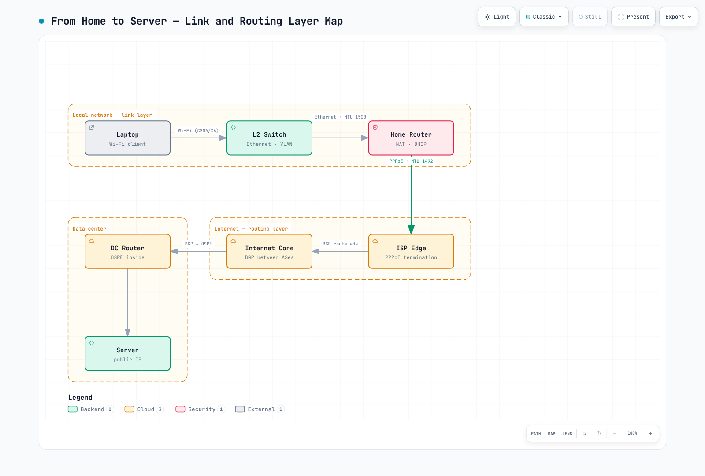

# ネットワークの基礎 Part 1：レイヤーモデル、リンク層、ルーティング層

> **最終更新日**: 2026年9月14日

::: tip 全5部構成のシリーズです
**Part 1：レイヤーモデル、リンク層、ルーティング層** *(このドキュメント)* ·
[Part 2：トランスポート層とTLS](./06-network-fundamentals-part2.md) ·
[Part 3：アプリケーションプロトコル](./06-network-fundamentals-part3.md) ·
[Part 4：リクエストの経路とクラウド](./06-network-fundamentals-part4.md) ·
[Part 5：ネットワーク機器、LAN、WAN](./06-network-fundamentals-part5.md)
:::

ブラウザーからのリクエストは、複数のプロトコルが連携して処理します。正確な順序は、キャッシュ、接続の再利用、IPのバージョン、HTTPのバージョンによって異なるため、トラブルシューティングではHTTPだけでなく、それ以外も調べる必要があります。

このシリーズでは、25のネットワークプロトコルと仕組みを、**下位から上位へ、レイヤーごとに**解説します。下位から積み上げる理由は単純です。上位レイヤーはすべて、その下のレイヤーがすでに機能していることを前提に設計されています。上から順に読むと、「でも、その部分はどう動くの？」という疑問に何度もぶつかります。

各項目は同じ形式で解説します。**1行の定義 → 仕組み → 実際に問題となる場面**。

---

## 0. 1ページでわかるレイヤーマップ

| レイヤー | 役割 | ここで扱うプロトコル |
|---|---|---|
| アプリケーション | 実際のサービスの意味を定義する | HTTP/3, WebSocket, WebRTC, gRPC, DNS, DoH, DHCP, MQTT, SSH, SMTP |
| セキュリティ | 暗号化と認証（トランスポート上で動作） | TLS |
| トランスポート | エンドツーエンドのデータ配送 | TCP, UDP, QUIC |
| インターネット / ルーティング | ネットワーク間の経路を選択する | IPv4, IPv6, ICMP, BGP, OSPF, NAT |
| リンク | 1つの物理セグメント内で配送する | Ethernet, Wi-Fi, VLAN, PPP, ARP |

レイヤーのきれいな境界に収まらない項目もあります。TLSはトランスポート層とアプリケーション層の間に位置し、QUICはUDP上で動作しながらトランスポート層の役割を果たし、ARPはIPとリンク層を橋渡しします。NATはプロトコルというより機能です。こうした「例外」は、実際のトラブルシューティングの大半に関係します。

---

[🔍 インタラクティブな図を表示](https://www.atomai.click/kubernetes-docs/archmaps/en-basics-06-network-fundamentals-part1-0.html)

---

## 1. リンク層：1つのセグメント内でビットを運ぶ

リンク層が扱うのは、ただ1つのことです。**すぐ隣にあるデバイスへビットを渡す方法です**。最終的な宛先が隣のラックであろうと地球の裏側であろうと、この層が担うのは次のホップまでです。

### Ethernet

**定義：** 有線ローカルネットワーク上でフレームを運ぶリンク層の標準規格。

**仕組み：** データはフレームに格納され、先頭に宛先と送信元のMACアドレスが付加されます。宛先が判明しているユニキャストの場合、スイッチはMACテーブルを使って宛先ポートを選択します。ブロードキャストと宛先不明のユニキャストのフレームは、通常VLAN内にフラッディングされます。マルチキャストの動作は設定によって異なります。初期のEthernetでは衝突検出（CSMA/CD）を使用していましたが、現代のスイッチング方式の全二重ネットワークでは、衝突はほぼ発生しなくなりました。

**実際の場面：** Ethernet上のIP通信では、MTUが1500なら、フレーム内のIPパケットは1500バイトです。この値にEthernetヘッダーとFCSは含まれません。ジャンボMTUはデバイスや経路に固有の値であり、9001はEC2でサポートされている値であって、Ethernet共通のサイズではありません。クラウドでは、VPNやオーバーレイネットワークを重ねるとカプセル化ヘッダーが追加され、実効MTUが小さくなります。MTU探索に失敗すると、ブラックホールが発生し、「pingは通るのに、大きな応答が停止する」という症状が現れることがあります。これは診断に最も時間がかかる障害の1つです。

**MTUとMSS：** MSSが制限するのはTCPデータのバイト数であり、フレーム全体ではありません。MTUが1500の場合、基本ヘッダーで計算すると、IPv4では1460（1500−20−20）、IPv6では1440（1500−40−20）です。送信側は、使用するIP/TCPオプションの分だけ、実際のデータ量をさらに減らします。TCPはハンドシェイク中にMSSを交換します。そのため、トンネルでMTUの問題が繰り返し起きる場合、ルーターでMSSクランプ（TCP MSSをより小さい値に強制すること）を行うのが、広く使われている回避策です。

### Wi-Fi

**定義：** 無線セグメントを介してLANフレームを運ぶリンク層の標準規格（IEEE 802.11）。

**仕組み：** 電波を共有媒体として使うため、Wi-FiはEthernetと根本的に異なります。Wi-Fiは送信中の衝突検出に頼らず、CSMA/CAを使用します。送信前にチャネルが空いているかを確認し、通常のユニキャスト通信ではACKと再試行を使います。ブロードキャスト／マルチキャストの動作は異なります。つまり、再送はリンク層にすでに組み込まれています。

**実際の場面：** リンク層での再送にTCPの再送が重なると、レイテンシーのばらつき（ジッター）が大きくなります。実際の原因がクライアントの無線区間にあるのに、リアルタイム通信の品質問題が「サーバーのせい」と報告されることがあります。サーバーのRTTだけでは原因を特定できません。アプリケーションの処理時間や、クライアント／APの再試行、信号、キューに関するメトリクスと相関を確認してください。

### VLAN

**定義：** 共有スイッチインフラストラクチャを論理的なL2ネットワークに分割する技術（IEEE 802.1Q）。

**仕組み：** 802.1Qタグ付きフレームには、4バイトのVLANタグが含まれます。アクセスポートでは、スイッチがVLANを割り当てるタグなしフレームを扱うことができます。ブロードキャストが届くのは同じVLAN内のホストに限られるため、配線に手を加えずにネットワークを分割できます。VLAN間のトラフィックは、L3デバイス（ルーターまたはL3スイッチ）を経由する必要があります。

**実際の場面：** VLANが提供するのは論理的なL2分割であり、物理的な分離や暗号学的な分離ではありません。セグメント間で許可されるトラフィックは、ルーティングとファイアウォールの制御によって決まります。VPC、サブネット、セキュリティグループは、それぞれクラウドネットワーキングにおける役割が異なり、VLANを一対一で置き換えるものではありません。

> 📎 EKSがVPCをどのように構成するかについては、[EKSネットワーキングの基礎](../eks/03-eks-networking-part1.md)を参照してください。

### PPP

**定義：** 2つのノードだけを接続するポイントツーポイントリンクで、パケットを運ぶプロトコル。

**仕組み：** Ethernetと違い、アドレス指定は必要ありません。リンクの両端にノードが1つずつあるだけです。その代わり、PPPはリンクの確立、オプションの認証、上位プロトコルのネゴシエーション（LCP/NCP）を提供します。

**実際の場面：** ダイヤルアップ時代の遺物のように見えますが、家庭向けインターネット回線の多くでPPPoEとして今も使われています。標準的な1500バイトのEthernetペイロードでは、通常6バイトのPPPoEヘッダーと2バイトのPPPプロトコルフィールドを差し引くと、IPに使えるのは1492バイトです。ネゴシエーションによって、より大きなアンダーレイで1500バイトを維持できる場合もあります。1492への縮小を考慮していないと、前述のMTU問題が発生する可能性があります。

### ARP

**定義：** オンリンクのIPv4次ホップアドレスをMACアドレスに解決するプロトコル。

**仕組み：** IP層が「これを10.0.1.5に送信」と指示しても、Ethernetが理解できるのはMACアドレスだけです。そこでホストは「10.0.1.5を持っているのは誰ですか？」とブロードキャストし、そのアドレスを持つホストが応答します。結果は、OS固有の隣接状態とタイムアウトを伴ってキャッシュされます。宛先がオンリンクでない場合、ホストはリモートホストのMACではなく、ゲートウェイのMACを解決します。

**実際の場面：** ARPには認証がありません。誰でも「そのIPは自分のものだ」と応答できるため、ARPスプーフィングが可能になります。同じ性質は、正当な用途にも使われます。フェイルオーバー時、新しいアクティブノードはGratuitous ARPをブロードキャストして、VIPとMACアドレスの対応関係を近隣ノードに通知します。また、スイッチはフレームから送信元MACアドレスの位置も学習します。VIPベースのHA構成でフェイルオーバーに時間がかかる場合、キャッシュ更新の遅延が有力な原因です。

> 📎 CiliumがeBPFと連携してL2／ルーティングの動作をどのように実現するかについては、[Ciliumネットワーキング](../networking/cilium/03-networking.md)を参照してください。

---

## 2. インターネット層とルーティング層：ネットワークをまたぐ

リンク層が「隣まで」届けるのに対し、この層は「地球の裏側まで」届けます。中心となる問いは、**このパケットを次にどこへ送るべきか**？です。

### IPv4

**定義：** 32ビットアドレスを基盤とするインターネット層のプロトコル。

**仕組み：** 各パケットには送信元と宛先のIPアドレスが含まれます。各ルーターはルーティングテーブルから最も具体的な経路（最長プレフィックス一致）を探し、次のホップへ転送します。配送はベストエフォートで、保証も順序制御もありません。それらを担うのは上位層のTCPです。

**実際の場面：** IPv4で使用可能なアドレスは約43億個です。アドレス不足によりNATが広く使われるようになり、プライベートアドレス範囲（10.0.0.0/8、172.16.0.0/12、192.168.0.0/16）が内部ネットワークの標準となりました。大規模組織がクラウド移行時に最初に直面する壁は、これらのプライベート範囲の重複です。オンプレミスとVPCのCIDRが重複していると、アドレスの再割り当て、変換、またはプロキシの設計による解決策がなければ、VPNやDirect Connectを介した単純なルーティングはできません。IPアドレス設計は、プロジェクト開始時に確定しておくべき事項です。

#### IPv4、CIDR、サブネットの計算例 {#ipv4-cidr-subnet}

IPv4アドレスは8ビットのオクテット4つで構成されます。CIDR表記の`/26`は、先頭の26ビットがネットワークプレフィックスで、`32 − 26 = 6`ビットがホスト部であることを示します。以下のアドレスは、[RFC 5737](https://www.rfc-editor.org/rfc/rfc5737.html)に記載されたドキュメント用の例であり、公開テスト用エンドポイントではありません。

**インターフェイスアドレスが`192.0.2.130/26`の場合**：

| 手順 | 計算または結果 |
|---|---|
| サブネットマスク | `255.255.255.192`。最終オクテットは2進数で`11000000` |
| ブロックあたりのアドレス数 | `2^6 = 64`。最終オクテットのブロックは`0`、`64`、`128`、`192`から始まる |
| ネットワークアドレス | `130 AND 192 = 128`（`10000010 AND 11000000 = 10000000`）のため、`192.0.2.128/26` |
| ブロードキャストアドレス | ホスト部の6ビットを1にする：`192.0.2.191` |
| 通常のホスト範囲 | `192.0.2.129`～`192.0.2.190`：62アドレス |

インターフェイスが使用するのは`.130`であり、`.128/26`はそのサブネットを示します。通常のブロードキャストサブネットでは、ホスト部がすべて0またはすべて1のアドレスが、それぞれネットワークアドレスとブロードキャストアドレスを示します。ゲートウェイを設定する場合はホスト範囲内のアドレスを1つ使いますが、CIDRはそれを最初のホストにすることを求めていません。

すべてのプレフィックスに「2を引く」という計算を適用してはいけません。[RFC 3021](https://www.rfc-editor.org/rfc/rfc3021.html)では、対応するポイントツーポイントリンク上で`/31`の両方のアドレスを使用できます。`/32`は1つのアドレスを示し、多くの場合ホストルートとして使われます。Ethernetで直接接続された相手がいることを意味するわけではありません。クラウドの割り当て規則は別です。AWS VPCの標準的なIPv4サブネットでは、先頭の4アドレスと末尾の1アドレスが予約されるため、`/26`で割り当て可能なアドレスは**59個**です。BYOIPなどの例外もあります。割り当て方式については、[VPCサブネットのルール](https://docs.aws.amazon.com/vpc/latest/userguide/subnet-sizing.html)を確認してください。

#### 最長プレフィックス、次ホップ、ARP {#longest-prefix-next-hop}

経路検索は、近隣ノードの解決より**先に**行われます。`eth0`に`192.0.2.130/26`が設定されたLinuxホストの、説明用ルーティングテーブルを見てみましょう。

| 宛先プレフィックス | 次ホップ / インターフェイス |
|---|---|
| `192.0.2.128/26` | `eth0`に直接接続（オンリンク） |
| `198.51.100.0/24` | `eth0`上で`192.0.2.129`経由 |
| `198.51.100.128/25` | `eth0`上で`192.0.2.190`経由 |
| `0.0.0.0/0` | `eth0`上で`192.0.2.129`を経由するデフォルト経路 |

選択されたテーブル内で一致する経路を探し、**最長のプレフィックス**を選びます（[RFC 1812 §5.2.4.3](https://www.rfc-editor.org/rfc/rfc1812.html#section-5.2.4.3)）。

- `192.0.2.150`の場合、`/26`の経路はオンリンクです。近隣エントリーがない場合は、**`.150`自体**をARPで解決します。
- `198.51.100.140`の場合、`/24`、`/25`、`/0`のすべてが一致し、`/25`が選ばれます。リモート宛先ではなく、**ゲートウェイの`192.0.2.190`をARPで解決します**。
- `203.0.113.10`の場合、一致するのは`/0`だけです。**ゲートウェイの`192.0.2.129`を使用します**。

ルーティングされるパケットでは、（NATがなければ）IP宛先はリモートホストのままですが、Ethernetの宛先はゲートウェイのMACアドレスになります。デフォルト経路のメトリックが小さくても、一致する`/25`より優先されることはありません。Linuxのポリシールールは別のテーブルを選択する場合があります。実際の検索結果を確認するには、[ip-route(8)のマニュアル](https://man7.org/linux/man-pages/man8/ip-route.8.html)で説明されているように、該当するネットワーク名前空間で`ip route get`を実行してください。ホストとコンテナでは、経路や近隣テーブルが異なる場合があります。

### IPv6

**定義：** 128ビットアドレスを持つ次世代のインターネット層プロトコル。

**仕組み：** 128ビットのアドレスにより、アドレス枯渇は問題になりません。基本ヘッダーは40バイト固定で、ヘッダーチェックサムはありません。ルーターはIPv6パケットをフラグメント化しません。SLAACを使うと、ホストはDHCPなしでアドレスを自動設定できます。また、ARPはNDP（Neighbor Discovery Protocol）に置き換えられます。

**実際の場面：** IPv6はIPv4と後方互換性がないため、実際の環境ではデュアルスタックで運用されます。つまり、ファイアウォールルールとセキュリティポリシーを2組維持する必要があります。IPv6経路のルール漏れは、よくあるセキュリティ上の穴です。グローバルIPv6アドレスがあるだけで、ワークロードがインターネットから到達可能になるわけではありません。AWSでも、ルーティングと、セキュリティグループ／NACLで許可されたトラフィックが必要です。アウトバウンド専用インターネットゲートウェイを使えば、要求されていないインバウンド接続を許可せずに、IPv6のアウトバウンド通信を可能にできます。

**移行方式：** IPv4と共存する実用的な方法は3つあります。**デュアルスタック**（両方を並行して実行する。ポリシーが重複するものの、最も一般的）、**トンネリング**（IPv6パケットをIPv4で包み、IPv4のみのセグメントを通過させる）、**NAT64/DNS64**（IPv6のみのクライアントがIPv4サーバーに到達できるよう変換する。モバイル通信事業者は464XLATとしてこれを大規模に使用）です。KubernetesのServiceもデュアルスタックに対応しているため、最初からIPv6範囲を考慮したクラスターCIDR設計ができます。

### ICMP

**定義：** ネットワークのエラーや状態を通知する制御プロトコル。

**仕組み：** ICMPは制御情報を運び、Echoのペイロードや元のパケットデータの引用を含むことがあります。例として、宛先到達不能、TTL超過、フラグメント化が必要などがあります。`ping`はEcho Request/Replyを使用します。`traceroute`はTTL（またはIPv6 Hop Limit）を1ホップずつ増やし、戻ってくるTime Exceededメッセージを読み取ります。

**実際の場面：** 「セキュリティのため」にICMPを一律にブロックするケースはよくありますが、これが前述のMTUブラックホールの直接的な原因になります。IPv4の従来型PMTUDはICMP Type 3 Code 4を使用し、IPv6はICMPv6 Packet Too Big Type 2を使用します。必要なメッセージをブロックするとブラックホールが発生することがあります。一方、PLPMTUDではICMPに依存せずにパケットサイズを探索できます。IPのバージョンとポリシーに応じて、必要なエラー／探索トラフィックを許可してください。

> 📎 EKSでこの障害がどのように現れるかについては、[EKSネットワーキングの詳細](../eks/03-eks-networking-part3.md)を参照してください。

#### ICMPとtracerouteの情報を読み解く {#icmp-traceroute-interpretation}

IPv4の転送では、ルーターがパケットのTTLを減らします。TTLが切れると、ルーターはそのプローブを破棄し、通常は**ICMP Time Exceeded**（Type 11, Code 0）を返します。意図的にTTLを短く設定したプローブでは想定どおりの動作であり、通常のアプリケーションパケットが失敗する証拠ではありません。このエラーには元のパケットの一部が引用されるため、送信元は応答とプローブを対応付けられます（[RFC 792](https://www.rfc-editor.org/rfc/rfc792.html)）。

**送信したプローブ**と**返ってきた応答**は、分けて考えてください。次の一般的なtraceroute方式はいずれも、中継ルーターからICMP Time Exceededを受け取る場合があります。

| 送信するプローブ | 宛先に到達したときの典型的な応答 |
|---|---|
| 使用されていない宛先ポートへのUDP | ICMP Destination Unreachable, Port Unreachable（IPv4 Type 3, Code 3） |
| ICMP Echo Request | ICMP Echo Reply |
| 選択したポートへのTCP SYN | リッスン中のポートならTCP SYN/ACK、閉じたポートならRST |

デフォルト値やオプションは実装によって異なります。[Linux traceroute(8)のマニュアル](https://man7.org/linux/man-pages/man8/traceroute.8.html)では、UDP、ICMP、TCPの方式が説明されています。TCPプローブでテストできるのは、そのポートの処理状況です。SYN/ACKが返っても、TLSやHTTPが動作する証明にはなりません。

`*`は、**待機時間が切れるまでに一致する応答が届かなかった**ことを意味します。プローブがフィルタリングされた、ルーターが応答を抑制またはレート制限した、あるいは戻り経路で応答が失われた可能性があります。後続のホップから応答がある場合、1つのホップが無応答だからといってエンドツーエンドのパケット損失が証明されるわけではありません。表示される各RTTには戻り経路も含まれますが、戻り経路は往路と異なる場合があります。また、負荷分散によって、プローブごとに異なるルーターが現れることもあります。障害箇所を特定する前に、宛先やアプリケーションの結果と照らし合わせ、繰り返し観測してください。

tracerouteは主にホップを調べるものであり、小さなプローブが成功しても経路MTUは確認できません。DFを設定した大きなIPv4パケットでも、より小さいMTUを検出するために**Fragmentation Needed**（Type 3, Code 4）が必要になることがあります。このメッセージをTime ExceededやPort Unreachableと区別してください。前述のIPv6とPLPMTUDの違いも踏まえてください。

> 📎 [LinuxのルーティングとICMPのラボ](../networking/07-linux-network-diagnostics.md#routing-icmp-lab)で経路とプローブの考え方を実践し、その後、コンテナやKubernetesのトラブルシューティングに応用してください。

### OSPF

**定義：** 1つの自律システム内で最適な経路を計算するリンクステート型ルーティングプロトコル。

**仕組み：** 各ルーターはリンク状態をエリア内にフラッディングするため、同じエリアにあるルーターは一貫したリンクステート情報を共有し、その後、それぞれがDijkstraのアルゴリズムを実行して最短経路を計算します。インターフェイスコストは設定され（帯域幅から算出されることが多い）、拡張性を高めるためにネットワークをエリアに分割します。

**実際の場面：** OSPFは内部ネットワークで使われるIGPです。収束が速く、経路も自動的に検出されますが、各ルーターは接続されたエリアのリンクステート情報を保持します。そのため、大規模な環境ではエリア設計が性能を左右します。

### BGP

**定義：** 自律システム（AS）間で到達可能性を交換するパスベクター型ルーティングプロトコル。

**仕組み：** BGPの目的はOSPFとは異なり、「最速の経路」ではなく「ポリシーで優先される経路」を選ぶことです。各ASは到達できるプレフィックスをAS_PATHとともに広告します。受信側はAS_PATHの長さ、Local Preference、MEDなどの属性を基に経路を順位付けします。インターネット全体のルーティングはこれに依存しています。

**実際の場面：** BGPはデフォルトで広告を信頼するため、不適切なプレフィックス広告によって広範囲な障害が発生することがあります。RPKIのオリジン検証は、プレフィックスの起点が認可されているかを確認しますが、AS_PATH全体を検証したり、すべての経路リークを防止したりするものではありません。クラウドの観点では、Direct ConnectはBGPを使用します。Site-to-Site VPNではBGPまたはサポート対象の静的ルーティングを使用できます。そのため、AS番号、広告するプレフィックスの設計、冗長化時の経路優先度（AS_PATHプリペンディングなど）が、実際の設計項目になります。

> 📎 Calicoがクラスター内でBGPをどのように使用するかについては、[Calico BGPの詳細](../networking/calico/04-bgp-deep-dive.md)を参照してください。

### NAT

**定義：** IPアドレスを変換する機能。NAPT/PATでは、トランスポートポートも変換します。

**仕組み：** よくあるケースは、多数のプライベートホストがPAT/NAPTを介して1つのパブリックアドレスを共有することです。変換はプライベートアドレス間でも行われるため、必ずしもパブリックインターネットのアドレス共有とは限りません。変換テーブルにセッションごとの対応関係を保持し、戻りのパケットが適切な内部ホストに届くようにします。

**実際の場面：** NATはレイヤー間の境界違反の代表例です。L3デバイスでありながらL4ポートを書き換え、インターネットの本来の前提であるエンドツーエンド接続を壊します。その結果、P2Pが難しくなり、STUN/TURNなどの回避策が必要になります（下記のWebRTCを参照）。クラウドでは、NAT Gatewayのポート枯渇とデータ処理料金が実務上の問題です。アウトバウンドの多いワークロードでは、VPCエンドポイントを使うことで、対応するAWSサービス向けのNAT処理を減らせます。料金の節約になると決めつける前に、時間単位の料金、データ料金、トラフィック経路を比較してください。

---

**次へ：** [Part 2：トランスポート層とTLS](./06-network-fundamentals-part2.md)

## 検証用参考資料

- https://docs.aws.amazon.com/AWSEC2/latest/UserGuide/network_mtu.html
- https://www.rfc-editor.org/rfc/rfc894
- https://www.rfc-editor.org/rfc/rfc6691
- https://www.rfc-editor.org/rfc/rfc4638
- https://www.rfc-editor.org/rfc/rfc5227
- https://www.rfc-editor.org/rfc/rfc792
- https://www.rfc-editor.org/rfc/rfc8899
- https://www.rfc-editor.org/rfc/rfc2328
- https://www.rfc-editor.org/rfc/rfc6811
- https://docs.kernel.org/networking/bridge.html
- https://docs.aws.amazon.com/vpc/latest/userguide/VPC_Internet_Gateway.html
- https://docs.aws.amazon.com/vpc/latest/userguide/egress-only-internet-gateway.html
- https://docs.aws.amazon.com/vpn/latest/s2svpn/VPNRoutingTypes.html
- https://docs.aws.amazon.com/vpc/latest/userguide/nat-gateway-scenarios.html
- https://docs.aws.amazon.com/vpc/latest/userguide/nat-gateway-pricing.html
