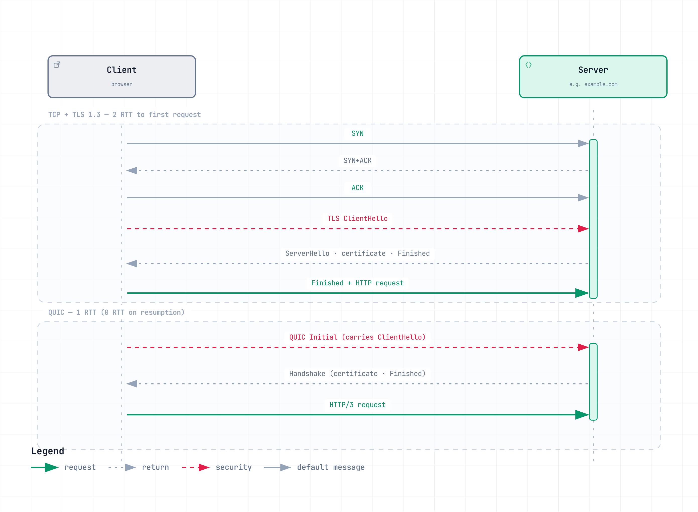

# ネットワークの基礎 パート2：トランスポート層とTLS

> **最終更新日**: 2026年9月11日

::: tip これは全5回のシリーズです
[パート1：レイヤーモデル、リンク層とルーティング層](./06-network-fundamentals-part1.md) ·
**パート2：トランスポート層とTLS** *(このドキュメント)* ·
[パート3：アプリケーションプロトコル](./06-network-fundamentals-part3.md) ·
[パート4：リクエストの経路とクラウド](./06-network-fundamentals-part4.md) ·
[パート5：ネットワーク機器、LANとWAN](./06-network-fundamentals-part5.md)
:::

パート1では、パケットを宛先ホストに届けました。このパートでは、信頼性のあるストリーム（TCPとQUIC）とUDPデータグラムを比較し、TLSが通信をどのように保護するかを説明します。UDP自体は信頼性もTLSも提供しません。アプリケーションはDTLSなどの適切なセキュリティプロトコルを選ぶか、TLS 1.3を統合したQUICのようなトランスポートを使用します。

このパートの要点を、次の図にまとめています。

[🔍 インタラクティブな図を表示](https://www.atomai.click/kubernetes-docs/archmaps/en-basics-06-network-fundamentals-part2-0.html)

---

## 3. トランスポート層：エンドツーエンドの配信

ここから先、通信相手は「ネットワーク」ではなく「プロセス」です。そのため、ポート番号が登場します。

### TCP

**定義：** 信頼性と順序性のあるバイトストリームを提供する、コネクション型のトランスポートプロトコル。

**仕組み：** 3ウェイハンドシェイク（SYN → SYN+ACK → ACK）で接続を確立します。シーケンス番号で順序を保ち、ACKと再送で損失を回復し、スライディングウィンドウでフローを制御し、輻輳制御でネットワークの負荷に対応します。アプリケーションから見ると、TCPは途切れのないバイトストリームというシンプルな抽象化を提供します。

**実際の動作：** 順序どおりに配信するため、**ヘッドオブライン（HOL）ブロッキング**が発生します。TCPセグメントが欠落すると、その欠落箇所以降のバイトは配信されません。HTTP/2では、この影響で同じ接続を共有する複数のストリームが遅延することがあります。ただし、すでに配信済みのデータや、アプリケーション内の独立した処理は引き続き進行できます。QUICは、ストリーム間にまたがるこのトランスポート層の順序依存を解消します。

最適化を行わない一般的な新規接続では、TCPの確立に約1 RTTかかり、その後、TLS 1.3の完全なハンドシェイクに1 RTT（TLS 1.2では通常2 RTT）かかります。接続の再利用、再開、早期データ、TCP Fast Openによってタイミングは変わり、再試行で遅延が増える場合もあります。実際のワークロードを踏まえて、接続プーリングを評価してください。

**輻輳制御の変遷を簡単に：** 輻輳制御は、帯域幅、遅延、バッファ、アプリケーションの挙動とともにスループットに影響します。従来型の**Reno**は、損失が発生すると輻輳ウィンドウを縮小します。Linuxで一般的なデフォルトである**CUBIC**は、ウィンドウを3次関数で増加させ、高帯域の経路でのスケーラビリティを高めます。**BBR**は、ボトルネック帯域幅と伝搬RTTをモデル化して送信を制御します。損失やECNの利用方法も、実装やバージョンによって異なります。どのアルゴリズムも、あらゆる長距離経路やモバイル経路でスループットを向上させるとは限りません。`sysctl net.ipv4.tcp_congestion_control` は設定済みのデフォルト値を**読み取るだけ**です。デフォルト値を変更すると新しい接続に影響し、別途設定と測定が必要です。

**TIME_WAITとポート枯渇：** 通常の正常な切断では、切断を開始した側が一般にTIME_WAIT状態に入ります。同時に切断した場合は、両方のピアがこの状態になることがあります。接続の頻繁な生成と終了は、実装や宛先のパターンによって、利用可能な接続タプル、一時ポート、またはNATマッピングの枯渇につながる場合があります。TIME_WAITエントリが、あらゆるリモートエンドポイントに対してそのポートを一律に予約するわけではありません。カーネル設定を変更する前に実際の上限を調査し、接続の再利用を検討してください。TIME_WAITは古い接続から遅れて到着するパケットを保護する役割もあります。

### UDP

**定義：** 接続を確立せずにデータグラムを送信する、最小限のトランスポートプロトコル。

**仕組み：** 8バイトのヘッダーには、送信元ポート、宛先ポート、長さ、チェックサムのみが含まれます。ハンドシェイク、再送、順序制御、輻輳制御はありません。本質的には「ポート番号付きのIP」です。

**実際の動作：** リアルタイムアプリケーションでは、古くなったデータを再送するより、タイムリーに届けることを優先する場合があります。また、DNSでは小規模なやり取りにUDPがよく使われます。信頼性が必要な場合は、アプリケーション自身が必要な信頼性と適切な輻輳制御を実装するか、それらを提供するQUICなどのプロトコルを使用する必要があります。

注意点：ステートレスであるため、UDPはIPアドレスの詐称や増幅攻撃に悪用されやすくなります。UDPサービスを外部に公開する場合は、応答サイズの制限とリクエストレートの制御を計画してください。

### QUIC

**定義：** UDP上に実装された、セキュアな多重化トランスポートプロトコル。

**仕組み：** QUICはUDP上で、TCP+TLSが担っていた機能を一から設計し直したものです。主な特性は次の4つです。

1. **ストリームごとの独立した配信**：各ストリームが独自のバイト順序を持つため、あるストリームで損失が発生しても、別のストリームで利用可能なデータの配信を妨げるとは限りません。パケットの回復と輻輳制御は、引き続き接続／経路全体に対して動作します。ストリームは自身の欠落バイトによってブロックされることがあり、アプリケーションやHTTP/3のQPACKの依存関係によってブロックされる場合もあります。
2. **組み込みの暗号化**：QUICはTLS 1.3のハンドシェイクを統合し、TLSレコードの代わりに独自のパケット保護を使用します。通常の完全なハンドシェイクには約1 RTTかかります。条件を満たし、受け入れられた再開では**0-RTT早期データ**を送信できますが、ハンドシェイクは後で完了します。Retryや追加のハンドシェイク交換によって遅延が増えることもあります。
3. **接続ID**：アドレス変更時の接続継続性を支えますが、パス検証とエンドポイント側の対応が必要です。移行制限や利用できない経路によって、Wi-Fiからモバイル回線への切り替えが中断される場合があります。接続の継続性が保証されるわけではありません。
4. **実装の柔軟性**：QUICは一般にユーザー空間で実装されるため、トランスポートの変更をアプリケーションやライブラリとともにリリースできます。ただし、ユーザー空間での実装はプロトコル上の要件ではありません。

**実際の動作：** HTTP/3は通常UDP 443を使用します。その経路がブロックされている場合、サーバーが対応していれば、HTTPクライアントはTCP上のHTTP/2またはHTTP/1.1を試すことができます。QUIC自体がTCPに切り替わるわけではありません。パフォーマンスの結果をQUICのせいにする前に、到達可能性、ネゴシエートされたプロトコル、実装やオフロードの挙動を確認してください。CPUコストは実装とワークロードによって異なります。

セキュリティ上の注意点：**0-RTTデータはリプレイされる可能性があります。** 早期データのやり取りがリプレイされると、アプリケーションがリクエストを複数回処理することがあります。トランスポート層でパケットの重複を排除するだけでは、アプリケーション層のリプレイ保護にはなりません。アプリケーションがリプレイに安全だと明示的に評価した操作のみを許可してください。GETという名前であることや、冪等性を主張していることだけでは不十分です。サーバーは早期データを拒否できます。HTTPサーバーは`425 Too Early`を使い、ハンドシェイク後にクライアントが再試行するよう指示できます。このポリシーはクライアント、CDN、オリジン全体で設定してください。

---

## 4. セキュリティ：TLS

### TLS

**定義：** 転送中のデータに機密性、完全性、認証を提供するプロトコル。

**仕組み：** TLSはハンドシェイク中に暗号パラメータをネゴシエートし、鍵を確立します。証明書ベースのハンドシェイクでは、証明書と鍵の所有証明を使ってサーバーを認証します。一方、PSKベースのハンドシェイクでは、すでに確立された鍵や外部からプロビジョニングされた鍵を使って認証できます。TLSレコードがアプリケーションデータを保護します。TLS 1.3は、機密性と完全性のために認証付き暗号（AEAD）を使用します。

TLS 1.3の通常の完全なハンドシェイクには約1 RTTかかります。再開では、追加条件を満たす場合に早期データを任意で利用できます。TLS 1.3では静的RSA鍵交換と旧式の暗号スイートが廃止されましたが、RSA証明書署名は引き続きサポートされています。エフェメラルな(EC)DHE鍵交換は、PSKと組み合わせた場合も含め、前方秘匿性を提供します。**PSKのみの鍵交換と0-RTTデータでは、同じ前方秘匿性の保証は得られません。**

**実際の運用：** 繰り返し発生する問題は3つあります。

- **証明書の有効期限切れ**：更新を自動化し、有効期限と証明書のデプロイ成功をそれぞれ監視してください。
- **SNIの露出**：TLS 1.3だけではClientHelloのSNIは可視のままです。両方のエンドポイントが対応し、設定されている場合は、ECH（Encrypted Client Hello、RFC 9849）で内側のClientHelloを保護できます。QUIC Initialパケットの鍵は公開情報から導出できるため、Initialの暗号化だけではSNIを隠せません。ECHでも宛先IPやすべてのトラフィックメタデータを隠せるわけではありません。
- **終端ポイントの設計**：クライアントからロードバランサー、ロードバランサーからアプリケーション、さらにサービス間の接続がある場合はその接続まで、すべてのホップを文書化してください。TLSを終端しても、次のホップが自動的に暗号化されるわけではありません。必要な場合はその経路でもTLSを使用してください。両方のピアを証明書で認証する必要がある場合は、mTLSを使用します。サービスメッシュでこれを自動化できますが、すべての設計で必須というわけではありません。

**証明書チェーンとOCSPステープリング：** 一般的なX.509検証では、リーフ証明書から必要な中間証明書を経て、設定済みのトラストアンカーまでのパスを構築します。サーバーは必要な中間証明書を送信する必要があります。通常、ルート証明書はすでにクライアントに信頼されています。中間証明書が不足するとクライアントによって失敗することがありますが、有効な証明書チェーンに中間証明書が必ず含まれるとは限りません。失効確認の扱いは発行者とクライアントによって異なります。OCSPに対応している場合、ステープリングを使うと、サーバーが署名済みのステータス応答を添付でき、クライアントからの直接問い合わせを減らせることがあります。ただし、普遍的に利用できるわけではありません。Let’s Encryptは2025年8月にOCSPサービスを終了し、CRLを使用しています。証明書と失効確認の設定は、実際のCAとクライアントに合わせてください。

> 📎 Istioがこれをどのように自動化するかについては、[Istio mTLS](../service-mesh/istio/security/01-mtls.md)を参照してください。

**主な参考資料**：[TLS 1.3](https://www.rfc-editor.org/rfc/rfc8446.html)、[QUICトランスポート](https://www.rfc-editor.org/rfc/rfc9000.html)、[QUIC/TLS](https://www.rfc-editor.org/rfc/rfc9001.html)、[HTTP早期データ](https://www.rfc-editor.org/rfc/rfc8470.html)、[ECH](https://www.rfc-editor.org/rfc/rfc9849.html)、[Linux TCP設定](https://docs.kernel.org/networking/ip-sysctl.html)、[Let’s EncryptのOCSPサービス終了](https://letsencrypt.org/2025/08/06/ocsp-service-has-reached-end-of-life/)。
---

**次へ：** [パート3：アプリケーションプロトコル](./06-network-fundamentals-part3.md)
