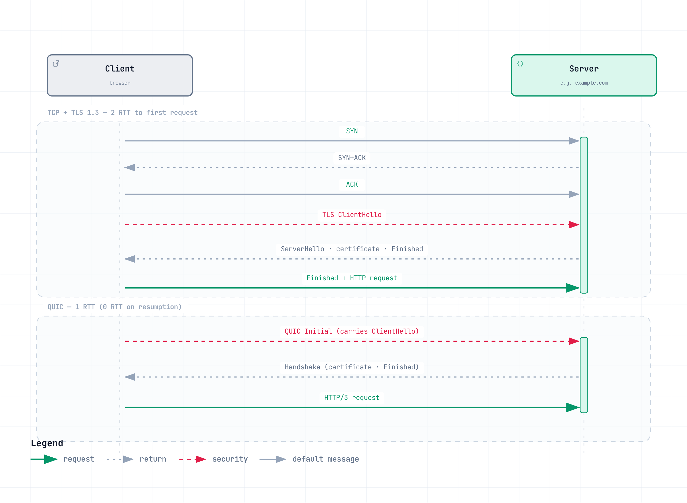

# ネットワーク基礎パート 2: トランスポート層と TLS

> **最終更新日**: 2026年9月11日

::: tip 全4回のシリーズ
[パート1: レイヤーモデル、リンク層、ルーティング層](./06-network-fundamentals-part1.md) ·
**パート2: トランスポート層と TLS**（このページ） ·
[パート3: アプリケーションプロトコル](./06-network-fundamentals-part3.md) ·
[パート4: リクエストの経路とクラウド](./06-network-fundamentals-part4.md)
:::

パート1では、パケットを宛先ホストまで届けました。ここでは、信頼性のあるストリーム（TCP と QUIC）と UDP データグラムを比較し、TLS が通信をどのように保護するかを説明します。UDP 自体には信頼性も TLS もありません。アプリケーションは DTLS などの適切なセキュリティプロトコルを選ぶか、TLS 1.3 を統合した QUIC などのトランスポートを使用します。

このパートの要点を、次の図にまとめます。

[🔍 インタラクティブ図を表示](https://www.atomai.click/kubernetes-docs/archmaps/en-basics-06-network-fundamentals-part2-0.html)

---

## 3. トランスポート層: エンドツーエンドの配送

ここから通信相手となるのは「ネットワーク」ではなく「プロセス」です。そのため、ポート番号が登場します。

### TCP

**定義:** 接続指向のトランスポートプロトコルで、信頼性があり順序が保証されたバイトストリームを提供します。

**仕組み:** 3ウェイハンドシェイク（SYN → SYN+ACK → ACK）で接続を確立します。シーケンス番号で順序を維持し、ACK と再送で損失から回復し、スライディングウィンドウでフローを制御し、輻輳制御でネットワーク負荷に適応します。アプリケーションから見ると、TCP は欠落のないバイトストリームという単純な抽象を提供します。

**実際の動作:** 順序どおりに配送するため、**Head-of-Line（HOL）ブロッキング**が発生します。TCP セグメントが欠落すると、その欠落箇所より後のバイトもアプリケーションへ渡せません。HTTP/2 では、同じ接続を共有する複数のストリームが遅れることがあります。ただし、すでに配送済みのデータや独立したアプリケーション処理は引き続き進められます。QUIC は、このストリーム間のトランスポート層の順序依存を取り除きます。

最適化のない一般的な新規接続では、TCP の確立に約1 RTT、その後の TLS 1.3 完全ハンドシェイクにさらに1 RTT かかります（TLS 1.2 では通常合計約2 RTT）。接続の再利用、セッション再開、早期データ、TCP Fast Open によって所要時間は変わります。再試行で遅延が増えることもあります。実際のワークロードに照らして、コネクションプーリングの効果を評価してください。

**輻輳制御の簡単な変遷:** 輻輳制御は、帯域幅、遅延、バッファー、アプリケーションの動作とともにスループットに影響します。従来の **Reno** は損失時に輻輳ウィンドウを縮小します。Linux の一般的なデフォルトである **CUBIC** は、帯域幅の大きい経路で拡張性を高める三次関数によるウィンドウ増加を使います。**BBR** はボトルネック帯域幅と伝搬 RTT をモデル化して送信を調整します。損失や ECN の扱いも実装やバージョンによって異なります。どのアルゴリズムも、すべての長距離経路やモバイル経路で高いスループットを保証するわけではありません。`sysctl net.ipv4.tcp_congestion_control` は設定済みのデフォルトを**読み取るだけ**です。デフォルトを変更すると新しい接続に影響し、別途設定と測定が必要です。

**TIME_WAIT とポート枯渇:** 通常の正常な切断では、一般に能動的に切断した側が TIME_WAIT に入ります。同時切断では両方のピアが TIME_WAIT になることがあります。接続の頻繁な生成と破棄は、実装や宛先パターンに応じて、利用可能な接続タプル、エフェメラルポート、NAT マッピングの枯渇につながることがあります。TIME_WAIT のエントリが、すべてのリモートエンドポイントに対してそのポートを一律に予約するわけではありません。カーネル設定を変更する前に、実際の上限を調査し、接続再利用も検討してください。TIME_WAIT には、古い接続から遅れて届くパケットを防ぐ役割もあります。

### UDP

**定義:** 接続確立なしでデータグラムを送信する、最小限のトランスポートプロトコルです。

**仕組み:** 8バイトのヘッダーには、送信元ポート、宛先ポート、長さ、チェックサムだけが含まれます。ハンドシェイク、再送、順序保証、輻輳制御はありません。要するに「ポート番号付きの IP」です。

**実際の動作:** リアルタイムアプリケーションでは、古いデータを再送するよりも、時間どおりに届くことを優先する場合があります。DNS では、小さなやり取りに UDP がよく使われます。必要な信頼性と適切な輻輳制御は、アプリケーション自身が実装するか、それらを提供する QUIC などのプロトコルを使う必要があります。

注意点として、UDP はステートレスなため、送信元を偽装する攻撃や増幅攻撃に悪用されやすくなります。UDP サービスを外部に公開するときは、応答サイズの上限とリクエスト頻度の制御を計画してください。

### QUIC

**定義:** UDP 上に実装された、安全で多重化に対応するトランスポートプロトコルです。

**仕組み:** QUIC は UDP 上で、TCP と TLS が担っていた機能を一から設計し直しました。主な特性は次の4つです。

1. **ストリームごとの独立した配送:** ストリームごとにバイト順序が管理されるため、あるストリームでの損失が、別のストリームで利用可能なデータの配送を必ずしも妨げるわけではありません。パケットの損失回復と輻輳制御は、引き続き接続／経路全体に作用します。ストリーム自体は欠落したバイトの到着を待つことがあり、アプリケーションや HTTP/3 の QPACK 依存関係がブロックを起こすこともあります。
2. **暗号化の組み込み:** QUIC は TLS 1.3 のハンドシェイクを統合し、TLS レコードの代わりに独自のパケット保護を使います。通常の完全ハンドシェイクには約1 RTT かかります。条件を満たし受け入れられたセッション再開では **0-RTT早期データ**を送信できますが、ハンドシェイクはその後に完了します。Retry や追加のハンドシェイク通信が必要になると、遅延が増える場合があります。
3. **Connection ID:** アドレス変更後も接続を継続するために使われ、経路検証とエンドポイントの対応が必要です。移行の制限や利用可能な経路がない場合、Wi-Fi から携帯電話回線への切り替えが中断されることがあります。接続継続は保証されません。
4. **実装の柔軟性:** QUIC は一般にユーザー空間で実装されるため、トランスポートの変更をアプリケーションやライブラリとともに配布できます。ただし、ユーザー空間での実装はプロトコル上の必須要件ではありません。

**実際の動作:** HTTP/3 は通常 UDP 443 を使います。その経路がブロックされていてサーバーが対応していれば、HTTP クライアントは TCP 上の HTTP/2 または HTTP/1.1 を試すことがあります。QUIC 自体が TCP に切り替わるわけではありません。性能結果を QUIC に帰属させる前に、到達性、ネゴシエートされたプロトコル、実装やオフロードの動作を確認してください。CPU コストは実装とワークロードによって変わります。

セキュリティ上の注意点として、**0-RTT データはリプレイされる可能性があります。** 早期データのやり取りが再送されると、アプリケーションがリクエストを複数回処理することがあります。トランスポート層のパケット重複排除だけでは、アプリケーション層のリプレイ保護になりません。アプリケーションがリプレイ安全と明示的に評価した操作だけを許可してください。GET という名前や、冪等性があるという主張だけでは不十分です。サーバーは早期データを拒否できます。HTTP サーバーは `425 Too Early` を使い、ハンドシェイク後にクライアントへ再試行させることもできます。クライアント、CDN、オリジン全体でこのポリシーを設定してください。

---

## 4. セキュリティ: TLS

### TLS

**定義:** 通信中のデータに機密性、完全性、認証を提供するプロトコルです。

**仕組み:** TLS はハンドシェイク中に暗号パラメーターをネゴシエートし、鍵を確立します。証明書ベースのハンドシェイクは、証明書と秘密鍵を保有していることの証明を使ってサーバーを認証します。一方、PSK ベースのハンドシェイクでは、以前に確立した鍵または外部からプロビジョニングされた鍵で認証できます。TLS レコードがアプリケーションデータを保護します。TLS 1.3 は、機密性と完全性に認証付き暗号（AEAD）を使います。

TLS 1.3 の通常の完全ハンドシェイクは約1 RTT かかります。セッション再開では、追加条件のもとで任意の早期データを使えます。TLS 1.3 では静的 RSA 鍵交換と旧式の暗号スイートが削除されましたが、RSA 証明書署名は引き続きサポートされます。エフェメラル (EC)DHE 鍵交換は、PSK と組み合わせた場合も含め、前方秘匿性を提供します。**PSK のみの鍵交換と 0-RTT データには、同じ前方秘匿性の保証がありません。**

**実際の運用で繰り返し発生する問題:**

- **証明書の期限切れ:** 更新を自動化し、有効期限と証明書のデプロイ成功を別々に監視してください。
- **SNI の露出:** TLS 1.3 だけでは ClientHello の SNI は可視のままです。ECH（Encrypted Client Hello、RFC 9849）は、両方のエンドポイントが対応し設定されている場合、内側の ClientHello を保護できます。QUIC Initial パケットの鍵は公開情報から導出できるため、Initial の暗号化だけでは SNI は隠れません。ECH でも宛先 IP やすべてのトラフィックメタデータは隠せません。
- **終端点の設計:** クライアントからロードバランサー、ロードバランサーからアプリケーション、サービス間接続まで、すべてのホップを文書化してください。TLS の終端後の次のホップが自動的に暗号化されるわけではありません。必要に応じてその区間にも TLS を使用してください。両方のピアが証明書で認証される必要がある場合は mTLS を使います。サービスメッシュで自動化できますが、すべての設計で必須ではありません。

**証明書チェーンと OCSP stapling:** 一般的な X.509 検証では、リーフ証明書から必要な中間証明書を経て、設定された信頼アンカーまで証明書パスを構築します。サーバーは必要な中間証明書を送信する必要があります。ルート証明書は通常、クライアントがすでに信頼しています。中間証明書が不足すると、クライアントによっては検証に失敗しますが、有効な証明書チェーンに中間証明書が必ず含まれるとは限りません。失効確認の扱いは発行者とクライアントによって異なります。OCSP に対応している場合、stapling を使うとサーバーが署名済みの状態応答を添付でき、クライアントから発行者への直接照会を減らせます。ただし、OCSP がどこでも使われるわけではありません。Let’s Encrypt は2025年8月に OCSP サービスを終了し、CRL を使用しています。実際の認証局とクライアントに合わせて、証明書と失効確認の設定を選んでください。

> 📎 Istio による自動化については、[Istio mTLS](../service-mesh/istio/security/01-mtls.md) を参照してください。

**主な参考資料**: [TLS 1.3](https://www.rfc-editor.org/rfc/rfc8446.html)、[QUIC transport](https://www.rfc-editor.org/rfc/rfc9000.html)、[QUIC/TLS](https://www.rfc-editor.org/rfc/rfc9001.html)、[HTTP early data](https://www.rfc-editor.org/rfc/rfc8470.html)、[ECH](https://www.rfc-editor.org/rfc/rfc9849.html)、[Linux TCP settings](https://docs.kernel.org/networking/ip-sysctl.html)、[Let’s Encrypt OCSP retirement](https://letsencrypt.org/2025/08/06/ocsp-service-has-reached-end-of-life/)。
---

**次へ:** [パート3: アプリケーションプロトコル](./06-network-fundamentals-part3.md)
