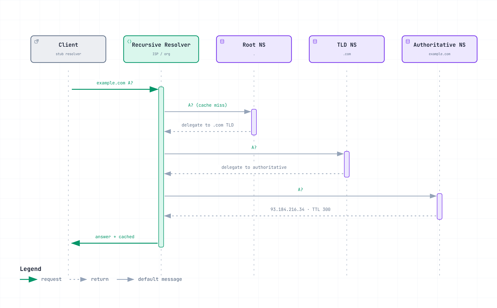

# ネットワークの基礎 Part 3：10のアプリケーションプロトコル

> **最終更新日**: 2026年9月14日

::: tip 全5回シリーズ
[Part 1：レイヤーモデル、リンク層、ルーティング層](./06-network-fundamentals-part1.md) ·
[Part 2：トランスポート層とTLS](./06-network-fundamentals-part2.md) ·
**Part 3：アプリケーションプロトコル** *(このドキュメント)* ·
[Part 4：リクエストの経路とクラウド](./06-network-fundamentals-part4.md) ·
[Part 5：ネットワーク機器、LAN、WAN](./06-network-fundamentals-part5.md)
:::

トランスポートプロトコルはストリームまたはデータグラムを提供し、アプリケーションプロトコルはそれらをサービスに変えます。このパートでは、名前解決（DNSとDoH）、ブートストラップ（DHCP）、運用アクセス（SSH）、メール（SMTP）、HTTP/3、WebSocket、WebRTC、gRPC、MQTTを取り上げます。

---

## 5. アプリケーション層：実際のサービス

### DNS

**定義：** ドメイン名をIPアドレスやその他のレコードに解決する、分散型ディレクトリシステムです。

**仕組み：** DNSは階層的な委任を利用します。キャッシュに回答がない場合、再帰リゾルバーはルートからTLD、権威ネームサーバーへと紹介をたどるか、別のリゾルバーに転送します。キャッシュされた回答があれば、こうした処理の一部または全部を省略できます。A/AAAAレコードにはアドレス、CNAMEレコードにはエイリアス、MXレコードにはメールサーバー、TXTレコードには複数のプロトコルで使われるテキストが格納されます。

**実際の運用：** DNSは分散型ですが、リゾルバー、プロバイダー、設定などが共有依存先になることがあります。DNSフェイルオーバーでは、障害検出、レコード更新、すでにキャッシュされている回答のTTL、アプリケーションのキャッシュ、既存の接続を考慮してください。今TTLを短くしても、すでにキャッシュされた古い回答のTTLが短くなるわけではありません。定められた障害条件下で古い回答を返すリゾルバーもあります（RFC 8767）。各段階を測定してください。TTLが短いだけでは、フェイルオーバー時間は保証されません。ロードバランサーやエニーキャストはDNSを補完できますが、それぞれに独自のヘルスチェックと収束の限界があります。

**主なレコードタイプ：**

| タイプ | 目的 | 補足 |
|---|---|---|
| A / AAAA | ドメイン名 → IPv4 / IPv6 | 基本のレコード |
| CNAME | エイリアス → 正規名 | ゾーン頂点のSOA/NSとは共存できません。プロバイダー固有のALIAS/ANAMEやRoute 53 Aliasを使えば、対応するターゲットへのゾーン頂点のマッピングが可能な場合があります |
| MX | メール受信サーバー | 優先度の数値が小さいものが優先 |
| TXT | 任意の文字列 | SPF/DKIM/DMARC、ドメイン所有権の確認 |
| NS | 委任先のネームサーバー | サブゾーンの委任 |
| SRV | サービスの場所（ホスト+ポート） | 一部プロトコルのサービス検出 |
| CAA | 証明書を発行できる認証局を制限 | CAによる適用が必要で、誤発行をすべて防ぐものではありません |

**DNSSECとDoHは、異なる問題を解決します。** DNSSECは署名されたDNSデータとその完全性を、検証済みの信頼チェーンを通じて認証しますが、クエリは暗号化しません。DoHはHTTPSを使って選択したリゾルバーを認証し、クライアントとリゾルバー間の通信経路で機密性と完全性を保護します。ただし、悪意のある、または誤ったリゾルバーが権威あるデータを返したことまでは証明しません。両者は併用できます。



[🔍 インタラクティブな図を見る](https://www.atomai.click/kubernetes-docs/archmaps/en-basics-06-network-fundamentals-part3-0.html)

### DoH

**定義：** DNSクエリをHTTPSで包み、HTTPS経由で転送する方式です。

**仕組み：** 従来のDNSでは通常、UDP **およびTCP** の53番ポートを平文で使います。DoHはDNSメッセージをHTTPS経由で転送し、その通信経路での受動的な盗聴や改ざんから保護します。ただし、リゾルバーのエンドポイントや通信メタデータからDoHの使用が特定される場合はあり、選択したリゾルバーはクエリを確認できます。

**実際の運用：** 組織のリゾルバーとは別に選んだパブリックDoHリゾルバーを使うと、組織のリゾルバーによるフィルタリングやログ記録を回避し、プライベートな名前を解決できなくなる可能性があります。DoH自体がポリシーを無効にするわけではありません。管理されたDoHリゾルバーでログ記録やフィルタリングを適用でき、ブラウザーやOSのポリシーで承認済みのリゾルバーを選択することもできます。暗号化を無効にすれば常に解決すると思い込まず、スプリットDNSとエンドポイントポリシーをテストしてください。

### DHCP

**定義：** ホストにIPアドレスとネットワーク設定を自動的に割り当てるプロトコルです。

**仕組み：** 一般的な初期の**DHCPv4**交換はDORAです。Discover → Offer → Request → Acknowledgeの順に進みます。ローカルブロードキャストまたはDHCPリレーを通じてサーバーを探します。リースには、IPv4アドレス、サブネットマスク、ゲートウェイ、DNS設定を含めることができます。更新時には、より短い交換で済む場合があります。DHCPv6では異なるメッセージを使います。IPv6のデフォルトルーター情報は通常、ルーター広告から取得され、SLAACもアドレス設定の仕組みの一つです。

**実際の運用：** クラウドでは大部分が抽象化されていますが、VPCのDHCPオプションセットで再び目にすることになります。DNSサーバーとドメイン名を設定するのはここです。オンプレミスDNSを使うハイブリッド環境で名前解決に問題が起きた場合は、この設定を確認してください。

### SSH

**定義：** 暗号化されたリモートシェルアクセスとトンネリングを提供するプロトコルです。

**仕組み：** サーバーはホストキーで自身を認証し、鍵交換によってセッションキーを導出した後、ユーザーが公開鍵またはパスワードで認証します。その後の通信はすべて暗号化されます。SSHはリモートシェル以外にも、ポートフォワーディング、SFTP、エージェントフォワーディングに対応しています。

**実際の運用：** アクセスポリシーに従ってフォワーディングを制限し、サーバーのホストキーを検証してください。侵害されたホストが転送されたエージェントソケットにアクセスできる場合、エージェントに署名や認証を要求できます。通常、秘密鍵そのものがそのホストにコピーされるわけではありません。エージェントフォワーディングが不要なら、ジャンプホスト（`ProxyJump`）を優先してください。生の鍵に固有の有効期限はありませんが、OpenSSHは証明書の有効期間と`authorized_keys`の有効期限制限に対応しています。離職者のアクセス権を削除し、認証情報をローテーションまたは失効させてください。

AWS Systems Manager Session Managerは、マネージドノード、IAM権限、サービス接続が設定されていれば、インバウンドSSHポートやSSH鍵の配布なしでシェルアクセスを提供できます。CloudTrailにはAPIアクティビティが記録されますが、シェルの内容をCloudWatch Logs/S3に記録するには設定が必要です。**Session ManagerのSSHセッションおよびポートフォワーディングセッションでは、セッション内容のログ記録は利用できません。** IAMベースのアクセスだからといって、すべてのコマンドが記録されるとは限りません。

### SMTP

**定義：** メールサーバー間でメッセージを中継するプロトコルです。

**仕組み：** クライアントはメールを送信サーバーに送信し、SMTPサーバーはメールを中継・受信します。ルーティングには通常、MXレコードの検索を使います。IMAPとPOP3は、すでにメールボックスに保存されたメッセージをユーザーが取得またはアクセスするためのプロトコルであり、サーバー側で受信するSMTPの役割を置き換えるものではありません。

**実際の運用：** SMTP認証とTLSは送信や転送を保護しますが、それだけでは表示される送信者ドメインの正当性を証明できません。相互に補完する次の3つのドメイン関連の仕組みが重要です。

- **SPF**：エンベロープのMAIL FROMまたはHELOのIDに対して、送信ホストを許可します。表示されるFromヘッダーが自動的に対象になるわけではありません。
- **DKIM**：署名ドメインのDNS鍵を使い、対象となるメッセージ内容の署名を検証します。署名ドメインは表示されるFromドメインと異なる場合があります。
- **DMARC**：表示されるFromドメインが、SPF **または** DKIMの合格したIDと整合していることを求め、要求する処理とレポートのポリシーを公開します。

適切な場合はSPF、DKIM、DMARCを併せて設定し、レポートを監視し、転送やメーリングリストの挙動を考慮してください。整合する仕組みのどちらか一方に合格すれば、DMARCに合格できます。これらの対策は配信を保証するものでも、表示名や類似ドメインを使ったなりすましをなくすものでもありません。受信側は独自のポリシーも適用します。

### HTTP/3

**定義：** QUIC上で動作するHTTPの第3の主要バージョンです。

**仕組み：** HTTPのセマンティクスは各バージョンで共通ですが、HTTP/3はQUICストリームと独自のフレーミングおよびマッピングを使います。TCPのストリーム間の順序依存性を取り除きますが、ストリーム内のパケット損失、QPACKの依存関係、共有される輻輳制御によって処理が遅れることはあります。一般的なフルハンドシェイクには約1 RTTかかり、対応していればアドレス変更後も接続を維持できます。QPACKは、ストリームが独立して到着する状況に対応するため、HPACKに代わって使われます。

**実際の運用：** クライアントは`Alt-Svc`、事前知識、または対応プロトコルを通知するHTTPS DNSレコードを通じてHTTP/3を検出できます。`Alt-Svc`は、それ以前のTCP接続を通じて学習する場合があります。HTTPSレコードに対応するクライアントは、そのやり取りより前にHTTP/3を検出できます。どちらの方法も、到達可能性や特定のレイテンシ削減を保証するものではありません。

独立したデータ配信と統合されたハンドシェイクは、損失の多い経路やレイテンシの高い経路で役立つ場合があります。実際のレイテンシ、スループット、CPUコストは、実装、オフロード、ワークロード、ネットワークの状態によって変わります。常に効果がある、またはないと思い込まず、代表的なモバイルおよびデータセンターのトラフィックを測定してください。

**3世代の比較：**

| | HTTP/1.1 | HTTP/2 | HTTP/3 |
|---|---|---|---|
| トランスポート | TCP | TCP | QUIC (UDP) |
| 1接続あたりのリクエスト | 順次、または順序どおりのレスポンスを伴うパイプライン | 多重化 | 多重化 |
| HOLブロッキング | レスポンスの順序とTCPの配信 | ストリーム間でのTCPの順序制約 | TCPのストリーム間順序制約はなし。他のブロッキングは残る |
| ヘッダー圧縮 | なし | HPACK | QPACK |
| 暗号化 | 任意（HTTPS） | HTTPSではTLS。平文のHTTP/2も存在する | TLS 1.3がQUICに統合されている |

多重化によって順序依存性が発生する場所は変わります。HTTP/3はブロッキングの原因を一つ減らしますが、スケジューリング、フロー制御、アプリケーションの依存関係をすべてなくすわけではありません。

#### HTTP/1.1のリクエストとレスポンスを読む {#http11-message-structure}

HTTPの各バージョンでは、メソッド、ステータスコード、フィールドのセマンティクスが共通です。HTTP/1.1では、それらが**開始行 → ヘッダーフィールド行 → 空行 → 任意のボディ**として明示されます。ボディにはテキストやバイナリデータを含めることができます。「テキスト形式のHTTP/1.1」とは開始行とヘッダーの形式を指し、すべてのペイロードがテキストであることを意味しません。

以下は**HTTP/1.1メッセージの例であり、キャプチャした出力でもコマンドのレシピでもありません**。読みやすさのため、表示上の改行にはLFを使っています。実際の通信では、開始行と各ヘッダー行の末尾は**CRLF（`\r\n`）で**、さらにCRLFを追加してヘッダーセクションを終えます。以下の各ボディは、末尾に改行を付けず、`hello`という**ASCII 5バイト**で構成されています。閉じるフェンスの前の表示上の改行はボディに含まれません。

クライアント → サーバー：

```http
POST /echo HTTP/1.1
Host: example.test
Content-Type: text/plain; charset=utf-8
Content-Length: 5

hello
```

サーバー → クライアント：

```http
HTTP/1.1 200 OK
Date: Mon, 14 Sep 2026 00:00:00 GMT
Content-Type: text/plain; charset=utf-8
Content-Length: 5

hello
```

| 要素 | 読み方 |
|---|---|
| リクエスト行 | `POST`はメソッド、`/echo`はリクエストターゲット（ここではパス）、`HTTP/1.1`はバージョンです。必須の`Host`フィールドには、ターゲットのホスト名と任意のポート（オーソリティ）が指定されます。 |
| ステータス行 | `HTTP/1.1`はバージョン、`200`はステータスコード、`OK`は任意の理由フレーズです。結果の解釈にはコードを使います。 |
| ヘッダーフィールド | `Name: value`の行にメタデータが含まれます。フィールド名は大文字と小文字を区別しません。`Content-Type`は表現のメディアタイプと、この例では文字セットを示します。 |
| 空行 | ヘッダーセクションの終わりを示します。その後に続くボディの終わりを示すものではありません。 |
| ボディ | 内容を表すバイト列です。この例では`Content-Length: 5`が5バイトの長さを示し、開始行、ヘッダー、区切りは含みません。Unicode文字数ではなく、バイト数を数えます。 |

**意味とフレーミングは、それぞれ異なる問いに答えます。** メソッドは要求する操作を表します。GETは表現の取得、HEADは対応するレスポンスメタデータの要求（レスポンス内容はなし）、POSTは提供した内容をターゲットに処理させる要求です。ステータスクラスは結果を要約します。1xxは情報、2xxは成功、3xxはリダイレクト、4xxはクライアントエラー、5xxはサーバーエラーです。`Content-Type`は内容の解釈方法を示しますが、その境界は示しません。これらの共通セマンティクスについては[RFC 9110](https://www.rfc-editor.org/rfc/rfc9110.html)を参照してください。

HTTP/1.1のフレーミングは、再利用可能なTCPストリーム上で、このメッセージに属するバイト数を決定します。通常のボディを持つメッセージでは、有効な`Content-Length`があり、`Transfer-Encoding`がなければ、その値がボディの長さを示します。`Transfer-Encoding: chunked`の場合は、チャンクサイズと終端のゼロサイズチャンク、それに続くトレーラーと最後の空行によって、代わりにボディの境界が定まります。送信側は両方のフィールドを送ってはなりません。接続の終了を区切りとして使うレスポンスもあります。TCPパケットの境界がHTTPメッセージの境界になることはありません。

まずメソッドとステータスの規則が適用されます。HEADへのレスポンス、およびステータスが1xx、204、304のレスポンスには、表現のメタデータが許容されていてもメッセージボディはありません。成功したCONNECTレスポンスはトンネルを開始します。長さも転送コーディングも指定されていないリクエストにはボディがありません。こうした区別により、次のメッセージを内容として読み取るのを防げます（[RFC 9112 §§2–6](https://www.rfc-editor.org/rfc/rfc9112.html)）。

**HTTP/2とHTTP/3は意味を維持しながら、これらのテキスト形式の開始行やCRLFの境界ではなく、HEADERSやDATAフレームなどのバイナリフレーミングを使います。** HTTP/2はTCPを使い、HTTP/3はメッセージをQUICストリームにマッピングします。どちらもHTTP/1.1のチャンク転送コーディングは使いません。ツールによっては、実際のワイヤー上のエンコーディングを示さずに、デコードしたフィールドを読みやすいテキストで表示できます（[RFC 9113](https://www.rfc-editor.org/rfc/rfc9113.html)、[RFC 9114](https://www.rfc-editor.org/rfc/rfc9114.html)）。

HTTPSでは、TLSが転送中のHTTPヘッダーとボディを保護します。セッションシークレットのない受動的なキャプチャでは、この平文を確認できません（[RFC 8446 §5](https://www.rfc-editor.org/rfc/rfc8446.html#section-5)）。QUICも同様にHTTP/3のアプリケーションデータを保護します。許可されたエンドポイント、またはTLS終端ポイントでデコード済みメッセージを調べ、観測している接続のどの区間かを確認してください。

> 📎 コンテナサービス、Kubernetes Ingress、AWSロードバランサーにも同じ区別を適用する前に、[Linux HTTPメッセージのラボ](../networking/07-linux-network-diagnostics.md#http-message-lab)を続けてください。

### WebSocket

**定義：** 1つの接続上で双方向のメッセージングを行うアプリケーションプロトコルです。

**仕組み：** HTTP/1.1のハンドシェイクでは`Upgrade`と成功を示す`101`レスポンスを使います。HTTP/2とHTTP/3では、対応している場合、代わりにExtended CONNECTを使います（RFC 8441および9220）。接続が確立すると、どちらのピアもHTTPポーリングを繰り返すことなくWebSocketメッセージを送信できます。

**実際の運用：** 長時間接続を前提に計画してください。該当するアイドルタイムアウト内にハートビートトラフィックを送信し、リリース時には正常に接続をドレインし、ジッターを加えた再接続バックオフを実装します。各ソケットは接続先のインスタンスに留まります。Redis Pub/Subなどでアプリケーションの状態やメッセージを共有すれば、インスタンス間でイベントを配信できますが、稼働中のソケットを移動することも、それだけで永続的な配信を実現することもできません。ネゴシエートしたHTTPバージョンで使われたハンドシェイクと、プロキシの対応状況を確認してください。

### WebRTC

**定義：** ブラウザーやメディアサーバーを含む、互換性のあるエンドポイント間でリアルタイムのメディアやデータをやり取りするためのAPIとプロトコルです。

**仕組み：** NATによって直接到達できない場合がありますが、NAT配下にある2つのピアが接続できる場合もあります。ICEは、ホスト候補、STUNで学習するサーバー反射候補、TURNで中継する候補を交換してテストします。アプリケーションのシグナリングでセッション記述と候補をやり取りします。選択される経路は、接続性チェックとポリシーによって決まります。メディアにはSRTPを使い、鍵の確立には一般にDTLS-SRTPを使います。データチャネルはDTLS上のSCTPを使います。

**実際の運用：** TURN中継を利用すると、帯域幅とインフラストラクチャのコストが発生します。メディアが直接通信する場合でも、シグナリング、STUN、その他のサービスのコストは残ります。NATのマッピングやフィルタリング、ファイアウォールの挙動は接続性に影響するため、「対称型NAT」というラベルだけで中継が不可避だと断定することはできません。TURNへのフォールバックを予算に含め、実際のネットワークでテストしてください。SFUは一般的な多人数通信の設計であり、フルメッシュ型と比べてクライアントのアップロード負荷を減らす代わりに、サーバーの帯域幅と計算リソースを多く使います。

### gRPC

**定義：** 標準的なネイティブトランスポートにHTTP/2を使い、Protocol Buffersのサービススキーマとメッセージスキーマを一般に利用するRPCフレームワークです。

**仕組み：** Protocol Buffersの定義からクライアントとサーバーのコードを生成でき、単項、サーバーストリーミング、クライアントストリーミング、双方向ストリーミングのRPCに対応します。バイナリエンコーディングはコンパクトになる場合がありますが、JSONと比べたサイズや速度はデータ、実装、圧縮方法によって異なり、プロトコルで保証されるものではありません。

**実際の運用：** ネイティブgRPCは、多くのサービスAPIでうまく機能します。ブラウザーAPIはネイティブgRPCが必要とする機能をすべて公開していないため、ブラウザークライアントでは、互換性のあるサーバーまたは変換プロキシとともにgRPC-Webを使うのが一般的です。利用できるストリーミングモードは実装によって異なります。調査やデバッグには、スキーマを理解するツールを使ってください。

gRPCのチャネルは、HTTP/2接続を**0個以上**使うことができ、多数のRPCが1つの長時間接続を共有できます。L4ロードバランシングでは接続ごとにバックエンドが選ばれるため、接続プールが小さいとRPCトラフィックが一部のバックエンドに集中することがあります。RPCごとの分散が保証されるわけではありません。適切なクライアント側ポリシー、またはgRPCを認識するL7プロキシ（サービスメッシュの一部である場合もあります）を検討してください。確立済みのストリームは、引き続き選択されたバックエンドに接続されます。スキーマを進化させる際は、削除したProtocol Buffersのフィールド番号と名前を予約し、その番号を再利用しないでください。

> 📎 IstioでのgRPCの扱いについては、[Istio gRPC Advanced](../service-mesh/istio/advanced/05-grpc.md)を参照してください。

### MQTT

**定義：** 軽量なパブリッシュ・サブスクライブ型メッセージングプロトコルです。

**仕組み：** クライアントはブローカーに接続し、トピックをパブリッシュまたはサブスクライブします。固定ヘッダーは最小2バイトですが、実際のパケットには可変ヘッダー、プロパティ、ペイロードも必要になる場合があります。QoS 0/1/2は、**該当する送信者と受信者間の通信区間におけるプロトコル上の配信**について、それぞれ最大1回、少なくとも1回、厳密に1回を提供します。パブリッシャーからブローカーへの配信と、ブローカーからサブスクライバーへの配信は別々です。設定したWillは、指定された切断条件でパブリッシュできます。Will Delayと再接続の挙動は、MQTT 5でWillが表示されるタイミングに影響します。

**実際の運用：** メッセージの損失や重複に対する許容度とコストに応じてQoSを選択してください。QoS 2の配信成功時には通常、PUBLISH、PUBREC、PUBREL、PUBCOMPを交換します。これによって、アプリケーションのデータベースへの副作用や業務ワークフロー全体が厳密に1回実行されるわけではありません。QoS 1とアプリケーション側での重複排除を組み合わせる方法も、選択肢の一つです。選択した製品に合わせて、ブローカーの可用性、永続的なセッションやメッセージの状態、障害からの復旧を計画してください。TLSと、適切なデバイス認証・認可方式を使ってください。クライアント証明書も選択肢の一つですが、プロビジョニングとローテーションが必要です。


**主な参考資料**：[DoH](https://www.rfc-editor.org/rfc/rfc8484.html)、[DNSの古い回答の提供](https://www.rfc-editor.org/rfc/rfc8767.html)、[OpenSSH](https://man.openbsd.org/ssh)、[Session Manager](https://docs.aws.amazon.com/systems-manager/latest/userguide/session-manager.html)、[DMARC](https://www.rfc-editor.org/rfc/rfc7489.html)、[HTTP/3](https://www.rfc-editor.org/rfc/rfc9114.html)、[ICE](https://www.rfc-editor.org/rfc/rfc8445.html)、[gRPCのパフォーマンス](https://grpc.io/docs/guides/performance/)、[MQTT 5.0](https://docs.oasis-open.org/mqtt/mqtt/v5.0/os/mqtt-v5.0-os.html)。
---

**次へ：** [Part 4：リクエストの経路とクラウド](./06-network-fundamentals-part4.md)
