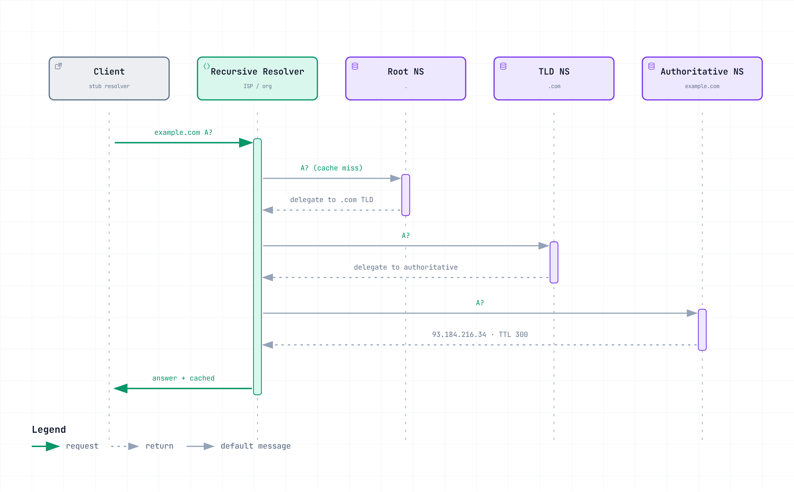

# ネットワークの基礎 Part 3 — 10のアプリケーションプロトコル

> **最終更新**: 2026年9月14日

::: tip これは4部構成のシリーズです
[Part 1: レイヤーモデル、リンク層、ルーティング層](./06-network-fundamentals-part1.md) ·
[Part 2: トランスポート層とTLS](./06-network-fundamentals-part2.md) ·
**Part 3: アプリケーションプロトコル** *(このドキュメント)* ·
[Part 4: リクエストの旅とクラウド](./06-network-fundamentals-part4.md)
:::

トランスポートプロトコルはストリームまたはデータグラムを提供し、アプリケーションプロトコルはそれらをサービスに変えます。このPartでは、名前解決（DNSとDoH）、ブートストラップ（DHCP）、運用アクセス（SSH）、メール（SMTP）、HTTP/3、WebSocket、WebRTC、gRPC、MQTTを扱います。

---

## 5. アプリケーション層 — 実際のサービス

### DNS

**定義:** ドメイン名をIPアドレスやその他のレコードへ解決する、分散型のディレクトリシステムです。

**仕組み:** DNSは階層的な委任を使用します。キャッシュミス時、再帰リゾルバはルート、TLD、権威ネームサーバーからの参照をたどるか、別のリゾルバへ転送します。キャッシュ済みの応答により、この作業の一部またはすべてを回避できます。A/AAAAレコードにはアドレス、CNAMEレコードにはエイリアス、MXレコードにはメールサーバー、TXTレコードには複数のプロトコルで使用されるテキストが含まれます。

**実務では:** DNSは分散されていますが、リゾルバ、プロバイダー、設定が共有依存関係になることがあります。DNSフェイルオーバーでは、障害検出、レコード更新、すでにキャッシュされた応答のTTL、アプリケーションキャッシュ、既存の接続を考慮してください。今TTLを短縮しても、以前にキャッシュされた応答のTTLは短くなりません。一部のリゾルバは、定義された障害条件下で古い応答も返します（RFC 8767）。各段階を測定してください。TTLが短いだけではフェイルオーバー時間を保証できません。ロードバランサーとanycastはDNSを補完できますが、それぞれにヘルス検出と収束の制限があります。

**主要なレコードタイプの一覧:**

| 種類 | 目的 | 補足 |
|---|---|---|
| A / AAAA | ドメイン → IPv4 / IPv6 | 基本 |
| CNAME | エイリアス → 正規名 | ゾーン頂点のSOA/NSとは共存不可。プロバイダー固有のALIAS/ANAMEまたはRoute 53 Aliasは、対応するターゲットへのゾーン頂点のマッピングを提供可能 |
| MX | メール受信サーバー | 優先度の数値が小さい方が優先 |
| TXT | 任意の文字列 | SPF/DKIM/DMARC、ドメイン所有権の検証 |
| NS | 委任されたネームサーバー | サブゾーンの委任 |
| SRV | サービスの場所（host+port） | 一部のプロトコルの検出 |
| CAA | 許可された証明書発行者を制限 | CAによる強制が必要。これ自体ですべての誤発行を防ぐものではない |

**DNSSECとDoHは異なる問題を解決します。** DNSSECは、検証済みの信頼チェーンを通じて、署名付きDNSデータとその完全性を認証します。クエリを暗号化するものではありません。DoHはHTTPSを使用して選択したリゾルバを認証し、クライアントとリゾルバ間の通信における機密性と完全性を保護します。悪意のある、または誤ったリゾルバが権威データを返したことを証明するものではありません。両者は併用できます。



[🔍 インタラクティブ図を表示](https://www.atomai.click/kubernetes-docs/archmaps/en-basics-06-network-fundamentals-part3-0.html)

### DoH

**定義:** HTTPSでラップされて転送されるDNSクエリです。

**仕組み:** 従来のDNSは一般に、プレーンテキストのUDP **およびTCP** ポート53を使用します。DoHはDNSメッセージをHTTPS経由で伝送し、そのホップ上の受動的な検査や改変から保護します。リゾルバエンドポイントとトラフィックメタデータによってDoHの使用が特定される可能性は残り、選択したリゾルバはクエリを確認できます。

**実務では:** 独自に選択したパブリックDoHリゾルバは、組織のリゾルバにおけるフィルタリングやログ記録を迂回し、プライベート名を解決できない場合があります。DoHは本質的にポリシーを無効化するものではありません。管理対象のDoHリゾルバはログ記録やフィルタリングを適用でき、ブラウザ/OSポリシーは承認済みのリゾルバを選択できます。暗号化の無効化が常に必要だと仮定せず、split DNSとエンドポイントポリシーをテストしてください。

### DHCP

**定義:** ホストへIPアドレスとネットワーク設定を自動的に割り当てるプロトコルです。

**仕組み:** 一般的な初期の**DHCPv4**交換はDORAです。Discover → Offer → Request → Acknowledge。ローカルブロードキャストまたはDHCPリレーがサーバーを見つけます。リースにはIPv4アドレス、サブネットマスク、ゲートウェイ、DNS設定を含められます。更新には、より短い交換を使用できます。DHCPv6では異なるメッセージを使用します。IPv6のデフォルトルーター情報は通常Router Advertisementsから取得され、SLAACも別のアドレス設定メカニズムです。

**実務では:** クラウドでは大部分が抽象化されていますが、VPCのDHCPオプションセットで再び目にします。ここでDNSサーバーとドメイン名を設定します。オンプレミスDNSを使用するハイブリッド構成で名前解決が失敗した場合、確認すべき設定はここです。

### SSH

**定義:** 暗号化されたリモートシェルアクセスとトンネリングを提供するプロトコルです。

**仕組み:** サーバーはホスト鍵で自身を認証し、鍵交換によってセッション鍵を導出した後、ユーザーを認証します（公開鍵またはパスワード）。以降のすべての通信は暗号化されます。リモートシェルに加えて、SSHはポートフォワーディング、SFTP、エージェントフォワーディングをサポートします。

**実務では:** アクセスポリシーに応じて転送を制限し、サーバーのホスト鍵を検証してください。転送されたエージェントソケットにアクセスできる侵害済みホストは、エージェントに署名または認証を要求できます。通常、転送によって秘密鍵そのものがコピーされることはありません。エージェント転送が不要な場合は、踏み台ホスト（`ProxyJump`）を使ってください。通常の鍵に固有の有効期限はありませんが、OpenSSHは証明書の有効期間と`authorized_keys`による期限の制限をサポートします。退職者のアクセスを削除し、認証情報をローテーションまたは失効させてください。

AWS Systems Manager Session Managerは、管理対象ノード、IAM権限、サービスへの接続が設定されていれば、インバウンドSSHポートを開けたりSSH鍵を配布したりせずにシェルアクセスを提供できます。CloudTrailはAPI操作を記録します。シェルの内容をCloudWatch LogsまたはS3に記録するには設定が必要です。**Session ManagerのSSHセッションとポートフォワーディングセッションでは、セッション内容を記録できません。** IAMベースのアクセスだけでは、すべてのコマンドが記録されるとは限りません。

### SMTP

**定義:** メールサーバー間でメッセージを中継するプロトコルです。

**仕組み:** クライアントはメール送信用サーバーにメールを送信し、SMTPサーバーは通常、MXレコードを検索してメッセージを中継・受信します。IMAPとPOP3は、ユーザーがメールボックスに保存済みのメッセージを取得または閲覧するためのプロトコルです。SMTPによるサーバー側のメール受信に代わるものではありません。

**実務では:** SMTP認証とTLSは送信/転送を保護しますが、それだけで表示される送信者ドメインを証明するものではありません。補完関係にある3つのドメインメカニズムが重要です。

- **SPF** — エンベロープのMAIL FROMまたはHELOの識別子に対して送信ホストを認可します。これは表示されるFromヘッダーと自動的に一致するものではありません。
- **DKIM** — 署名ドメインのDNS鍵を使って、署名対象のメッセージ内容を検証します。署名ドメインは表示されるFromドメインと異なる場合があります。
- **DMARC** — 表示されるFromドメインを、合格したSPF **または** DKIMの識別子と整合させることを求め、要求する処理やレポートのポリシーを公開します。

必要に応じてSPF、DKIM、DMARCをまとめて設定し、レポートを監視し、転送/メーリングリストの動作を考慮してください。DMARCは、整合したメカニズムが1つあれば合格できます。これらの制御は配信を保証するものでも、表示名または類似ドメインによるなりすましを排除するものでもありません。受信側もローカルポリシーを適用します。

### HTTP/3

**定義:** QUIC上で動作するHTTPの第3の主要バージョンです。

**仕組み:** HTTPの意味と動作はバージョン間で共通ですが、HTTP/3はQUICのストリームと独自のフレーミング／マッピングを使用します。TCPにおけるストリーム間の順序依存をなくしますが、ストリーム内の損失、QPACKの依存関係、共有輻輳制御によって処理が遅れることはあります。一般的なフルハンドシェイクには約1 RTTかかります。サポートされる移行機能では、アドレスが変わっても接続を維持できます。QPACKは、ストリームを独立して配信できるようHPACKに代わって使われます。

**実務では:** クライアントは、`Alt-Svc`、事前知識、または対応プロトコルを広告するHTTPS DNSレコードを通じてHTTP/3を検出できます。`Alt-Svc`は先行するTCP接続を通じて学習される場合があります。HTTPSレコードに対応するクライアントは、その通信より前にHTTP/3を検出できます。どちらの方法も、接続先への到達や特定のレイテンシ短縮を保証しません。

独立した配信と統合されたハンドシェイクは、損失の多い経路や遅延の大きい経路で役立つ場合があります。実際のレイテンシ、スループット、CPUコストは、実装、オフロード、ワークロード、ネットワーク条件に依存します。常に速くなる、または遅くなると決めつけず、モバイルやデータセンターの代表的なトラフィックで測定してください。

**3世代の比較:**

| | HTTP/1.1 | HTTP/2 | HTTP/3 |
|---|---|---|---|
| トランスポート | TCP | TCP | QUIC (UDP) |
| 接続あたりのリクエスト | 順次、または順序付き応答を伴うパイプライン処理 | 多重化 | 多重化 |
| 先頭行ブロッキング（HOL） | 順序付き応答とTCP配信 | ストリーム間のTCP順序付け | TCPのストリーム間順序付けなし。他のブロッキングは残る |
| ヘッダー圧縮 | なし | HPACK | QPACK |
| 暗号化 | 任意（HTTPS） | HTTPSにはTLS。平文のHTTP/2も存在 | TLS 1.3がQUICに統合 |

多重化によって、順序依存が生じる箇所が変わります。HTTP/3はブロッキングの原因を1つ減らしますが、スケジューリング、フロー制御、アプリケーション側の依存関係をすべてなくすわけではありません。

#### HTTP/1.1のリクエストとレスポンスの読み方 {#http11-message-structure}

HTTPの各バージョンで、メソッド、ステータスコード、フィールドの意味は共通です。HTTP/1.1では、これらが**開始行 → ヘッダーフィールド行 → 空行 → 任意の本文**として目に見える形で表れます。本文にはテキストまたはバイナリデータを含められます。「テキスト形式のHTTP/1.1」とは開始行とヘッダーを指し、すべてのペイロードがテキストであることを意味しません。

以下は**HTTP/1.1メッセージの例であり、キャプチャした出力でもコマンド手順でもありません**。読みやすさのため、表示ではLF改行を使っています。実際の通信では、開始行と各ヘッダー行は**CRLF（`\r\n`）で終わり**、さらにCRLFを加えてヘッダー部を終了します。以下の各本文は末尾の改行を含まず、`hello`の**5 ASCIIバイト**です。閉じフェンスの前に表示される改行は本文の一部ではありません。

クライアント → サーバー:

```http
POST /echo HTTP/1.1
Host: example.test
Content-Type: text/plain; charset=utf-8
Content-Length: 5

hello
```

サーバー → クライアント:

```http
HTTP/1.1 200 OK
Date: Mon, 14 Sep 2026 00:00:00 GMT
Content-Type: text/plain; charset=utf-8
Content-Length: 5

hello
```

| 要素 | 読み方 |
|---|---|
| リクエスト行 | `POST`はメソッド、`/echo`はリクエスト対象（ここではパス）、`HTTP/1.1`はバージョンです。必須の`Host`ヘッダーには、宛先のホスト名と任意のポート（authority）が入ります。 |
| ステータス行 | `HTTP/1.1`はバージョン、`200`はステータスコード、`OK`は任意の理由句です。結果の解釈にはコードを使います。 |
| ヘッダーフィールド | `名前: 値`の行でメタデータを伝えます。フィールド名では大文字と小文字を区別しません。`Content-Type`は表現のメディアタイプを示し、この例では文字セットも示します。 |
| 空行 | ヘッダー部の終わりを示します。その後に続く本文の終端は示しません。 |
| 本文 | 内容のバイト列です。この例の`Content-Length: 5`は、開始行、ヘッダー、区切りを除いた5バイトの長さを示します。Unicode文字数ではなくバイト数を数えてください。 |

**意味とフレーミングは別の問いに答えます。** メソッドは要求する処理を表します。GETは表現を取得し、HEADは本文を返さずに対応するレスポンスメタデータを要求し、POSTは対象に提供した内容の処理を依頼します。ステータスクラスは結果を要約します。1xxは情報、2xxは成功、3xxはリダイレクト、4xxはクライアントエラー、5xxはサーバーエラーです。`Content-Type`は内容の解釈方法を説明するもので、内容を区切るものではありません。これらの共通の意味については[RFC 9110](https://www.rfc-editor.org/rfc/rfc9110.html)を参照してください。

HTTP/1.1のフレーミングは、再利用可能なTCPストリーム上で、このメッセージに属するバイト数を決めます。本文を持つ一般的なメッセージでは、`Transfer-Encoding`がなく有効な`Content-Length`があれば、その値が長さを示します。`Transfer-Encoding: chunked`の場合は、チャンクサイズ、終端のゼロサイズチャンク、続く任意のトレーラー、最後の空行で本文を区切ります。送信側は両方のフィールドを送信してはなりません。一部のレスポンスは接続終了を区切りとして使います。TCPパケット境界がHTTPメッセージを区切ることはありません。

まずメソッドとステータスのルールを適用します。HEADへのレスポンスと、ステータスが1xx、204、304のレスポンスには、メタデータが表現を示す場合でも本文はありません。成功したCONNECTレスポンスはトンネルを開始します。長さも転送コーディングも指定されていないリクエストに本文はありません。こうした区別により、次のメッセージを本文として誤って読み取るのを防げます（[RFC 9112 §§2–6](https://www.rfc-editor.org/rfc/rfc9112.html)）。

**HTTP/2とHTTP/3は意味を保ちながら、テキストの開始行やCRLF境界ではなく、HEADERSやDATAフレームを含むバイナリ形式のフレーミングを使います**。HTTP/2はTCPを使い、HTTP/3はメッセージをQUICストリームに対応付けます。どちらもHTTP/1.1のチャンク転送コーディングは使いません。ツールは、実際の通信上の符号化形式を示さずに、デコードしたフィールドを読みやすいテキストで表示することがあります（[RFC 9113](https://www.rfc-editor.org/rfc/rfc9113.html)、[RFC 9114](https://www.rfc-editor.org/rfc/rfc9114.html)）。

HTTPSではTLSが通信中のHTTPヘッダーと本文を保護します。セッション鍵なしの受動的なキャプチャでは、平文は見えません（[RFC 8446 §5](https://www.rfc-editor.org/rfc/rfc8446.html#section-5)）。QUICもHTTP/3のアプリケーションデータを保護します。許可されたエンドポイントまたはTLS終端点でデコード済みのメッセージを検査し、通信経路のどの区間を観測しているか確認してください。

> 📎 Kubernetes IngressやAWSロードバランサーを使うコンテナサービスにも同じ区別を適用する前に、[LinuxのHTTPメッセージ演習](../networking/07-linux-network-diagnostics.md#http-message-lab)に取り組んでください。

### WebSocket

**定義:** 1つの接続上で双方向にメッセージをやり取りするアプリケーションプロトコルです。

**仕組み:** HTTP/1.1のハンドシェイクでは`Upgrade`と成功を示す`101`レスポンスを使います。HTTP/2とHTTP/3では、対応している場合、代わりにExtended CONNECTを使います（RFC 8441および9220）。接続が確立すると、どちらの側もHTTPで繰り返しポーリングすることなくWebSocketメッセージを送信できます。

**実務では:** 長時間維持する接続を計画してください。関連するアイドルタイムアウト内に収めるハートビート、デプロイ時のグレースフルなドレイン、ジッターを加えた再接続バックオフが必要です。各ソケットは、接続を受け付けたインスタンスに残ります。Redis Pub/Subなどの共有アプリケーション状態やメッセージングは、インスタンス間でイベントを配信できますが、接続中のソケットを移すものでも、それ自体で配信を永続化するものでもありません。ネゴシエートされたHTTPのバージョンで実際に使われたハンドシェイクと、プロキシの対応状況を確認してください。

### WebRTC

**定義:** ブラウザーやメディアサーバーなど、互換性のあるエンドポイント間でリアルタイムの音声・映像・データをやり取りするためのAPIとプロトコルです。

**仕組み:** NATによって直接接続が妨げられることはありますが、NAT配下の2つのピアが接続できる場合もあります。ICEは、ホスト、サーバー反射型（STUNで取得）、リレー型（TURN）の候補を交換して検査します。アプリケーションのシグナリングでセッション記述と候補を伝えます。選択される経路は接続確認とポリシーに依存します。メディアにはSRTPを使い、通常はDTLS-SRTPで鍵を確立します。データチャネルにはDTLS上のSCTPを使います。

**実務では:** TURNリレーを使うと、帯域幅とインフラのコストがかかります。メディアが直接届く場合でも、シグナリング、STUN、その他のサービスのコストは残ります。NATのマッピング／フィルタリングとファイアウォールの動作は接続性に影響するため、「対称型NAT」という呼び方だけでリレーが必須だとは判断できません。TURNへのフォールバックも見込んで予算を確保し、実際のネットワークでテストしてください。SFUは複数参加者向けの一般的な方式です。完全なピアメッシュよりクライアントの送信量を減らせますが、その分サーバーの帯域幅と計算資源を使います。

### gRPC

**定義:** 標準の通信方式としてHTTP/2を使い、通常はProtocol Buffersのサービス定義とメッセージスキーマを利用するRPCフレームワークです。

**仕組み:** Protocol Buffersの定義からクライアント／サーバーコードを生成でき、単項、サーバー側ストリーミング、クライアント側ストリーミング、双方向ストリーミングのRPCをサポートします。バイナリ形式はコンパクトにできますが、JSONと比べたサイズや速度はデータ、実装、圧縮方式に依存し、プロトコルで保証されるものではありません。

**実務では:** 通常のgRPCは多くのサービスAPIに適しています。ブラウザーAPIは通常のgRPCに必要な機能をすべて公開していないため、ブラウザークライアントでは一般に、互換性のあるサーバーまたは変換プロキシとgRPC-Webを組み合わせます。利用できるストリーミング方式は実装によって異なります。内容の確認やデバッグには、スキーマに対応したツールを使ってください。

gRPCチャネルは**0個以上のHTTP/2接続**を使い、多数のRPCで長時間維持される接続を共有できます。L4負荷分散は接続ごとにバックエンドを選ぶため、接続プールが小さいとRPCトラフィックが一部に集中することがあります。RPCごとの分散は保証されません。適切なクライアント側のポリシーか、gRPCに対応するL7プロキシ（サービスメッシュの一部の場合もあります）を検討してください。確立済みのストリームは、選択されたバックエンドに残ります。スキーマを進化させる場合は、削除したProtocol Buffersのフィールド番号と名前を予約し、番号を再利用しないでください。

> 📎 IstioにおけるgRPC処理については、[Istio gRPC Advanced](../service-mesh/istio/advanced/05-grpc.md)を参照してください。

### MQTT

**定義:** 軽量なパブリッシュ／サブスクライブ型のメッセージングプロトコルです。

**仕組み:** クライアントはブローカーに接続し、トピックをパブリッシュ／サブスクライブします。固定ヘッダーは最小2バイトですが、実際のパケットには可変ヘッダー、プロパティ、ペイロードが含まれる場合があります。QoS 0/1/2は、**該当する送信者と受信者の間でのプロトコル上の配信**を、それぞれ最大1回、最低1回、正確に1回行います。パブリッシャーからブローカーへの配信と、ブローカーからサブスクライバーへの配信は別々です。設定されたWillは、指定された切断条件でパブリッシュできます。MQTT 5のWill Delayや再接続時の動作によって、Willが送信されるタイミングは変わります。

**実務では:** メッセージの損失や重複をどこまで許容できるか、コストはいくらかを踏まえてQoSを選んでください。QoS 2で正常に配信する場合、通常はPUBLISH、PUBREC、PUBREL、PUBCOMPを交換します。ただし、アプリケーションのデータベース更新や業務処理全体が正確に1回だけ実行されるわけではありません。QoS 1とアプリケーション側の重複排除を組み合わせるのも選択肢です。選んだ製品に応じて、ブローカーの可用性、永続セッション／メッセージの状態、復旧方法を計画してください。TLSと適切なデバイス認証／認可方式を使ってください。クライアント証明書も選択肢の1つですが、プロビジョニングとローテーションが必要です。


**主な参考資料**: [DoH](https://www.rfc-editor.org/rfc/rfc8484.html), [DNS serve-stale](https://www.rfc-editor.org/rfc/rfc8767.html), [OpenSSH](https://man.openbsd.org/ssh), [Session Manager](https://docs.aws.amazon.com/systems-manager/latest/userguide/session-manager.html), [DMARC](https://www.rfc-editor.org/rfc/rfc7489.html), [HTTP/3](https://www.rfc-editor.org/rfc/rfc9114.html), [ICE](https://www.rfc-editor.org/rfc/rfc8445.html), [gRPC performance](https://grpc.io/docs/guides/performance/), [MQTT 5.0](https://docs.oasis-open.org/mqtt/mqtt/v5.0/os/mqtt-v5.0-os.html).
---

**次へ:** [Part 4: リクエストの旅とクラウド](./06-network-fundamentals-part4.md)
