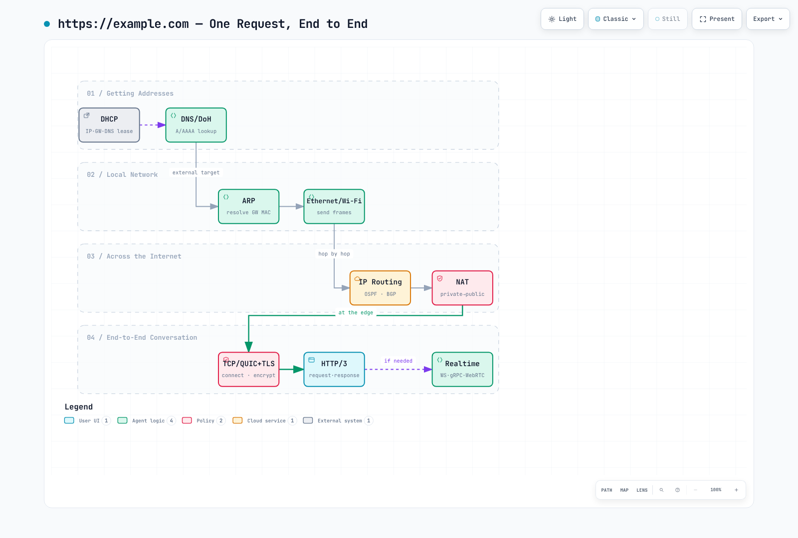

# ネットワークの基礎 第4部：リクエストの旅路とクラウドへの対応付け

> **最終更新日**: 2026年10月12日

::: tip 全5部構成のシリーズです
[第1部：レイヤーモデル、リンク層とルーティング層](./06-network-fundamentals-part1.md) ·
[第2部：トランスポート層とTLS](./06-network-fundamentals-part2.md) ·
[第3部：アプリケーションプロトコル](./06-network-fundamentals-part3.md) ·
**第4部：リクエストの旅路とクラウド** *(このドキュメント)* ·
[第5部：ネットワークデバイス、LANとWAN](./06-network-fundamentals-part5.md)
:::

このパートでは、例示的なリクエストを通じてシリーズで扱った25のプロトコルとメカニズムを結び付け、関連する責務をAWSとKubernetesに対応付けます。これらは機能上の比較であり、1対1の置き換えではありません。

[🔍 インタラクティブ図を見る](https://www.atomai.click/kubernetes-docs/archmaps/en-basics-06-network-fundamentals-part4-0.html)

---

## 6. 1つのリクエストを最初から最後まで追う

`https://example.com` への新しい接続では、次の手順が概念上の依存関係を示します。これはパケットトレースではありません。DNSクエリやハンドシェイクのパケット自体もリンク層とルーティング層を使い、キャッシュされた状態や既存の接続があれば、処理の一部を省略できます。

1. **アドレス設定**：ホストにはすでにアドレス、ルート、リゾルバーの設定があります。これらはDHCP、静的設定、IPv6 SLAAC/Router Advertisement、または別の管理された仕組みによって設定されます。
2. **DNS（またはDoH）**：必要に応じて宛先を名前解決します。再帰リゾルバーはキャッシュを使ったり、委任をたどったり、クエリを転送したりできます。アプリケーションがルートサーバーに直接問い合わせる必要はありません。HTTPSレコードによって接続パラメーターが通知される場合もあります。
3. **近隣解決**：Ethernet上のIPv4では、選択された次ホップのMACアドレスがキャッシュにない場合、ARPを使って解決します。IPv6ではNeighbor Discoveryを使います。次ホップは同一ネットワーク上の宛先の場合も、ルーターの場合もあります。
4. **Ethernet / Wi-Fi**：その次ホップにフレームを送信します。デフォルトゲートウェイを使うのは、選択されたルートがそれを必要とする場合だけです。
5. **IPルーティング**：ルーターは転送テーブルを使ってパケットを転送します。ルートは静的、直結、またはBGP、OSPFなどの制御プレーンを通じて学習されたものです。ルーティングプロトコルは、リクエストごとに新たなネゴシエーションを行うわけではありません。
6. **必要に応じたNAT**：IPv4のインターネット向けエグレス経路では、プライベートアドレスをパブリックアドレスに変換する場合があります。内部経路やIPv6経路の多くではNATを使いませんが、プライベートアドレスから別のプライベートアドレスへのNATもあります。
7. **TCPまたはQUIC**：トランスポート接続を確立するか、既存の接続を再利用します。HTTP/1.1とHTTP/2は通常TCPを使い、HTTP/3はUDP上のQUICを使います。
8. **TLS**：ハンドシェイク方式に応じてピアを認証し、通信鍵を確立します。QUICではTLS 1.3が手順7に統合されています。再開時の処理は、新しい証明書ベースのハンドシェイクとは異なります。
9. **HTTP**：ネゴシエートされたバージョンを使ってリクエストとレスポンスを交換します。HTTP/3にはQUIC経路が必要で、TCP経路上では動作しません。
10. **必要に応じたアプリケーション機能**：WebSocket、ブラウザー対応のgRPC、WebRTCは、実装に応じて追加の接続を作成したり、既存のトランスポートを再利用または多重化したりします。

**ICMP**は、宛先に到達できない場合や、パスに対してパケットが大きすぎる場合など、IP層の特定のエラーを報告できます。ただし、すべての障害を報告するわけではありません。パケットやICMPエラーがフィルタリングされることがあり、TLSやアプリケーションの障害にはそれぞれ独自の仕組みが使われます。許可された関連性のあるICMPと、トランスポート／アプリケーションのログや測定値を組み合わせて確認してください。ICMPエラーがないからといって、成功した証拠にはなりません。

---

## 7. これらの概念はクラウドでどう位置付けられるか

クラウドネットワークでもアドレス指定、ルーティング、フィルタリング、トランスポートの責務は変わりませんが、従来のアプライアンスとは境界が異なります。AWSでは次のように対応します。

| 従来の概念 | AWSでの対応 |
|---|---|
| セグメンテーションとフィルタリング | 論理ネットワークの境界にはVPC／サブネット、フィルタリングにはセキュリティグループとNACLを使用。VLANに相当するものではない |
| ルーティングテーブル | VPCルートテーブル、Transit Gateway |
| BGPピアリング | Direct Connect仮想インターフェイス、動的ルーティングを使うSite-to-Site VPN（静的ルーティングのVPNも可能） |
| NAT／プライベートなサービスアクセス | NAT Gatewayはアドレスを変換し、VPCエンドポイントは対応サービスへのプライベート経路を提供する |
| DNSサーバー | Route 53、Resolverエンドポイント |
| DHCP | VPC DHCPオプションセット |
| TLS終端／証明書 | ALBのHTTPSリスナー、NLBのTLSリスナー、またはCloudFront。ACMは対応する証明書を管理し、トラフィックを転送するわけではない |
| L7ロードバランシング | ALB。別途管理されるサービスメッシュ内のIstio／Envoyなどのアプリケーションプロキシ |
| SSHアクセス | Systems Manager Session Manager |
| 内部セグメントの暗号化 | アプリケーションまたはプロキシでのTLS/mTLS。ネットワーク層の暗号化は別途設計する選択肢 |

AWS App Meshのサポートは**2026年9月30日に終了しました**。AWSによると、その日以降はApp Meshコンソールとリソースにアクセスできなくなっています。既存のデプロイメントでは、制御および管理の経路が失われています。公式のサポート終了通知と移行ガイダンスを参照してください。

設計時に**最初に決めるべき3つのこと**は次のとおりです。

1. **IPアドレス計画**：オンプレミス、Pod、Serviceの範囲を含め、相互接続が必要なネットワークのCIDRを計画します。範囲が重複するとアドレス変換や再設計が必要になる場合があります。アドレスの再割り当てには運用コストが伴いますが、普遍的に適用できるコストの順位付けはありません。
2. **アウトバウンド経路**：各宛先に応じて、インターネット向けまたはプライベートサービス向けの経路を選びます。NATの時間料金とデータ処理料金、インターフェイスエンドポイントの時間料金とデータ処理料金、AZ間の転送料金、可用性要件を比較します。S3／DynamoDBのゲートウェイエンドポイントには追加のエンドポイント料金はかかりませんが、すべてのインターネット宛先をエンドポイントで代替できるわけではありません。
3. **暗号化の終端点**：ロードバランサーの背後にある接続も含め、各ホップでの暗号化と認証を記録します。ワークロードの要件と適用されるポリシーを確認してください。TLSを終端するだけでは、次のホップは保護されません。

---

## 8. Kubernetesでこれらの処理を担うもの

クラスター内では、同じ概念が新しいコンポーネント名で繰り返し登場します。この表は、本シリーズから後続の詳しい解説ドキュメントへの橋渡しとなります。

| 従来の概念 | Kubernetesでの対応 |
|---|---|
| Pod IPの割り当て | CNI/IPAMとの連携（VPC CNI、Cilium、…）。Podごとに必ずDHCPを使うわけではない |
| ローカル配送／転送 | ホストインターフェイス、近隣処理、CNIデータパス。実装によってveth、ルート、トンネル、eBPFを使う場合がある |
| DNS | クラスターDNS。多くの場合はCoreDNSを使用する。`service.namespace.svc.<cluster-domain>`（`cluster.local`はよく使われる設定済みドメイン） |
| Service仮想IP／L4ロードバランシング | Linux上のkube-proxy：iptablesまたはnftables。IPVSは1.35以降非推奨。eBPF実装でkube-proxyを置き換えることもできるが、kube-proxyのモードではない |
| Podのトラフィックポリシー | NetworkPolicy。対応するネットワークコントローラー／プラグインによってのみ適用される |
| L7ルーティング／TLS終端 | Ingress／Gateway APIリソースと、それを実装するコントローラーおよびデータプレーン |
| Service間のmTLS | アプリケーションのTLS、または設定済みのIstio／Linkerdなどのメッシュ。CNIをインストールしただけでは有効にならない |
| BGPルーティング／広告 | 例：CalicoのBGPルート、またはMetalLBによるServiceアドレスのBGP広告。役割はそれぞれ異なる |

Podをバックエンドとする通常のClusterIP Serviceでは、クラスターDNSは通常、ServiceのIPを名前解決します。その後、kube-proxyまたはその代替がService／EndpointSliceの状態を使って、利用可能なエンドポイントを選びます。データパスは、そのエンドポイントが同じノード上にある場合も、別のノード上にある場合も、そこへ転送します。Headless Serviceは代わりにDNSを通じてエンドポイントアドレスを公開し、ExternalName ServiceはCNAMEを返します。mTLSが適用されるのは、関連するピアとポリシーが設定されている場合だけです。こうした違いがあるため、「常にすべてのレイヤーが動作する」という想定は、パケットフローを考えるうえで正しくありません。

---

## まとめ

これら25のプロトコルとメカニズムを見てきたところで、それぞれのトレードオフと保証の範囲を確認しましょう。

TCPは、順序を保証した信頼性の高い配送を提供しますが、回復と順序制御にはコストが伴います。UDPはこれらの機能を上位レイヤーに委ねます。QUICは、UDP上で信頼性の高いストリームと統合されたセキュリティを提供します。NATはパブリックIPv4アドレスを節約しますが、外部からの到達性を複雑にします。その解決にはICE/STUN/TURNが役立ちます。DoHはリゾルバーまでの1ホップを保護します。組織がどの程度可視性を得られるかは、リゾルバーとエンドポイントのポリシーに左右されます。

障害を調査するときは、各レイヤーが実際に提供する保証と観測可能な証拠を使って、障害の範囲を絞り込みましょう。プロトコルレベルで妥当に思える説明も、ログ、トレース、または測定値によって他の可能性と区別できるまでは仮説にすぎません。

---

## 次のドキュメント

まずLinux上での観測とこれらのプロトコルの基礎を結び付け、その後[ネットワーキングの学習パス](../networking/README.md#learning-path)に沿って、コンテナやServiceからCNI実装へと進みましょう。

- [第5部：ネットワークデバイス、LANとWANの基礎](./06-network-fundamentals-part5.md)：デバイスごとの転送判断、VLAN/STP/FHRP、NATとCGNAT、WANの種類 | [クイズ](../quizzes/basics/06-network-fundamentals-part5-quiz.md)
- [カーネルネットワーキングスタック](../kernel/02-network-stack.md)：ソケット／VFSの入口、バッファー、パケット処理
- [Linuxネットワーク診断の実践](../networking/07-linux-network-diagnostics.md)：観測結果の解釈と仮説の検証 | [クイズ](../quizzes/networking/07-linux-network-diagnostics-quiz.md)
- [eBPFの基礎](./05-ebpf-fundamentals.md)：カーネル内でパケットが処理される仕組み
- [Ciliumネットワーキング](../networking/cilium/03-networking.md)：eBPFベースのCNI
- [Calico BGPの詳細解説](../networking/calico/04-bgp-deep-dive.md)：クラスター内のBGPルーティング
- [Amazon VPC CNI](../networking/01-vpc-cni.md)：VPC CNIとIPアドレスの割り当て

## 参考資料

プロトコルの一覧は、ByteByteGoのインフォグラフィック「What Keeps the Internet Running?」を参考に作成しました。解説と実践的なコメントは独自に執筆しています。

主な参考資料：[Kubernetes Serviceプロキシのモード](https://kubernetes.io/docs/reference/networking/virtual-ips/)、[ServiceのDNS](https://kubernetes.io/docs/concepts/services-networking/dns-pod-service/)、[NetworkPolicy](https://kubernetes.io/docs/concepts/services-networking/network-policies/)、[NAT Gatewayの料金ガイダンス](https://docs.aws.amazon.com/vpc/latest/userguide/nat-gateway-pricing.html)、[ECR VPCエンドポイント](https://docs.aws.amazon.com/AmazonECR/latest/userguide/vpc-endpoints.html)、[App Meshのライフサイクル](https://docs.aws.amazon.com/app-mesh/latest/userguide/what-is-app-mesh.html)。
