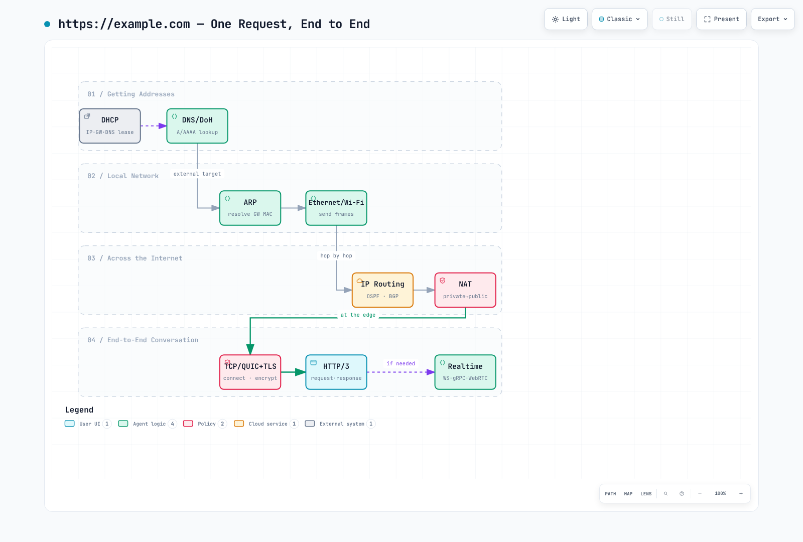

# ネットワークの基礎 第4部：リクエストの道のりとクラウドへの対応付け

> **最終更新日**: 2026年10月12日

::: tip 全4部構成のシリーズです
[第1部：レイヤーモデル、リンク層、ルーティング層](./06-network-fundamentals-part1.md) ·
[第2部：トランスポート層とTLS](./06-network-fundamentals-part2.md) ·
[第3部：アプリケーションプロトコル](./06-network-fundamentals-part3.md) ·
**第4部：リクエストの道のりとクラウド** *(このドキュメント)*
:::

このパートでは、例示的なリクエストを通じてシリーズで取り上げた25のプロトコルとメカニズムをつなぎ、関連する責務をAWSとKubernetesに対応付けます。ここで示すのは機能上の比較であり、1対1の置き換えではありません。

[🔍 インタラクティブ図を表示](https://www.atomai.click/kubernetes-docs/archmaps/en-basics-06-network-fundamentals-part4-0.html)

---

## 6. 1つのリクエストを最後までたどる

`https://example.com` への新しい接続について、以下に概念上の依存関係を示します。これはパケットトレースではありません。DNSクエリやハンドシェイクのパケット自体もリンク層とルーティング層を使います。また、キャッシュされた状態や既存の接続があれば、処理を省略できます。

1. **アドレス設定**: ホストにはすでにアドレス、経路、リゾルバー設定があり、DHCP、静的設定、IPv6 SLAAC/Router Advertisement、または別の管理された仕組みから取得します。
2. **DNS（またはDoH）**: 必要に応じて宛先を名前解決します。再帰リゾルバーはキャッシュを利用したり、委任をたどったり、クエリを転送したりできます。アプリケーションがルートサーバーに直接問い合わせる必要はありません。HTTPSレコードが接続パラメーターを通知することもあります。
3. **近隣ノードの解決**: Ethernet上のIPv4では、選択された次ホップのMACアドレスがキャッシュにない場合、ARPで解決します。IPv6ではNeighbor Discoveryを使います。次ホップはローカルの宛先かルーターです。
4. **Ethernet / Wi-Fi**: 次ホップにフレームを送信します。デフォルトゲートウェイが使われるのは、選択された経路で必要な場合だけです。
5. **IPルーティング**: ルーターは転送テーブルを使ってパケットを転送します。経路は静的、直結、またはBGP、OSPFなどの制御プレーンを通じて学習されたものです。ルーティングプロトコルがリクエストごとに新たなネゴシエーションを行うわけではありません。
6. **任意のNAT**: IPv4インターネットへの送信経路では、プライベートアドレスをパブリックアドレスに変換することがあります。内部経路やIPv6の経路の多くではNATを使いませんが、プライベートアドレス間のNATもあります。
7. **TCPまたはQUIC**: トランスポートを確立するか、既存のものを再利用します。HTTP/1.1とHTTP/2は一般にTCPを使い、HTTP/3はUDP上のQUICを使います。
8. **TLS**: ハンドシェイク方式に応じて、相手を認証し、トラフィック鍵を確立します。QUICではTLS 1.3が手順7に統合されています。再開時の処理は、証明書を用いる新規ハンドシェイクとは異なります。
9. **HTTP**: ネゴシエーションされたバージョンを使ってリクエストとレスポンスを交換します。HTTP/3にはQUICの経路が必要であり、TCPの経路では動作しません。
10. **任意のアプリケーション機能**: WebSocket、ブラウザー互換のgRPC、またはWebRTCは、実装に応じて追加の接続を作成したり、既存のトランスポートを再利用または多重化したりします。

**ICMP**は、宛先に到達できない、またはパケットが経路のMTUを超えているなど、特定のIP層エラーを報告できます。すべての障害を報告するわけではありません。パケットやICMPエラーがフィルタリングされることがあり、TLSやアプリケーションの障害にはそれぞれ独自の仕組みがあります。許可されている関連性の高いICMPの情報を、トランスポート／アプリケーションのログや計測値と組み合わせてください。ICMPエラーがないことは、成功の証明にはなりません。

---

## 7. クラウドではこれらの概念はどこに当てはまるか

クラウドネットワーキングでも、アドレス指定、ルーティング、フィルタリング、トランスポートの責務は変わりませんが、従来のネットワーク機器とは境界が異なります。AWSでは次のようになります。

| 従来の概念 | AWSでの対応 |
|---|---|
| セグメンテーションとフィルタリング | 論理ネットワークの境界にはVPC/subnet、フィルタリングにはsecurity groupとNACLを使用します。VLANに相当するものではありません |
| ルーティングテーブル | VPC route table、Transit Gateway |
| BGPピアリング | Direct Connect virtual interface、動的ルーティングを使用するSite-to-Site VPN（静的VPNルーティングも可能） |
| NAT / プライベートサービスへのアクセス | NAT Gatewayはアドレスを変換し、VPC endpointは対応サービスへのプライベート経路を提供します |
| DNSサーバー | Route 53、Resolver endpoint |
| DHCP | VPC DHCP option set |
| TLS終端 / 証明書 | ALB HTTPS listener、NLB TLS listener、またはCloudFront。ACMは対応する証明書を管理しますが、トラフィックを転送するものではありません |
| L7ロードバランシング | ALB、または別途管理されるサービスメッシュ内のIstio/Envoyなどのアプリケーションプロキシ |
| SSHアクセス | Systems Manager Session Manager |
| 内部セグメントの暗号化 | アプリケーションまたはプロキシでのTLS/mTLS。ネットワーク層の暗号化は別途設計する選択肢です |

AWS App Meshのサポートは**2026年9月30日に終了しました**。AWSによると、その日以降はApp Meshコンソールとリソースにアクセスできません。既存のデプロイでは、制御と管理の経路が失われています。公式のサポート終了のお知らせと移行ガイダンスを確認してください。

設計時にまず行うべき**3つの判断**：

1. **IPアドレス計画**: オンプレミス、Pod、Serviceの範囲を含め、相互接続が必要なネットワークのCIDRを計画します。範囲が重複すると変換や再設計が必要になることがあります。アドレスの再割り当てには運用コストがかかりますが、あらゆるケースに適用できる一律のコスト順位はありません。
2. **アウトバウンド経路**: 各宛先に対し、インターネット経由またはプライベートサービス経由の経路を選びます。NATの時間料金／データ処理料金、インターフェイスエンドポイントの時間料金／データ処理料金、AZ間の転送料、可用性要件を比較します。S3/DynamoDBのゲートウェイエンドポイントには追加のエンドポイント料金はかかりませんが、あらゆるインターネット上の宛先へのアクセスを代替するものではありません。
3. **暗号化の終端点**: ロードバランサーの後段のバックエンド接続も含め、各ホップでの暗号化と認証を記録します。ワークロードの要件と適用されるポリシーを確認してください。TLSを終端するだけでは次のホップは保護されません。

---

## 8. Kubernetesでは誰がこの処理を担うか

クラスター内では、同じ概念が新たなコンポーネント名で繰り返し現れます。この表は、このシリーズから続く詳解ドキュメントへの橋渡しです。

| 従来の概念 | Kubernetesでの対応 |
|---|---|
| Pod IPの割り当て | CNI/IPAM統合（VPC CNI、Cilium、…）。Podごとに必ずDHCPを使うわけではありません |
| ローカル配送 / 転送 | ホストインターフェイス、近隣ノードの処理、CNI datapath。実装ではveth、経路、トンネル、またはeBPFを使うことがあります |
| DNS | クラスターDNS（多くの場合CoreDNS）。`service.namespace.svc.<cluster-domain>`（`cluster.local`はよく設定されるドメインです） |
| Service仮想IP / L4ロードバランシング | Linux上のkube-proxy：iptablesまたはnftables。IPVSは1.35以降非推奨です。eBPF実装でkube-proxyを置き換えることもできますが、これはkube-proxyのモードではありません |
| Podトラフィックポリシー | NetworkPolicy。対応するネットワーキングコントローラー／プラグインによってのみ適用されます |
| L7ルーティング / TLS終端 | Ingress/Gateway APIリソースと、それを実装するコントローラーおよびデータプレーン |
| Service間のmTLS | アプリケーションのTLS、または設定済みのIstio/Linkerdなどのメッシュ。CNIをインストールしただけでは有効になりません |
| BGPルーティング / 広告 | 例：Calico BGPによる経路、またはMetalLB BGPによるServiceアドレスの広告。役割は異なります |

Podをバックエンドとする通常のClusterIP Serviceでは、一般にクラスターDNSがService IPを名前解決し、その後kube-proxyまたはその代替がService/EndpointSliceの状態に基づいて利用可能なエンドポイントを選択します。データプレーンは、同じノードまたは別のノードにあるそのエンドポイントへ転送します。これに対し、Headless ServiceはDNSを通じてエンドポイントアドレスを公開し、ExternalName ServiceはCNAMEを返します。mTLSが適用されるのは、該当する通信相手とポリシーが設定されている場合だけです。こうした違いがあるため、「すべてのレイヤーが常に動作する」という前提は、パケットフローの理解には適しません。

---

## まとめ

これら25のプロトコルとメカニズムをたどった後は、それぞれのトレードオフと保証の範囲を確認しましょう。

TCPは順序どおりの信頼性ある配信を提供しますが、回復処理や順序制御にコストが伴います。UDPはこれらの機能を上位層に委ねます。QUICはUDP上で、信頼性のあるストリームと統合されたセキュリティを提供します。NATはパブリックIPv4アドレスを節約する一方、外部からの到達性を複雑にします。その解決にはICE/STUN/TURNが役立ちます。DoHはリゾルバーまでの1ホップを保護します。組織内での可視性は、リゾルバーとエンドポイントポリシーによって変わります。

障害を調査する際は、各レイヤーが実際に保証する内容と観測可能な証拠を使って、障害の範囲を絞り込んでください。プロトコルレベルで妥当と思われる説明も、ログ、トレース、計測によって他の可能性と区別されるまでは仮説にすぎません。

---

## 次のドキュメント

まずLinux上での観測とプロトコルの基礎を結び付け、その後、コンテナやServiceからCNI実装まで、[ネットワーキング学習パス](../networking/README.md#learning-path)に沿って読み進めてください。

- [カーネルネットワーキングスタック](../kernel/02-network-stack.md)：socket/VFSの入口経路、バッファー、パケット処理
- [Linuxネットワーク診断の実践](../networking/07-linux-network-diagnostics.md)：観測結果を解釈し、仮説を検証する | [クイズ](../quizzes/networking/07-linux-network-diagnostics-quiz.md)
- [eBPFの基礎](./05-ebpf-fundamentals.md)：カーネルでのパケット処理の仕組み
- [Ciliumネットワーキング](../networking/cilium/03-networking.md)：eBPFベースのCNI
- [Calico BGP詳解](../networking/calico/04-bgp-deep-dive.md)：クラスター内のBGPルーティング
- [Amazon VPC CNI](../networking/01-vpc-cni.md)：VPC CNIとIP割り当て

## 参考資料

プロトコルの一覧はByteByteGoのインフォグラフィック「What Keeps the Internet Running?」を参考にしています。説明と実践的な解説は独自に執筆しました。

主な参考資料：[Kubernetes Serviceのプロキシモード](https://kubernetes.io/docs/reference/networking/virtual-ips/)、[Service DNS](https://kubernetes.io/docs/concepts/services-networking/dns-pod-service/)、[NetworkPolicy](https://kubernetes.io/docs/concepts/services-networking/network-policies/)、[NAT Gatewayの料金ガイダンス](https://docs.aws.amazon.com/vpc/latest/userguide/nat-gateway-pricing.html)、[ECR VPC endpoint](https://docs.aws.amazon.com/AmazonECR/latest/userguide/vpc-endpoints.html)、[App Meshのライフサイクル](https://docs.aws.amazon.com/app-mesh/latest/userguide/what-is-app-mesh.html)。
