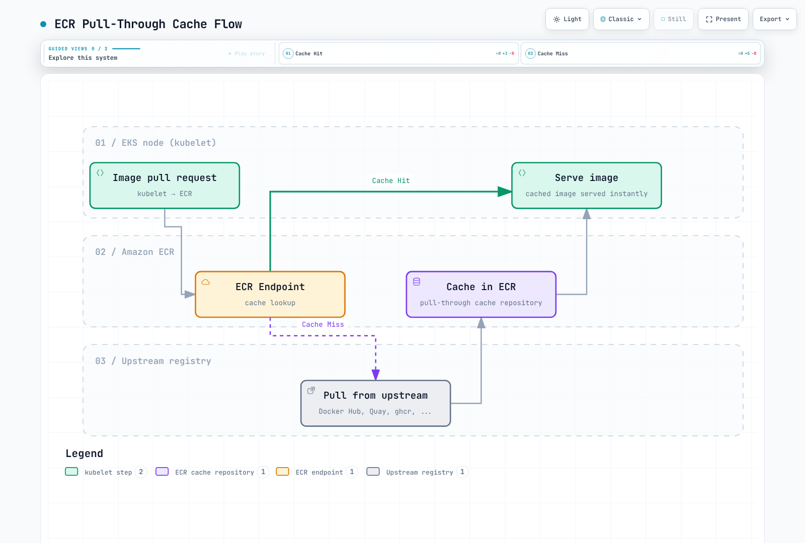

# Amazon ECR (Elastic Container Registry)

> **最終更新日**: 2026年10月16日

## ECR の概要

Amazon Elastic Container Registry (ECR) は AWS が提供するフルマネージド型コンテナレジストリサービスです。独自にコンテナレジストリのインフラストラクチャを運用せずに済み、AWS サービス、とくに Amazon EKS と緊密に統合できます。

特に指定がない限り、CLI/CDK/IAM/ライフサイクルの例は ECR Private を対象とします。それぞれは代替の構成例であり、すべてを無条件に1つのスクリプトとして実行するものではありません。同じリポジトリを二重に作成せず、作成方法を1つ選んでください。スキャン/照会の例では、既存のリポジトリとイメージタグが必要です。AWS 認証情報を設定し、サンプルのアカウント/リソース識別子を置き換えます。

```bash
export AWS_REGION=us-east-1
export AWS_DEFAULT_REGION="$AWS_REGION"
```

### アーキテクチャ

ECR はリージョンサービスとして動作し、2種類のサービスを提供します。


[🔍 対話型図を表示](https://www.atomai.click/kubernetes-docs/archmaps/en-container-registry-02-amazon-ecr-0.html)

**ECR Private**: IAM ベースのアクセス制御で内部コンテナイメージを扱います。イメージはリージョン単位で保存され、リージョン間で複製できます。

**ECR Public**: 公開イメージを配布します。管理 API endpoint は `us-east-1` と `us-west-2` で利用でき、イメージにはグローバルな `public.ecr.aws` URL を使います。図にある us-east-1 は一例であり、唯一の endpoint という意味ではありません。

### 料金

| 項目 | 料金 |
|-----------|-------|
| **ストレージ** | リージョン/ストレージクラス別料金。公式の標準ストレージ例では $0.10/GB-month |
| **同一リージョン内の対応 AWS コンピューティングへの転送** | ECR の転送料はなし。ネットワークサービスの料金は別 |
| **リージョン間/インターネット転送** | 送信元、宛先、料金段階、無料枠を確認する。常に $0.02/GB ではない |
| **ECR Public** | ストレージ、匿名転送、認証済み転送で無料枠が異なる |
| **Basic Scanning** | 無料 |
| **Enhanced Scanning** | Amazon Inspector の料金が適用 |

AWS Signer、KMS、VPC endpoint にも料金が発生する場合があります。実際の見積もりには[現在の ECR 料金](https://aws.amazon.com/ecr/pricing/)を、API リージョンには[Public endpoint 一覧](https://docs.aws.amazon.com/general/latest/gr/ecr-public.html)を使ってください。

### リージョンサービスに関する考慮事項

ECR はリージョンサービスです。主な影響は以下のとおりです。

- `us-east-1` に push したイメージが `eu-west-1` から自動的に利用できるわけではない
- クロスリージョン pull にはデータ転送料金が発生する
- マルチリージョンデプロイではレプリケーションを使う
- VPC endpoint はリージョンごとに設定する

## リポジトリの作成と設定

### AWS CLI

```bash
# Create a basic repository
aws ecr create-repository \
  --repository-name myapp \
  --region us-east-1

# Alternative example using a separate repository; the KMS key must exist
aws ecr create-repository \
  --repository-name myapp-secure \
  --image-tag-mutability IMMUTABLE \
  --image-scanning-configuration scanOnPush=true \
  --encryption-configuration encryptionType=KMS,kmsKey=alias/ecr-key \
  --tags Key=Environment,Value=production Key=Team,Value=platform \
  --region us-east-1
```

### AWS CDK (TypeScript)

```typescript
import * as cdk from 'aws-cdk-lib';
import * as ecr from 'aws-cdk-lib/aws-ecr';
import * as kms from 'aws-cdk-lib/aws-kms';
import { Construct } from 'constructs';

export class EcrStack extends cdk.Stack {
  constructor(scope: Construct, id: string, props?: cdk.StackProps) {
    super(scope, id, props);

    // KMS key for encryption
    const ecrKey = new kms.Key(this, 'EcrKey', {
      description: 'KMS key for ECR encryption',
      enableKeyRotation: true,
      alias: 'ecr-key',
    });

    // ECR Repository
    const repository = new ecr.Repository(this, 'MyAppRepo', {
      repositoryName: 'myapp',
      imageScanOnPush: true,
      imageTagMutability: ecr.TagMutability.IMMUTABLE,
      encryption: ecr.RepositoryEncryption.KMS,
      encryptionKey: ecrKey,
      lifecycleRules: [
        {
          rulePriority: 1,
          description: 'Keep last 100 production images',
          tagStatus: ecr.TagStatus.TAGGED,
          tagPatternList: ['v*'],
          maxImageCount: 100,
        },
        {
          rulePriority: 2,
          description: 'Expire untagged images after 3 days',
          tagStatus: ecr.TagStatus.UNTAGGED,
          maxImageAge: cdk.Duration.days(3),
        },
      ],
    });

    // Output repository URI
    new cdk.CfnOutput(this, 'RepositoryUri', {
      value: repository.repositoryUri,
      description: 'ECR Repository URI',
    });
  }
}
```

### リポジトリ設定

#### イメージタグの変更可能性

| 設定 | 説明 | 用途 |
|---------|-------------|----------|
| `MUTABLE` (デフォルト) | タグを上書きできる | 開発、CI ビルド |
| `IMMUTABLE` | 既存タグを上書きできない | そのタグが存在する間の安定したリリース参照 |
| `IMMUTABLE_WITH_EXCLUSION` | 例外に一致するタグだけ上書きできる | `latest` のような明示的に変更可能な別名 |

```bash
# Update existing repository to immutable
aws ecr put-image-tag-mutability \
  --repository-name myapp \
  --image-tag-mutability IMMUTABLE
```

#### 暗号化オプション

| 種類 | 説明 | 料金 |
|------|-------------|------|
| `AES256` (デフォルト) | Amazon S3 が管理する暗号化キー (SSE-S3) | KMS キーの個別料金なし |
| `KMS` | AWS 管理の ECR キー、または指定したカスタマー管理 KMS キー | 該当する KMS 料金 |

KMS 暗号化の利点:

- CloudTrail でキーの使用状況を監査
- きめ細かなアクセス制御
- キーローテーションに対応
- キーのライフサイクルを明示的に管理

キーはリポジトリと同じリージョンにある必要があります。既存リポジトリの暗号化構成は変更できません。新しいリポジトリへの移行を計画し、インフラストラクチャを変更する前に `cdk diff` を確認してください。

#### Push 時のスキャン

| スキャン種別 | 説明 | 料金 |
|-----------|-------------|------|
| Basic Scanning | AWS ネイティブ技術による OS CVE スキャン | 無料 |
| Enhanced Scanning | 継続監視を行う Amazon Inspector | Inspector の料金 |

```bash
# Inspect existing rules before replacing account/region registry configuration
aws ecr get-registry-scanning-configuration
# Isolated-registry example; merge existing production rules rather than dropping them
aws ecr put-registry-scanning-configuration \
  --scan-type ENHANCED \
  --rules '[{"repositoryFilters":[{"filter":"*","filterType":"WILDCARD"}],"scanFrequency":"CONTINUOUS_SCAN"}]'

# Check scan findings
aws ecr describe-image-scan-findings \
  --repository-name myapp \
  --image-id imageTag=v1.0.0
```

Basic スキャンの新規設定では、`SCAN_ON_PUSH` filter を使うレジストリレベルの `BASIC` ルールを使用します。作成例にあるリポジトリレベルの `imageScanOnPush`/CLI オプションは、以前との互換性のための設定です。Basic スキャンには、イメージごとに24時間あたりの上限があります。検出結果を解釈する前にスキャン完了を待ってください。Enhanced スキャンは、設定された対象条件と再スキャン期間に従います。

#### イメージ署名

ECR は AWS Signer によるマネージド自動署名と、Notation などのクライアント側署名に対応します。署名を保存しただけでは EKS の admission が自動的に強制されません。信頼する ID/鍵、digest 検証、admission policy を別途設定します。[ECR のイメージ署名](https://docs.aws.amazon.com/AmazonECR/latest/userguide/image-signing.html)を参照してください。

マネージド署名を使うリポジトリに push するユーザーには、`signer:SignPayload` など必要な署名プロファイル権限も要ります。以下の ECR のみを対象とする IAM 例には、これらの追加権限はありません。

## 認証とアクセス制御

### AWS CLI で Docker にログインする

```bash
# Standard login (uses default profile)
aws ecr get-login-password --region us-east-1 | \
  docker login --username AWS --password-stdin 123456789012.dkr.ecr.us-east-1.amazonaws.com

# Login with specific profile
aws ecr get-login-password --region us-east-1 --profile production | \
  docker login --username AWS --password-stdin 123456789012.dkr.ecr.us-east-1.amazonaws.com

# Login script for CI/CD
#!/bin/bash
ACCOUNT_ID=$(aws sts get-caller-identity --query Account --output text)
REGION=${AWS_REGION:-us-east-1}
aws ecr get-login-password --region $REGION | \
  docker login --username AWS --password-stdin ${ACCOUNT_ID}.dkr.ecr.${REGION}.amazonaws.com
```

### Docker Credential Helper

自動認証には ECR credential helper をインストールして設定します。

```bash
# Install on Amazon Linux 2023; check upstream instructions for other distributions
sudo yum install -y amazon-ecr-credential-helper

# Install on Ubuntu / Debian
sudo apt-get install -y amazon-ecr-credential-helper

# Install on macOS
brew install docker-credential-helper-ecr

# Merge the following fragment into Docker config; do not overwrite other credentials/settings.
```

```json
{
  "credHelpers": {
    "123456789012.dkr.ecr.us-east-1.amazonaws.com": "ecr-login",
    "public.ecr.aws": "ecr-login"
  }
}
```

### IAM ポリシー

#### 基本的な Pull ポリシー

```json
{
  "Version": "2012-10-17",
  "Statement": [
    {
      "Effect": "Allow",
      "Action": [
        "ecr:GetAuthorizationToken"
      ],
      "Resource": "*"
    },
    {
      "Effect": "Allow",
      "Action": [
        "ecr:BatchCheckLayerAvailability",
        "ecr:GetDownloadUrlForLayer",
        "ecr:BatchGetImage"
      ],
      "Resource": "arn:aws:ecr:us-east-1:123456789012:repository/myapp"
    }
  ]
}
```

#### Push/Pull 全権ポリシー

```json
{
  "Version": "2012-10-17",
  "Statement": [
    {
      "Effect": "Allow",
      "Action": [
        "ecr:GetAuthorizationToken"
      ],
      "Resource": "*"
    },
    {
      "Effect": "Allow",
      "Action": [
        "ecr:BatchCheckLayerAvailability",
        "ecr:GetDownloadUrlForLayer",
        "ecr:BatchGetImage",
        "ecr:PutImage",
        "ecr:InitiateLayerUpload",
        "ecr:UploadLayerPart",
        "ecr:CompleteLayerUpload"
      ],
      "Resource": "arn:aws:ecr:us-east-1:123456789012:repository/*"
    }
  ]
}
```

#### CI/CD パイプラインポリシー

```json
{
  "Version": "2012-10-17",
  "Statement": [
    {
      "Sid": "ECRAuth",
      "Effect": "Allow",
      "Action": "ecr:GetAuthorizationToken",
      "Resource": "*"
    },
    {
      "Sid": "ECRPushPull",
      "Effect": "Allow",
      "Action": [
        "ecr:BatchCheckLayerAvailability",
        "ecr:GetDownloadUrlForLayer",
        "ecr:BatchGetImage",
        "ecr:PutImage",
        "ecr:InitiateLayerUpload",
        "ecr:UploadLayerPart",
        "ecr:CompleteLayerUpload",
        "ecr:DescribeImages",
        "ecr:DescribeRepositories",
        "ecr:ListImages"
      ],
      "Resource": [
        "arn:aws:ecr:us-east-1:123456789012:repository/myapp",
        "arn:aws:ecr:us-east-1:123456789012:repository/myapp-*"
      ]
    },
    {
      "Sid": "ECRScanResults",
      "Effect": "Allow",
      "Action": [
        "ecr:DescribeImageScanFindings"
      ],
      "Resource": "arn:aws:ecr:us-east-1:123456789012:repository/myapp"
    }
  ]
}
```

### クロスアカウントアクセス

#### リポジトリポリシー (送信元アカウント)

```json
{
  "Version": "2012-10-17",
  "Statement": [
    {
      "Sid": "AllowCrossAccountPull",
      "Effect": "Allow",
      "Principal": {
        "AWS": [
          "arn:aws:iam::111111111111:root",
          "arn:aws:iam::222222222222:root"
        ]
      },
      "Action": [
        "ecr:GetDownloadUrlForLayer",
        "ecr:BatchGetImage",
        "ecr:BatchCheckLayerAvailability"
      ]
    },
    {
      "Sid": "AllowCrossAccountPush",
      "Effect": "Allow",
      "Principal": {
        "AWS": "arn:aws:iam::333333333333:role/ci-cd-role"
      },
      "Action": [
        "ecr:GetDownloadUrlForLayer",
        "ecr:BatchGetImage",
        "ecr:BatchCheckLayerAvailability",
        "ecr:PutImage",
        "ecr:InitiateLayerUpload",
        "ecr:UploadLayerPart",
        "ecr:CompleteLayerUpload"
      ]
    }
  ]
}
```

#### ターゲットアカウントの IAM ポリシー

```json
{
  "Version": "2012-10-17",
  "Statement": [
    {
      "Sid": "ECRAuth",
      "Effect": "Allow",
      "Action": "ecr:GetAuthorizationToken",
      "Resource": "*"
    },
    {
      "Sid": "CrossAccountPull",
      "Effect": "Allow",
      "Action": [
        "ecr:BatchCheckLayerAvailability",
        "ecr:GetDownloadUrlForLayer",
        "ecr:BatchGetImage"
      ],
      "Resource": "arn:aws:ecr:us-east-1:123456789012:repository/myapp"
    }
  ]
}
```

## ライフサイクルポリシーの詳細

ECR のライフサイクルポリシーはイメージのクリーンアップを自動化し、ストレージ料金とリポジトリの整理を最適化します。ルール評価の仕組みを理解することが、効果的なポリシー設計には欠かせません。

### ルールの評価順

ライフサイクルポリシーは、**先にすべてのルールを評価してから**、優先順位に従って結果を適用します。

1. 優先順位に関係なくすべてを評価します。数値の小さい `rulePriority` ほど適用時の優先度が高くなります。
2. 高い優先度のルールのタグ要件に一致したイメージは、低い優先度のルールでは期限切れにできません。
3. 1つのイメージが期限切れまたはアーカイブされるのは最大1つのルールによります。件数が指すのはタグ数ではなくイメージ digest です。
4. 優先順位は一意である必要があります。prefix の集合と untagged ルールは選択したストレージクラスのサービス制約に従います。`any` ルールは最後に置きます。


[🔍 対話型図を表示](https://www.atomai.click/kubernetes-docs/archmaps/en-container-registry-02-amazon-ecr-1.html)

### 選択条件

| パラメーター | 説明 | 値 |
|-----------|-------------|--------|
| `tagStatus` | タグの有無で絞り込み | `tagged`、`untagged`、`any` |
| `tagPrefixList` | 指定 prefix で始まるタグに一致 | `["v1.", "release-"]` |
| `tagPatternList` | 文書化された `*` ワイルドカード。複数パターンは AND | `["v*"]` |
| `countType` | イメージの数え方 | `imageCountMoreThan`、`sinceImagePushed` |
| `countUnit` | `sinceImagePushed` の単位 | `days` |
| `countNumber` | 選択した件数種別のしきい値 | 正の整数 |

これは正規表現でも完全な Unix glob でもありません。SemVer 検証のために `?`、`[0-9]`、`^`、`$` を使わないでください。文字列ごとに `*` は最大4個です。以下の例は CI で検証した `v1.2.3` のリリースタグを使い、`v*` で選択します。対象は現行イメージの期限切れです。アーカイブ/復元の時間、参照 artifact、追加の件数種別については[現在のライフサイクルルール](https://docs.aws.amazon.com/AmazonECR/latest/userguide/LifecyclePolicies.html)を確認してください。

### 戦略 A: リポジトリを分ける (推奨)

最もわかりやすい方法は、本番イメージと開発イメージを別のリポジトリに分け、異なるライフサイクルポリシーを設定することです。

#### 本番リポジトリ (`myapp-prod`)

```bash
aws ecr create-repository \
  --repository-name myapp-prod \
  --image-tag-mutability IMMUTABLE \
  --image-scanning-configuration scanOnPush=true
```

ライフサイクルポリシー - SemVer リリースを直近100件保持:

```json
{
  "rules": [
    {
      "rulePriority": 1,
      "description": "Keep newest 100 v-prefixed release image digests; CI validates the version format",
      "selection": {
        "tagStatus": "tagged",
        "tagPatternList": [
          "v*"
        ],
        "countType": "imageCountMoreThan",
        "countNumber": 100
      },
      "action": {
        "type": "expire"
      }
    },
    {
      "rulePriority": 2,
      "description": "Expire untagged images after 1 day",
      "selection": {
        "tagStatus": "untagged",
        "countType": "sinceImagePushed",
        "countUnit": "days",
        "countNumber": 1
      },
      "action": {
        "type": "expire"
      }
    }
  ]
}
```

```bash
aws ecr put-lifecycle-policy \
  --repository-name myapp-prod \
  --lifecycle-policy-text file://lifecycle-policy-prod.json
```

#### 開発リポジトリ (`myapp-dev`)

```bash
aws ecr create-repository \
  --repository-name myapp-dev \
  --image-tag-mutability MUTABLE \
  --image-scanning-configuration scanOnPush=true
```

ライフサイクルポリシー - タグ付きイメージを60日後に期限切れ:

これは経過日数だけに基づくポリシーであり、最低件数を保持する保証はありません。低い優先度の件数ルールを足しても安全策にはなりません。実行中とロールバック用の digest は別途保護してください。

```json
{
  "rules": [
    {
      "rulePriority": 1,
      "description": "Expire tagged development images older than 60 days",
      "selection": {
        "tagStatus": "tagged",
        "tagPatternList": [
          "*"
        ],
        "countType": "sinceImagePushed",
        "countUnit": "days",
        "countNumber": 60
      },
      "action": {
        "type": "expire"
      }
    },
    {
      "rulePriority": 2,
      "description": "Expire untagged images after 3 days",
      "selection": {
        "tagStatus": "untagged",
        "countType": "sinceImagePushed",
        "countUnit": "days",
        "countNumber": 3
      },
      "action": {
        "type": "expire"
      }
    }
  ]
}
```

```bash
aws ecr put-lifecycle-policy \
  --repository-name myapp-dev \
  --lifecycle-policy-text file://lifecycle-policy-dev.json
```

### 戦略 B: 1つのリポジトリに優先順位ルールを設定

リポジトリを分けるのが現実的でない場合は、1つのリポジトリで優先順位を慎重に設定したルールを使います。

```json
{
  "rules": [
    {
      "rulePriority": 1,
      "description": "Keep newest 100 v-prefixed release image digests; CI validates the version format",
      "selection": {
        "tagStatus": "tagged",
        "tagPatternList": [
          "v*"
        ],
        "countType": "imageCountMoreThan",
        "countNumber": 100
      },
      "action": {
        "type": "expire"
      }
    },
    {
      "rulePriority": 2,
      "description": "Expire dev-* images older than 60 days",
      "selection": {
        "tagStatus": "tagged",
        "tagPatternList": [
          "dev-*"
        ],
        "countType": "sinceImagePushed",
        "countUnit": "days",
        "countNumber": 60
      },
      "action": {
        "type": "expire"
      }
    },
    {
      "rulePriority": 3,
      "description": "Expire stage-* images older than 60 days",
      "selection": {
        "tagStatus": "tagged",
        "tagPatternList": [
          "stage-*"
        ],
        "countType": "sinceImagePushed",
        "countUnit": "days",
        "countNumber": 60
      },
      "action": {
        "type": "expire"
      }
    },
    {
      "rulePriority": 4,
      "description": "Expire staging-* images older than 60 days",
      "selection": {
        "tagStatus": "tagged",
        "tagPatternList": [
          "staging-*"
        ],
        "countType": "sinceImagePushed",
        "countUnit": "days",
        "countNumber": 60
      },
      "action": {
        "type": "expire"
      }
    },
    {
      "rulePriority": 9,
      "description": "Expire untagged images after 3 days",
      "selection": {
        "tagStatus": "untagged",
        "countType": "sinceImagePushed",
        "countUnit": "days",
        "countNumber": 3
      },
      "action": {
        "type": "expire"
      }
    }
  ]
}
```

#### 重大な制約: 最低件数と経過日数の組み合わせ

**重要:** 1つのルールが選択できる件数の種類は1つです。個別の期限切れルールを組み合わせても、「60日未満のイメージ OR 新しい方から10件を保持」を直接保証する一般的な Boolean 保持式にはなりません。開発/ステージングのルールを分ければ異なるタググループを選べますが、同じイメージに対して保持条件を組み合わせることとは別です。

上記のポリシーでは、開発用イメージがリポジトリ内に5つしかなくても、優先度2のルールにより60日を超えた開発/ステージングイメージが**すべて期限切れ**になります。ECR では「60日より古く、かつイメージが10個より多い場合に期限切れ」とは指定できません。

**制約が問題になる例:**

| シナリオ | 開発イメージ | 動作 | 問題 |
|----------|-----------|----------|---------|
| 活発な開発 | 50件 (3件が60日超) | 古い3件を期限切れ | 想定どおり ✓ |
| 低速な開発 | 8件 (5件が60日超) | 古い5件を期限切れ | 3件しか残らない |
| 停滞したプロジェクト | 10件 (すべて60日超) | すべて期限切れ | 0件になる |

リポジトリを分ければ環境ごとに隔離できますが、同じイメージに対する経過日数/件数の複合条件が実現するわけではありません。この要件には独自の判定処理が必要です。次の例は読み取り専用です。

### 戦略 C: 保持候補を読み取り専用でプレビューする

独自処理で複合保持条件を計算できますが、候補の計算と削除は別の操作です。この例は削除 API を一切呼び出しません。`REPOSITORY_NAME` を設定し、対象リポジトリの `ecr:DescribeImages` だけを許可します。現在の ECR モデルに対応する boto3 バージョンを使ってください。保守的に、dev/stage タグだけが付いた通常イメージを対象とし、release/不明なタグ、index、署名、明示的に保護された digest は除外します。

#### アーキテクチャ

```
┌─────────────────┐     ┌───────────────────┐     ┌─────────────────┐
│ EventBridge     │────▶│ Lambda Function   │────▶│ ECR             │
│ (Optional)      │     │ (Read-only report)│     │ (describe-images)│
└─────────────────┘     └───────────────────┘     └─────────────────┘
```

#### Lambda 関数 (Python)

この例は最低件数と直近の時間範囲の両方を保持します。削除の仕組みを追加する前に、稼働中の workload、manifest 参照、ロールバック要件、同時にタグが付け直される可能性を別途確認してください。10,000件を超える一覧は、部分データに基づく判定をせず明示的に失敗します。

```python
# ecr_retention_preview.py -- read-only candidate report, never deletes images
import os
from datetime import datetime, timedelta, timezone

import boto3

ecr = boto3.client("ecr")


def retention_candidates(images, now, min_images=10, max_age_days=60, protected_digests=()):
    if type(min_images) is not int or min_images < 1:
        raise ValueError("min_images must be a positive integer")
    if type(max_age_days) is not int or max_age_days < 1:
        raise ValueError("max_age_days must be a positive integer")
    if not isinstance(now, datetime) or now.tzinfo is None:
        raise ValueError("now must be timezone-aware")
    if isinstance(protected_digests, str):
        raise ValueError("protected_digests must be a collection, not a string")
    protected = set(protected_digests)
    by_digest = {image["imageDigest"]: image for image in images if image.get("imageDigest")}
    eligible = []
    manifests = {
        "application/vnd.docker.distribution.manifest.v2+json",
        "application/vnd.oci.image.manifest.v1+json",
    }
    configs = {
        None,
        "application/vnd.docker.container.image.v1+json",
        "application/vnd.oci.image.config.v1+json",
    }
    for digest, image in by_digest.items():
        tags = image.get("imageTags") or []
        timestamp = image.get("lastActivatedAt") or image.get("imagePushedAt")
        if digest in protected or not tags:
            continue
        # A dev tag must not hide a release/protected tag on the same digest.
        if not all(tag.startswith(("dev-", "stage-", "staging-")) for tag in tags):
            continue
        # This example does not classify indexes, signatures or unknown artifacts.
        if image.get("imageManifestMediaType") not in manifests:
            continue
        if image.get("artifactMediaType") not in configs:
            continue
        if not isinstance(timestamp, datetime) or timestamp.tzinfo is None:
            continue
        eligible.append((timestamp, digest, tags))
    eligible.sort(reverse=True, key=lambda item: item[0])
    cutoff = now - timedelta(days=max_age_days)
    return [
        {"imageDigest": digest, "imageTags": tags, "timestamp": timestamp.isoformat()}
        for timestamp, digest, tags in eligible[min_images:]
        if timestamp < cutoff
    ]


def lambda_handler(event, context):
    repository = os.environ["REPOSITORY_NAME"]
    images = []
    paginator = ecr.get_paginator("describe_images")
    for page in paginator.paginate(repositoryName=repository, filter={"imageStatus": "ACTIVE"}):
        images.extend(page.get("imageDetails", []))
        if len(images) > 10000:
            raise ValueError("Inventory too large for this example; use a paged batch workflow")
    candidates = retention_candidates(
        images,
        datetime.now(timezone.utc),
        event.get("min_images", 10),
        event.get("max_age_days", 60),
        event.get("protected_digests", []),
    )
    return {
        "repository": repository,
        "dry_run": True,
        "candidate_count": len(candidates),
        "candidates_requiring_review": candidates,
    }
```

### ライフサイクルポリシーの Dry Run

ライフサイクルポリシーを適用する前に、必ず影響をプレビューします。

```bash
# Start a lifecycle policy preview
aws ecr start-lifecycle-policy-preview \
  --repository-name myapp \
  --lifecycle-policy-text file://lifecycle-policy.json

aws ecr wait lifecycle-policy-preview-complete --repository-name myapp

# Check preview results
aws ecr get-lifecycle-policy-preview \
  --repository-name myapp

```

応答の構造例 (一部省略):

```json
{
    "registryId": "123456789012",
    "repositoryName": "myapp",
    "lifecyclePolicyText": "...",
    "status": "COMPLETE",
    "previewResults": [
        {
            "imageTags": ["v1.0.0"],
            "imageDigest": "sha256:abc123...",
            "imagePushedAt": "2024-01-15T10:30:00Z",
            "action": {
                "type": "EXPIRE"
            },
            "appliedRulePriority": 1
        }
    ]
}
```

## 複数環境でのタグ戦略

### タグ規則

| タグパターン | 説明 | 例 | 環境 |
|-------------|-------------|---------|-------------|
| `vX.Y.Z` | CI 検証済みの安定リリース | `v1.2.3` | 本番 |
| `stage-X.Y.Z-rc.N` | リリース候補 | `stage-1.2.3-rc.1` | ステージング |
| `stage-X.Y.Z-beta.N` | ベータ版 | `stage-1.2.3-beta.2` | 本番前 |
| `dev-<sha>` | Git SHA (開発) | `dev-abc123f` | 開発 |
| `staging-<sha>` | Git SHA (ステージング) | `staging-abc123f` | ステージング |
| `<branch>-<sha>` | ブランチと SHA | `feature-auth-abc123f` | 機能ブランチ |
| `latest` | 最新のビルド | `latest` | 本番では使用しない |

### 昇格ワークフロー

```
Development → Staging → Production

┌─────────────┐     ┌─────────────┐     ┌─────────────┐
│ abc123f-dev │────▶│abc123f-stage│────▶│   v1.2.3    │
└─────────────┘     └─────────────┘     └─────────────┘
       │                   │                   │
       ▼                   ▼                   ▼
   myapp-dev          myapp-staging        myapp-prod
  (Repository)        (Repository)        (Repository)
```

### CI/CD タグ付けスクリプト

```bash
#!/bin/bash
# build-and-push.sh - Example tagging strategy

set -e

ACCOUNT_ID=$(aws sts get-caller-identity --query Account --output text)
REGION=${AWS_REGION:-us-east-1}
ECR_BASE="${ACCOUNT_ID}.dkr.ecr.${REGION}.amazonaws.com"

# Login to ECR
aws ecr get-login-password --region $REGION | \
  docker login --username AWS --password-stdin $ECR_BASE

# Get version info
GIT_SHA=$(git rev-parse --short HEAD)
GIT_BRANCH=$(git rev-parse --abbrev-ref HEAD)
BUILD_DATE=$(date -u +%Y%m%d)

# Determine environment and tags
case "$GIT_BRANCH" in
  main|master)
    # Production release - requires VERSION env var
    if [ -z "${VERSION:-}" ]; then
      echo "ERROR: VERSION environment variable required for production builds"
      exit 1
    fi
    REPO="${ECR_BASE}/myapp-prod"
    RELEASE_VERSION=${VERSION#v}
    [[ "$RELEASE_VERSION" =~ ^(0|[1-9][0-9]*)\.(0|[1-9][0-9]*)\.(0|[1-9][0-9]*)$ ]] || exit 1
    TAGS=("v$RELEASE_VERSION" "v$RELEASE_VERSION-${GIT_SHA}")
    ;;
  staging)
    REPO="${ECR_BASE}/myapp-staging"
    TAGS=("staging-${GIT_SHA}" "staging-${BUILD_DATE}")
    ;;
  develop)
    REPO="${ECR_BASE}/myapp-dev"
    TAGS=("dev-${GIT_SHA}" "dev-latest")
    ;;
  feature/*|bugfix/*)
    REPO="${ECR_BASE}/myapp-dev"
    BRANCH_SLUG=$(printf '%s' "$GIT_BRANCH" | sed 's/[^a-zA-Z0-9_.-]/-/g' | cut -c1-90)
    TAGS=("dev-${BRANCH_SLUG}-${GIT_SHA}")
    ;;
  *)
    echo "Unknown branch: $GIT_BRANCH"
    exit 1
    ;;
esac

# Build image
docker build -t myapp:local \
  --build-arg BUILD_DATE=$BUILD_DATE \
  --build-arg GIT_SHA=$GIT_SHA \
  --build-arg VERSION=${VERSION:-$GIT_SHA} \
  .

# Tag and push
for TAG in "${TAGS[@]}"; do
  docker tag myapp:local "${REPO}:${TAG}"
  docker push "${REPO}:${TAG}"
  echo "Pushed: ${REPO}:${TAG}"
done
```

### タグを変更不可能にするベストプラクティス

誤った上書きを防ぐため、本番リポジトリではタグ不変性を有効にします。

```bash
# Enable immutable tags
aws ecr put-image-tag-mutability \
  --repository-name myapp-prod \
  --image-tag-mutability IMMUTABLE

# Pushing a different digest under an existing immutable tag fails
docker push 123456789012.dkr.ecr.us-east-1.amazonaws.com/myapp-prod:v1.0.0
# Error: tag invalid: The image tag 'v1.0.0' already exists...
```

## EKS との統合

### イメージ pull 用 ID と workload ID の違い

イメージ pull はアプリケーションコンテナの起動**前**に kubelet/ノード実行環境が行います。kubelet はアプリケーションの IRSA や Pod Identity の SDK 認証情報を継承しません。

| 実行環境 | 最初の ECR イメージ pull に必要な権限 |
|---|---|
| EC2 マネージド/セルフマネージドノード | ノード IAM ロールの ECR pull 権限 |
| EKS Auto Mode | Auto Mode ノードロールの ECR pull 権限 |
| Fargate | Fargate Pod 実行ロール |
| 別途構成した provider/Secret | その provider、または同じ namespace 内の imagePullSecrets |

たとえば `AmazonEC2ContainerRegistryPullOnly` などの[ノードロール](https://docs.aws.amazon.com/eks/latest/userguide/create-node-role.html)を確認します。[Fargate 実行ロール](https://docs.aws.amazon.com/eks/latest/userguide/pod-execution-role.html)がアプリケーションコンテナから直接引き受けられるわけではありません。クロスアカウント pull には、呼び出し元 IAM とリポジトリポリシーの両方による認可も必要です。

### IRSA と Pod Identity が適用される箇所

既に稼働しているビルド/運用 Pod は、自身の workload ロールを使って ECR API を呼び出したりイメージを push したりできます。これは初回のイメージ pull に必要な ID の代わりにはなりません。IRSA には OIDC/信頼設定が必要です。Pod Identity には対応するランタイム、Agent、ロール信頼、ServiceAccount の関連付けが必要です。[EKS workload ID のドキュメント](https://docs.aws.amazon.com/eks/latest/userguide/pod-identities.html)に従ってください。

### imagePullSecrets が必要な環境

ECR の認可 token の有効期間は12時間です。次の単体スクリプトには AWS CLI、Python 3、kubectl が必要です。Kubernetes を更新する前に新しい構成を作成し、既存 Secret を先に削除**しません**。Secret と Pod は同じ namespace にある必要があり、呼び出し元には Kubernetes API 認証情報が必要です。

```bash
#!/usr/bin/env bash
set -euo pipefail
: "${AWS_REGION:?Set the ECR region}"
ECR_ACCOUNT_ID=${ECR_ACCOUNT_ID:-$(aws sts get-caller-identity --query Account --output text)}
export ECR_REGISTRY="$ECR_ACCOUNT_ID.dkr.ecr.$AWS_REGION.amazonaws.com"
PULL_SECRET_NAMESPACE=${PULL_SECRET_NAMESPACE:-default}
registry_secret_file=$(mktemp)
trap 'rm -f "$registry_secret_file"' EXIT
# Build the config before touching Kubernetes; an AWS failure keeps the old Secret.
aws ecr get-login-password --region "$AWS_REGION" | python3 -c '
import base64, json, os, sys
password = sys.stdin.read().strip()
if not password:
    raise SystemExit("No ECR password returned")
auth = base64.b64encode(("AWS:" + password).encode()).decode()
json.dump({"auths": {os.environ["ECR_REGISTRY"]: {"auth": auth}}}, sys.stdout)
' > "$registry_secret_file"
kubectl create secret generic ecr-secret \
  --namespace "$PULL_SECRET_NAMESPACE" \
  --type=kubernetes.io/dockerconfigjson \
  --from-file=.dockerconfigjson="$registry_secret_file" \
  --dry-run=client -o yaml | \
  kubectl apply --server-side --field-manager=ecr-credentials-sync -f -
```

CronJob では、3つのツールすべてを含むテスト済みイメージ、`ecr:GetAuthorizationToken` の IAM 権限、対象 Secret に対する get/create/patch 権限、12時間より短い更新間隔、失敗の監視が追加で必要です。AWS CLI のイメージに kubectl が入っているとは限りません。更新 job 自身のイメージで、有効期限が切れる Secret に依存しないでください。`--force-conflicts` で別の controller を上書きせず、field-manager の競合を意図的に解決します。

### プライベート VPC endpoint

プライベートな AWS 接続には VPC endpoint を使用します。完全に切断したエアギャップ環境になるわけではありません。初回 PTC pull、Windows の外部レイヤー、その他の依存関係について[最新の endpoint ガイダンス](https://docs.aws.amazon.com/AmazonECR/latest/userguide/vpc-endpoints.html)を確認してください。Private イメージで通常使う endpoint は以下のとおりです。

- **ecr.api**: ECR API 呼び出し用の Interface endpoint
- **ecr.dkr**: Docker レジストリプロトコル用の Interface endpoint
- **s3**: イメージレイヤーストレージへのアクセス用の Gateway endpoint

```bash
# Create VPC Endpoints (AWS CLI)
aws ec2 create-vpc-endpoint \
  --vpc-id vpc-12345678 \
  --service-name com.amazonaws.us-east-1.ecr.api \
  --vpc-endpoint-type Interface \
  --subnet-ids subnet-11111111 subnet-22222222 \
  --security-group-ids sg-12345678 \
  --private-dns-enabled

aws ec2 create-vpc-endpoint \
  --vpc-id vpc-12345678 \
  --service-name com.amazonaws.us-east-1.ecr.dkr \
  --vpc-endpoint-type Interface \
  --subnet-ids subnet-11111111 subnet-22222222 \
  --security-group-ids sg-12345678 \
  --private-dns-enabled

aws ec2 create-vpc-endpoint \
  --vpc-id vpc-12345678 \
  --service-name com.amazonaws.us-east-1.s3 \
  --vpc-endpoint-type Gateway \
  --route-table-ids rtb-12345678
```

### Pull-Through Cache

ECR Pull-Through Cache により、同じ上流からの繰り返しダウンロードを減らせます。キャッシュミスと更新は引き続き上流の可用性とポリシーに依存します。キャッシュによってレート制限を無条件に回避できるわけではありません。



[🔍 対話型図を表示](https://www.atomai.click/kubernetes-docs/archmaps/en-container-registry-02-amazon-ecr-2.html)

#### 対応する上流レジストリ

| 上流レジストリ | ECR prefix | 認証が必要 | 備考 |
|---|---|---|---|
| Docker Hub | `docker-hub` | 必要 (Secrets Manager) | 繰り返しのダウンロードを減らす。上流ポリシーは引き続き適用 |
| Quay.io | `quay` | 不要 | Red Hat / CoreOS のイメージ |
| GitHub Container Registry | `ghcr` | 必要 (Secrets Manager) | GitHub Actions のイメージ |
| registry.k8s.io | `k8s` | 不要 | Kubernetes コアコンポーネント |
| ECR Public | `ecr-public` | 不要 | AWS 公開イメージ |

#### Secrets Manager の設定 (認証が必要なレジストリ)

```bash
# Store Docker Hub credentials
aws secretsmanager create-secret \
  --name ecr-pullthroughcache/docker-hub \
  --secret-string '{"username":"your-dockerhub-username","accessToken":"dckr_pat_xxxxx"}'

# Store GitHub Container Registry credentials
aws secretsmanager create-secret \
  --name ecr-pullthroughcache/ghcr \
  --secret-string '{"username":"your-github-username","accessToken":"ghp_xxxxx"}'
```

#### Pull-Through Cache ルールを作成する

```bash
# Docker Hub cache rule
aws ecr create-pull-through-cache-rule \
  --ecr-repository-prefix docker-hub \
  --upstream-registry-url registry-1.docker.io \
  --credential-arn "$(aws secretsmanager describe-secret --secret-id ecr-pullthroughcache/docker-hub --region "$AWS_REGION" --query ARN --output text)" \
  --region "$AWS_REGION"

# Quay.io cache rule
aws ecr create-pull-through-cache-rule \
  --ecr-repository-prefix quay \
  --upstream-registry-url quay.io

# GitHub Container Registry cache rule
aws ecr create-pull-through-cache-rule \
  --ecr-repository-prefix ghcr \
  --upstream-registry-url ghcr.io \
  --credential-arn "$(aws secretsmanager describe-secret --secret-id ecr-pullthroughcache/ghcr --region "$AWS_REGION" --query ARN --output text)" \
  --region "$AWS_REGION"

# Kubernetes registry cache rule
aws ecr create-pull-through-cache-rule \
  --ecr-repository-prefix k8s \
  --upstream-registry-url registry.k8s.io

# ECR Public cache rule
aws ecr create-pull-through-cache-rule \
  --ecr-repository-prefix ecr-public \
  --upstream-registry-url public.ecr.aws
```

#### Pull-Through Cache の IAM ポリシー

この例が対象とするのは、キャッシュを pull/import する呼び出し元です。ルール作成の管理権限は別です。ECR はサービスリンクロールを通じて上流のシークレットを取得します。通常の pull クライアントにシークレットへの包括的なアクセス権を与えないでください。[PTC の権限](https://docs.aws.amazon.com/AmazonECR/latest/userguide/pull-through-cache-iam.html)を参照します。

```json
{
  "Version": "2012-10-17",
  "Statement": [
    {
      "Sid": "RegistryAuthentication",
      "Effect": "Allow",
      "Action": "ecr:GetAuthorizationToken",
      "Resource": "*"
    },
    {
      "Sid": "ReadCachedImages",
      "Effect": "Allow",
      "Action": [
        "ecr:BatchGetImage",
        "ecr:GetDownloadUrlForLayer",
        "ecr:BatchCheckLayerAvailability"
      ],
      "Resource": [
        "arn:aws:ecr:us-east-1:123456789012:repository/docker-hub/*",
        "arn:aws:ecr:us-east-1:123456789012:repository/quay/*",
        "arn:aws:ecr:us-east-1:123456789012:repository/ghcr/*",
        "arn:aws:ecr:us-east-1:123456789012:repository/k8s/*",
        "arn:aws:ecr:us-east-1:123456789012:repository/ecr-public/*"
      ]
    },
    {
      "Sid": "ImportCacheMisses",
      "Effect": "Allow",
      "Action": [
        "ecr:BatchImportUpstreamImage",
        "ecr:CreateRepository"
      ],
      "Resource": [
        "arn:aws:ecr:us-east-1:123456789012:repository/docker-hub/*",
        "arn:aws:ecr:us-east-1:123456789012:repository/quay/*",
        "arn:aws:ecr:us-east-1:123456789012:repository/ghcr/*",
        "arn:aws:ecr:us-east-1:123456789012:repository/k8s/*",
        "arn:aws:ecr:us-east-1:123456789012:repository/ecr-public/*"
      ]
    }
  ]
}
```

#### 検証

```bash
# Verify cache rules
aws ecr describe-pull-through-cache-rules

# Test pull (Docker Hub nginx)
docker pull 123456789012.dkr.ecr.us-east-1.amazonaws.com/docker-hub/library/nginx:1.30.6

# Verify cached repository was created
aws ecr describe-repositories \
  --repository-names docker-hub/library/nginx

# Test Kubernetes registry image
docker pull 123456789012.dkr.ecr.us-east-1.amazonaws.com/k8s/pause:3.10
```

#### キャッシュイメージ参照を明示する

Pod/Helm/Kustomize のイメージ参照には、実際の ECR cache URI を使います。廃止予定の `registry.mirrors` 設定に ECR URL を貼り付けるだけでは、完全な透過ミラー構成になりません。そのような構成では、現在の containerd hosts 設定、prefix マッピング、TLS、動作する ECR 認証も追加で必要です。

## マルチリージョンレプリケーション

### 設定

```bash
# Enable replication in registry settings
aws ecr put-replication-configuration \
  --replication-configuration '{
    "rules": [
      {
        "destinations": [
          {
            "region": "eu-west-1",
            "registryId": "123456789012"
          },
          {
            "region": "ap-northeast-1",
            "registryId": "123456789012"
          }
        ],
        "repositoryFilters": [
          {
            "filter": "myapp",
            "filterType": "PREFIX_MATCH"
          }
        ]
      }
    ]
  }'
```

### 災害復旧時の考慮事項

レプリケーションは非同期です。既存イメージは自動バックフィルされず、構成後の push または復元が対象になります。宛先では、リポジトリ設定、ポリシー、ライフサイクルルールを独立して設定します。たとえば creation template を使います。削除をリージョン間で保持状態を同期する仕組みにしてはいけません。

RTO/RPO は復旧プロセス全体を対象に測定します。タグ不変性は削除防止ではなく、S3 に接続されているだけでエアギャップになるわけでもありません。復旧可能と宣言する前に、宛先で必要な digest、独立した権限/保持設定、workload が参照するリージョン別イメージ URI を確認してください。

### クロスリージョン pull の設定

Kubernetes は `image` フィールド内のシェル環境変数を展開しません。具体的なレジストリ URI を指定するか、overlay をレンダリングしてください。以下の placeholder base は、対象のリポジトリ/イメージが既にある状態で、適切なリージョン overlay 経由でデプロイします。

```yaml
# base/deployment.yaml
apiVersion: apps/v1
kind: Deployment
metadata:
  name: myapp
spec:
  selector:
    matchLabels:
      app: myapp
  template:
    metadata:
      labels:
        app: myapp
    spec:
      containers:
      - name: app
        image: myapp:v1.0.0
```

```yaml
# base/kustomization.yaml
apiVersion: kustomize.config.k8s.io/v1beta1
kind: Kustomization
resources:
- deployment.yaml
```

```yaml
# overlays/us-east-1/kustomization.yaml
apiVersion: kustomize.config.k8s.io/v1beta1
kind: Kustomization
resources:
- ../../base
images:
- name: myapp
  newName: 123456789012.dkr.ecr.us-east-1.amazonaws.com/myapp
```

```yaml
# overlays/eu-west-1/kustomization.yaml
apiVersion: kustomize.config.k8s.io/v1beta1
kind: Kustomization
resources:
- ../../base
images:
- name: myapp
  newName: 123456789012.dkr.ecr.eu-west-1.amazonaws.com/myapp
```

`kubectl kustomize overlays/eu-west-1` でレンダリングし、対象クラスター context に適用する前にイメージ URI を確認します。この例のレプリケーション構成では `myapp` リポジトリ prefix を使っています。本番では実際に必要な範囲を選んでください。

## 監視とコスト最適化

### CloudWatch メトリクスとスキャン検出結果

`AWS/ECR` の ECR ネイティブなリポジトリメトリクスは、`RepositoryName` dimension を持つ `RepositoryPullCount` です。[文書化されたメトリクス一覧](https://docs.aws.amazon.com/AmazonECR/latest/userguide/ecr-repository-metrics.html)を確認してください。実在すると仮定したネイティブ `ImagePushCount` または `ImageScanFindingsSeverityCounts` メトリクスにアラームを設定しても、目的のデータは監視できません。

```bash
# Linux example using GNU date: repository pulls during the last seven days
aws cloudwatch get-metric-statistics \
  --namespace AWS/ECR --metric-name RepositoryPullCount \
  --dimensions Name=RepositoryName,Value=myapp \
  --start-time "$(date -u -d '7 days ago' +%Y-%m-%dT%H:%M:%SZ)" \
  --end-time "$(date -u +%Y-%m-%dT%H:%M:%SZ)" \
  --period 86400 --statistics Sum --region "$AWS_REGION"

# Query findings through ECR/Inspector APIs
aws ecr describe-image-scan-findings \
  --repository-name myapp --image-id imageTag=v1.0.0 \
  --query '{status:imageScanStatus.status,counts:imageScanFindings.findingSeverityCounts}' --region "$AWS_REGION"
```

通知には、Basic スキャン完了イベントまたは Inspector 検出イベントを EventBridge 経由で使います。数値の CloudWatch alarm が必要な場合は、イベント/API 応答からカスタムメトリクスを明示的に発行します。そのカスタムメトリクスを ECR のネイティブメトリクスと混同しないでください。検出結果がない/null の場合は脆弱性ゼロを意味しません。スキャン状態と対象条件を確認してください。

### コスト最適化の戦略

#### 1. 論理上のイメージサイズを確認する

サイズのメタデータを合計すると共有レイヤーを二重に数え、archive ストレージなど別の課金項目は含まない場合があります。その合計をストレージ請求額や削減額の主張に直接換算しないでください。

```bash
# Active-image metadata sizes are logical totals, not billed unique-layer storage.
aws ecr describe-repositories --region "$AWS_REGION" --output json | \
  jq -r '.repositories[].repositoryName' | while IFS= read -r repo; do
    size=$(aws ecr describe-images --repository-name "$repo" \
      --region "$AWS_REGION" --output json | \
      jq '[.imageDetails[].imageSizeInBytes // 0] | add // 0')
    printf '%s: %s logical image bytes\n' "$repo" "$size"
  done
```

#### 2. Untagged イメージを確認する

```bash
# Read-only inventory; untagged does not mean unreferenced or safe to delete.
aws ecr list-images --repository-name myapp --filter tagStatus=UNTAGGED --output json
```

#### 3. イメージサイズを監査する

```bash
# List largest images
aws ecr describe-images --repository-name myapp \
  --query 'sort_by(imageDetails, &imageSizeInBytes)[-10:].{Tag:imageTags[0],Size:imageSizeInBytes,Pushed:imagePushedAt}' \
  --output table
```

#### 4. イメージサイズを最適化する

```dockerfile
# Multi-stage build to reduce image size
FROM golang:1.27.2 AS builder
WORKDIR /app
COPY . .
RUN CGO_ENABLED=0 go build -o /app/server

FROM gcr.io/distroless/static-debian12
COPY --from=builder /app/server /server
ENTRYPOINT ["/server"]
```

#### 5. コストの監視

認可された請求アカウントから Cost Explorer/CUR を使います。終了日は範囲に含まれません。ECR service の filter には、Inspector、Signer、KMS、ネットワークの別料金は含まれません。

```bash
: "${START_DATE:?Set inclusive YYYY-MM-DD start}"
: "${END_DATE:?Set exclusive YYYY-MM-DD end}"
# Discover the exact billing service name rather than hard-coding a legacy label.
aws ce get-dimension-values --region us-east-1 \
  --time-period Start="$START_DATE",End="$END_DATE" \
  --dimension SERVICE --search-string 'Container Registry'

: "${ECR_BILLING_SERVICE:?Set the returned service name}"
aws ce get-cost-and-usage --region us-east-1 \
  --time-period Start="$START_DATE",End="$END_DATE" \
  --granularity MONTHLY --metrics UnblendedCost \
  --filter "$(jq -nc --arg service "$ECR_BILLING_SERVICE" \
    '{Dimensions:{Key:"SERVICE",Values:[$service]}}')"
```

### クリーンアップの手順

上記の読み取り専用候補プレビューと、明示的なリポジトリ許可リストを使います。削除を承認する前に、稼働中/ロールバック用 digest、マルチアーキテクチャ参照、署名、レプリケーションを再確認します。`BatchDeleteImage` が1回で受け付ける ID は最大100件で、イメージごとの失敗を返すことがあります。上限のない `list-images` の結果を削除 API に直接渡したり、部分応答を全件成功とみなしたりしないでください。

## まとめ

Amazon ECR は AWS エコシステムとシームレスに統合する、堅牢なフルマネージド型コンテナレジストリです。主なポイント:

### リポジトリ戦略

- 可能なら本番と開発で**別のリポジトリ**を使う
- 本番リポジトリでは**タグを変更不可**にする
- コスト管理のため早い段階で**ライフサイクルポリシー**を実装する

### セキュリティ

- 初回イメージ pull にはノード/Fargate の実行認証情報を、workload の API アクセスには IRSA/Pod Identity を使う
- 本番では Enhanced Scanning による**push 時スキャン**を有効化する
- プライベート接続用に**VPC endpoint**を構成し、残るネットワーク依存関係を確認する
- スキャン結果を確認し、脆弱なイメージのデプロイをブロックする

### コスト管理

- コスト制御にはライフサイクルポリシーが不可欠
- untagged イメージを監視し、定期的にクリーンアップする
- pull-through cache で外部依存を減らす
- マルチステージビルドでイメージサイズを適正化する

### 高可用性

- 重要なイメージでは**クロスリージョンレプリケーション**を構成する
- DR 手順を定期的にテストする
- 遅延を減らすためリージョンごとの endpoint を使う

## 参考資料

- [Amazon ECR User Guide](https://docs.aws.amazon.com/AmazonECR/latest/userguide/)
- [ECR Lifecycle Policies](https://docs.aws.amazon.com/AmazonECR/latest/userguide/LifecyclePolicies.html)
- [ECR Private Registries](https://docs.aws.amazon.com/AmazonECR/latest/userguide/Registries.html)
- [EKS Best Practices - Security](https://aws.github.io/aws-eks-best-practices/security/docs/)
- [ECR Pricing](https://aws.amazon.com/ecr/pricing/)
- [Amazon Inspector with ECR](https://docs.aws.amazon.com/inspector/latest/user/scanning-ecr.html)
