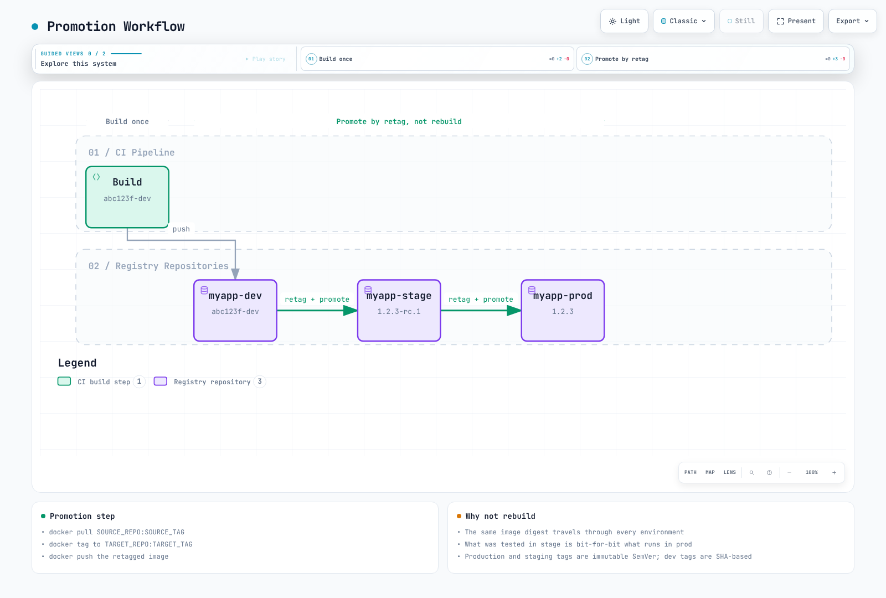

# コンテナレジストリのベストプラクティス

> **最終更新日**: 2026年10月16日

## はじめに

このドキュメントでは、Docker Hub、Amazon ECR、Harbor に共通するコンテナレジストリ管理のベストプラクティスをまとめます。ここでの推奨事項は、どのレジストリを選ぶ場合にも適用でき、優れた運用、セキュリティ、コスト最適化に重点を置いています。

API/CLI の例に出てくるアカウント、リージョン、ホスト名、リポジトリの値は例示です。先に対象リソースと認証情報を準備してください。Harbor API の例では `HARBOR_USER` を設定し、パスワード入力には `curl --user` のプロンプトを使います。endpoint ID は作成レスポンスから取得してください。

## タグ管理

### 変更不可能なタグ

バージョン形式のタグでも、レジストリが変更不可能として強制しなければ上書きできます。デプロイではテスト済み digest を固定し、リリースタグに不変性ルールを適用してください。不変性を設定しても、artifact が削除されないことまで一律に保証されるわけではありません。レジストリ固有のポリシーを確認します。

| レジストリ | 設定 |
|----------|---------------|
| Docker Hub | リポジトリの Tag mutability 設定 (このレビュー時点では Beta) |
| Amazon ECR | `image-tag-mutability: IMMUTABLE` |
| Harbor | プロジェクトのタグ不変性ルール |

```bash
# ECR: Enable immutable tags
aws ecr put-image-tag-mutability \
  --repository-name myapp \
  --image-tag-mutability IMMUTABLE

```

### セマンティックバージョニング

SemVer の `+build` メタデータは、そのままではイメージタグとして有効ではありません。OCI label に完全な SemVer を保持し、許可される英数字、アンダースコア、ピリオド、ハイフンの構文にタグを対応付けます。

リリースイメージでは SemVer (Semantic Versioning) を使います。

```
MAJOR.MINOR.PATCH[-PRERELEASE][+BUILD]

Examples:
  1.0.0           - Initial release
  1.0.1           - Patch release (bug fixes)
  1.1.0           - Minor release (new features, backward compatible)
  2.0.0           - Major release (breaking changes)
  1.0.0-rc.1      - Release candidate
  1.0.0-beta.2    - Beta release
  1.0.0+build.123 - Build metadata
```

### 環境別のタグ戦略

| 環境 | タグのパターン | 例 | 変更可能性 |
|-------------|-------------|---------|------------|
| 本番 | SemVer | `1.2.3` | 変更不可 |
| ステージング | SemVer-rc | `1.2.3-rc.1` | 変更不可 |
| 開発 | SHA ベース | `abc123f-dev` | 変更可能 |
| 機能ブランチ | Branch-SHA | `feature-auth-abc123f` | 変更可能 |
| CI ビルド | ビルド番号 | `build-456` | 変更可能 |

### `latest` タグのアンチパターン

本番で `latest` を**決して使わないでください**。`latest` には以下の問題があります。

1. **非決定的**: ノードごとに異なるイメージを pull する可能性がある
2. **ロールバックできない**: 「ひとつ前の latest」に戻せない
3. **pull ポリシーが不明瞭**: 作成時にポリシーを省略すると、`latest` のデフォルトは `Always`。ただし、キャッシュ済みレイヤーは再利用されることがある
4. **監査が困難**: 実行中のバージョンを特定できない

```yaml
# BAD - Never do this in production
spec:
  containers:
  - name: app
    image: myregistry.com/myapp:latest
    imagePullPolicy: Always  # Checks the reference each start; cached layers can be reused

---
# GOOD - Use specific versions
spec:
  containers:
  - name: app
    image: myregistry.com/myapp:1.2.3
    # imagePullPolicy: IfNotPresent (default, efficient)
```

`latest` を使ってもよい場合:

- ローカル開発
- チュートリアルや例
- Dockerfile のベースイメージ (本番ではタグを固定)

### 昇格ワークフロー

イメージを再ビルドするのではなく、昇格ワークフローを実装します。



[🔍 対話型図を表示](https://www.atomai.click/kubernetes-docs/archmaps/en-container-registry-04-best-practices-10.html)

昇格スクリプト:

```bash
#!/usr/bin/env bash
set -euo pipefail
: "${AWS_REGION:?Set the registry region}"
: "${ECR_REGISTRY:?Set account.dkr.ecr.region.amazonaws.com}"
: "${SOURCE_REPO:?Set the source repository}"
: "${SOURCE_DIGEST:?Set the scanned sha256 digest}"
: "${TARGET_REPO:?Set the pre-created destination repository}"
: "${TARGET_TAG:?Set a new immutable release tag}"
aws ecr get-login-password --region "$AWS_REGION" \
  | skopeo login --username AWS --password-stdin "$ECR_REGISTRY"
skopeo copy --all --preserve-digests \
  "docker://${ECR_REGISTRY}/${SOURCE_REPO}@${SOURCE_DIGEST}" \
  "docker://${ECR_REGISTRY}/${TARGET_REPO}:${TARGET_TAG}"
```

## イメージ命名規則

### 標準形式

```
[REGISTRY/]NAMESPACE/REPOSITORY:TAG[@DIGEST]

Examples:
  nginx:1.30.6                                    # Docker Hub official
  myuser/myapp:v1.0.0                          # Docker Hub user
  123456789012.dkr.ecr.us-east-1.amazonaws.com/myapp:v1.0.0  # ECR
  harbor.example.com/production/myapp:v1.0.0   # Harbor
  ghcr.io/myorg/myapp:v1.0.0                   # GitHub Container Registry
```

### 組織構造

```
REGISTRY/
├── NAMESPACE (organization/team/environment)/
│   ├── REPOSITORY (application name)/
│   │   ├── TAG (version)
│   │   └── TAG
│   └── REPOSITORY/
└── NAMESPACE/
```

ECR の構成例:

```
123456789012.dkr.ecr.us-east-1.amazonaws.com/
├── platform/
│   ├── ingress-controller:<supported-version>
│   ├── cert-manager:<supported-version>
│   └── external-dns:<supported-version>
├── myapp/
│   ├── api:v2.1.0
│   ├── web:v2.1.0
│   └── worker:v2.1.0
└── tools/
    ├── kubectl:<cluster-compatible-version>
    └── helm:<supported-version>
```

### 環境プレフィックス

単一リポジトリ戦略の場合:

```
myapp:v1.2.3                 # Production release
myapp:v1.2.3-staging         # Staging candidate
myapp:abc123f-dev            # Development build
myapp:abc123f-feature-auth   # Feature branch
```

### マルチアーキテクチャイメージ

マルチアーキテクチャに対応するには manifest list を使います。

```bash
# Build for multiple architectures
docker buildx build \
  --platform linux/amd64,linux/arm64 \
  --tag myregistry.com/myapp:v1.0.0 \
  --push .

# Inspect manifest
docker manifest inspect myregistry.com/myapp:v1.0.0
```

アーキテクチャ別イメージにタグを付ける場合の規則:

```
myapp:v1.0.0           # Manifest list (preferred)
myapp:v1.0.0-amd64     # AMD64-specific
myapp:v1.0.0-arm64     # ARM64-specific
```

## レジストリのミラーリングとキャッシュ

### ミラー/キャッシュを使う理由

1. **レート制限の回避**: Docker Hub は pull を制限する
2. **性能改善**: ローカルキャッシュにより遅延が減る
3. **信頼性**: 事前ロードしたミラーは依存性を減らすが、キャッシュミス/更新には引き続き上流へのアクセスが必要
4. **セキュリティ**: 環境に取り込むイメージを制御できる
5. **コスト削減**: リージョン間/インターネット転送コストを減らす


[🔍 対話型図を表示](https://www.atomai.click/kubernetes-docs/archmaps/en-container-registry-04-best-practices-1.html)

### Pull-Through Cache の比較

| 機能 | ECR Pull-Through | Harbor Proxy | Distribution |
|---------|-----------------|--------------|--------------|
| マネージド | はい | いいえ | いいえ |
| 上流の対応先 | ECR が対応する上流 | Harbor アダプターが対応する上流 | Docker Hub |
| 認証 | Secrets Manager | 組み込み | 環境変数 |
| スキャン | リポジトリ/レジストリのスキャン設定による | プロジェクト/スキャナーの設定による | スキャナーを内蔵しない |
| 高可用性 | 組み込み | 自己管理 | 自己管理 |

### ECR Pull-Through Cache を設定する

Docker Hub の認証情報は、同一アカウント/リージョンの Secrets Manager に保存します。名前には `ecr-pullthroughcache/` プレフィックスを使用し、`username` と `accessToken` キーを含めます。ARN を組み立てて推測せず、実際のシークレット ARN を解決してください。リポジトリの作成/import 権限とサービスリンクロールについては[Amazon ECR](02-amazon-ecr.md)を参照します。

```bash
# The upstream secret must already exist in this account and region.
: "${AWS_REGION:?Set the target AWS region}"
SECRET_ARN=$(aws secretsmanager describe-secret --region "$AWS_REGION" \
  --secret-id ecr-pullthroughcache/docker-hub --query ARN --output text)
aws ecr create-pull-through-cache-rule --region "$AWS_REGION" \
  --ecr-repository-prefix docker-hub \
  --upstream-registry-url registry-1.docker.io \
  --credential-arn "$SECRET_ARN"
```

Pull URI: `ACCOUNT.dkr.ecr.REGION.amazonaws.com/docker-hub/library/nginx:1.30.6`。キャッシュミスと更新は、引き続き上流へのアクセスに依存します。

### containerd のミラーを設定する

この例では、Docker Hub と同じリポジトリパスを提供する信頼済みミラーがあることを前提とします。containerd 2.x は images plugin の `config_path` を使い、1.x は CRI plugin のパスを使います。`resolve` 機能を指定すると、ミラーによるタグから digest への解決を信頼します。ECR/Harbor のプロジェクトプレフィックスや認証情報が自動的に変換されるわけではありません。

```toml
# containerd 2.x: /etc/containerd/config.toml
[plugins."io.containerd.cri.v1.images".registry]
  config_path = "/etc/containerd/certs.d"
# For containerd 1.x, use plugins."io.containerd.grpc.v1.cri".registry.
```

```toml
# /etc/containerd/certs.d/docker.io/hosts.toml
server = "https://registry-1.docker.io"
[host."https://mirror.example.com"]
  capabilities = ["pull", "resolve"]
  ca = "/etc/containerd/certs.d/docker.io/mirror-ca.crt"
```

`server` を指定すると Docker Hub にフォールバックできるため、オフライン専用の構成ではありません。切断ネットワークや認証が必要な ECR/Harbor キャッシュでは、内部イメージ URI を明示し、ノードの CA 信頼、imagePullSecrets、実際の pull を検証してください。

### Harbor Proxy Cache を設定する

```bash
# 1. Create registry endpoint
curl --fail-with-body -X POST "https://harbor.example.com/api/v2.0/registries" \
  -H "Content-Type: application/json" \
  --user "$HARBOR_USER" \
  -d '{
    "name": "docker-hub",
    "type": "docker-hub",
    "url": "https://hub.docker.com",
    "credential": {
      "type": "basic",
      "access_key": "username",
      "access_secret": "password"
    }
  }'

# 2. Create proxy cache project
curl --fail-with-body -X POST "https://harbor.example.com/api/v2.0/projects" \
  -H "Content-Type: application/json" \
  --user "$HARBOR_USER" \
  -d '{
    "project_name": "dockerhub-cache",
    "registry_id": 1,
    "metadata": {"public": "true"}
  }'

# Usage: harbor.example.com/dockerhub-cache/library/nginx:latest
```

## 災害復旧

### マルチリージョン戦略

```
┌─────────────────────────────────────────────────────────────────┐
│                    Primary Region (us-east-1)                    │
│  ┌─────────────┐                                                │
│  │  ECR / Harbor│──────────────────┐                            │
│  └─────────────┘                   │                            │
└────────────────────────────────────┼────────────────────────────┘
                                     │ Replication
                                     ▼
┌─────────────────────────────────────────────────────────────────┐
│                    DR Region (eu-west-1)                         │
│  ┌─────────────┐                                                │
│  │  ECR / Harbor│                                                │
│  └─────────────┘                                                │
└─────────────────────────────────────────────────────────────────┘
```

### ECR のクロスリージョンレプリケーション

```hcl
resource "aws_ecr_replication_configuration" "dr" {
  replication_configuration {
    rule {
      destination {
        region      = "eu-west-1"
        registry_id = data.aws_caller_identity.current.account_id
      }

      # Only replicate production images
      repository_filter {
        filter      = "prod-"
        filter_type = "PREFIX_MATCH"
      }
    }
  }
}
```

### DR 用 Harbor レプリケーション

```bash
# Configure DR Harbor as endpoint
# Add destination credentials through the protected Harbor UI before using this endpoint.
curl --fail-with-body -X POST "https://harbor-primary.example.com/api/v2.0/registries" \
  -H "Content-Type: application/json" \
  --user "$HARBOR_USER" \
  -d '{
    "name": "harbor-dr",
    "type": "harbor",
    "url": "https://harbor-dr.example.com"
  }'

# Create event-based replication
curl --fail-with-body -X POST "https://harbor-primary.example.com/api/v2.0/replication/policies" \
  -H "Content-Type: application/json" \
  --user "$HARBOR_USER" \
  -d '{
    "name": "dr-replication",
    "dest_registry": {"id": 1},
    "trigger": {"type": "event_based"},
    "enabled": true,
    "replicate_deletion": false
  }'
```

### バックアップ手順と RTO/RPO

ECR レプリケーションは非同期で、設定後に push/復元されたイメージに適用されます。既存 artifact にはバックフィルが必要です。宛先ポリシー、権限、スキャン、暗号化、ライフサイクル設定、実際の pull を検証してください。レプリケーション構成 API はレジストリ設定全体を置き換えるため、先に既存ルールをマージします。

RPO/RTO は復旧訓練で測定します。レプリケーション遅延、検出、artifact/署名の準備状況、クラスター/DNS のフェイルオーバーを含めてください。イベントレプリケーションは RPO ゼロや5分の RTO を保証しません。削除も複製すると DR コピーも失われる場合があるため、独立したバックアップを設計します。

Docker pull/save で取得した少数のタグだけでは完全なバックアップになりません。テスト済み digest、すべての対象プラットフォーム、OCI manifest、署名/SBOM、復元手順の一覧を保持します。[Harbor の Skopeo 転送手順](03-harbor.md)と同様に、明示的な一覧/チェックサムを使います。Harbor のメタデータ、blob、構成、鍵は一貫した状態でバックアップしてください。S3 の tar ファイルを Kubernetes がレジストリとして pull できるわけではありません。復旧用レジストリにインポートします。

## コスト最適化

### コストの見積もり

ストレージ、リージョン/AZ/インターネット転送、スキャン/署名、PrivateLink/NAT、レジストリのコンピューティング/データベース/バックアップ、運用コストを分けて見積もります。ECR のリージョン別ストレージ料金を `$0.10/GB-month` とする例は請求総額ではありません。`imageSizeInBytes` を合計しても、重複排除された課金対象レイヤーの容量とは一致しません。500 GB などの固定しきい値だけで ECR と Harbor のどちらが安いかは決まりません。

### ライフサイクルポリシーの要点

以下の ECR 例は、開発専用リポジトリ内の3つの開発タグプレフィックスを30日後に期限切れにします。1つの `tagPatternList` に複数のパターンを書くと、OR ではなく**AND**になります。プレフィックスごとに別のルールを使ってください。リリースタグと開発タグを同じ digest に混在させず、Lifecycle Preview でデプロイ済み/ロールバック用 digest が保護されることを確認します。タグなしイメージも digest でデプロイされる場合があるため、自動的に削除して安全とは限りません。

```json
{
  "rules": [
    {
      "rulePriority": 1,
      "description": "Expire dev-* development artifacts after 30 days",
      "selection": {
        "tagStatus": "tagged",
        "tagPatternList": [
          "dev-*"
        ],
        "countType": "sinceImagePushed",
        "countNumber": 30,
        "countUnit": "days"
      },
      "action": {
        "type": "expire"
      }
    },
    {
      "rulePriority": 2,
      "description": "Expire feature-* development artifacts after 30 days",
      "selection": {
        "tagStatus": "tagged",
        "tagPatternList": [
          "feature-*"
        ],
        "countType": "sinceImagePushed",
        "countNumber": 30,
        "countUnit": "days"
      },
      "action": {
        "type": "expire"
      }
    },
    {
      "rulePriority": 3,
      "description": "Expire pr-* development artifacts after 30 days",
      "selection": {
        "tagStatus": "tagged",
        "tagPatternList": [
          "pr-*"
        ],
        "countType": "sinceImagePushed",
        "countNumber": 30,
        "countUnit": "days"
      },
      "action": {
        "type": "expire"
      }
    }
  ]
}
```

Harbor の保持は保持ルールの OR 和集合を使い、ECR とは異なるスキーマです。[Harbor](03-harbor.md) の UI/API による dry-run 手順に従い、削除後に GC を確認してください。

### イメージサイズの最適化

互換性のある builder/runtime イメージを使い、ランタイム依存関係だけをコピーします。この Python の例では、同じ Python ベースバージョン間で仮想環境をコピーします。ネイティブ拡張/システムライブラリの要件は、引き続き検証が必要です。`.dockerignore` を使い、シークレット、ローカル仮想環境、キャッシュをビルドコンテキストに含めないようにします。

```dockerfile
FROM python:3.14-slim AS builder
WORKDIR /app
RUN python -m venv /opt/venv
COPY requirements.txt .
RUN /opt/venv/bin/pip install --no-cache-dir -r requirements.txt

FROM python:3.14-slim
WORKDIR /app
COPY --from=builder /opt/venv /opt/venv
COPY --chown=10001:10001 . .
ENV PATH="/opt/venv/bin:$PATH"
USER 10001:10001
CMD ["python", "app.py"]
```

イメージサイズはアプリケーション、アーキテクチャ、圧縮、依存関係によって異なります。Distroless を使えば自動的に脆弱性がなくなるわけではありません。builder/runtime ABI、CA 証明書、ユーザー ID、デバッグ手順を検証します。リリースではテスト済みベース digest と依存関係 lock を固定し、定期的に更新してください。

### 転送コストを減らす

リージョン内のレジストリ参照を使い、フェイルオーバー前にレプリケーションを確認します。VPC endpoint で NAT トラフィックを減らせますが、インターフェイス endpoint の時間/データ料金と ECR API/DKR、および S3 の経路を含めて検討します。リージョンごとの Kustomize overlay 全体は[Amazon ECR](02-amazon-ecr.md)を参照してください。

## セキュリティチェックリスト

### イメージスキャン

Docker Hub は Docker Scout、ECR は AWS ネイティブの Basic スキャンまたは Inspector ベースの Enhanced スキャン、Harbor は構成した Trivy/外部スキャナーを使います。料金、対応 artifact、再スキャン、データベースの鮮度を確認します。自動スキャンとデプロイ時の適用は別です。失敗/不完全な結果を検出件数ゼロとみなしてはいけません。現在の手順は [ECR](02-amazon-ecr.md) と [Harbor](03-harbor.md) を参照します。

### Admission Controller

[イメージ署名の検証](../security/07-image-security.md)と [Kyverno レジストリポリシー](../security/01-kyverno-policy-management.md)を組み合わせます。レジストリの許可リストでは署名を検証できず、脆弱性をスキャンするわけでもありません。脆弱性 attestation には、信頼できる署名者、実際の predicate スキーマ/フィールド、スキャンの鮮度が必要です。`criticalCount` フィールドの存在を決めつけたり、切り詰められた公開鍵を適用したりしないでください。

Audit で通常/init/ephemeral container と CREATE/UPDATE の対象範囲をテストしてから Enforce に進みます。Gatekeeper の constraint を使う場合は、先に対応する ConstraintTemplate をインストールします。

### 最小権限のアクセス

このポリシーは選択した ECR リポジトリからの pull を許可します。`GetAuthorizationToken` はリポジトリ単位のリソース権限に対応せず、`Resource: "*"` が必要です。実際の pull アクションは ARN で範囲を限定します。EKS ではノードロールまたは Fargate Pod 実行ロールに権限を付けます。アプリケーションの IRSA/Pod Identity ロールは、初回のイメージ pull 用認証情報には使われません。

```json
{
  "Version": "2012-10-17",
  "Statement": [
    {
      "Sid": "RegistryToken",
      "Effect": "Allow",
      "Action": "ecr:GetAuthorizationToken",
      "Resource": "*"
    },
    {
      "Sid": "PullApprovedRepositories",
      "Effect": "Allow",
      "Action": [
        "ecr:BatchCheckLayerAvailability",
        "ecr:GetDownloadUrlForLayer",
        "ecr:BatchGetImage"
      ],
      "Resource": [
        "arn:aws:ecr:ap-northeast-2:123456789012:repository/myapp-prod",
        "arn:aws:ecr:ap-northeast-2:123456789012:repository/base-images/*"
      ]
    }
  ]
}
```

Harbor では、有効期限/ローテーションを設定したプロジェクト限定の pull 専用 robot を使います。最新の `/api/v2.0/robots` スキーマと、namespace 内に限定した imagePullSecrets の手順は[Harbor](03-harbor.md)を参照してください。

### ネットワークポリシー

Kubernetes NetworkPolicy は選択した Pod のトラフィックを制御します。Pod の egress ポリシーが、ノード kubelet/containerd によるイメージ pull まで制御すると考えないでください。admission で許可するレジストリを検証し、ノード/ネットワーク層でノードからのレジストリ/DNS/ECR API/DKR/S3 アクセスを制御します。アプリケーション Pod の egress ポリシーでは、DNS と必要なアプリケーション通信も考慮します。

### シークレット管理

External Secrets Operator の v1 API を提供する CRD と、構成済みの ClusterSecretStore が必要です。リモートシークレットには完全で有効な Docker config JSON を保存します。完全な JSON を渡せば、文字列補間で引用符やバックスラッシュを含むパスワードが壊れるのを防げます。作成された Secret は、同じ namespace の Pod/ServiceAccount から参照します。

```yaml
apiVersion: external-secrets.io/v1
kind: ExternalSecret
metadata:
  name: registry-credentials
  namespace: production
spec:
  refreshInterval: 1h
  secretStoreRef:
    name: aws-secrets-manager
    kind: ClusterSecretStore
  target:
    name: registry-pull-secret
    creationPolicy: Owner
    template:
      engineVersion: v2
      type: kubernetes.io/dockerconfigjson
      data:
        .dockerconfigjson: "{{ .dockerconfigjson | toString }}"
  data:
  - secretKey: dockerconfigjson
    remoteRef:
      key: harbor-pull-dockerconfigjson
```

保存済みの ECR token を何度コピーしても、有効期限12時間は更新されません。EKS ネイティブのイメージ pull ID、または明示的に構成した ECR token generator を使います。シークレットストアの認可、暗号化、ローテーションの失敗を監視します。

## CI/CD 統合パターン

### ECR を使う GitHub Actions

この例では、Linux/amd64 用のイメージをローカル Docker に1つビルドし、**そのイメージをスキャン**してから push と署名を行います。ECR リポジトリ、`aud`/`sub` で制限した OIDC IAM ロール、push 権限、対応する runner を準備してください。Action はレビュー済みリリースの commit に固定します。同じ commit を再ビルドして不変タグと競合する場合は、検証済み digest を再利用するか、新しいビルド ID を割り当てます。

```yaml
name: Build scan and publish to ECR
on:
  push:
    branches: [main]
    tags: ['v*']
permissions:
  contents: read
  id-token: write
env:
  AWS_REGION: ap-northeast-2
  ECR_REPOSITORY: myapp
jobs:
  publish:
    runs-on: ubuntu-24.04
    steps:
    - uses: actions/checkout@3d3c42e5aac5ba805825da76410c181273ba90b1 # v7.0.1
    - uses: aws-actions/configure-aws-credentials@e1253824e5c10ff9df46874f81ed3ec929e19cfd # v6.3.0
      with:
        role-to-assume: arn:aws:iam::123456789012:role/github-actions-ecr
        aws-region: ${{ env.AWS_REGION }}
    - uses: aws-actions/amazon-ecr-login@03f1aad4c6c7ffd436567f42f9384779290529bd # v2.1.7
      id: login
    - uses: docker/setup-buildx-action@f87e5991a6d7451dcb8d9637bfbc97413f497069 # v4.4.1
    - uses: docker/build-push-action@c3c9e263c25d99ce0380d002d59b67737d91b0dc # v7.4.0
      with:
        context: .
        platforms: linux/amd64
        load: true
        push: false
        tags: ${{ steps.login.outputs.registry }}/${{ env.ECR_REPOSITORY }}:${{ github.sha }}
        cache-from: type=gha
        cache-to: type=gha,mode=max
    - uses: aquasecurity/trivy-action@ed142fd0673e97e23eac54620cfb913e5ce36c25 # v0.36.0
      with:
        version: v0.76.0
        image-ref: ${{ steps.login.outputs.registry }}/${{ env.ECR_REPOSITORY }}:${{ github.sha }}
        scan-type: image
        scanners: vuln
        exit-code: '1'
        severity: HIGH,CRITICAL
    - name: Publish scanned image and record digest
      id: publish
      env:
        REGISTRY: ${{ steps.login.outputs.registry }}
      run: |
        set -euo pipefail
        IMAGE="$REGISTRY/$ECR_REPOSITORY"
        docker push "$IMAGE:$GITHUB_SHA"
        DIGEST=$(aws ecr describe-images --repository-name "$ECR_REPOSITORY" \
          --image-ids "imageTag=$GITHUB_SHA" --query 'imageDetails[0].imageDigest' --output text)
        [[ "$DIGEST" =~ ^sha256:[a-f0-9]{64}$ ]]
        printf 'image=%s@%s\n' "$IMAGE" "$DIGEST" >> "$GITHUB_OUTPUT"
    - uses: sigstore/cosign-installer@6f9f17788090df1f26f669e9d70d6ae9567deba6 # v4.1.2
    - name: Sign the published digest with the job OIDC identity
      env:
        SIGNED_IMAGE: ${{ steps.publish.outputs.image }}
      run: cosign sign --yes "$SIGNED_IMAGE"
```

マルチプラットフォームリリースでは、各プラットフォームをスキャンして最終 index digest を昇格します。デプロイには `publish.outputs.image` を使います。SemVer タグが一致するだけではリリース承認になりません。Keyless 検証では、このワークフローの OIDC issuer/ID に制限した admission policy が必要です。SARIF アップロードを追加する場合は、Code Scanning の利用資格と `security-events: write` を設定してください。

### Harbor を使う GitLab CI

この Docker executor の例では、TLS を有効にした DinD を使います。分離された専用 runner で必要な privileged mode と共有 `/certs/client` volume を設定します。保護された masked 変数 `HARBOR_USERNAME`/`HARBOR_PASSWORD` でプロジェクト robot の認証情報を渡し、Harbor CA を信頼します。スキャンと publish は同じビルド artifact を利用し、スキャンの成功後にのみ publish します。

```yaml
stages: [build, scan, publish]
workflow:
  rules:
    - if: '$CI_COMMIT_BRANCH == "main" || $CI_COMMIT_TAG'
variables:
  HARBOR_HOST: harbor.example.com
  IMAGE_NAME: harbor.example.com/myapp/app
  DOCKER_HOST: tcp://docker:2376
  DOCKER_TLS_CERTDIR: /certs
  DOCKER_TLS_VERIFY: "1"
  DOCKER_CERT_PATH: /certs/client
.docker:
  image: docker:29.9.0-cli
  services:
    - name: docker:29.9.0-dind
      alias: docker
build:
  extends: .docker
  stage: build
  script:
    - docker build -t "$IMAGE_NAME:$CI_COMMIT_SHA" .
    - docker save "$IMAGE_NAME:$CI_COMMIT_SHA" -o image.tar
  artifacts:
    paths: [image.tar]
    expire_in: 1 day
scan:
  stage: scan
  image:
    name: aquasec/trivy:0.76.0
    entrypoint: [""]
  needs:
    - job: build
      artifacts: true
  script:
    - trivy image --input image.tar --exit-code 1 --severity HIGH,CRITICAL
publish:
  extends: .docker
  stage: publish
  needs:
    - job: build
      artifacts: true
    - job: scan
      artifacts: false
  script:
    - printf '%s' "$HARBOR_PASSWORD" | docker login "$HARBOR_HOST" --username "$HARBOR_USERNAME" --password-stdin
    - docker load -i image.tar
    - docker push "$IMAGE_NAME:$CI_COMMIT_SHA"
```

### デプロイとイメージの更新

スキャン/署名ゲートの後で、検証済み digest を使って GitOps リポジトリを更新し、承認、admission 検証、ロールアウト確認を適用します。Argo CD Image Updater 1.x は `ImageUpdater` CR を使います。古い Application annotation をコピーするだけでは不十分です。対応する CRD をインストールし、リリース承認ポリシーに応じて Argo CD のアクセス、レジストリ認証情報、Git への書き戻し権限を設定します。

## skopeo によるイメージ管理

[skopeo](https://github.com/containers/skopeo) は、レジストリ間のコンテナイメージの調査、コピー、同期を行うコマンドラインツールです。Docker daemon を使わず、root 権限も不要なため、CI/CD パイプラインやエアギャップ環境に適しています。

### インストール

```bash
# RHEL/CentOS/Amazon Linux
sudo yum install -y skopeo

# Ubuntu/Debian
sudo apt-get install -y skopeo

# macOS
brew install skopeo
```

### skopeo inspect: リモートイメージを調べる

イメージを pull せずにメタデータを確認します。

```bash
# Inspect Docker Hub image
skopeo inspect docker://docker.io/library/nginx:1.30.6

# Inspect ECR image (requires AWS auth)
skopeo inspect docker://123456789012.dkr.ecr.us-east-1.amazonaws.com/myapp:v1.0.0

# View raw manifest
skopeo inspect --raw docker://docker.io/library/nginx:1.30.6 | jq .

# Inspect specific architecture
skopeo --override-arch arm64 inspect docker://docker.io/library/nginx:1.30.6
```

### skopeo copy: レジストリ間でイメージをコピーする

ローカルに pull せず、レジストリ間でイメージを直接コピーします。

```bash
# Docker Hub → ECR
skopeo copy --all \
  docker://docker.io/library/nginx:1.30.6 \
  docker://123456789012.dkr.ecr.us-east-1.amazonaws.com/nginx:1.30.6

# ECR → Harbor
skopeo copy --all \
  docker://123456789012.dkr.ecr.us-east-1.amazonaws.com/myapp:v1.0.0 \
  docker://harbor.example.com/myapp/backend:v1.0.0

# Format conversion (Docker → OCI)
skopeo copy --all \
  docker://docker.io/library/nginx:1.30.6 \
  oci:nginx-oci:1.30.6

# Save as OCI archive
skopeo copy --all \
  docker://docker.io/library/nginx:1.30.6 \
  oci-archive:nginx-1.30.6.tar
```

### skopeo sync: レジストリを一括同期する

同期前に、対象タグを明示してプレビューします。タグを指定せずにリポジトリを指定すると、そのリポジトリのすべてのタグをコピーする場合があります。各 `images-by-tag-regex` 値はリストではなく文字列です。`--scoped` はソースのレジストリ/パス要素を保持して名前の衝突を防ぎます。宛先のプロジェクト/リポジトリと認証は別途準備します。

```bash
cat > sync-manifest.yaml <<'YAML'
docker.io:
  images:
    library/nginx:
      - "1.30.6"
  images-by-tag-regex:
    library/busybox: '^1\.38\.0$'
YAML
# Preview exact source/destination paths before creating target repositories.
skopeo sync --all --scoped --dry-run --src yaml --dest docker \
  sync-manifest.yaml harbor.internal/mirror
# After reviewing the preview and preparing destinations, remove --dry-run.
```

### エアギャップ環境へのイメージ転送

skopeo は切断された環境へのイメージ転送に適しています。

```bash
# Step 1: Export images to tar on connected environment
skopeo copy --all docker://docker.io/library/nginx:1.30.6 oci-archive:nginx-1.30.6.tar
skopeo copy --all docker://docker.io/library/redis:7-alpine oci-archive:redis-7.tar
skopeo copy --all docker://registry.k8s.io/pause:3.10 oci-archive:pause-3.10.tar

# Step 2: Transfer via USB/secure file transfer to air-gapped environment

# Step 3: Import into Harbor on air-gapped environment
skopeo copy --all oci-archive:nginx-1.30.6.tar \
  docker://harbor.internal/library/nginx:1.30.6
skopeo copy --all oci-archive:redis-7.tar \
  docker://harbor.internal/library/redis:7-alpine
skopeo copy --all oci-archive:pause-3.10.tar \
  docker://harbor.internal/k8s/pause:3.10
```

> **ヒント:** `docker save/load` と異なり、skopeo は Docker daemon を使わないため、Docker をインストールしていないエアギャップサーバーでも利用できます。

### ツールの比較

| ツール | このガイドでの役割 | 確認する条件 |
|---|---|---|
| Skopeo | リモート調査、コピー/同期、OCI archive | 認証、manifest 変換、`--all`、referrer 対応 |
| Docker/Buildx | ビルド、manifest の調査、push | daemon/builder の設定。rootless 構成もある |
| crane | リモートイメージの調査/コピー | インストール済みバージョンの copy/export と署名対応 |
| ctr | containerd のイメージストアへの import/export | ランタイムソケット権限、namespace、プラットフォームの選択 |

`--all` はプラットフォーム別 manifest を選択しますが、署名/SBOM の referrer まですべてコピーする保証ではありません。digest の保持が必要な場合は `--preserve-digests` を使い、失敗をそのまま失敗として扱います。オフライン転送では[Harbor](03-harbor.md)のマッピング、チェックサム、データベース、CA、復元手順に従います。

## まとめ

### 主なポイント

1. **タグ管理**
   - 本番では変更不可能なタグを使う
   - リリースには SemVer を使う
   - 本番で `latest` を決して使わない
   - 昇格ワークフローを実装する

2. **命名規則**
   - 一貫した namespace 構造を定める
   - 単一リポジトリ戦略では環境プレフィックスを使う
   - マルチアーキテクチャイメージに対応する

3. **ミラーリングとキャッシュ**
   - レート制限を避ける pull-through cache を導入する
   - 重要な外部イメージをミラーする
   - 検証済みのミラーパス/認証、または明示した内部イメージ URI を使う

4. **災害復旧**
   - クロスリージョンレプリケーションを有効にする
   - RTO/RPO 目標を定めてテストする
   - バックアップ手順を自動化する

5. **コスト最適化**
   - すべての環境でライフサイクルポリシーを実施する
   - マルチステージビルドでイメージサイズを最適化する
   - リージョン内 endpoint を使って転送費用を減らす

6. **セキュリティ**
   - push 時スキャンを有効にする
   - admission controller を導入する
   - 最小権限の原則に従う
   - ネットワークポリシーを使う

7. **CI/CD 統合**
   - ビルド/スキャン/署名/デプロイのパイプラインを自動化する
   - クラウド認証に OIDC を使う
   - セキュリティゲートを実装する

### クイックリファレンス

| プラクティス | Docker Hub | ECR | Harbor |
|----------|------------|-----|--------|
| 変更不可能なタグ | タグの変更可能性 (Beta) | `IMMUTABLE` | タグ不変性ルール |
| ライフサイクルポリシー | API クリーンアップ | ネイティブ | タグ保持 |
| 脆弱性スキャン | Docker Scout | AWS ネイティブ/Inspector | Trivy または設定済みスキャナー |
| イメージ署名 | 外部署名/OCI artifact。互換性を検証 | 署名者/OCI artifact | Cosign/Notation |
| レプリケーション | なし | クロスリージョン | Push/Pull |
| Pull-through cache | なし | ネイティブ | Proxy プロジェクト |

### 新規デプロイのチェックリスト

- [ ] リポジトリの命名規則を文書化
- [ ] タグ戦略を定義し、強制適用
- [ ] ライフサイクルポリシーを設定
- [ ] 脆弱性スキャンを有効化
- [ ] イメージ署名を実装
- [ ] DR レプリケーションを設定
- [ ] アクセス制御 (RBAC/IAM) を設定
- [ ] CI/CD パイプラインを統合
- [ ] 監視とアラートを設定
- [ ] コスト監視を有効化
- [ ] バックアップ手順をテスト

## 参考資料

- [Docker Hub immutable tags](https://docs.docker.com/docker-hub/repos/manage/hub-images/immutable-tags/)
- [Image tag grammar](https://github.com/distribution/reference/blob/main/regexp.go)
- [Containerd registry configuration](https://github.com/containerd/containerd/blob/main/docs/hosts.md)
- [Skopeo copy](https://github.com/containers/skopeo/blob/main/docs/skopeo-copy.1.md)
- [Skopeo sync](https://github.com/containers/skopeo/blob/main/docs/skopeo-sync.1.md)
- [External Secrets Docker config](https://external-secrets.io/latest/guides/common-k8s-secret-types/)
- [Argo CD Image Updater 1.3 image configuration](https://github.com/argoproj-labs/argocd-image-updater/blob/v1.3.1/docs/configuration/images.md)
- [Docker build-push action](https://github.com/docker/build-push-action/tree/v7.4.0)
- [Trivy action](https://github.com/aquasecurity/trivy-action/tree/v0.36.0)
- [GitLab Docker-in-Docker TLS](https://docs.gitlab.com/ci/docker/using_docker_build/)
