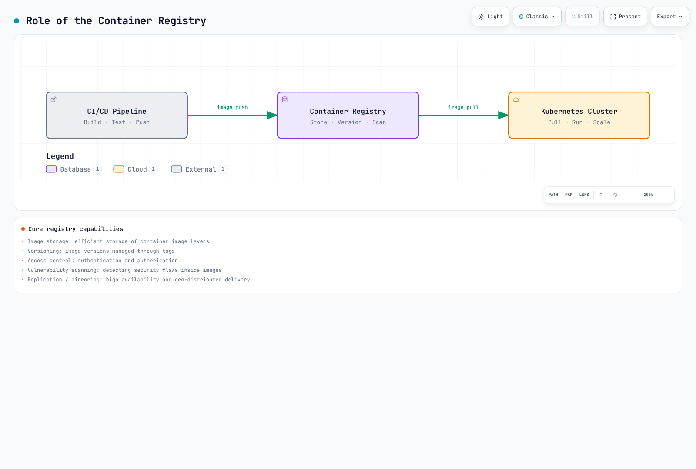
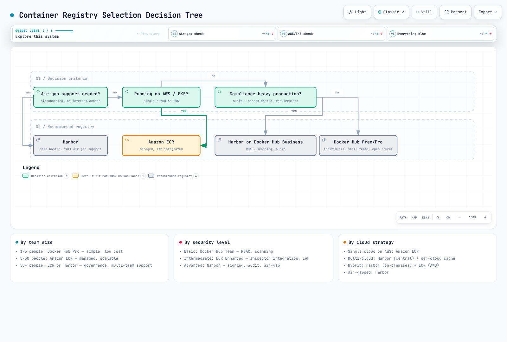

# Container Registry

> **最終更新日**: 2026 年 9 月 11 日

## はじめに

コンテナレジストリは Kubernetes エコシステムの基盤となるコンポーネントです。コンテナイメージを保存、管理、配布するための一元的なリポジトリとして機能します。CI/CD パイプラインと Kubernetes クラスタをつなぎ、ワークロードにイメージを確実かつ安全に届けます。

コンテナレジストリには、次の機能があります。

- **イメージストレージ**: タグでバージョン管理するコンテナイメージの永続ストレージ
- **アクセス制御**: イメージをプッシュ／プルできるユーザーを制御する認証と認可の仕組み
- **セキュリティスキャン**: デプロイ前にコンテナイメージの脆弱性を検出する
- **配布**: コンテナランタイムへの効率的なイメージレイヤーのキャッシュと配布
- **ライフサイクル管理**: ストレージを最適化するためのクリーンアップと保持ポリシーの自動化

[🔍 インタラクティブダイアグラムを表示](https://www.atomai.click/kubernetes-docs/archmaps/en-container-registry-readme-0.html)

## レジストリの比較

| 機能 | Docker Hub | Amazon ECR | Harbor |
|---------|------------|------------|--------|
| **種類** | SaaS（パブリッククラウド） | AWS マネージドサービス | セルフホスト（CNCF） |
| **料金モデル** | 個人向け＋有料サブスクリプション | 使用量ベース | インフラ、運用、バックアップ |
| **プライベートリポジトリ** | 個人向け: 1 件。有料プランには利用枠あり | サービスクォータが適用される | Operator でクォータを設定 |
| **パブリックリポジトリ** | プランのポリシーに応じて利用可能 | ECR Public。無料利用枠と従量課金あり | 対応 |
| **ストレージ料金** | プランによる | リージョン／ストレージクラスごとの料金 | 自己管理 |
| **データ転送** | 使用量と公正利用ポリシーによる | 宛先／リージョンに応じて課金 | 自己管理 |
| **脆弱性スキャン** | Docker Scout のプラン利用枠 | Basic / Enhanced（Inspector） | Trivy 統合 |
| **イメージ署名** | DCT または別の OCI 署名ツール | AWS Signer によるマネージド／手動署名 | Cosign/Notation |
| **レプリケーション** | 利用不可 | リージョン間レプリケーション | Pull/Push レプリケーション |
| **RBAC** | 組織レベル | IAM ポリシー | プロジェクトレベルのロール |
| **完全に切断された環境での運用** | Hub への接続が必要 | AWS への接続が必要。VPC エンドポイントでプライベートアクセスを提供 | イメージ、スキャナーデータベース、インストール依存関係をインポート |
| **レート制限** | アカウントごとのプル制限と公正利用ポリシー | API ごとのサービスクォータ | Operator の制限とインフラ容量 |
| **統合** | 汎用 | AWS ネイティブ（EKS、IAM） | Kubernetes ネイティブ |
| **コンプライアンス** | サービスの最新の認証と適用範囲を確認 | AWS サービス／リージョンの適格性と自社の管理策を確認 | 管理策と証跡の責任は Operator にある |

ECR にはリクエストレートやリポジトリの制限を含む[サービスクォータ](https://docs.aws.amazon.com/AmazonECR/latest/userguide/service-quotas.html)があります。[AWS Signer の統合](https://docs.aws.amazon.com/AmazonECR/latest/userguide/image-signing.html)に対応していますが、署名の保存とデプロイ時の検証強制は別途構成が必要です。Docker Hub については、過去のプル上限を普遍的なものとして扱わず、[現行の利用ポリシー](https://docs.docker.com/docker-hub/usage/)とレスポンスヘッダーを確認してください。

## 詳細な比較

### Docker Hub

**最適な用途**: オープンソースプロジェクト、開発環境、手早くセットアップしたいチーム

**利点**:
- 最大規模の公開イメージライブラリ（Official Images、Verified Publishers）
- インフラ管理が不要
- Docker CLI と簡単に統合できる
- GitHub Actions/GitLab CI など外部 CI を使ったビルドとプッシュの自動化。Hub ネイティブの Automated Builds は非推奨

**欠点**:
- アカウントごとのプル制限と公正利用／不正利用対策
- 無料プランではプライベートリポジトリのストレージが限られる
- AWS/Kubernetes とのネイティブ統合がない
- 公開イメージにはサプライチェーンセキュリティ上の懸念があり得る

**料金**: [現行の料金ページ](https://www.docker.com/pricing/)で、ユーザー数、月払い／年払い、含まれる Scout/build の利用枠を比較してください。過去の Pro 月額 $5、Team 月額 $9、日次のプル利用枠は、現在の料金基準ではありません。

### Amazon ECR

**最適な用途**: AWS ネイティブのワークロード、EKS クラスタ、コンプライアンスを必要とする企業

**利点**:
- EKS ノードと Fargate の実行ロールとの統合。ワークロードの IRSA/Pod Identity 権限は、イメージ取得用の認証情報とは別
- IAM ベースのアクセス制御と調整可能な API サービスクォータ
- リージョン間レプリケーション
- Amazon Inspector による Enhanced scanning
- プライベートな AWS 接続を可能にする VPC エンドポイント。完全に切断されたエアギャップではない
- 従量課金（初期契約不要）

**欠点**:
- AWS ベンダーロックイン
- 大規模なイメージライブラリではコストが積み上がることがある
- ライフサイクルポリシーの構文が複雑
- クロスアカウントアクセスには慎重な IAM 構成が必要

**料金**: 保存データ量に該当するリージョン／ストレージクラスの単価を掛け、転送、Inspector、AWS Signer、VPC エンドポイントの料金も考慮してください。公式例の $0.10/GB-month では、100GB のストレージ料金だけで月額 $10 です。対応する AWS コンピューティングサービスへの同一リージョン転送は、インターネット経由やリージョン間のトラフィックとは異なります。実際の経路に応じた料金は[ECR の料金ページ](https://aws.amazon.com/ecr/pricing/)を確認してください。

### Harbor

**最適な用途**: オンプレミス、エアギャップ環境、マルチクラウド、コンプライアンス要件が厳しい業界

**利点**:
- データとインフラを完全に制御できる
- ベンダーロックインがない
- 豊富な機能（レプリケーション、スキャン、署名、RBAC）
- CNCF の Graduated プロジェクトで、強力なコミュニティがある
- 規制の厳しい業界（金融、医療、政府機関）に適している

**欠点**:
- 運用負荷（デプロイ、アップグレード、バックアップ）
- インフラへの投資が必要
- 管理に習熟するまで時間がかかる
- 高可用性構成が複雑

**料金**: ライセンス料金はありません。インフラ費用はデプロイ構成によって異なります。
- Kubernetes クラスタのリソース（CPU、メモリ、ストレージ）
- 永続ストレージ（データベース、レジストリストレージ）
- ネットワーク／ロードバランサーの料金

## 選択基準

次の要素を基に、コンテナレジストリを選択してください。

### 1. インフラ環境

| 環境 | 推奨レジストリ |
|-------------|---------------------|
| AWS ネイティブ（EKS） | Amazon ECR |
| マルチクラウド／ハイブリッド | Harbor |
| 開発／オープンソース | Docker Hub |
| エアギャップ／切断環境 | Harbor |
| エッジ／IoT | Harbor（レプリケーションを使用） |

### 2. セキュリティとコンプライアンスの要件

アクセス制御、認証情報の有効期間、脆弱性スキャン、ダイジェスト固定、署名検証、ネットワーク境界、復旧手順を比較してください。セルフホストであることや、上位のサブスクリプションを使っていることだけで、自動的に安全性が高まるわけではありません。サービスがコンプライアンスの対象となることも、必要な管理策がなければワークロードの準拠を意味しません。

- **AWS の要件**: 対象リージョンとコンプライアンス範囲で ECR が適格か確認します。
- **データ主権または切断環境での運用**: Harbor はデプロイを制御できますが、パッチ適用、バックアップ、証跡収集は Operator が担います。
- **マネージドなコラボレーション**: Docker Hub の実際のプラン機能を、チームが必要とする管理策と比較します。

### 3. チームの規模と予算

- **小規模チーム、予算が限られている**: Docker Hub Free/Pro
- **AWS を利用する成長中のチーム**: Amazon ECR（従量課金）
- **専任のプラットフォームチームがいる企業**: Harbor

### 4. 運用上の希望

- **完全マネージド、運用作業を最小限にする**: Docker Hub または Amazon ECR
- **完全な制御とカスタマイズ**: Harbor

## このセクションの内容

このセクションでは、コンテナレジストリの概念と実装を詳しく扱います。

1. [Docker Hub](01-docker-hub.md) - パブリックレジストリの使用方法、レート制限、Kubernetes 統合
2. [Amazon ECR](02-amazon-ecr.md) - ライフサイクルポリシーと EKS 統合を備えた AWS ネイティブレジストリ
3. [Harbor](03-harbor.md) - CNCF Graduated のセルフホスト型エンタープライズレジストリ
4. [ベストプラクティス](04-best-practices.md) - セキュリティ、コスト、運用のためのレジストリ横断戦略

## クイックスタートの判断ツリー

[🔍 インタラクティブダイアグラムを表示](https://www.atomai.click/kubernetes-docs/archmaps/en-container-registry-readme-1.html)

## まとめ

コンテナレジストリは、デプロイの信頼性、セキュリティ態勢、運用コストに直接影響する重要なインフラです。Docker Hub は最も手軽に始められ、Amazon ECR は AWS との統合が最も強く、Harbor は複雑なエンタープライズ要件に対して最大限の制御と柔軟性を提供します。

このセクションの各ドキュメントでは、それぞれのレジストリを実装する方法を詳しく説明します。選択したソリューションを最大限に活用してください。
