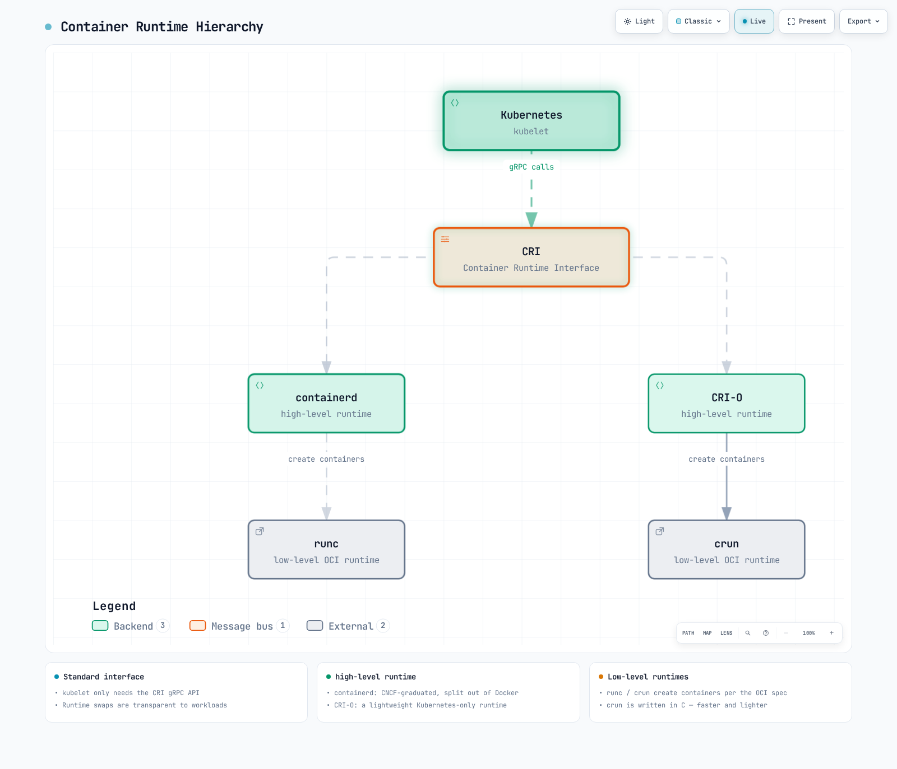

# クラスターアーキテクチャ

> **サポート対象バージョン**: Kubernetes 1.35、1.36、1.37
> **最終更新日**: 2026年11月19日

バージョンヘッダーは上流の Kubernetes を指します。このプロジェクトでは、直近3つのマイナーリリース（1.35～1.37）のリリースブランチを維持しています。上流の1.34はメンテナンスモードにあり、EKSにおけるAWSサポート終了日とは別に、**2026年10月27日**のサポート終了日までパッチリリースが提供されます。

2026年10月12日時点で、EKSの標準サポート対象は1.34～1.37です。EKS 1.37は2026年10月1日に利用可能になりました。バージョンを選ぶ前に、[Kubernetesのリリース状況](https://kubernetes.io/releases/)と[EKSのライフサイクル](https://docs.aws.amazon.com/eks/latest/userguide/kubernetes-versions.html)を確認してください。

以下のコンポーネントコマンドは、自己管理クラスターを例に示しています。EKSではコントロールプレーンを管理します。イメージタグとインフラストラクチャIDは例です。互換性があり、メンテナンスされているイメージを選び、使用前にプレースホルダーを置き換えてください。

## ラボ環境のセットアップ

このドキュメントの概念を実践するには、次のツールと環境が必要です。

### 必要なツール
- APIサーバーとマイナーバージョンの差が1以内のkubectl
- 動作するKubernetesクラスター（EKS、minikube、kindなど）

### ローカル開発環境のセットアップ

```bash
# Install minikube (for local development)
curl -LO https://storage.googleapis.com/minikube/releases/latest/minikube-linux-amd64
sudo install minikube-linux-amd64 /usr/local/bin/minikube

# Start cluster
minikube start

# Check cluster status
kubectl cluster-info

# Check control plane components
kubectl get pods -n kube-system
```

## クラスターアーキテクチャの概要

> **重要な概念**: Kubernetesクラスターはコントロールプレーンとワーカーノードで構成され、それぞれが特定の役割を担う複数のコンポーネントから成り立っています。

Kubernetesクラスターは、コンテナ化されたアプリケーションを実行するためのノード（仮想マシンまたは物理マシン）の集合です。クラスターは大きくコントロールプレーンとワーカーノードに分かれます。

### クラスターアーキテクチャ図


[🔍 インタラクティブな図を表示](https://www.atomai.click/kubernetes-docs/archmaps/en-core-01-cluster-architecture-0.html)

**コントロールプレーンのコンポーネント**:
- **kube-apiserver**: Kubernetes APIを公開するフロントエンド
- **etcd**: Kubernetes APIの状態を保存するキー・バリューストア
- **kube-scheduler**: 新しく作成されたPodを実行するノードを選択
- **kube-controller-manager**: クラスターの状態を管理するコントローラーを実行
- **cloud-controller-manager**: クラウドプロバイダーのAPIと連携

**ワーカーノードのコンポーネント**:
- **kubelet**: 各ノードで動作し、コンテナの実行を管理するエージェント
- **kube-proxy**: ネットワークルールを維持し、接続を転送
- **コンテナランタイム**: コンテナを実行（containerd、CRI-Oなど）

## コントロールプレーンのコンポーネント

コントロールプレーンはKubernetesクラスターの「頭脳」として機能し、クラスター全体の状態を管理・制御します。通常、コントロールプレーンのコンポーネントは専用のマシンで動作し、高可用性を実現するために複数のインスタンスに複製できます。

### コントロールプレーンのコンポーネントの詳細

| コンポーネント | 主な機能 | 通信先 | 高可用性の構成 |
|-----------|---------------|----------------------|--------------------------------|
| **kube-apiserver** | - Kubernetes APIを提供<br>- 認証と認可<br>- APIリクエストの処理 | - すべてのコンポーネント<br>- etcd | 複数のインスタンスによる水平スケーリング |
| **etcd** | - クラスターのデータを保存<br>- 分散キー・バリューストア<br>- 一貫性を保証 | - kube-apiserver | 複数ノードのクラスター |
| **kube-scheduler** | - Podの配置を決定<br>- ノードのリソースを評価<br>- アフィニティ／アンチアフィニティを適用 | - kube-apiserver | アクティブ・スタンバイ構成 |
| **kube-controller-manager** | - Nodeコントローラー<br>- Replicationコントローラー<br>- Endpointコントローラー<br>- ServiceAccountコントローラー | - kube-apiserver | アクティブ・スタンバイ構成 |
| **cloud-controller-manager** | - クラウドプロバイダーとの連携<br>- ノードのライフサイクル<br>- ルーティングとロードバランシング | - kube-apiserver<br>- Cloud API | アクティブ・スタンバイ構成 |

### コントロールプレーンの通信フロー

1. ユーザーまたはコントローラーがkube-apiserverにリクエストを送信する
2. kube-apiserverが認証、認可、アドミッションを行う
3. kube-apiserverがetcdからデータを読み取り、またはetcdにデータを書き込む
4. コントローラーとスケジューラーは、kube-apiserverを通じてクラスターの状態を監視する
5. kubeletがノードの状態をkube-apiserverに報告する

### kube-apiserver

kube-apiserverは、Kubernetes APIを公開するコントロールプレーンのフロントエンドです。内部と外部からのすべてのリクエストは、このAPIサーバーを通じて処理されます。

**主な機能**:
- REST APIを提供
- 認証と認可
- リクエストの検証と処理
- etcdとの通信
- 水平スケーリングに対応（複数のインスタンスにスケール可能）

**主なフラグと設定オプション**:
```bash
# Basic configuration example
kube-apiserver \
  --advertise-address=192.168.1.10 \
  --allow-privileged=true \
  --authorization-mode=Node,RBAC \
  --client-ca-file=/etc/kubernetes/pki/ca.crt \
  --enable-admission-plugins=NodeRestriction \
  --enable-bootstrap-token-auth=true \
  --etcd-servers=https://127.0.0.1:2379 \
  --etcd-cafile=/etc/kubernetes/pki/etcd/ca.crt \
  --etcd-certfile=/etc/kubernetes/pki/apiserver-etcd-client.crt \
  --etcd-keyfile=/etc/kubernetes/pki/apiserver-etcd-client.key \
  --kubelet-client-certificate=/etc/kubernetes/pki/apiserver-kubelet-client.crt \
  --kubelet-client-key=/etc/kubernetes/pki/apiserver-kubelet-client.key \
  --service-account-key-file=/etc/kubernetes/pki/sa.pub \
  --service-account-signing-key-file=/etc/kubernetes/pki/sa.key \
  --service-account-issuer=https://kubernetes.default.svc.cluster.local \
  --service-cluster-ip-range=10.96.0.0/12 \
  --tls-cert-file=/etc/kubernetes/pki/apiserver.crt \
  --tls-private-key-file=/etc/kubernetes/pki/apiserver.key
```

**APIサーバーのセキュリティ**:
- TLS証明書による安全な通信
- さまざまな認証方式に対応（X.509証明書、ServiceAccountトークン、OIDC、Webhookなど）
- RBAC（ロールベースアクセス制御）による権限管理
- アドミッションコントローラーによるリクエストの検証と変更

### etcd

etcdは、Kubernetes APIの状態を保存する、一貫性と高可用性を備えたキー・バリューストアです。Kubernetesの「信頼できる唯一の情報源」として機能します。

**主な機能**:
- 分散システム
- 強い一貫性（Raft合意アルゴリズムを使用）
- 高可用性（複数ノードで構成可能）
- 安全なデータ保存
- 変更を監視するWatch機能

**etcdクラスターの構成**:
```bash
# etcd cluster configuration example (3 nodes)
etcd \
  --name etcd-1 \
  --initial-advertise-peer-urls https://192.168.1.11:2380 \
  --listen-peer-urls https://192.168.1.11:2380 \
  --listen-client-urls https://192.168.1.11:2379,https://127.0.0.1:2379 \
  --advertise-client-urls https://192.168.1.11:2379 \
  --initial-cluster-token etcd-cluster \
  --initial-cluster etcd-1=https://192.168.1.11:2380,etcd-2=https://192.168.1.12:2380,etcd-3=https://192.168.1.13:2380 \
  --initial-cluster-state new \
  --data-dir=/var/lib/etcd \
  --cert-file=/etc/kubernetes/pki/etcd/server.crt \
  --key-file=/etc/kubernetes/pki/etcd/server.key \
  --trusted-ca-file=/etc/kubernetes/pki/etcd/ca.crt \
  --client-cert-auth=true \
  --peer-cert-file=/etc/kubernetes/pki/etcd/peer.crt \
  --peer-key-file=/etc/kubernetes/pki/etcd/peer.key \
  --peer-trusted-ca-file=/etc/kubernetes/pki/etcd/ca.crt \
  --peer-client-cert-auth=true
```

**etcdのバックアップと復旧**:
```bash
# etcd backup
ETCDCTL_API=3 etcdctl snapshot save snapshot.db \
  --endpoints=https://127.0.0.1:2379 \
  --cacert=/etc/kubernetes/pki/etcd/ca.crt \
  --cert=/etc/kubernetes/pki/etcd/server.crt \
  --key=/etc/kubernetes/pki/etcd/server.key

# etcd recovery
etcdutl snapshot restore snapshot.db \
  --bump-revision=1000000000 --mark-compacted \
  --data-dir=/var/lib/etcd-restore \
  --name=etcd-1 \
  --initial-cluster=etcd-1=https://192.168.1.11:2380 \
  --initial-cluster-token=etcd-cluster \
  --initial-advertise-peer-urls=https://192.168.1.11:2380
```

**etcdのパフォーマンス最適化**:
- ディスクI/Oの最適化（SSDを推奨）
- 適切なメモリ割り当て
- 定期的なログ圧縮とデフラグ
- クラスターの規模に応じた適切な数のetcdノード（通常は3台または5台）

#### 2026年7月の更新: etcd v3.7.0のリリース

2026年7月8日、SIG etcdはetcd v3.7.0をリリースしました。主な内容は次のとおりです。

- **RangeStream**: 大きな範囲検索の結果全体をメモリにバッファリングする代わりに、チャンクに分けてストリーミングします（以前から強く要望されていた機能）。
- **パフォーマンスの改善**: キーのみを返す範囲検索を最適化し、リースをより高速かつ確実にしました。
- レガシーなv2storeの残存部分をすべて削除し、大規模なprotobufの刷新を完了しました。
- コア依存関係を更新し、bbolt v1.5.0とraft v3.7.0を同梱しています。

詳細は[公式発表](https://kubernetes.io/blog/2026/07/08/announcing-etcd-3.7/)と[etcd v3.7の変更履歴](https://github.com/etcd-io/etcd/blob/main/CHANGELOG/CHANGELOG-3.7.md)を参照してください。

#### 2026年11月の更新: Amazon EKS Provisioned Control Planeの24 GB etcd

マネージドサービスでは、etcdの容量は提供プランにも左右されます。2026年11月11日、AWSはAmazon EKS Provisioned Control Planeの4XLおよび8XLプランで、etcdデータベースの容量が16 GBから**24 GB**に増加したと発表しました。etcdデータベースがいっぱいになると、クラスター内のオブジェクトを追加または変更できなくなります。そのため、容量の余裕が増えることで、大規模なAI/MLのトレーニングや推論、バッチ処理、CI/CDパイプラインなど、多数のオブジェクトを作成・更新するワークロードに役立ちます。データベースの容量増加は、EKS 1.34以降で4XLまたは8XLプランを選択した場合に適用されます。これらのプランを利用中の既存クラスターにも、操作不要で自動的に適用されます。また、Provisioned Control Planeが提供されているすべてのAWS商用リージョンで利用できます。詳細は[発表](https://aws.amazon.com/about-aws/whats-new/2026/11/amazon-eks-provisioned-control-plane-larger-etcd-database/)を参照してください。

### kube-scheduler

kube-schedulerは、新しく作成されたPodを実行するノードを選択するコントロールプレーンのコンポーネントです。

**スケジューリングのプロセス**:
1. **フィルタリング**: Podを実行できるノードを特定する
   - リソース要件（CPU、メモリ）
   - ノードセレクター、ノードアフィニティ
   - TaintとToleration
   - ボリュームの制約

2. **スコアリング**: 適切なノードにスコアを割り当てる
   - リソース使用率
   - Pod間のアフィニティ／アンチアフィニティ
   - データローカリティ
   - ノード間の負荷分散

3. **バインド**: Podを最適なノードに割り当てる

**スケジューラーの構成**:
```bash
# Basic configuration example
kube-scheduler \
  --kubeconfig=/etc/kubernetes/scheduler.conf \
  --leader-elect=true \
  --v=2
```

**スケジューラープロファイルとプラグイン**:
- デフォルトのスケジューラープロファイル
- カスタムのスケジューラープロファイル
- スケジューラーの拡張ポイント（filter、score、bindなど）
- 複数のスケジューラーへの対応

**スケジューリングポリシー**:
```yaml
# Scheduling policy example
apiVersion: kubescheduler.config.k8s.io/v1
kind: KubeSchedulerConfiguration
profiles:
- schedulerName: default-scheduler
  pluginConfig:
  - name: NodeResourcesFit
    args:
      scoringStrategy:
        type: MostAllocated
        resources:
        - name: cpu
          weight: 1
        - name: memory
          weight: 1
```

### kube-controller-manager

kube-controller-managerは、複数のコントローラープロセスを実行するコントロールプレーンのコンポーネントです。各コントローラーは、クラスターの特定の側面を管理します。

**主なコントローラー**:
- **Node Controller**: ノードの状態を監視し、それに応じて動作する
- **Replication Controller**: Podレプリカ数を維持する
- **EndpointSlice Controller**: EndpointSlice内のServiceバックエンドを追跡する
- **Service Account & Token Controllers**: デフォルトのServiceAccountを作成し、明示的に要求されたレガシーなトークンSecretを維持する。現在のPodは、有効期間の短いTokenRequestトークンを使用する
- **Job Controller**: 1回限りのタスクを管理する
- **CronJob Controller**: スケジュールされたタスクを管理する
- **DaemonSet Controller**: 特定のPodをすべてのノードで実行されるようにする
- **StatefulSet Controller**: ステートフルアプリケーションを管理する
- **PV Controller**: 永続ボリュームを管理する
- **Namespace Controller**: Namespaceのライフサイクルを管理する
- **Garbage Collector**: 孤立したオブジェクトを削除する

**コントローラーマネージャーの構成**:
```bash
# Basic configuration example
kube-controller-manager \
  --kubeconfig=/etc/kubernetes/controller-manager.conf \
  --leader-elect=true \
  --use-service-account-credentials=true \
  --root-ca-file=/etc/kubernetes/pki/ca.crt \
  --service-account-private-key-file=/etc/kubernetes/pki/sa.key \
  --cluster-signing-cert-file=/etc/kubernetes/pki/ca.crt \
  --cluster-signing-key-file=/etc/kubernetes/pki/ca.key \
  --controllers=*,bootstrapsigner,tokencleaner
```

**コントローラーの動作**:
1. コントローラーはAPIサーバーを通じてクラスターの状態を継続的に監視する
2. 現在の状態と望ましい状態の差を検出する
3. 差を調整する操作を行う
4. 状態の変化をAPIサーバーに報告する

### cloud-controller-manager

cloud-controller-managerは、クラウド固有の制御ロジックを含むコントロールプレーンのコンポーネントです。これにより、KubernetesのコアとクラウドプロバイダーのAPIを分離できます。

**主なコントローラー**:
- **Node Controller**: クラウドプロバイダーのAPIを通じてノードの状態を確認する
- **Route Controller**: クラウド環境内のルートを設定する
- **Service Controller**: クラウドロードバランサーを作成、更新、削除する

クラウドストレージのプロビジョニングとアタッチにはCSIコントローラーを使います。マウントはkubeletとCSIノードプラグインが処理します。これらはcloud-controller-managerの責務ではありません。

**クラウドプロバイダーの実装**:
- AWS Cloud Controller Manager
- Azure Cloud Controller Manager
- GCP Cloud Controller Manager
- OpenStack Cloud Controller Manager
- vSphere Cloud Controller Manager

**Cloud Controller Managerの構成**:
```bash
# AWS Cloud Controller Manager example
cloud-controller-manager \
  --cloud-provider=aws \
  --cloud-config=/etc/kubernetes/cloud-config \
  --kubeconfig=/etc/kubernetes/cloud-controller-manager.conf \
  --leader-elect=true
```

**Cloud Controller Managerの利点**:
- クラウドプロバイダー固有のコードをKubernetesのコアから分離できる
- クラウドプロバイダーが独自の機能を個別に開発できる
- Kubernetesのコアを変更せずにクラウド機能を追加できる

## ノードのコンポーネント

ノードは、コンテナ化されたアプリケーションを実行するKubernetesクラスター内のワーカーマシンです。各ノードはコントロールプレーンによって管理され、複数のコンポーネントで構成されます。

### kubelet

kubeletは、各ノードで動作し、Pod内のコンテナを管理するエージェントです。kubeletはさまざまな仕組みを通じてPodSpecを受け取り、それに従ってコンテナが正常に動作するようにします。

**主な機能**:
- PodSpecに従ってコンテナを実行する
- コンテナの状態を監視して報告する
- コンテナのライフサイクルを管理する
- ボリュームのマウントを管理する
- ノードの状態を報告する
- コンテナのヘルスチェックを行う

**kubeletの構成**:
```bash
# Basic configuration example
kubelet \
  --kubeconfig=/etc/kubernetes/kubelet.conf \
  --config=/var/lib/kubelet/config.yaml \
  --container-runtime-endpoint=unix:///run/containerd/containerd.sock
```

**kubelet設定ファイルの例**:
```yaml
# /var/lib/kubelet/config.yaml
apiVersion: kubelet.config.k8s.io/v1beta1
kind: KubeletConfiguration
address: 0.0.0.0
authentication:
  anonymous:
    enabled: false
  webhook:
    cacheTTL: 2m0s
    enabled: true
  x509:
    clientCAFile: /etc/kubernetes/pki/ca.crt
authorization:
  mode: Webhook
  webhook:
    cacheAuthorizedTTL: 5m0s
    cacheUnauthorizedTTL: 30s
cgroupDriver: systemd
clusterDomain: cluster.local
cpuManagerPolicy: none
evictionHard:
  memory.available: 100Mi
  nodefs.available: 10%
  nodefs.inodesFree: 5%
failSwapOn: true
healthzBindAddress: 127.0.0.1
healthzPort: 10248
```

**Static Pod**: 以下のマニフェストは断片であり、コントロールプレーンの完全なインストール手順ではありません。ホストネットワーク、証明書、マウント、APIサーバーの完全な設定も必要です。
kubeletは、APIサーバーを介さずに直接管理するStatic Podを実行できます。これは主に、コントロールプレーンのコンポーネントを実行するために使用されます。

```yaml
# /etc/kubernetes/manifests/kube-apiserver.yaml
apiVersion: v1
kind: Pod
metadata:
  name: kube-apiserver
  namespace: kube-system
spec:
  containers:
  - name: kube-apiserver
    image: registry.k8s.io/kube-apiserver:v1.37.1
    command:
    - kube-apiserver
    - --advertise-address=192.168.1.10
    # ... additional flags
```

### kube-proxy

kube-proxyは、各ノードで動作するネットワークプロキシで、KubernetesのServiceという概念を実装します。ノード上のネットワークルールを維持し、接続を転送します。

**主な機能**:
- ServiceのIPとポートに関するネットワークルールを維持する
- 接続を転送する
- ロードバランシングを実装する
- サービスディスカバリーに対応する

**動作モード**:
1. **iptables**: Linuxのデフォルトモード。カーネルのパケット処理ルールをインストールする
2. **nftables**: v1.33以降でStable。カーネルおよびCNIとの互換性を確認する
3. **IPVS**: Linuxのレガシーモード。v1.35以降は非推奨。サポート対象の代替方式に移行する
4. **kernelspace**: Windowsモード

古い`userspace`モードは削除されました。一部のネットワーク実装では、kube-proxyを完全に置き換えます。

**kube-proxyの構成**:
```bash
# Basic configuration example
kube-proxy \
  --config=/var/lib/kube-proxy/config.conf \
  --hostname-override=node1
```

**kube-proxy設定ファイルの例**:
```yaml
# /var/lib/kube-proxy/config.conf
apiVersion: kubeproxy.config.k8s.io/v1alpha1
kind: KubeProxyConfiguration
bindAddress: 0.0.0.0
clientConnection:
  acceptContentTypes: ""
  burst: 10
  contentType: application/vnd.kubernetes.protobuf
  kubeconfig: /var/lib/kube-proxy/kubeconfig.conf
  qps: 5
clusterCIDR: 10.244.0.0/16
configSyncPeriod: 15m0s
conntrack:
  maxPerCore: 32768
  min: 131072
  tcpCloseWaitTimeout: 1h0m0s
  tcpEstablishedTimeout: 24h0m0s
enableProfiling: false
healthzBindAddress: 0.0.0.0:10256
hostnameOverride: node1
iptables:
  masqueradeAll: false
  masqueradeBit: 14
  minSyncPeriod: 0s
  syncPeriod: 30s
ipvs:
  excludeCIDRs: null
  minSyncPeriod: 0s
  scheduler: ""
  syncPeriod: 30s
mode: "iptables"
```

**IPVSモードとiptablesモードの比較**:

| 特性 | iptablesモード | IPVSモード |
|----------------|---------------|-----------|
| パフォーマンス | Service数が多いとパフォーマンスが低下 | 大規模クラスターでパフォーマンスが向上 |
| 負荷分散アルゴリズム | デフォルトではランダムにバックエンドを選択 | 複数のアルゴリズムに対応（rr、lc、dh、sh、sed、nq） |
| 実装 | ネットワークパケットのフィルタリングチェーン | ハッシュテーブルベース |
| カーネル要件 | デフォルトのカーネルモジュール | IPVSカーネルモジュールが必要 |

### コンテナランタイム

コンテナランタイムは、コンテナを実行するソフトウェアです。Kubernetesは、Container Runtime Interface（CRI）を通じてさまざまなコンテナランタイムに対応しています。

**主なコンテナランタイム**:
1. **containerd**: 軽量なコンテナランタイム（現在、最も広く使用されている）
2. **CRI-O**: Kubernetes専用に設計された軽量ランタイム
3. **Docker Engine**: cri-dockerdなどの外部CRIアダプターが必要です。組み込みのdockershimはv1.24で削除されました。DockerでビルドしたOCIイメージは、引き続きcontainerd/CRI-Oで動作します。

**コンテナランタイムのレイヤー構造**:



[🔍 インタラクティブな図を表示](https://www.atomai.click/kubernetes-docs/archmaps/en-core-01-cluster-architecture-1.html)

**containerd 1.xの構成例**（2.xではプラグインIDが異なります。インストールされているリリースのデフォルト設定を生成してください）:
```toml
# /etc/containerd/config.toml
version = 2

[plugins]
  [plugins."io.containerd.grpc.v1.cri"]
    sandbox_image = "registry.k8s.io/pause:3.10"
    [plugins."io.containerd.grpc.v1.cri".containerd]
      default_runtime_name = "runc"
      [plugins."io.containerd.grpc.v1.cri".containerd.runtimes]
        [plugins."io.containerd.grpc.v1.cri".containerd.runtimes.runc]
          runtime_type = "io.containerd.runc.v2"
          [plugins."io.containerd.grpc.v1.cri".containerd.runtimes.runc.options]
            SystemdCgroup = true
```

**CRI-Oの構成例**:
```toml
# /etc/crio/crio.conf
[crio]
root = "/var/lib/containers/storage"
runroot = "/var/run/containers/storage"
storage_driver = "overlay"
storage_option = ["overlay.mountopt=nodev"]

[crio.runtime]
default_runtime = "runc"
conmon = "/usr/bin/conmon"
conmon_cgroup = "pod"
cgroup_manager = "systemd"

[crio.image]
pause_image = "registry.k8s.io/pause:3.10"
```

### アドオンコンポーネント

アドオンは、Kubernetesクラスターの機能を拡張する追加コンポーネントです。主なアドオンは次のとおりです。

1. **CNIネットワークプラグイン**: Podネットワーキングを実装する
   - Calico、Cilium、Flannelなど

2. **DNS**: クラスター内でDNSサービスを提供する
   - CoreDNS（デフォルト）

3. **ダッシュボード**: WebベースのUIを提供する
   - Headlamp（Kubernetes Dashboardはアーカイブ済み）

4. **Ingress Controller**: HTTP/HTTPSルーティングを管理する
   - Traefik、HAProxyなど

5. **Metrics Server**: リソース使用率のメトリクスを収集する
   - Metrics Server

6. **ロギングとモニタリング**: ログの収集と監視を行う
   - Prometheus、Grafana、Elasticsearch、Fluentd、Kibanaなど

**CoreDNSの構成例**:
```yaml
apiVersion: v1
kind: ConfigMap
metadata:
  name: coredns
  namespace: kube-system
data:
  Corefile: |
    .:53 {
        errors
        health {
            lameduck 5s
        }
        ready
        kubernetes cluster.local in-addr.arpa ip6.arpa {
            pods insecure
            fallthrough in-addr.arpa ip6.arpa
            ttl 30
        }
        prometheus :9153
        forward . /etc/resolv.conf {
            max_concurrent 1000
        }
        cache 30
        loop
        reload
        loadbalance
    }
```

**Calico CNIの構成例**:
```yaml
apiVersion: v1
kind: ConfigMap
metadata:
  name: calico-config
  namespace: kube-system
data:
  calico_backend: "bird"
  cni_network_config: |-
    {
      "name": "k8s-pod-network",
      "cniVersion": "0.3.1",
      "plugins": [
        {
          "type": "calico",
          "log_level": "info",
          "datastore_type": "kubernetes",
          "nodename": "__KUBERNETES_NODE_NAME__",
          "mtu": __CNI_MTU__,
          "ipam": {
            "type": "calico-ipam"
          },
          "policy": {
            "type": "k8s"
          },
          "kubernetes": {
            "kubeconfig": "__KUBECONFIG_FILEPATH__"
          }
        },
        {
          "type": "portmap",
          "snat": true,
          "capabilities": {"portMappings": true}
        }
      ]
    }
```

## クラスター内の通信経路

Kubernetesクラスター内では、さまざまなコンポーネント間で通信が行われます。クラスターの設計、セキュリティ、トラブルシューティングには、こうした通信経路の理解が重要です。

### コントロールプレーン内部の通信


[🔍 インタラクティブな図を表示](https://www.atomai.click/kubernetes-docs/archmaps/en-core-01-cluster-architecture-2.html)

コントロールプレーンのコンポーネント間の通信は、次のとおりです。

1. **kube-apiserverとetcd**: kube-apiserverは、クラスターの状態を保存および取得するためにetcdと通信します。
   - プロトコル: gRPC
   - ポート: 2379/TCP
   - セキュリティ: TLS証明書ベースの認証

2. **kube-schedulerとkube-apiserver**: kube-schedulerはPodのスケジューリングのためにkube-apiserverと通信します。
   - プロトコル: HTTPS
   - ポート: 6443/TCP（kube-apiserver）
   - セキュリティ: TLS証明書ベースの認証

3. **kube-controller-managerとkube-apiserver**: コントローラーは、クラスターの状態を監視および変更するためにkube-apiserverと通信します。
   - プロトコル: HTTPS
   - ポート: 6443/TCP（kube-apiserver）
   - セキュリティ: TLS証明書ベースの認証

4. **cloud-controller-managerとkube-apiserver**: Cloud Controllerは、クラスターの状態を監視し、クラウドリソースを管理するためにkube-apiserverと通信します。
   - プロトコル: HTTPS
   - ポート: 6443/TCP（kube-apiserver）
   - セキュリティ: TLS証明書ベースの認証

### コントロールプレーンとノード間の通信


[🔍 インタラクティブな図を表示](https://www.atomai.click/kubernetes-docs/archmaps/en-core-01-cluster-architecture-3.html)

コントロールプレーンとノード間の通信は、次のとおりです。

1. **kube-apiserver → kubelet**: APIサーバーは、ログ、exec/attach、ポートフォワーディングのためにkubelet APIを呼び出します。
   - プロトコル: HTTPS
   - ポート: 10250/TCP（kubelet）
   - セキュリティ: TLS証明書ベースの認証

2. **kubeletとkube-apiserver**: kubeletは、割り当てられたPodSpecを監視し、ノードを登録し、ノード／Podの状態やイベントを報告するためにkube-apiserverと通信します。
   - プロトコル: HTTPS
   - ポート: 6443/TCP（kube-apiserver）
   - セキュリティ: TLS証明書ベースの認証

3. **kube-proxyとkube-apiserver**: kube-proxyは、Serviceの情報を取得するためにkube-apiserverと通信します。
   - プロトコル: HTTPS
   - ポート: 6443/TCP（kube-apiserver）
   - セキュリティ: TLS証明書ベースの認証

### ノード間通信


[🔍 インタラクティブな図を表示](https://www.atomai.click/kubernetes-docs/archmaps/en-core-01-cluster-architecture-4.html)

ノード間の通信は、次のとおりです。

1. **Pod間通信**: PodはCNIプラグインが提供するネットワークを通じて相互に通信します。
   - プロトコル: アプリケーションによって異なる（TCP、UDPなど）
   - ポート: アプリケーションによって異なる
   - セキュリティ: NetworkPolicyで制御可能

2. **ノードをまたぐPod間通信**: 異なるノード上のPod間の通信は、CNIプラグインによって処理されます。
   - プロトコル: アプリケーションによって異なる（TCP、UDPなど）
   - ポート: アプリケーションによって異なる
   - セキュリティ: NetworkPolicyで制御可能

### 外部との通信


[🔍 インタラクティブな図を表示](https://www.atomai.click/kubernetes-docs/archmaps/en-core-01-cluster-architecture-5.html)

外部との通信は、次のとおりです。

1. **クライアントとkube-apiserver**: ユーザーや外部システムは、kube-apiserverを通じてクラスターとやり取りします。
   - プロトコル: HTTPS
   - ポート: 6443/TCP（kube-apiserver）
   - セキュリティ: TLS証明書、トークン、ユーザー認証など

2. **外部トラフィックとService**: 外部トラフィックは、NodePort、LoadBalancer Service、またはIngressを通じてクラスター内のアプリケーションにアクセスします。
   - プロトコル: HTTP、HTTPS、TCP、UDPなど
   - ポート: Serviceの構成によって異なる
   - セキュリティ: Ingress ControllerとServiceの構成によって異なる

### 通信のセキュリティ

Kubernetesクラスター内の通信は、次の方法で保護されます。

1. **TLS証明書**: コントロールプレーンのコンポーネント間の通信は、TLS証明書で暗号化されます。
2. **認証と認可**: APIサーバーへのリクエストはすべて、認証と認可のプロセスを経ます。
3. **NetworkPolicy**: Pod間通信をNetworkPolicyで制限できます。
4. **暗号化されたSecret**: etcdに保存されたSecretを暗号化できます。

**APIデータの保存時暗号化の例**（APIサーバーを`--encryption-provider-config`で設定し、既存のSecretを書き換えて暗号化します）:
```yaml
apiVersion: apiserver.config.k8s.io/v1
kind: EncryptionConfiguration
resources:
  - resources:
    - secrets
    providers:
    - aescbc:
        keys:
        - name: key1
          secret: <base64-encoded-key>
    - identity: {}
```

### 高可用性クラスターの構成

高可用性（HA）Kubernetesクラスターは、単一障害点をなくし、サービスを中断せずに稼働を継続できるように設計されています。

### コントロールプレーンの高可用性

コントロールプレーンの高可用性は、次の方法で実現します。

1. **複数のコントロールプレーンノード**: 冗長性を確保するため、通常は3台または5台のコントロールプレーンノードをデプロイする
2. **etcdクラスター**: 複数のetcdインスタンスで構成するクラスターをデプロイする（通常は3台または5台）
3. **ロードバランサー**: APIサーバーの前段にロードバランサーを配置して、トラフィックを分散する

**高可用性コントロールプレーンのアーキテクチャ**:


[🔍 インタラクティブな図を表示](https://www.atomai.click/kubernetes-docs/archmaps/en-core-01-cluster-architecture-6.html)

**etcdクラスターの構成**:


[🔍 インタラクティブな図を表示](https://www.atomai.click/kubernetes-docs/archmaps/en-core-01-cluster-architecture-7.html)

### ワーカーノードの高可用性

ワーカーノードの高可用性は、次の方法で実現します。

1. **複数のワーカーノード**: 複数のワーカーノードにワークロードを分散する
2. **ノードの自動復旧**: クラウドプロバイダーの自動復旧機能を利用する
3. **自動スケーリング**: Cluster Autoscalerでノードを自動的にスケールする
4. **複数のアベイラビリティーゾーン**: 複数のアベイラビリティーゾーンにノードをデプロイする

**ワーカーノードの分散デプロイ**:


[🔍 インタラクティブな図を表示](https://www.atomai.click/kubernetes-docs/archmaps/en-core-01-cluster-architecture-8.html)

### アプリケーションの高可用性

アプリケーションの高可用性は、次の方法で実現します。

1. **ReplicaSet/Deployment**: 複数のPodレプリカを実行する
2. **Podの分散ルール**: Podアンチアフィニティによって、複数のノードにPodを分散する
3. **PodDisruptionBudget**: 計画的な中断の際に、最低限の可用性を確保する
4. **Serviceとロードバランシング**: 複数のPodにトラフィックを分散する

**Podアンチアフィニティの例**:
```yaml
apiVersion: apps/v1
kind: Deployment
metadata:
  name: web-server
spec:
  replicas: 3
  selector:
    matchLabels:
      app: web-server
  template:
    metadata:
      labels:
        app: web-server
    spec:
      affinity:
        podAntiAffinity:
          requiredDuringSchedulingIgnoredDuringExecution:
          - labelSelector:
              matchExpressions:
              - key: app
                operator: In
                values:
                - web-server
            topologyKey: "kubernetes.io/hostname"
      containers:
      - name: web-server
        image: nginx:1.30.6
```

**PodDisruptionBudgetの例**:
```yaml
apiVersion: policy/v1
kind: PodDisruptionBudget
metadata:
  name: web-server-pdb
spec:
  minAvailable: 2
  selector:
    matchLabels:
      app: web-server
```

### 災害復旧戦略

Kubernetesクラスターの災害復旧戦略は、次の方法で実施します。

1. **etcdのバックアップと復旧**: etcdデータを定期的にバックアップし、復旧する手順を整備する
2. **マルチリージョンデプロイ**: 複数のリージョンにクラスターをデプロイする
3. **クラスターのフェデレーション**: フェデレーションによって複数のクラスターを管理する
4. **継続的なバックアップ**: アプリケーションデータを継続的にバックアップする

**etcdバックアップスクリプトの例**:
```bash
#!/bin/bash
ETCDCTL_API=3 etcdctl snapshot save /backup/etcd-snapshot-$(date +%Y%m%d-%H%M%S).db \
  --endpoints=https://127.0.0.1:2379 \
  --cacert=/etc/kubernetes/pki/etcd/ca.crt \
  --cert=/etc/kubernetes/pki/etcd/server.crt \
  --key=/etc/kubernetes/pki/etcd/server.key
```

**etcdの復旧手順（自己管理クラスター）**:

1. `etcdutl snapshot status`でスナップショットを検証します。上記の例のように、互換性のある`etcdutl`を使って新しいデータディレクトリに復元します。
2. データディレクトリを切り替える前に、クラスターの運用手順書に従って、すべてのAPIサーバーインスタンスと対象のetcdプロセスを停止します。kubeletを停止するだけでは、既存のStatic Podコンテナは停止しません。
3. 複数メンバーの復旧では、すべてのメンバーに同じスナップショットを復元し、それぞれ異なる名前／ピアURLと、同一の完全な`--initial-cluster`メンバー構成を指定します。上記の単一メンバーの例は、HA復旧の手順ではありません。
4. KubernetesのWatchキャッシュに対応するため、`--bump-revision`と`--mark-compacted`を使用します。バンプ値には、スナップショット以降のリビジョンを超える値を選びます（例に示した値は一例です）。
5. etcdのStatic Podに設定されているhostPathを復元先ディレクトリに更新し、etcdを再起動してクォーラムとヘルスを確認してから、APIサーバーとコントローラーを再起動します。検証が完了するまで、元のデータとバックアップを保持してください。

[etcdの復旧ガイド](https://etcd.io/docs/v3.6/op-guide/recovery/)に従ってください。EKSのユーザーは、マネージドコントロールプレーンのetcdを直接操作したり復元したりしません。

## クラスターネットワーキング

Kubernetesネットワーキングによって、Pod、Service、外部との通信が可能になります。Kubernetesのネットワークモデルでは、各Podに一意のIPアドレスが割り当てられ、NATを使わずに他のすべてのPodと通信できることを前提とします。

### ネットワークモデル

Kubernetesのネットワークモデルには、次の要件があります。

1. **Pod間通信**: すべてのPodがNATを使わずに他のすべてのPodと通信できること
2. **ノードとPod間の通信**: ノード上のエージェントが、そのノード上のPodと通信できること
3. **Podと外部間の通信**: 外部への接続性は、ルーティング、必要に応じたNAT、セキュリティ／送信ポリシーに依存します。すべてのPodがインターネットに接続できることは要件ではありません。

### CNI（Container Network Interface）

CNIは、Kubernetesでネットワーキングを実装するための標準インターフェースです。さまざまなCNIプラグインがあり、それぞれ機能やパフォーマンス特性が異なります。

**主なCNIプラグイン**:

1. **Calico**: BGPベースのネットワーキングとNetworkPolicyに対応
   - 特徴: 高いパフォーマンス、NetworkPolicy、暗号化、eBPF対応
   - ユースケース: 大規模クラスター、セキュリティを重視する環境

2. **Cilium**: eBPFベースのネットワーキングとセキュリティ
   - 特徴: L3～L7のセキュリティポリシー、高いパフォーマンス、可観測性
   - ユースケース: マイクロサービス、セキュリティを重視する環境

3. **Flannel**: シンプルなオーバーレイネットワーク
   - 特徴: 簡単なセットアップ、軽量
   - ユースケース: 小規模クラスター、開発環境

4. **Weave Net（歴史的なプラグイン）**: プロジェクトは2024年6月にアーカイブされました。新規デプロイでは、メンテナンスされている代替製品を評価してください。

**CNI設定の例（Calico）**:
```yaml
apiVersion: v1
kind: ConfigMap
metadata:
  name: calico-config
  namespace: kube-system
data:
  calico_backend: "bird"
  cni_network_config: |-
    {
      "name": "k8s-pod-network",
      "cniVersion": "0.3.1",
      "plugins": [
        {
          "type": "calico",
          "log_level": "info",
          "datastore_type": "kubernetes",
          "nodename": "__KUBERNETES_NODE_NAME__",
          "mtu": __CNI_MTU__,
          "ipam": {
            "type": "calico-ipam"
          },
          "policy": {
            "type": "k8s"
          },
          "kubernetes": {
            "kubeconfig": "__KUBECONFIG_FILEPATH__"
          }
        },
        {
          "type": "portmap",
          "snat": true,
          "capabilities": {"portMappings": true}
        }
      ]
    }
```

### Serviceネットワーキング

KubernetesのServiceは、Podの集合に対して安定したエンドポイントを提供します。ServiceにはClusterIP、NodePort、LoadBalancer、ExternalNameなどの種類があります。

**Serviceネットワーキングのコンポーネント**:

1. **ClusterIP**: クラスター内からのみアクセスできる仮想IP
2. **kube-proxy**: ServiceのIP宛てのトラフィックをPodにルーティングする
3. **CoreDNS**: サービスディスカバリーのためのDNSサービス

**Serviceネットワーキングのフロー**:
```
Client -> kernel rules programmed by kube-proxy (ClusterIP DNAT) -> Pod
```

**Serviceの例**:
```yaml
apiVersion: v1
kind: Service
metadata:
  name: my-service
spec:
  selector:
    app: my-app
  ports:
  - port: 80
    targetPort: 8080
  type: ClusterIP
```

### Ingressネットワーキング

Ingressは、クラスター外部からクラスター内部のServiceへのHTTPおよびHTTPSルーティングを管理します。Ingress ControllerがIngressリソースを実装します。

**主なIngress Controller**:
1. **メンテナンスされているIngress/Gateway Controller**: ControllerのライフサイクルとGateway APIへの対応を確認する
2. **AWS Load Balancer Controller**: Ingress用にALBをプロビジョニングする
3. **Traefik**: クラウドネイティブなエッジルーター
4. **HAProxy Ingress**: HAProxyベースのIngress Controller

**Ingressネットワーキングのフロー**:
```
Client -> Ingress Controller -> Service -> Pod
```

コミュニティ版ingress-nginxは2026年3月に廃止されました。[廃止に関するお知らせ](https://kubernetes.io/blog/2025/11/11/ingress-nginx-retirement/)を参照してください。この例を使用するには、`traefik`という名前のIngressClassを持つTraefik Controllerがインストールされている必要があります。`/app`は変更されずに転送されます。

**Ingressの例**:
```yaml
apiVersion: networking.k8s.io/v1
kind: Ingress
metadata:
  name: my-ingress
spec:
  ingressClassName: traefik
  rules:
  - host: example.com
    http:
      paths:
      - path: /app
        pathType: Prefix
        backend:
          service:
            name: my-service
            port:
              number: 80
```

### NetworkPolicy

NetworkPolicyを使用して、Pod間の通信を制御できます。デフォルトではすべてのPodが相互に通信できますが、NetworkPolicyで制限できます。

**NetworkPolicyの例**:
```yaml
apiVersion: networking.k8s.io/v1
kind: NetworkPolicy
metadata:
  name: db-network-policy
spec:
  podSelector:
    matchLabels:
      role: db
  policyTypes:
  - Ingress
  - Egress
  ingress:
  - from:
    - podSelector:
        matchLabels:
          role: frontend
    ports:
    - protocol: TCP
      port: 3306
  egress:
  - to:
    - podSelector:
        matchLabels:
          role: monitoring
    ports:
    - protocol: TCP
      port: 9090
```

### ネットワークのトラブルシューティング

Kubernetesのネットワーク問題のトラブルシューティングに使用する、一般的なツールとコマンドを紹介します。

1. **ping、traceroute**: 基本的なネットワーク接続テスト
2. **tcpdump**: ネットワークパケットのキャプチャと解析
3. **netstat、ss**: ネットワーク接続の状態確認
4. **nslookup、dig**: DNS検索テスト
5. **kubectl exec**: Pod内でネットワークコマンドを実行する

**ネットワークのデバッグ例**:
```bash
# Test network connectivity within a pod
kubectl exec -it <pod-name> -- ping <target-ip>

# Test DNS lookup within a pod
kubectl exec -it <pod-name> -- nslookup <service-name>

# Capture network packets within a pod
kubectl exec -it <pod-name> -- tcpdump -i eth0 -n

# Check service endpoints
kubectl get endpointslices -l kubernetes.io/service-name=<service-name>
```

## クラスターストレージ

Kubernetesのストレージは、コンテナ化されたアプリケーションのデータを永続化します。Kubernetesは、アプリケーションがストレージを効率的に利用できるよう、さまざまなストレージオプションと抽象化機能を提供します。

### ストレージアーキテクチャ

Kubernetesのストレージアーキテクチャは、次のコンポーネントで構成されます。

1. **ボリューム**: Pod内のコンテナにマウントできるディレクトリ
2. **Persistent Volume（PV）**: クラスター内のストレージリソース
3. **Persistent Volume Claim（PVC）**: ユーザーからのストレージ要求
4. **StorageClass**: ストレージの「クラス」または種類を定義する
5. **CSI（Container Storage Interface）**: ストレージシステムとの標準インターフェース

**ストレージアーキテクチャのフロー**:


[🔍 インタラクティブな図を表示](https://www.atomai.click/kubernetes-docs/archmaps/en-core-01-cluster-architecture-9.html)

### ボリュームの種類

Kubernetesは、さまざまな種類のボリュームに対応しています。

1. **一時ボリューム**:
   - **emptyDir**: 空のディレクトリとして作成され、Podの削除時に削除される
   - **configMap**: ConfigMapをボリュームとしてマウントする
   - **secret**: Secretをボリュームとしてマウントする
   - **downwardAPI**: Podとコンテナの情報をファイルとして公開する

2. **永続ボリューム**:
   - **CSI経由のクラウドブロックストレージ**: AWS EBS、Azure Disk、GCE Persistent Disk。これらのレガシーなツリー内実装は削除済み
   - **nfs**: NFSボリューム
   - **csi**: CSIドライバー経由のボリューム

**ボリュームの例**:
```yaml
apiVersion: v1
kind: Pod
metadata:
  name: test-pd
spec:
  containers:
  - name: test-container
    image: nginx
    volumeMounts:
    - mountPath: /test-pd
      name: test-volume
  volumes:
  - name: test-volume
    persistentVolumeClaim:
      claimName: test-pvc
```

### Persistent VolumeとClaim

Persistent Volume（PV）は、管理者がプロビジョニングするか、StorageClassを通じて動的にプロビジョニングされるクラスター内のストレージリソースです。Persistent Volume Claim（PVC）は、ユーザーからのストレージ要求です。

まず、IAM権限を設定してEBS CSIドライバーをインストールしてください。以下のStatic PVでは、ボリュームIDとゾーンを、既存のEBSボリュームとその実際のゾーンに置き換えてください。EBSはFargateにはマウントできません。EKS Auto Modeでは、代わりに`ebs.csi.eks.amazonaws.com`を使用します。

**Persistent Volumeの例**:
```yaml
apiVersion: v1
kind: PersistentVolume
metadata:
  name: pv-example
spec:
  capacity:
    storage: 10Gi
  accessModes:
    - ReadWriteOnce
  persistentVolumeReclaimPolicy: Retain
  storageClassName: standard
  csi:
    driver: ebs.csi.aws.com
    volumeHandle: vol-0123456789abcdef0
    fsType: ext4
  nodeAffinity:
    required:
      nodeSelectorTerms:
      - matchExpressions:
        - key: topology.kubernetes.io/zone
          operator: In
          values: [ap-northeast-2a]
```

**Persistent Volume Claimの例**:
```yaml
apiVersion: v1
kind: PersistentVolumeClaim
metadata:
  name: pvc-example
spec:
  accessModes:
    - ReadWriteOnce
  resources:
    requests:
      storage: 5Gi
  storageClassName: standard
```

### StorageClass

StorageClassは、管理者が提供するストレージの「クラス」を記述します。StorageClassを使うと、PVCの要求時にPVを動的にプロビジョニングできます。

**StorageClassの例**:
```yaml
apiVersion: storage.k8s.io/v1
kind: StorageClass
metadata:
  name: standard
provisioner: ebs.csi.aws.com
parameters:
  type: gp3
  csi.storage.k8s.io/fstype: ext4
  encrypted: "true"
reclaimPolicy: Delete
allowVolumeExpansion: true
volumeBindingMode: WaitForFirstConsumer
```

### CSI（Container Storage Interface）

CSIは、Kubernetesとストレージシステム間の標準インターフェースです。CSIを通じて、ストレージプロバイダーはKubernetesのコードを変更することなく独自のストレージドライバーを開発できます。

**CSIアーキテクチャ**:


[🔍 インタラクティブな図を表示](https://www.atomai.click/kubernetes-docs/archmaps/en-core-01-cluster-architecture-10.html)

**CSIドライバーのデプロイ例**:
```yaml
apiVersion: storage.k8s.io/v1
kind: StorageClass
metadata:
  name: ebs-sc
provisioner: ebs.csi.aws.com
parameters:
  type: gp3
  csi.storage.k8s.io/fstype: ext4
  encrypted: "true"
volumeBindingMode: WaitForFirstConsumer
```

### ストレージのベストプラクティス

Kubernetesストレージを使用する際のベストプラクティスは次のとおりです。

1. **適切なストレージタイプを選ぶ**: ワークロードの特性に合ったストレージタイプを選択する
2. **動的プロビジョニングを使用する**: StorageClassを通じた動的プロビジョニングを活用する
3. **適切なアクセスモードを選ぶ**: ワークロードの要件に合ったアクセスモードを選択する
4. **リソース要求と制限を設定する**: 適切なストレージ容量を要求する
5. **バックアップと復旧の戦略を確立する**: 重要なデータのバックアップと復旧の戦略を準備する
6. **ストレージを監視する**: ストレージの使用状況とパフォーマンスを監視する

## クラスターのスケーラビリティ

Kubernetesクラスターのスケーラビリティとは、負荷や要件の増加に対応する能力です。水平スケーリング（スケールアウト）と垂直スケーリング（スケールアップ）によって実現できます。

### クラスター規模の上限

上流の[大規模クラスターに関するガイダンス](https://kubernetes.io/docs/setup/best-practices/cluster-large/)では、テスト済みのサポート範囲として、ノード5,000台、Pod合計150,000個、コンテナ合計300,000個、ノードあたり110 Podが示されています。これらの基準は一体として適用され、すべての環境に共通する厳密なAPI上限ではありません。Podあたりのコンテナ数に一般的な上限20個という制限はありません。Serviceの処理能力は、アドレス範囲とデータプレーンにも左右されます。クラウドネットワーキングの制限やクォータのほうが低い場合があります。

### 水平スケーリング

水平スケーリングでは、ノードを追加してクラスターの容量を増やします。

**ノードの自動スケーリング**:
Kubernetes Cluster Autoscalerは、ワークロードの要件に応じてノード数を自動的に調整します。

```yaml
# AWS Auto Scaling Group tags example
tags:
  k8s.io/cluster-autoscaler/enabled: "true"
  k8s.io/cluster-autoscaler/my-cluster: "owned"
```

**Cluster AutoscalerのDeployment断片（v1.36クラスターの例）**: クラスターのマイナーバージョンに合ったパッチ適用済みリリースを選択してください。ServiceAccount、Kubernetes RBAC、専用のIAMロールを用意してください。この断片は完全なインストール手順ではありません。
```yaml
apiVersion: apps/v1
kind: Deployment
metadata:
  name: cluster-autoscaler
  namespace: kube-system
spec:
  replicas: 1
  selector:
    matchLabels:
      app: cluster-autoscaler
  template:
    metadata:
      labels:
        app: cluster-autoscaler
    spec:
      containers:
      - name: cluster-autoscaler
        image: registry.k8s.io/autoscaling/cluster-autoscaler:v1.36.1
        command:
        - ./cluster-autoscaler
        - --cloud-provider=aws
        - --nodes=2:10:my-asg-group
        - --scale-down-unneeded-time=10m
```

**Karpenter**:
Karpenterは、AWSが開発した新しいノード自動スケーリングツールで、より高速かつ効率的なノードのプロビジョニングを実現します。

```yaml
apiVersion: karpenter.sh/v1
kind: NodePool
metadata:
  name: default
spec:
  template:
    spec:
      requirements:
        - key: karpenter.sh/capacity-type
          operator: In
          values: ["spot", "on-demand"]
      nodeClassRef:
        group: karpenter.k8s.aws
        kind: EC2NodeClass
        name: default-class
  limits:
    cpu: 1000
    memory: 1000Gi
---
apiVersion: karpenter.k8s.aws/v1
kind: EC2NodeClass
metadata:
  name: default-class
spec:
  role: KarpenterNodeRole-my-cluster
  amiSelectorTerms:
    - alias: al2023@latest
  subnetSelectorTerms:
    - tags:
        karpenter.sh/discovery: my-cluster
  securityGroupSelectorTerms:
    - tags:
        karpenter.sh/discovery: my-cluster
```

### 垂直スケーリング

ワークロードの垂直スケーリングでは、PodのCPU／メモリ要求を調整します。VPAは基盤となるノードのサイズを変更しません。追加のノード容量は別途プロビジョニングする必要があります。

**Vertical Pod Autoscaler（VPA）**:
VPAはPodのCPUとメモリの要求を自動的に調整します。

```yaml
apiVersion: autoscaling.k8s.io/v1
kind: VerticalPodAutoscaler
metadata:
  name: my-app-vpa
spec:
  targetRef:
    apiVersion: "apps/v1"
    kind: Deployment
    name: my-app
  updatePolicy:
    updateMode: "Recreate"
  resourcePolicy:
    containerPolicies:
    - containerName: '*'
      minAllowed:
        cpu: 100m
        memory: 50Mi
      maxAllowed:
        cpu: 1
        memory: 500Mi
```

### アプリケーションのスケーリング

アプリケーションレベルのスケーリングは、Podレプリカ数を調整して実現します。

**Horizontal Pod Autoscaler（HPA）**:
HPAは、CPU使用率またはカスタムメトリクスに基づいてPodレプリカ数を自動的に調整します。

```yaml
apiVersion: autoscaling/v2
kind: HorizontalPodAutoscaler
metadata:
  name: my-app-hpa
spec:
  scaleTargetRef:
    apiVersion: apps/v1
    kind: Deployment
    name: my-app
  minReplicas: 2
  maxReplicas: 10
  metrics:
  - type: Resource
    resource:
      name: cpu
      target:
        type: Utilization
        averageUtilization: 80
```

**KEDA（Kubernetes Event-driven Autoscaling）**:
KEDAはイベント駆動型のオートスケーリングを提供し、さまざまなイベントソースに基づくスケーリングを可能にします。

```yaml
apiVersion: keda.sh/v1alpha1
kind: ScaledObject
metadata:
  name: my-app-scaledobject
spec:
  scaleTargetRef:
    name: my-app
  minReplicaCount: 0
  maxReplicaCount: 10
  triggers:
  - type: kafka
    metadata:
      bootstrapServers: kafka.svc:9092
      consumerGroup: my-group
      topic: my-topic
      lagThreshold: "10"
```

### スケーラビリティのベストプラクティス

Kubernetesクラスターのスケーラビリティに関するベストプラクティスは次のとおりです。

1. **リソース要求と制限を設定する**: すべてのPodに適切なリソース要求と制限を設定する
2. **ノードプール戦略**: ワークロードの特性に合わせて複数のノードプールを構成する
3. **自動スケーリングを設定する**: Cluster Autoscaler、HPA、VPAを適切に構成する
4. **効率的にPodを配置する**: ノードアフィニティ、Podアフィニティ／アンチアフィニティを活用する
5. **クラスターを監視する**: リソース使用率とパフォーマンスを継続的に監視する
6. **負荷テスト**: 定期的に負荷テストを行い、スケーリング戦略を検証する

## クラスターのセキュリティ

Kubernetesクラスターのセキュリティは、複数のレイヤーで実装する必要があります。認証、認可、NetworkPolicy、Podのセキュリティなどが含まれます。

### 認証

Kubernetes APIサーバーへのアクセスを認証する方法は次のとおりです。

1. **X.509証明書**: TLSクライアント証明書を使用する認証
2. **ServiceAccountトークン**: Pod内からAPIサーバーにアクセスするためのトークン
3. **OpenID Connect（OIDC）**: 外部のアイデンティティプロバイダーを通じた認証
4. **Webhookトークン認証**: 外部の認証サービスを通じた認証
5. **認証プロキシ**: 認証プロキシを通じた認証

**kubeconfigの例**:
```yaml
apiVersion: v1
kind: Config
clusters:
- name: my-cluster
  cluster:
    certificate-authority-data: <CA-DATA>
    server: https://api.my-cluster.example.com
users:
- name: admin
  user:
    client-certificate-data: <CERT-DATA>
    client-key-data: <KEY-DATA>
contexts:
- name: my-context
  context:
    cluster: my-cluster
    user: admin
current-context: my-context
```

### 認可

認証されたユーザーの操作を制御する方法は次のとおりです。

1. **RBAC（ロールベースアクセス制御）**: ロールに基づくアクセス制御
2. **ABAC（属性ベースアクセス制御）**: 属性に基づくアクセス制御
3. **Node Authorization**: ノード用の特別な認可
4. **Webhook Authorization**: 外部サービスを通じた認可

**RBACの例**:
```yaml
# Role definition
apiVersion: rbac.authorization.k8s.io/v1
kind: Role
metadata:
  namespace: default
  name: pod-reader
rules:
- apiGroups: [""]
  resources: ["pods"]
  verbs: ["get", "watch", "list"]
---
# Role binding
apiVersion: rbac.authorization.k8s.io/v1
kind: RoleBinding
metadata:
  name: read-pods
  namespace: default
subjects:
- kind: User
  name: jane
  apiGroup: rbac.authorization.k8s.io
roleRef:
  kind: Role
  name: pod-reader
  apiGroup: rbac.authorization.k8s.io
```

### ネットワークセキュリティ

クラスター内のネットワークトラフィックを保護する方法は次のとおりです。

1. **NetworkPolicy**: Pod間通信を制御する
2. **暗号化通信**: TLSで通信を暗号化する
3. **Service Mesh**: Istio、Linkerdなどを通じて高度なネットワークセキュリティを実現する

**NetworkPolicyの例**:
```yaml
apiVersion: networking.k8s.io/v1
kind: NetworkPolicy
metadata:
  name: default-deny-all
spec:
  podSelector: {}
  policyTypes:
  - Ingress
  - Egress
```

### Podのセキュリティ

Podレベルのセキュリティは、次の方法で実装します。

1. **PodのSecurity Context**: Podおよびコンテナレベルのセキュリティ設定
2. **Pod Security Standards**: Podに求められるセキュリティ要件を定義する
3. **seccompプロファイル**: システムコールを制限する
4. **AppArmor/SELinux**: 強制アクセス制御

**PodのSecurity Contextの例**:
```yaml
apiVersion: v1
kind: Pod
metadata:
  name: security-context-pod
spec:
  securityContext:
    runAsUser: 1000
    runAsGroup: 3000
    fsGroup: 2000
  containers:
  - name: app
    image: myapp:1.0
    securityContext:
      allowPrivilegeEscalation: false
      capabilities:
        drop:
        - ALL
```

### Secret管理

機密情報を安全に管理する方法は次のとおりです。

1. **Kubernetes Secret**: 基本的なSecretリソースを使用する
2. **etcdの暗号化**: etcdに保存されたSecretを暗号化する
3. **外部のSecret管理**: HashiCorp Vault、AWS Secrets Managerなどを活用する

**etcd暗号化の構成例**:
```yaml
apiVersion: apiserver.config.k8s.io/v1
kind: EncryptionConfiguration
resources:
  - resources:
    - secrets
    providers:
    - aescbc:
        keys:
        - name: key1
          secret: <base64-encoded-key>
    - identity: {}
```

### セキュリティのベストプラクティス

Kubernetesクラスターのセキュリティに関するベストプラクティスは次のとおりです。

1. **最小権限の原則**: 必要最小限の権限のみを付与する
2. **定期的な更新**: クラスターとコンポーネントを定期的に更新する
3. **ネットワーク分離**: NetworkPolicyを通じてPod間通信を制限する
4. **イメージのセキュリティ**: 信頼できるイメージのみを使用し、脆弱性スキャンを実施する
5. **監査ログ**: クラスターの活動に関する監査ログを有効にする
6. **セキュリティベンチマーク**: CISベンチマークなどのセキュリティ標準に準拠する

## クラスターのアップグレード

Kubernetesクラスターのアップグレードは、新機能、セキュリティパッチ、バグ修正を適用するために必要です。アップグレードは慎重に計画し、実行する必要があります。

### 2026年8月の更新: Kubernetes v1.37「Garhwal」のリリース

[Kubernetes v1.37「Garhwal」](https://kubernetes.io/blog/2026/08/26/kubernetes-v1-37-release/)は、予定どおり2026年8月26日にリリースされました。このリリースには67件の機能強化が含まれます。内訳はStableに昇格したものが16件、Betaに昇格したものが23件、新たにAlphaとなったものが27件、非推奨化／削除が1件です。主な内容は次のとおりです。

- **Pod証明書とClusterTrustBundlesがStableに昇格**: ServiceAccountトークンに代わる手段として、ワークロード用のX.509証明書を自動発行・ローテーションするPodCertificate機能と、信頼アンカーを配布するClusterTrustBundleリソースが標準機能になりました（[詳細な記事](https://kubernetes.io/blog/2026/08/28/kubernetes-v1-37-pod-certificates-and-cluster-trust-bundles/)）。
- **Metrics API（metrics.k8s.io）がGAに**: `kubectl top`とHPAが使用するリソースメトリクスAPIがStableに昇格しました（[詳細な記事](https://kubernetes.io/blog/2026/08/27/kubernetes-v1-37-metrics-api-ga/)）。
- そのほかの**Stable**機能: DRA（Dynamic Resource Allocation）の複数の機能、耐障害性を備えたwatchcacheの初期化など。**Beta**機能: HPAのゼロへのスケール、マニフェストベースのアドミッション制御設定など。**Alpha**機能: Podレベルのチェックポイントと復元など。
- **非推奨化**: kube-dnsと`kubectl run --filename/-f`が非推奨になりました。v1.35ですでに非推奨となっているkube-proxyの`ipvs`モードは、v1.40でデフォルトで無効化され、v1.43で削除される予定です（[KEP-5495](https://kep.k8s.io/5495)）。また、Static PodからSecretやConfigMapを参照できなくなりました。cgroup v1のサポート終了も引き続き進められています。

アップグレードの前に、[公式リリースノート](https://github.com/kubernetes/kubernetes/blob/master/CHANGELOG/CHANGELOG-1.37.md)で非推奨化と削除の内容を必ず確認してください。

### 2026年9月の更新: v1.37.1などの通常のパッチリリース

2026年9月23日、サポート対象のすべてのマイナーバージョン向けにパッチリリースが公開されました。[v1.37.1](https://github.com/kubernetes/kubernetes/releases/tag/v1.37.1)、v1.36.5、v1.35.9、v1.34.12です。v1.37.1は通常のバグ修正リリースです。ビルドに使用するGoを1.26.8に更新し、たとえば、`spec.deviceSelector`のないDeviceTaintRuleによってすべてのDRAデバイスがスケジュール不能になるバグや、ポートマッピングのないHNSロードバランサーを列挙した際にWindows版kube-proxy（winkernel）がパニックを起こして終了する問題などを修正しました。

同じ週には、v1.37の詳細解説記事[「PersistentVolumeClaimが最後に使用された日時の追跡（Beta）」](https://kubernetes.io/blog/2026/09/21/kubernetes-v1-37-pvc-last-used-time/)も公開されました。`PersistentVolumeClaimUnusedSinceTime`機能ゲートがBetaに昇格し、デフォルトで有効になりました。これにより、PVC保護コントローラーは各PVCに`Unused`条件を追加します。カスタムツールを使わずに、実行中のPodから参照されていない孤立したPVCを特定できます。

### 2026年9月の更新: v1.37の機能詳細解説

2026年9月14日から16日にかけて、Kubernetesブログでv1.37の機能を詳しく解説する記事が公開されました。

- **[Memory QoSがBetaに昇格](https://kubernetes.io/blog/2026/09/14/kubernetes-v1-37-memory-qos-graduates-to-beta/)**: `MemoryQoS`機能ゲートはBetaとなり、v1.37のkubeletでデフォルトで有効になりました。cgroup v2を実行するLinuxノードでは、メモリーコントローラーを使用して、コンテナのメモリーをカーネルがより適切に扱えるようにします。kubeletのデフォルト設定では`memory.high`／`memory.min`／`memory.low`の値は書き込まれないため、`memoryThrottlingFactor`などのフィールドを明示的に設定するまで動作は変わりません。
- **[PodレベルのリソースマネージャーがBetaに昇格](https://kubernetes.io/blog/2026/09/15/kubernetes-v1-37-pod-level-resource-managers-beta/)**（デフォルトでは無効）: kubeletのTopology Manager、CPU Manager、Memory Managerが、NUMAに整合した配置のためにPodレベルのリソース宣言（`.spec.resources`）を直接使用できるようになりました。これにより、プライマリコンテナには専用コアを割り当て、軽量なサイドカーはPod専用のプールを共有するハイブリッドな割り当てが可能になります。
- **[コンテナストレージの強化](https://kubernetes.io/blog/2026/09/16/kubernetes-v1-37-hardening-container-storage/)**: 新しい`emptyDir`権限モードと、`noexec`、`nosuid`、`nodev`などのバインドマウントオプションによって、書き込み可能なボリュームから任意のバイナリを実行させないなどのセキュリティポリシーを、回避策なしでKubernetes内に直接適用できます。

### 2026年11月の更新: v1.38.0-beta.0の公開

[Kubernetes v1.38.0-beta.0](https://github.com/kubernetes/kubernetes/releases/tag/v1.38.0-beta.0)は、Go 1.27.3でビルドされ、v1.38サイクルの最初のBetaとして2026年11月6日に公開されました。[v1.38のリリーススケジュール](https://www.kubernetes.dev/resources/release/)によると、コードフリーズは11月中旬に続き、v1.38.0 GAは2026年12月16日を予定しています。Betaタグはテスト用のプレリリースであり、本番用バージョンではありません。

### アップグレード戦略

Kubernetesクラスターのアップグレード戦略は次のとおりです。

1. **Blue/Greenアップグレード**: 新しいバージョンのクラスターを別途作成し、ワークロードを移行する
2. **インプレースアップグレード**: 既存のクラスターを直接アップグレードする
3. **カナリアアップグレード**: 検証のために、一部のノードだけを先にアップグレードする

### アップグレードの順序

Kubernetesクラスターの一般的なアップグレード順序は次のとおりです。

1. **コントロールプレーンのアップグレード**: kube-apiserver、kube-controller-manager、kube-scheduler、etcd
2. **DNSとCNIのアップグレード**: CoreDNS、CNIプラグイン、その他の主要なアドオン
3. **ワーカーノードのアップグレード**: ワーカーノードを順番にアップグレードする

**kubeadmのアップグレード手順**:

[バージョン別のkubeadmアップグレードガイド](https://kubernetes.io/docs/tasks/administer-cluster/kubeadm/kubeadm-upgrade/)に従い、対象マイナーバージョンの`pkgs.k8s.io`パッケージリポジトリを設定してください。マイナーバージョンは一度に1つだけアップグレードしてください。

1. etcdをバックアップし、アドオンとの互換性を確認します。最初のコントロールプレーンノードで`kubeadm`をアップグレードし、`kubeadm upgrade plan`を実行してから、`kubeadm upgrade apply <target-version>`を実行します。
2. 追加のコントロールプレーンノードでは、`kubeadm`をアップグレードして`kubeadm upgrade node`を実行します。
3. 各ノードをdrainしてからkubeletをアップグレードします。選択したパッチバージョンにkubelet／kubectlパッケージをアップグレードし、systemdを再読み込みしてkubeletを再起動します。準備完了を確認してからuncordonします。
4. ワーカーノードでは、`kubeadm`をアップグレードして`kubeadm upgrade node`を実行し、その後drain／kubelet／uncordonの手順を行います。kubeletのバージョンがAPIサーバーより新しくならないようにしてください。

### アップグレード時の考慮事項

Kubernetesクラスターのアップグレード時に考慮すべき事項は次のとおりです。

1. **APIの変更**: 新しいバージョンでのAPIの変更を確認する
2. **機能ゲート**: 新しい機能ゲートやデフォルト値の変更を確認する
3. **依存関係**: CNI、CSIなどの依存コンポーネントとの互換性を確認する
4. **ダウンタイム**: アップグレード中に想定されるダウンタイムを計画する
5. **ロールバック計画**: 問題発生時に備えてロールバック計画を整備する

### アップグレードのベストプラクティス

Kubernetesクラスターのアップグレードに関するベストプラクティスは次のとおりです。

1. **まずテスト環境で試す**: 本番環境をアップグレードする前にテスト環境で検証する
2. **段階的にアップグレードする**: マイナーバージョンを一度に1つずつアップグレードする
3. **バックアップ**: アップグレード前にetcdデータをバックアップする
4. **ドキュメント化**: アップグレード手順と結果を文書化する
5. **モニタリング**: アップグレード中およびアップグレード後にクラスターの状態を監視する
6. **アップグレード時間帯**: トラフィックの少ない時間帯にアップグレードを実施する

## Amazon EKSクラスターアーキテクチャ

Amazon EKS（Elastic Kubernetes Service）は、AWSが提供するマネージドKubernetesサービスです。EKSはKubernetesの基本機能をすべて提供しながら、AWSサービスとの統合や管理の利便性も実現します。

### EKSアーキテクチャの概要

EKSクラスターは、次のコンポーネントで構成されます。

1. **EKSコントロールプレーン**: AWSが管理するKubernetesコントロールプレーン
2. **EKSノード**: ユーザーが管理するワーカーノード（EC2インスタンス）
3. **EKS Managed Node Group**: AWSが管理するノードグループ
4. **EKS Fargate Profile**: サーバーレスのコンテナ実行環境
5. **VPCとサブネット**: クラスターネットワーキング用のVPCとサブネット

**EKSアーキテクチャ図**:


[🔍 インタラクティブな図を表示](https://www.atomai.click/kubernetes-docs/archmaps/en-core-01-cluster-architecture-11.html)

### EKSコントロールプレーン

EKSコントロールプレーンはAWSが管理し、複数のアベイラビリティーゾーンにわたって高可用性を提供します。

**主な機能**:
1. **マネージドサービス**: AWSがコントロールプレーンのメンテナンスとアップグレードを管理する
2. **高可用性**: 複数のアベイラビリティーゾーンにデプロイされる
3. **自動スケーリング**: 負荷に基づいて自動的にスケールする
4. **セキュリティ**: AWSのセキュリティサービスと統合されている

### EKSのノードタイプ

EKSは、さまざまな種類のノードに対応しています。

1. **自己管理ノード**: ユーザーがEC2インスタンスを直接管理する
2. **Managed Node Group**: AWSがノードのライフサイクルを管理する
3. **Fargate**: サーバーレスのコンテナ実行環境
4. **EKS Auto Mode**: AWSがコンピューティングと統合インフラストラクチャを管理する
5. **EKS Hybrid Nodes**: 顧客が管理するオンプレミスノード

Bottlerocketはノードのオペレーティングシステムであり、独立したコンピューティング管理方式ではありません。

**Managed Node Groupの例**:
```yaml
apiVersion: eksctl.io/v1alpha5
kind: ClusterConfig
metadata:
  name: my-cluster
  region: ap-northeast-2
managedNodeGroups:
  - name: ng-1
    instanceType: m5.large
    desiredCapacity: 3
    minSize: 2
    maxSize: 5
    volumeSize: 80
    privateNetworking: true
    labels:
      role: worker
    tags:
      nodegroup-role: worker
```

### EKSネットワーキング

EKSのネットワーキングはAmazon VPCを基盤とし、次のコンポーネントを含みます。

1. **VPC CNIプラグイン**: AWS VPCネットワーキングとの統合
2. **Security Group**: ノードおよびPodレベルのネットワークセキュリティ
3. **ロードバランサーとの統合**: ELB、ALB、NLBとの統合
4. **VPC Endpoint**: AWSサービスとのプライベート通信

**VPC CNIアドオンの構成例**（ConfigMapではなく、JSON形式の構成値）:

```json
{
  "enableNetworkPolicy": "true",
  "env": {
    "WARM_IP_TARGET": "5",
    "MINIMUM_IP_TARGET": "10"
  }
}
```

これらの値は、インストール済みアドオンの構成にマージし、更新前にそのスキーマを検証してください。Pod ENIのサポートには`ENABLE_POD_ENI`環境変数を使用し、互換性のあるノード、IAM権限、SecurityGroupPolicyも必要です。ConfigMapのキーだけでは有効になりません。[NetworkPolicyの設定](https://docs.aws.amazon.com/eks/latest/userguide/cni-network-policy-configure.html)を参照してください。

### EKSストレージ

EKSはさまざまなAWSストレージサービスと統合されています。

1. **EBS CSI Driver**: Amazon EBSボリュームの管理
2. **EFS CSI Driver**: Amazon EFSファイルシステムの管理
3. **FSx for Lustre CSI Driver**: FSx for Lustreファイルシステムの管理
4. **S3**: オブジェクトストレージ

**EBS CSI Driverの例**:
```yaml
apiVersion: storage.k8s.io/v1
kind: StorageClass
metadata:
  name: ebs-sc
provisioner: ebs.csi.aws.com
parameters:
  type: gp3
  encrypted: "true"
volumeBindingMode: WaitForFirstConsumer
```

### EKSのセキュリティ

EKSはAWSのセキュリティサービスと統合し、強固なセキュリティを提供します。

1. **IAMとの統合**: AWS IAMとKubernetes RBACの統合
2. **VPCセキュリティ**: VPC Security GroupとネットワークACL
3. **AWS KMS**: Secretの暗号化に関するKMSとの統合
4. **AWS WAF**: Webアプリケーションファイアウォールとの統合
5. **AWS Shield**: DDoS保護

**IAMロール用ServiceAccountの例**:
```yaml
apiVersion: v1
kind: ServiceAccount
metadata:
  name: s3-reader
  namespace: default
  annotations:
    eks.amazonaws.com/role-arn: arn:aws:iam::123456789012:role/s3-reader-role
```

### EKSのモニタリングとロギング

EKSはAWSのモニタリングおよびロギングサービスと統合されています。

1. **CloudWatch Container Insights**: コンテナのモニタリング
2. **CloudWatch Logs**: ログの収集と分析
3. **X-Ray**: 分散トレーシング
4. **PrometheusとGrafana**: オープンソースのモニタリングツールとの統合

**CloudWatch Container Insightsの例**:
```yaml
apiVersion: v1
kind: Namespace
metadata:
  name: amazon-cloudwatch
---
apiVersion: apps/v1
kind: DaemonSet
metadata:
  name: cloudwatch-agent
  namespace: amazon-cloudwatch
spec:
  selector:
    matchLabels:
      name: cloudwatch-agent
  template:
    metadata:
      labels:
        name: cloudwatch-agent
    spec:
      containers:
      - name: cloudwatch-agent
        image: amazon/cloudwatch-agent:1.300073.0b1828
        # ... additional configuration
```

### EKSのコスト最適化

EKSクラスターのコストを最適化する方法は次のとおりです。

1. **Spot Instance**: コスト効率の高いSpot Instanceを利用する
2. **Fargate**: サーバーレスのコンテナ実行によってアイドル状態のリソースコストを削減する
3. **自動スケーリング**: Cluster Autoscalerを通じてリソースを最適化する
4. **Gravitonプロセッサ**: ARMベースのGravitonインスタンスを利用する
5. **リソース要求の最適化**: 適切なリソース要求と制限を設定する

**Spot Instanceノードグループの例**:
```yaml
apiVersion: eksctl.io/v1alpha5
kind: ClusterConfig
metadata:
  name: my-cluster
  region: ap-northeast-2
managedNodeGroups:
  - name: spot-ng
    instanceTypes: ["m5.large", "m5a.large", "m5d.large", "m5ad.large"]
    spot: true
    desiredCapacity: 3
    minSize: 2
    maxSize: 10
```

## さらに学ぶ

このドキュメントで扱ったクラスターアーキテクチャへの理解を深めるには、次のトピックを参照してください。

- [Kubernetesの概要](../basics/04-kubernetes-introduction.md) - Kubernetesの基本概念と歴史
- [Podとワークロード](./02-pods-and-workloads.md) - クラスターで実行するワークロードの管理
- [Serviceとネットワーキング](./03-services-networking.md) - クラスター内のネットワーク構成
- [スケジューリング、プリエンプション、退避](./08-scheduling-preemption-eviction.md) - Podがノードに配置される仕組み
- [クラスター管理](./09-cluster-administration.md) - クラスターの運用と管理
- [EKSの概要](../eks/01-eks-introduction.md) - Amazon EKSサービスの概要
- [EKSクラスターの作成](../eks/02-eks-cluster-creation-part1.md) - EKSクラスターの作成方法

### 実践と発展的な学習

- [Kubernetes公式チュートリアル](https://kubernetes.io/docs/tutorials/) - 実践しながら学ぶ
- [Kubernetes The Hard Way](https://github.com/kelseyhightower/kubernetes-the-hard-way) - Kubernetesクラスターを手動で構築する
- [Ciliumネットワーキング](../networking/cilium/01-introduction.md) - 高度なネットワーキング機能とセキュリティ機能

## まとめ

このドキュメントでは、Kubernetesクラスターのアーキテクチャ、主なコンポーネント、それらが連携して動作する仕組みを確認しました。また、クラスターのネットワーキング、ストレージ、スケーラビリティ、セキュリティ、アップグレードなどの重要な側面に加え、Amazon EKSクラスターのアーキテクチャも取り上げました。

Kubernetesクラスターのアーキテクチャを理解することは、効果的なクラスターの設計、デプロイ、運用の基礎です。この知識を活用することで、安定性、スケーラビリティ、セキュリティを高めたKubernetes環境を構築できます。

## クイズ

この章で学んだ内容を確認するには、[クラスターアーキテクチャのクイズ](../quizzes/core/01-cluster-architecture-quiz.md)に挑戦してください。

## 参考資料

- [Kubernetes公式ドキュメント](https://kubernetes.io/docs/)
- [Amazon EKSドキュメント](https://docs.aws.amazon.com/eks/)
- [Kubernetes The Hard Way](https://github.com/kelseyhightower/kubernetes-the-hard-way)
- [Kubernetes Patterns](https://www.oreilly.com/library/view/kubernetes-patterns/9781492050278/)
- [Kubernetes Up & Running](https://www.oreilly.com/library/view/kubernetes-up-and/9781492046523/)
- [Kubernetes Best Practices](https://www.oreilly.com/library/view/kubernetes-best-practices/9781492056461/)
