# クラスターアーキテクチャ

> **サポート対象バージョン**: Kubernetes 1.35、1.36、1.37
> **最終更新日**: 2026年11月21日

バージョンヘッダーは upstream Kubernetes を指します。このプロジェクトでは、直近3つのマイナーリリース（1.35～1.37）のリリースブランチを維持しています。upstream 1.34 はメンテナンスモードにあり、EKS における AWS サポート終了日とは別に、ライフサイクル終了日の **2026年10月27日** までパッチリリースが提供されます。

2026年10月12日時点で、EKS の標準サポート対象は1.34～1.37です。EKS 1.37 は2026年10月1日に利用可能になりました。バージョンを選ぶ前に、[Kubernetes のリリース状況](https://kubernetes.io/releases/)と[EKS のライフサイクル](https://docs.aws.amazon.com/eks/latest/userguide/kubernetes-versions.html)を確認してください。

以下のコンポーネントコマンドは、自己管理型クラスターの例です。EKS ではコントロールプレーンが管理されます。イメージタグとインフラストラクチャ ID は例示用です。互換性があり、メンテナンスされているイメージを選び、使用前にプレースホルダーを置き換えてください。

## ラボ環境のセットアップ

このドキュメントの概念を実践するには、次のツールと環境が必要です。

### 必要なツール
- API サーバーと1つ以内のマイナーバージョン差がある kubectl
- 稼働中の Kubernetes クラスター（EKS、minikube、kind など）

### ローカル開発環境のセットアップ

```bash
# Install minikube (for local development)
curl -LO https://storage.googleapis.com/minikube/releases/latest/minikube-linux-amd64
sudo install minikube-linux-amd64 /usr/local/bin/minikube

# Start cluster
minikube start

# Check cluster status
kubectl cluster-info

# Check control plane components
kubectl get pods -n kube-system
```

## クラスターアーキテクチャの概要

> **基本概念**: Kubernetes クラスターは、コントロールプレーンとワーカーノードで構成されます。それぞれは特定の役割を担う複数のコンポーネントから成ります。

Kubernetes クラスターは、コンテナ化されたアプリケーションを実行するためのノード（仮想マシンまたは物理マシン）の集合です。クラスターは大きく、コントロールプレーンとワーカーノードに分かれています。

### クラスターアーキテクチャ図

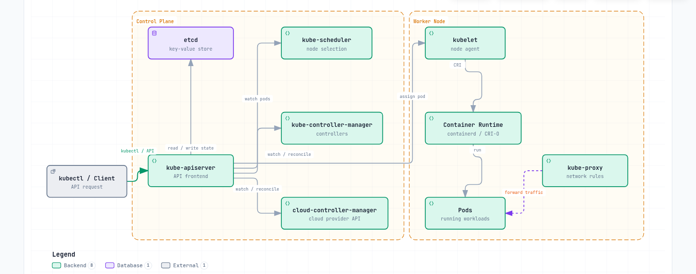

[🔍 インタラクティブな図を表示](https://www.atomai.click/kubernetes-docs/archmaps/en-core-01-cluster-architecture-0.html)

**コントロールプレーンのコンポーネント**:
- **kube-apiserver**: Kubernetes API を公開するフロントエンド
- **etcd**: Kubernetes API の状態を保存するキーバリューストア
- **kube-scheduler**: 新しく作成された Pod を実行するノードを選択
- **kube-controller-manager**: クラスターの状態を管理するコントローラーを実行
- **cloud-controller-manager**: クラウドプロバイダーの API と連携

**ワーカーノードのコンポーネント**:
- **kubelet**: 各ノードで動作し、コンテナの実行を管理するエージェント
- **kube-proxy**: ネットワークルールを維持し、接続を転送
- **コンテナランタイム**: コンテナを実行（containerd、CRI-O など）

## コントロールプレーンのコンポーネント

コントロールプレーンは Kubernetes クラスターの「頭脳」として機能し、クラスター全体の状態を管理・制御します。通常、コントロールプレーンのコンポーネントは専用マシンで実行され、高可用性を実現するため複数のインスタンスに複製できます。

### コントロールプレーンコンポーネントの詳細

| コンポーネント | 主な機能 | 通信先 | 高可用性の構成 |
|-----------|---------------|----------------------|--------------------------------|
| **kube-apiserver** | - Kubernetes API を提供<br>- 認証と認可<br>- API リクエストの処理 | - すべてのコンポーネント<br>- etcd | 複数インスタンスによる水平スケーリング |
| **etcd** | - クラスターのデータを保存<br>- 分散キーバリューストア<br>- 一貫性を保証 | - kube-apiserver | 複数ノードのクラスター |
| **kube-scheduler** | - Pod の配置を決定<br>- ノードリソースを評価<br>- アフィニティ／アンチアフィニティを適用 | - kube-apiserver | アクティブ／スタンバイ構成 |
| **kube-controller-manager** | - Node controller<br>- Replication controller<br>- Endpoint controller<br>- Service account controller | - kube-apiserver | アクティブ／スタンバイ構成 |
| **cloud-controller-manager** | - クラウドプロバイダーとの連携<br>- ノードのライフサイクル<br>- ルーティングと負荷分散 | - kube-apiserver<br>- クラウド API | アクティブ／スタンバイ構成 |

### コントロールプレーンの通信フロー

1. ユーザーまたはコントローラーが kube-apiserver にリクエストを送信する
2. kube-apiserver が認証、認可、アドミッションを実行する
3. kube-apiserver が etcd からデータを読み取る、または etcd に書き込む
4. コントローラーと scheduler が kube-apiserver を通じてクラスターの状態を監視する
5. kubelet がノードの状態を kube-apiserver に報告する

### kube-apiserver

kube-apiserver は Kubernetes API を公開するコントロールプレーンのフロントエンドです。内部と外部からのすべてのリクエストは、この API サーバーを通じて処理されます。

**主な機能**:
- REST API の提供
- 認証と認可
- リクエストの検証と処理
- etcd との通信
- 水平スケーリングが可能（複数インスタンスにスケール可能）

**主なフラグと設定オプション**:
```bash
# Basic configuration example
kube-apiserver \
  --advertise-address=192.168.1.10 \
  --allow-privileged=true \
  --authorization-mode=Node,RBAC \
  --client-ca-file=/etc/kubernetes/pki/ca.crt \
  --enable-admission-plugins=NodeRestriction \
  --enable-bootstrap-token-auth=true \
  --etcd-servers=https://127.0.0.1:2379 \
  --etcd-cafile=/etc/kubernetes/pki/etcd/ca.crt \
  --etcd-certfile=/etc/kubernetes/pki/apiserver-etcd-client.crt \
  --etcd-keyfile=/etc/kubernetes/pki/apiserver-etcd-client.key \
  --kubelet-client-certificate=/etc/kubernetes/pki/apiserver-kubelet-client.crt \
  --kubelet-client-key=/etc/kubernetes/pki/apiserver-kubelet-client.key \
  --service-account-key-file=/etc/kubernetes/pki/sa.pub \
  --service-account-signing-key-file=/etc/kubernetes/pki/sa.key \
  --service-account-issuer=https://kubernetes.default.svc.cluster.local \
  --service-cluster-ip-range=10.96.0.0/12 \
  --tls-cert-file=/etc/kubernetes/pki/apiserver.crt \
  --tls-private-key-file=/etc/kubernetes/pki/apiserver.key
```

**API サーバーのセキュリティ**:
- TLS 証明書による安全な通信
- 各種認証方式をサポート（X.509 証明書、ServiceAccount トークン、OIDC、webhook など）
- RBAC（Role-Based Access Control）による権限管理
- Admission Controller によるリクエストの検証と変更

### etcd

etcd は Kubernetes API の状態を保存する、一貫性と高可用性を備えたキーバリューストアです。Kubernetes の「信頼できる唯一の情報源」として機能します。

**主な特徴**:
- 分散システム
- 強い一貫性（Raft 合意アルゴリズムを使用）
- 高可用性（複数ノードで構成可能）
- 安全なデータ保存
- 変更を監視する Watch 機能

**etcd クラスターの構成**:
```bash
# etcd cluster configuration example (3 nodes)
etcd \
  --name etcd-1 \
  --initial-advertise-peer-urls https://192.168.1.11:2380 \
  --listen-peer-urls https://192.168.1.11:2380 \
  --listen-client-urls https://192.168.1.11:2379,https://127.0.0.1:2379 \
  --advertise-client-urls https://192.168.1.11:2379 \
  --initial-cluster-token etcd-cluster \
  --initial-cluster etcd-1=https://192.168.1.11:2380,etcd-2=https://192.168.1.12:2380,etcd-3=https://192.168.1.13:2380 \
  --initial-cluster-state new \
  --data-dir=/var/lib/etcd \
  --cert-file=/etc/kubernetes/pki/etcd/server.crt \
  --key-file=/etc/kubernetes/pki/etcd/server.key \
  --trusted-ca-file=/etc/kubernetes/pki/etcd/ca.crt \
  --client-cert-auth=true \
  --peer-cert-file=/etc/kubernetes/pki/etcd/peer.crt \
  --peer-key-file=/etc/kubernetes/pki/etcd/peer.key \
  --peer-trusted-ca-file=/etc/kubernetes/pki/etcd/ca.crt \
  --peer-client-cert-auth=true
```

**etcd のバックアップと復旧**:
```bash
# etcd backup
ETCDCTL_API=3 etcdctl snapshot save snapshot.db \
  --endpoints=https://127.0.0.1:2379 \
  --cacert=/etc/kubernetes/pki/etcd/ca.crt \
  --cert=/etc/kubernetes/pki/etcd/server.crt \
  --key=/etc/kubernetes/pki/etcd/server.key

# etcd recovery
etcdutl snapshot restore snapshot.db \
  --bump-revision=1000000000 --mark-compacted \
  --data-dir=/var/lib/etcd-restore \
  --name=etcd-1 \
  --initial-cluster=etcd-1=https://192.168.1.11:2380 \
  --initial-cluster-token=etcd-cluster \
  --initial-advertise-peer-urls=https://192.168.1.11:2380
```

**etcd のパフォーマンス最適化**:
- ディスク I/O の最適化（SSD を推奨）
- 適切なメモリ割り当て
- 定期的なコンパクションとデフラグ
- クラスターサイズに応じた適切な etcd ノード数（通常は3または5）

#### 2026年7月の更新: etcd v3.7.0 のリリース

2026年7月8日、SIG etcd が etcd v3.7.0 をリリースしました。主な内容は次のとおりです。

- **RangeStream**: 大規模な範囲検索の結果全体をメモリにバッファリングせず、チャンク単位でストリーミングします（長らく要望されていた機能）
- **パフォーマンス改善**: キーのみを返す範囲検索を最適化し、リースを高速化して信頼性を向上
- レガシー v2store の最後の名残を削除し、大規模な protobuf の刷新を完了
- 更新された主要依存関係 bbolt v1.5.0 と raft v3.7.0 を同梱

詳細は[公式発表](https://kubernetes.io/blog/2026/07/08/announcing-etcd-3.7/)と[etcd v3.7 の変更履歴](https://github.com/etcd-io/etcd/blob/main/CHANGELOG/CHANGELOG-3.7.md)を参照してください。

#### 2026年11月の更新: Amazon EKS Provisioned Control Plane の etcd が24 GBに拡大

マネージドサービスでは、etcd の容量は提供プランにも左右されます。2026年11月11日、AWS は Amazon EKS Provisioned Control Plane の 4XL および 8XL プランで、etcd データベースの容量を16 GBから **24 GB** に拡大すると発表しました。etcd データベースがいっぱいになると、クラスター内のオブジェクトを追加または変更できなくなるため、容量の増加は大規模な AI/ML のトレーニングと推論、バッチ処理、CI/CD パイプラインなど、多数のオブジェクトを作成・更新するワークロードに余裕をもたらします。データベース容量の拡大は、EKS 1.34 以降で 4XL または 8XL プランを選択した場合に適用されます。これらのプランを利用中の既存クラスターには、操作不要で自動的に適用されます。また、Provisioned Control Plane が提供されているすべての商用 AWS リージョンで利用できます。詳細は[発表](https://aws.amazon.com/about-aws/whats-new/2026/11/amazon-eks-provisioned-control-plane-larger-etcd-database/)を参照してください。

### kube-scheduler

kube-scheduler は、新しく作成された Pod を実行するノードを選択するコントロールプレーンのコンポーネントです。

**スケジューリングのプロセス**:
1. **フィルタリング**: Pod を実行できるノードを特定する
   - リソース要件（CPU、メモリ）
   - ノードセレクター、ノードアフィニティ
   - Taint と Toleration
   - ボリュームの制約

2. **スコアリング**: 適切なノードにスコアを付ける
   - リソース使用率
   - Pod 間のアフィニティ／アンチアフィニティ
   - データの局所性
   - ノード間の負荷分散

3. **バインド**: Pod を最適なノードに割り当てる

**Scheduler の構成**:
```bash
# Basic configuration example
kube-scheduler \
  --kubeconfig=/etc/kubernetes/scheduler.conf \
  --leader-elect=true \
  --v=2
```

**Scheduler のプロファイルとプラグイン**:
- デフォルトの scheduler プロファイル
- カスタム scheduler プロファイル
- Scheduler の拡張ポイント（filter、score、bind など）
- 複数の scheduler のサポート

**スケジューリングポリシー**:
```yaml
# Scheduling policy example
apiVersion: kubescheduler.config.k8s.io/v1
kind: KubeSchedulerConfiguration
profiles:
- schedulerName: default-scheduler
  pluginConfig:
  - name: NodeResourcesFit
    args:
      scoringStrategy:
        type: MostAllocated
        resources:
        - name: cpu
          weight: 1
        - name: memory
          weight: 1
```

### kube-controller-manager

kube-controller-manager は複数のコントローラープロセスを実行するコントロールプレーンのコンポーネントです。各コントローラーはクラスターの特定の側面を管理します。

**主なコントローラー**:
- **Node Controller**: ノードの状態を監視し、変化に対応
- **Replication Controller**: Pod のレプリカ数を維持
- **EndpointSlice Controller**: EndpointSlice 内の Service バックエンドを追跡
- **Service Account と Token Controller**: デフォルトの ServiceAccount を作成し、明示的に要求されたレガシーのトークン Secret を維持。現在の Pod では、有効期間の短い TokenRequest トークンを使用
- **Job Controller**: 1回限りのタスクを管理
- **CronJob Controller**: スケジュールされたタスクを管理
- **DaemonSet Controller**: すべてのノードで特定の Pod が実行されるようにする
- **StatefulSet Controller**: ステートフルアプリケーションを管理
- **PV Controller**: Persistent Volume を管理
- **Namespace Controller**: Namespace のライフサイクルを管理
- **Garbage Collector**: 孤立したオブジェクトを削除

**Controller Manager の構成**:
```bash
# Basic configuration example
kube-controller-manager \
  --kubeconfig=/etc/kubernetes/controller-manager.conf \
  --leader-elect=true \
  --use-service-account-credentials=true \
  --root-ca-file=/etc/kubernetes/pki/ca.crt \
  --service-account-private-key-file=/etc/kubernetes/pki/sa.key \
  --cluster-signing-cert-file=/etc/kubernetes/pki/ca.crt \
  --cluster-signing-key-file=/etc/kubernetes/pki/ca.key \
  --controllers=*,bootstrapsigner,tokencleaner
```

**Controller の動作**:
1. コントローラーは API サーバーを通じてクラスターの状態を継続的に監視する
2. 現在の状態と望ましい状態の差を検出する
3. 差を解消するための操作を実行する
4. 状態の変更を API サーバーに報告する

### cloud-controller-manager

cloud-controller-manager は、クラウド固有の制御ロジックを含むコントロールプレーンのコンポーネントです。これにより、Kubernetes のコア部分をクラウドプロバイダーの API から分離できます。

**主なコントローラー**:
- **Node Controller**: クラウドプロバイダーの API を通じてノードの状態を確認
- **Route Controller**: クラウド環境のルートを設定
- **Service Controller**: クラウドロードバランサーを作成、更新、削除

クラウドストレージのプロビジョニングとアタッチには CSI コントローラーを使用し、マウントは kubelet と CSI ノードプラグインが処理します。これらは cloud-controller-manager の責務ではありません。

**クラウドプロバイダーの実装**:
- AWS Cloud Controller Manager
- Azure Cloud Controller Manager
- GCP Cloud Controller Manager
- OpenStack Cloud Controller Manager
- vSphere Cloud Controller Manager

**Cloud Controller Manager の構成**:
```bash
# AWS Cloud Controller Manager example
cloud-controller-manager \
  --cloud-provider=aws \
  --cloud-config=/etc/kubernetes/cloud-config \
  --kubeconfig=/etc/kubernetes/cloud-controller-manager.conf \
  --leader-elect=true
```

**Cloud Controller Manager の利点**:
- クラウドプロバイダー固有のコードを Kubernetes のコア部分から分離
- クラウドプロバイダーが独自の機能を個別に開発可能
- Kubernetes のコア部分を変更せずにクラウド機能を追加可能

## ノードコンポーネント

ノードは Kubernetes クラスター内のワーカーマシンで、コンテナ化されたアプリケーションを実行します。各ノードはコントロールプレーンによって管理され、複数のコンポーネントで構成されます。

### kubelet

kubelet は各ノードで動作し、Pod 内のコンテナを管理するエージェントです。kubelet はさまざまな仕組みを通じて PodSpec を受け取り、仕様に従ってコンテナが正常に実行されるようにします。

**主な機能**:
- PodSpec に従ってコンテナを実行
- コンテナの状態を監視して報告
- コンテナのライフサイクルを管理
- ボリュームのマウントを管理
- ノードの状態を報告
- コンテナのヘルスチェックを実行

**kubelet の構成**:
```bash
# Basic configuration example
kubelet \
  --kubeconfig=/etc/kubernetes/kubelet.conf \
  --config=/var/lib/kubelet/config.yaml \
  --container-runtime-endpoint=unix:///run/containerd/containerd.sock
```

**kubelet 設定ファイルの例**:
```yaml
# /var/lib/kubelet/config.yaml
apiVersion: kubelet.config.k8s.io/v1beta1
kind: KubeletConfiguration
address: 0.0.0.0
authentication:
  anonymous:
    enabled: false
  webhook:
    cacheTTL: 2m0s
    enabled: true
  x509:
    clientCAFile: /etc/kubernetes/pki/ca.crt
authorization:
  mode: Webhook
  webhook:
    cacheAuthorizedTTL: 5m0s
    cacheUnauthorizedTTL: 30s
cgroupDriver: systemd
clusterDomain: cluster.local
cpuManagerPolicy: none
evictionHard:
  memory.available: 100Mi
  nodefs.available: 10%
  nodefs.inodesFree: 5%
failSwapOn: true
healthzBindAddress: 127.0.0.1
healthzPort: 10248
```

**Static Pod**: 以下のマニフェストは断片であり、コントロールプレーンを完全にインストールするものではありません。ホストネットワーク、証明書、マウント、API サーバーの完全な設定も必要です。
kubelet は、API サーバーを経由せずに直接管理する Static Pod を実行できます。主にコントロールプレーンのコンポーネントを実行するために使用されます。

```yaml
# /etc/kubernetes/manifests/kube-apiserver.yaml
apiVersion: v1
kind: Pod
metadata:
  name: kube-apiserver
  namespace: kube-system
spec:
  containers:
  - name: kube-apiserver
    image: registry.k8s.io/kube-apiserver:v1.37.1
    command:
    - kube-apiserver
    - --advertise-address=192.168.1.10
    # ... additional flags
```

### kube-proxy

kube-proxy は各ノードで動作し、Kubernetes の Service 概念を実装するネットワークプロキシです。ノード上のネットワークルールを維持し、接続を転送します。

**主な機能**:
- Service の IP とポートに対するネットワークルールを維持
- 接続を転送
- 負荷分散を実装
- サービスディスカバリーをサポート

**動作モード**:
1. **iptables**: Linux のデフォルトモード。カーネルのパケット処理ルールをインストール
2. **nftables**: v1.33 以降で安定版。カーネルと CNI の互換性を確認
3. **IPVS**: Linux のレガシーモード。v1.35 以降は非推奨。サポート対象の代替方式に移行
4. **kernelspace**: Windows モード

旧式の `userspace` モードは削除されました。一部のネットワーク実装は kube-proxy を完全に置き換えます。

**kube-proxy の構成**:
```bash
# Basic configuration example
kube-proxy \
  --config=/var/lib/kube-proxy/config.conf \
  --hostname-override=node1
```

**kube-proxy 設定ファイルの例**:
```yaml
# /var/lib/kube-proxy/config.conf
apiVersion: kubeproxy.config.k8s.io/v1alpha1
kind: KubeProxyConfiguration
bindAddress: 0.0.0.0
clientConnection:
  acceptContentTypes: ""
  burst: 10
  contentType: application/vnd.kubernetes.protobuf
  kubeconfig: /var/lib/kube-proxy/kubeconfig.conf
  qps: 5
clusterCIDR: 10.244.0.0/16
configSyncPeriod: 15m0s
conntrack:
  maxPerCore: 32768
  min: 131072
  tcpCloseWaitTimeout: 1h0m0s
  tcpEstablishedTimeout: 24h0m0s
enableProfiling: false
healthzBindAddress: 0.0.0.0:10256
hostnameOverride: node1
iptables:
  masqueradeAll: false
  masqueradeBit: 14
  minSyncPeriod: 0s
  syncPeriod: 30s
ipvs:
  excludeCIDRs: null
  minSyncPeriod: 0s
  scheduler: ""
  syncPeriod: 30s
mode: "iptables"
```

**IPVS モードと iptables モードの比較**:

| 特性 | iptables モード | IPVS モード |
|----------------|---------------|-----------|
| パフォーマンス | Service が多いと性能が低下 | 大規模クラスターでより高い性能 |
| 負荷分散アルゴリズム | デフォルトではバックエンドをランダムに選択 | さまざまなアルゴリズムに対応（rr、lc、dh、sh、sed、nq） |
| 実装方式 | ネットワークパケットフィルタリングチェーン | ハッシュテーブルベース |
| カーネル要件 | デフォルトのカーネルモジュール | IPVS カーネルモジュールが必要 |

### コンテナランタイム

コンテナランタイムは、コンテナを実行するソフトウェアです。Kubernetes は Container Runtime Interface（CRI）を通じて、さまざまなコンテナランタイムをサポートしています。

**主なコンテナランタイム**:
1. **containerd**: 軽量なコンテナランタイム（現在、最も広く使用されている）
2. **CRI-O**: Kubernetes 向けに特化して設計された軽量ランタイム
3. **Docker Engine**: cri-dockerd などの外部 CRI アダプターが必要。組み込みの dockershim は v1.24 で削除されました。Docker でビルドした OCI イメージは、引き続き containerd／CRI-O で動作します。

**コンテナランタイム層の構成**:


[🔍 インタラクティブな図を表示](https://www.atomai.click/kubernetes-docs/archmaps/en-core-01-cluster-architecture-1.html)

**containerd 1.x の設定例**（2.x ではプラグイン ID が異なります。インストールしたリリースのデフォルト設定を生成してください）:
```toml
# /etc/containerd/config.toml
version = 2

[plugins]
  [plugins."io.containerd.grpc.v1.cri"]
    sandbox_image = "registry.k8s.io/pause:3.10"
    [plugins."io.containerd.grpc.v1.cri".containerd]
      default_runtime_name = "runc"
      [plugins."io.containerd.grpc.v1.cri".containerd.runtimes]
        [plugins."io.containerd.grpc.v1.cri".containerd.runtimes.runc]
          runtime_type = "io.containerd.runc.v2"
          [plugins."io.containerd.grpc.v1.cri".containerd.runtimes.runc.options]
            SystemdCgroup = true
```

**CRI-O の設定例**:
```toml
# /etc/crio/crio.conf
[crio]
root = "/var/lib/containers/storage"
runroot = "/var/run/containers/storage"
storage_driver = "overlay"
storage_option = ["overlay.mountopt=nodev"]

[crio.runtime]
default_runtime = "runc"
conmon = "/usr/bin/conmon"
conmon_cgroup = "pod"
cgroup_manager = "systemd"

[crio.image]
pause_image = "registry.k8s.io/pause:3.10"
```

### アドオンコンポーネント

アドオンは Kubernetes クラスターの機能を拡張する追加コンポーネントです。重要なアドオンには次のものがあります。

1. **CNI ネットワークプラグイン**: Pod ネットワークを実装
   - Calico、Cilium、Flannel など

2. **DNS**: クラスター内の DNS サービスを提供
   - CoreDNS（デフォルト）

3. **Dashboard**: Web ベースの UI を提供
   - Headlamp（Kubernetes Dashboard はアーカイブ済み）

4. **Ingress Controller**: HTTP/HTTPS ルーティングを管理
   - Traefik、HAProxy など

5. **Metrics Server**: リソース使用率のメトリクスを収集
   - Metrics Server

6. **ロギングとモニタリング**: ログ収集と監視
   - Prometheus、Grafana、Elasticsearch、Fluentd、Kibana など

**CoreDNS の設定例**:
```yaml
apiVersion: v1
kind: ConfigMap
metadata:
  name: coredns
  namespace: kube-system
data:
  Corefile: |
    .:53 {
        errors
        health {
            lameduck 5s
        }
        ready
        kubernetes cluster.local in-addr.arpa ip6.arpa {
            pods insecure
            fallthrough in-addr.arpa ip6.arpa
            ttl 30
        }
        prometheus :9153
        forward . /etc/resolv.conf {
            max_concurrent 1000
        }
        cache 30
        loop
        reload
        loadbalance
    }
```

**Calico CNI の設定例**:
```yaml
apiVersion: v1
kind: ConfigMap
metadata:
  name: calico-config
  namespace: kube-system
data:
  calico_backend: "bird"
  cni_network_config: |-
    {
      "name": "k8s-pod-network",
      "cniVersion": "0.3.1",
      "plugins": [
        {
          "type": "calico",
          "log_level": "info",
          "datastore_type": "kubernetes",
          "nodename": "__KUBERNETES_NODE_NAME__",
          "mtu": __CNI_MTU__,
          "ipam": {
            "type": "calico-ipam"
          },
          "policy": {
            "type": "k8s"
          },
          "kubernetes": {
            "kubeconfig": "__KUBECONFIG_FILEPATH__"
          }
        },
        {
          "type": "portmap",
          "snat": true,
          "capabilities": {"portMappings": true}
        }
      ]
    }
```

## クラスター内の通信経路

Kubernetes クラスター内では、さまざまなコンポーネント間で通信が行われます。クラスターの設計、セキュリティ、トラブルシューティングにおいて、これらの通信経路を理解することが重要です。

### コントロールプレーン内部の通信

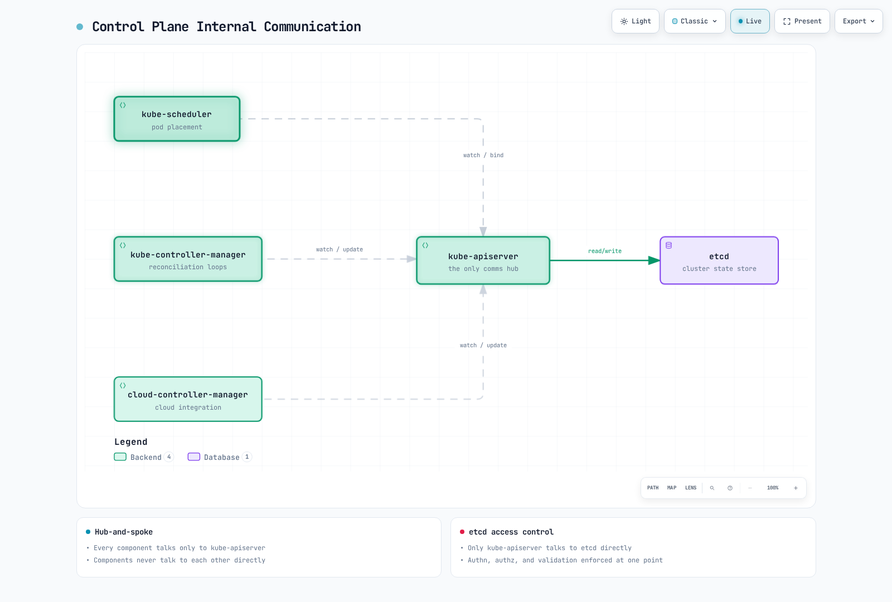

[🔍 インタラクティブな図を表示](https://www.atomai.click/kubernetes-docs/archmaps/en-core-01-cluster-architecture-2.html)

コントロールプレーンのコンポーネント間の通信は次のとおりです。

1. **kube-apiserver と etcd**: kube-apiserver はクラスターの状態を保存・取得するために etcd と通信します。
   - プロトコル: gRPC
   - ポート: 2379/TCP
   - セキュリティ: TLS 証明書ベースの認証

2. **kube-scheduler と kube-apiserver**: kube-scheduler は Pod のスケジューリングのために kube-apiserver と通信します。
   - プロトコル: HTTPS
   - ポート: 6443/TCP（kube-apiserver）
   - セキュリティ: TLS 証明書ベースの認証

3. **kube-controller-manager と kube-apiserver**: コントローラーはクラスターの状態を監視・変更するために kube-apiserver と通信します。
   - プロトコル: HTTPS
   - ポート: 6443/TCP（kube-apiserver）
   - セキュリティ: TLS 証明書ベースの認証

4. **cloud-controller-manager と kube-apiserver**: クラウドコントローラーは、クラスターの状態を監視しクラウドリソースを管理するために kube-apiserver と通信します。
   - プロトコル: HTTPS
   - ポート: 6443/TCP（kube-apiserver）
   - セキュリティ: TLS 証明書ベースの認証

### コントロールプレーンとノード間の通信

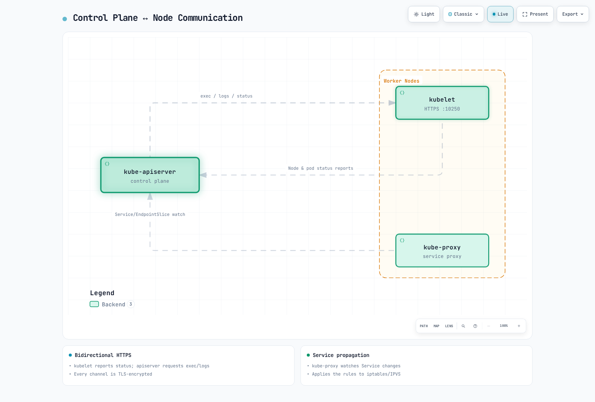

[🔍 インタラクティブな図を表示](https://www.atomai.click/kubernetes-docs/archmaps/en-core-01-cluster-architecture-3.html)

コントロールプレーンとノード間の通信は次のとおりです。

1. **kube-apiserver → kubelet**: API サーバーは、ログ、exec／attach、ポートフォワーディングのために kubelet API を呼び出します。
   - プロトコル: HTTPS
   - ポート: 10250/TCP（kubelet）
   - セキュリティ: TLS 証明書ベースの認証

2. **kubelet と kube-apiserver**: kubelet は、割り当てられた PodSpec の監視、ノードの登録、ノード／Pod の状態とイベントの報告のために kube-apiserver と通信します。
   - プロトコル: HTTPS
   - ポート: 6443/TCP（kube-apiserver）
   - セキュリティ: TLS 証明書ベースの認証

3. **kube-proxy と kube-apiserver**: kube-proxy は Service 情報を取得するために kube-apiserver と通信します。
   - プロトコル: HTTPS
   - ポート: 6443/TCP（kube-apiserver）
   - セキュリティ: TLS 証明書ベースの認証

### ノード間通信

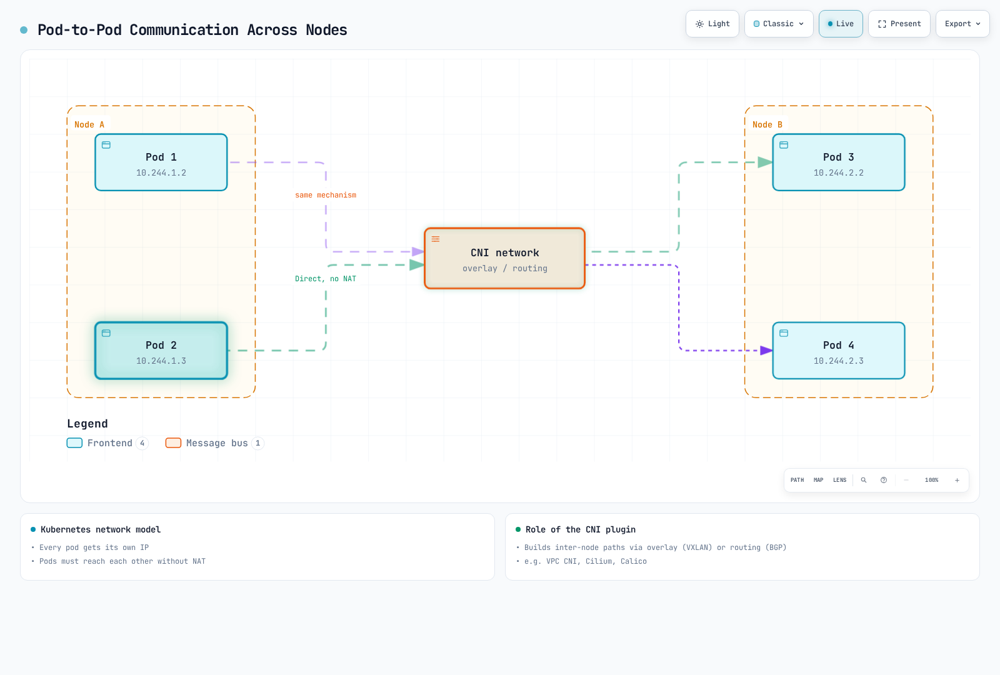

[🔍 インタラクティブな図を表示](https://www.atomai.click/kubernetes-docs/archmaps/en-core-01-cluster-architecture-4.html)

ノード間通信は次のとおりです。

1. **Pod 間通信**: Pod は CNI プラグインが提供するネットワークを通じて相互に通信します。
   - プロトコル: アプリケーションによる（TCP、UDP など）
   - ポート: アプリケーションによる
   - セキュリティ: NetworkPolicy で制御可能

2. **ノードをまたぐ Pod 間通信**: 異なるノード上の Pod 間の通信は、CNI プラグインが処理します。
   - プロトコル: アプリケーションによる（TCP、UDP など）
   - ポート: アプリケーションによる
   - セキュリティ: NetworkPolicy で制御可能

### 外部との通信

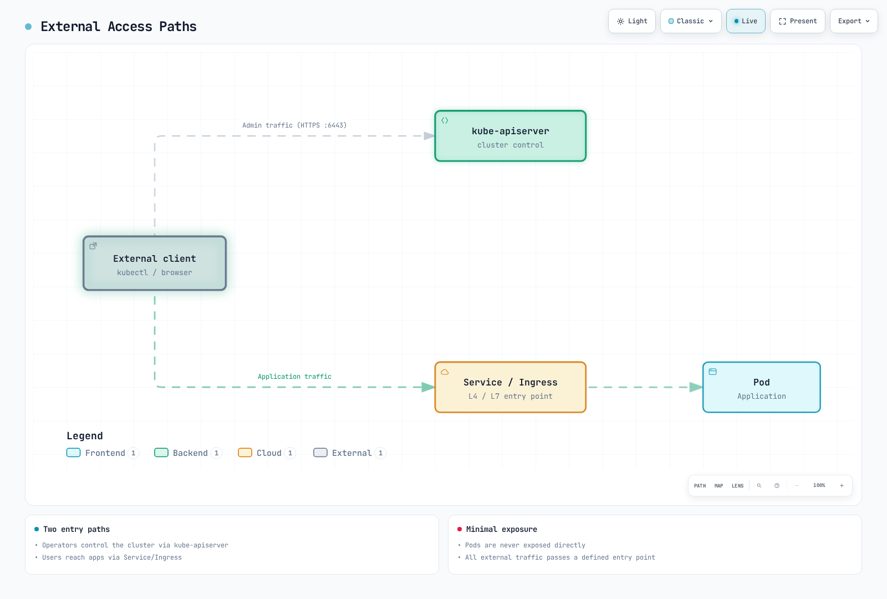

[🔍 インタラクティブな図を表示](https://www.atomai.click/kubernetes-docs/archmaps/en-core-01-cluster-architecture-5.html)

外部との通信は次のとおりです。

1. **クライアントと kube-apiserver**: ユーザーと外部システムは kube-apiserver を通じてクラスターとやり取りします。
   - プロトコル: HTTPS
   - ポート: 6443/TCP（kube-apiserver）
   - セキュリティ: TLS 証明書、トークン、ユーザー認証など

2. **外部トラフィックと Service**: 外部トラフィックは NodePort、LoadBalancer Service、または Ingress を通じてクラスター内のアプリケーションにアクセスします。
   - プロトコル: HTTP、HTTPS、TCP、UDP など
   - ポート: Service の設定による
   - セキュリティ: Ingress Controller と Service の設定による

### 通信のセキュリティ

Kubernetes クラスター内の通信は、次の方法で保護されます。

1. **TLS 証明書**: コントロールプレーンコンポーネント間の通信は、すべて TLS 証明書で暗号化されます。
2. **認証と認可**: API サーバーへのリクエストはすべて、認証と認可のプロセスを経由します。
3. **NetworkPolicy**: Pod 間通信は NetworkPolicy で制限できます。
4. **暗号化された Secret**: etcd に保存する Secret を暗号化できます。

**API データの保存時暗号化の例**（API サーバーで `--encryption-provider-config` を設定します。既存の Secret を暗号化するには書き換えが必要です）:
```yaml
apiVersion: apiserver.config.k8s.io/v1
kind: EncryptionConfiguration
resources:
  - resources:
    - secrets
    providers:
    - aescbc:
        keys:
        - name: key1
          secret: <base64-encoded-key>
    - identity: {}
```

### 高可用性クラスターの構成

高可用性（HA）Kubernetes クラスターは、単一障害点をなくし、サービスを中断することなく運用を継続できるように設計されています。

### コントロールプレーンの高可用性

コントロールプレーンの高可用性は、次の方法で実現します。

1. **複数のコントロールプレーンノード**: 冗長性を確保するため、通常は3台または5台のコントロールプレーンノードをデプロイ
2. **etcd クラスター**: 複数の etcd インスタンスで構成するクラスターをデプロイ（通常は3台または5台）
3. **ロードバランサー**: API サーバーの前にロードバランサーを配置し、トラフィックを分散

**高可用性コントロールプレーンのアーキテクチャ**:

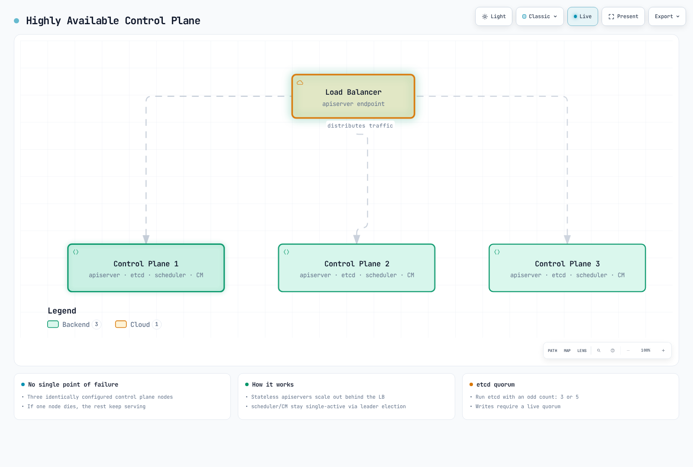

[🔍 インタラクティブな図を表示](https://www.atomai.click/kubernetes-docs/archmaps/en-core-01-cluster-architecture-6.html)

**etcd クラスターの構成**:

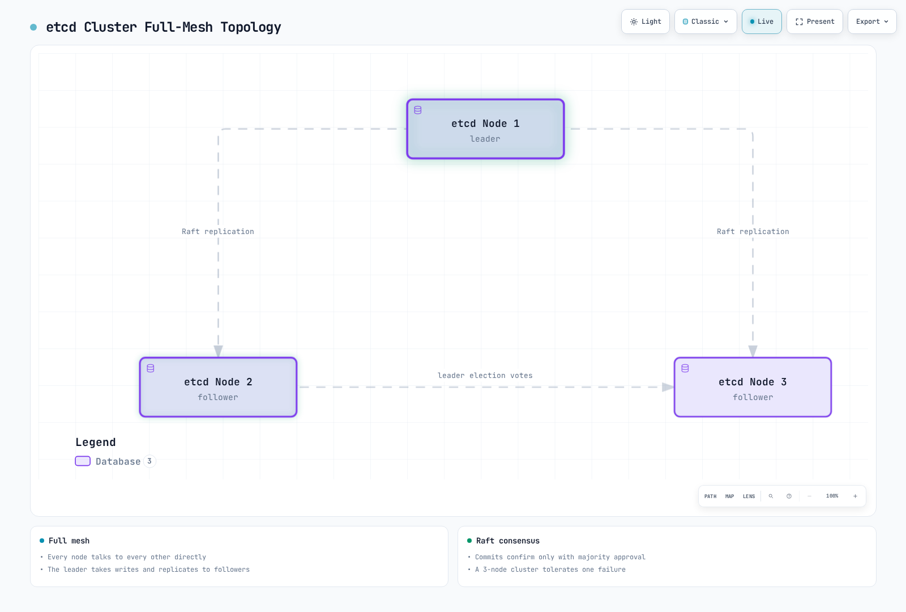

[🔍 インタラクティブな図を表示](https://www.atomai.click/kubernetes-docs/archmaps/en-core-01-cluster-architecture-7.html)

### ワーカーノードの高可用性

ワーカーノードの高可用性は、次の方法で実現します。

1. **複数のワーカーノード**: 複数のワーカーノードにワークロードを分散
2. **ノードの自動復旧**: クラウドプロバイダーの自動復旧機能を活用
3. **オートスケーリング**: Cluster Autoscaler によるノードの自動スケーリング
4. **複数のアベイラビリティーゾーン**: 複数のアベイラビリティーゾーンにノードをデプロイ

**ワーカーノードの分散デプロイ**:

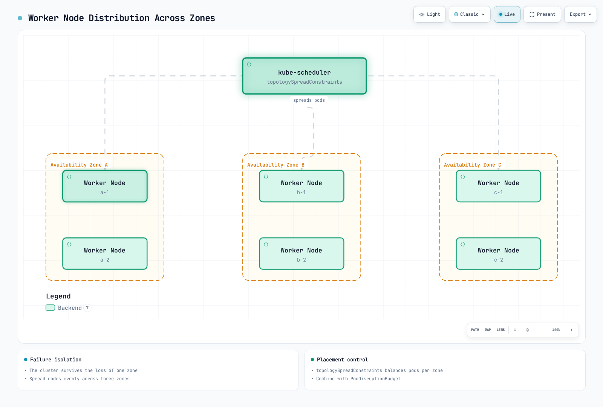

[🔍 インタラクティブな図を表示](https://www.atomai.click/kubernetes-docs/archmaps/en-core-01-cluster-architecture-8.html)

### アプリケーションの高可用性

アプリケーションの高可用性は、次の方法で実現します。

1. **ReplicaSet／Deployment**: 複数の Pod レプリカを実行
2. **Pod の配置ルール**: Pod アンチアフィニティを使って、複数のノードに Pod を分散
3. **PodDisruptionBudget**: 計画的な中断中も最低限の可用性を確保
4. **Service と負荷分散**: 複数の Pod にトラフィックを分散

**Pod アンチアフィニティの例**:
```yaml
apiVersion: apps/v1
kind: Deployment
metadata:
  name: web-server
spec:
  replicas: 3
  selector:
    matchLabels:
      app: web-server
  template:
    metadata:
      labels:
        app: web-server
    spec:
      affinity:
        podAntiAffinity:
          requiredDuringSchedulingIgnoredDuringExecution:
          - labelSelector:
              matchExpressions:
              - key: app
                operator: In
                values:
                - web-server
            topologyKey: "kubernetes.io/hostname"
      containers:
      - name: web-server
        image: nginx:1.30.6
```

**PodDisruptionBudget の例**:
```yaml
apiVersion: policy/v1
kind: PodDisruptionBudget
metadata:
  name: web-server-pdb
spec:
  minAvailable: 2
  selector:
    matchLabels:
      app: web-server
```

### 災害復旧戦略

Kubernetes クラスターの災害復旧戦略は、次の方法で実施します。

1. **etcd のバックアップと復旧**: etcd データの定期的なバックアップと復旧手順を確立
2. **マルチリージョンデプロイ**: 複数のリージョンにクラスターをデプロイ
3. **クラスター連携**: 複数のクラスターを連携して管理
4. **継続的なバックアップ**: アプリケーションデータを継続的にバックアップ

**etcd バックアップスクリプトの例**:
```bash
#!/bin/bash
ETCDCTL_API=3 etcdctl snapshot save /backup/etcd-snapshot-$(date +%Y%m%d-%H%M%S).db \
  --endpoints=https://127.0.0.1:2379 \
  --cacert=/etc/kubernetes/pki/etcd/ca.crt \
  --cert=/etc/kubernetes/pki/etcd/server.crt \
  --key=/etc/kubernetes/pki/etcd/server.key
```

**etcd の復旧手順（自己管理型クラスター）**:

1. `etcdutl snapshot status` でスナップショットを検証します。上記の例のように、互換性のある `etcdutl` を使用して新しいデータディレクトリに復元します。
2. データディレクトリを切り替える前に、クラスターの運用手順書に従って、すべての API サーバーインスタンスと対象となる etcd プロセスを停止します。kubelet を停止するだけでは、既存の Static Pod コンテナは停止しません。
3. 複数メンバーの復旧では、すべてのメンバーで同じスナップショットを復元し、各メンバーには一意の名前とピア URL を設定し、`--initial-cluster` には同じ全メンバー構成を指定します。上記の単一メンバーの例は、HA 復旧の手順ではありません。
4. Kubernetes の watch キャッシュに対して `--bump-revision` と `--mark-compacted` を使用します。スナップショット以降のリビジョンを超える値を bump に指定してください（例にある値は一例です）。
5. etcd の Static Pod の hostPath を復元先のディレクトリに更新し、etcd を再起動してクォーラムと正常性を確認した後、API サーバーとコントローラーを再起動します。検証が完了するまで、元のデータとバックアップを保持してください。

[etcd の復旧ガイド](https://etcd.io/docs/v3.6/op-guide/recovery/)に従ってください。EKS ユーザーは、マネージドコントロールプレーンの etcd を直接操作したり、復元したりしません。

## クラスターのネットワーク

Kubernetes のネットワークは、Pod、Service、外部との通信を可能にします。Kubernetes のネットワークモデルでは、すべての Pod が一意の IP アドレスを持ち、NAT を介さずにほかのすべての Pod と通信できることを前提としています。

### ネットワークモデル

Kubernetes のネットワークモデルには、次の要件があります。

1. **Pod 間通信**: すべての Pod が NAT を介さずにほかのすべての Pod と通信できること
2. **ノードと Pod 間の通信**: ノードエージェントが、そのノード上の Pod と通信できること
3. **Pod と外部との通信**: 外部接続はルーティング、必要に応じた NAT、セキュリティ／エグレスポリシーに依存します。すべての Pod がインターネットに接続できることは要件ではありません。

### CNI（Container Network Interface）

CNI は Kubernetes のネットワークを実装するための標準インターフェースです。さまざまな CNI プラグインがあり、それぞれ機能やパフォーマンス特性が異なります。

**主な CNI プラグイン**:

1. **Calico**: BGP ベースのネットワーク。NetworkPolicy をサポート
   - 特徴: 高いパフォーマンス、NetworkPolicy、暗号化、eBPF のサポート
   - 用途: 大規模クラスター、セキュリティを重視する環境

2. **Cilium**: eBPF ベースのネットワークとセキュリティ
   - 特徴: L3～L7 セキュリティポリシー、高いパフォーマンス、可観測性
   - 用途: マイクロサービス、セキュリティを重視する環境

3. **Flannel**: シンプルなオーバーレイネットワーク
   - 特徴: 簡単にセットアップでき、軽量
   - 用途: 小規模クラスター、開発環境

4. **Weave Net（過去の選択肢）**: プロジェクトは2024年6月にアーカイブされました。新規デプロイでは、メンテナンスされている代替製品を検討してください。

**CNI の設定例（Calico）**:
```yaml
apiVersion: v1
kind: ConfigMap
metadata:
  name: calico-config
  namespace: kube-system
data:
  calico_backend: "bird"
  cni_network_config: |-
    {
      "name": "k8s-pod-network",
      "cniVersion": "0.3.1",
      "plugins": [
        {
          "type": "calico",
          "log_level": "info",
          "datastore_type": "kubernetes",
          "nodename": "__KUBERNETES_NODE_NAME__",
          "mtu": __CNI_MTU__,
          "ipam": {
            "type": "calico-ipam"
          },
          "policy": {
            "type": "k8s"
          },
          "kubernetes": {
            "kubeconfig": "__KUBECONFIG_FILEPATH__"
          }
        },
        {
          "type": "portmap",
          "snat": true,
          "capabilities": {"portMappings": true}
        }
      ]
    }
```

### Service ネットワーク

Kubernetes の Service は、一連の Pod に対して安定したエンドポイントを提供します。Service には ClusterIP、NodePort、LoadBalancer、ExternalName などのタイプがあります。

**Service ネットワークのコンポーネント**:

1. **ClusterIP**: クラスター内からのみアクセスできる仮想 IP
2. **kube-proxy**: Service IP 宛てのトラフィックを Pod にルーティング
3. **CoreDNS**: サービスディスカバリー用の DNS サービス

**Service ネットワークのフロー**:
```
Client -> kernel rules programmed by kube-proxy (ClusterIP DNAT) -> Pod
```

**Service の例**:
```yaml
apiVersion: v1
kind: Service
metadata:
  name: my-service
spec:
  selector:
    app: my-app
  ports:
  - port: 80
    targetPort: 8080
  type: ClusterIP
```

### Ingress ネットワーク

Ingress は、クラスター外部からクラスター内部の Service への HTTP および HTTPS のルーティングを管理します。Ingress Controller は Ingress リソースを実装します。

**主な Ingress Controller**:
1. **メンテナンスされている Ingress／Gateway Controller**: Controller のライフサイクルと Gateway API のサポートを確認
2. **AWS Load Balancer Controller**: Ingress 用に ALB をプロビジョニング
3. **Traefik**: クラウドネイティブなエッジルーター
4. **HAProxy Ingress**: HAProxy ベースの Ingress Controller

**Ingress ネットワークのフロー**:
```
Client -> Ingress Controller -> Service -> Pod
```

コミュニティ版 ingress-nginx は2026年3月にリタイアしました。詳細は[リタイアのお知らせ](https://kubernetes.io/blog/2025/11/11/ingress-nginx-retirement/)を参照してください。この例では、`traefik` という名前の IngressClass を持つ Traefik Controller がインストール済みである必要があります。`/app` は変更されずに転送されます。

**Ingress の例**:
```yaml
apiVersion: networking.k8s.io/v1
kind: Ingress
metadata:
  name: my-ingress
spec:
  ingressClassName: traefik
  rules:
  - host: example.com
    http:
      paths:
      - path: /app
        pathType: Prefix
        backend:
          service:
            name: my-service
            port:
              number: 80
```

### NetworkPolicy

NetworkPolicy を使うと、Pod 間の通信を制御できます。デフォルトではすべての Pod が相互に通信できますが、NetworkPolicy でこれを制限できます。

**NetworkPolicy の例**:
```yaml
apiVersion: networking.k8s.io/v1
kind: NetworkPolicy
metadata:
  name: db-network-policy
spec:
  podSelector:
    matchLabels:
      role: db
  policyTypes:
  - Ingress
  - Egress
  ingress:
  - from:
    - podSelector:
        matchLabels:
          role: frontend
    ports:
    - protocol: TCP
      port: 3306
  egress:
  - to:
    - podSelector:
        matchLabels:
          role: monitoring
    ports:
    - protocol: TCP
      port: 9090
```

### ネットワークのトラブルシューティング

Kubernetes のネットワーク問題のトラブルシューティングに使える一般的なツールとコマンド:

1. **ping、traceroute**: 基本的なネットワーク接続テスト
2. **tcpdump**: ネットワークパケットのキャプチャと分析
3. **netstat、ss**: ネットワーク接続状態の確認
4. **nslookup、dig**: DNS の名前解決テスト
5. **kubectl exec**: Pod 内でネットワークコマンドを実行

**ネットワークデバッグの例**:
```bash
# Test network connectivity within a pod
kubectl exec -it <pod-name> -- ping <target-ip>

# Test DNS lookup within a pod
kubectl exec -it <pod-name> -- nslookup <service-name>

# Capture network packets within a pod
kubectl exec -it <pod-name> -- tcpdump -i eth0 -n

# Check service endpoints
kubectl get endpointslices -l kubernetes.io/service-name=<service-name>
```

## クラスターのストレージ

Kubernetes のストレージは、コンテナ化されたアプリケーションのデータを永続化します。Kubernetes にはさまざまなストレージオプションと抽象化があり、アプリケーションがストレージを効率的に利用できるようになっています。

### ストレージアーキテクチャ

Kubernetes のストレージアーキテクチャは、次のコンポーネントで構成されます。

1. **Volume**: Pod 内のコンテナにマウントできるディレクトリ
2. **Persistent Volume（PV）**: クラスター内のストレージリソース
3. **Persistent Volume Claim（PVC）**: ユーザーによるストレージ要求
4. **StorageClass**: ストレージの「クラス」またはタイプを定義
5. **CSI（Container Storage Interface）**: ストレージシステムとの標準インターフェース

**ストレージアーキテクチャのフロー**:

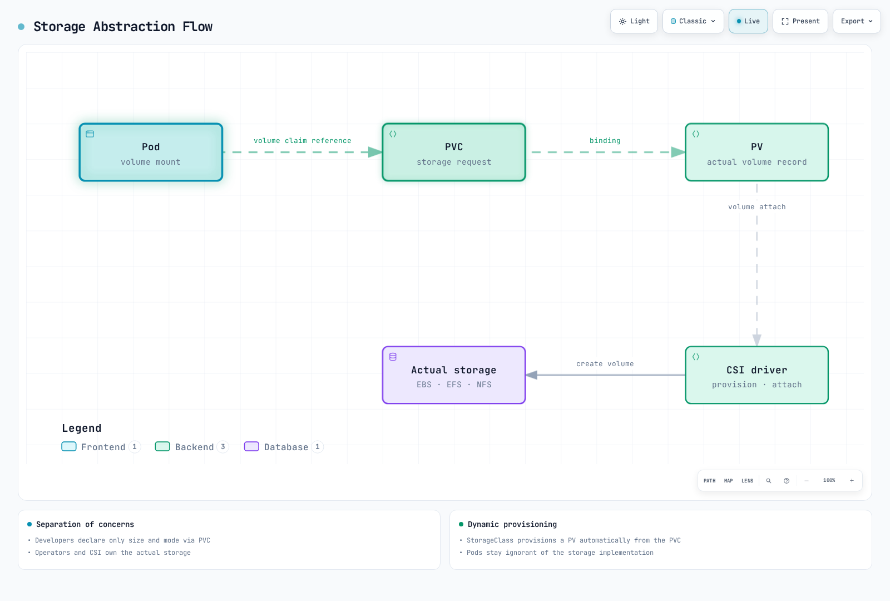

[🔍 インタラクティブな図を表示](https://www.atomai.click/kubernetes-docs/archmaps/en-core-01-cluster-architecture-9.html)

### Volume のタイプ

Kubernetes はさまざまなタイプの Volume をサポートしています。

1. **エフェメラル Volume**:
   - **emptyDir**: 空のディレクトリとして作成され、Pod の削除時に削除される
   - **configMap**: ConfigMap を Volume としてマウント
   - **secret**: Secret を Volume としてマウント
   - **downwardAPI**: Pod とコンテナの情報をファイルとして公開

2. **Persistent Volume**:
   - **CSI 経由のクラウドブロックストレージ**: AWS EBS、Azure Disk、GCE Persistent Disk。これらの従来のインツリー実装は削除済み
   - **nfs**: NFS Volume
   - **csi**: CSI ドライバーを通じた Volume

**Volume の例**:
```yaml
apiVersion: v1
kind: Pod
metadata:
  name: test-pd
spec:
  containers:
  - name: test-container
    image: nginx
    volumeMounts:
    - mountPath: /test-pd
      name: test-volume
  volumes:
  - name: test-volume
    persistentVolumeClaim:
      claimName: test-pvc
```

### Persistent Volume と Claim

Persistent Volume（PV）はクラスター内のストレージリソースで、管理者がプロビジョニングするか、StorageClass を通じて動的にプロビジョニングされます。Persistent Volume Claim（PVC）は、ユーザーによるストレージ要求です。

まず、IAM 権限を設定して EBS CSI ドライバーをインストールしてください。以下の静的 PV では、Volume ID とゾーンを既存の EBS Volume とその実際のゾーンに置き換えてください。EBS は Fargate にはマウントできません。EKS Auto Mode では `ebs.csi.eks.amazonaws.com` を使用します。

**Persistent Volume の例**:
```yaml
apiVersion: v1
kind: PersistentVolume
metadata:
  name: pv-example
spec:
  capacity:
    storage: 10Gi
  accessModes:
    - ReadWriteOnce
  persistentVolumeReclaimPolicy: Retain
  storageClassName: standard
  csi:
    driver: ebs.csi.aws.com
    volumeHandle: vol-0123456789abcdef0
    fsType: ext4
  nodeAffinity:
    required:
      nodeSelectorTerms:
      - matchExpressions:
        - key: topology.kubernetes.io/zone
          operator: In
          values: [ap-northeast-2a]
```

**Persistent Volume Claim の例**:
```yaml
apiVersion: v1
kind: PersistentVolumeClaim
metadata:
  name: pvc-example
spec:
  accessModes:
    - ReadWriteOnce
  resources:
    requests:
      storage: 5Gi
  storageClassName: standard
```

### StorageClass

StorageClass は、管理者が提供するストレージの「クラス」を記述します。StorageClass を使うと、PVC の要求時に PV を動的にプロビジョニングできます。

**StorageClass の例**:
```yaml
apiVersion: storage.k8s.io/v1
kind: StorageClass
metadata:
  name: standard
provisioner: ebs.csi.aws.com
parameters:
  type: gp3
  csi.storage.k8s.io/fstype: ext4
  encrypted: "true"
reclaimPolicy: Delete
allowVolumeExpansion: true
volumeBindingMode: WaitForFirstConsumer
```

### CSI（Container Storage Interface）

CSI は、Kubernetes とストレージシステムの間の標準インターフェースです。CSI を通じて、ストレージプロバイダーは Kubernetes のコードを変更することなく、独自のストレージドライバーを開発できます。

**CSI アーキテクチャ**:

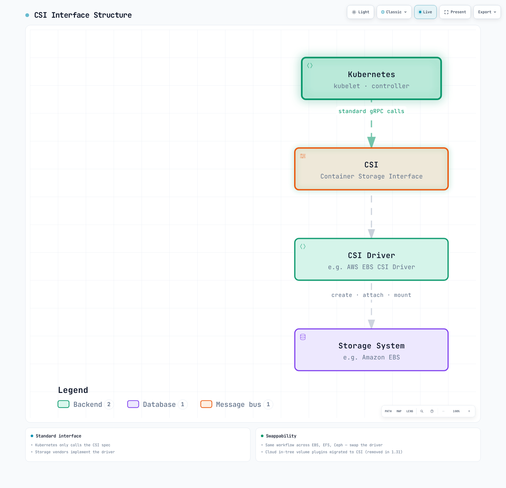

[🔍 インタラクティブな図を表示](https://www.atomai.click/kubernetes-docs/archmaps/en-core-01-cluster-architecture-10.html)

**CSI ドライバーのデプロイ例**:
```yaml
apiVersion: storage.k8s.io/v1
kind: StorageClass
metadata:
  name: ebs-sc
provisioner: ebs.csi.aws.com
parameters:
  type: gp3
  csi.storage.k8s.io/fstype: ext4
  encrypted: "true"
volumeBindingMode: WaitForFirstConsumer
```

### ストレージのベストプラクティス

Kubernetes ストレージを使用する際のベストプラクティス:

1. **適切なストレージタイプを選ぶ**: ワークロードの特性に合ったストレージタイプを選択
2. **動的プロビジョニングを使用する**: StorageClass を通じた動的プロビジョニングを活用
3. **適切なアクセスモードを選ぶ**: ワークロードの要件に合ったアクセスモードを選択
4. **リソースの Request と Limit を設定する**: 適切なストレージ容量を要求
5. **バックアップと復旧の戦略を確立する**: 重要なデータのバックアップと復旧の戦略を用意
6. **ストレージを監視する**: ストレージの使用量とパフォーマンスを監視

## クラスターのスケーラビリティ

Kubernetes クラスターのスケーラビリティとは、増大する負荷や要件に対応する能力です。水平スケーリング（スケールアウト）と垂直スケーリング（スケールアップ）によって拡張できます。

### クラスターの規模上限

upstream の[大規模クラスター向けガイダンス](https://kubernetes.io/docs/setup/best-practices/cluster-large/)では、検証済みのサポート範囲として、ノード数5,000、Pod 総数150,000、コンテナ総数300,000、ノードあたり110 Pod が示されています。これらの基準はすべて同時に適用され、普遍的な API のハードリミットではありません。Pod あたりのコンテナ数に一律の上限20という制限はありません。Service の収容能力は、アドレス範囲とデータプレーンにも左右されます。クラウドネットワークの制限やクォータは、これらより低い場合があります。

### 水平スケーリング

水平スケーリングでは、ノードを追加してクラスターの容量を増やします。

**ノードのオートスケーリング**:
Kubernetes Cluster Autoscaler は、ワークロードの要件に応じてノード数を自動的に調整します。

```yaml
# AWS Auto Scaling Group tags example
tags:
  k8s.io/cluster-autoscaler/enabled: "true"
  k8s.io/cluster-autoscaler/my-cluster: "owned"
```

**Cluster Autoscaler の Deployment の断片（v1.36 クラスターの例）**: クラスターのマイナーバージョンに一致する、パッチ適用済みのリリースを選択してください。ServiceAccount、Kubernetes RBAC、専用の IAM ロールを用意してください。この断片はインストール全体を示すものではありません。
```yaml
apiVersion: apps/v1
kind: Deployment
metadata:
  name: cluster-autoscaler
  namespace: kube-system
spec:
  replicas: 1
  selector:
    matchLabels:
      app: cluster-autoscaler
  template:
    metadata:
      labels:
        app: cluster-autoscaler
    spec:
      containers:
      - name: cluster-autoscaler
        image: registry.k8s.io/autoscaling/cluster-autoscaler:v1.36.1
        command:
        - ./cluster-autoscaler
        - --cloud-provider=aws
        - --nodes=2:10:my-asg-group
        - --scale-down-unneeded-time=10m
```

**Karpenter**:
Karpenter は AWS が開発した新しいノードオートスケーリングツールで、より高速かつ効率的なノードのプロビジョニングを実現します。

```yaml
apiVersion: karpenter.sh/v1
kind: NodePool
metadata:
  name: default
spec:
  template:
    spec:
      requirements:
        - key: karpenter.sh/capacity-type
          operator: In
          values: ["spot", "on-demand"]
      nodeClassRef:
        group: karpenter.k8s.aws
        kind: EC2NodeClass
        name: default-class
  limits:
    cpu: 1000
    memory: 1000Gi
---
apiVersion: karpenter.k8s.aws/v1
kind: EC2NodeClass
metadata:
  name: default-class
spec:
  role: KarpenterNodeRole-my-cluster
  amiSelectorTerms:
    - alias: al2023@latest
  subnetSelectorTerms:
    - tags:
        karpenter.sh/discovery: my-cluster
  securityGroupSelectorTerms:
    - tags:
        karpenter.sh/discovery: my-cluster
```

### 垂直スケーリング

ワークロードの垂直スケーリングでは、Pod の CPU／メモリ Request を調整します。VPA は基盤となるノードのサイズを変更しません。追加のノード容量は別途プロビジョニングする必要があります。

**Vertical Pod Autoscaler（VPA）**:
VPA は Pod の CPU とメモリの Request を自動的に調整します。

```yaml
apiVersion: autoscaling.k8s.io/v1
kind: VerticalPodAutoscaler
metadata:
  name: my-app-vpa
spec:
  targetRef:
    apiVersion: "apps/v1"
    kind: Deployment
    name: my-app
  updatePolicy:
    updateMode: "Recreate"
  resourcePolicy:
    containerPolicies:
    - containerName: '*'
      minAllowed:
        cpu: 100m
        memory: 50Mi
      maxAllowed:
        cpu: 1
        memory: 500Mi
```

### アプリケーションのスケーリング

アプリケーションレベルのスケーリングは、Pod のレプリカ数を調整して実施します。

**Horizontal Pod Autoscaler（HPA）**:
HPA は CPU 使用率またはカスタムメトリクスに基づいて、Pod のレプリカ数を自動的に調整します。

```yaml
apiVersion: autoscaling/v2
kind: HorizontalPodAutoscaler
metadata:
  name: my-app-hpa
spec:
  scaleTargetRef:
    apiVersion: apps/v1
    kind: Deployment
    name: my-app
  minReplicas: 2
  maxReplicas: 10
  metrics:
  - type: Resource
    resource:
      name: cpu
      target:
        type: Utilization
        averageUtilization: 80
```

**KEDA（Kubernetes Event-driven Autoscaling）**:
KEDA はイベント駆動型のオートスケーリングを提供し、さまざまなイベントソースに基づくスケーリングを可能にします。

```yaml
apiVersion: keda.sh/v1alpha1
kind: ScaledObject
metadata:
  name: my-app-scaledobject
spec:
  scaleTargetRef:
    name: my-app
  minReplicaCount: 0
  maxReplicaCount: 10
  triggers:
  - type: kafka
    metadata:
      bootstrapServers: kafka.svc:9092
      consumerGroup: my-group
      topic: my-topic
      lagThreshold: "10"
```

### スケーラビリティのベストプラクティス

Kubernetes クラスターのスケーラビリティに関するベストプラクティス:

1. **リソースの Request と Limit を設定する**: すべての Pod に適切なリソースの Request と Limit を設定
2. **NodePool 戦略**: ワークロードの特性に応じて複数の NodePool を構成
3. **オートスケーリングを構成する**: Cluster Autoscaler、HPA、VPA を適切に構成
4. **効率的に Pod を配置する**: ノードアフィニティ、Pod アフィニティ／アンチアフィニティを活用
5. **クラスターを監視する**: リソース使用量とパフォーマンスを継続的に監視
6. **負荷テストを実施する**: スケーリング戦略を検証するため、定期的に負荷テストを実施

## クラスターのセキュリティ

Kubernetes クラスターのセキュリティは、複数のレイヤーで実装する必要があります。認証、認可、ネットワークポリシー、Pod セキュリティなどが含まれます。

### 認証

Kubernetes API サーバーへのアクセスを認証する方法:

1. **X.509 証明書**: TLS クライアント証明書による認証
2. **ServiceAccount トークン**: Pod 内から API サーバーにアクセスするためのトークン
3. **OpenID Connect（OIDC）**: 外部の ID プロバイダーを通じた認証
4. **Webhook トークン認証**: 外部の認証サービスを通じた認証
5. **認証プロキシ**: 認証プロキシを通じた認証

**kubeconfig の例**:
```yaml
apiVersion: v1
kind: Config
clusters:
- name: my-cluster
  cluster:
    certificate-authority-data: <CA-DATA>
    server: https://api.my-cluster.example.com
users:
- name: admin
  user:
    client-certificate-data: <CERT-DATA>
    client-key-data: <KEY-DATA>
contexts:
- name: my-context
  context:
    cluster: my-cluster
    user: admin
current-context: my-context
```

### 認可

認証済みユーザーの操作を制御する方法:

1. **RBAC（Role-Based Access Control）**: ロールベースのアクセス制御
2. **ABAC（Attribute-Based Access Control）**: 属性ベースのアクセス制御
3. **Node Authorization**: ノード向けの特別な認可
4. **Webhook Authorization**: 外部サービスを通じた認可

**RBAC の例**:
```yaml
# Role definition
apiVersion: rbac.authorization.k8s.io/v1
kind: Role
metadata:
  namespace: default
  name: pod-reader
rules:
- apiGroups: [""]
  resources: ["pods"]
  verbs: ["get", "watch", "list"]
---
# Role binding
apiVersion: rbac.authorization.k8s.io/v1
kind: RoleBinding
metadata:
  name: read-pods
  namespace: default
subjects:
- kind: User
  name: jane
  apiGroup: rbac.authorization.k8s.io
roleRef:
  kind: Role
  name: pod-reader
  apiGroup: rbac.authorization.k8s.io
```

### ネットワークセキュリティ

クラスター内のネットワークトラフィックを保護する方法:

1. **NetworkPolicy**: Pod 間通信を制御
2. **通信の暗号化**: TLS によって通信を暗号化
3. **サービスメッシュ**: Istio、Linkerd などによる高度なネットワークセキュリティ

**NetworkPolicy の例**:
```yaml
apiVersion: networking.k8s.io/v1
kind: NetworkPolicy
metadata:
  name: default-deny-all
spec:
  podSelector: {}
  policyTypes:
  - Ingress
  - Egress
```

### Pod のセキュリティ

Pod レベルでのセキュリティ実装:

1. **Pod Security Context**: Pod およびコンテナレベルのセキュリティ設定
2. **Pod Security Standards**: Pod のセキュリティ要件を定義
3. **seccomp プロファイル**: システムコールを制限
4. **AppArmor／SELinux**: 強制アクセス制御

**Pod Security Context の例**:
```yaml
apiVersion: v1
kind: Pod
metadata:
  name: security-context-pod
spec:
  securityContext:
    runAsUser: 1000
    runAsGroup: 3000
    fsGroup: 2000
  containers:
  - name: app
    image: myapp:1.0
    securityContext:
      allowPrivilegeEscalation: false
      capabilities:
        drop:
        - ALL
```

### Secret の管理

機密情報を安全に管理する方法:

1. **Kubernetes Secret**: 基本的な Secret リソースを使用
2. **暗号化された etcd**: etcd に保存される Secret を暗号化
3. **外部の Secret 管理**: HashiCorp Vault、AWS Secrets Manager などを活用

**etcd 暗号化の設定例**:
```yaml
apiVersion: apiserver.config.k8s.io/v1
kind: EncryptionConfiguration
resources:
  - resources:
    - secrets
    providers:
    - aescbc:
        keys:
        - name: key1
          secret: <base64-encoded-key>
    - identity: {}
```

### セキュリティのベストプラクティス

Kubernetes クラスターのセキュリティに関するベストプラクティス:

1. **最小権限の原則**: 必要最小限の権限だけを付与
2. **定期的な更新**: クラスターとコンポーネントを定期的に更新
3. **ネットワークの分離**: NetworkPolicy によって Pod 間通信を制限
4. **イメージのセキュリティ**: 信頼できるイメージのみを使用し、脆弱性スキャンを実施
5. **監査ログ**: クラスターのアクティビティに対する監査ログを有効化
6. **セキュリティベンチマーク**: CIS ベンチマークなどのセキュリティ標準に準拠

## クラスターのアップグレード

Kubernetes クラスターのアップグレードは、新機能、セキュリティパッチ、バグ修正を適用するために必要です。アップグレードは慎重に計画して実行する必要があります。

### 2026年8月の更新: Kubernetes v1.37「Garhwal」リリース

[Kubernetes v1.37「Garhwal」](https://kubernetes.io/blog/2026/08/26/kubernetes-v1-37-release/)は、予定どおり2026年8月26日にリリースされました。このリリースには67件の拡張機能が含まれ、16件が Stable に昇格、23件が Beta に昇格、27件が Alpha として追加され、1件が非推奨化／削除となりました。主な内容は次のとおりです。

- **Pod 証明書と ClusterTrustBundle が Stable に昇格**: ServiceAccount トークンの代替としてワークロード向けに X.509 証明書を自動発行・ローテーションする PodCertificate 機能と、信頼アンカーを配布する ClusterTrustBundle リソースが標準機能になりました（[詳細記事](https://kubernetes.io/blog/2026/08/28/kubernetes-v1-37-pod-certificates-and-cluster-trust-bundles/)）
- **Metrics API（metrics.k8s.io）が GA に**: `kubectl top` と HPA が使用するリソースメトリクス API が Stable に昇格しました（[詳細記事](https://kubernetes.io/blog/2026/08/27/kubernetes-v1-37-metrics-api-ga/)）
- そのほかの**Stable**機能: DRA（Dynamic Resource Allocation）の複数の機能、耐障害性が向上した watchcache の初期化など。**Beta**機能: HPA のゼロへのスケーリング、マニフェストベースのアドミッション制御設定など。**Alpha**機能: Pod レベルのチェックポイントと復元など
- **非推奨化**: kube-dns と `kubectl run --filename/-f` が非推奨になりました。v1.35 ですでに非推奨となっていた kube-proxy の `ipvs` モードは、v1.40 でデフォルト無効化、v1.43 で削除される予定が設定されました（[KEP-5495](https://kep.k8s.io/5495)）。また、Static Pod が Secret または ConfigMap を参照できなくなりました。cgroup v1 のサポート終了に向けた作業も引き続き進められています。

アップグレード前に、[公式リリースノート](https://github.com/kubernetes/kubernetes/blob/master/CHANGELOG/CHANGELOG-1.37.md)で非推奨化と削除の内容を必ず確認してください。

### 2026年9月の更新: v1.37.1 とその他の定期的なパッチリリース

2026年9月23日、サポート対象のすべてのマイナーバージョン向けにパッチリリースが公開されました。[v1.37.1](https://github.com/kubernetes/kubernetes/releases/tag/v1.37.1)、v1.36.5、v1.35.9、v1.34.12 です。v1.37.1 は通常のバグ修正リリースです。ビルドが Go 1.26.8 に更新されたほか、`spec.deviceSelector` のない DeviceTaintRule によってすべての DRA デバイスがスケジューリング不能になるバグや、ポートマッピングのない HNS ロードバランサーを列挙した Windows kube-proxy（winkernel）がパニックを起こして終了する問題などが修正されました。

同じ週には、v1.37 の詳細記事[「PersistentVolumeClaim が最後に使用された時刻を追跡する（Beta）」](https://kubernetes.io/blog/2026/09/21/kubernetes-v1-37-pvc-last-used-time/)も公開されました。`PersistentVolumeClaimUnusedSinceTime` の Feature Gate が Beta に昇格し（デフォルトで有効）、PVC 保護コントローラーが各 PVC に `Unused` 条件を追加するようになりました。これにより、カスタムツールを使わずに、実行中の Pod から参照されていない孤立した PVC を特定できます。

### 2026年9月の更新: v1.37 の機能に関する詳細記事

2026年9月14日から16日にかけて、Kubernetes ブログで v1.37 の機能に関する一連の詳細記事が公開されました。

- **[Memory QoS が Beta に昇格](https://kubernetes.io/blog/2026/09/14/kubernetes-v1-37-memory-qos-graduates-to-beta/)**: `MemoryQoS` Feature Gate が Beta になり、v1.37 の kubelet ではデフォルトで有効になりました。cgroup v2 を実行する Linux ノードでは、memory controller を使用して、コンテナメモリの扱い方についてカーネルに適切な指針を提供します。デフォルトの kubelet 設定では `memory.high`／`memory.min`／`memory.low` の値を書き込まないため、`memoryThrottlingFactor` などのフィールドを明示的に設定するまで動作は変わりません。
- **[Pod レベルの Resource Manager が Beta に昇格](https://kubernetes.io/blog/2026/09/15/kubernetes-v1-37-pod-level-resource-managers-beta/)**（デフォルトでは無効）: kubelet の Topology Manager、CPU Manager、Memory Manager が、NUMA に整合した配置のために Pod レベルのリソース宣言（`.spec.resources`）を直接使用できるようになりました。これにより、プライマリーコンテナには専用コアを割り当てつつ、軽量なサイドカーには Pod ごとに分離されたプールを共有させるハイブリッド割り当てが可能になります。
- **[コンテナストレージの堅牢化](https://kubernetes.io/blog/2026/09/16/kubernetes-v1-37-hardening-container-storage/)**: 新しい `emptyDir` の権限モードと bind mount オプション（`noexec`、`nosuid`、`nodev`）により、書き込み可能な Volume から任意のバイナリを実行させないといったセキュリティポリシーを、回避策を使わず Kubernetes で直接適用できます。

### 2026年10月の更新: v1.37.2 とその他の定期的なパッチリリース

2026年10月28日、サポート対象のすべてのマイナーバージョン向けにパッチリリースが公開されました。[v1.37.2](https://github.com/kubernetes/kubernetes/releases/tag/v1.37.2)、v1.36.6、v1.35.10、v1.34.13 です。v1.37.2 ではビルドが Go 1.26.10 に更新され、侵害された eMudhra 中間 CA 証明書が信頼されなくなりました。また、DRA バックエンドの拡張リソースを使用する Pod が `NoExecute` のデバイス Taint（DeviceTaintRule）によって退避されない問題、最近削除された Job と同じ名前で再作成された Job が調整されないまま残る可能性のある問題、`nf_conntrack_max` がすでに十分高いにもかかわらず kube-proxy が値を下げようとした v1.36 のリグレッションなどが修正されました。さらに kube-apiserver は、最大16384個のリクエストヘッダー値を受け入れるようになり、およそ500以上のグループを持つ偽装ユーザーまたはプロキシ経由ユーザーに対する HTTP 431 エラーを防止します。v1.34.13 は、2026年10月27日にライフサイクル終了（EOL）を迎えた1.34系列の最終パッチです。

### 2026年11月の更新: v1.38.0-beta.0 を公開

[Kubernetes v1.38.0-beta.0](https://github.com/kubernetes/kubernetes/releases/tag/v1.38.0-beta.0) が2026年11月6日に公開されました（Go 1.27.3 でビルド）。v1.38 サイクルで最初の Beta です。[v1.38 のリリーススケジュール](https://www.kubernetes.dev/resources/release/)によると、11月中旬にコードフリーズが予定されており、v1.38.0 GA は2026年12月16日を目標としています。Beta タグはテスト用のプレリリースであり、本番用バージョンではありません。

### アップグレード戦略

Kubernetes クラスターのアップグレード戦略:

1. **Blue/Green アップグレード**: 新バージョンのクラスターを別に作成し、ワークロードを移行
2. **インプレースアップグレード**: 既存のクラスターを直接アップグレード
3. **カナリアアップグレード**: 検証のため、最初は一部のノードだけをアップグレード

### アップグレードの順序

Kubernetes クラスターの一般的なアップグレード順序:

1. **コントロールプレーンのアップグレード**: kube-apiserver、kube-controller-manager、kube-scheduler、etcd
2. **DNS と CNI のアップグレード**: CoreDNS、CNI プラグイン、その他の主要なアドオン
3. **ワーカーノードのアップグレード**: ワーカーノードを順次アップグレード

**kubeadm によるアップグレード手順**:

[バージョン別の kubeadm アップグレードガイド](https://kubernetes.io/docs/tasks/administer-cluster/kubeadm/kubeadm-upgrade/)に従い、対象マイナーバージョンの `pkgs.k8s.io` パッケージリポジトリを設定してください。一度にアップグレードするのは1つのマイナーバージョンだけにしてください。

1. etcd をバックアップし、アドオンの互換性を確認します。最初のコントロールプレーンノードで `kubeadm` をアップグレードし、`kubeadm upgrade plan` を実行してから、`kubeadm upgrade apply <target-version>` を実行します。
2. 追加のコントロールプレーンノードで `kubeadm` をアップグレードし、`kubeadm upgrade node` を実行します。
3. kubelet をアップグレードする前に各ノードを drain します。kubelet／kubectl パッケージを選択したパッチバージョンにアップグレードし、systemd を再読み込みして kubelet を再起動します。ノードが Ready であることを確認し、uncordon します。
4. ワーカーノードでは、`kubeadm` をアップグレードして `kubeadm upgrade node` を実行し、その後 drain／kubelet／uncordon の手順を行います。kubelet のバージョンは API サーバーより新しくならないようにしてください。

### アップグレード時の考慮事項

Kubernetes クラスターをアップグレードする際の考慮事項:

1. **API の変更**: 新しいバージョンでの API の変更を確認
2. **Feature Gate**: 新しい Feature Gate とデフォルト値の変更を確認
3. **依存関係**: CNI、CSI などの依存コンポーネントとの互換性を確認
4. **ダウンタイム**: アップグレード中に想定されるダウンタイムを計画
5. **ロールバック計画**: 問題発生時に備えてロールバック計画を確立

### アップグレードのベストプラクティス

Kubernetes クラスターをアップグレードする際のベストプラクティス:

1. **まずテスト環境で検証する**: 本番環境をアップグレードする前にテスト環境で検証
2. **段階的にアップグレードする**: 一度にアップグレードするのは1つのマイナーバージョンだけ
3. **バックアップする**: アップグレード前に etcd データをバックアップ
4. **手順を文書化する**: アップグレードの手順と結果を記録
5. **監視する**: アップグレード中および完了後のクラスター状態を監視
6. **アップグレードの時間帯**: トラフィックが少ない時間帯にアップグレードを実施

## Amazon EKS クラスターアーキテクチャ

Amazon EKS（Elastic Kubernetes Service）は、AWS が提供するマネージド Kubernetes サービスです。EKS は Kubernetes の基本機能を提供しながら、AWS サービスとの統合と管理の利便性を実現します。

### EKS アーキテクチャの概要

EKS クラスターは次のコンポーネントで構成されます。

1. **EKS コントロールプレーン**: AWS が管理する Kubernetes コントロールプレーン
2. **EKS ノード**: ユーザーが管理するワーカーノード（EC2 インスタンス）
3. **EKS Managed Node Group**: AWS が管理するノードグループ
4. **EKS Fargate Profile**: サーバーレスのコンテナ実行環境
5. **VPC とサブネット**: クラスターのネットワークに使用する VPC とサブネット

**EKS アーキテクチャ図**:

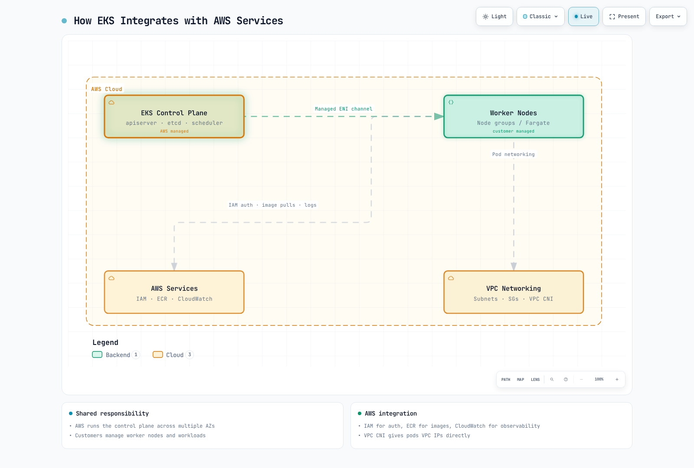

[🔍 インタラクティブな図を表示](https://www.atomai.click/kubernetes-docs/archmaps/en-core-01-cluster-architecture-11.html)

### EKS コントロールプレーン

EKS コントロールプレーンは AWS が管理し、複数のアベイラビリティーゾーンにまたがる高可用性を提供します。

**主な特徴**:
1. **マネージドサービス**: AWS がコントロールプレーンのメンテナンスとアップグレードを管理
2. **高可用性**: 複数のアベイラビリティーゾーンにデプロイ
3. **オートスケーリング**: 負荷に応じて自動的にスケーリング
4. **セキュリティ**: AWS セキュリティサービスと統合

### EKS のノードタイプ

EKS はさまざまなタイプのノードをサポートしています。

1. **自己管理型ノード**: ユーザーが EC2 インスタンスを直接管理
2. **Managed Node Group**: AWS がノードのライフサイクルを管理
3. **Fargate**: サーバーレスのコンテナ実行環境
4. **EKS Auto Mode**: AWS がコンピューティングリソースと統合インフラストラクチャを管理
5. **EKS Hybrid Nodes**: 顧客が管理するオンプレミスノード

Bottlerocket はノードのオペレーティングシステムであり、独立したコンピューティング管理タイプではありません。

**Managed Node Group の例**:
```yaml
apiVersion: eksctl.io/v1alpha5
kind: ClusterConfig
metadata:
  name: my-cluster
  region: ap-northeast-2
managedNodeGroups:
  - name: ng-1
    instanceType: m5.large
    desiredCapacity: 3
    minSize: 2
    maxSize: 5
    volumeSize: 80
    privateNetworking: true
    labels:
      role: worker
    tags:
      nodegroup-role: worker
```

### EKS のネットワーク

EKS のネットワークは Amazon VPC を基盤とし、次のコンポーネントを含みます。

1. **VPC CNI プラグイン**: AWS VPC ネットワークとの統合
2. **Security Group**: ノードおよび Pod レベルのネットワークセキュリティ
3. **ロードバランサーとの統合**: ELB、ALB、NLB との統合
4. **VPC Endpoint**: AWS サービスとのプライベート通信

**VPC CNI アドオンの設定例**（ConfigMap ではなく、JSON 形式の設定値）:

```json
{
  "enableNetworkPolicy": "true",
  "env": {
    "WARM_IP_TARGET": "5",
    "MINIMUM_IP_TARGET": "10"
  }
}
```

これらの値をインストール済みアドオンの設定にマージし、更新前にスキーマを検証してください。Pod ENI のサポートには `ENABLE_POD_ENI` 環境変数を使用します。また、互換性のあるノード、IAM 権限、SecurityGroupPolicy も必要です。ConfigMap のキーを設定するだけでは有効になりません。[NetworkPolicy の設定方法](https://docs.aws.amazon.com/eks/latest/userguide/cni-network-policy-configure.html)を参照してください。

### EKS のストレージ

EKS はさまざまな AWS ストレージサービスと統合します。

1. **EBS CSI Driver**: Amazon EBS Volume の管理
2. **EFS CSI Driver**: Amazon EFS ファイルシステムの管理
3. **FSx for Lustre CSI Driver**: FSx for Lustre ファイルシステムの管理
4. **S3**: オブジェクトストレージ

**EBS CSI Driver の例**:
```yaml
apiVersion: storage.k8s.io/v1
kind: StorageClass
metadata:
  name: ebs-sc
provisioner: ebs.csi.aws.com
parameters:
  type: gp3
  encrypted: "true"
volumeBindingMode: WaitForFirstConsumer
```

### EKS のセキュリティ

EKS は AWS セキュリティサービスと統合し、強固なセキュリティを提供します。

1. **IAM 統合**: AWS IAM と Kubernetes RBAC の統合
2. **VPC セキュリティ**: VPC Security Group と Network ACL
3. **AWS KMS**: Secret の暗号化のための KMS 統合
4. **AWS WAF**: Web アプリケーションファイアウォールとの統合
5. **AWS Shield**: DDoS 保護

**IAM ロールを使用する ServiceAccount の例**:
```yaml
apiVersion: v1
kind: ServiceAccount
metadata:
  name: s3-reader
  namespace: default
  annotations:
    eks.amazonaws.com/role-arn: arn:aws:iam::123456789012:role/s3-reader-role
```

### EKS のモニタリングとロギング

EKS は AWS のモニタリングおよびロギングサービスと統合します。

1. **CloudWatch Container Insights**: コンテナのモニタリング
2. **CloudWatch Logs**: ログの収集と分析
3. **X-Ray**: 分散トレーシング
4. **Prometheus と Grafana**: オープンソースのモニタリングツールとの統合

**CloudWatch Container Insights の例**:
```yaml
apiVersion: v1
kind: Namespace
metadata:
  name: amazon-cloudwatch
---
apiVersion: apps/v1
kind: DaemonSet
metadata:
  name: cloudwatch-agent
  namespace: amazon-cloudwatch
spec:
  selector:
    matchLabels:
      name: cloudwatch-agent
  template:
    metadata:
      labels:
        name: cloudwatch-agent
    spec:
      containers:
      - name: cloudwatch-agent
        image: amazon/cloudwatch-agent:1.300073.0b1828
        # ... additional configuration
```

### EKS のコスト最適化

EKS クラスターのコストを最適化する方法:

1. **Spot Instance**: コスト効率の高い Spot Instance を活用
2. **Fargate**: サーバーレスのコンテナ実行によってアイドルリソースのコストを削減
3. **オートスケーリング**: Cluster Autoscaler によってリソースを最適化
4. **Graviton プロセッサ**: ARM ベースの Graviton Instance を活用
5. **リソース Request の最適化**: 適切なリソースの Request と Limit を設定

**Spot Instance のノードグループの例**:
```yaml
apiVersion: eksctl.io/v1alpha5
kind: ClusterConfig
metadata:
  name: my-cluster
  region: ap-northeast-2
managedNodeGroups:
  - name: spot-ng
    instanceTypes: ["m5.large", "m5a.large", "m5d.large", "m5ad.large"]
    spot: true
    desiredCapacity: 3
    minSize: 2
    maxSize: 10
```

## さらに学ぶ

このドキュメントで扱ったクラスターアーキテクチャの理解を深めるには、次のトピックを参照してください。

- [Kubernetes の概要](../basics/04-kubernetes-introduction.md) - Kubernetes の基本概念と歴史
- [Pod とワークロード](./02-pods-and-workloads.md) - クラスター内で動作するワークロードの管理
- [Service とネットワーク](./03-services-networking.md) - クラスター内のネットワーク設定
- [スケジューリング、プリエンプション、退避](./08-scheduling-preemption-eviction.md) - Pod をノードに配置する仕組み
- [クラスター管理](./09-cluster-administration.md) - クラスターの運用と管理
- [EKS の概要](../eks/01-eks-introduction.md) - Amazon EKS サービスの概要
- [EKS クラスターの作成](../eks/02-eks-cluster-creation-part1.md) - EKS クラスターの作成方法

### 実践と応用的な学習

- [Kubernetes 公式チュートリアル](https://kubernetes.io/docs/tutorials/) - 実践を通じた学習
- [Kubernetes The Hard Way](https://github.com/kelseyhightower/kubernetes-the-hard-way) - Kubernetes クラスターを手動で構築
- [Cilium ネットワーク](../networking/cilium/01-introduction.md) - 高度なネットワーク機能とセキュリティ機能

## まとめ

このドキュメントでは、Kubernetes クラスターのアーキテクチャ、主なコンポーネント、それらが連携して動作する仕組みを確認しました。また、クラスターのネットワーク、ストレージ、スケーラビリティ、セキュリティ、アップグレードと、Amazon EKS クラスターのアーキテクチャなどの重要な側面も取り上げました。

Kubernetes クラスターのアーキテクチャを理解することは、クラスターを効果的に設計、デプロイ、運用するための基礎です。この知識を活用することで、安定性、スケーラビリティ、セキュリティを強化した Kubernetes 環境を構築できます。

## クイズ

この章で学んだことを確認するには、[クラスターアーキテクチャのクイズ](../quizzes/core/01-cluster-architecture-quiz.md)に挑戦してください。

## 参考資料

- [Kubernetes 公式ドキュメント](https://kubernetes.io/docs/)
- [Amazon EKS ドキュメント](https://docs.aws.amazon.com/eks/)
- [Kubernetes The Hard Way](https://github.com/kelseyhightower/kubernetes-the-hard-way)
- [Kubernetes Patterns](https://www.oreilly.com/library/view/kubernetes-patterns/9781492050278/)
- [Kubernetes Up & Running](https://www.oreilly.com/library/view/kubernetes-up-and/9781492046523/)
- [Kubernetes Best Practices](https://www.oreilly.com/library/view/kubernetes-best-practices/9781492056461/)
