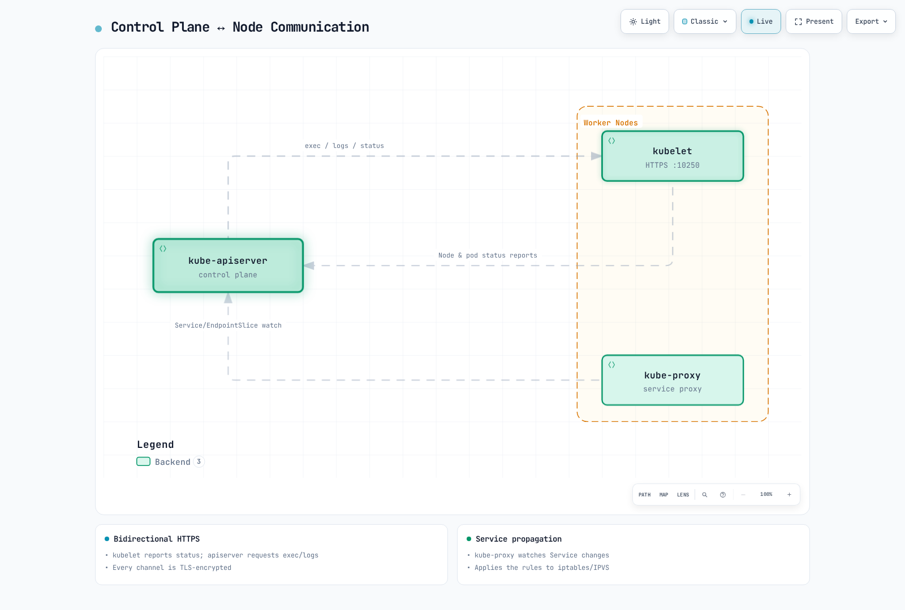
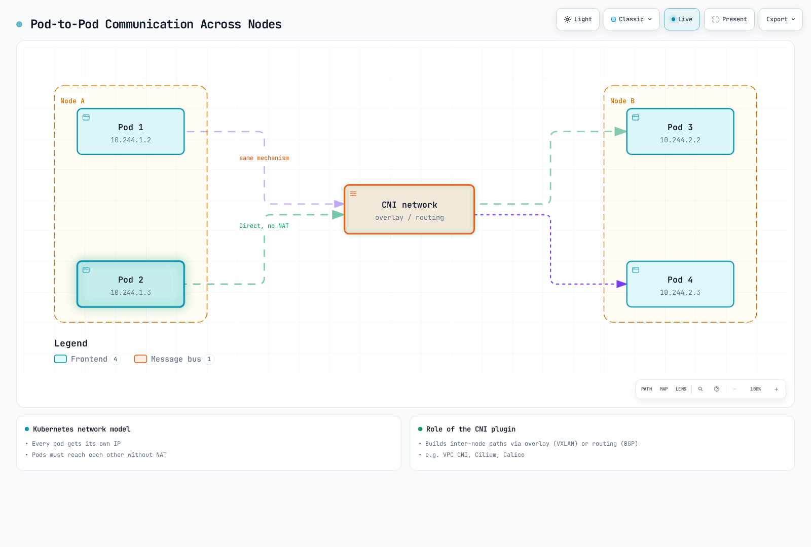
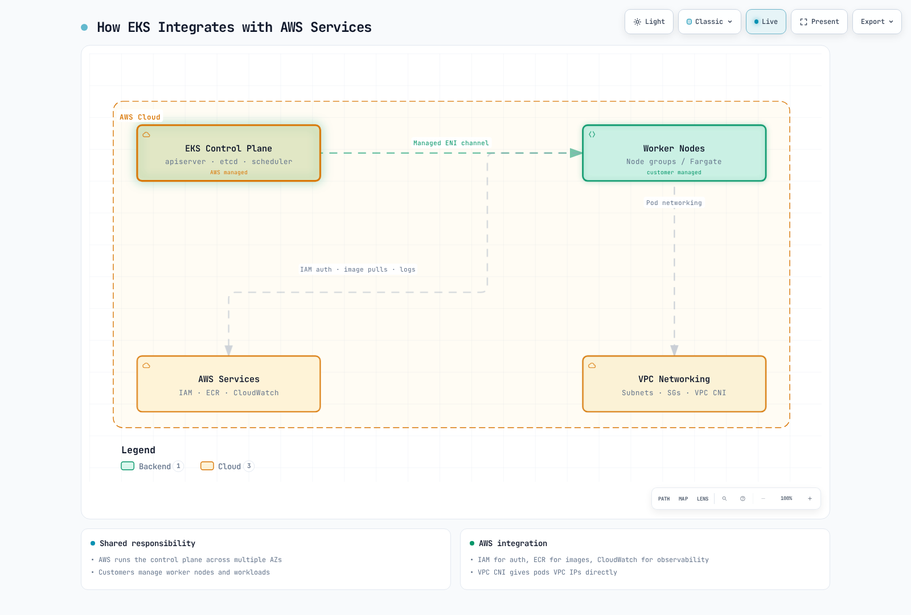

# クラスターアーキテクチャ

> **サポート対象バージョン**: Kubernetes 1.35, 1.36, 1.37
> **最終更新**: October 12, 2026

バージョンヘッダーはアップストリーム Kubernetes を指します。このプロジェクトでは、直近 3 つのマイナーリリース（1.35～1.37）のリリースブランチを維持しています。アップストリーム 1.34 はメンテナンスモードであり、EKS での AWS サポート終了日とは別に、**October 27, 2026** のサポート終了までパッチリリースを受け取ります。

October 12, 2026 時点で、EKS の標準サポートは 1.34～1.37 を対象としており、EKS 1.37 は October 1, 2026 に利用可能になりました。バージョンを選択する前に、[Kubernetes release status](https://kubernetes.io/releases/) と [EKS lifecycle](https://docs.aws.amazon.com/eks/latest/userguide/kubernetes-versions.html) を確認してください。

以下のコンポーネントコマンドは自己管理クラスターの例です。EKS はそのコントロールプレーンを管理します。イメージタグとインフラストラクチャ ID は例であるため、使用前に互換性があり保守されているイメージを選択し、プレースホルダーを置き換えてください。

## ラボ環境のセットアップ

このドキュメントの概念を実践するには、次のツールと環境が必要です。

### 必要なツール
- API サーバーから 1 マイナーバージョン以内の kubectl
- 動作する Kubernetes クラスター（EKS、minikube、kind など）

### ローカル開発環境のセットアップ

```bash
# Install minikube (for local development)
curl -LO https://storage.googleapis.com/minikube/releases/latest/minikube-linux-amd64
sudo install minikube-linux-amd64 /usr/local/bin/minikube

# Start cluster
minikube start

# Check cluster status
kubectl cluster-info

# Check control plane components
kubectl get pods -n kube-system
```

## クラスターアーキテクチャの概要

> **主要な概念**: Kubernetes クラスターはコントロールプレーンとワーカーノードで構成され、それぞれは特定の役割を果たす複数のコンポーネントから成り立っています。

Kubernetes クラスターは、コンテナ化されたアプリケーションを実行するためのノード（仮想マシンまたは物理マシン）の集合で構成されます。クラスターは大きくコントロールプレーンとワーカーノードに分けられます。

### クラスターアーキテクチャ図


[🔍 インタラクティブ図を表示](https://www.atomai.click/kubernetes-docs/archmaps/en-core-01-cluster-architecture-0.html)

**コントロールプレーンコンポーネント**:
- **kube-apiserver**: Kubernetes API を公開するフロントエンド
- **etcd**: Kubernetes API の状態を格納するキー・バリューストア
- **kube-scheduler**: 新しく作成された Pod を実行するノードを選択
- **kube-controller-manager**: クラスター状態を管理するコントローラーを実行
- **cloud-controller-manager**: クラウドプロバイダーの API と連携

**ワーカーノードコンポーネント**:
- **kubelet**: 各ノードで実行されるエージェント。コンテナの実行を管理
- **kube-proxy**: ネットワークルールを維持し、接続転送を実行
- **Container Runtime**: コンテナを実行（containerd、CRI-O など）

## コントロールプレーンコンポーネント

コントロールプレーンは Kubernetes クラスターの「頭脳」として機能し、クラスター全体の状態を管理および制御します。コントロールプレーンコンポーネントは通常、専用マシン上で実行され、高可用性のために複数のインスタンスへ複製できます。

### コントロールプレーンコンポーネントの詳細

| コンポーネント | 主な機能 | 通信先 | 高可用性構成 |
|-----------|---------------|----------------------|--------------------------------|
| **kube-apiserver** | - Kubernetes API を提供<br>- 認証と認可<br>- API リクエストの処理 | - すべてのコンポーネント<br>- etcd | 複数インスタンスによる水平スケーリング |
| **etcd** | - クラスターのデータを格納<br>- 分散キー・バリューストア<br>- 一貫性を保証 | - kube-apiserver | マルチノードクラスター |
| **kube-scheduler** | - Pod 配置の決定<br>- ノードリソースの評価<br>- affinity/anti-affinity の適用 | - kube-apiserver | アクティブ・スタンバイ構成 |
| **kube-controller-manager** | - Node Controller<br>- Replication Controller<br>- Endpoint Controller<br>- Service Account Controller | - kube-apiserver | アクティブ・スタンバイ構成 |
| **cloud-controller-manager** | - クラウドプロバイダー統合<br>- ノードライフサイクル<br>- ルーティングとロードバランシング | - kube-apiserver<br>- Cloud API | アクティブ・スタンバイ構成 |

### コントロールプレーンの通信フロー

1. ユーザーまたはコントローラーが kube-apiserver にリクエストを送信
2. kube-apiserver が認証、認可、admission を実行
3. kube-apiserver が etcd からデータを読み取り、または etcd に書き込み
4. コントローラーと scheduler が kube-apiserver 経由でクラスター状態を watch
5. kubelet がノード状態を kube-apiserver に報告

### kube-apiserver

kube-apiserver は Kubernetes API を公開するコントロールプレーンのフロントエンドです。内部および外部からのすべてのリクエストは、この API サーバーを通じて処理されます。

**主な機能**:
- REST API の提供
- 認証と認可
- リクエストの検証と処理
- etcd との通信
- 水平スケーリング可能（複数インスタンスへスケール可能）

**主なフラグと設定オプション**:
```bash
# Basic configuration example
kube-apiserver \
  --advertise-address=192.168.1.10 \
  --allow-privileged=true \
  --authorization-mode=Node,RBAC \
  --client-ca-file=/etc/kubernetes/pki/ca.crt \
  --enable-admission-plugins=NodeRestriction \
  --enable-bootstrap-token-auth=true \
  --etcd-servers=https://127.0.0.1:2379 \
  --etcd-cafile=/etc/kubernetes/pki/etcd/ca.crt \
  --etcd-certfile=/etc/kubernetes/pki/apiserver-etcd-client.crt \
  --etcd-keyfile=/etc/kubernetes/pki/apiserver-etcd-client.key \
  --kubelet-client-certificate=/etc/kubernetes/pki/apiserver-kubelet-client.crt \
  --kubelet-client-key=/etc/kubernetes/pki/apiserver-kubelet-client.key \
  --service-account-key-file=/etc/kubernetes/pki/sa.pub \
  --service-account-signing-key-file=/etc/kubernetes/pki/sa.key \
  --service-account-issuer=https://kubernetes.default.svc.cluster.local \
  --service-cluster-ip-range=10.96.0.0/12 \
  --tls-cert-file=/etc/kubernetes/pki/apiserver.crt \
  --tls-private-key-file=/etc/kubernetes/pki/apiserver.key
```

**API サーバーのセキュリティ**:
- TLS 証明書によるセキュアな通信
- さまざまな認証方式をサポート（X.509 証明書、Service Account トークン、OIDC、webhook など）
- RBAC（Role-Based Access Control）による権限管理
- admission controller によるリクエストの検証と変更

### etcd

etcd は Kubernetes API の状態を格納する、一貫性と高可用性を備えたキー・バリューストアです。Kubernetes の「信頼できる唯一の情報源」として機能します。

**主な機能**:
- 分散システム
- 強整合性（Raft コンセンサスアルゴリズムを使用）
- 高可用性（複数ノードで構成可能）
- セキュアなデータ保存
- 変更を監視する watch 機能

**etcd クラスターの設定**:
```bash
# etcd cluster configuration example (3 nodes)
etcd \
  --name etcd-1 \
  --initial-advertise-peer-urls https://192.168.1.11:2380 \
  --listen-peer-urls https://192.168.1.11:2380 \
  --listen-client-urls https://192.168.1.11:2379,https://127.0.0.1:2379 \
  --advertise-client-urls https://192.168.1.11:2379 \
  --initial-cluster-token etcd-cluster \
  --initial-cluster etcd-1=https://192.168.1.11:2380,etcd-2=https://192.168.1.12:2380,etcd-3=https://192.168.1.13:2380 \
  --initial-cluster-state new \
  --data-dir=/var/lib/etcd \
  --cert-file=/etc/kubernetes/pki/etcd/server.crt \
  --key-file=/etc/kubernetes/pki/etcd/server.key \
  --trusted-ca-file=/etc/kubernetes/pki/etcd/ca.crt \
  --client-cert-auth=true \
  --peer-cert-file=/etc/kubernetes/pki/etcd/peer.crt \
  --peer-key-file=/etc/kubernetes/pki/etcd/peer.key \
  --peer-trusted-ca-file=/etc/kubernetes/pki/etcd/ca.crt \
  --peer-client-cert-auth=true
```

**etcd のバックアップとリカバリ**:
```bash
# etcd backup
ETCDCTL_API=3 etcdctl snapshot save snapshot.db \
  --endpoints=https://127.0.0.1:2379 \
  --cacert=/etc/kubernetes/pki/etcd/ca.crt \
  --cert=/etc/kubernetes/pki/etcd/server.crt \
  --key=/etc/kubernetes/pki/etcd/server.key

# etcd recovery
etcdutl snapshot restore snapshot.db \
  --bump-revision=1000000000 --mark-compacted \
  --data-dir=/var/lib/etcd-restore \
  --name=etcd-1 \
  --initial-cluster=etcd-1=https://192.168.1.11:2380 \
  --initial-cluster-token=etcd-cluster \
  --initial-advertise-peer-urls=https://192.168.1.11:2380
```

**etcd のパフォーマンス最適化**:
- ディスク I/O の最適化（SSD を推奨）
- 適切なメモリ割り当て
- 定期的な compaction と defragmentation
- クラスター規模に応じた適切な etcd ノード数（通常は 3 または 5）

#### 2026 年 7 月の更新: etcd v3.7.0 リリース

2026 年 7 月 8 日、SIG etcd は etcd v3.7.0 をリリースしました。主な変更点は次のとおりです。

- **RangeStream**: レスポンス全体をメモリにバッファリングするのではなく、大きな範囲の結果をチャンク単位でストリーミングします（長く要望されていた機能）
- **パフォーマンス改善**: keys-only の範囲リクエストを最適化し、lease をより高速かつ信頼性の高いものにしました
- レガシー v2store の最後の残存部分を削除し、大規模な protobuf の刷新を完了
- 更新されたコア依存関係 bbolt v1.5.0 および raft v3.7.0 を同梱

詳細は [official announcement](https://kubernetes.io/blog/2026/07/08/announcing-etcd-3.7/) と [etcd v3.7 changelog](https://github.com/etcd-io/etcd/blob/main/CHANGELOG/CHANGELOG-3.7.md) を参照してください。

### kube-scheduler

kube-scheduler は、新しく作成された Pod を実行するノードを選択するコントロールプレーンコンポーネントです。

**スケジューリングプロセス**:
1. **フィルタリング**: Pod を実行できるノードを特定
   - リソース要件（CPU、メモリ）
   - ノードセレクター、ノード affinity
   - taint と toleration
   - Volume の制約

2. **スコアリング**: 適したノードにスコアを割り当て
   - リソース使用率
   - Pod の inter-affinity/anti-affinity
   - データの局所性
   - ノード間のロードバランシング

3. **バインディング**: 最適なノードに Pod を割り当て

**Scheduler の設定**:
```bash
# Basic configuration example
kube-scheduler \
  --kubeconfig=/etc/kubernetes/scheduler.conf \
  --leader-elect=true \
  --v=2
```

**Scheduler プロファイルとプラグイン**:
- デフォルトの Scheduler プロファイル
- カスタム Scheduler プロファイル
- Scheduler 拡張ポイント（filter、score、bind など）
- 複数 Scheduler のサポート

**スケジューリングポリシー**:
```yaml
# Scheduling policy example
apiVersion: kubescheduler.config.k8s.io/v1
kind: KubeSchedulerConfiguration
profiles:
- schedulerName: default-scheduler
  pluginConfig:
  - name: NodeResourcesFit
    args:
      scoringStrategy:
        type: MostAllocated
        resources:
        - name: cpu
          weight: 1
        - name: memory
          weight: 1
```

### kube-controller-manager

kube-controller-manager は、複数のコントローラープロセスを実行するコントロールプレーンコンポーネントです。各コントローラーはクラスターの特定の側面を管理します。

**主なコントローラー**:
- **Node Controller**: ノード状態を監視して応答
- **Replication Controller**: Pod レプリカ数を維持
- **EndpointSlice Controller**: EndpointSlice 内の Service バックエンドを追跡
- **Service Account & Token Controllers**: デフォルトの ServiceAccount を作成し、明示的に要求されたレガシートークン Secret を維持します。現在の Pod は短命な TokenRequest トークンを使用します
- **Job Controller**: 一回限りのタスクを管理
- **CronJob Controller**: スケジュールされたタスクを管理
- **DaemonSet Controller**: 特定の Pod がすべてのノードで実行されることを保証
- **StatefulSet Controller**: ステートフルアプリケーションを管理
- **PV Controller**: 永続 Volume を管理
- **Namespace Controller**: namespace のライフサイクルを管理
- **Garbage Collector**: 孤立したオブジェクトをクリーンアップ

**Controller Manager の設定**:
```bash
# Basic configuration example
kube-controller-manager \
  --kubeconfig=/etc/kubernetes/controller-manager.conf \
  --leader-elect=true \
  --use-service-account-credentials=true \
  --root-ca-file=/etc/kubernetes/pki/ca.crt \
  --service-account-private-key-file=/etc/kubernetes/pki/sa.key \
  --cluster-signing-cert-file=/etc/kubernetes/pki/ca.crt \
  --cluster-signing-key-file=/etc/kubernetes/pki/ca.key \
  --controllers=*,bootstrapsigner,tokencleaner
```

**コントローラーの動作**:
1. コントローラーは API サーバー経由でクラスター状態を継続的に watch
2. 現在の状態と望ましい状態の差異を検出
3. 差異を調整する操作を実行
4. 状態の変更を API サーバーへ報告

### cloud-controller-manager

cloud-controller-manager は、クラウド固有の制御ロジックを含むコントロールプレーンコンポーネントです。これにより Kubernetes コアをクラウドプロバイダーの API から分離できます。

**主なコントローラー**:
- **Node Controller**: クラウドプロバイダー API 経由でノード状態を確認
- **Route Controller**: クラウド環境でルートを構成
- **Service Controller**: クラウドロードバランサーを作成、更新、削除

クラウドストレージのプロビジョニングとアタッチには CSI コントローラーを使用し、kubelet と CSI ノードプラグインがマウントを処理します。これらは cloud-controller-manager の責務ではありません。

**クラウドプロバイダー実装**:
- AWS Cloud Controller Manager
- Azure Cloud Controller Manager
- GCP Cloud Controller Manager
- OpenStack Cloud Controller Manager
- vSphere Cloud Controller Manager

**Cloud Controller Manager の設定**:
```bash
# AWS Cloud Controller Manager example
cloud-controller-manager \
  --cloud-provider=aws \
  --cloud-config=/etc/kubernetes/cloud-config \
  --kubeconfig=/etc/kubernetes/cloud-controller-manager.conf \
  --leader-elect=true
```

**Cloud Controller Manager の利点**:
- Kubernetes コアからクラウドプロバイダー固有コードを分離
- クラウドプロバイダーが独自の機能を個別に開発可能
- Kubernetes コアを変更せずにクラウド機能を追加

## ノードコンポーネント

ノードはコンテナ化されたアプリケーションを実行する Kubernetes クラスター内のワーカーマシンです。各ノードはコントロールプレーンによって管理され、複数のコンポーネントで構成されます。

### kubelet

kubelet は各ノードで実行されるエージェントであり、Pod 内のコンテナを管理します。kubelet はさまざまなメカニズムを通じて PodSpec を受け取り、それらの仕様に従ってコンテナが正常に実行されることを保証します。

**主な機能**:
- PodSpec に従ってコンテナを実行
- コンテナ状態を監視して報告
- コンテナのライフサイクルを管理
- Volume マウントを管理
- ノード状態を報告
- コンテナのヘルスチェックを実行

**kubelet の設定**:
```bash
# Basic configuration example
kubelet \
  --kubeconfig=/etc/kubernetes/kubelet.conf \
  --config=/var/lib/kubelet/config.yaml \
  --container-runtime-endpoint=unix:///run/containerd/containerd.sock
```

**kubelet 設定ファイルの例**:
```yaml
# /var/lib/kubelet/config.yaml
apiVersion: kubelet.config.k8s.io/v1beta1
kind: KubeletConfiguration
address: 0.0.0.0
authentication:
  anonymous:
    enabled: false
  webhook:
    cacheTTL: 2m0s
    enabled: true
  x509:
    clientCAFile: /etc/kubernetes/pki/ca.crt
authorization:
  mode: Webhook
  webhook:
    cacheAuthorizedTTL: 5m0s
    cacheUnauthorizedTTL: 30s
cgroupDriver: systemd
clusterDomain: cluster.local
cpuManagerPolicy: none
evictionHard:
  memory.available: 100Mi
  nodefs.available: 10%
  nodefs.inodesFree: 5%
failSwapOn: true
healthzBindAddress: 127.0.0.1
healthzPort: 10248
```

**Static Pod**: 以下の manifest は断片であり、完全なコントロールプレーンのインストールではありません。また、ホストネットワーク、証明書、マウント、および完全な API サーバー設定が必要です。
kubelet は API サーバーを経由せずに直接管理する Static Pod を実行できます。これは主にコントロールプレーンコンポーネントの実行に使用されます。

```yaml
# /etc/kubernetes/manifests/kube-apiserver.yaml
apiVersion: v1
kind: Pod
metadata:
  name: kube-apiserver
  namespace: kube-system
spec:
  containers:
  - name: kube-apiserver
    image: registry.k8s.io/kube-apiserver:v1.37.1
    command:
    - kube-apiserver
    - --advertise-address=192.168.1.10
    # ... additional flags
```

### kube-proxy

kube-proxy は、Kubernetes の Service 概念を実装する各ノード上で実行されるネットワークプロキシです。ノード上のネットワークルールを維持し、接続転送を実行します。

**主な機能**:
- Service IP およびポートのネットワークルールを維持
- 接続転送
- ロードバランシングを実装
- Service discovery をサポート

**動作モード**:
1. **iptables**: デフォルトの Linux モード。カーネルのパケット処理ルールをインストール
2. **nftables**: v1.33 以降で安定。カーネルと CNI の互換性を確認
3. **IPVS**: レガシー Linux モード。v1.35 以降で非推奨。サポートされる代替手段へ移行
4. **kernelspace**: Windows モード

従来の `userspace` モードは削除されました。一部のネットワーク実装は kube-proxy を完全に置き換えます。

**kube-proxy の設定**:
```bash
# Basic configuration example
kube-proxy \
  --config=/var/lib/kube-proxy/config.conf \
  --hostname-override=node1
```

**kube-proxy 設定ファイルの例**:
```yaml
# /var/lib/kube-proxy/config.conf
apiVersion: kubeproxy.config.k8s.io/v1alpha1
kind: KubeProxyConfiguration
bindAddress: 0.0.0.0
clientConnection:
  acceptContentTypes: ""
  burst: 10
  contentType: application/vnd.kubernetes.protobuf
  kubeconfig: /var/lib/kube-proxy/kubeconfig.conf
  qps: 5
clusterCIDR: 10.244.0.0/16
configSyncPeriod: 15m0s
conntrack:
  maxPerCore: 32768
  min: 131072
  tcpCloseWaitTimeout: 1h0m0s
  tcpEstablishedTimeout: 24h0m0s
enableProfiling: false
healthzBindAddress: 0.0.0.0:10256
hostnameOverride: node1
iptables:
  masqueradeAll: false
  masqueradeBit: 14
  minSyncPeriod: 0s
  syncPeriod: 30s
ipvs:
  excludeCIDRs: null
  minSyncPeriod: 0s
  scheduler: ""
  syncPeriod: 30s
mode: "iptables"
```

**IPVS と iptables モードの比較**:

| 特性 | iptables モード | IPVS モード |
|----------------|---------------|-----------|
| パフォーマンス | Service 数が多いとパフォーマンスが低下 | 大規模クラスターでより優れたパフォーマンス |
| ロードバランシングアルゴリズム | デフォルトではランダムなバックエンド選択 | 各種アルゴリズムをサポート（rr、lc、dh、sh、sed、nq） |
| 実装 | ネットワークパケットフィルタリングチェーン | ハッシュテーブルベース |
| カーネル要件 | デフォルトのカーネルモジュール | IPVS カーネルモジュールが必要 |

### Container Runtime

Container runtime はコンテナを実行するソフトウェアです。Kubernetes は Container Runtime Interface（CRI）を通じてさまざまなコンテナランタイムをサポートします。

**主な Container Runtime**:
1. **containerd**: 軽量なコンテナランタイム（現在最も広く使用）
2. **CRI-O**: Kubernetes 用に特別設計された軽量ランタイム
3. **Docker Engine**: cri-dockerd などの外部 CRI アダプターが必要です。組み込みの dockershim は v1.24 で削除されました。Docker でビルドされた OCI イメージは containerd/CRI-O でも引き続き動作します。

**Container Runtime のレイヤー構造**:


[🔍 インタラクティブ図を表示](https://www.atomai.click/kubernetes-docs/archmaps/en-core-01-cluster-architecture-1.html)

**containerd 1.x の設定例**（2.x では異なるプラグイン ID を使用します。インストール済みリリース用のデフォルトを生成してください）:
```toml
# /etc/containerd/config.toml
version = 2

[plugins]
  [plugins."io.containerd.grpc.v1.cri"]
    sandbox_image = "registry.k8s.io/pause:3.10"
    [plugins."io.containerd.grpc.v1.cri".containerd]
      default_runtime_name = "runc"
      [plugins."io.containerd.grpc.v1.cri".containerd.runtimes]
        [plugins."io.containerd.grpc.v1.cri".containerd.runtimes.runc]
          runtime_type = "io.containerd.runc.v2"
          [plugins."io.containerd.grpc.v1.cri".containerd.runtimes.runc.options]
            SystemdCgroup = true
```

**CRI-O の設定例**:
```toml
# /etc/crio/crio.conf
[crio]
root = "/var/lib/containers/storage"
runroot = "/var/run/containers/storage"
storage_driver = "overlay"
storage_option = ["overlay.mountopt=nodev"]

[crio.runtime]
default_runtime = "runc"
conmon = "/usr/bin/conmon"
conmon_cgroup = "pod"
cgroup_manager = "systemd"

[crio.image]
pause_image = "registry.k8s.io/pause:3.10"
```

### アドオンコンポーネント

アドオンは Kubernetes クラスターの機能を拡張する追加コンポーネントです。重要なアドオンには次のものがあります。

1. **CNI Network Plugins**: Pod ネットワークを実装
   - Calico、Cilium、Flannel など

2. **DNS**: クラスター内で DNS サービスを提供
   - CoreDNS（デフォルト）

3. **Dashboard**: Web ベースの UI を提供
   - Headlamp（Kubernetes Dashboard はアーカイブ済み）

4. **Ingress Controller**: HTTP/HTTPS ルーティングを管理
   - Traefik、HAProxy など

5. **Metrics Server**: リソース使用量メトリクスを収集
   - Metrics Server

6. **Logging and Monitoring**: ログ収集と監視
   - Prometheus、Grafana、Elasticsearch、Fluentd、Kibana など

**CoreDNS の設定例**:
```yaml
apiVersion: v1
kind: ConfigMap
metadata:
  name: coredns
  namespace: kube-system
data:
  Corefile: |
    .:53 {
        errors
        health {
            lameduck 5s
        }
        ready
        kubernetes cluster.local in-addr.arpa ip6.arpa {
            pods insecure
            fallthrough in-addr.arpa ip6.arpa
            ttl 30
        }
        prometheus :9153
        forward . /etc/resolv.conf {
            max_concurrent 1000
        }
        cache 30
        loop
        reload
        loadbalance
    }
```

**Calico CNI の設定例**:
```yaml
apiVersion: v1
kind: ConfigMap
metadata:
  name: calico-config
  namespace: kube-system
data:
  calico_backend: "bird"
  cni_network_config: |-
    {
      "name": "k8s-pod-network",
      "cniVersion": "0.3.1",
      "plugins": [
        {
          "type": "calico",
          "log_level": "info",
          "datastore_type": "kubernetes",
          "nodename": "__KUBERNETES_NODE_NAME__",
          "mtu": __CNI_MTU__,
          "ipam": {
            "type": "calico-ipam"
          },
          "policy": {
            "type": "k8s"
          },
          "kubernetes": {
            "kubeconfig": "__KUBECONFIG_FILEPATH__"
          }
        },
        {
          "type": "portmap",
          "snat": true,
          "capabilities": {"portMappings": true}
        }
      ]
    }
```

## クラスター通信経路

Kubernetes クラスター内ではさまざまなコンポーネント間で通信が行われます。これらの通信経路を理解することは、クラスター設計、セキュリティ、トラブルシューティングにとって重要です。

### コントロールプレーン内部通信


[🔍 インタラクティブ図を表示](https://www.atomai.click/kubernetes-docs/archmaps/en-core-01-cluster-architecture-2.html)

コントロールプレーンコンポーネント間の通信は次のとおりです。

1. **kube-apiserver と etcd**: kube-apiserver はクラスター状態を保存および取得するために etcd と通信します。
   - プロトコル: gRPC
   - ポート: 2379/TCP
   - セキュリティ: TLS 証明書ベースの認証

2. **kube-scheduler と kube-apiserver**: kube-scheduler は Pod スケジューリングのために kube-apiserver と通信します。
   - プロトコル: HTTPS
   - ポート: 6443/TCP（kube-apiserver）
   - セキュリティ: TLS 証明書ベースの認証

3. **kube-controller-manager と kube-apiserver**: コントローラーはクラスター状態を watch および変更するために kube-apiserver と通信します。
   - プロトコル: HTTPS
   - ポート: 6443/TCP（kube-apiserver）
   - セキュリティ: TLS 証明書ベースの認証

4. **cloud-controller-manager と kube-apiserver**: Cloud controller はクラスター状態を watch し、クラウドリソースを管理するために kube-apiserver と通信します。
   - プロトコル: HTTPS
   - ポート: 6443/TCP（kube-apiserver）
   - セキュリティ: TLS 証明書ベースの認証

### コントロールプレーンとノード間の通信



[🔍 インタラクティブ図を表示](https://www.atomai.click/kubernetes-docs/archmaps/en-core-01-cluster-architecture-3.html)

コントロールプレーンとノード間の通信は次のとおりです。

1. **kube-apiserver → kubelet**: API サーバーはログ、exec/attach、ポートフォワーディングのために kubelet API を呼び出します。
   - プロトコル: HTTPS
   - ポート: 10250/TCP（kubelet）
   - セキュリティ: TLS 証明書ベースの認証

2. **kubelet と kube-apiserver**: kubelet は、割り当てられた PodSpec の watch、ノードの登録、ノード/Pod の状態およびイベントの報告のために kube-apiserver と通信します。
   - プロトコル: HTTPS
   - ポート: 6443/TCP（kube-apiserver）
   - セキュリティ: TLS 証明書ベースの認証

3. **kube-proxy と kube-apiserver**: kube-proxy は Service 情報を取得するために kube-apiserver と通信します。
   - プロトコル: HTTPS
   - ポート: 6443/TCP（kube-apiserver）
   - セキュリティ: TLS 証明書ベースの認証

### ノード間通信



[🔍 インタラクティブ図を表示](https://www.atomai.click/kubernetes-docs/archmaps/en-core-01-cluster-architecture-4.html)

ノード間通信は次のとおりです。

1. **Pod 間通信**: Pod は CNI プラグインが提供するネットワークを通じて相互に通信します。
   - プロトコル: アプリケーションに依存（TCP、UDP など）
   - ポート: アプリケーションに依存
   - セキュリティ: network policy で制御可能

2. **ノード間 Pod 通信**: 異なるノード上の Pod 間の通信は CNI プラグインによって処理されます。
   - プロトコル: アプリケーションに依存（TCP、UDP など）
   - ポート: アプリケーションに依存
   - セキュリティ: network policy で制御可能

### 外部通信


[🔍 インタラクティブ図を表示](https://www.atomai.click/kubernetes-docs/archmaps/en-core-01-cluster-architecture-5.html)

外部エンティティとの通信は次のとおりです。

1. **クライアントと kube-apiserver**: ユーザーと外部システムは kube-apiserver を通じてクラスターと対話します。
   - プロトコル: HTTPS
   - ポート: 6443/TCP（kube-apiserver）
   - セキュリティ: TLS 証明書、トークン、ユーザー認証など

2. **外部トラフィックと Service**: 外部トラフィックは NodePort、LoadBalancer Service、または Ingress を通じてクラスター内のアプリケーションにアクセスします。
   - プロトコル: HTTP、HTTPS、TCP、UDP など
   - ポート: Service 設定に依存
   - セキュリティ: ingress controller と Service 設定に依存

### 通信セキュリティ

Kubernetes クラスター内の通信におけるセキュリティは、次の方法で実装されます。

1. **TLS 証明書**: コントロールプレーンコンポーネント間のすべての通信は TLS 証明書で暗号化されます。
2. **認証と認可**: API サーバーへのすべてのリクエストは認証および認可プロセスを通過します。
3. **Network Policy**: Pod 間通信は network policy により制限できます。
4. **暗号化された Secret**: etcd に格納された Secret は暗号化できます。

**保存時 API データ暗号化の例**（`--encryption-provider-config` で API サーバーを設定します。既存の Secret を再書き込みして暗号化してください）:
```yaml
apiVersion: apiserver.config.k8s.io/v1
kind: EncryptionConfiguration
resources:
  - resources:
    - secrets
    providers:
    - aescbc:
        keys:
        - name: key1
          secret: <base64-encoded-key>
    - identity: {}
```

### 高可用性クラスターの構成

高可用性（HA）Kubernetes クラスターは、単一障害点を排除し、サービスを中断せずに動作を継続するよう設計されています。

### コントロールプレーンの高可用性

コントロールプレーンの高可用性は次の方法で実装されます。

1. **複数のコントロールプレーンノード**: 通常、冗長性のために 3 または 5 個のコントロールプレーンノードをデプロイ
2. **etcd クラスター**: 複数の etcd インスタンスで構成されたクラスターをデプロイ（通常は 3 または 5）
3. **Load Balancer**: API サーバーの前に Load Balancer を配置してトラフィックを分散

**高可用性コントロールプレーンアーキテクチャ**:


[🔍 インタラクティブ図を表示](https://www.atomai.click/kubernetes-docs/archmaps/en-core-01-cluster-architecture-6.html)

**etcd クラスターの構成**:


[🔍 インタラクティブ図を表示](https://www.atomai.click/kubernetes-docs/archmaps/en-core-01-cluster-architecture-7.html)

### ワーカーノードの高可用性

ワーカーノードの高可用性は次の方法で実装されます。

1. **複数のワーカーノード**: 複数のワーカーノードにワークロードを分散
2. **自動ノードリカバリ**: クラウドプロバイダーの自動リカバリ機能を利用
3. **Auto Scaling**: cluster autoscaler による自動ノードスケーリング
4. **複数の Availability Zone**: 複数の Availability Zone にノードをデプロイ

**ワーカーノードの分散デプロイメント**:


[🔍 インタラクティブ図を表示](https://www.atomai.click/kubernetes-docs/archmaps/en-core-01-cluster-architecture-8.html)

### アプリケーションの高可用性

アプリケーションの高可用性は次の方法で実装されます。

1. **ReplicaSet/Deployment**: 複数の Pod レプリカを実行
2. **Pod 分散ルール**: pod anti-affinity により複数ノードへ Pod を分散
3. **PodDisruptionBudget**: 計画的な中断時に最小可用性を保証
4. **Service とロードバランシング**: 複数の Pod にトラフィックを分散

**Pod Anti-Affinity の例**:
```yaml
apiVersion: apps/v1
kind: Deployment
metadata:
  name: web-server
spec:
  replicas: 3
  selector:
    matchLabels:
      app: web-server
  template:
    metadata:
      labels:
        app: web-server
    spec:
      affinity:
        podAntiAffinity:
          requiredDuringSchedulingIgnoredDuringExecution:
          - labelSelector:
              matchExpressions:
              - key: app
                operator: In
                values:
                - web-server
            topologyKey: "kubernetes.io/hostname"
      containers:
      - name: web-server
        image: nginx:1.30.4
```

**PodDisruptionBudget の例**:
```yaml
apiVersion: policy/v1
kind: PodDisruptionBudget
metadata:
  name: web-server-pdb
spec:
  minAvailable: 2
  selector:
    matchLabels:
      app: web-server
```

### ディザスタリカバリ戦略

Kubernetes クラスターのディザスタリカバリ戦略は、次の方法で実装されます。

1. **etcd のバックアップとリカバリ**: 定期的な etcd データバックアップおよびリカバリ手順を確立
2. **マルチリージョンデプロイメント**: 複数のリージョンにクラスターをデプロイ
3. **クラスター Federation**: 複数のクラスターを Federation で管理
4. **継続的バックアップ**: アプリケーションデータを継続的にバックアップ

**etcd バックアップスクリプトの例**:
```bash
#!/bin/bash
ETCDCTL_API=3 etcdctl snapshot save /backup/etcd-snapshot-$(date +%Y%m%d-%H%M%S).db \
  --endpoints=https://127.0.0.1:2379 \
  --cacert=/etc/kubernetes/pki/etcd/ca.crt \
  --cert=/etc/kubernetes/pki/etcd/server.crt \
  --key=/etc/kubernetes/pki/etcd/server.key
```

**etcd のリカバリ手順（自己管理クラスター）**:

1. `etcdutl snapshot status` でスナップショットを検証します。上記のとおり、互換性のある `etcdutl` を使用して新しいデータディレクトリへリストアします。
2. データディレクトリを切り替える前に、クラスターの runbook を使用してすべての API サーバーインスタンスと影響を受ける etcd プロセスを停止します。kubelet だけを停止しても、既存の Static Pod コンテナは停止しません。
3. 複数メンバーをリカバリする場合、各メンバーで一意の名前/peer URL と同一の完全な `--initial-cluster` メンバーシップを指定し、同じスナップショットをリストアします。上記の単一メンバーの例は HA リカバリの手順ではありません。
4. Kubernetes の watch cache には `--bump-revision` と `--mark-compacted` を使用します。スナップショット以降の revision を超える値を選択してください（表示されている値は例です）。
5. etcd Static Pod の hostPath をリストア先ディレクトリに更新し、etcd を再起動して quorum/health を確認した後、API サーバーとコントローラーを再起動します。検証が終了するまで、元のデータとバックアップを保持してください。

[etcd recovery guide](https://etcd.io/docs/v3.6/op-guide/recovery/) に従ってください。EKS ユーザーは、マネージドコントロールプレーンの etcd を直接操作またはリストアしません。

## クラスターネットワーキング

Kubernetes ネットワーキングは、Pod、Service、外部世界の間の通信を可能にします。Kubernetes ネットワーキングモデルは、すべての Pod が一意の IP アドレスを持ち、NAT を使わずに相互通信できることを前提とします。

### ネットワーキングモデル

Kubernetes ネットワーキングモデルには次の要件があります。

1. **Pod 間通信**: すべての Pod は NAT を使用せず、他のすべての Pod と通信できなければなりません
2. **ノードから Pod への通信**: ノードエージェントはそのノード上の Pod と通信できなければなりません
3. **Pod から外部への通信**: 外部接続は、ルーティング、必要に応じた NAT、セキュリティ/egress ポリシーに依存します。すべての Pod がインターネットに到達できることは要件ではありません

### CNI（Container Network Interface）

CNI は Kubernetes でネットワーキングを実装するための標準インターフェースです。さまざまな CNI プラグインがあり、それぞれ異なる機能とパフォーマンス特性を備えています。

**主な CNI プラグイン**:

1. **Calico**: BGP ベースのネットワーキング、network policy のサポート
   - 機能: 高パフォーマンス、network policy、暗号化、eBPF サポート
   - ユースケース: 大規模クラスター、セキュリティ重視の環境

2. **Cilium**: eBPF ベースのネットワーキングとセキュリティ
   - 機能: L3-L7 セキュリティポリシー、高パフォーマンス、可観測性
   - ユースケース: マイクロサービス、セキュリティ重視の環境

3. **Flannel**: シンプルなオーバーレイネットワーク
   - 機能: シンプルなセットアップ、軽量
   - ユースケース: 小規模クラスター、開発環境

4. **Weave Net（歴史的）**: プロジェクトは 2024 年 6 月にアーカイブされました。新規デプロイメントでは保守されている代替手段を評価してください。

**CNI 設定例（Calico）**:
```yaml
apiVersion: v1
kind: ConfigMap
metadata:
  name: calico-config
  namespace: kube-system
data:
  calico_backend: "bird"
  cni_network_config: |-
    {
      "name": "k8s-pod-network",
      "cniVersion": "0.3.1",
      "plugins": [
        {
          "type": "calico",
          "log_level": "info",
          "datastore_type": "kubernetes",
          "nodename": "__KUBERNETES_NODE_NAME__",
          "mtu": __CNI_MTU__,
          "ipam": {
            "type": "calico-ipam"
          },
          "policy": {
            "type": "k8s"
          },
          "kubernetes": {
            "kubeconfig": "__KUBECONFIG_FILEPATH__"
          }
        },
        {
          "type": "portmap",
          "snat": true,
          "capabilities": {"portMappings": true}
        }
      ]
    }
```

### Service ネットワーキング

Kubernetes Service は Pod のセットに対して安定したエンドポイントを提供します。Service には ClusterIP、NodePort、LoadBalancer、ExternalName などのタイプがあります。

**Service ネットワーキングコンポーネント**:

1. **ClusterIP**: クラスター内からのみアクセス可能な仮想 IP
2. **kube-proxy**: Service IP 宛てのトラフィックを Pod にルーティング
3. **CoreDNS**: Service discovery 用の DNS サービス

**Service ネットワーキングフロー**:
```
Client -> kernel rules programmed by kube-proxy (ClusterIP DNAT) -> Pod
```

**Service の例**:
```yaml
apiVersion: v1
kind: Service
metadata:
  name: my-service
spec:
  selector:
    app: my-app
  ports:
  - port: 80
    targetPort: 8080
  type: ClusterIP
```

### Ingress ネットワーキング

Ingress はクラスター外部からクラスター内部の Service への HTTP および HTTPS ルーティングを管理します。Ingress controller は Ingress リソースを実装します。

**主な Ingress Controller**:
1. **保守されている Ingress/Gateway controller**: controller のライフサイクルと Gateway API サポートを確認
2. **AWS Load Balancer Controller**: Ingress 用の ALB をプロビジョニング
3. **Traefik**: クラウドネイティブなエッジルーター
4. **HAProxy Ingress**: HAProxy ベースの Ingress controller

**Ingress ネットワーキングフロー**:
```
Client -> Ingress Controller -> Service -> Pod
```

Community ingress-nginx は 2026 年 3 月に廃止されました。[retirement notice](https://kubernetes.io/blog/2025/11/11/ingress-nginx-retirement/) を参照してください。この例には、`traefik` という名前の IngressClass を持つインストール済みの Traefik controller が必要です。`/app` は変更されずに転送されます。

**Ingress の例**:
```yaml
apiVersion: networking.k8s.io/v1
kind: Ingress
metadata:
  name: my-ingress
spec:
  ingressClassName: traefik
  rules:
  - host: example.com
    http:
      paths:
      - path: /app
        pathType: Prefix
        backend:
          service:
            name: my-service
            port:
              number: 80
```

### Network Policy

Network policy は Pod 間の通信を制御する方法を提供します。デフォルトではすべての Pod が相互に通信できますが、network policy によりこれを制限できます。

**Network Policy の例**:
```yaml
apiVersion: networking.k8s.io/v1
kind: NetworkPolicy
metadata:
  name: db-network-policy
spec:
  podSelector:
    matchLabels:
      role: db
  policyTypes:
  - Ingress
  - Egress
  ingress:
  - from:
    - podSelector:
        matchLabels:
          role: frontend
    ports:
    - protocol: TCP
      port: 3306
  egress:
  - to:
    - podSelector:
        matchLabels:
          role: monitoring
    ports:
    - protocol: TCP
      port: 9090
```

### ネットワークのトラブルシューティング

Kubernetes ネットワーキング問題のトラブルシューティングで使用する一般的なツールとコマンド:

1. **ping、traceroute**: 基本的なネットワーク接続性テスト
2. **tcpdump**: ネットワークパケットのキャプチャと分析
3. **netstat、ss**: ネットワーク接続状態の確認
4. **nslookup、dig**: DNS ルックアップテスト
5. **kubectl exec**: Pod 内でネットワークコマンドを実行

**ネットワークデバッグの例**:
```bash
# Test network connectivity within a pod
kubectl exec -it <pod-name> -- ping <target-ip>

# Test DNS lookup within a pod
kubectl exec -it <pod-name> -- nslookup <service-name>

# Capture network packets within a pod
kubectl exec -it <pod-name> -- tcpdump -i eth0 -n

# Check service endpoints
kubectl get endpointslices -l kubernetes.io/service-name=<service-name>
```

## クラスターストレージ

Kubernetes ストレージは、コンテナ化されたアプリケーションにデータ永続化を提供します。Kubernetes は、アプリケーションがストレージを効率的に使用できるよう、さまざまなストレージオプションと抽象化を提供します。

### ストレージアーキテクチャ

Kubernetes ストレージアーキテクチャは、次のコンポーネントで構成されます。

1. **Volume**: Pod 内のコンテナにマウントできるディレクトリ
2. **Persistent Volume（PV）**: クラスター内のストレージリソース
3. **Persistent Volume Claim（PVC）**: ユーザーによるストレージリクエスト
4. **Storage Class**: ストレージの「クラス」またはタイプを定義
5. **CSI（Container Storage Interface）**: ストレージシステムとの標準インターフェース

**ストレージアーキテクチャフロー**:


[🔍 インタラクティブ図を表示](https://www.atomai.click/kubernetes-docs/archmaps/en-core-01-cluster-architecture-9.html)

### Volume タイプ

Kubernetes はさまざまなタイプの Volume をサポートします。

1. **Ephemeral Volume**:
   - **emptyDir**: 空のディレクトリとして開始し、Pod の削除時に削除
   - **configMap**: ConfigMap を Volume としてマウント
   - **secret**: Secret を Volume としてマウント
   - **downwardAPI**: Pod とコンテナの情報をファイルとして公開

2. **Persistent Volume**:
   - **CSI 経由のクラウドブロックストレージ**: AWS EBS、Azure Disk、GCE Persistent Disk。それらのレガシー in-tree 実装は削除済み
   - **nfs**: NFS Volume
   - **csi**: CSI driver 経由の Volume

**Volume の例**:
```yaml
apiVersion: v1
kind: Pod
metadata:
  name: test-pd
spec:
  containers:
  - name: test-container
    image: nginx
    volumeMounts:
    - mountPath: /test-pd
      name: test-volume
  volumes:
  - name: test-volume
    persistentVolumeClaim:
      claimName: test-pvc
```

### Persistent Volume と Claim

Persistent Volume（PV）は、管理者によってプロビジョニングされるか、Storage Class を通じて動的にプロビジョニングされるクラスター内のストレージリソースです。Persistent Volume Claim（PVC）は、ユーザーによるストレージリクエストです。

最初に IAM 権限付きで EBS CSI driver をインストールしてください。以下の静的 PV では、Volume ID とゾーンを、既存の EBS Volume およびその実際のゾーンに置き換えてください。EBS は Fargate にはマウントできません。EKS Auto Mode は代わりに `ebs.csi.eks.amazonaws.com` を使用します。

**Persistent Volume の例**:
```yaml
apiVersion: v1
kind: PersistentVolume
metadata:
  name: pv-example
spec:
  capacity:
    storage: 10Gi
  accessModes:
    - ReadWriteOnce
  persistentVolumeReclaimPolicy: Retain
  storageClassName: standard
  csi:
    driver: ebs.csi.aws.com
    volumeHandle: vol-0123456789abcdef0
    fsType: ext4
  nodeAffinity:
    required:
      nodeSelectorTerms:
      - matchExpressions:
        - key: topology.kubernetes.io/zone
          operator: In
          values: [ap-northeast-2a]
```

**Persistent Volume Claim の例**:
```yaml
apiVersion: v1
kind: PersistentVolumeClaim
metadata:
  name: pvc-example
spec:
  accessModes:
    - ReadWriteOnce
  resources:
    requests:
      storage: 5Gi
  storageClassName: standard
```

### Storage Class

Storage Class は、管理者が提供するストレージの「クラス」を記述します。Storage Class により、PVC がリクエストされたときに PV を動的にプロビジョニングできます。

**Storage Class の例**:
```yaml
apiVersion: storage.k8s.io/v1
kind: StorageClass
metadata:
  name: standard
provisioner: ebs.csi.aws.com
parameters:
  type: gp3
  csi.storage.k8s.io/fstype: ext4
  encrypted: "true"
reclaimPolicy: Delete
allowVolumeExpansion: true
volumeBindingMode: WaitForFirstConsumer
```

### CSI（Container Storage Interface）

CSI は Kubernetes とストレージシステム間の標準インターフェースを提供します。CSI により、ストレージプロバイダーは Kubernetes コードを変更せずに独自のストレージ driver を開発できます。

**CSI アーキテクチャ**:


[🔍 インタラクティブ図を表示](https://www.atomai.click/kubernetes-docs/archmaps/en-core-01-cluster-architecture-10.html)

**CSI Driver デプロイメントの例**:
```yaml
apiVersion: storage.k8s.io/v1
kind: StorageClass
metadata:
  name: ebs-sc
provisioner: ebs.csi.aws.com
parameters:
  type: gp3
  csi.storage.k8s.io/fstype: ext4
  encrypted: "true"
volumeBindingMode: WaitForFirstConsumer
```

### ストレージのベストプラクティス

Kubernetes ストレージを使用するためのベストプラクティス:

1. **適切なストレージタイプを選択**: ワークロードの特性に合うストレージタイプを選択
2. **動的プロビジョニングを使用**: Storage Class による動的プロビジョニングを利用
3. **適切なアクセスモードを選択**: ワークロード要件に合うアクセスモードを選択
4. **リソースリクエストと制限を設定**: 適切なストレージ容量をリクエスト
5. **バックアップおよびリカバリ戦略を確立**: 重要なデータのバックアップおよびリカバリ戦略を準備
6. **ストレージを監視**: ストレージ使用量とパフォーマンスを監視

## クラスターのスケーラビリティ

Kubernetes クラスターのスケーラビリティとは、増加する負荷と要件を処理するクラスターの能力を指します。スケーラビリティは、水平スケーリング（scale out）および垂直スケーリング（scale up）によって実装できます。

### クラスターのスケール制限

アップストリームの [large-cluster guidance](https://kubernetes.io/docs/setup/best-practices/cluster-large/) では、テスト済みのサポート範囲として、5,000 ノード、合計 150,000 Pod、合計 300,000 コンテナ、ノードあたり 110 Pod を説明しています。これらの基準は併せて適用されるものであり、汎用的な厳密 API 制限ではありません。一般的な Pod あたり 20 コンテナの制限はありません。Service の容量もアドレス範囲とデータプレーンに依存します。クラウドネットワーキングの制限とクォータはこれより低い場合があります。

### 水平スケーリング

水平スケーリングでは、ノードを追加してクラスター容量を増加させます。

**ノード Auto Scaling**:
Kubernetes Cluster Autoscaler は、ワークロード要件に応じてノード数を自動的に調整します。

```yaml
# AWS Auto Scaling Group tags example
tags:
  k8s.io/cluster-autoscaler/enabled: "true"
  k8s.io/cluster-autoscaler/my-cluster: "owned"
```

**Cluster Autoscaler Deployment の断片（v1.36 クラスターの例）**: クラスターのマイナーバージョンに一致するパッチ済みリリースを選択してください。ServiceAccount、Kubernetes RBAC、専用 IAM role を指定してください。この断片は完全なインストールではありません。
```yaml
apiVersion: apps/v1
kind: Deployment
metadata:
  name: cluster-autoscaler
  namespace: kube-system
spec:
  replicas: 1
  selector:
    matchLabels:
      app: cluster-autoscaler
  template:
    metadata:
      labels:
        app: cluster-autoscaler
    spec:
      containers:
      - name: cluster-autoscaler
        image: registry.k8s.io/autoscaling/cluster-autoscaler:v1.36.0
        command:
        - ./cluster-autoscaler
        - --cloud-provider=aws
        - --nodes=2:10:my-asg-group
        - --scale-down-unneeded-time=10m
```

**Karpenter**:
Karpenter は AWS が開発した新しいノード Auto Scaling ツールであり、より高速かつ効率的なノードプロビジョニングを提供します。

```yaml
apiVersion: karpenter.sh/v1
kind: NodePool
metadata:
  name: default
spec:
  template:
    spec:
      requirements:
        - key: karpenter.sh/capacity-type
          operator: In
          values: ["spot", "on-demand"]
      nodeClassRef:
        group: karpenter.k8s.aws
        kind: EC2NodeClass
        name: default-class
  limits:
    cpu: 1000
    memory: 1000Gi
---
apiVersion: karpenter.k8s.aws/v1
kind: EC2NodeClass
metadata:
  name: default-class
spec:
  role: KarpenterNodeRole-my-cluster
  amiSelectorTerms:
    - alias: al2023@latest
  subnetSelectorTerms:
    - tags:
        karpenter.sh/discovery: my-cluster
  securityGroupSelectorTerms:
    - tags:
        karpenter.sh/discovery: my-cluster
```

### 垂直スケーリング

垂直ワークロードスケーリングは、Pod の CPU/メモリリクエストを調整します。VPA は基盤となるノードのサイズを変更しないため、追加のノード容量は別途プロビジョニングする必要があります。

**Vertical Pod Autoscaler（VPA）**:
VPA は Pod の CPU およびメモリリクエストを自動的に調整します。

```yaml
apiVersion: autoscaling.k8s.io/v1
kind: VerticalPodAutoscaler
metadata:
  name: my-app-vpa
spec:
  targetRef:
    apiVersion: "apps/v1"
    kind: Deployment
    name: my-app
  updatePolicy:
    updateMode: "Recreate"
  resourcePolicy:
    containerPolicies:
    - containerName: '*'
      minAllowed:
        cpu: 100m
        memory: 50Mi
      maxAllowed:
        cpu: 1
        memory: 500Mi
```

### アプリケーションのスケーリング

アプリケーションレベルのスケーリングは、Pod レプリカ数を調整して実装されます。

**Horizontal Pod Autoscaler（HPA）**:
HPA は CPU 使用率またはカスタムメトリクスに基づいて、Pod レプリカ数を自動的に調整します。

```yaml
apiVersion: autoscaling/v2
kind: HorizontalPodAutoscaler
metadata:
  name: my-app-hpa
spec:
  scaleTargetRef:
    apiVersion: apps/v1
    kind: Deployment
    name: my-app
  minReplicas: 2
  maxReplicas: 10
  metrics:
  - type: Resource
    resource:
      name: cpu
      target:
        type: Utilization
        averageUtilization: 80
```

**KEDA（Kubernetes Event-driven Autoscaling）**:
KEDA はイベント駆動の Auto Scaling を提供し、さまざまなイベントソースに基づくスケーリングを可能にします。

```yaml
apiVersion: keda.sh/v1alpha1
kind: ScaledObject
metadata:
  name: my-app-scaledobject
spec:
  scaleTargetRef:
    name: my-app
  minReplicaCount: 0
  maxReplicaCount: 10
  triggers:
  - type: kafka
    metadata:
      bootstrapServers: kafka.svc:9092
      consumerGroup: my-group
      topic: my-topic
      lagThreshold: "10"
```

### スケーラビリティのベストプラクティス

Kubernetes クラスターのスケーラビリティに関するベストプラクティス:

1. **リソースリクエストと制限を設定**: すべての Pod に適切なリソースリクエストと制限を設定
2. **Node Pool 戦略**: 異なるワークロード特性に対して複数の Node Pool を構成
3. **Auto Scaling を構成**: Cluster Autoscaler、HPA、VPA を適切に構成
4. **効率的な Pod 配置**: node affinity、pod affinity/anti-affinity を活用
5. **クラスター監視**: リソース使用量とパフォーマンスを継続的に監視
6. **負荷テスト**: スケーリング戦略を検証するために定期的に負荷テストを実施

## クラスターセキュリティ

Kubernetes クラスターのセキュリティは複数のレイヤーで実装する必要があります。これには認証、認可、network policy、Pod セキュリティなどが含まれます。

### 認証

Kubernetes API サーバーへのアクセスを認証する方法:

1. **X.509 証明書**: TLS クライアント証明書を使用した認証
2. **Service Account トークン**: Pod 内から API サーバーにアクセスするためのトークン
3. **OpenID Connect（OIDC）**: 外部 ID プロバイダーを通じた認証
4. **Webhook Token Authentication**: 外部認証サービスを通じた認証
5. **Authentication Proxy**: 認証プロキシを通じた認証

**kubeconfig の例**:
```yaml
apiVersion: v1
kind: Config
clusters:
- name: my-cluster
  cluster:
    certificate-authority-data: <CA-DATA>
    server: https://api.my-cluster.example.com
users:
- name: admin
  user:
    client-certificate-data: <CERT-DATA>
    client-key-data: <KEY-DATA>
contexts:
- name: my-context
  context:
    cluster: my-cluster
    user: admin
current-context: my-context
```

### 認可

認証済みユーザーの操作を制御する方法:

1. **RBAC（Role-Based Access Control）**: ロールベースのアクセス制御
2. **ABAC（Attribute-Based Access Control）**: 属性ベースのアクセス制御
3. **Node Authorization**: ノード用の特別な認可
4. **Webhook Authorization**: 外部サービスを通じた認可

**RBAC の例**:
```yaml
# Role definition
apiVersion: rbac.authorization.k8s.io/v1
kind: Role
metadata:
  namespace: default
  name: pod-reader
rules:
- apiGroups: [""]
  resources: ["pods"]
  verbs: ["get", "watch", "list"]
---
# Role binding
apiVersion: rbac.authorization.k8s.io/v1
kind: RoleBinding
metadata:
  name: read-pods
  namespace: default
subjects:
- kind: User
  name: jane
  apiGroup: rbac.authorization.k8s.io
roleRef:
  kind: Role
  name: pod-reader
  apiGroup: rbac.authorization.k8s.io
```

### ネットワークセキュリティ

クラスター内のネットワークトラフィックを保護する方法:

1. **Network Policy**: Pod 間通信を制御
2. **暗号化通信**: TLS による通信の暗号化
3. **Service Mesh**: Istio、Linkerd などによる高度なネットワークセキュリティ

**Network Policy の例**:
```yaml
apiVersion: networking.k8s.io/v1
kind: NetworkPolicy
metadata:
  name: default-deny-all
spec:
  podSelector: {}
  policyTypes:
  - Ingress
  - Egress
```

### Pod セキュリティ

Pod レベルでのセキュリティ実装:

1. **Pod Security Context**: Pod およびコンテナレベルのセキュリティ設定
2. **Pod Security Standards**: Pod セキュリティ要件を定義
3. **seccomp Profile**: システムコールの制限
4. **AppArmor/SELinux**: 強制アクセス制御

**Pod Security Context の例**:
```yaml
apiVersion: v1
kind: Pod
metadata:
  name: security-context-pod
spec:
  securityContext:
    runAsUser: 1000
    runAsGroup: 3000
    fsGroup: 2000
  containers:
  - name: app
    image: myapp:1.0
    securityContext:
      allowPrivilegeEscalation: false
      capabilities:
        drop:
        - ALL
```

### Secret 管理

機密情報を安全に管理する方法:

1. **Kubernetes Secret**: 基本的な Secret リソースを使用
2. **暗号化された etcd**: etcd に格納される Secret を暗号化
3. **外部 Secret 管理**: HashiCorp Vault、AWS Secrets Manager などを利用

**暗号化された etcd 設定例**:
```yaml
apiVersion: apiserver.config.k8s.io/v1
kind: EncryptionConfiguration
resources:
  - resources:
    - secrets
    providers:
    - aescbc:
        keys:
        - name: key1
          secret: <base64-encoded-key>
    - identity: {}
```

### セキュリティのベストプラクティス

Kubernetes クラスターセキュリティに関するベストプラクティス:

1. **最小権限の原則**: 必要最小限の権限のみを付与
2. **定期的な更新**: クラスターとコンポーネントを定期的に更新
3. **ネットワーク分離**: network policy を通じて Pod 間通信を制限
4. **イメージセキュリティ**: 信頼できるイメージのみを使用し、脆弱性スキャンを実施
5. **監査ログ**: クラスターアクティビティ用の監査ログを有効化
6. **セキュリティベンチマーク**: CIS ベンチマークなどのセキュリティ標準に準拠

## クラスターアップグレード

Kubernetes クラスターのアップグレードは、新機能、セキュリティパッチ、バグ修正を適用するために必要です。アップグレードは慎重に計画し、実行する必要があります。

### 2026 年 8 月の更新: Kubernetes v1.37 "Garhwal" リリース

[Kubernetes v1.37 "Garhwal"](https://kubernetes.io/blog/2026/08/26/kubernetes-v1-37-release/) は、予定どおり 2026 年 8 月 26 日にリリースされました。このリリースは 67 の拡張で構成され、16 が Stable に昇格し、23 が Beta に昇格、残りが Alpha として導入されました。主な変更点:

- **Pod certificates と ClusterTrustBundles が Stable に昇格**: Service Account トークンの代替としてワークロード用 X.509 証明書を自動発行およびローテーションする PodCertificate 機能と、trust anchor を配布する ClusterTrustBundle リソースが標準機能になりました（[detailed post](https://kubernetes.io/blog/2026/08/28/kubernetes-v1-37-pod-certificates-and-cluster-trust-bundles/)）
- **Metrics API（metrics.k8s.io）が GA に**: `kubectl top` と HPA が使用するリソースメトリクス API が Stable に昇格しました（[detailed post](https://kubernetes.io/blog/2026/08/27/kubernetes-v1-37-metrics-api-ga/)）
- その他の **Stable**: 複数の DRA（Dynamic Resource Allocation）機能、回復性のある watchcache 初期化など / **Beta**: HPA の scale-to-zero、manifest ベースの admission control 設定など / **Alpha**: Pod レベルの checkpoint と restore など
- **非推奨**: kube-dns と `kubectl run --filename/-f` は非推奨です。`ipvs` はすでに v1.35 で非推奨となっており、Static Pod は Secret や ConfigMap を参照できなくなりました。cgroup v1 サポートの削除も引き続き進んでいます。

アップグレード前に、[official release notes](https://github.com/kubernetes/kubernetes/blob/master/CHANGELOG/CHANGELOG-1.37.md) の非推奨事項と削除事項を必ず確認してください。

### アップグレード戦略

Kubernetes クラスターのアップグレード戦略:

1. **Blue/Green Upgrade**: 新バージョンのクラスターを別途作成し、ワークロードを移行
2. **In-Place Upgrade**: 既存クラスターを直接アップグレード
3. **Canary Upgrade**: 検証のため、最初に一部のノードのみをアップグレード

### アップグレード順序

Kubernetes クラスターアップグレードの一般的な順序:

1. **コントロールプレーンのアップグレード**: kube-apiserver、kube-controller-manager、kube-scheduler、etcd
2. **DNS および CNI のアップグレード**: CoreDNS、CNI プラグイン、その他の主要アドオン
3. **ワーカーノードのアップグレード**: ワーカーノードを順次アップグレード

**kubeadm アップグレードシーケンス**:

[version-specific kubeadm upgrade guide](https://kubernetes.io/docs/tasks/administer-cluster/kubeadm/kubeadm-upgrade/) に従い、対象マイナーの `pkgs.k8s.io` パッケージリポジトリを構成してください。一度にアップグレードするのは 1 マイナーのみです。

1. etcd をバックアップし、アドオンの互換性を確認します。最初のコントロールプレーンノードで `kubeadm` をアップグレードし、`kubeadm upgrade plan` を実行してから、`kubeadm upgrade apply <target-version>` を実行します。
2. 追加のコントロールプレーンノードで `kubeadm` をアップグレードし、`kubeadm upgrade node` を実行します。
3. 各ノードの kubelet をアップグレードする前に drain します。選択したパッチに kubelet/kubectl パッケージをアップグレードし、systemd をリロードして kubelet を再起動し、Ready を確認してから uncordon します。
4. ワーカーでは、`kubeadm` をアップグレードし、`kubeadm upgrade node` を実行してから、drain/kubelet/uncordon のシーケンスを実行します。kubelet を API サーバーより新しいバージョンにしないでください。

### アップグレード時の考慮事項

Kubernetes クラスターをアップグレードする際の考慮事項:

1. **API の変更**: 新バージョンの API 変更を確認
2. **Feature Gate**: 新しい Feature Gate とデフォルト値の変更を確認
3. **依存関係**: CNI、CSI などの依存コンポーネントの互換性を確認
4. **ダウンタイム**: アップグレード中に予想されるダウンタイムを計画
5. **ロールバック計画**: 問題発生時のロールバック計画を確立

### アップグレードのベストプラクティス

Kubernetes クラスターアップグレードに関するベストプラクティス:

1. **まずテスト環境でテスト**: 本番アップグレード前にテスト環境で検証
2. **段階的なアップグレード**: 一度に 1 マイナーバージョンずつアップグレード
3. **バックアップ**: アップグレード前に etcd データをバックアップ
4. **ドキュメント化**: アップグレード手順と結果を記録
5. **監視**: アップグレード中および後にクラスター状態を監視
6. **アップグレードウィンドウ**: トラフィックの少ない時間帯にアップグレードを実行

## Amazon EKS クラスターアーキテクチャ

Amazon EKS（Elastic Kubernetes Service）は AWS が提供するマネージド Kubernetes サービスです。EKS は Kubernetes のすべての基本機能を提供するとともに、AWS サービスとの統合および管理の利便性を追加します。

### EKS アーキテクチャの概要

EKS クラスターは次のコンポーネントで構成されます。

1. **EKS Control Plane**: AWS が管理する Kubernetes コントロールプレーン
2. **EKS Nodes**: ユーザーが管理するワーカーノード（EC2 インスタンス）
3. **EKS Managed Node Groups**: AWS が管理するノードグループ
4. **EKS Fargate Profiles**: サーバーレスコンテナ実行環境
5. **VPC と Subnet**: クラスターネットワーキング用の VPC と Subnet

**EKS アーキテクチャ図**:



[🔍 インタラクティブ図を表示](https://www.atomai.click/kubernetes-docs/archmaps/en-core-01-cluster-architecture-11.html)

### EKS Control Plane

EKS コントロールプレーンは AWS によって管理され、複数の Availability Zone にわたる高可用性を提供します。

**主な機能**:
1. **マネージドサービス**: AWS がコントロールプレーンの保守とアップグレードを管理
2. **高可用性**: 複数の Availability Zone にデプロイ
3. **Auto Scaling**: 負荷に応じて自動的にスケーリング
4. **セキュリティ**: AWS セキュリティサービスと統合

### EKS ノードタイプ

EKS はさまざまなタイプのノードをサポートします。

1. **自己管理ノード**: ユーザーが EC2 インスタンスを直接管理
2. **Managed Node Groups**: AWS がノードのライフサイクルを管理
3. **Fargate**: サーバーレスコンテナ実行環境
4. **EKS Auto Mode**: AWS がコンピューティングと統合インフラストラクチャを管理
5. **EKS Hybrid Nodes**: 顧客管理のオンプレミスノード

Bottlerocket はノードオペレーティングシステムであり、個別のコンピューティング管理タイプではありません。

**Managed Node Group の例**:
```yaml
apiVersion: eksctl.io/v1alpha5
kind: ClusterConfig
metadata:
  name: my-cluster
  region: ap-northeast-2
managedNodeGroups:
  - name: ng-1
    instanceType: m5.large
    desiredCapacity: 3
    minSize: 2
    maxSize: 5
    volumeSize: 80
    privateNetworking: true
    labels:
      role: worker
    tags:
      nodegroup-role: worker
```

### EKS ネットワーキング

EKS ネットワーキングは Amazon VPC を基盤とし、次のコンポーネントを含みます。

1. **VPC CNI Plugin**: AWS VPC ネットワーキングとの統合
2. **Security Group**: ノードおよび Pod レベルのネットワークセキュリティ
3. **Load Balancer 統合**: ELB、ALB、NLB との統合
4. **VPC Endpoint**: AWS サービスとのプライベート通信

**VPC CNI アドオン設定例**（ConfigMap ではなく JSON 設定値）:

```json
{
  "enableNetworkPolicy": "true",
  "env": {
    "WARM_IP_TARGET": "5",
    "MINIMUM_IP_TARGET": "10"
  }
}
```

これらの値をインストール済みアドオンの設定とマージし、更新前にそのスキーマを検証してください。Pod ENI サポートでは `ENABLE_POD_ENI` 環境変数を使用し、さらに互換性のあるノード、IAM 権限、SecurityGroupPolicy が必要です。ConfigMap キーだけでは有効になりません。[network policy setup](https://docs.aws.amazon.com/eks/latest/userguide/cni-network-policy-configure.html) を参照してください。

### EKS ストレージ

EKS はさまざまな AWS ストレージサービスと統合します。

1. **EBS CSI Driver**: Amazon EBS Volume 管理
2. **EFS CSI Driver**: Amazon EFS ファイルシステム管理
3. **FSx for Lustre CSI Driver**: FSx for Lustre ファイルシステム管理
4. **S3**: オブジェクトストレージ

**EBS CSI Driver の例**:
```yaml
apiVersion: storage.k8s.io/v1
kind: StorageClass
metadata:
  name: ebs-sc
provisioner: ebs.csi.aws.com
parameters:
  type: gp3
  encrypted: "true"
volumeBindingMode: WaitForFirstConsumer
```

### EKS セキュリティ

EKS は AWS セキュリティサービスと統合し、強力なセキュリティを提供します。

1. **IAM 統合**: AWS IAM と Kubernetes RBAC の統合
2. **VPC セキュリティ**: VPC Security Group と network ACL
3. **AWS KMS**: Secret 暗号化のための KMS 統合
4. **AWS WAF**: Web application firewall の統合
5. **AWS Shield**: DDoS 保護

**IAM Role Service Account の例**:
```yaml
apiVersion: v1
kind: ServiceAccount
metadata:
  name: s3-reader
  namespace: default
  annotations:
    eks.amazonaws.com/role-arn: arn:aws:iam::123456789012:role/s3-reader-role
```

### EKS の監視とロギング

EKS は AWS の監視およびロギングサービスと統合します。

1. **CloudWatch Container Insights**: コンテナ監視
2. **CloudWatch Logs**: ログ収集と分析
3. **X-Ray**: 分散トレーシング
4. **Prometheus と Grafana**: オープンソース監視ツールとの統合

**CloudWatch Container Insights の例**:
```yaml
apiVersion: v1
kind: Namespace
metadata:
  name: amazon-cloudwatch
---
apiVersion: apps/v1
kind: DaemonSet
metadata:
  name: cloudwatch-agent
  namespace: amazon-cloudwatch
spec:
  selector:
    matchLabels:
      name: cloudwatch-agent
  template:
    metadata:
      labels:
        name: cloudwatch-agent
    spec:
      containers:
      - name: cloudwatch-agent
        image: amazon/cloudwatch-agent:1.247347.6b250880
        # ... additional configuration
```

### EKS のコスト最適化

EKS クラスターコストを最適化する方法:

1. **Spot Instance**: コスト効率の高い Spot Instance を利用
2. **Fargate**: サーバーレスコンテナ実行によりアイドルリソースコストを削減
3. **Auto Scaling**: cluster autoscaler によるリソース最適化
4. **Graviton Processor**: ARM ベースの Graviton インスタンスを利用
5. **リソースリクエストの最適化**: 適切なリソースリクエストと制限を設定

**Spot Instance Node Group の例**:
```yaml
apiVersion: eksctl.io/v1alpha5
kind: ClusterConfig
metadata:
  name: my-cluster
  region: ap-northeast-2
managedNodeGroups:
  - name: spot-ng
    instanceTypes: ["m5.large", "m5a.large", "m5d.large", "m5ad.large"]
    spot: true
    desiredCapacity: 3
    minSize: 2
    maxSize: 10
```

## さらに学ぶ

このドキュメントで扱ったクラスターアーキテクチャへの理解を深めるには、次のトピックを参照してください。

- [Kubernetes の概要](../basics/04-kubernetes-introduction.md) - Kubernetes の基本概念と歴史
- [Pod とワークロード](./02-pods-and-workloads.md) - クラスターで実行されるワークロードの管理
- [Service とネットワーキング](./03-services-networking.md) - クラスター内のネットワーキング設定
- [スケジューリング、プリエンプション、退避](./08-scheduling-preemption-eviction.md) - Pod がノードに配置される仕組み
- [クラスター管理](./09-cluster-administration.md) - クラスターの運用と管理
- [EKS の概要](../eks/01-eks-introduction.md) - Amazon EKS サービスの概要
- [EKS クラスターの作成](../eks/02-eks-cluster-creation-part1.md) - EKS クラスターの作成方法

### ハンズオンおよび高度な学習

- [Kubernetes 公式チュートリアル](https://kubernetes.io/docs/tutorials/) - ハンズオン実践による学習
- [Kubernetes The Hard Way](https://github.com/kelseyhightower/kubernetes-the-hard-way) - Kubernetes クラスターを手動で構築
- [Cilium ネットワーキング](../networking/cilium/01-introduction.md) - 高度なネットワーキングおよびセキュリティ機能

## 結論

このドキュメントでは、Kubernetes クラスターのアーキテクチャ、主要コンポーネント、およびそれらが連携する仕組みを確認しました。また、クラスターのネットワーキング、ストレージ、スケーラビリティ、セキュリティ、アップグレードなどの重要な側面と、Amazon EKS クラスターのアーキテクチャについても取り上げました。

Kubernetes クラスターアーキテクチャを理解することは、効果的なクラスターの設計、デプロイ、運用の基盤となります。この知識により、安定性、スケーラビリティ、セキュリティが向上した Kubernetes 環境を構築できます。

## クイズ

この章で学んだ内容を確認するには、[クラスターアーキテクチャクイズ](../quizzes/core/01-cluster-architecture-quiz.md) に挑戦してください。

## 参考資料

- [Kubernetes 公式ドキュメント](https://kubernetes.io/docs/)
- [Amazon EKS ドキュメント](https://docs.aws.amazon.com/eks/)
- [Kubernetes The Hard Way](https://github.com/kelseyhightower/kubernetes-the-hard-way)
- [Kubernetes Patterns](https://www.oreilly.com/library/view/kubernetes-patterns/9781492050278/)
- [Kubernetes Up & Running](https://www.oreilly.com/library/view/kubernetes-up-and/9781492046523/)
- [Kubernetes Best Practices](https://www.oreilly.com/library/view/kubernetes-best-practices/9781492056461/)