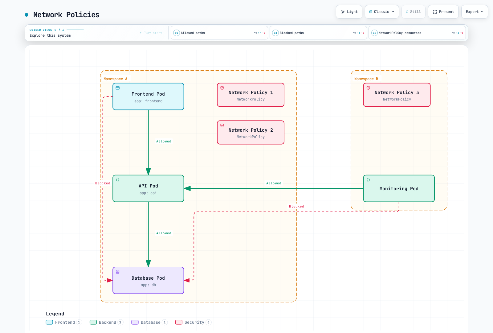
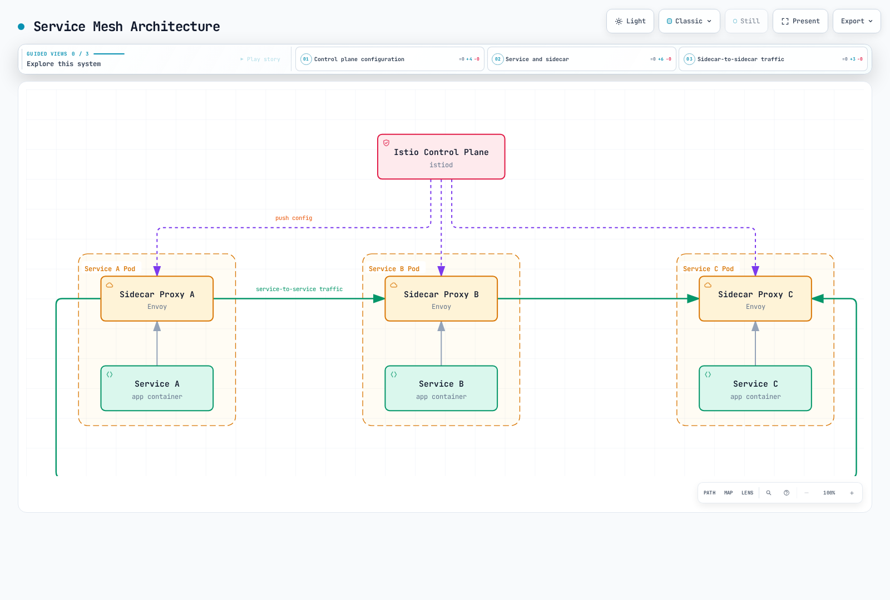
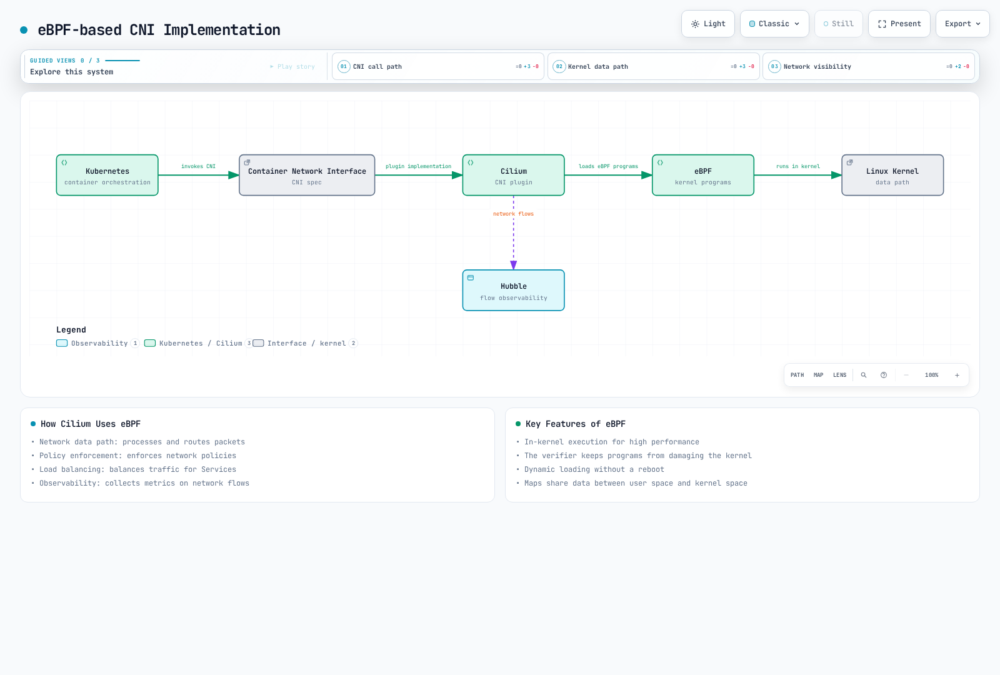

# Service とネットワーキング

> **対応バージョン**: Kubernetes 1.35、1.36、1.37
> **最終更新**: 2026年10月16日

Kubernetes の Service は、複数の Pod に対する単一のアクセスポイントを提供する抽象化レイヤーです。この章では、さまざまな Service タイプ、Ingress、NetworkPolicy など、Kubernetes ネットワーキングの概念を詳しく説明します。

## ラボ環境の準備

このドキュメントの例を試すには、次のツールと環境が必要です。

### 必要なツール
- API サーバーとマイナーバージョンが1つ以内の kubectl
- 利用可能な Kubernetes クラスター（EKS、minikube、kind など）

### サンプルアプリケーションのデプロイ

```bash
# Create namespace
kubectl create namespace networking-demo

# Deploy a simple application
kubectl -n networking-demo apply -f - <<EOF
apiVersion: apps/v1
kind: Deployment
metadata:
  name: web-app
  labels:
    app: web
spec:
  replicas: 3
  selector:
    matchLabels:
      app: web
  template:
    metadata:
      labels:
        app: web
    spec:
      containers:
      - name: nginx
        image: nginx:1.30.6
        ports:
        - containerPort: 80
---
apiVersion: v1
kind: Service
metadata:
  name: web-service
spec:
  selector:
    app: web
  ports:
  - port: 80
    targetPort: 80
  type: ClusterIP
EOF

# Verify services
kubectl -n networking-demo get svc,pods
```

## 目次

1. [Service タイプ](#service-types)
2. [Ingress](#ingress)
3. [Endpoints](#endpoints)
4. [Service Discovery](#service-discovery)
5. [CoreDNS](#coredns)
6. [NetworkPolicy](#network-policies)
7. [Service Mesh](#service-mesh)
8. [CNI（Container Network Interface）](#cnicontainer-network-interface)
9. [Cilium](#cilium)
   - [Cilium の概要](#introduction-to-cilium)
   - [eBPF テクノロジー](#ebpf-technology)
   - [Cilium のネットワーキングモデル](#cilium-networking-model)
   - [Cilium NetworkPolicy](#cilium-network-policies)
   - [Hubble によるネットワークの可視化](#network-visibility-with-hubble)
   - [Amazon EKS での Cilium の設定](#configuring-cilium-on-amazon-eks)

## Service タイプ {#service-types}

> **重要なポイント**: Kubernetes Service は Pod 群に安定したネットワークエンドポイントを提供し、タイプに応じてクラスター内外からのアクセスを制御します。

Kubernetes は、アプリケーションをさまざまな方法で公開できるよう、複数の Service タイプを用意しています。

### Service のアーキテクチャ


[🔍 インタラクティブ図を表示](https://www.atomai.click/kubernetes-docs/archmaps/en-core-03-services-networking-0.html)

### Service タイプの比較

| Service タイプ | アクセス範囲 | 外部 IP | 用途 | 特徴 |
|-------------|-------------|-------------|----------|----------|
| **ClusterIP** | クラスター内 | なし | 内部マイクロサービス間通信 | 既定の Service タイプ。クラスター内からのみアクセス可能 |
| **NodePort** | クラスター外 | なし | 開発・テスト環境 | すべてのノードの指定ポート（30000～32767）経由でアクセス |
| **LoadBalancer** | クラスター外 | あり | 本番環境の外部向けサービス | クラウドプロバイダーのロードバランサーを作成 |
| **ExternalName** | クラスター内 | なし | 外部サービスの内部エイリアス | DNS CNAME レコードで転送 |
| **Headless** | クラスター内 | なし | Pod IP への直接アクセスが必要な場合 | ClusterIP を持たない特殊な Service |

### ClusterIP

ClusterIP は最も基本的な Service タイプです。クラスター内からのみ到達できる固定 IP アドレスを提供します。

```yaml
apiVersion: v1
kind: Service
metadata:
  name: my-service
spec:
  selector:
    app: MyApp
  ports:
  - protocol: TCP
    port: 80
    targetPort: 9376
  type: ClusterIP  # Default, can be omitted
```

### NodePort

NodePort Service は、すべてのノードで指定されたポートを通じて Service へのアクセスを可能にします。

```yaml
apiVersion: v1
kind: Service
metadata:
  name: my-service
spec:
  selector:
    app: MyApp
  ports:
  - protocol: TCP
    port: 80        # Port used within cluster
    targetPort: 9376 # Pod's port
    nodePort: 30007  # Port exposed on nodes (30000-32767)
  type: NodePort
```

### LoadBalancer

LoadBalancer Service は、クラウドプロバイダーのロードバランサーを作成して Service を外部に公開します。

```yaml
apiVersion: v1
kind: Service
metadata:
  name: my-service
  annotations:
    service.beta.kubernetes.io/aws-load-balancer-type: external
    service.beta.kubernetes.io/aws-load-balancer-nlb-target-type: ip
    service.beta.kubernetes.io/aws-load-balancer-scheme: internet-facing
spec:
  selector:
    app: MyApp
  ports:
  - port: 80
    targetPort: 9376
  type: LoadBalancer
```

この例では、AWS Load Balancer Controller、その IAM 権限、適切なサブネット、およびルーティング可能な Pod IP が必要です。インターネット向け NLB が作成されます。内部ロードバランサーも作成できますが、AWS が IP アドレスではなく DNS ホスト名を返す場合があります。EKS Auto Mode では、別のコントローラー／クラスと設定を使用します。

### ExternalName

ExternalName Service は、外部サービスへのエイリアスを提供します。

```yaml
apiVersion: v1
kind: Service
metadata:
  name: my-service
spec:
  type: ExternalName
  externalName: my.database.example.com
```

この Service は、DNS 名 `my-service` を `my.database.example.com` に対応付けます。

### Headless Service

Headless Service はクラスター IP を持たず、各 Pod の DNS レコードを作成します。

```yaml
apiVersion: v1
kind: Service
metadata:
  name: my-service
spec:
  clusterIP: None  # Headless service
  selector:
    app: MyApp
  ports:
  - port: 80
    targetPort: 9376
```

この Service はクラスター IP を割り当てず、Pod ごとの DNS レコードを作成します。

### External IP

`externalIPs` は、管理者が割り当て、すでにノードへルーティングされている IP でこの Service を公開します。アドレスを割り当てたり、外部バックエンドを選択したりする機能ではありません。v1.36 から非推奨です。新しい構成では、サポート対象のロードバランサーまたは Gateway 実装を使用してください。以下のアドレスはドキュメント用のため、管理下にあるアドレスに置き換えてください。

```yaml
apiVersion: v1
kind: Service
metadata:
  name: my-service
spec:
  selector:
    app: MyApp
  ports:
  - port: 80
    targetPort: 9376
  externalIPs:
  - 198.51.100.32
```

## Ingress

Ingress は、クラスター外部からクラスター内の Service への HTTP および HTTPS ルートを公開する API オブジェクトです。ロードバランシング、SSL 終端、ホスト名ベースの仮想ホスティングを構成できます。


[🔍 インタラクティブ図を表示](https://www.atomai.click/kubernetes-docs/archmaps/en-core-03-services-networking-1.html)

### Ingress Controller

Ingress リソースを使うには、クラスター内で Ingress Controller が稼働している必要があります。主な Controller には次のものがあります。

- AWS Load Balancer Controller
- GCE Ingress Controller
- Traefik
- HAProxy
- Istio Ingress

コミュニティ版 ingress-nginx は2026年3月に廃止されました（[告知](https://kubernetes.io/blog/2025/11/11/ingress-nginx-retirement/)）。以下の一般例では、Traefik Controller がインストールされ、`traefik` IngressClass があることを前提としています。Ingress は設定 API であり、パケット処理の中継点ではありません。Controller が実際のプロキシまたはロードバランサーを設定します。

### 基本的な Ingress

```yaml
apiVersion: networking.k8s.io/v1
kind: Ingress
metadata:
  name: minimal-ingress
spec:
  ingressClassName: traefik  # Ingress controller class to use
  rules:
  - host: example.com
    http:
      paths:
      - path: /
        pathType: Prefix
        backend:
          service:
            name: example-service
            port:
              number: 80
```

この Ingress は、`example.com` ホスト宛てのすべてのリクエストを `example-service:80` に転送します。

### パスベースのルーティング

```yaml
apiVersion: networking.k8s.io/v1
kind: Ingress
metadata:
  name: path-based-ingress
spec:
  ingressClassName: traefik
  rules:
  - host: example.com
    http:
      paths:
      - path: /api
        pathType: Prefix
        backend:
          service:
            name: api-service
            port:
              number: 80
      - path: /web
        pathType: Prefix
        backend:
          service:
            name: web-service
            port:
              number: 80
```

この Ingress は、`example.com/api` で始まるリクエストを `api-service` に、`example.com/web` で始まるリクエストを `web-service` に転送します。

### ホスト名ベースの仮想ホスティング

```yaml
apiVersion: networking.k8s.io/v1
kind: Ingress
metadata:
  name: name-based-ingress
spec:
  ingressClassName: traefik
  rules:
  - host: foo.example.com
    http:
      paths:
      - path: /
        pathType: Prefix
        backend:
          service:
            name: foo-service
            port:
              number: 80
  - host: bar.example.com
    http:
      paths:
      - path: /
        pathType: Prefix
        backend:
          service:
            name: bar-service
            port:
              number: 80
```

この Ingress は、`foo.example.com` 宛てのリクエストを `foo-service` に、`bar.example.com` 宛てのリクエストを `bar-service` に転送します。

### TLS の設定

```yaml
apiVersion: networking.k8s.io/v1
kind: Ingress
metadata:
  name: tls-ingress
spec:
  ingressClassName: traefik
  tls:
  - hosts:
    - example.com
    secretName: example-tls
  rules:
  - host: example.com
    http:
      paths:
      - path: /
        pathType: Prefix
        backend:
          service:
            name: example-service
            port:
              number: 80
```

この Ingress は、`example-tls` Secret に格納された TLS 証明書を使って `example.com` への HTTPS 接続を終端します。

TLS Secret の作成:

```bash
kubectl create secret tls example-tls --cert=path/to/cert.crt --key=path/to/key.key
```

### AWS Load Balancer Controller

AWS EKS では、AWS Load Balancer Controller を使って Application Load Balancer を作成できます。

```yaml
apiVersion: networking.k8s.io/v1
kind: Ingress
metadata:
  name: alb-ingress
  annotations:
    alb.ingress.kubernetes.io/scheme: internet-facing
    alb.ingress.kubernetes.io/target-type: ip
    alb.ingress.kubernetes.io/listen-ports: '[{"HTTP": 80}, {"HTTPS": 443}]'
    alb.ingress.kubernetes.io/ssl-redirect: "443"
    alb.ingress.kubernetes.io/certificate-arn: arn:aws:acm:region:account-id:certificate/certificate-id
spec:
  ingressClassName: alb
  rules:
  - host: example.com
    http:
      paths:
      - path: /
        pathType: Prefix
        backend:
          service:
            name: example-service
            port:
              number: 80
```

この Ingress は AWS ALB を使って `example.com` 宛てのリクエストを処理します。

## Endpoints

従来の `v1/Endpoints` API は v1.33 から非推奨です。新しい連携には `discovery.k8s.io/v1` の EndpointSlice を使用してください。これらのオブジェクトはバックエンドを記述するもので、API オブジェクトをトラフィックが経由するわけではありません。

Endpoints リソースには、Service が参照する Pod の IP アドレスとポートが保存されます。Service の selector に一致する Pod があると、Kubernetes が Endpoints オブジェクトを自動的に作成・管理します。

```yaml
apiVersion: v1
kind: Endpoints
metadata:
  name: my-service
subsets:
- addresses:
  - ip: 192.168.1.1
  ports:
  - port: 9376
```

手動でバックエンドを管理する場合は、selector を**設定せずに** `my-service` という名前の Service を作成し、ポートを一致させてください。そうしないと、コントローラーがバックエンド情報を上書きする可能性があります。次のように、EndpointSlice を手動で管理する方法を推奨します。

### EndpointSlice

EndpointSlice は Endpoints のスケーラブルな代替であり、大規模クラスターでのパフォーマンスが向上します。

```yaml
apiVersion: discovery.k8s.io/v1
kind: EndpointSlice
metadata:
  name: my-service-abc
  labels:
    kubernetes.io/service-name: my-service
    endpointslice.kubernetes.io/managed-by: docs.example.com
addressType: IPv4
ports:
- name: ""
  protocol: TCP
  port: 9376
endpoints:
- addresses:
  - "10.1.2.3"
  conditions:
    ready: true
  hostname: pod-1
  nodeName: node-1
  zone: us-west-2a
```

## Service Discovery

Kubernetes には、主に次の2つの Service Discovery 方式があります。

1. **環境変数**: Pod の作成時に、Kubernetes が稼働中の Service に関する環境変数を Pod に注入します。
2. **DNS**: クラスター DNS サーバーを通じて Service の DNS レコードを提供します。

### 環境変数

`enableServiceLinks: true` の場合、コンテナの起動時に kubelet が、その Pod の namespace にすでに存在する ClusterIP 付き Service の環境変数を追加します。この変数は動的には更新されないため、後から作成された Service には DNS の使用が適しています。たとえば、`my-service` という Service がある場合、次の環境変数が作成されます。

```
MY_SERVICE_SERVICE_HOST=10.0.0.11
MY_SERVICE_SERVICE_PORT=80
```

### DNS

Kubernetes DNS は Service の DNS レコードを作成します。Pod から Service 名を使って Service にアクセスできます。

- 通常の Service: `my-service.my-namespace.svc.cluster.local`
- Headless Service の Pod: `pod-name.my-service.my-namespace.svc.cluster.local`

## CoreDNS

CoreDNS は、Kubernetes クラスターの DNS サーバーとして使われる、柔軟で拡張可能な DNS サーバーです。

### CoreDNS の設定

CoreDNS は ConfigMap で設定します。

```yaml
apiVersion: v1
kind: ConfigMap
metadata:
  name: coredns
  namespace: kube-system
data:
  Corefile: |
    .:53 {
        errors
        health {
            lameduck 5s
        }
        ready
        kubernetes cluster.local in-addr.arpa ip6.arpa {
            pods insecure
            fallthrough in-addr.arpa ip6.arpa
            ttl 30
        }
        prometheus :9153
        forward . /etc/resolv.conf
        cache 30
        loop
        reload
        loadbalance
    }
```

この設定では、次の機能を利用できます。

- `errors`: エラーのログ記録
- `health`: ヘルスチェック用エンドポイント
- `ready`: Readiness チェック用エンドポイント
- `kubernetes`: Kubernetes Service と Pod の DNS レコード
- `prometheus`: Prometheus メトリクスの公開
- `forward`: 外部 DNS クエリの転送
- `cache`: DNS 応答のキャッシュ
- `loop`: ループの検出
- `reload`: 設定ファイル変更時の自動再読み込み
- `loadbalance`: ロードバランシング

### DNS Policy

Pod の DNS Policy は `dnsPolicy` フィールドで設定できます。

- `ClusterFirst`: 既定値です。まず Kubernetes DNS サーバーを使い、一致する名前が見つからない場合は上流のネームサーバーに転送します。
- `Default`: Pod が実行されているノードの DNS 設定を引き継ぎます。
- `ClusterFirstWithHostNet`: `hostNetwork: true` の Pod に推奨される Policy です。
- `None`: すべての DNS 設定を `dnsConfig` フィールドで明示する必要があります。

```yaml
apiVersion: v1
kind: Pod
metadata:
  name: custom-dns
spec:
  containers:
  - name: nginx
    image: nginx
  dnsPolicy: "None"
  dnsConfig:
    nameservers:
    - 1.1.1.1
    - 8.8.8.8
    searches:
    - ns1.svc.cluster.local
    - my.dns.search.suffix
    options:
    - name: ndots
      value: "2"
    - name: edns0
```

## NetworkPolicy {#network-policies}

NetworkPolicy を使うと、Pod 間の通信を制御できます。利用するネットワークプラグイン（Calico、Cilium など）が NetworkPolicy をサポートしている必要があります。



[🔍 インタラクティブ図を表示](https://www.atomai.click/kubernetes-docs/archmaps/en-core-03-services-networking-2.html)

### 基本的な NetworkPolicy

```yaml
apiVersion: networking.k8s.io/v1
kind: NetworkPolicy
metadata:
  name: default-deny-ingress
spec:
  podSelector: {}  # Applies to all Pods
  policyTypes:
  - Ingress
```

この Policy は、対象 namespace 内の Pod への ingress を隔離します。標準の NetworkPolicy は許可ルールを加算する仕組みであり、別の Policy が許可する通信は引き続き許可されます。また、接続には送信元の egress と宛先の ingress の両方で許可が必要です。ノードトラフィックには文書化された例外があります。Policy を実際に強制するには、対応するネットワークプラグインが必要です。

### 特定の Pod への Ingress を許可

```yaml
apiVersion: networking.k8s.io/v1
kind: NetworkPolicy
metadata:
  name: allow-nginx-ingress
spec:
  podSelector:
    matchLabels:
      app: nginx
  policyTypes:
  - Ingress
  ingress:
  - from:
    - podSelector:
        matchLabels:
          access: allowed
    ports:
    - protocol: TCP
      port: 80
```

この NetworkPolicy は、`access: allowed` ラベルを持つ Pod から `app: nginx` ラベルを持つ Pod への TCP ポート 80 の ingress トラフィックを許可します。

### Namespace に基づく Policy

```yaml
apiVersion: networking.k8s.io/v1
kind: NetworkPolicy
metadata:
  name: allow-from-prod-namespace
spec:
  podSelector:
    matchLabels:
      app: db
  policyTypes:
  - Ingress
  ingress:
  - from:
    - namespaceSelector:
        matchLabels:
          purpose: production
```

この NetworkPolicy は、`purpose: production` ラベルを持つ namespace 内のすべての Pod から、`app: db` ラベルを持つ Pod への ingress トラフィックを許可します。

### Egress Policy

```yaml
apiVersion: networking.k8s.io/v1
kind: NetworkPolicy
metadata:
  name: limit-egress
spec:
  podSelector:
    matchLabels:
      app: frontend
  policyTypes:
  - Egress
  egress:
  - to:
    - podSelector:
        matchLabels:
          app: api
    ports:
    - protocol: TCP
      port: 8080
  - to:
    - namespaceSelector:
        matchLabels:
          purpose: monitoring
```

この NetworkPolicy は、`app: frontend` ラベルを持つ Pod から、`app: api` ラベルを持つ Pod の TCP ポート 8080、および `purpose: monitoring` ラベルを持つ namespace 内のすべての Pod への egress トラフィックを許可します。

この egress 例では、別の Policy が許可しない限り DNS も遮断されます。アプリケーションが Service 名を使う場合は、クラスター DNS のエンドポイントへの TCP／UDP ポート 53 の通信を許可してください。NodeLocal DNS が導入されている場合は、その構成も考慮します。

### CIDR に基づく Policy

```yaml
apiVersion: networking.k8s.io/v1
kind: NetworkPolicy
metadata:
  name: allow-external-traffic
spec:
  podSelector:
    matchLabels:
      app: web
  policyTypes:
  - Ingress
  ingress:
  - from:
    - ipBlock:
        cidr: 192.168.1.0/24
        except:
        - 192.168.1.1/32
```

この NetworkPolicy は、`192.168.1.0/24` CIDR ブロックからの ingress トラフィックを許可します。ただし `192.168.1.1` は除外されます。対象は `app: web` ラベルを持つ Pod です。

## Service Mesh

Service Mesh は、マイクロサービス間の通信を管理するインフラストラクチャレイヤーです。Service Discovery、ロードバランシング、暗号化、認証、認可、可観測性などの機能を提供します。



[🔍 インタラクティブ図を表示](https://www.atomai.click/kubernetes-docs/archmaps/en-core-03-services-networking-3.html)

### Istio

Istio は広く使われている Service Mesh 実装の1つです。図は sidecar モードを示しており、Istio は参加対象の Pod に Envoy を注入します。Istio には、異なるデータプレーンを使用する ambient モードもあります。

#### Istio Virtual Service

```yaml
apiVersion: networking.istio.io/v1
kind: VirtualService
metadata:
  name: reviews
spec:
  hosts:
  - reviews
  http:
  - match:
    - headers:
        end-user:
          exact: jason
    route:
    - destination:
        host: reviews
        subset: v2
  - route:
    - destination:
        host: reviews
        subset: v1
```

この VirtualService は、`end-user: jason` ヘッダーを持つリクエストを `reviews` Service の `v2` subset に、それ以外のすべてのリクエストを `v1` subset に転送します。

#### Istio Destination Rule

```yaml
apiVersion: networking.istio.io/v1
kind: DestinationRule
metadata:
  name: reviews
spec:
  host: reviews
  trafficPolicy:
    loadBalancer:
      simple: RANDOM
  subsets:
  - name: v1
    labels:
      version: v1
  - name: v2
    labels:
      version: v2
    trafficPolicy:
      loadBalancer:
        simple: ROUND_ROBIN
```

この DestinationRule は、`reviews` Service に `v1` と `v2` の2つの subset を定義し、それぞれにロードバランシング Policy を設定します。

### Linkerd

Linkerd は、インストールと利用のシンプルさを特徴とする軽量な Service Mesh です。

#### Linkerd Service Profile

これは従来の例です。Linkerd 2.16 以降は Gateway API の型が ServiceProfile に取って代わっています。互換性のために ServiceProfile も引き続き利用できます。詳しくは[現行のリファレンス](https://linkerd.io/2-edge/reference/service-profiles/)を参照してください。

```yaml
apiVersion: linkerd.io/v1alpha2
kind: ServiceProfile
metadata:
  name: nginx.default.svc.cluster.local
  namespace: default
spec:
  routes:
  - name: GET /
    condition:
      method: GET
      pathRegex: /
    responseClasses:
    - condition:
        status:
          min: 500
          max: 599
      isFailure: true
  retryBudget:
    retryRatio: 0.2
    minRetriesPerSecond: 10
    ttl: 10s
```

この ServiceProfile は `nginx` Service のルートとリトライ Policy を定義します。

<span id="cnicontainer-network-interface"></span>

## CNI（Container Network Interface）

CNI プラグインは Pod のネットワークインターフェイスと IP アドレスを設定します。NetworkPolicy の強制は必須ではなく、プラグインによってサポート状況が異なります。

## Cilium



[🔍 インタラクティブ図を表示](https://www.atomai.click/kubernetes-docs/archmaps/en-core-03-services-networking-4.html)

[Cilium の詳細](../networking/cilium/README.md)

### Cilium の概要 {#introduction-to-cilium}

Cilium は、Linux kernel の eBPF 技術を活用し、コンテナ化されたアプリケーションにネットワーク接続、セキュリティ、可観測性を提供するオープンソースソフトウェアです。現行の Kubernetes 連携では、CNI プラグインとコントローラーを通じてネットワーキング、セキュリティ、可観測性を実現します。

#### 主な機能

- **eBPF ベース**: kernel 内のプログラム可能なデータパスを通じて、高性能なネットワーキングとセキュリティ機能を提供
- **API 対応ネットワーキング**: L3～L7 レイヤーの API 対応ネットワークセキュリティ Policy をサポート
- **Kubernetes との統合**: Kubernetes CNI（Container Network Interface）の実装を提供
- **分散ロードバランシング**: Service 間通信を効率化する分散ロードバランシング
- **ネットワークの可視化**: Hubble によるネットワークフローの監視とトラブルシューティング
- **マルチクラスター対応**: クラスター間ネットワーキングとセキュリティ Policy をサポート

#### Cilium の特長

Cilium には、他の CNI ソリューションと比べて次のような特長があります。

**技術面の特長**:
- **eBPF の活用**: kernel 内のプログラム可能なデータパスによる高い性能と柔軟性
- **API 対応ネットワーキング**: L7 レイヤーまでの NetworkPolicy
- **XDP（eXpress Data Path）**: パケット処理を高速化
- **kube-proxy の置き換え**: Service のロードバランシングをより効率的に実行
- **Hubble との統合**: 高度なネットワーク可観測性

**ユースケース別のメリット**:
- **マイクロサービスアーキテクチャ**: きめ細かな NetworkPolicy と可観測性
- **マルチクラスターのデプロイ**: クラスター間のシームレスなネットワーキング
- **セキュリティ重視の環境**: 堅牢なネットワークセキュリティ Policy
- **高い性能要件**: 最適化されたデータパス
- **Service Mesh との統合**: Istio などの Service Mesh との連携

### eBPF テクノロジー {#ebpf-technology}

eBPF（extended Berkeley Packet Filter）は、Linux kernel 内でプログラムを安全に実行できる技術です。Cilium は eBPF を使って、ネットワーキング、セキュリティ、可観測性の機能を実装します。

#### eBPF の主な機能

1. **kernel 内での実行**: eBPF プログラムは kernel 内で直接実行されるため、高い性能が得られます。
2. **安全性**: verifier がロード前にプログラムの安全性制約を確認します。ただし、kernel のバグや Policy ロジックの誤りがないことを保証するものではありません。
3. **動的なロード**: kernel を再起動せずに eBPF プログラムをロード、アンロードできます。
4. **Map**: eBPF map を使ってデータを保存し、ユーザー空間と kernel 空間の間で共有します。

#### Cilium での eBPF の利用

Cilium は次の用途で eBPF を使います。

1. **ネットワークデータパス**: eBPF プログラムがネットワークパケットを処理、転送します。
2. **Policy の強制**: eBPF プログラムがネットワーク Policy を適用します。
3. **ロードバランシング**: eBPF プログラムが Service のロードバランシングを行います。
4. **可観測性**: eBPF プログラムがネットワークフローのメトリクスを収集します。

#### eBPF と従来のネットワーキング方式の比較

| 項目 | eBPF | 従来の方式（iptables） |
|---------|------|--------------------------------|
| 性能 | 非常に高い | 中程度 |
| スケーラビリティ | 非常に高い | 限定的 |
| プログラム可能性 | 高い | 限定的 |
| 可観測性 | 高い | 限定的 |
| 実装の複雑さ | 高い | 中程度 |

### Cilium のネットワーキングモデル {#cilium-networking-model}

Cilium は、環境や要件に合わせて設定できる複数のネットワーキングモデルをサポートしています。

#### Overlay ネットワーキング

Cilium は既定で VXLAN を使った overlay ネットワーキングを実装します。Geneve など、別のカプセル化プロトコルも使用できます。

**仕組み**:
1. 送信元ノードでパケットが生成されます。
2. Cilium が元のパケットをカプセル化ヘッダーで包み、カプセル化します。
3. カプセル化されたパケットは物理ネットワークを通って宛先ノードへ送信されます。
4. 宛先ノードで Cilium がパケットをデカプセル化し、元のパケットを取り出します。
5. 取り出されたパケットが宛先コンテナに配信されます。

**利点**:
- 既存のネットワークインフラストラクチャと互換性がある
- ネットワークトポロジーへの依存が少ない
- Pod のアドレス設計をアンダーレイから独立させられる。ただし、接続するクラスター間では互換性があり、重複しないアドレス計画が必要

**欠点**:
- カプセル化のオーバーヘッドによる性能低下
- MTU サイズの縮小
- CPU 使用量の増加

#### Native Routing

Native Routing はカプセル化を行わず、直接ルーティングします。この方式では、基盤ネットワークが Pod IP アドレスをルーティングできなければなりません。

**仕組み**:
1. 各ノードが、そのノード上で稼働する Pod の CIDR ブロックをアドバタイズします。
2. 各 Pod CIDR ブロックを対応するノードにルーティングするよう、ルーティングテーブルを設定します。
3. パケットはカプセル化せずに宛先ノードへ直接ルーティングされます。

**利点**:
- カプセル化のオーバーヘッドがない
- ネットワーク性能の向上
- CPU 使用量の削減

**欠点**:
- 基盤ネットワークへの依存
- ネットワークトポロジーによる制約
- IP アドレス管理の複雑さ

#### ルーティングモードの選択

デプロイ時にカプセル化方式または Native Routing を明示的に選択してください。Native Routing の経路が失敗すると自動的にトンネルへフォールバックするとは限りません。選択した Cilium バージョンに従って、ルーティングと移行方法を構成してください。

#### AWS ENI モード

AWS EKS では、Cilium が AWS Elastic Network Interface（ENI）を使い、Pod に VPC ネイティブの IP アドレスを割り当てられます。

**主な機能**:
- Pod に VPC ネイティブの IP アドレスを割り当て
- overlay ネットワークを使わない VPC ネイティブネットワーキング
- AWS Security Group と NetworkPolicy の連携
- ネットワーク性能の向上

### Cilium NetworkPolicy {#cilium-network-policies}

Cilium は Kubernetes NetworkPolicy を拡張し、L3～L7 レイヤーで細かなネットワークセキュリティ Policy を提供します。

#### L3／L4 Policy

Cilium は標準の Kubernetes NetworkPolicy に対応しており、IP アドレス、ポート、プロトコルに基づく Policy を定義できます。

```yaml
apiVersion: "cilium.io/v2"
kind: CiliumNetworkPolicy
metadata:
  name: "l3-l4-policy"
spec:
  endpointSelector:
    matchLabels:
      app: myapp
  ingress:
  - fromEndpoints:
    - matchLabels:
        app: frontend
    toPorts:
    - ports:
      - port: "80"
        protocol: TCP
```

この Policy は、`app: frontend` ラベルを持つ Pod から `app: myapp` ラベルを持つ Pod への TCP ポート 80 の ingress トラフィックを許可します。

#### L7 Policy

Cilium は HTTP ルールなどの L7 Policy に対応しています。eBPF とユーザー空間の Envoy proxy を組み合わせて使用します。L7 の検査がすべて kernel 内で行われるわけではありません。使用中のバージョンにおけるプロトコルや暗号化の制限を確認してください。

```yaml
apiVersion: "cilium.io/v2"
kind: CiliumNetworkPolicy
metadata:
  name: "l7-policy"
spec:
  endpointSelector:
    matchLabels:
      app: myapp
  ingress:
  - fromEndpoints:
    - matchLabels:
        app: frontend
    toPorts:
    - ports:
      - port: "80"
        protocol: TCP
      rules:
        http:
        - method: "GET"
          path: "/api/v1/products"
```

この Policy は、`app: frontend` ラベルを持つ Pod から `app: myapp` ラベルを持つ Pod に対し、`/api/v1/products` パスへの HTTP GET リクエストだけを許可します。

#### クラスター全体に適用する Policy

Cilium は、すべての Pod に適用するクラスター全体の NetworkPolicy を定義できます。

```yaml
apiVersion: "cilium.io/v2"
kind: CiliumClusterwideNetworkPolicy
metadata:
  name: "cluster-wide-policy"
spec:
  endpointSelector:
    matchLabels: {}  # Applies to all Pods
  ingress:
  - fromEndpoints:
    - matchLabels:
        io.kubernetes.pod.namespace: kube-system
```

この Policy は、`kube-system` namespace 内の Pod から、すべての Pod への ingress トラフィックを許可します。

### Hubble によるネットワークの可視化 {#network-visibility-with-hubble}

Hubble は、eBPF を使ってネットワークフローを監視し、問題を調査する Cilium の可観測性レイヤーです。

#### Hubble の主な機能

1. **ネットワークフローの監視**: Pod 間通信をリアルタイムで監視します。
2. **Service 依存関係の可視化**: Service 間の依存関係を可視化します。
3. **セキュリティの監視**: NetworkPolicy 違反を検出します。
4. **性能分析**: ネットワークレイテンシーとスループットを分析します。
5. **トラブルシューティング**: ネットワーク接続の問題を診断します。

#### Hubble のアーキテクチャ

Hubble は次のコンポーネントで構成されています。

1. **Hubble Server**: Cilium agent に組み込まれ、ネットワークフローデータを収集するサーバーです。
2. **Hubble Relay**: 複数の Hubble Server からデータを集約します。
3. **Hubble UI**: ネットワークフローを可視化する Web インターフェイスです。
4. **Hubble CLI**: ネットワークフローを検索するコマンドラインツールです。

#### Hubble の使用例

```bash
# Install Hubble CLI
curl -L --remote-name-all https://github.com/cilium/hubble/releases/latest/download/hubble-linux-amd64.tar.gz
sudo tar xzvfC hubble-linux-amd64.tar.gz /usr/local/bin
rm hubble-linux-amd64.tar.gz

# Enable Hubble
cilium hubble enable

# Run in a separate terminal and keep it open
cilium hubble port-forward

# Observe network flows
hubble observe

# Observe HTTP requests
hubble observe --protocol http

# Observe network flows for specific Pod
hubble observe --pod default/myapp-pod

# Observe network policy violations
hubble observe --verdict DROPPED
```

### Amazon EKS での Cilium の設定 {#configuring-cilium-on-amazon-eks}

Amazon EKS で Cilium を構成する方法はいくつかあります。ここでは一般的な設定方法を説明します。

#### インストール前に CNI モードを選択

使い捨ての EKS テストクラスターを用意し、その Kubernetes バージョンと互換性のある Cilium リリースを選んでください。[公式 EKS インストールガイド](https://docs.cilium.io/en/stable/installation/k8s-install-helm/)に従います。以下は Helm の**values 断片**であり、インストールや移行を完了するコマンドではありません。

**AWS VPC CNI chaining** を使う場合は、IPAM として `aws-node` を維持し、次のように設定します。

```yaml
cni:
  chainingMode: aws-cni
  exclusive: false
enableIPv4Masquerade: false
routingMode: native
```

新しい CNI chain を適用するには、制御された rollout で既存 Pod を再作成する必要があります。L7 Policy や kube-proxy replacement を有効にする前に、chaining 機能の制限を確認してください。

**Cilium ENI IPAM** を使う場合は、VPC CNI ではなく Cilium が ENI を管理します。

```yaml
eni:
  enabled: true
ipam:
  mode: eni
routingMode: native
```

この方式には EC2 API 権限が必要です。また、公式の移行／インストール手順に従い、`aws-node` が同じノードを管理しないようにしてください。必要な手順を踏まずに、稼働中の VPC CNI 構成へ適用してはいけません。EKS Auto Mode と Fargate は、別のネットワーキング管理方式を使用します。

インストール後は、分離されたテストクラスターで `cilium status --wait` と接続テストを実行して検証します。アップグレードに備えて chart のバージョンを固定し、確認済みの values を保存してください。

#### Hubble を有効にする

```bash
# Enable Hubble
cilium hubble enable --ui

# Access Hubble UI
kubectl port-forward -n kube-system svc/hubble-ui 12000:80
```

#### Cilium NetworkPolicy の例

```yaml
apiVersion: "cilium.io/v2"
kind: CiliumNetworkPolicy
metadata:
  name: "eks-app-policy"
spec:
  endpointSelector:
    matchLabels:
      app: api
  ingress:
  - fromEndpoints:
    - matchLabels:
        app: frontend
    toPorts:
    - ports:
      - port: "8080"
        protocol: TCP
      rules:
        http:
        - method: "GET"
          path: "/api/v1/.*"
  egress:
  - toEndpoints:
    - matchLabels:
        app: database
    toPorts:
    - ports:
      - port: "3306"
        protocol: TCP
```

この Policy は、`app: frontend` ラベルを持つ Pod から `app: api` ラベルを持つ Pod へ、`/api/v1/` パスに対する HTTP GET リクエストのみを許可します。また、`app: api` ラベルを持つ Pod から `app: database` ラベルを持つ Pod への TCP ポート 3306 の egress トラフィックを許可します。

#### EKS での Cilium 最適化

1. **Node Group の設定**:
   - 十分な ENI と IP アドレスを提供できるインスタンスタイプを選択
   - 適切な最大 Pod 数を設定

2. **性能の最適化**:
   - 直接ルーティングモードを使用
   - XDP アクセラレーションを有効化
   - BBR 輻輳制御アルゴリズムを有効化

3. **監視とログ記録**:
   - Hubble を有効化
   - Prometheus メトリクスを収集
   - CloudWatch と連携

## まとめ

この章では、Kubernetes の Service とネットワーキングについて説明しました。Service は Pod 群に安定したエンドポイントを提供し、Ingress はクラスター外部からのトラフィックをクラスター内の Service にルーティングします。NetworkPolicy は Pod 間通信を制御し、Service Mesh はマイクロサービス間通信を管理します。また、CNI と Cilium を使って高度なネットワーキング機能を実装する方法も確認しました。

Kubernetes のネットワーキング機能を理解して活用すると、安全でスケーラブルなアプリケーションを構築できます。

次の章では、Kubernetes のストレージオプションについて説明します。

## 参考資料

- [Kubernetes 公式ドキュメント - Services](https://kubernetes.io/docs/concepts/services-networking/service/)
- [Kubernetes 公式ドキュメント - Ingress](https://kubernetes.io/docs/concepts/services-networking/ingress/)
- [Kubernetes 公式ドキュメント - NetworkPolicy](https://kubernetes.io/docs/concepts/services-networking/network-policies/)
- [Kubernetes 公式ドキュメント - Service と Pod の DNS](https://kubernetes.io/docs/concepts/services-networking/dns-pod-service/)
- [Istio 公式ドキュメント](https://istio.io/latest/docs/)
- [Linkerd 公式ドキュメント](https://linkerd.io/2-edge/overview/)
- [Cilium 公式ドキュメント](https://docs.cilium.io/)
- [CNI 公式ドキュメント](https://github.com/containernetworking/cni)

## クイズ

この章の内容を確認するには、[Services and Networking Quiz](../quizzes/core/03-services-networking-quiz.md) に挑戦してください。
