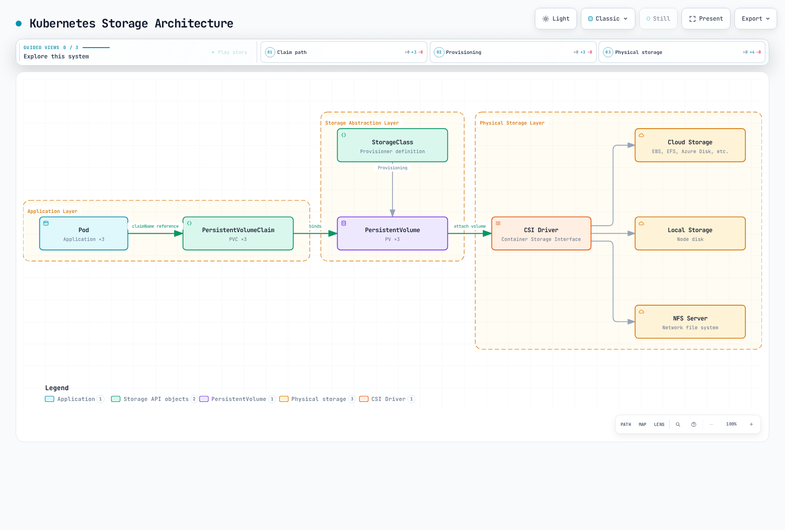
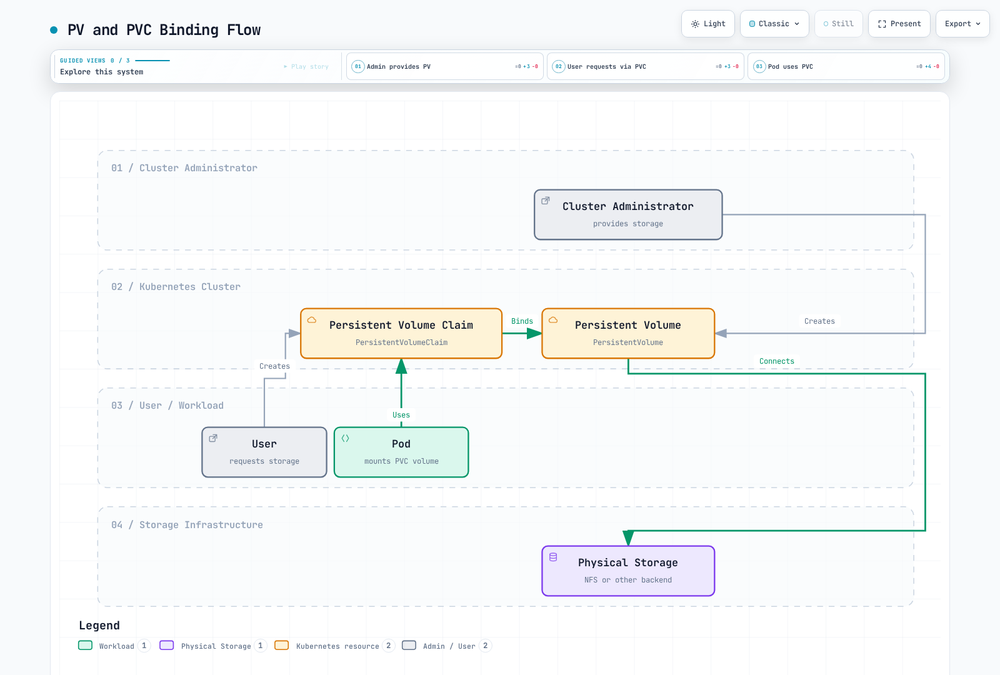
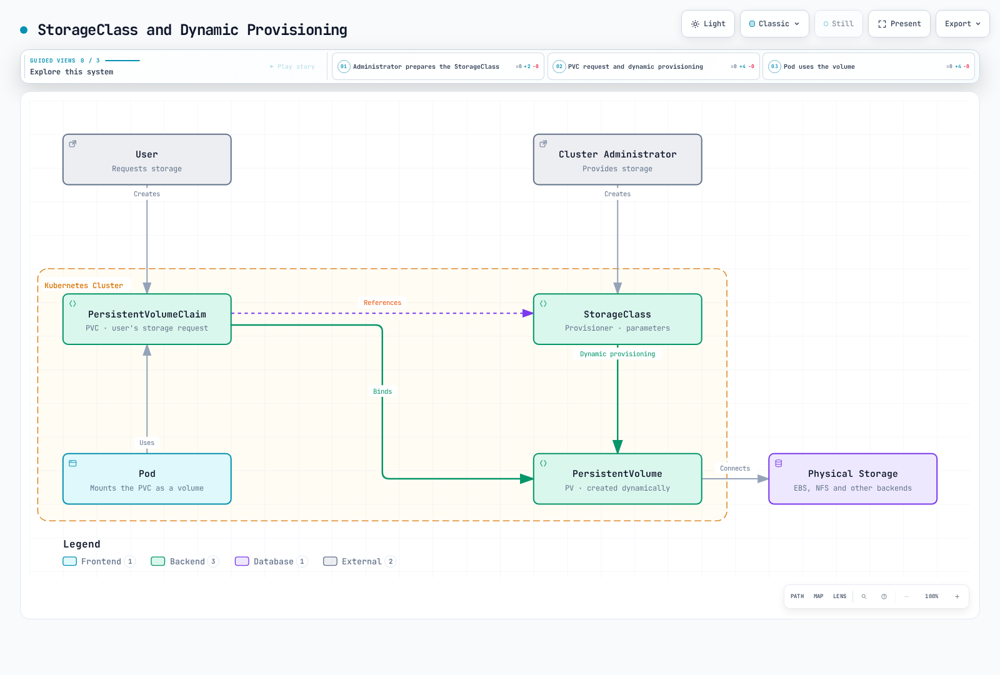
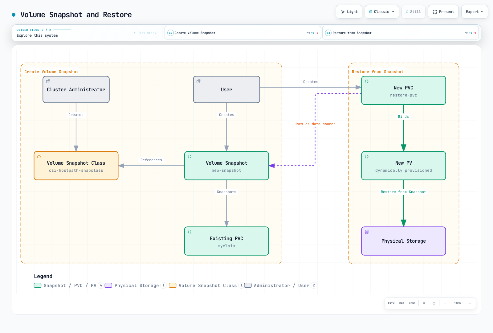

# ストレージ

> **対応バージョン**: Kubernetes 1.35、1.36、1.37
> **最終更新**: 2026年10月16日

Kubernetes では、コンテナ化されたアプリケーションのデータを保存・管理するうえで、ストレージが重要な役割を果たします。この章では、Volume、Persistent Volume、Persistent Volume Claim、StorageClass など、Kubernetes のストレージ概念を詳しく説明します。

## ラボ環境のセットアップ

このドキュメントの例を試すには、次のツールと環境が必要です。

### 必要なツール
- API server と同じ minor version か、1 つ以内の差にある kubectl
- 利用可能な Kubernetes クラスター（EKS、minikube、kind など）
- ストレージプロビジョナー（EKS では EBS CSI driver）

最初の例にはデフォルトの StorageClass が必要です。デフォルトがなければ、インストール済みの class を `storageClassName` に指定してください。以下の EKS EBS の例は、IAM 権限を設定した EC2 node 上で標準の EBS CSI driver を使います。Auto Mode では `ebs.csi.eks.amazonaws.com` を使います。EBS は Fargate や Hybrid Nodes にはマウントできません。後続の manifest は、それぞれに記載された前提条件を持つ独立した例として扱ってください。

### ストレージ例のセットアップ

```bash
# Create namespace
kubectl create namespace storage-demo

# Create a simple PVC and Pod
kubectl -n storage-demo apply -f - <<'EOF'
apiVersion: v1
kind: PersistentVolumeClaim
metadata:
  name: data-pvc
spec:
  accessModes:
    - ReadWriteOnce
  resources:
    requests:
      storage: 1Gi
---
apiVersion: v1
kind: Pod
metadata:
  name: data-pod
spec:
  containers:
  - name: data-container
    image: busybox
    command: ["sh", "-c", "while true; do echo $(date) >> /data/output.txt; sleep 5; done"]
    volumeMounts:
    - name: data-volume
      mountPath: /data
  volumes:
  - name: data-volume
    persistentVolumeClaim:
      claimName: data-pvc
EOF

# Check storage resources
kubectl -n storage-demo get pvc,pod
```

## 目次

1. [Volume](#volumes)
2. [Persistent Volume](#persistent-volumes)
3. [Persistent Volume Claim](#persistent-volume-claims)
4. [StorageClass](#storage-classes)
5. [動的プロビジョニング](#dynamic-provisioning)
6. [Volume Snapshot](#volume-snapshots)
7. [Volume の拡張](#volume-expansion)
8. [Projected Volume](#projected-volumes)
9. [Generic Ephemeral Volume](#generic-ephemeral-volumes)
10. [ブロック Volume モード](#block-volume-mode)
11. [Volume のクローン](#volume-cloning)
12. [ストレージ ResourceQuota](#storage-resourcequota)
13. [EKS のストレージ選択肢](#storage-options-in-eks)

## Volume {#volumes}

> **重要な概念**: Kubernetes の Volume は、Pod 内のコンテナがデータを保存・共有するための領域です。コンテナが再起動しても、Volume のデータは保持されます。

Kubernetes の Volume は、Pod 内のコンテナがデータを保存・共有するための領域です。マウントは Pod に属しますが、バックエンドデータがどれだけ保持されるかは Volume の種類によります。`emptyDir` のデータは Pod とともに削除されますが、永続ストレージは Pod の削除後も残る場合があります。

### Kubernetes ストレージアーキテクチャ



[🔍 インタラクティブな図を表示](https://www.atomai.click/kubernetes-docs/archmaps/en-core-04-storage-0.html)

### Volume が必要な理由

1. **コンテナ再起動後のデータ保持**: コンテナが再起動するとコンテナのファイルシステムは初期化されますが、Volume を使えばデータを保持できます。
2. **コンテナ間のデータ共有**: 同じ Pod 内の複数コンテナで Volume を共有できます。

### 主な Volume 種類の比較

| Volume の種類 | ライフサイクル | データの保持 | ユースケース | 特徴 |
|------------|----------|-----------------|----------|----------|
| **emptyDir** | Pod | 一時的 | 一時データ、cache、checkpoint | Pod の削除時にデータも削除 |
| **hostPath** | Node | Node 単位 | Node のファイルシステムへのアクセス、監視 | セキュリティリスクがあるため注意して使用 |
| **configMap** | 設定 | 設定データ | アプリケーション設定 | 設定データを Volume としてマウント |
| **secret** | 設定 | 機密データ | 証明書、password | 機密データを Volume としてマウント |
| **persistentVolumeClaim** | クラスター | 永続的 | database、file storage | Pod の再起動や再スケジュール後もデータを保持 |

### emptyDir

`emptyDir` Volume は Pod が Node に割り当てられた時点で作成され、その Node 上で Pod が実行されている間は存続します。Pod が Node から削除されると、`emptyDir` のデータも完全に削除されます。

```yaml
apiVersion: v1
kind: Pod
metadata:
  name: test-pd
spec:
  containers:
  - image: nginx
    name: test-container
    volumeMounts:
    - mountPath: /cache
      name: cache-volume
  volumes:
  - name: cache-volume
    emptyDir: {}
```

### hostPath

`hostPath` Volume は Node のファイルまたはディレクトリを Pod にマウントします。Node のファイルシステムにアクセスする必要がある Pod に便利ですが、セキュリティリスクがあるため慎重に使用してください。

```yaml
apiVersion: v1
kind: Pod
metadata:
  name: test-hostpath
spec:
  containers:
  - image: nginx
    name: test-container
    volumeMounts:
    - mountPath: /test-pd
      name: test-volume
  volumes:
  - name: test-volume
    hostPath:
      path: /data
      type: Directory  # DirectoryOrCreate, Directory, FileOrCreate, File, Socket, CharDevice, BlockDevice
```

```yaml
apiVersion: v1
kind: Pod
metadata:
  name: test-pd
spec:
  containers:
  - image: nginx
    name: test-container
    volumeMounts:
    - mountPath: /test-pd
      name: test-volume
  volumes:
  - name: test-volume
    hostPath:
      path: /data
      type: Directory
```

#### configMap

`configMap` Volume は ConfigMap のデータを Pod にマウントします。ConfigMap は key-value 形式で設定データを保存します。

```yaml
apiVersion: v1
kind: Pod
metadata:
  name: configmap-pod
spec:
  containers:
  - name: test
    image: busybox
    volumeMounts:
    - name: config-vol
      mountPath: /etc/config
  volumes:
  - name: config-vol
    configMap:
      name: log-config
      items:
      - key: log_level
        path: log_level
```

#### secret

`secret` Volume は Secret のデータを Pod にマウントします。Secret には password、token、key などの機密情報を保存します。

```yaml
apiVersion: v1
kind: Pod
metadata:
  name: secret-pod
spec:
  containers:
  - name: test
    image: busybox
    volumeMounts:
    - name: secret-vol
      mountPath: /etc/secret
      readOnly: true
  volumes:
  - name: secret-vol
    secret:
      secretName: mysecret
      items:
      - key: username
        path: my-username
```

#### nfs

`nfs` Volume は既存の NFS（Network File System）共有を Pod にマウントします。

```yaml
apiVersion: v1
kind: Pod
metadata:
  name: nfs-pod
spec:
  containers:
  - name: test
    image: busybox
    volumeMounts:
    - name: nfs-vol
      mountPath: /mnt/nfs
  volumes:
  - name: nfs-vol
    nfs:
      server: nfs-server.example.com
      path: /share
```

#### persistentVolumeClaim

`persistentVolumeClaim` Volume は PersistentVolumeClaim を Pod にマウントします。よく使われる Volume の種類の一つです。

```yaml
apiVersion: v1
kind: Pod
metadata:
  name: pvc-pod
spec:
  containers:
  - name: test
    image: busybox
    volumeMounts:
    - name: pvc-vol
      mountPath: /mnt/pvc
  volumes:
  - name: pvc-vol
    persistentVolumeClaim:
      claimName: my-pvc
```

#### CSI（Container Storage Interface）

CSI Volume は Kubernetes と外部ストレージシステムの間に標準インターフェイスを提供します。CSI を使えば、ストレージベンダーは Kubernetes のコードを変更せずに独自の driver を開発できます。

```yaml
apiVersion: v1
kind: Pod
metadata:
  name: csi-pod
spec:
  containers:
  - name: test
    image: busybox
    volumeMounts:
    - name: csi-vol
      mountPath: /mnt/csi
  volumes:
  - name: csi-vol
    csi:
      driver: csi-driver.example.com
      volumeAttributes:
        foo: bar
      nodePublishSecretRef:
        name: csi-secret
```

## Persistent Volume {#persistent-volumes}

Persistent Volume（PV）は、管理者がプロビジョニングするか、StorageClass を使って動的にプロビジョニングされるクラスターのストレージです。PV は Pod から独立したライフサイクルを持ち、Pod が削除されても残ります。



[🔍 インタラクティブな図を表示](https://www.atomai.click/kubernetes-docs/archmaps/en-core-04-storage-1.html)

### PV の作成

```yaml
apiVersion: v1
kind: PersistentVolume
metadata:
  name: pv0001
  labels:
    release: stable
    environment: dev
spec:
  capacity:
    storage: 10Gi
  volumeMode: Filesystem
  accessModes:
    - ReadWriteOnce
  persistentVolumeReclaimPolicy: Retain
  storageClassName: slow
  mountOptions:
    - hard
    - nfsvers=4.1
  nfs:
    path: /tmp
    server: 172.17.0.2
```

### PV のアクセスモード

PV は次のアクセスモードをサポートします。

- **ReadWriteOnce（RWO）**: 1 つの Node から読み書き可能な Volume としてマウントできます。
- **ReadOnlyMany（ROX）**: 複数の Node から読み取り専用でマウントできます。
- **ReadWriteMany（RWX）**: 複数の Node から読み書き可能な Volume としてマウントできます。
- **ReadWriteOncePod（RWOP）**: CSI のみでサポートされ、Kubernetes v1.29 から stable です。Volume を読み書き可能な形でマウントできる Pod を 1 つに制限します。

RWO が書き込み可能なマウントを制限するのは 1 つの **Node** であり、1 つの Pod ではありません。同じ Node 上の複数 Pod で Volume を共有できます。RWOP は、対応する CSI driver を使って、マウントできる Pod を 1 つに制限します。アクセスモードはファイルシステム権限の代わりにはなりません。

### PV の回収ポリシー

PV には次の回収ポリシーを設定できます。

- **Retain**: PVC を削除しても PV とデータを保持します。管理者が手動でクリーンアップします。
- **Delete**: PVC の削除時に PV と外部ストレージ資産を自動削除します。
- **Recycle**: PVC の削除時に PV 内のデータを削除して PV を再利用可能にします（非推奨）。

### PV の状態

PV は次の状態を取ります。

- **Available**: Claim にまだバインドされていない利用可能なリソース。
- **Bound**: Claim にバインド済み。
- **Released**: Claim は削除されましたが、クラスターによる再利用はまだ完了していません。
- **Failed**: 自動回収に失敗しました。

## Persistent Volume Claim {#persistent-volume-claims}

Persistent Volume Claim（PVC）は、ユーザーによるストレージ要求です。PVC がユーザーの要求手段であるのに対し、PV は管理者が提供するストレージです。

### PVC の作成

```yaml
apiVersion: v1
kind: PersistentVolumeClaim
metadata:
  name: myclaim
spec:
  accessModes:
    - ReadWriteOnce
  volumeMode: Filesystem
  resources:
    requests:
      storage: 8Gi
  storageClassName: slow
  selector:
    matchLabels:
      release: "stable"
    matchExpressions:
      - {key: environment, operator: In, values: [dev]}
```

### PVC と PV のバインド

PVC を作成すると、Kubernetes はストレージ容量、アクセスモード、StorageClass、selector などの条件を満たす PV を探してバインドします。一致する PV がなければ、適切な StorageClass によって動的にプロビジョニングできます。ただし、上の例のように PVC に空でない selector があると動的プロビジョニングは行われず、一致する静的 PV がなければ PVC は Pending のままです。`WaitForFirstConsumer` もスケジューリングが行われるまでバインドを意図的に遅らせます。

### PVC の使用

PVC は Pod の Volume として使用できます。

```yaml
apiVersion: v1
kind: Pod
metadata:
  name: mypod
spec:
  containers:
    - name: myfrontend
      image: nginx
      volumeMounts:
      - mountPath: "/var/www/html"
        name: mypd
  volumes:
    - name: mypd
      persistentVolumeClaim:
        claimName: myclaim
```

## StorageClass {#storage-classes}

StorageClass は管理者が提供するストレージの種類を表し、PV の動的プロビジョニングに使われます。



[🔍 インタラクティブな図を表示](https://www.atomai.click/kubernetes-docs/archmaps/en-core-04-storage-2.html)

### StorageClass の作成

```yaml
apiVersion: storage.k8s.io/v1
kind: StorageClass
metadata:
  name: standard
provisioner: ebs.csi.aws.com
parameters:
  type: gp3
  csi.storage.k8s.io/fstype: ext4
reclaimPolicy: Delete
allowVolumeExpansion: true
volumeBindingMode: WaitForFirstConsumer
```

この例では、AWS EBS gp3 Volume をプロビジョニングする StorageClass を作成します。

### プロビジョナー

StorageClass には Volume のプロビジョニングに使う provisioner を指定します。現在の CSI provisioner には次のものがあります。

- `ebs.csi.aws.com`: AWS EBS
- `efs.csi.aws.com`: AWS EFS
- `fsx.csi.aws.com`: FSx for Lustre
- `pd.csi.storage.gke.io`: Google Persistent Disk
- `disk.csi.azure.com` / `file.csi.azure.com`: Azure Disk / File
- `nfs.csi.k8s.io`: 既存の NFS server を必要とする NFS CSI driver

従来の in-tree cloud plugin は削除または移行されています。適切な CSI driver をインストールしてください。Kubernetes に組み込みの `kubernetes.io/nfs` 動的 provisioner はありません。

### Volume のバインドモード

StorageClass は次の Volume binding mode をサポートします。

- **Immediate**: デフォルトです。PVC を作成するとすぐに Volume をプロビジョニングします。
- **WaitForFirstConsumer**: Pod が PVC を使おうとするまでプロビジョニングを遅らせます。Pod と同じ zone に Volume を作成するのに役立ちます。

### デフォルト StorageClass

クラスターにはデフォルトの StorageClass を設定できます。PVC に StorageClass を指定しなければ、デフォルトの class が使われます。

```yaml
apiVersion: storage.k8s.io/v1
kind: StorageClass
metadata:
  name: standard
  annotations:
    storageclass.kubernetes.io/is-default-class: "true"
provisioner: ebs.csi.aws.com
parameters:
  type: gp3
  encrypted: "true"
volumeBindingMode: WaitForFirstConsumer
```

## 動的プロビジョニング {#dynamic-provisioning}

動的プロビジョニングは、PVC の作成時に PV を自動作成する機能です。管理者が事前に PV を作成しなくても、ユーザーは必要なときにストレージを要求できます。

### 動的プロビジョニングの例

1. StorageClass を作成します。

```yaml
apiVersion: storage.k8s.io/v1
kind: StorageClass
metadata:
  name: fast
provisioner: ebs.csi.aws.com
parameters:
  type: gp3
  iops: "3000"
  encrypted: "true"
allowVolumeExpansion: true
volumeBindingMode: WaitForFirstConsumer
```

2. PVC を作成します。

```yaml
apiVersion: v1
kind: PersistentVolumeClaim
metadata:
  name: myclaim
spec:
  accessModes:
    - ReadWriteOnce
  resources:
    requests:
      storage: 100Gi
  storageClassName: fast
```

3. Pod で PVC を使用します。

```yaml
apiVersion: v1
kind: Pod
metadata:
  name: mypod
spec:
  containers:
    - name: myfrontend
      image: nginx
      volumeMounts:
      - mountPath: "/var/www/html"
        name: mypd
  volumes:
    - name: mypd
      persistentVolumeClaim:
        claimName: myclaim
```

## Volume Snapshot {#volume-snapshots}

Kubernetes は PV の特定時点のコピーを Volume Snapshot として作成できます。バックアップや復元に利用できます。



[🔍 インタラクティブな図を表示](https://www.atomai.click/kubernetes-docs/archmaps/en-core-04-storage-3.html)

Snapshot CRD、snapshot controller、Snapshot に対応した CSI driver をインストールしてください。以下の例は EBS を使うため、元の PVC と復元先の StorageClass の両方で同じ driver が必要です。`readyToUse: true` を待ち、Snapshot の復元サイズ以上の容量を要求してください。ストレージの Snapshot だけでは database の整合性は保証されません。書き込みを停止するか、database 対応のバックアップを使ってください。

### VolumeSnapshotClass

```yaml
apiVersion: snapshot.storage.k8s.io/v1
kind: VolumeSnapshotClass
metadata:
  name: ebs-snapclass
driver: ebs.csi.aws.com
deletionPolicy: Delete
```

### Volume Snapshot の作成

```yaml
apiVersion: snapshot.storage.k8s.io/v1
kind: VolumeSnapshot
metadata:
  name: new-snapshot
spec:
  volumeSnapshotClassName: ebs-snapclass
  source:
    persistentVolumeClaimName: myclaim
```

### Snapshot から PVC を作成

```yaml
apiVersion: v1
kind: PersistentVolumeClaim
metadata:
  name: restore-pvc
spec:
  storageClassName: standard
  dataSource:
    name: new-snapshot
    kind: VolumeSnapshot
    apiGroup: snapshot.storage.k8s.io
  accessModes:
    - ReadWriteOnce
  resources:
    requests:
      storage: 100Gi
```

## Volume の拡張 {#volume-expansion}

PVC の容量は拡張できます。そのためには StorageClass で `allowVolumeExpansion: true` を設定する必要があります。


[🔍 インタラクティブな図を表示](https://www.atomai.click/kubernetes-docs/archmaps/en-core-04-storage-4.html)

### PVC の拡張

拡張に対応した EBS StorageClass 上の既存の 100Gi PVC では、要求サイズだけを変更します。

```bash
kubectl patch pvc myclaim --type merge -p '{"spec":{"resources":{"requests":{"storage":"120Gi"}}}}'
```

PVC の namespace と既存の StorageClass を使ってください。CSI driver とファイルシステムが拡張に対応している必要があります。縮小はできません。バインド済み PVC の StorageClass を変更したり、サイズ変更に見せかけて PV の容量を直接編集したりしないでください。

## Projected Volume {#projected-volumes}

Projected Volume を使うと、複数の Volume source を単一の mount にまとめられます。secret、configMap、downwardAPI、serviceAccountToken を同じディレクトリに公開する場合に便利です。

### サポートされる source

- **secret**: Secret データを mount
- **configMap**: 設定データを mount
- **downwardAPI**: Pod と container のメタデータを公開
- **serviceAccountToken**: 有効期限を設定できる ServiceAccount token を mount

### Projected Volume の例

```yaml
apiVersion: v1
kind: Pod
metadata:
  name: projected-volume-pod
spec:
  containers:
  - name: app
    image: busybox
    command: ["sh", "-c", "ls -la /etc/projected && sleep 3600"]
    volumeMounts:
    - name: all-in-one
      mountPath: /etc/projected
      readOnly: true
  volumes:
  - name: all-in-one
    projected:
      sources:
      - secret:
          name: db-credentials
          items:
          - key: username
            path: db/username
          - key: password
            path: db/password
      - configMap:
          name: app-config
          items:
          - key: config.yaml
            path: config/app.yaml
      - downwardAPI:
          items:
          - path: labels
            fieldRef:
              fieldPath: metadata.labels
          - path: cpu-request
            resourceFieldRef:
              containerName: app
              resource: requests.cpu
      - serviceAccountToken:
          path: token
          expirationSeconds: 3600
          audience: api
```

この設定では、次の内容を含む単一の Volume を `/etc/projected` に作成します。
- Secret から `/etc/projected/db/username` と `/etc/projected/db/password`
- ConfigMap から `/etc/projected/config/app.yaml`
- downwardAPI から `/etc/projected/labels` と `/etc/projected/cpu-request`
- 自動ローテーションされる ServiceAccount token を含む `/etc/projected/token`

### ServiceAccount token の Projection

ServiceAccount token の projection は、有効期間と audience が制限された token を提供します。

```yaml
apiVersion: v1
kind: Pod
metadata:
  name: token-projected-pod
spec:
  serviceAccountName: my-service-account
  containers:
  - name: app
    image: myapp:latest
    volumeMounts:
    - name: token
      mountPath: /var/run/secrets/tokens
  volumes:
  - name: token
    projected:
      sources:
      - serviceAccountToken:
          path: api-token
          expirationSeconds: 7200  # 2 hours
          audience: my-api-service
```

Projected token はローテーションされるため、アプリケーションはファイルを再読み込みする必要があります。明示した `audience` は利用する verifier と一致していなければなりません。Kubernetes API へのアクセスにも自動的に使えるわけではありません。

## Generic Ephemeral Volume {#generic-ephemeral-volumes}

Generic Ephemeral Volume は、Pod のライフサイクルに結び付いた PVC 相当のストレージを提供します。`emptyDir` と異なり、動的プロビジョニングを含む PVC と StorageClass の機能を利用できます。

### emptyDir との違い

| 項目 | emptyDir | Generic Ephemeral Volume |
|---------|----------|--------------------------|
| **ストレージバックエンド** | Node のローカルストレージまたはメモリ | 任意の CSI driver |
| **プロビジョニング** | 自動で簡単 | StorageClass による動的プロビジョニング |
| **サイズ制限** | `sizeLimit`（ソフト制限） | PVC の容量管理を利用 |
| **Snapshot** | 非対応 | CSI driver が対応すれば利用可能 |
| **ストレージ機能** | 基本機能 | 暗号化、IOPS など CSI の機能を利用 |
| **永続性** | Pod 削除時に消失 | PVC は Pod とともに削除されるが、バックエンドの扱いは reclaim policy に従う |

### Generic Ephemeral Volume の例

```yaml
apiVersion: v1
kind: Pod
metadata:
  name: ephemeral-volume-pod
spec:
  containers:
  - name: app
    image: busybox
    command: ["sh", "-c", "dd if=/dev/zero of=/scratch/data bs=1M count=100 && sleep 3600"]
    volumeMounts:
    - name: scratch
      mountPath: /scratch
  volumes:
  - name: scratch
    ephemeral:
      volumeClaimTemplate:
        metadata:
          labels:
            type: scratch-storage
        spec:
          accessModes:
          - ReadWriteOnce
          storageClassName: fast-ssd
          resources:
            requests:
              storage: 10Gi
```

### ユースケース

1. **CI/CD pipeline**: 容量が確保された一時的な build artifact
2. **データ処理**: 特定の性能要件を満たす scratch space
3. **テスト**: CSI 機能を使う一時的な database や cache
4. **機械学習**: 高性能ストレージ上の一時的な model checkpoint

### Generic Ephemeral Volume を使う Deployment

```yaml
apiVersion: apps/v1
kind: Deployment
metadata:
  name: ml-training
spec:
  replicas: 3
  selector:
    matchLabels:
      app: ml-training
  template:
    metadata:
      labels:
        app: ml-training
    spec:
      containers:
      - name: trainer
        image: ml-trainer:latest
        volumeMounts:
        - name: checkpoint-storage
          mountPath: /checkpoints
      volumes:
      - name: checkpoint-storage
        ephemeral:
          volumeClaimTemplate:
            spec:
              accessModes:
              - ReadWriteOnce
              storageClassName: high-iops
              resources:
                requests:
                  storage: 50Gi
```

Generic Ephemeral PVC は Pod が所有し、Pod とともに garbage collection されます。基盤データの削除は PV の reclaim policy に従います。`Retain` ではストレージが残り、手動のクリーンアップが必要です。Pod を失っても残す必要がある checkpoint は、永続ストレージに export してください。

## ブロック Volume モード {#block-volume-mode}

Kubernetes はファイルシステム Volume に加えて raw block Volume もサポートします。raw block Volume はファイルシステムを介さず、ストレージを block device として提供します。独自のデータ配置を管理するアプリケーションに適しています。

### Filesystem と Block モードの比較

| 項目 | Filesystem（デフォルト） | Block |
|--------|---------------------|-------|
| **volumeMode** | `Filesystem` | `Block` |
| **mount の種類** | ディレクトリとして mount | device file として公開 |
| **ファイルシステム** | ext4、xfs など | なし（raw） |
| **Pod 内のアクセス先** | `/mnt/data/` | `/dev/xvda` |
| **用途** | 一般的なアプリケーション | Database、専用アプリケーション |

### Block Volume の PV と PVC

```yaml
# PersistentVolume with Block mode
apiVersion: v1
kind: PersistentVolume
metadata:
  name: block-pv
spec:
  capacity:
    storage: 100Gi
  volumeMode: Block
  accessModes:
  - ReadWriteOnce
  persistentVolumeReclaimPolicy: Retain
  storageClassName: block-storage
  csi:
    driver: ebs.csi.aws.com
    volumeHandle: vol-0123456789abcdef0
  nodeAffinity:
    required:
      nodeSelectorTerms:
      - matchExpressions:
        - key: topology.kubernetes.io/zone
          operator: In
          values: [us-west-2a]
---
# PersistentVolumeClaim for Block volume
apiVersion: v1
kind: PersistentVolumeClaim
metadata:
  name: block-pvc
spec:
  volumeMode: Block
  accessModes:
  - ReadWriteOnce
  storageClassName: block-storage
  resources:
    requests:
      storage: 100Gi
```

### Pod で Block Volume を使う

```yaml
apiVersion: v1
kind: Pod
metadata:
  name: block-volume-pod
spec:
  containers:
  - name: database
    image: custom-database:latest
    volumeDevices:
    - name: data
      devicePath: /dev/xvda
  volumes:
  - name: data
    persistentVolumeClaim:
      claimName: block-pvc
```

注: Block Volume では `volumeMounts` と `mountPath` の代わりに `volumeDevices` と `devicePath` を使います。

### Block Volume のユースケース

1. **raw block device 専用のストレージエンジン**: raw device 向けに明示的に設計されたソフトウェアに限ります。通常の MySQL/PostgreSQL の data directory にはファイルシステムが必要です。
2. **独自ファイルシステム**: ZFS や LVM などの特殊なファイルシステムを使うアプリケーション
3. **高性能ストレージ**: ファイルシステムの overhead なしに直接 I/O を行う必要があるアプリケーション
4. **ストレージ仮想化**: software-defined storage ソリューション

静的 EBS volume ID と nodeAffinity の zone は、実際の Volume とその Availability Zone に置き換えてください。`custom-database` image は raw block device に対応するソフトウェアの placeholder です。

## Volume のクローン {#volume-cloning}

Volume cloning は既存 PVC の内容を持つ新しい PVC を作成します。テスト環境の作成、データの複製、ワークロードの移行に利用できます。

### 前提条件

EBS CSI は v1.51.0 から PVC cloning をサポートします（[version 固定の例](https://github.com/kubernetes-sigs/aws-ebs-csi-driver/blob/v1.67.0/examples/kubernetes/clone/README.md)）。導入済み driver の version と IAM 権限を確認してください。FSx for Lustre CSI は `CLONE_VOLUME` を公開していません。EFS も対応していると推測しないでください。`kubectl get csidriver` では CSI RPC capability を確認できません。

- CSI driver が Volume cloning に対応していること
- source と destination の PVC が同じ namespace にあること
- driver が対応していれば異なる StorageClass も使えます。source は Bound 状態で利用可能（使用中ではない）であること
- source と destination の `volumeMode` が同じであること

### PVC cloning の例

```yaml
# Source PVC (existing)
apiVersion: v1
kind: PersistentVolumeClaim
metadata:
  name: source-pvc
  namespace: production
spec:
  accessModes:
  - ReadWriteOnce
  storageClassName: ebs-sc
  resources:
    requests:
      storage: 100Gi
---
# Clone PVC using dataSource
apiVersion: v1
kind: PersistentVolumeClaim
metadata:
  name: cloned-pvc
  namespace: production
spec:
  accessModes:
  - ReadWriteOnce
  storageClassName: ebs-sc
  resources:
    requests:
      storage: 100Gi  # Must be >= source size
  dataSource:
    kind: PersistentVolumeClaim
    name: source-pvc
```

### Cloning と Snapshot の比較

| 項目 | Volume cloning | Volume Snapshot |
|---------|---------------|------------------|
| **結果** | データを持つ新しい PVC | Snapshot object |
| **用途** | 利用可能な source Volume の複製 | 特定時点のバックアップ |
| **性能** | driver/backend に依存 | driver/backend に依存 |
| **namespace 間の利用** | 不可 | 不可 |
| **ストレージ overhead** | backend に依存 | backend に依存 |

### テスト用に Clone を作成

最初に `staging` namespace で、Bound 状態かつ整合性の取れた `staging-source-pvc` を作成してください。`dataSource` から `production` の PVC を直接参照することはできません。Clone には互換性のある PostgreSQL data directory が既に入っている必要があります。以下は初期化の例ではありません。

```yaml
apiVersion: v1
kind: PersistentVolumeClaim
metadata:
  name: test-db-clone
  namespace: staging
spec:
  accessModes:
  - ReadWriteOnce
  storageClassName: ebs-sc
  resources:
    requests:
      storage: 100Gi
  dataSource:
    kind: PersistentVolumeClaim
    name: staging-source-pvc
---
apiVersion: v1
kind: Pod
metadata:
  name: test-database
  namespace: staging
spec:
  containers:
  - name: postgres
    image: postgres:15
    volumeMounts:
    - name: data
      mountPath: /var/lib/postgresql/data
  volumes:
  - name: data
    persistentVolumeClaim:
      claimName: test-db-clone
```

## ストレージ ResourceQuota {#storage-resourcequota}

ResourceQuota は、namespace 内の PVC 数やストレージ総容量など、ストレージ消費量を制限できます。

### ストレージ関連の Quota field

| Field | 説明 |
|-------|-------------|
| **persistentvolumeclaims** | 許可する PVC の総数 |
| **requests.storage** | すべての PVC が要求するストレージ容量の合計 |
| **\<storage-class\>.storageclass.storage.k8s.io/requests.storage** | 指定した StorageClass に対するストレージ容量 |
| **\<storage-class\>.storageclass.storage.k8s.io/persistentvolumeclaims** | 指定した StorageClass に対する PVC 数 |

### ResourceQuota の例

```yaml
apiVersion: v1
kind: ResourceQuota
metadata:
  name: storage-quota
  namespace: team-a
spec:
  hard:
    # Total limits
    persistentvolumeclaims: "10"
    requests.storage: "500Gi"

    # Per-StorageClass limits
    ebs-sc.storageclass.storage.k8s.io/requests.storage: "200Gi"
    ebs-sc.storageclass.storage.k8s.io/persistentvolumeclaims: "5"

    efs-sc.storageclass.storage.k8s.io/requests.storage: "300Gi"
    efs-sc.storageclass.storage.k8s.io/persistentvolumeclaims: "5"
```

### ResourceQuota の状態を確認

```bash
# View quota status
kubectl get resourcequota storage-quota -n team-a -o yaml

# Example output
status:
  hard:
    persistentvolumeclaims: "10"
    requests.storage: "500Gi"
  used:
    persistentvolumeclaims: "3"
    requests.storage: "150Gi"
```

### ストレージの LimitRange

LimitRange は PVC の要求容量の最小値と最大値を適用できますが、PVC に要求値がない場合の default は設定しません。

```yaml
apiVersion: v1
kind: LimitRange
metadata:
  name: storage-limits
  namespace: team-a
spec:
  limits:
  - type: PersistentVolumeClaim
    min:
      storage: 1Gi
    max:
      storage: 100Gi
```

次の制約が適用されます。
- PVC の最小サイズは 1Gi
- PVC の最大サイズは 100Gi
- 各 PVC でストレージ容量を明示的に要求する必要があります。LimitRange による PVC の default 設定はありません。

## EKS のストレージ選択肢 {#storage-options-in-eks}

Amazon EKS では複数のストレージを利用できます。それぞれ用途と性能特性が異なるため、アプリケーションの要件に合ったものを選びます。


[🔍 インタラクティブな図を表示](https://www.atomai.click/kubernetes-docs/archmaps/en-core-04-storage-5.html)

### Amazon EBS

Amazon EBS（Elastic Block Store）は EC2 instance に接続するブロックストレージ Volume を提供します。EKS では EBS CSI driver を使って EBS Volume を Kubernetes Pod にマウントできます。

#### EBS CSI driver のインストール

PVC を作る前に、互換性のある add-on/driver version を選び、IAM role と node の前提条件を設定して、[EKS driver インストールガイド](https://docs.aws.amazon.com/eks/latest/userguide/ebs-csi.html)に従ってください。StorageClass を作成しても driver はインストールされません。

#### EBS StorageClass

```yaml
apiVersion: storage.k8s.io/v1
kind: StorageClass
metadata:
  name: ebs-sc
provisioner: ebs.csi.aws.com
parameters:
  type: gp3
  csi.storage.k8s.io/fstype: ext4
  encrypted: "true"
volumeBindingMode: WaitForFirstConsumer
```

#### EBS Volume の種類

Amazon EBS には次の Volume 種類があります。

1. **gp3**: 多くの workload に適した汎用 SSD です。基準性能は 3,000 IOPS、125 MiB/s です。現在のリージョン別上限は最大 80,000 IOPS、2,000 MiB/s ですが、容量と IOPS の比率、instance の上限が適用されます。Outposts の上限はより低くなります（[AWS 仕様](https://docs.aws.amazon.com/ebs/latest/userguide/general-purpose.html)）。

2. **io2**: 高 IOPS を必要とする workload 向けの高性能 SSD です。対応する Nitro instance 上の io2 Block Express は最大 1,000 IOPS/GiB、256,000 IOPS をサポートしますが、instance と Volume の上限が適用されます（[AWS 仕様](https://docs.aws.amazon.com/ebs/latest/userguide/provisioned-iops.html)）。

3. **st1**: big data、data warehouse、log 処理など、スループットを重視する workload 向けの HDD です。

4. **sc1**: アクセス頻度の低いデータ向けの低温 HDD です。

#### EBS gp3 StorageClass の例

```yaml
apiVersion: storage.k8s.io/v1
kind: StorageClass
metadata:
  name: ebs-gp3
provisioner: ebs.csi.aws.com
parameters:
  type: gp3
  iops: "3000"
  throughput: "125"
  encrypted: "true"
  kmsKeyId: "arn:aws:kms:us-west-2:111122223333:key/1234abcd-12ab-34cd-56ef-1234567890ab"
volumeBindingMode: WaitForFirstConsumer
```

#### EBS io2 StorageClass の例

```yaml
apiVersion: storage.k8s.io/v1
kind: StorageClass
metadata:
  name: ebs-io2
provisioner: ebs.csi.aws.com
parameters:
  type: io2
  iops: "10000"
  encrypted: "true"
volumeBindingMode: WaitForFirstConsumer
```

### Amazon EFS

Amazon EFS（Elastic File System）は、複数の EC2 instance から同時にアクセスできるスケーラブルな file storage です。EFS は ReadWriteMany access mode をサポートするため、複数 Pod で Volume を共有する用途に使えます。

#### EFS CSI driver のインストール

PVC を作る前に、互換性のある add-on/driver version を選び、IAM role と node の前提条件を設定して、[EKS driver インストールガイド](https://docs.aws.amazon.com/eks/latest/userguide/efs-csi.html)に従ってください。StorageClass を作成しても driver はインストールされません。

#### EFS file system の作成

EFS file system は AWS Management Console、AWS CLI、または AWS CloudFormation で作成できます。

AWS CLI の例:

```bash
# Create EFS file system
aws efs create-file-system \
  --creation-token eks-efs \
  --performance-mode generalPurpose \
  --encrypted \
  --throughput-mode bursting \
  --tags Key=Name,Value=EKS-EFS

# Store file system ID
FS_ID=$(aws efs describe-file-systems \
  --creation-token eks-efs \
  --query "FileSystems[0].FileSystemId" \
  --output text)

# Create one mount target per Availability Zone
aws efs create-mount-target \
  --file-system-id "$FS_ID" \
  --subnet-id subnet-0eabfaa81fb22bcaf \
  --security-groups sg-068000ccf82dfba88
```

#### EFS StorageClass

```yaml
apiVersion: storage.k8s.io/v1
kind: StorageClass
metadata:
  name: efs-sc
provisioner: efs.csi.aws.com
parameters:
  provisioningMode: efs-ap
  fileSystemId: fs-1234abcd
  directoryPerms: "700"
```

#### EFS Access Point と PV/PVC

```yaml
# Persistent Volume
apiVersion: v1
kind: PersistentVolume
metadata:
  name: efs-pv
spec:
  capacity:
    storage: 5Gi
  volumeMode: Filesystem
  accessModes:
    - ReadWriteMany
  persistentVolumeReclaimPolicy: Retain
  storageClassName: efs-sc
  csi:
    driver: efs.csi.aws.com
    volumeHandle: fs-1234abcd::fsap-0123456789abcdef
---
# Persistent Volume Claim
apiVersion: v1
kind: PersistentVolumeClaim
metadata:
  name: efs-pvc
spec:
  accessModes:
    - ReadWriteMany
  storageClassName: efs-sc
  resources:
    requests:
      storage: 5Gi
```

Filesystem ID と Access Point ID を実値に置き換え、client security group から mount target への NFS TCP 2049 を許可してください。動的プロビジョニングで作成されるのは既存 file system 上の Access Point であり、file system 自体ではありません。EFS PVC の容量要求は binding に使う値であり、PVC 単位の quota ではありません。EFS の容量は伸縮します。Fargate で使えるのは静的な EFS プロビジョニングのみです。

#### EFS の性能モード

EFS には 2 つの性能モードがあります。

1. **General Purpose**: ほとんどの file system workload に推奨されるデフォルトで、低 latency を提供します。

2. **Max I/O**: 旧世代のモードで、1 回の operation あたりの latency が高くなります。新しい workload には AWS が General Purpose を推奨します。Max I/O は Elastic throughput と併用できません。

#### EFS のスループットモード

EFS には 3 つのスループットモードがあります。

1. **Bursting**: file system のサイズを基に基準スループットが割り当てられ、burst credit によって一時的に高いスループットを利用できます。

2. **Provisioned**: file system のサイズによらず、指定したスループットを提供します。

3. **Elastic**: workload に応じてスループットを自動的に増減します。

### Amazon FSx for Lustre

Amazon FSx for Lustre は HPC 向けの高性能 file system です。大規模データ処理、機械学習、分析 workload に適しています。

#### FSx for Lustre CSI driver のインストール

PVC を作る前に、互換性のある add-on/driver version を選び、IAM role と node の前提条件を設定して、[EKS driver インストールガイド](https://docs.aws.amazon.com/eks/latest/userguide/fsx-csi-create.html)に従ってください。StorageClass を作成しても driver はインストールされません。

#### FSx for Lustre file system の作成

AWS CLI の例:

```bash
aws fsx create-file-system \
  --file-system-type LUSTRE \
  --storage-capacity 1200 \
  --subnet-ids subnet-0eabfaa81fb22bcaf \
  --lustre-configuration DeploymentType=SCRATCH_2
```

#### FSx for Lustre StorageClass

```yaml
apiVersion: storage.k8s.io/v1
kind: StorageClass
metadata:
  name: fsx-sc
provisioner: fsx.csi.aws.com
parameters:
  subnetId: subnet-0eabfaa81fb22bcaf
  securityGroupIds: sg-068000ccf82dfba88
  deploymentType: SCRATCH_2
  dataCompressionType: "NONE"
  weeklyMaintenanceStartTime: "7:09:00"
```

#### FSx for Lustre のデプロイタイプ

FSx for Lustre には scratch と persistent のストレージがあります。

- **SCRATCH_1 / SCRATCH_2**: データ複製のない一時ストレージです。file server が故障しても置き換えられず、影響を受けたデータは失われる可能性があります。SCRATCH_2 もそのデータを自動復旧しません。
- **PERSISTENT_1 / PERSISTENT_2**: 自動的な component 交換を備えた複製ストレージです。利用できる StorageClass、容量増分、スループット設定、リージョンはデプロイタイプにより異なります。

Scratch の基準スループットは 200 MBps/TiB で、最大 6 倍まで burst できます。`PerUnitStorageThroughput` は persistent SSD/HDD 用で、SCRATCH_2 には使いません。Persistent SSD は PERSISTENT_1 で 50/100/200 MBps/TiB、PERSISTENT_2 で 125/250/500/1000 MBps/TiB の設定があります。Intelligent-Tiering は容量とスループットの設定方法が異なります。サイズを決める前に、[デプロイ仕様](https://docs.aws.amazon.com/fsx/latest/LustreGuide/using-fsx-lustre.html)と API を確認してください。

### vLLM workload 向け FSx for Lustre の構成

vLLM は LLM の推論・serve engine です。vLLM のような大規模 AI model workload には、高スループットかつ低 latency のストレージが必要です。FSx for Lustre はこの要件を満たす有力な選択肢です。

#### vLLM 用 FSx for Lustre StorageClass

```yaml
apiVersion: storage.k8s.io/v1
kind: StorageClass
metadata:
  name: fsx-lustre-vllm
provisioner: fsx.csi.aws.com
parameters:
  subnetId: subnet-0eabfaa81fb22bcaf
  securityGroupIds: sg-068000ccf82dfba88
  deploymentType: PERSISTENT_1
  perUnitStorageThroughput: "200"
  dataCompressionType: "NONE"
reclaimPolicy: Retain
volumeBindingMode: Immediate
```

FSx CSI driver は StorageClass の `storageCapacity` parameter ではなく、PVC の要求値から容量を決定します。subnet/security group ID を実環境の値に置き換え、互換性のある Lustre client と CSI driver をインストールし、選択したデプロイタイプで要求容量が有効か確認してください。下の inference image は placeholder であり、model serving command を含む image に置き換える必要があります。

#### vLLM workload 用 PVC

```yaml
apiVersion: v1
kind: PersistentVolumeClaim
metadata:
  name: vllm-model-storage
spec:
  accessModes:
    - ReadWriteMany
  resources:
    requests:
      storage: 4800Gi
  storageClassName: fsx-lustre-vllm
```

#### vLLM Deployment の例

```yaml
apiVersion: apps/v1
kind: Deployment
metadata:
  name: vllm-inference
spec:
  replicas: 1
  selector:
    matchLabels:
      app: vllm-inference
  template:
    metadata:
      labels:
        app: vllm-inference
    spec:
      nodeSelector:
        node.kubernetes.io/instance-type: g5.12xlarge
      containers:
      - name: vllm
        image: vllm-inference:latest
        resources:
          limits:
            nvidia.com/gpu: 4
          requests:
            nvidia.com/gpu: 4
            memory: "64Gi"
            cpu: "32"
        volumeMounts:
        - name: model-storage
          mountPath: /models
      volumes:
      - name: model-storage
        persistentVolumeClaim:
          claimName: vllm-model-storage
```

#### vLLM の性能を調整するヒント

1. **適切なスループットの選択**: model load の同時実行数と dataset access を測定し、その結果を基に選びます。
2. **ストレージ容量の調整**: model と dataset のサイズを考慮して必要量を割り当てます。
3. **ネットワークの調整**: FSx for Lustre file system と EKS node を同じ Availability Zone に配置します。
4. **instance type の選択**: vLLM の性能評価には、g5.12xlarge などの GPU instance を使います。
5. **メモリの設定**: model size に応じて十分なメモリを割り当てます。
6. **file system の mount option**: 性能要件に合った mount option を使います。

   ```bash
   mount -t lustre -o noatime,flock fs-1234abcd.fsx.us-west-2.amazonaws.com@tcp:/fsx /mnt/fsx
   ```

### ストレージ選択肢の比較

| ストレージ | アクセスモード | ユースケース | 性能 | コスト | 拡張性 |
|---------------|-------------|----------|-------------|------|-------------|
| Amazon EBS | ReadWriteOnce | 1 つの Node にマウントする block storage | 中～高 | 中 | 限定的（単一 Node） |
| Amazon EFS | ReadWriteMany | 複数 Pod で共有する file storage | 中 | 中～高 | 高（複数 Node） |
| Amazon FSx for Lustre | ReadWriteMany | HPC、機械学習、分析 | 非常に高い | 高 | 非常に高い（並列アクセス） |

### EKS ストレージ選択ガイド

1. **1 つの Node にマウントする block storage が必要な場合**: Amazon EBS
   - Database
   - Stateful application
   - 単一 Node で実行する workload

2. **複数の Pod で共有する file storage が必要な場合**: Amazon EFS
   - Web server のコンテンツ
   - 共有設定ファイル
   - 中規模のデータ処理

3. **高性能な file storage が必要な場合**: Amazon FSx for Lustre
   - 大規模なデータ処理
   - 機械学習と AI workload（vLLM など）
   - HPC
   - big data 分析

## まとめ

この章では Kubernetes のストレージ概念を学びました。Volume は Pod 内のコンテナがデータを保存・共有する方法を提供し、PV と PVC は Pod とは独立したライフサイクルを持つストレージを提供します。StorageClass を使うと、動的プロビジョニングによって必要なときにストレージを要求できます。

EKS では Amazon EBS、Amazon EFS、Amazon FSx for Lustre などを利用でき、それぞれ用途と性能特性が異なります。大規模 AI model workload である vLLM には、高スループットと低 latency を備える FSx for Lustre が適した選択肢です。FSx for Lustre は複数 Node から同時にデータへアクセスできる並列 file system で、大規模 model の学習や推論に利用できます。

アプリケーションの要件に合わせてストレージを選んでください。1 つの Node にマウントする block storage には Amazon EBS、複数 Pod で共有する file storage には Amazon EFS、高性能 file storage には Amazon FSx for Lustre を検討します。

次の章では Kubernetes の設定と Secret を学びます。

## クイズ

この章の内容を確認するには、[ストレージクイズ](../quizzes/core/04-storage-quiz.md)に挑戦してください。

## 参考資料

- [Kubernetes 公式ドキュメント - Volume](https://kubernetes.io/docs/concepts/storage/volumes/)
- [Kubernetes 公式ドキュメント - Persistent Volume](https://kubernetes.io/docs/concepts/storage/persistent-volumes/)
- [Kubernetes 公式ドキュメント - StorageClass](https://kubernetes.io/docs/concepts/storage/storage-classes/)
- [Kubernetes 公式ドキュメント - Volume Snapshot](https://kubernetes.io/docs/concepts/storage/volume-snapshots/)
- [AWS EBS CSI Driver](https://github.com/kubernetes-sigs/aws-ebs-csi-driver)
- [AWS EFS CSI Driver](https://github.com/kubernetes-sigs/aws-efs-csi-driver)
- [AWS FSx for Lustre CSI Driver](https://github.com/kubernetes-sigs/aws-fsx-csi-driver)
- [AWS Blog - LLM 推論 workload のスケーリング: Amazon EKS で TensorRT-LLM と Triton を使うマルチノードデプロイ](https://aws.amazon.com/ko/blogs/hpc/scaling-your-llm-inference-workloads-multi-node-deployment-with-tensorrt-llm-and-triton-on-amazon-eks/)
- [AWS Workshop - GenAI FSx EKS](https://catalog.workshops.aws/genaifsxeks/en-US/200-module2-genai/210-deploy)
