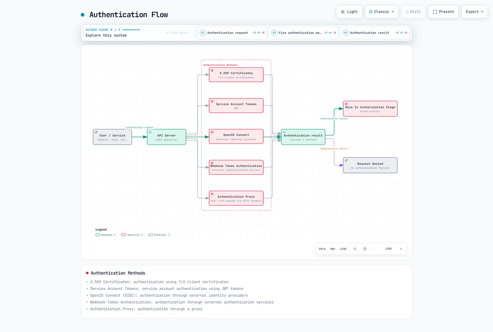

# Kubernetes のセキュリティ

> **対応バージョン**: Kubernetes 1.35、1.36、1.37
> **最終更新日**: 2026 年 10 月 16 日

Kubernetes では、クラスターとアプリケーションを保護するためにセキュリティが重要です。この章では、Kubernetes のセキュリティ概念、認証と認可の仕組み、ネットワークポリシー、セキュリティコンテキスト、および Amazon EKS のセキュリティを強化する方法を説明します。

## ラボ環境のセットアップ

このドキュメントの例を試すには、次のツールと環境が必要です。

### 必要なツール

- API server と同じ minor version か、1 minor version 以内の `kubectl`
- 動作する Kubernetes クラスター（EKS、minikube、kind など）
- 証明書作成用の OpenSSL

### セキュリティ例のセットアップ

```bash
# Create namespace
kubectl create namespace security-demo

# Create service account
kubectl -n security-demo create serviceaccount demo-sa

# Create role
kubectl -n security-demo apply -f - <<EOF
apiVersion: rbac.authorization.k8s.io/v1
kind: Role
metadata:
  name: pod-reader
rules:
- apiGroups: [""]
  resources: ["pods"]
  verbs: ["get", "watch", "list"]
EOF

# Create role binding
kubectl -n security-demo apply -f - <<EOF
apiVersion: rbac.authorization.k8s.io/v1
kind: RoleBinding
metadata:
  name: read-pods
subjects:
- kind: ServiceAccount
  name: demo-sa
  namespace: security-demo
roleRef:
  kind: Role
  name: pod-reader
  apiGroup: rbac.authorization.k8s.io
EOF

# Create Pod with security context
kubectl -n security-demo apply -f - <<EOF
apiVersion: v1
kind: Pod
metadata:
  name: security-context-demo
spec:
  serviceAccountName: demo-sa
  securityContext:
    runAsUser: 1000
    runAsGroup: 3000
    fsGroup: 2000
    runAsNonRoot: true
    seccompProfile:
      type: RuntimeDefault
  containers:
  - name: sec-ctx-demo
    image: busybox
    command: ["sh", "-c", "sleep 3600"]
    securityContext:
      allowPrivilegeEscalation: false
      readOnlyRootFilesystem: true
EOF
```

## Kubernetes セキュリティアーキテクチャ


[🔍 インタラクティブな図を見る](https://www.atomai.click/kubernetes-docs/archmaps/en-core-06-security-0.html)

## 目次

1. [セキュリティの概要](#security-overview)
2. [認証](#authentication)
3. [認可](#authorization)
4. [セキュリティコンテキスト](#security-context)
5. [ネットワークポリシー](#network-policy)
6. [Secret の管理](#secret-management)
7. [イメージセキュリティ](#image-security)
8. [Pod Security Standards](#pod-security-standards)
9. [監査](#audit)
10. [Amazon EKS におけるセキュリティ強化](#amazon-eks-security-enhancement)

## セキュリティの概要 {#security-overview}

> **重要な概念**: Kubernetes のセキュリティは多層防御の考え方に基づき、インフラストラクチャ、クラスター、ワークロードの各レベルで複数の保護手段を提供します。

Kubernetes のセキュリティは、主に次の領域で構成されます。

### セキュリティ領域の比較

| セキュリティ領域 | 主なコンポーネント | 担当者 | セキュリティの仕組み |
|--------------|-----------------|-------------------|---------------------|
| **インフラストラクチャのセキュリティ** | ホスト OS、コンテナランタイム、ネットワーク | クラスター管理者 | ファイアウォール、OS の堅牢化、コンテナランタイムのセキュリティ |
| **クラスターのセキュリティ** | API server、etcd、kubelet | クラスター管理者 | 認証、認可、Admission Control、暗号化 |
| **ワークロードのセキュリティ** | Pod、コンテナ、Service | アプリケーション開発者 | セキュリティコンテキスト、ネットワークポリシー、RBAC |

### セキュリティの原則

1. **最小権限の原則**: 必要な権限だけを付与する
2. **多層防御**: 複数のセキュリティ層で防御する
3. **デフォルト拒否**: 明示的に許可されていない通信や操作は拒否する
4. **セキュリティの堅牢化**: 既定値より強固なセキュリティ設定を適用する
5. **継続的な監視**: セキュリティイベントを検知し、対応する

## 認証 {#authentication}

Kubernetes API server にアクセスするには、認証を通過する必要があります。Kubernetes は複数の認証方式をサポートしています。



[🔍 インタラクティブな図を見る](https://www.atomai.click/kubernetes-docs/archmaps/en-core-06-security-1.html)

### X.509 証明書

Kubernetes は TLS 証明書でクライアントを認証します。これは主にクラスター内部の通信と管理者の認証に使用されます。

```bash
# Example kubeconfig setup for certificate-based authentication
kubectl config set-credentials admin --client-certificate=admin.crt --client-key=admin.key
```

### ServiceAccount token

ServiceAccount は、Pod 内で実行されるプロセスが API server と通信するために使うアカウントです。現在の Pod には通常、TokenRequest API を通じて有効期間が短く Pod に紐づいた投影 token が渡されます。kubelet が token をローテーションするため、アプリケーションは token ファイルを再読み込みする必要があります。v1.24 以降、ServiceAccount を作成しても有効期間の長い token Secret は自動作成されません。この Web server の例のように API 資格情報が不要な場合は、`automountServiceAccountToken: false` を設定してください。短期 token を明示的に作成するには `kubectl create token` を使用します。有効期間の長い token Secret はレガシーな例外です。

```yaml
apiVersion: v1
kind: ServiceAccount
metadata:
  name: my-service-account
  namespace: default
```

```yaml
apiVersion: v1
kind: Pod
metadata:
  name: my-pod
spec:
  serviceAccountName: my-service-account
  automountServiceAccountToken: false
  containers:
  - name: my-container
    image: nginx:1.30.6
```

### OpenID Connect（OIDC）

Google や Microsoft Entra ID などの外部 Identity Provider を介した認証をサポートします。企業環境で Single Sign-On（SSO）を実現する場合に有用です。

Identity Provider に対応する、信頼済みの client-go ExecCredential ログインプラグインを設定し、そのログイン手順を完了してください。この kubeconfig の user 部分には実行ファイルの placeholder があるため、インストール済みプラグインと、その公式手順に記載された引数に置き換えます。EKS の IAM 認証は、たとえば `aws eks get-token` で AWS 署名付き token を使用します。IAM を汎用の OIDC Identity Provider として使うわけではありません。

```yaml
users:
- name: oidc-user
  user:
    exec:
      apiVersion: client.authentication.k8s.io/v1
      command: oidc-login-helper
      interactiveMode: IfAvailable
      provideClusterInfo: true
```

### Webhook token 認証

外部の認証サービスを使って token を検証する方式です。API server は token を外部サービスに転送し、サービスは token を検証してユーザー情報を返します。

### 認証プロキシ

API server の手前に認証プロキシを配置し、ユーザー認証を処理する方式です。プロキシは認証済みユーザーの情報を HTTP header に含めて API server に転送します。

## 認可 {#authorization}

認証が「誰であるか」を検証するプロセスであるのに対し、認可は「何を実行できるか」を判断するプロセスです。Kubernetes は複数の認可モードをサポートしています。


[🔍 インタラクティブな図を見る](https://www.atomai.click/kubernetes-docs/archmaps/en-core-06-security-2.html)

### RBAC（Role-Based Access Control）

RBAC は Kubernetes で最も広く使われる認可方式です。Role と RoleBinding を使い、特定のリソースに対する権限をユーザーまたは ServiceAccount に付与します。

#### Role と ClusterRole

Role は名前空間スコープです。ClusterRole はクラスター全体のスコープで、名前空間スコープまたはクラスター全体の権限を記述できます。どちらも定義しただけではアクセス権を付与しません。RoleBinding は自分の名前空間内でのアクセスに制限し、ClusterRoleBinding はクラスター全体へのアクセスを付与します。

```yaml
# Namespace Role example
apiVersion: rbac.authorization.k8s.io/v1
kind: Role
metadata:
  namespace: default
  name: pod-reader
rules:
- apiGroups: [""]
  resources: ["pods"]
  verbs: ["get", "watch", "list"]
```

```yaml
# Cluster-wide ClusterRole example
apiVersion: rbac.authorization.k8s.io/v1
kind: ClusterRole
metadata:
  name: node-reader
rules:
- apiGroups: [""]
  resources: ["nodes"]
  verbs: ["get", "watch", "list"]
```

#### RoleBinding と ClusterRoleBinding

RoleBinding は、特定の名前空間で Role または ClusterRole をユーザー、グループ、ServiceAccount に紐づけます。ClusterRoleBinding は、ClusterRole をクラスター全体のユーザー、グループ、ServiceAccount に紐づけます。

```yaml
# RoleBinding example
apiVersion: rbac.authorization.k8s.io/v1
kind: RoleBinding
metadata:
  name: read-pods
  namespace: default
subjects:
- kind: User
  name: jane
  apiGroup: rbac.authorization.k8s.io
roleRef:
  kind: Role
  name: pod-reader
  apiGroup: rbac.authorization.k8s.io
```

```yaml
# ClusterRoleBinding example
apiVersion: rbac.authorization.k8s.io/v1
kind: ClusterRoleBinding
metadata:
  name: read-nodes-global
subjects:
- kind: Group
  name: node-viewers
  apiGroup: rbac.authorization.k8s.io
roleRef:
  kind: ClusterRole
  name: node-reader
  apiGroup: rbac.authorization.k8s.io
```

### ABAC（Attribute-Based Access Control）

ABAC は、ユーザー、リソース、環境などの属性に基づいて権限を付与する方式です。Kubernetes では JSON file でポリシーを定義します。RBAC より柔軟ですが、管理が複雑なため、RBAC ほど一般的ではありません。

### Node 認可

Node 認可は、kubelet が API server にアクセスするときに使われる専用の認可モードです。kubelet は、自身が稼働する Node に関係するリソース（Pod、Node status など）だけにアクセスできます。

### Webhook 認可

外部サービスを通じて認可を判断する方式です。API server は認可要求を外部サービスに転送し、そのサービスが要求を許可するか拒否するかを判断します。

## セキュリティコンテキスト {#security-context}

セキュリティコンテキストは、Pod またはコンテナ単位のセキュリティ設定を定義します。これにより、権限、アクセス制御、capability などを細かく制御できます。


[🔍 インタラクティブな図を見る](https://www.atomai.click/kubernetes-docs/archmaps/en-core-06-security-3.html)

### Pod のセキュリティコンテキスト

```yaml
apiVersion: v1
kind: Pod
metadata:
  name: security-context-pod
spec:
  securityContext:
    runAsUser: 1000
    runAsGroup: 3000
    fsGroup: 2000
    runAsNonRoot: true
    seccompProfile:
      type: RuntimeDefault
  containers:
  - name: security-context-container
    image: busybox:1.36
    command: ["sh", "-c", "sleep 3600"]
    securityContext:
      allowPrivilegeEscalation: false
      capabilities:
        drop:
        - ALL
      readOnlyRootFilesystem: true
```

上の例では:

- `runAsUser`: コンテナプロセスを実行する User ID
- `runAsGroup`: コンテナプロセスを実行する Group ID
- `fsGroup`: volume にアクセスする際に使う Group ID
- `allowPrivilegeEscalation`: 親プロセスより多くの権限をプロセスが取得できるかどうか
- `capabilities`: Linux kernel capability を追加または削除する
- `readOnlyRootFilesystem`: root filesystem を read-only で mount する

### Pod Security Standards

PodSecurityPolicy は v1.25 で削除されました。v1.25 で安定版となった Pod Security Admission は、namespace label を通じて Pod Security Standards を適用できます。これらはポリシー定義であり、`PodSecurityStandard` という API resource ではありません。3 つのレベルがあります。

1. **Privileged**: 制限なし。すべての権限を許可
2. **Baseline**: 既知の権限昇格経路を遮断
3. **Restricted**: 強固に制限したセキュリティポリシー

```yaml
# Example applying Pod Security Standards to namespace
apiVersion: v1
kind: Namespace
metadata:
  name: my-namespace
  labels:
    pod-security.kubernetes.io/enforce: restricted
    pod-security.kubernetes.io/audit: restricted
    pod-security.kubernetes.io/warn: restricted
```

Restricted な Linux ワークロードでは、`runAsNonRoot: true`、`allowPrivilegeEscalation: false`、許可された seccomp profile、capability の削除、および host access の制限が必要です。`readOnlyRootFilesystem` は有用な堅牢化ですが、Restricted で必須ではありません。ポリシーバージョンを固定する場合は、namespace label の `*-version` を指定してください。

## ネットワークポリシー {#network-policy}

ネットワークポリシーを使うと Pod 間の通信を制御できます。既定ではクラスター内のすべての Pod が相互に通信できますが、ネットワークポリシーで制限できます。


[🔍 インタラクティブな図を見る](https://www.atomai.click/kubernetes-docs/archmaps/en-core-06-security-4.html)

```yaml
apiVersion: networking.k8s.io/v1
kind: NetworkPolicy
metadata:
  name: api-allow
  namespace: default
spec:
  podSelector:
    matchLabels:
      app: api
  policyTypes:
  - Ingress
  - Egress
  ingress:
  - from:
    - podSelector:
        matchLabels:
          app: frontend
    ports:
    - protocol: TCP
      port: 8080
  egress:
  - to:
    - podSelector:
        matchLabels:
          app: database
    ports:
    - protocol: TCP
      port: 5432
```

上の例では:

- `app=api` を持つ Pod のネットワークポリシーを定義する
- `app=frontend` を持つ Pod からの inbound traffic で、port 8080 のみを許可する
- `app=database` を持つ Pod への outbound traffic で、port 5432 のみを許可する

ネットワークポリシーを使用するには、クラスターのネットワークプラグインが対応している必要があります。Calico、Cilium、Antrea などの CNI plugin が対応しています。

これらの podSelector は `default` 名前空間の Pod を選択します。ポリシーは加算的に適用されるため、別のポリシーが追加の通信を許可することがあります。接続には送信元の egress と宛先の ingress の両方で許可が必要です。この例では DNS を省略しています。アプリケーションが Service 名を解決するには、実際のクラスター DNS endpoint への TCP／UDP 53 番も許可してください。

## Secret の管理 {#secret-management}

Kubernetes Secret は、password、API key、証明書などの機密情報の保存と管理に使います。Secret API の `data` は base64 を使いますが、base64 は暗号化ではありません。保存時の保護はクラスターによって異なります。セルフマネージドクラスターでは暗号化の設定が必要ですが、現在の EKS クラスターでは既定で envelope encryption が有効です。どちらの場合も RBAC と、アプリケーションでの安全な取り扱いが必要です。

### Secret の暗号化

etcd に保存する Secret を暗号化するには、API server の encryption configuration を設定します。

```yaml
apiVersion: apiserver.config.k8s.io/v1
kind: EncryptionConfiguration
resources:
  - resources:
      - secrets
    providers:
      - aescbc:
          keys:
            - name: key1
              secret: <base64-encoded-key>
      - identity: {}
```

セルフマネージド API server では `--encryption-provider-config` にこの file を指定する必要があります。暗号鍵を保護し、既存の Secret も再書き込みしてください。これは `kubectl` で適用する Kubernetes resource ではありません。

### 外部 Secret 管理

より安全な Secret 管理には、次のような外部システムを利用できます。

- HashiCorp Vault
- AWS Secrets Manager
- Azure Key Vault
- Google Secret Manager
- External Secrets Operator

## イメージセキュリティ {#image-security}

コンテナイメージのセキュリティは Kubernetes セキュリティの重要な要素です。

### イメージの脆弱性スキャン

コンテナイメージをスキャンして、既知のセキュリティ問題を特定し、対処します。

- Trivy
- Clair
- Anchore
- AWS ECR Scan
- Docker Hub Scan

### イメージの署名と検証

イメージ署名を使って、イメージの出所と完全性を検証します。

- Notary
- Cosign
- Portieris
- AWS Signer
- Connaisseur

### イメージポリシー

イメージポリシーを使い、信頼できる registry からのみイメージを pull するように制限します。

```yaml
apiVersion: apiserver.config.k8s.io/v1
kind: AdmissionConfiguration
plugins:
- name: ImagePolicyWebhook
  configuration:
    imagePolicy:
      kubeConfigFile: /path/to/kubeconfig
      allowTTL: 50
      denyTTL: 50
      retryBackoff: 500
      defaultAllow: false
```

ImagePolicyWebhook を動作させるには、policy backend とセルフマネージド API server の admission 設定が必要です。この file だけでは registry rule は適用されません。EKS では任意の API server flag を公開していません。EKS ではサポート対象の admission webhook／policy controller を使ってください。

## 監査 {#audit}

Kubernetes の監査機能は、クラスター内で発生するイベントを記録して分析する仕組みです。

### 監査ポリシー

監査ポリシーで記録するイベントを定義します。

```yaml
apiVersion: audit.k8s.io/v1
kind: Policy
rules:
- level: Metadata
  resources:
  - group: ""
    resources: ["secrets", "serviceaccounts/token"]
  - group: "authentication.k8s.io"
    resources: ["tokenreviews"]
- level: Metadata
```

監査レベル:

- `None`: イベントを記録しない
- `Metadata`: request metadata（ユーザー、時刻、resource など）のみを記録する
- `Request`: request metadata と request body を記録する
- `RequestResponse`: request metadata、request body、response body を記録する

### 監査ログの backend

監査ログは複数の backend に保存できます。

- File
- Webhook

組み込み backend は file／log と webhook です。出力を collector 経由で Elasticsearch／Loki に転送できますが、これらは動的なネイティブ監査 backend ではありません。この例では Secret／token の body をログにコピーしないよう metadata のみを記録します。セルフマネージドクラスターでは API server の監査ポリシーと backend を設定する必要があります。EKS の監査ログは control plane logging で有効にします。

## Amazon EKS におけるセキュリティ強化 {#amazon-eks-security-enhancement}

Amazon EKS では、Kubernetes の基本機能に加えて AWS のセキュリティサービスと連携し、セキュリティを強化できます。


[🔍 インタラクティブな図を見る](https://www.atomai.click/kubernetes-docs/archmaps/en-core-06-security-5.html)

### IAM Roles for Service Accounts（IRSA）

IRSA（IAM Roles for Service Accounts）を使うと、IAM role を Kubernetes ServiceAccount に紐づけ、AWS service に安全にアクセスできます。

```bash
# Create OIDC provider
eksctl utils associate-iam-oidc-provider --cluster my-cluster --approve

# Create IAM role and associate with service account
eksctl create iamserviceaccount \
  --name my-service-account \
  --namespace default \
  --cluster my-cluster \
  --attach-policy-arn arn:aws:iam::123456789012:policy/ReadApplicationBucket \
  --approve
```

`ReadApplicationBucket` には、必要な bucket／prefix に範囲を限定した `s3:GetObject` を付与します。必要な場合に限り `s3:ListBucket` も許可してください。広範な managed policy で全 bucket へのアクセスを付与してはいけません。サポート対象のコンピューティングでは EKS Pod Identity も選択肢です。Fargate のアプリケーションでは IRSA を使います。

### AWS KMS による Secret 暗号化

EKS 1.28 以降は、Kubernetes API data を AWS 所有 KMS key で既定で暗号化します。customer-managed key は任意です。正しい範囲の association 例は[設定の章](./05-configuration-secrets.md#secret-encryption-with-aws-kms)を参照してください。base64 による API 表現と、保存時に管理される暗号化を混同しないでください。

### AWS Security Group

EKS クラスターの node と Pod に AWS Security Group を適用し、ネットワーク通信を制御します。

```bash
# Create security group
SECURITY_GROUP_ID=$(aws ec2 create-security-group \
  --vpc-id vpc-0123456789abcdef0 \
  --group-name eks-client-access --description "EKS client access example" \
  --query GroupId --output text)

# Add inbound rule
aws ec2 authorize-security-group-ingress \
  --group-id "$SECURITY_GROUP_ID" \
  --protocol tcp \
  --port 443 \
  --cidr 10.0.0.0/16
```

VPC／CIDR を環境に合わせて変更し、意図した resource に Security Group を関連付けてください。Security Group を作成しただけでは、既存の node や Pod は保護されません。Pod の Security Group には、サポート対象の VPC CNI 設定と SecurityGroupPolicy も必要です。

### AWS WAF

AWS WAF は、関連付けた ALB または CloudFront distribution 経由の HTTP(S) アプリケーション通信を保護します。EKS API server、Pod、NLB に直接取り付けるものではありません。default action が `Allow` で rule がない Web ACL は、何も遮断しません。rule を設定してテストした後、アプリケーション ALB と同じ Region の regional ACL を関連付けてください。例:

```bash
aws wafv2 associate-web-acl \
  --web-acl-arn "$WEB_ACL_ARN" \
  --resource-arn "$APPLICATION_ALB_ARN"
```

### AWS GuardDuty

AWS GuardDuty を使って、EKS クラスターのセキュリティ脅威を検出し、対応します。

対象のアカウント／Region で detector を最初に確認してください。EKS audit log 分析（`EKS_AUDIT_LOGS`）と Runtime Monitoring（`RUNTIME_MONITORING`）は別の機能です。Runtime Monitoring には、サポート対象 node 上で agent がカバーしていることも必要です。EKS による agent の自動管理には `EKS_ADDON_MANAGEMENT` を使います。既存の `EKS_RUNTIME_MONITORING` 利用者は、runtime 機能を両方有効にするのではなく、移行手順に従ってください。

```bash
aws guardduty list-detectors
aws guardduty get-detector --detector-id "$DETECTOR_ID"
```

返された ID から `DETECTOR_ID` を設定し、[Runtime Monitoring の設定手順](https://docs.aws.amazon.com/guardduty/latest/ug/runtime-monitoring-configuration.html)に従って coverage を確認してください。GuardDuty は finding を生成します。自動修復には別途 workflow の設定が必要です。

## セキュリティのベストプラクティス

Kubernetes クラスターとワークロードのセキュリティを強化するためのベストプラクティスを紹介します。

### クラスターのセキュリティ

1. **バージョンを最新に保つ**: Kubernetes とすべてのコンポーネントを更新し、既知の脆弱性を修正する
2. **API server へのアクセスを制限する**: アクセスを制限し、必要な場合に限って public access を許可する
3. **etcd の暗号化**: etcd の保存データを暗号化し、機密情報を保護する
4. **監査ログを有効にする**: クラスターの活動を監視、分析する
5. **ネットワークポリシーを適用する**: Pod 間通信を制限する

### ワークロードのセキュリティ

1. **最小権限の原則**: Pod とコンテナには必要最小限の権限だけを付与する
2. **非 root ユーザー**: コンテナを非 root ユーザーで実行する
3. **read-only filesystem**: 可能ならコンテナの root filesystem を read-only で mount する
4. **resource limit**: DoS 攻撃を防ぐため CPU と memory の resource limit を設定する
5. **セキュリティコンテキストを設定する**: Pod とコンテナのセキュリティコンテキストを適切に設定する

### イメージセキュリティ

1. **最小構成の base image**: package を最小限にした base image を使う
2. **イメージの脆弱性スキャン**: コンテナイメージを定期的にスキャンする
3. **イメージの署名と検証**: 署名でイメージの出所と完全性を検証する
4. **信頼できる registry**: 信頼できる registry からのみ image を pull する
5. **最新の image を使う**: 既知の脆弱性を修正するため、image を定期的に更新する

### Secret の管理

1. **外部 Secret 管理**: 外部システムを使って Secret を安全に管理する
2. **Secret の暗号化**: etcd に保存する Secret を暗号化する
3. **Secret のローテーション**: セキュリティ強化のため定期的に Secret をローテーションする
4. **最小権限のアクセス**: 必要な Pod のみに Secret へのアクセスを許可する
5. **環境変数ではなく volume を使う**: Secret は volume mount で渡す

## まとめ

Kubernetes のセキュリティは、クラスターインフラストラクチャ、Kubernetes コンポーネント、アプリケーションワークロードを含む複数の層で実装する必要があります。認証、認可、ネットワークポリシー、セキュリティコンテキストなどの基本機能に加え、イメージセキュリティ、Secret 管理、監査ログなどの対策を組み合わせることで、クラスターとワークロードをさらに保護できます。

Amazon EKS では、AWS の各種セキュリティサービスとの連携によって、セキュリティを追加できます。IAM Roles for Service Accounts（IRSA）、AWS KMS による Secret 暗号化、AWS Security Group、AWS WAF、AWS GuardDuty などを利用して、EKS クラスターのセキュリティを強化できます。

セキュリティは継続的な取り組みです。定期的なセキュリティ評価と更新を通じて、クラスターとワークロードのセキュリティ態勢を維持してください。

## クイズ

この章の内容を確認するには、[セキュリティクイズ](../quizzes/core/06-security-quiz.md)に挑戦してください。

## 参考資料

- [Kubernetes 公式ドキュメント - セキュリティ](https://kubernetes.io/docs/concepts/security/)
- [Kubernetes 公式ドキュメント - 認証](https://kubernetes.io/docs/reference/access-authn-authz/authentication/)
- [Kubernetes 公式ドキュメント - 認可](https://kubernetes.io/docs/reference/access-authn-authz/authorization/)
- [Kubernetes 公式ドキュメント - RBAC](https://kubernetes.io/docs/reference/access-authn-authz/rbac/)
- [Kubernetes 公式ドキュメント - ネットワークポリシー](https://kubernetes.io/docs/concepts/services-networking/network-policies/)
- [Kubernetes 公式ドキュメント - セキュリティコンテキスト](https://kubernetes.io/docs/tasks/configure-pod-container/security-context/)
- [Kubernetes 公式ドキュメント - Pod Security Standards](https://kubernetes.io/docs/concepts/security/pod-security-standards/)
- [Kubernetes 公式ドキュメント - Secret](https://kubernetes.io/docs/concepts/configuration/secret/)
- [Kubernetes 公式ドキュメント - 監査](https://kubernetes.io/docs/tasks/debug/debug-cluster/audit/)
- [Amazon EKS 公式ドキュメント - セキュリティ](https://docs.aws.amazon.com/eks/latest/userguide/security.html)
- [Amazon EKS 公式ドキュメント - IAM Roles for Service Accounts](https://docs.aws.amazon.com/eks/latest/userguide/iam-roles-for-service-accounts.html)
- [Amazon EKS 公式ドキュメント - Secret 暗号化](https://docs.aws.amazon.com/eks/latest/userguide/enable-kms.html)
- [Amazon EKS セキュリティのベストプラクティス](https://docs.aws.amazon.com/eks/latest/best-practices/security.html)
