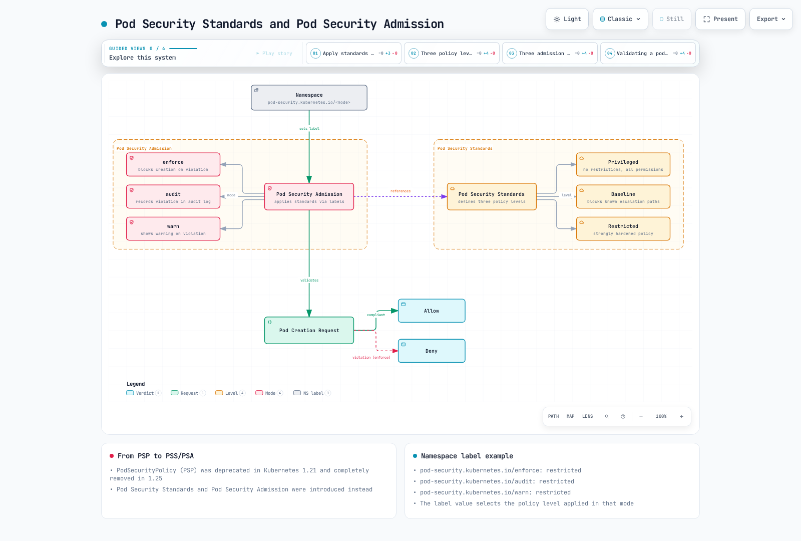
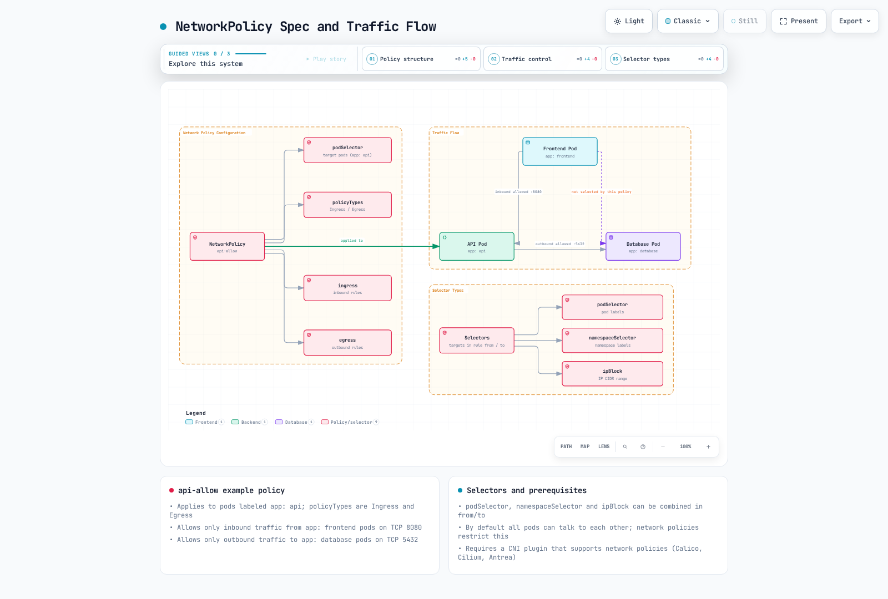

# Kubernetes ポリシー

> **サポート対象バージョン**: Kubernetes 1.35～1.37
> **最終更新**: 2026年10月16日

Kubernetes では、ポリシーはクラスターやワークロードの動作を制御・規定するルールです。ポリシーを使うと、セキュリティ、リソース使用量、ネットワーク通信など、さまざまな側面を管理できます。この章では、Kubernetes のポリシーの種類と実装方法、および Amazon EKS でのポリシー管理を説明します。

## ラボ環境の準備

このドキュメントの例を試すには、以下のツールと環境が必要です。

### 必要なツール
- API Server と同じ Minor Version、または1つ以内の差の kubectl
- 動作する Kubernetes クラスター（EKS、minikube、kind など）
- Kyverno CLI（任意）
- OPA Gatekeeper（任意）

### ポリシー例の準備

```bash
# Create namespace
kubectl create namespace policy-demo

# Create resource quota
kubectl -n policy-demo apply -f - <<EOF
apiVersion: v1
kind: ResourceQuota
metadata:
  name: demo-quota
spec:
  hard:
    requests.cpu: "1"
    requests.memory: 1Gi
    limits.cpu: "2"
    limits.memory: 2Gi
    pods: "10"
EOF

# Create network policy
kubectl -n policy-demo apply -f - <<EOF
apiVersion: networking.k8s.io/v1
kind: NetworkPolicy
metadata:
  name: default-deny
spec:
  podSelector: {}
  policyTypes:
  - Ingress
  - Egress
EOF

# Verify policies
kubectl -n policy-demo get resourcequota,networkpolicy
```

## Kubernetes ポリシーのアーキテクチャ


[🔍 インタラクティブな図を表示](https://www.atomai.click/kubernetes-docs/archmaps/en-core-07-policies-0.html)

## ポリシーの種類の比較

| ポリシーの種類 | 実装方式 | 適用レベル | 主な目的 | Kubernetes バージョン |
|------------|--------------------------|-------------------|-----------------|---------------------------|
| **リソースポリシー** | ResourceQuota、LimitRange | Namespace | リソース使用量の制限と管理 | 全バージョン |
| **セキュリティポリシー** | Pod Security Standards、Pod Security Admission（PSP は削除済み） | Pod、Namespace | Security Context の制限 | PSP 削除: 1.25、PSA Stable: 1.25 |
| **ネットワークポリシー** | NetworkPolicy | Pod | ネットワーク通信の制御 | 1.8 以降 |
| **カスタムポリシー** | OPA Gatekeeper、Kyverno | クラスター、Namespace、Pod | ユーザー定義ポリシーの適用 | インストール済みエンジンの互換性による |

## リソースポリシー

リソースポリシーは、Kubernetes クラスター内で CPU やメモリなどの計算リソースと、Pod や Service などのオブジェクト数を制限・管理する仕組みです。

### ResourceQuota

ResourceQuota は、Namespace 内で使用できるリソースの合計量を制限します。

```yaml
apiVersion: v1
kind: ResourceQuota
metadata:
  name: compute-resources
  namespace: dev
spec:
  hard:
    requests.cpu: "1"
    requests.memory: 1Gi
    limits.cpu: "2"
    limits.memory: 2Gi
    pods: "10"
    services: "5"
    persistentvolumeclaims: "5"
    secrets: "10"
    configmaps: "10"
```

### LimitRange

LimitRange は、コンテナの request/limit に既定値を設定し、コンテナ、Pod、PVC のリソース範囲を検証します。Pod と PVC の設定は request/limit の既定値を注入しません。

```yaml
apiVersion: v1
kind: LimitRange
metadata:
  name: limit-mem-cpu-per-container
  namespace: dev
spec:
  limits:
  - default:
      cpu: 500m
      memory: 512Mi
    defaultRequest:
      cpu: 100m
      memory: 256Mi
    max:
      cpu: "1"
      memory: 1Gi
    min:
      cpu: 50m
      memory: 128Mi
    type: Container
```

## 目次
1. [ポリシーの概要](#policy-overview)
2. [リソース割り当てポリシー](#resource-allocation-policies)
3. [Pod セキュリティポリシー](#pod-security-policies)
4. [ネットワークポリシー](#network-policies)
5. [リソースクォータ](#resource-quotas)
6. [LimitRange](#limitrange)
7. [ポリシーエンジン](#policy-engines)
8. [Amazon EKS でのポリシー管理](#policy-management-in-amazon-eks)
9. [ポリシーのベストプラクティス](#policy-best-practices)
10. [まとめ](#conclusion)

## ポリシーの概要 {#policy-overview}

Kubernetes ポリシーを使うと、クラスター管理者がクラスター内のリソースやワークロードに制約を定義できます。ポリシーの主な目的は次のとおりです。

1. **セキュリティの強化**: 不正な操作を防ぎ、セキュリティのベストプラクティスを適用する
2. **リソース管理**: リソース使用量を制限し、公平にリソースを配分する
3. **コンプライアンス**: 組織のポリシーや規制への準拠を確保する
4. **標準化**: 一貫した設定とデプロイ方法を適用する

Kubernetes では、組み込みリソース（NetworkPolicy、ResourceQuota、LimitRange など）またはサードパーティのポリシーエンジン（OPA Gatekeeper、Kyverno など）を使って、さまざまなポリシーを実装できます。

## リソース割り当てポリシー {#resource-allocation-policies}

リソース割り当てポリシーは、Pod やコンテナが使用できる CPU、メモリなどのリソース量を制御します。


[🔍 インタラクティブな図を表示](https://www.atomai.click/kubernetes-docs/archmaps/en-core-07-policies-1.html)

### リソースリクエストと制限

Pod やコンテナにリソース Request と Limit を設定して、使用量を管理できます。

```yaml
apiVersion: v1
kind: Pod
metadata:
  name: resource-demo
spec:
  containers:
  - name: resource-demo-container
    image: nginx
    resources:
      requests:
        memory: "64Mi"
        cpu: "250m"
      limits:
        memory: "128Mi"
        cpu: "500m"
```

- **requests**: スケジューリング時の予約量および実行時のリソース割り当てに使われます。実際の使用量はこの値を下回る場合があります。
- **limits**: 実行時の上限です。CPU は Throttling され、メモリ使用量が上限を超えると OOM Kill が発生する場合があります。

リソース Request と Limit の設定には、次の利点があります。

1. **リソースの確保**: Scheduler が要求容量を配置計算に使います。可用性を保証するものではありません。
2. **リソース分離**: ある Pod が別の Pod のリソースを独占するのを防ぎます。
3. **効率的なスケジューリング**: Pod の配置時にノードのリソース容量が考慮されます。

### QoS（Quality of Service）クラス

Kubernetes は Pod のリソース Request と Limit の設定に基づき、QoS クラスを自動的に割り当てます。

1. **Guaranteed**: コンテナ単位の設定で、すべてのコンテナの CPU/メモリ Request と Limit がそれぞれ同じ
2. **Burstable**: 少なくとも1つのコンテナにリソース Request があるが、Guaranteed の条件は満たさない
3. **BestEffort**: どのコンテナにもリソース Request/Limit が設定されていない

ノードプレッシャーによる Eviction では、使用量が Request を超えているか、Pod の Priority、相対的な使用量などが考慮されます。一般に BestEffort は Guaranteed より Eviction されやすいものの、QoS だけで厳密な優先順位が決まるわけではありません。Pod レベルのリソースも QoS に影響します。詳しくは[公式 QoS 判定基準](https://kubernetes.io/docs/concepts/workloads/pods/pod-qos/)を参照してください。

## Pod セキュリティポリシー {#pod-security-policies}

Pod Security Policy（PSP）は Kubernetes 1.21 から非推奨となり、1.25 で完全に削除されました。代わりに Pod Security Standards と Pod Security Admission が導入されています。



[🔍 インタラクティブな図を表示](https://www.atomai.click/kubernetes-docs/archmaps/en-core-07-policies-2.html)

### Pod Security Standards

Pod Security Standards は3つのポリシーレベルを定義します。

1. **Privileged**: 制限なし。すべての権限を許可
2. **Baseline**: 既知の権限昇格経路をブロック
3. **Restricted**: 厳格に強化されたセキュリティポリシー

### Pod Security Admission

Pod Security Admission は Namespace Label を通じて Pod Security Standards を適用します。

```yaml
apiVersion: v1
kind: Namespace
metadata:
  name: my-namespace
  labels:
    pod-security.kubernetes.io/enforce: restricted
    pod-security.kubernetes.io/audit: restricted
    pod-security.kubernetes.io/warn: restricted
```

各 Label の意味:
- **enforce**: ポリシーに違反する Pod の作成を拒否する
- **audit**: 違反を監査ログに記録する
- **warn**: 違反に対する警告を表示する

## ネットワークポリシー {#network-policies}

NetworkPolicy を使って Pod 間の通信を制御できます。既定では Kubernetes クラスター内のすべての Pod が相互に通信できますが、ネットワークポリシーで通信を制限できます。



[🔍 インタラクティブな図を表示](https://www.atomai.click/kubernetes-docs/archmaps/en-core-07-policies-3.html)

```yaml
apiVersion: networking.k8s.io/v1
kind: NetworkPolicy
metadata:
  name: api-allow
  namespace: default
spec:
  podSelector:
    matchLabels:
      app: api
  policyTypes:
  - Ingress
  - Egress
  ingress:
  - from:
    - podSelector:
        matchLabels:
          app: frontend
    ports:
    - protocol: TCP
      port: 8080
  egress:
  - to:
    - podSelector:
        matchLabels:
          app: database
    ports:
    - protocol: TCP
      port: 5432
```

上記の例では:
- `app=api` の Label が付いた Pod にネットワークポリシーを定義します。
- ポート 8080 では、`app=frontend` の Pod からの Ingress だけを許可します。
- ポート 5432 では、`app=database` の Pod への Egress だけを許可します。

ネットワークポリシーを使うには、クラスターのネットワークプラグインが対応している必要があります。Calico、Cilium、Antrea などの CNI Plugin はネットワークポリシーをサポートしています。

Namespace Selector を指定しない Pod Selector は、Policy の Namespace 内でのみ対象を選びます。標準 NetworkPolicy の許可ルールは加算方式です。別の Policy が追加の通信を許可することもあり、接続には送信元側 Egress と宛先側 Ingress の両方が許可される必要があります。この例は、別の Egress Rule でクラスター DNS Endpoint の TCP/UDP 53 を許可しない限り DNS 通信も遮断します。

### ネットワークポリシーの種類

1. **Ingress Policy**: Pod への受信トラフィックを制御する
2. **Egress Policy**: Pod からの送信トラフィックを制御する
3. **Ingress and Egress Policy**: 双方向のトラフィックを制御する

### ネットワークポリシーの Selector

ネットワークポリシーでは、次の Selector を使ってトラフィックを絞り込めます。

1. **podSelector**: Pod Label に基づいて選択する
2. **namespaceSelector**: Namespace Label に基づいて選択する
3. **ipBlock**: IP CIDR 範囲に基づいて選択する

```yaml
# Example combining multiple selectors
ingress:
- from:
  - podSelector:
      matchLabels:
        app: frontend
    namespaceSelector:
      matchLabels:
        env: prod
  - ipBlock:
      cidr: 172.17.0.0/16
      except:
      - 172.17.1.0/24
```

## リソースクォータ {#resource-quotas}

ResourceQuota は Namespace 内で使えるリソース総量を制限します。複数のチームやプロジェクトがクラスターを共有する際に、1つのチームがすべてのリソースを独占するのを防ぎます。


[🔍 インタラクティブな図を表示](https://www.atomai.click/kubernetes-docs/archmaps/en-core-07-policies-4.html)

```yaml
apiVersion: v1
kind: ResourceQuota
metadata:
  name: compute-resources
  namespace: team-a
spec:
  hard:
    pods: "10"
    requests.cpu: "4"
    requests.memory: 8Gi
    limits.cpu: "8"
    limits.memory: 16Gi
```

上記の例では:
- `team-a` Namespace では、終端状態ではない Pod を最大10個作成できます。
- Pod 全体の CPU Request 合計は4コア以下です。
- Pod 全体のメモリ Request 合計は 8Gi 以下です。
- Pod 全体の CPU Limit 合計は8コア以下です。
- Pod 全体のメモリ Limit 合計は 16Gi 以下です。

### オブジェクト数の Quota

ResourceQuota は CPU とメモリに加えて、Namespace 内で作成できるオブジェクト数も制限できます。

```yaml
apiVersion: v1
kind: ResourceQuota
metadata:
  name: object-counts
  namespace: team-b
spec:
  hard:
    configmaps: "10"
    persistentvolumeclaims: "5"
    replicationcontrollers: "20"
    secrets: "10"
    services: "10"
    services.loadbalancers: "2"
```

### PriorityClass ごとの Quota

特定の PriorityClass を持つ Pod に対する Quota も設定できます。

PriorityClass ごとに別の Quota を作成してください。`pods.high` のような Key は存在しません。Pod をスケジュールする前に対応する PriorityClass を作成します。

```yaml
apiVersion: v1
kind: ResourceQuota
metadata:
  name: high-priority-quota
  namespace: team-c
spec:
  hard:
    pods: "5"
  scopeSelector:
    matchExpressions:
    - operator: In
      scopeName: PriorityClass
      values: ["high"]
---
apiVersion: v1
kind: ResourceQuota
metadata:
  name: medium-priority-quota
  namespace: team-c
spec:
  hard:
    pods: "3"
  scopeSelector:
    matchExpressions:
    - operator: In
      scopeName: PriorityClass
      values: ["medium"]
---
apiVersion: v1
kind: ResourceQuota
metadata:
  name: low-priority-quota
  namespace: team-c
spec:
  hard:
    pods: "2"
  scopeSelector:
    matchExpressions:
    - operator: In
      scopeName: PriorityClass
      values: ["low"]
```

## LimitRange

LimitRange は、コンテナに Request/Limit がない場合に既定値を設定し、Admission 時に最小値/最大値を検証します。既存 Pod のサイズを変更したり、Pod/PVC の設定に既定値を補ったりはしません。

```yaml
apiVersion: v1
kind: LimitRange
metadata:
  name: cpu-limit-range
  namespace: default
spec:
  limits:
  - default:
      cpu: 1
      memory: 512Mi
    defaultRequest:
      cpu: 500m
      memory: 256Mi
    max:
      cpu: 2
      memory: 1Gi
    min:
      cpu: 100m
      memory: 128Mi
    type: Container
```

上記の例では:
- **default**: コンテナに明示的な Limit がない場合に適用する既定 Limit
- **defaultRequest**: コンテナに明示的な Request がない場合に適用する既定 Request
- **max**: コンテナに設定できる最大 Limit
- **min**: コンテナに設定できる最小 Request

LimitRange は次のリソースタイプに適用できます。
- Container
- Pod
- PersistentVolumeClaim

## ポリシーエンジン {#policy-engines}

Kubernetes のエコシステムには、より複雑で柔軟なポリシーを実装できるエンジンがいくつかあります。


[🔍 インタラクティブな図を表示](https://www.atomai.click/kubernetes-docs/archmaps/en-core-07-policies-5.html)

### OPA Gatekeeper

OPA（Open Policy Agent）Gatekeeper は、Kubernetes クラスターのポリシーを定義し適用するオープンソースプロジェクトです。Kubernetes Admission Controller として API Server に送られるリクエストを仲介し、ポリシーを適用します。

Gatekeeper は次のコンポーネントで構成されます。

1. **ConstraintTemplate**: ポリシーロジックを定義する Template
2. **Constraint**: 特定の Resource にポリシーを適用する ConstraintTemplate のインスタンス

```yaml
# ConstraintTemplate example
apiVersion: templates.gatekeeper.sh/v1
kind: ConstraintTemplate
metadata:
  name: k8srequiredlabelkeys
spec:
  crd:
    spec:
      names:
        kind: K8sRequiredLabelKeys
      validation:
        openAPIV3Schema:
          type: object
          properties:
            labels:
              type: array
              items:
                type: string
  targets:
    - target: admission.k8s.gatekeeper.sh
      rego: |
        package k8srequiredlabelkeys
        violation[{"msg": msg, "details": {"missing_labels": missing}}] {
          provided := {label | input.review.object.metadata.labels[label]}
          required := {label | label := input.parameters.labels[_]}
          missing := required - provided
          count(missing) > 0
          msg := sprintf("missing required labels: %v", [missing])
        }
```

```yaml
# Constraint example
apiVersion: constraints.gatekeeper.sh/v1beta1
kind: K8sRequiredLabelKeys
metadata:
  name: require-app-label
spec:
  match:
    kinds:
      - apiGroups: [""]
        kinds: ["Pod"]
  parameters:
    labels: ["app", "owner"]
```

### Kyverno

Kyverno は Kubernetes ネイティブのポリシーエンジンです。YAML ベースのポリシーで Kubernetes Resource を検証・変更・生成できます。Rego 言語を学ぶ必要はなく、Kubernetes Resource に似た構文でポリシーを記述できます。

```yaml
# Kyverno policy example
apiVersion: kyverno.io/v1
kind: ClusterPolicy
metadata:
  name: require-labels
spec:
  rules:
  - name: check-for-labels
    match:
      any:
      - resources:
          kinds:
          - Pod
    validate:
      failureAction: Enforce
      message: "The labels 'app' and 'owner' are required."
      pattern:
        metadata:
          labels:
            app: "?*"
            owner: "?*"
```

Kyverno は次の種類のポリシーをサポートします。

1. **Validate**: Resource が特定の条件を満たすか検証する
2. **Mutate**: Resource を自動的に変更する
3. **Generate**: Resource の作成時に別の Resource を自動生成する
4. **Verify Images**: コンテナイメージの署名を検証する
5. **Clean Up**: CleanupPolicy/ClusterCleanupPolicy が一致する Resource の削除をスケジュールする。Owner Reference による Garbage Collection とは別の機能

### Kubewarden

Kubewarden は WebAssembly ベースのポリシーエンジンで、さまざまなプログラミング言語でポリシーを記述できます。ポリシーは WebAssembly Module にコンパイルされ、Kubewarden Policy Server 上で実行されます。

```yaml
# Kubewarden policy example
apiVersion: policies.kubewarden.io/v1
kind: ClusterAdmissionPolicy
metadata:
  name: require-labels
spec:
  module: "registry://ghcr.io/kubewarden/policies/safe-labels:<tested-tag>"
  mutating: false
  rules:
  - apiGroups: [""]
    apiVersions: ["v1"]
    resources: ["pods"]
    operations:
    - CREATE
    - UPDATE
  settings:
    mandatory_labels:
      - app
      - owner
```

これらの Resource を適用する前に、ポリシーエンジン、CRD、Policy Server をインストールしてください。Gatekeeper の例では、より機能が豊富な共有ライブラリの `K8sRequiredLabels` Template と競合しないよう、`K8sRequiredLabelKeys` を定義しています。Kubewarden では、テスト済みの公開 safe-labels Tag/Digest を選び、`mandatory_labels` を設定してください。`<tested-tag>` は置き換え用のプレースホルダーです。

## Amazon EKS でのポリシー管理 {#policy-management-in-amazon-eks}

Amazon EKS では、Kubernetes の既定ポリシー機構とさまざまな AWS Service を組み合わせてポリシーを管理できます。


[🔍 インタラクティブな図を表示](https://www.atomai.click/kubernetes-docs/archmaps/en-core-07-policies-6.html)

### AWS IAM との統合

Amazon EKS は IAM Roles for Service Accounts（IRSA）を通じて、Pod に AWS Service の権限を付与できます。これにより最小権限の原則を適用できます。

```bash
# Create OIDC provider
eksctl utils associate-iam-oidc-provider --cluster my-cluster --approve

# Create IAM role and link to service account
eksctl create iamserviceaccount \
  --name my-service-account \
  --namespace default \
  --cluster my-cluster \
  --attach-policy-arn arn:aws:iam::123456789012:policy/ReadApplicationBucket \
  --approve
```

参照される Customer-managed Policy は、必要な Bucket/Prefix に限定した読み取りアクセスで作成してください。サポート対象の Compute では EKS Pod Identity も利用できます。IAM は AWS API へのアクセスを制御するものであり、Kubernetes Resource の認可は制御しません。

### Pod 用 AWS Security Group

Amazon EKS では、Pod レベルで AWS Security Group を適用できます。Pod 間の通信をより細かく制御できます。

```yaml
apiVersion: vpcresources.k8s.aws/v1beta1
kind: SecurityGroupPolicy
metadata:
  name: allow-db-access
  namespace: default
spec:
  podSelector:
    matchLabels:
      app: web
  securityGroups:
    groupIds:
      - sg-0123456789abcdef0
```

Security Group ID は、必要なアプリケーション通信と DNS 通信を許可するクラスター VPC 内の Group に置き換えてください。Pod 用 Security Group には、対応する VPC CNI 設定、IAM 権限、互換性のある Compute が必要です。Windows と EKS Auto Mode ではサポートされません。

### AWS Config と AWS Organizations

AWS Config はリソースのコンプライアンスを評価しますが、それだけで `CreateCluster` を拒否することはありません。Organizations Service Control Policy（SCP）を使うと、適用対象のメンバーアカウント/OU で、次の例のように必須 Request Tag のない作成を拒否できます。

```json
{
  "Version": "2012-10-17",
  "Statement": [
    {
      "Effect": "Deny",
      "Action": "eks:CreateCluster",
      "Resource": "*",
      "Condition": {
        "Null": {
          "aws:RequestTag/Environment": "true"
        }
      }
    }
  ]
}
```

### AWS Firewall Manager

Firewall Manager は、WAF、VPC Security Group、Network Firewall、DNS Firewall など、AWS がサポートする保護機能を一元管理します。Kubernetes NetworkPolicy Resource は同期しません。これらは Kubernetes/GitOps のポリシーツールで管理してください。

## ポリシーのベストプラクティス {#policy-best-practices}

Kubernetes クラスターのポリシーを効果的に管理するには、次の点を実践してください。

### ポリシーの設計

1. **最小権限の原則**: 必要最小限の権限だけを付与するポリシーを設計する
2. **段階的な適用**: 影響を抑えるため、一度にすべてのポリシーを適用せず段階的に導入する
3. **監査モード**: 強制する前に監査モードで実行し、影響を評価する
4. **明確な文書化**: 各ポリシーの目的と影響を明確に記録する

### リソース管理

1. **Namespace の分離**: チーム/プロジェクトごとに Namespace を分け、適切な ResourceQuota を設定する
2. **既定の制限**: LimitRange を使って全コンテナの既定リソース制限を設定する
3. **QoS クラスの考慮**: ワークロードの重要度に応じて QoS クラスを設定する

### ネットワークセキュリティ

1. **既定拒否ポリシー**: すべての通信を既定で拒否し、必要な通信だけを明示的に許可する
2. **詳細なポリシー**: Pod 間通信を細かく制御するネットワークポリシーを設定する
3. **定期的なレビュー**: ネットワークポリシーを定期的に見直し、更新する

### ポリシーの自動化

1. **CI/CD との統合**: デプロイ前に違反を検知できるよう、ポリシー検証を CI/CD Pipeline に統合する
2. **ポリシーのテスト**: まずテスト環境で検証し、問題がないことを確認してから本番環境へ適用する
3. **バージョン管理**: ポリシーをコードとして管理し、変更履歴を追跡できるよう Version Control を使う

## まとめ {#conclusion}

Kubernetes ポリシーは、クラスターやワークロードのセキュリティ、リソース使用量、ネットワーク通信を制御する強力な手段です。ResourceQuota、LimitRange、NetworkPolicy などの組み込み機構と、OPA Gatekeeper、Kyverno などのポリシーエンジンを組み合わせることで、組織の要件に合ったポリシー基盤を構築できます。

Amazon EKS では、IAM、Security Group、AWS Config、AWS Organizations、AWS Firewall Manager などの Service を活用して、ポリシー管理をさらに強化できます。これらを組み合わせることで、クラスターやワークロードのセキュリティ、コンプライアンス、リソース管理を効果的に行えます。

ポリシーは継続的に進化するため、新たな脅威や要件に対応できるよう定期的に見直し、更新することが重要です。一貫性と効率を高めるため、ポリシーをコードとして管理し、自動化することも推奨されます。

## クイズ

この章の理解度を確認するには、[ポリシーのクイズ](../quizzes/core/07-policies-quiz.md)に挑戦してください。

## 参考資料

- [Kubernetes 公式ドキュメント - Resource Quota](https://kubernetes.io/docs/concepts/policy/resource-quotas/)
- [Kubernetes 公式ドキュメント - LimitRange](https://kubernetes.io/docs/concepts/policy/limit-range/)
- [Kubernetes 公式ドキュメント - NetworkPolicy](https://kubernetes.io/docs/concepts/services-networking/network-policies/)
- [Kubernetes 公式ドキュメント - Pod Security Standards](https://kubernetes.io/docs/concepts/security/pod-security-standards/)
- [Kubernetes 公式ドキュメント - Pod Security Admission](https://kubernetes.io/docs/concepts/security/pod-security-admission/)
- [OPA Gatekeeper 公式ドキュメント](https://open-policy-agent.github.io/gatekeeper/website/docs/)
- [Kyverno 公式ドキュメント](https://kyverno.io/docs/)
- [Kubewarden 公式ドキュメント](https://docs.kubewarden.io/)
- [Amazon EKS 公式ドキュメント - ServiceAccount 用 IAM Role](https://docs.aws.amazon.com/eks/latest/userguide/iam-roles-for-service-accounts.html)
- [Amazon EKS 公式ドキュメント - Pod 用 Security Group](https://docs.aws.amazon.com/eks/latest/userguide/security-groups-for-pods.html)
- [AWS Config 公式ドキュメント](https://docs.aws.amazon.com/config/latest/developerguide/WhatIsConfig.html)
- [AWS Organizations 公式ドキュメント](https://docs.aws.amazon.com/organizations/latest/userguide/orgs_introduction.html)
- [AWS Firewall Manager 公式ドキュメント](https://docs.aws.amazon.com/waf/latest/developerguide/fms-chapter.html)
