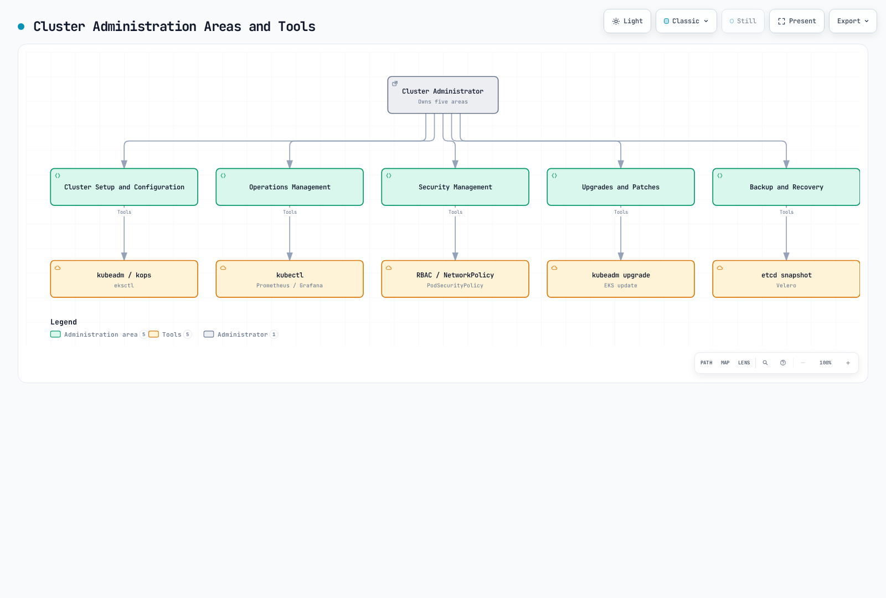
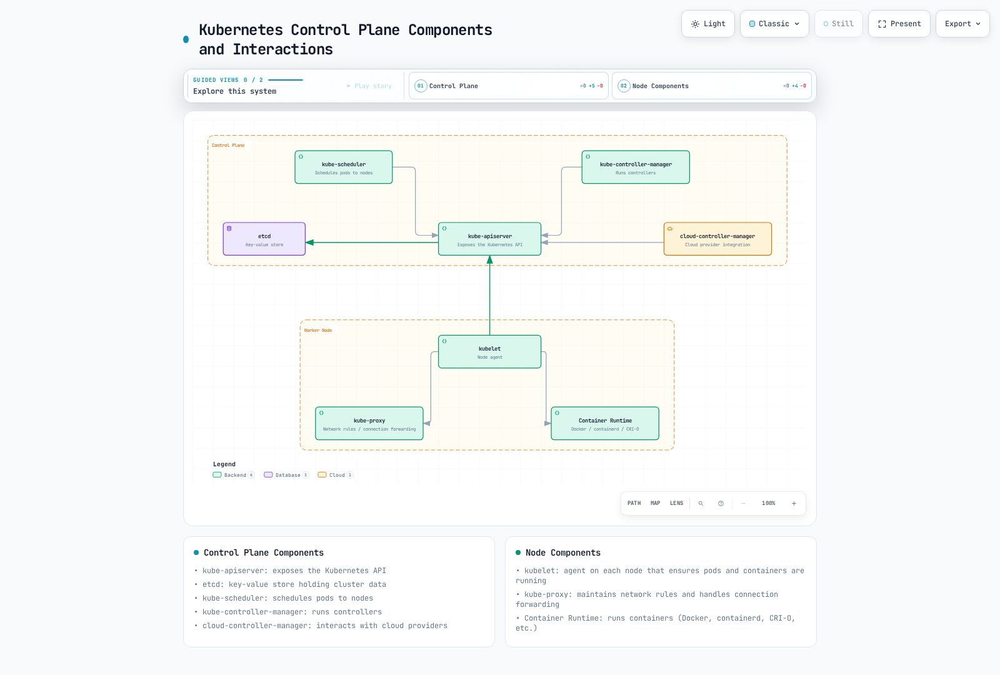
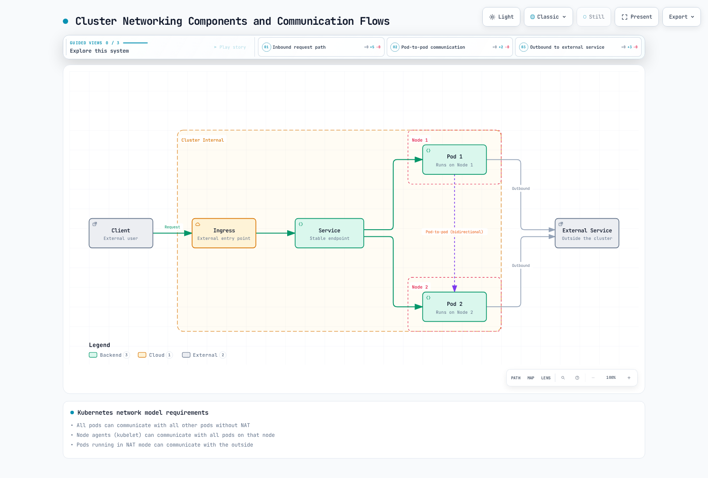
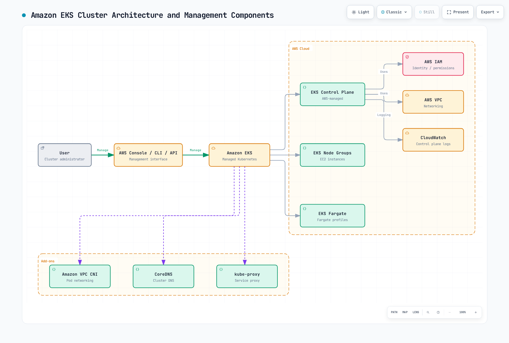
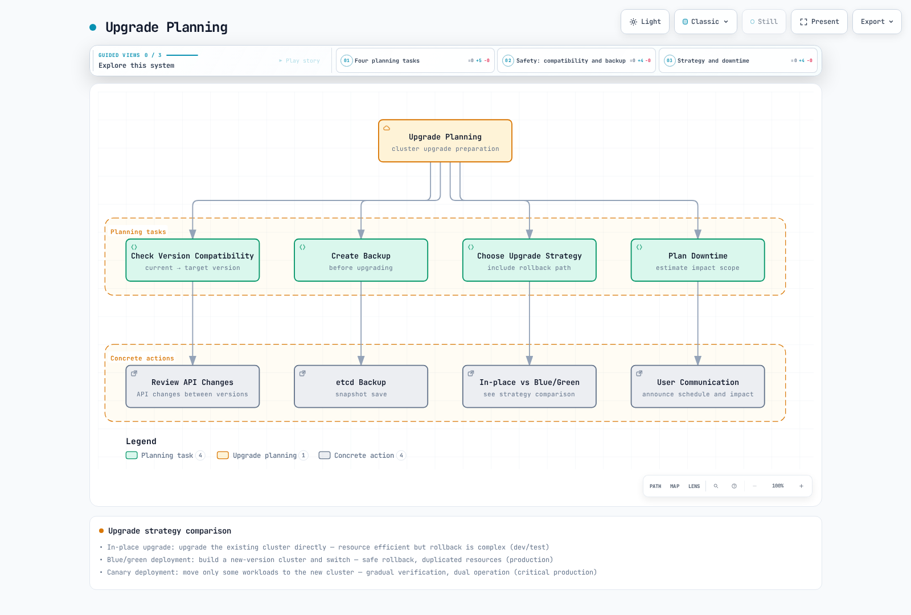
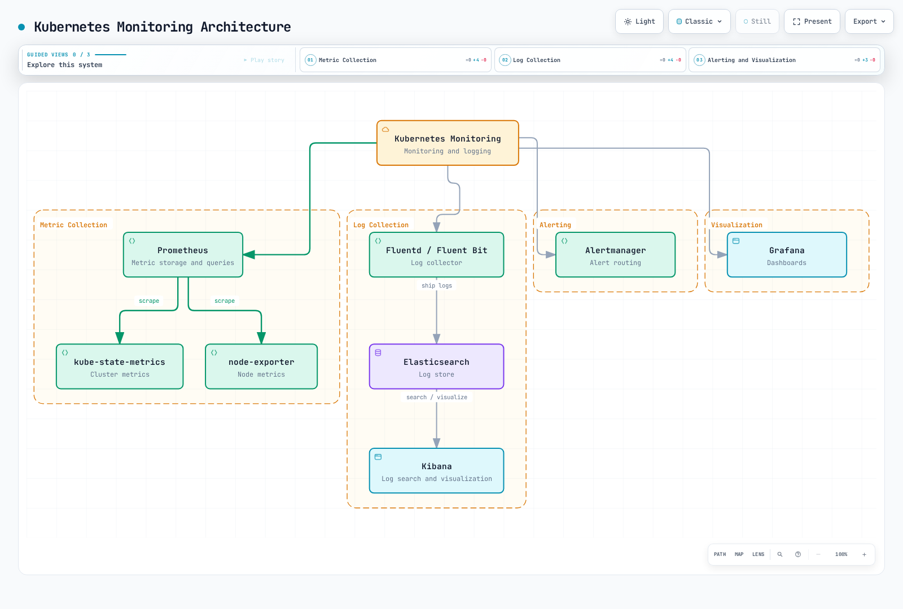

# Kubernetes クラスター管理

> **サポート対象バージョン**: Kubernetes 1.34～1.37 の EKS 標準サポート（2026年10月12日確認）
> **最終更新日**: 2026年10月16日

Kubernetes クラスター管理は、クラスターのセットアップ、保守、監視、トラブルシューティング、アップグレードを含む重要な作業です。この章では、Kubernetes クラスター管理のさまざまな側面と、Amazon EKS でクラスターを管理するためのベストプラクティスを説明します。

kubeadm による自己管理操作と EKS サービスの操作は別物です。EKS では、コントロールプレーンのホスト、静的 Pod マニフェスト、etcd への直接アクセスは公開されません。以下の各コードブロックは個別の例として扱い、1つのスクリプトとして順番に実行しないでください。実際のクラスターのバージョンについて、上流のサポート状況とアドオンの互換性を確認してください。

## 基本概念

- **クラスターライフサイクル管理**: クラスターの作成から廃止までの全プロセス
- **コントロールプレーン管理**: API server、scheduler、controller manager などの主要コンポーネントの管理
- **ノード管理**: ワーカーノードの追加、削除、保守
- **リソース割り当て**: CPU、メモリ、ストレージなどのリソース割り当てと上限の設定
- **アップグレード戦略**: ダウンタイムを最小限に抑えるためのクラスターとアプリケーションのアップグレード戦略

## 目次
1. [クラスター管理の概要](#cluster-administration-overview)
2. [クラスターコンポーネントの管理](#cluster-component-management)
3. [リソース管理](#resource-management)
4. [クラスターのネットワーク](#cluster-networking)
5. [認証と認可の管理](#authentication-and-authorization-management)
6. [クラスターのアップグレード](#cluster-upgrades)
7. [バックアップと復旧](#backup-and-recovery)
8. [監視とログ記録](#monitoring-and-logging)
9. [トラブルシューティング](#troubleshooting)
10. [Amazon EKS クラスター管理](#amazon-eks-cluster-administration)
11. [クラスター管理のベストプラクティス](#cluster-administration-best-practices)
12. [まとめ](#conclusion)

## 環境のセットアップ

クラスター管理には、次のツールが必要です。

[kubectl の公式インストールガイド](https://kubernetes.io/docs/tasks/tools/install-kubectl-linux/)に従ってインストールし、kubectl のバージョンを API server のマイナーバージョンから1つ以内に保ちます。自己管理クラスターでは、対象マイナーバージョンの `pkgs.k8s.io` リポジトリから kubeadm/kubelet をインストールしてください。古い `1.x.y-00` パッケージの例は廃止されています。インストール前に、設定済みのリポジトリから正確なパッケージバージョンを選択してください。

[Helm の公式手順](https://helm.sh/docs/intro/install/)と[k9s のリリース](https://github.com/derailed/k9s/releases)に従って Helm と k9s をインストールし、プラットフォームのアーキテクチャとチェックサムを確認してください。EKS の管理には、認証済みの AWS CLI と互換性のあるバージョンの eksctl も必要です。

```bash
kubectl version --client
helm version
k9s version
# Self-managed nodes only, after configuring the target minor repository:
apt-cache madison kubeadm
```


## クラスター管理の概要

Kubernetes クラスター管理とは、クラスターのライフサイクル全体を管理するプロセスです。主な領域は次のとおりです。

1. **クラスターのセットアップと構成**: クラスターの作成、ノードの追加、ネットワークのセットアップ、ストレージの構成など
2. **運用管理**: リソースの監視、パフォーマンスの最適化、キャパシティプランニング、トラブルシューティング
3. **セキュリティ管理**: 認証、認可、ネットワークポリシー、セキュリティコンテキストなど
4. **アップグレードとパッチ適用**: クラスターのバージョンアップグレード、セキュリティパッチの適用
5. **バックアップと復旧**: クラスターデータのバックアップ、災害復旧計画

次の図は、Kubernetes クラスター管理の主な領域と関連ツールを示しています。

## クラスターコンポーネントの管理

Kubernetes クラスターは、コントロールプレーンのコンポーネントとノードのコンポーネントで構成されます。各コンポーネントを管理することは、クラスターの安定性とパフォーマンスにとって重要です。

### コントロールプレーンコンポーネントの管理


[🔍 インタラクティブな図を表示](https://www.atomai.click/kubernetes-docs/archmaps/en-core-09-cluster-administration-0.html)

#### API Server の管理

API server は、Kubernetes API を公開するコントロールプレーンの主要コンポーネントです。

```bash
# Check API server logs
kubectl logs -n kube-system kube-apiserver-<master-node-name>

# Check API server configuration (kubeadm cluster)
sudo cat /etc/kubernetes/manifests/kube-apiserver.yaml

# Check API server status
kubectl get --raw='/readyz?verbose'
```

#### etcd の管理

etcd は、Kubernetes API の状態を保存する分散キーバリューストアです。

```bash
# etcd backup
ETCDCTL_API=3 etcdctl --endpoints=https://127.0.0.1:2379 \
  --cacert=/etc/kubernetes/pki/etcd/ca.crt \
  --cert=/etc/kubernetes/pki/etcd/server.crt \
  --key=/etc/kubernetes/pki/etcd/server.key \
  snapshot save /backup/etcd-snapshot-$(date +%Y-%m-%d).db

# Check etcd status
ETCDCTL_API=3 etcdctl --endpoints=https://127.0.0.1:2379 \
  --cacert=/etc/kubernetes/pki/etcd/ca.crt \
  --cert=/etc/kubernetes/pki/etcd/server.crt \
  --key=/etc/kubernetes/pki/etcd/server.key \
  endpoint health
```

### ノード管理

ノードは、コンテナ化されたアプリケーションを実行するワーカーマシンです。

```bash
# List nodes
kubectl get nodes

# Check node detailed information
kubectl describe node <node-name>

# Add node label
kubectl label node <node-name> environment=production

# Set node to maintenance mode
kubectl drain <node-name> --ignore-daemonsets

# Return node after maintenance
kubectl uncordon <node-name>
```

### コンポーネントの状態監視

```bash
# Check control plane component status
kubectl get --raw='/readyz?verbose'

# Check system pod status
kubectl get pods -n kube-system

# Check node resource usage
kubectl top nodes
```



[🔍 インタラクティブな図を表示](https://www.atomai.click/kubernetes-docs/archmaps/en-core-09-cluster-administration-1.html)

### クラスター管理ツール

Kubernetes クラスター管理には、さまざまなツールを使用できます。

1. **kubectl**: Kubernetes クラスターとやり取りするためのコマンドラインツール
2. **kubeadm**: Kubernetes クラスターを作成、管理するためのツール
3. **kops**: Kubernetes クラスターを作成、アップグレード、管理するためのツール
4. **eksctl**: Amazon EKS クラスターを作成、管理するためのツール
5. **Helm**: Kubernetes アプリケーションのパッケージマネージャー
6. **Headlamp**: Kubernetes の Web UI。旧 Kubernetes Dashboard プロジェクトはアーカイブされています
7. **Prometheus と Grafana**: 監視およびアラートツール
8. **Fluentd と Elasticsearch**: ログ記録ツール

## クラスターコンポーネントの管理

Kubernetes クラスターは複数のコンポーネントで構成されており、それらを効果的に管理することが重要です。

### コントロールプレーンコンポーネント

コントロールプレーンコンポーネントは、クラスター全体の状態を管理します。

1. **kube-apiserver**: Kubernetes API を公開するコンポーネント
2. **etcd**: クラスターのデータを保存するキーバリューストア
3. **kube-scheduler**: Pod をノードにスケジュールするコンポーネント
4. **kube-controller-manager**: コントローラーを実行するコンポーネント
5. **cloud-controller-manager**: クラウドプロバイダーと連携するコンポーネント

次の図は、Kubernetes コントロールプレーンコンポーネントとその相互作用を示しています。



[🔍 インタラクティブな図を表示](https://www.atomai.click/kubernetes-docs/archmaps/en-core-09-cluster-administration-2.html)

#### コントロールプレーンコンポーネントの監視

コントロールプレーンコンポーネントの状態を監視することが重要です。

```bash
# Check control plane component status
kubectl get --raw='/readyz?verbose'

# Check API server logs
kubectl logs -n kube-system kube-apiserver-<node-name>

# Check etcd status
kubectl exec -n kube-system etcd-<node-name> -- etcdctl \
  --endpoints=https://127.0.0.1:2379 \
  --cacert=/etc/kubernetes/pki/etcd/ca.crt \
  --cert=/etc/kubernetes/pki/etcd/healthcheck-client.crt \
  --key=/etc/kubernetes/pki/etcd/healthcheck-client.key endpoint health
```

#### コントロールプレーンコンポーネントの構成

以下のマニフェストは、フラグと構成の一部のみを示しています。host networking、証明書のマウント、その他の kubeadm 生成設定は省略されているため、この断片で稼働中のコントロールプレーンマニフェストを置き換えないでください。イメージはクラスターのアップグレード計画に合わせてください。

コントロールプレーンコンポーネントの構成を管理する方法は次のとおりです。

```yaml
# kube-apiserver configuration example
apiVersion: v1
kind: Pod
metadata:
  name: kube-apiserver
  namespace: kube-system
spec:
  containers:
  - command:
    - kube-apiserver
    - --advertise-address=192.168.1.10
    - --allow-privileged=true
    - --authorization-mode=Node,RBAC
    - --client-ca-file=/etc/kubernetes/pki/ca.crt
    - --enable-admission-plugins=NodeRestriction
    - --enable-bootstrap-token-auth=true
    - --etcd-cafile=/etc/kubernetes/pki/etcd/ca.crt
    - --etcd-certfile=/etc/kubernetes/pki/apiserver-etcd-client.crt
    - --etcd-keyfile=/etc/kubernetes/pki/apiserver-etcd-client.key
    - --etcd-servers=https://127.0.0.1:2379
    - --kubelet-client-certificate=/etc/kubernetes/pki/apiserver-kubelet-client.crt
    - --kubelet-client-key=/etc/kubernetes/pki/apiserver-kubelet-client.key
    - --kubelet-preferred-address-types=InternalIP,ExternalIP,Hostname
    - --secure-port=6443
    - --service-account-key-file=/etc/kubernetes/pki/sa.pub
    - --service-account-signing-key-file=/etc/kubernetes/pki/sa.key
    - --service-account-issuer=https://kubernetes.default.svc.cluster.local
    - --service-cluster-ip-range=10.96.0.0/12
    - --tls-cert-file=/etc/kubernetes/pki/apiserver.crt
    - --tls-private-key-file=/etc/kubernetes/pki/apiserver.key
    image: registry.k8s.io/kube-apiserver:v1.36.5
    name: kube-apiserver
```

### ノードコンポーネント

ノードコンポーネントは各ノードで実行され、Pod を管理します。

1. **kubelet**: 各ノードで実行され、Pod とコンテナが稼働していることを確認するエージェント
2. **kube-proxy**: ネットワークルールを維持し、接続の転送を処理するコンポーネント
3. **コンテナランタイム**: コンテナを実行するソフトウェア（containerd、CRI-O、または外部 CRI アダプターを使用した Docker Engine）

#### ノード管理

ノード管理の主なコマンドは次のとおりです。

```bash
# List nodes
kubectl get nodes

# Check node detailed information
kubectl describe node <node-name>

# Add node label
kubectl label node <node-name> key=value

# Add node taint
kubectl taint node <node-name> key=value:NoSchedule

# Set node to maintenance mode
kubectl cordon <node-name>

# Drain node
kubectl drain <node-name> --ignore-daemonsets
```

Drain は、スタンドアロン Pod、PDB、またはローカルデータがある場合に停止することがあります。既定で `--force` や `--delete-emptydir-data` を追加するのではなく、原因を調査してください。後者は emptyDir データの損失を明示的に許可します。保守を行う前に、drain の完了とワークロードの正常性を確認してください。

#### ノードのトラブルシューティング

ノードのトラブルシューティングに使用するコマンドは次のとおりです。

```bash
# Check node status
kubectl describe node <node-name> | grep Conditions -A 10

# Check node resource usage
kubectl top node <node-name>

# Check kubelet logs
journalctl -u kubelet

# Check container runtime status
systemctl status docker  # When using Docker
systemctl status containerd  # When using containerd
```

## リソース管理

Kubernetes クラスターのリソースを効果的に管理することは、クラスターの安定性とパフォーマンスを維持するうえで重要です。

### Namespace の管理

ライフサイクル操作の練習には、使い捨ての namespace を使用してください。namespace を削除すると、その namespace 内のリソースも削除されます。必要なデータを事前に確認し、バックアップしてください。`get all` で取得できるのはワークロードの一部だけです。

```bash
kubectl create namespace admin-demo
kubectl get all -n admin-demo
# Cleanup only the disposable exercise namespace:
kubectl delete namespace admin-demo
```

### ResourceQuota

ResourceQuota は、namespace ごとのリソース使用量を制限します。

```yaml
apiVersion: v1
kind: ResourceQuota
metadata:
  name: compute-resources
  namespace: dev
spec:
  hard:
    requests.cpu: "1"
    requests.memory: 1Gi
    limits.cpu: "2"
    limits.memory: 2Gi
    pods: "10"
```

上記の例では、`dev` namespace で許可される最大数は Pod が10個、requests が CPU 1個とメモリ 1Gi、limits が CPU 2個とメモリ 2Gi です。

### LimitRange

LimitRange は、namespace 内の個々のリソースに対して既定値と上限を設定します。

```yaml
apiVersion: v1
kind: LimitRange
metadata:
  name: limit-range
  namespace: dev
spec:
  limits:
  - default:
      cpu: 500m
      memory: 512Mi
    defaultRequest:
      cpu: 200m
      memory: 256Mi
    max:
      cpu: 1
      memory: 1Gi
    min:
      cpu: 100m
      memory: 128Mi
    type: Container
```

上記の例では、`dev` namespace 内のすべてのコンテナに、CPU 500m とメモリ 512Mi の既定の limits、CPU 200m とメモリ 256Mi の既定の requests、CPU 1個とメモリ 1Gi の最大値、CPU 100m とメモリ 128Mi の最小値が設定されます。

### Horizontal Pod Autoscaler (HPA)

HPA は、CPU 使用率またはカスタムメトリクスに基づいて Pod の数を自動的に調整します。

```yaml
apiVersion: autoscaling/v2
kind: HorizontalPodAutoscaler
metadata:
  name: frontend-hpa
spec:
  scaleTargetRef:
    apiVersion: apps/v1
    kind: Deployment
    name: frontend
  minReplicas: 2
  maxReplicas: 10
  metrics:
  - type: Resource
    resource:
      name: cpu
      target:
        type: Utilization
        averageUtilization: 80
```

上記の例では、`frontend` Deployment の目標 CPU 平均使用率を、要求された CPU の80%に設定しています。ただし、許容差、メトリクスの欠落、安定化期間、スケーリングポリシーの影響を受けます。レプリカ数は最小2、最大10に維持されます。

### Vertical Pod Autoscaler (VPA)

VPA は、Pod の CPU とメモリの requests を自動的に調整します。

```yaml
apiVersion: autoscaling.k8s.io/v1
kind: VerticalPodAutoscaler
metadata:
  name: frontend-vpa
spec:
  targetRef:
    apiVersion: apps/v1
    kind: Deployment
    name: frontend
  updatePolicy:
    updateMode: "Recreate"
```

上記の例では、`frontend` Deployment 内の Pod の CPU とメモリの requests が、実際のリソース使用量に基づいて自動的に調整されます。
## クラスターのネットワーク

Kubernetes クラスターのネットワークは、Pod、Service、ノード間の通信を管理します。

### クラスターネットワークモデル

Kubernetes ネットワークモデルの基本要件は次のとおりです。

1. すべての Pod は NAT なしで他のすべての Pod と通信できる
2. ノードエージェント（kubelet）は、そのノード上のすべての Pod と通信できる
3. 外部接続はルーティングとエグレスポリシーによって異なり、Pod に共通する NAT モード要件はない

次の図は、Kubernetes のネットワークコンポーネントと通信フローを示しています。



[🔍 インタラクティブな図を表示](https://www.atomai.click/kubernetes-docs/archmaps/en-core-09-cluster-administration-3.html)

### CNI (Container Network Interface) プラグイン

Kubernetes は CNI プラグインを通じてネットワークを実装します。一般的な CNI プラグインは次のとおりです。

1. **Calico**: 強化されたネットワークポリシーとセキュリティ機能を備えた CNI
2. **Flannel**: シンプルなオーバーレイネットワークを提供
3. **Cilium**: eBPF ベースのネットワークおよびセキュリティソリューション
4. **AWS VPC CNI**: AWS VPC と統合された CNI
5. **Weave Net (歴史的)**: アーカイブ済みです。新規インストールでは、保守されている代替手段を選択してください

#### CNI プラグインのインストールと構成

CNI プラグイン（Calico）のインストール例:

CNI は1つ選ぶか、文書化されたチェーン構成または移行構成を使用してください。Calico、Flannel、Cilium の各選択肢を、同じ稼働中のクラスターに順番にインストールしてはいけません。サポート対象でバージョンを固定したリリースと、プロバイダー固有の手順を使用してください。EKS では、[ネットワークの章](./03-services-networking.md)に記載されている VPC CNI または計画済みの代替 CNI の手順に従ってください。

```bash
# Inspect the installed networking components before making changes
kubectl get daemonsets -A
kubectl get pods -A -l k8s-app=calico-node
```


### Service ネットワーク

Kubernetes Service は、Pod の集合に対して安定したエンドポイントを提供します。

1. **ClusterIP**: クラスター内でのみアクセスできる Service
2. **NodePort**: すべてのノード上の特定のポートからアクセスできる Service
3. **LoadBalancer**: 外部ロードバランサー経由でアクセスできる Service
4. **ExternalName**: 外部サービスの CNAME レコードを提供

#### Service CIDR の構成

Service CIDR は、Service の IP アドレス範囲を定義します。

```bash
# Set service CIDR in kube-apiserver configuration
--service-cluster-ip-range=10.96.0.0/12
```

### CoreDNS の管理

CoreDNS は Kubernetes の DNS サービスを提供します。

```bash
# Check CoreDNS status
kubectl get pods -n kube-system -l k8s-app=kube-dns

# Check CoreDNS configuration
kubectl get configmap -n kube-system coredns -o yaml
```

CoreDNS の構成例:

```yaml
apiVersion: v1
kind: ConfigMap
metadata:
  name: coredns
  namespace: kube-system
data:
  Corefile: |
    .:53 {
        errors
        health {
           lameduck 5s
        }
        ready
        kubernetes cluster.local in-addr.arpa ip6.arpa {
           pods insecure
           fallthrough in-addr.arpa ip6.arpa
           ttl 30
        }
        prometheus :9153
        forward . /etc/resolv.conf
        cache 30
        loop
        reload
        loadbalance
    }
```

### NetworkPolicy

NetworkPolicy は、Pod 間の通信を制御します。

```yaml
apiVersion: networking.k8s.io/v1
kind: NetworkPolicy
metadata:
  name: db-network-policy
  namespace: default
spec:
  podSelector:
    matchLabels:
      role: db
  policyTypes:
  - Ingress
  - Egress
  ingress:
  - from:
    - podSelector:
        matchLabels:
          role: frontend
    ports:
    - protocol: TCP
      port: 3306
  egress:
  - to:
    - podSelector:
        matchLabels:
          role: monitoring
    ports:
    - protocol: TCP
      port: 9090
```

上記の例では、`role=db` ラベルを持つ Pod は、`role=frontend` ラベルを持つ Pod からの TCP ポート3306のインバウンドトラフィックと、`role=monitoring` ラベルを持つ Pod への TCP ポート9090のアウトバウンドトラフィックのみを許可します。

## 認証と認可の管理

Kubernetes の認証と認可の管理は、クラスターセキュリティの中核をなす要素です。

次の図は、Kubernetes の認証と認可のフローを示しています。


[🔍 インタラクティブな図を表示](https://www.atomai.click/kubernetes-docs/archmaps/en-core-09-cluster-administration-4.html)

### 認証

Kubernetes は、さまざまな認証方式をサポートしています。

1. **X.509 証明書**: クライアント証明書を使用した認証
2. **Service Account トークン**: Service Account に関連付けられた JWT トークン
3. **OpenID Connect (OIDC)**: 外部 ID プロバイダーを介した認証
4. **Webhook トークン認証**: 外部サービスを介したトークン検証
5. **認証プロキシ**: 認証プロキシを介したリクエスト処理

#### X.509 証明書の管理

X.509 証明書の作成と管理:

```bash
# Generate a protected private key and CSR
umask 077
openssl genrsa -out user.key 2048
openssl req -new -key user.key -out user.csr -subj "/CN=user/O=group"

# Submit CSR to Kubernetes
cat <<EOF | kubectl apply -f -
apiVersion: certificates.k8s.io/v1
kind: CertificateSigningRequest
metadata:
  name: user-csr
spec:
  request: $(cat user.csr | base64 | tr -d '\n')
  signerName: kubernetes.io/kube-apiserver-client
  usages:
  - client auth
EOF

# Approve CSR
kubectl certificate approve user-csr
kubectl wait --for=jsonpath='{.status.certificate}' csr/user-csr --timeout=60s

# Get certificate
kubectl get csr user-csr -o jsonpath='{.status.certificate}' | base64 --decode > user.crt
```

#### OIDC 認証の構成

OIDC 認証の構成例:

```bash
# Add OIDC flags to kube-apiserver configuration
--oidc-issuer-url=https://accounts.google.com
--oidc-client-id=kubernetes
--oidc-username-claim=email
--oidc-groups-claim=groups
```

### 認可

Kubernetes は、さまざまな認可モードをサポートしています。

1. **RBAC (Role-Based Access Control)**: ロールベースのアクセス制御
2. **ABAC (Attribute-Based Access Control)**: 属性ベースのアクセス制御
3. **Node**: ノード認可
4. **Webhook**: 外部サービスを介した認可

#### RBAC の構成

RBAC は、最も一般的な認可メカニズムです。

```yaml
# Role example
apiVersion: rbac.authorization.k8s.io/v1
kind: Role
metadata:
  namespace: default
  name: pod-reader
rules:
- apiGroups: [""]
  resources: ["pods"]
  verbs: ["get", "watch", "list"]

# RoleBinding example
---
apiVersion: rbac.authorization.k8s.io/v1
kind: RoleBinding
metadata:
  name: read-pods
  namespace: default
subjects:
- kind: User
  name: user
  apiGroup: rbac.authorization.k8s.io
roleRef:
  kind: Role
  name: pod-reader
  apiGroup: rbac.authorization.k8s.io
```

上記の例では、`user` は `default` namespace 内の Pod を表示する権限を持ちます。

#### ClusterRole と ClusterRoleBinding

クラスター全体のリソースに対する権限を管理します。

```yaml
# ClusterRole example
apiVersion: rbac.authorization.k8s.io/v1
kind: ClusterRole
metadata:
  name: node-reader
rules:
- apiGroups: [""]
  resources: ["nodes"]
  verbs: ["get", "watch", "list"]

# ClusterRoleBinding example
---
apiVersion: rbac.authorization.k8s.io/v1
kind: ClusterRoleBinding
metadata:
  name: read-nodes
subjects:
- kind: User
  name: user
  apiGroup: rbac.authorization.k8s.io
roleRef:
  kind: ClusterRole
  name: node-reader
  apiGroup: rbac.authorization.k8s.io
```

上記の例では、`user` はクラスター内のすべてのノードを表示する権限を持ちます。

### Service Account の管理

Service Account は、Pod が API server と通信するために使用されます。

```yaml
# Create service account
apiVersion: v1
kind: ServiceAccount
metadata:
  name: my-service-account
  namespace: default

# Grant permissions to service account
---
apiVersion: rbac.authorization.k8s.io/v1
kind: RoleBinding
metadata:
  name: my-service-account-binding
  namespace: default
subjects:
- kind: ServiceAccount
  name: my-service-account
  namespace: default
roleRef:
  kind: Role
  name: pod-reader
  apiGroup: rbac.authorization.k8s.io

# Use service account in pod
---
apiVersion: v1
kind: Pod
metadata:
  name: my-pod
spec:
  serviceAccountName: my-service-account
  containers:
  - name: my-container
    image: nginx
```

### SecurityContext

SecurityContext は、Pod とコンテナの権限およびアクセス制御を定義します。

```yaml
apiVersion: v1
kind: Pod
metadata:
  name: security-context-pod
spec:
  securityContext:
    runAsUser: 1000
    runAsGroup: 3000
    fsGroup: 2000
    runAsNonRoot: true
    seccompProfile:
      type: RuntimeDefault
  containers:
  - name: security-context-container
    image: busybox:1.36
    command: ["sh", "-c", "sleep 3600"]
    securityContext:
      allowPrivilegeEscalation: false
      capabilities:
        drop:
        - ALL
      readOnlyRootFilesystem: true
```

上記の例では、Pod は UID 1000、GID 3000 で実行されます。また、コンテナは権限を昇格できず、すべての Linux capability が除外され、ルートファイルシステムは読み取り専用でマウントされます。

## クラスターのアップグレード

新機能、パフォーマンス改善、セキュリティパッチを適用するには、Kubernetes クラスターのアップグレードが必要です。

次の図は、Kubernetes クラスターのアップグレードプロセスを示しています。


[🔍 インタラクティブな図を表示](https://www.atomai.click/kubernetes-docs/archmaps/en-core-09-cluster-administration-5.html)

### アップグレード計画

クラスターのアップグレードを計画する際は、次の点を考慮してください。

1. **バージョン互換性**: Kubernetes バージョン間の互換性を確認する
2. **アップグレードパス**: サポート対象のアップグレードパスを確認する
3. **ダウンタイム**: アップグレード中に予想されるダウンタイムを計画する
4. **ロールバック計画**: 問題発生時に備えてロールバック計画を作成する
5. **アプリケーションへの影響**: アップグレードがアプリケーションに与える影響を評価する

### コントロールプレーンのアップグレード

kubeadm を使用したコントロールプレーンのアップグレード:

[バージョン固有の kubeadm アップグレード手順](https://kubernetes.io/docs/tasks/administer-cluster/kubeadm/kubeadm-upgrade/)を使用してください。対象マイナーバージョンの pkgs.k8s.io リポジトリを有効にし、公開済みの正確なパッケージバージョンを選択してください。アップグレードは一度に1つのマイナーバージョンずつ行います。

1. etcd をバックアップし、ワークロードとアドオンの互換性を検証します。最初のコントロールプレーンノードで kubeadm をアップグレードし、`kubeadm upgrade plan` を実行してから、`kubeadm upgrade apply <target-version>` を実行します。
2. 追加のコントロールプレーンノードでは kubeadm をアップグレードし、`kubeadm upgrade node` を実行します。
3. kubelet をアップグレードする前に各ノードを drain します。drain に失敗した場合は手順を中止し、原因を解決してください。kubelet/kubectl を互換性のあるバージョンにアップグレードし、systemd を再読み込みして kubelet を再起動します。Ready とワークロードの状態を確認してから、管理クライアントから uncordon します。
4. 各ワーカーで kubeadm をアップグレードし、`kubeadm upgrade node` を実行してから、drain/kubelet/検証/uncordon の手順を実行します。Kubernetes のバージョン固有の手順の代わりに、システム全体の汎用アップグレードを実行しないでください。

コマンドは、明示的に指定したノードまたは管理クライアントで実行してください。入れ子になった `ssh` セッションの連続は、複数ノードの自動化スクリプトではありません。

### ワーカーノードのアップグレード

ワーカーノードのアップグレード手順:

[バージョン固有の kubeadm アップグレード手順](https://kubernetes.io/docs/tasks/administer-cluster/kubeadm/kubeadm-upgrade/)を使用してください。対象マイナーバージョンの pkgs.k8s.io リポジトリを有効にし、公開済みの正確なパッケージバージョンを選択してください。アップグレードは一度に1つのマイナーバージョンずつ行います。

1. etcd をバックアップし、ワークロードとアドオンの互換性を検証します。最初のコントロールプレーンノードで kubeadm をアップグレードし、`kubeadm upgrade plan` を実行してから、`kubeadm upgrade apply <target-version>` を実行します。
2. 追加のコントロールプレーンノードでは kubeadm をアップグレードし、`kubeadm upgrade node` を実行します。
3. kubelet をアップグレードする前に各ノードを drain します。drain に失敗した場合は手順を中止し、原因を解決してください。kubelet/kubectl を互換性のあるバージョンにアップグレードし、systemd を再読み込みして kubelet を再起動します。Ready とワークロードの状態を確認してから、管理クライアントから uncordon します。
4. 各ワーカーで kubeadm をアップグレードし、`kubeadm upgrade node` を実行してから、drain/kubelet/検証/uncordon の手順を実行します。Kubernetes のバージョン固有の手順の代わりに、システム全体の汎用アップグレードを実行しないでください。

コマンドは、明示的に指定したノードまたは管理クライアントで実行してください。入れ子になった `ssh` セッションの連続は、複数ノードの自動化スクリプトではありません。

### アップグレードの検証

アップグレード後にクラスターの状態を検証します。

```bash
# Check node versions
kubectl get nodes

# Check component status
kubectl get --raw='/readyz?verbose'

# Check pod status
kubectl get pods --all-namespaces

# Test cluster functionality
kubectl create deployment nginx --image=nginx
kubectl expose deployment nginx --port=80
kubectl get svc nginx
```
## バックアップと復旧

Kubernetes クラスターのバックアップと復旧は、災害復旧計画の重要な要素です。

次の図は、Kubernetes クラスターのバックアップと復旧のプロセスを示しています。


[🔍 インタラクティブな図を表示](https://www.atomai.click/kubernetes-docs/archmaps/en-core-09-cluster-administration-6.html)

### etcd のバックアップ

etcd は Kubernetes クラスターのすべての状態情報を保存するため、定期的なバックアップが重要です。

```bash
# Create etcd snapshot
ETCDCTL_API=3 etcdctl --endpoints=https://127.0.0.1:2379 \
  --cacert=/etc/kubernetes/pki/etcd/ca.crt \
  --cert=/etc/kubernetes/pki/etcd/server.crt \
  --key=/etc/kubernetes/pki/etcd/server.key \
  snapshot save /backup/etcd-snapshot-$(date +%Y-%m-%d-%H-%M-%S).db

# Check snapshot status
etcdutl snapshot status --write-out=table /backup/etcd-snapshot-2023-01-01-12-00-00.db
```

### etcd の復旧

etcd スナップショットから復元します。

自己管理クラスターの災害復旧では、ディストリビューション固有の手順書に従って、すべての API server と対象の etcd プロセスを停止してください。kubelet だけを停止しても、既存の静的 Pod コンテナは実行され続けます。互換性のある etcdutl を使用して新しいディレクトリに復元し、復旧が検証されるまで元のデータを保持してください。以下の単一メンバー向けコマンドは例示であり、複数メンバーの HA 復元用ではありません。

```bash
etcdutl snapshot status "$SNAPSHOT_FILE" --write-out=table
etcdutl snapshot restore "$SNAPSHOT_FILE" \
  --data-dir=/var/lib/etcd-restore \
  --name=etcd-1 \
  --initial-cluster=etcd-1=https://127.0.0.1:2380 \
  --initial-cluster-token=restored-cluster \
  --initial-advertise-peer-urls=https://127.0.0.1:2380 \
  --bump-revision=1000000000 --mark-compacted
```

SNAPSHOT_FILE には検証済みのスナップショットを設定します。HA の場合は、同じ完全なメンバーリストを使い、メンバーごとに固有の名前と peer URL を指定して、すべてのメンバーに同じスナップショットを復元してください。リビジョンの増加値は、スナップショット取得後の変更数を上回る値にします。etcd のマニフェストまたは Service を、所有権と証明書が正しい復元先パスに更新し、クォーラムと正常性を確認してから、API server とコントローラーを再起動してください。[公式の復旧ガイド](https://etcd.io/docs/v3.6/op-guide/recovery/)を参照してください。EKS ユーザーは、管理対象のコントロールプレーン etcd を直接復元できません。

### リソースのバックアップ

これらのエクスポートは保護されたインベントリであり、完全な移植可能な復元計画ではありません。Secret が含まれるため、アクセス制限と暗号化が必要であり、PV データは含まれません。`umask 077` を使用し、すべてのコマンドの失敗を確認してください。CRD と依存リソースは順序に従って復元し、必要に応じてサーバー管理のメタデータを削除してください。`kubectl get all` で取得できるのは一部のリソース種別のみです。

Kubernetes リソースを YAML ファイルとしてバックアップします。

```bash
# Export listable resources (includes sensitive Secrets)
set -eu
umask 077
for ns in $(kubectl get ns -o jsonpath='{.items[*].metadata.name}'); do
  mkdir -p /backup/resources/$ns
  for resource in $(kubectl api-resources --verbs=list --namespaced=true -o name); do
    kubectl get -n "$ns" "$resource" -o yaml > "/backup/resources/$ns/$resource.yaml"
  done
done

# Backup cluster-scoped resources
mkdir -p /backup/resources/cluster-scoped
for resource in $(kubectl api-resources --verbs=list --namespaced=false -o name); do
  kubectl get "$resource" -o yaml > "/backup/resources/cluster-scoped/$resource.yaml"
done
```

### バックアップの自動化

自己管理 kubeadm の例に限ります。ツールのイメージは、互換性のある etcdctl を含む検証済みイメージに置き換え、コントロールプレーンのラベル/taint と証明書のパスを合わせ、バックアップ用 PVC を作成してください。選択したホストでは、図示されたループバックアドレスで etcd にアクセスでき、PVC をマウントできる必要があります。これは、管理対象の EKS コントロールプレーンでは実行されません。スナップショットを検証して保護された外部ストレージにコピーしてください。クラスター内の PVC だけでは災害復旧になりません。

CronJob を使用してバックアップタスクを自動化します。

```yaml
apiVersion: batch/v1
kind: CronJob
metadata:
  name: etcd-backup
  namespace: kube-system
spec:
  concurrencyPolicy: Forbid
  schedule: "0 0 * * *"  # Run daily at midnight
  jobTemplate:
    spec:
      template:
        spec:
          hostNetwork: true
          automountServiceAccountToken: false
          nodeSelector:
            node-role.kubernetes.io/control-plane: ""
          tolerations:
          - key: node-role.kubernetes.io/control-plane
            operator: Exists
            effect: NoSchedule
          containers:
          - name: etcd-backup
            image: example.invalid/etcd-backup-tools:replace-me
            command:
            - /bin/sh
            - -c
            - |
              set -eu
              umask 077
              ETCDCTL_API=3 etcdctl --endpoints=https://127.0.0.1:2379 \
                --cacert=/etc/kubernetes/pki/etcd/ca.crt \
                --cert=/etc/kubernetes/pki/etcd/healthcheck-client.crt \
                --key=/etc/kubernetes/pki/etcd/healthcheck-client.key \
                snapshot save /backup/etcd-snapshot-$(date +%Y-%m-%d-%H-%M-%S).db
            volumeMounts:
            - name: etcd-ca
              mountPath: /etc/kubernetes/pki/etcd/ca.crt
              readOnly: true
            - name: etcd-client-cert
              mountPath: /etc/kubernetes/pki/etcd/healthcheck-client.crt
              readOnly: true
            - name: etcd-client-key
              mountPath: /etc/kubernetes/pki/etcd/healthcheck-client.key
              readOnly: true
            - name: backup
              mountPath: /backup
          restartPolicy: OnFailure
          volumes:
          - name: etcd-ca
            hostPath:
              path: /etc/kubernetes/pki/etcd/ca.crt
              type: File
          - name: etcd-client-cert
            hostPath:
              path: /etc/kubernetes/pki/etcd/healthcheck-client.crt
              type: File
          - name: etcd-client-key
            hostPath:
              path: /etc/kubernetes/pki/etcd/healthcheck-client.key
              type: File
          - name: backup
            persistentVolumeClaim:
              claimName: etcd-backup-pvc
```

## 監視とログ記録

効果的な監視とログ記録は、クラスター管理の中核をなす要素です。

次の図は、Kubernetes クラスターの監視とログ記録のアーキテクチャを示しています。


[🔍 インタラクティブな図を表示](https://www.atomai.click/kubernetes-docs/archmaps/en-core-09-cluster-administration-7.html)

### 監視ツール

Kubernetes クラスターの監視に使用するツール:

1. **Prometheus**: メトリクスの収集と保存
2. **Grafana**: メトリクスの可視化
3. **Alertmanager**: アラート管理
4. **kube-state-metrics**: Kubernetes オブジェクトのメトリクスを生成
5. **metrics-server**: リソース使用状況のメトリクスを提供

#### Prometheus と Grafana のインストール

Helm を使用して Prometheus と Grafana をインストールします。

```bash
# Add Helm repository
helm repo add prometheus-community https://prometheus-community.github.io/helm-charts
helm repo update

# Install Prometheus stack
helm install prometheus prometheus-community/kube-prometheus-stack \
  --namespace monitoring \
  --create-namespace
```

#### 主な監視メトリクス

監視すべき主なメトリクス:

1. **ノードメトリクス**: CPU、メモリ、ディスク、ネットワークの使用量
2. **Pod メトリクス**: CPU、メモリの使用量、再起動回数
3. **コンテナメトリクス**: CPU、メモリ、ファイルシステムの使用量
4. **API Server メトリクス**: リクエストのレイテンシ、リクエスト数、エラー率
5. **etcd メトリクス**: ディスク I/O、リーダーの変更、コミットレイテンシ

### ログ記録ツール

Kubernetes クラスターのログ記録に使用するツール:

1. **Elasticsearch**: ログの保存と検索
2. **Fluentd/Fluent Bit**: ログの収集と転送
3. **Kibana**: ログの可視化
4. **Loki**: ログ集約システム
5. **Grafana**: ログの可視化

#### EFK (Elasticsearch、Fluentd、Kibana) スタックのインストール

Helm を使用して EFK スタックをインストールします。

単独の Elastic Stack Helm Chart リポジトリはアーカイブされています。保守されている環境をデプロイするには、Elastic Cloud on Kubernetes (ECK) を使用し、Elasticsearch/Kibana リソースと互換性のあるログ収集ツールを定義してください。Operator をインストールしただけでは EFK スタックは作成されません。

```bash
helm repo add elastic https://helm.elastic.co
helm upgrade --install elastic-operator elastic/eck-operator \
  --namespace elastic-system --create-namespace \
  --version "${ECK_CHART_VERSION:?Select a supported ECK chart version}"
```

ダッシュボードへのアクセスは ClusterIP または認証で保護してください。[ECK ガイド](https://www.elastic.co/docs/deploy-manage/deploy/cloud-on-k8s/install-using-helm-chart)に従い、ストレージ、TLS、認証情報、収集ツールのパース、RBAC を構成してください。

#### ログ収集の構成

この例では、Docker JSON を前提とせず、CRI のログエンベロープをパースします。収集ツールのイメージにはメタデータ/出力プラグインが含まれている必要があります。また、ノードログと書き込み可能な position ファイル用ストレージをマウントし、スコープを限定したメタデータ用 RBAC を付与してください。実際の Elasticsearch Service に合わせて TLS/認証を構成してください。プレースホルダーのホストだけでは、ECK との統合は完了しません。部分的なレコードや複数行レコードは、選択した収集ツールに応じて処理してください。

Fluentd の構成例:

```yaml
apiVersion: v1
kind: ConfigMap
metadata:
  name: fluentd-config
  namespace: logging
data:
  fluent.conf: |
    <source>
      @type tail
      path /var/log/containers/*.log
      pos_file /var/log/fluentd-containers.log.pos
      tag kubernetes.*
      read_from_head true
      <parse>
        @type regexp
        expression /^(?<time>[^ ]+) (?<stream>stdout|stderr) (?<logtag>[^ ]*) (?<log>.*)$/
        time_type string
        time_format %Y-%m-%dT%H:%M:%S.%N%:z
      </parse>
    </source>

    <filter kubernetes.**>
      @type kubernetes_metadata
      kubernetes_url https://kubernetes.default.svc
      bearer_token_file /var/run/secrets/kubernetes.io/serviceaccount/token
      ca_file /var/run/secrets/kubernetes.io/serviceaccount/ca.crt
    </filter>

    <match kubernetes.**>
      @type elasticsearch
      host elasticsearch-master
      port 9200
      logstash_format true
      logstash_prefix k8s
    </match>
```

## トラブルシューティング

Kubernetes クラスターのトラブルシューティングは、クラスター管理の重要な要素です。

### Pod のトラブルシューティング

Pod のトラブルシューティングに使用するコマンド:

```bash
# Check pod status
kubectl get pod <pod-name> -o wide

# Check pod detailed information
kubectl describe pod <pod-name>

# Check pod logs
kubectl logs <pod-name>
kubectl logs <pod-name> -c <container-name>  # For multi-container pods
kubectl logs <pod-name> --previous  # Logs from previous container

# Execute command in pod
kubectl exec -it <pod-name> -- /bin/sh
```

### ノードのトラブルシューティング

ノードのトラブルシューティングに使用するコマンド:

```bash
# Check node status
kubectl get node <node-name> -o wide

# Check node detailed information
kubectl describe node <node-name>

# Check node resource usage
kubectl top node <node-name>

# SSH to node
ssh <node-name>

# Check node system logs
journalctl -u kubelet

# Check node resource usage
top
df -h
free -m
```

### ネットワークのトラブルシューティング

ネットワークのトラブルシューティングに使用するコマンド:

```bash
# Check service status
kubectl get svc <service-name>

# Check service detailed information
kubectl describe svc <service-name>

# Check endpoints
kubectl get endpointslices -l kubernetes.io/service-name=<service-name>

# Check DNS
kubectl run -it --rm --restart=Never busybox --image=busybox -- nslookup <service-name>

# Test network connectivity
kubectl run -it --rm --restart=Never busybox --image=busybox -- wget -O- <service-name>:<port>

# Check network policies
kubectl get networkpolicy
kubectl describe networkpolicy <policy-name>
```

### コントロールプレーンのトラブルシューティング

コントロールプレーンのトラブルシューティングに使用するコマンド:

```bash
# Check component status
kubectl get --raw='/readyz?verbose'

# Check API server logs
kubectl logs -n kube-system kube-apiserver-<node-name>

# Check controller manager logs
kubectl logs -n kube-system kube-controller-manager-<node-name>

# Check scheduler logs
kubectl logs -n kube-system kube-scheduler-<node-name>

# Check etcd logs
kubectl logs -n kube-system etcd-<node-name>
```

## Amazon EKS クラスター管理

Amazon EKS は、クラスター管理の多くの側面を自動化するマネージド Kubernetes サービスです。

次の図は、Amazon EKS クラスターのアーキテクチャと管理コンポーネントを示しています。



[🔍 インタラクティブな図を表示](https://www.atomai.click/kubernetes-docs/archmaps/en-core-09-cluster-administration-8.html)

### EKS クラスターの構成

エンドポイントアクセスを変更する前に、実際の管理者 CIDR を設定し、プライベートアクセスが引き続き到達可能であることを確認してください。バージョンアップグレードの対象は、互換性のあるアドオン/ノードを備えた次のサポート対象マイナーバージョンでなければなりません。この例をダウングレードやマイナーバージョンのスキップに使用しないでください。返された更新 ID をポーリングし、失敗した場合は依存する変更を中止してください。

EKS クラスター構成の管理:

```bash
# Check EKS cluster information
aws eks describe-cluster --name my-cluster

# Update EKS cluster
aws eks update-cluster-config \
  --name my-cluster \
  --resources-vpc-config "endpointPublicAccess=true,endpointPrivateAccess=true,publicAccessCidrs=${ADMIN_CIDR:?Set an approved administrator public CIDR}"

# Update EKS cluster version
aws eks update-cluster-version \
  --name my-cluster \
  --kubernetes-version "${TARGET_VERSION:?Select the next EKS-supported minor version}"
```

### EKS Node Group の管理

EKS Node Group の管理:

```bash
# Check node group information
aws eks describe-nodegroup \
  --cluster-name my-cluster \
  --nodegroup-name my-nodegroup

# Scale node group
aws eks update-nodegroup-config \
  --cluster-name my-cluster \
  --nodegroup-name my-nodegroup \
  --scaling-config minSize=2,maxSize=10,desiredSize=5

# Update node group
aws eks update-nodegroup-version \
  --cluster-name my-cluster \
  --nodegroup-name my-nodegroup
```

### EKS アドオンの管理

`aws eks describe-cluster --name my-cluster --query cluster.version --output text` を使用して現在のバージョンを読み取り、アドオンの検出に使い、互換性のあるバージョンを固定して選択してください。作成/更新の前に既存の構成/IAM を確認し、すでに管理されているアドオンを再作成しないでください。削除の例では `--preserve` を使用して、EKS による管理を解除しても CNI の稼働を維持します。稼働中のネットワークをアンインストールする操作は、別の中断を伴う操作です。

EKS アドオンの管理:

```bash
# Check available add-ons
aws eks describe-addon-versions --addon-name vpc-cni \
  --kubernetes-version "${CLUSTER_VERSION:?Set the actual cluster version}"

# Install add-on
aws eks create-addon \
  --cluster-name my-cluster \
  --addon-name vpc-cni \
  --addon-version "${CNI_ADDON_VERSION:?Select a compatible pinned VPC CNI add-on version}"

# Update add-on
aws eks update-addon \
  --cluster-name my-cluster \
  --addon-name vpc-cni \
  --addon-version "${CNI_ADDON_VERSION:?Select a compatible pinned VPC CNI add-on version}"

# Delete add-on
aws eks delete-addon \
  --cluster-name my-cluster \
  --addon-name vpc-cni --preserve
```

### EKS クラスターのアップグレード

EKS クラスターのアップグレード手順:

1. **コントロールプレーンのアップグレード**:
   ```bash
   aws eks update-cluster-version \
     --name my-cluster \
     --kubernetes-version "${TARGET_VERSION:?Select the next EKS-supported minor version}"
   ```

2. **アドオンのアップグレード**:
   ```bash
   aws eks update-addon \
     --cluster-name my-cluster \
     --addon-name vpc-cni \
     --addon-version "${CNI_ADDON_VERSION:?Select a compatible pinned VPC CNI add-on version}"
   ```

3. **Node Group のアップグレード**:
   ```bash
   aws eks update-nodegroup-version \
     --cluster-name my-cluster \
     --nodegroup-name my-nodegroup
   ```

### EKS クラスターの監視

コントロールプレーンのログ記録では、api/audit/authenticator/controllerManager/scheduler のログがエクスポートされます。Container Insights を利用するには、CloudWatch agent/アドオンと、スコープを限定したテレメトリ用 IAM 権限が必要です。`update-cluster-logging` では有効になりません。CloudWatch observability アドオンがインストールするのは CloudWatch/Fluent Bit コンポーネントであり、Prometheus/Grafana ではありません。[公式アドオンのセットアップ手順](https://docs.aws.amazon.com/AmazonCloudWatch/latest/monitoring/install-CloudWatch-Observability-EKS-addon.html)を参照してください。

EKS クラスターの監視ツール:

1. **Amazon CloudWatch**: メトリクス、ログ、アラート
2. **AWS CloudTrail**: API 呼び出しのログ記録
3. **Amazon Managed Grafana**: メトリクスの可視化
4. **Amazon Managed Service for Prometheus**: メトリクスの収集と保存

EKS コントロールプレーンのログ記録を有効にします。

```bash
# Enable EKS control-plane logs
eksctl utils update-cluster-logging \
  --enable-types all \
  --cluster my-cluster \
  --approve
```

## クラスター管理のベストプラクティス

Kubernetes と EKS のクラスター管理に関するベストプラクティス:

### クラスター構成のベストプラクティス

1. **Infrastructure as Code (IaC)**: Terraform、AWS CDK、eksctl などを使ってクラスター構成を管理する
2. **バージョン管理**: クラスター構成をバージョン管理システムに保存する
3. **複数環境**: 開発、ステージング、本番環境を分離する
4. **ネットワーク分離**: 適切なネットワーク分離とセキュリティグループを構成する
5. **最小権限の原則**: 必要最小限の権限のみを付与する

### 運用のベストプラクティス

1. **定期的なバックアップ**: etcd と重要なリソースを定期的にバックアップする
2. **監視とアラート**: 包括的な監視およびアラートシステムを構築する
3. **ログの一元管理**: ログを一元化して分析する
4. **自動化**: 繰り返しの作業を自動化する
5. **災害復旧計画**: 明確な災害復旧計画を策定し、テストする

### セキュリティのベストプラクティス

1. **定期的な更新**: クラスターとノードを定期的に更新する
2. **NetworkPolicy**: 適切なネットワークポリシーを構成する
3. **暗号化**: 保存時と転送中のデータを暗号化する
4. **SecurityContext**: 適切なセキュリティコンテキストを構成する
5. **イメージスキャン**: コンテナイメージの脆弱性をスキャンする

### リソース管理のベストプラクティス

1. **リソース requests と limits**: すべての Pod に適切なリソース requests と limits を設定する
2. **Namespace の分離**: ワークロードを namespace ごとに分離する
3. **ResourceQuota**: namespace ごとに ResourceQuota を設定する
4. **HPA と VPA**: オートスケーリングを構成する
5. **ノードアフィニティと taint**: ワークロードの配置を最適化する

### EKS 固有のベストプラクティス

1. **マネージドノードグループ**: 可能な場合はマネージドノードグループを使用する
2. **Fargate**: サーバーレスワークロードには Fargate を使用する
3. **EKS アドオン**: 公式の EKS アドオンを使用する
4. **Service Account 向け IAM ロール (IRSA)**: Pod ごとに IAM 権限を管理する
5. **VPC CNI のカスタマイズ**: ネットワーク要件に応じて VPC CNI を構成する

## まとめ

Kubernetes クラスター管理は、クラスターの安定性、セキュリティ、パフォーマンスを維持するうえで重要な役割を果たします。この章では、クラスターコンポーネントの管理、リソース管理、ネットワーク、認証と認可の管理、アップグレード、バックアップと復旧、監視とログ記録、トラブルシューティングなど、クラスター管理のさまざまな側面を扱いました。

Amazon EKS を使用すると、Kubernetes コントロールプレーン管理の複雑さが軽減され、AWS サービスとの統合によってクラスター管理が簡素化されます。ただし、クラスターを効果的に管理するには、Kubernetes の基本概念とベストプラクティスを理解しておくことも重要です。

クラスター管理は継続的なプロセスであり、クラスターの要件やワークロードの特性に応じて、常に調整していく必要があります。監視ツールを使ってクラスターの状態を追跡し、自動化によって繰り返しの作業を最小限に抑え、ベストプラクティスに従ってクラスターの安定性とセキュリティを維持することが重要です。

## クラスターのネットワーク

Kubernetes クラスターのネットワークは、Pod 間通信、Service 検出、外部アクセスを管理します。

### ネットワークアーキテクチャ


[🔍 インタラクティブな図を表示](https://www.atomai.click/kubernetes-docs/archmaps/en-core-09-cluster-administration-9.html)

### CNI プラグインの管理

CNI (Container Network Interface) プラグインは、Kubernetes クラスターのネットワークを処理します。

CNI は1つ選ぶか、文書化されたチェーン構成または移行構成を使用してください。Calico、Flannel、Cilium の各選択肢を、同じ稼働中のクラスターに順番にインストールしてはいけません。サポート対象でバージョンを固定したリリースと、プロバイダー固有の手順を使用してください。EKS では、[ネットワークの章](./03-services-networking.md)に記載されている VPC CNI または計画済みの代替 CNI の手順に従ってください。

```bash
# Inspect the installed networking components before making changes
kubectl get daemonsets -A
kubectl get pods -A -l k8s-app=calico-node
```


### CNI プラグインの比較

| CNI プラグイン | ネットワークモデル | NetworkPolicy のサポート | パフォーマンス | 機能 |
|-----------|---------------|----------------------|-------------|----------|
| **Calico** | BGP | あり | 高い | ネットワークポリシーに強く、ルーティングベース |
| **Flannel** | VXLAN/ホストゲートウェイ | なし | 中程度 | セットアップが簡単で、機能は限定的 |
| **Cilium** | eBPF | あり | 非常に高い | L3-L7 ポリシー、高いパフォーマンス |
| **Weave Net** | VXLAN | あり | 中程度 | 暗号化をサポート、マルチクラスター対応 |
| **AWS VPC CNI** | AWS VPC | あり（サポート対象のバージョン/構成の場合） | ワークロードに依存 | EKS とのネイティブな統合 |

### ネットワークのトラブルシューティング

```bash
# Test pod network connectivity
kubectl run -it --rm network-test --image=busybox -- sh
# Inside the container
ping <target-ip>
traceroute <target-ip>
wget -O- <service-name>

# DNS troubleshooting
kubectl run -it --rm dns-test --image=busybox -- sh
# Inside the container
nslookup kubernetes.default.svc.cluster.local
cat /etc/resolv.conf

# Check service endpoints
kubectl get endpointslices -l kubernetes.io/service-name=<service-name>

# Check network policies
kubectl describe networkpolicy -n <namespace>
```
## 認証と認可の管理

Kubernetes の認証と認可の管理は、クラスターセキュリティの中核をなす要素です。RBAC (Role-Based Access Control) を使用して、ユーザーと Service Account の権限を管理します。

### 認証方式

Kubernetes は、さまざまな認証方式をサポートしています。

1. **X.509 証明書**: クライアント証明書を使用した認証
2. **Service Account トークン**: Pod 内からの API server アクセスに使用
3. **OpenID Connect (OIDC)**: 外部 ID プロバイダーとの統合
4. **Webhook トークン認証**: 外部認証サービスとの統合
5. **認証プロキシ**: プロキシを介した認証

### RBAC の構成

```yaml
# role.yaml - namespace-scoped role
apiVersion: rbac.authorization.k8s.io/v1
kind: Role
metadata:
  namespace: default
  name: pod-reader
rules:
- apiGroups: [""]
  resources: ["pods"]
  verbs: ["get", "watch", "list"]
```

```yaml
# rolebinding.yaml - binding role to user
apiVersion: rbac.authorization.k8s.io/v1
kind: RoleBinding
metadata:
  name: read-pods
  namespace: default
subjects:
- kind: User
  name: jane
  apiGroup: rbac.authorization.k8s.io
roleRef:
  kind: Role
  name: pod-reader
  apiGroup: rbac.authorization.k8s.io
```

```yaml
# clusterrole.yaml - cluster-scoped role
apiVersion: rbac.authorization.k8s.io/v1
kind: ClusterRole
metadata:
  name: namespace-reader
rules:
- apiGroups: [""]
  resources: ["namespaces"]
  verbs: ["get", "watch", "list"]
```

```yaml
# clusterrolebinding.yaml - binding cluster role to user
apiVersion: rbac.authorization.k8s.io/v1
kind: ClusterRoleBinding
metadata:
  name: read-namespaces-global
subjects:
- kind: Group
  name: namespace-viewers
  apiGroup: rbac.authorization.k8s.io
roleRef:
  kind: ClusterRole
  name: namespace-reader
  apiGroup: rbac.authorization.k8s.io
```

### ユーザー証明書の作成

自己管理クラスターでクライアント証明書認証を行う場合は、CSR を送信し、認可された承認者が要求された ID とグループを確認してください。クラスター CA の秘密鍵を配布しないでください。EKS のユーザーアクセスには IAM/access entry を使用してください。

```bash
umask 077
openssl genrsa -out jane.key 2048
openssl req -new -key jane.key -out jane.csr -subj "/CN=jane/O=dev"
cat <<EOF | kubectl apply -f -
apiVersion: certificates.k8s.io/v1
kind: CertificateSigningRequest
metadata:
  name: jane-csr
spec:
  request: $(base64 < jane.csr | tr -d '\n')
  signerName: kubernetes.io/kube-apiserver-client
  expirationSeconds: 86400
  usages:
  - client auth
EOF
# Authorized approver only, after reviewing the CSR identity:
kubectl certificate approve jane-csr
kubectl wait --for=jsonpath='{.status.certificate}' csr/jane-csr --timeout=60s
kubectl get csr jane-csr -o jsonpath='{.status.certificate}' | base64 --decode > jane.crt
kubectl config set-credentials jane --client-certificate=jane.crt --client-key=jane.key
kubectl config set-context jane-context --cluster=kubernetes --user=jane
```

### Service Account の管理

```bash
# Create service account
kubectl create serviceaccount app-service-account

# Bind role to service account
kubectl create rolebinding app-service-account-binding \
  --role=pod-reader \
  --serviceaccount=default:app-service-account

# Inspect ServiceAccount metadata (projected tokens are not listed here)
kubectl describe serviceaccount app-service-account
```

### 権限の確認

```bash
# Check user permissions
kubectl auth can-i get pods --as jane

# Check permissions in a specific namespace
kubectl auth can-i create deployments --as jane --namespace production
```
## クラスターのアップグレード

新機能、セキュリティパッチ、バグ修正を適用するには、Kubernetes クラスターのアップグレードが必要です。アップグレードは慎重に計画し、実施する必要があります。

### アップグレード計画



[🔍 インタラクティブな図を表示](https://www.atomai.click/kubernetes-docs/archmaps/en-core-09-cluster-administration-10.html)

### アップグレード戦略の比較

| 戦略 | 説明 | メリット | デメリット | 適した環境 |
|----------|-------------|------------|---------------|---------------------|
| **インプレースアップグレード** | 既存クラスターを直接アップグレードする | リソース効率がよく、手順が簡単 | ロールバックが複雑で、ダウンタイムの可能性がある | 開発、テスト環境 |
| **Blue/Green デプロイ** | 新バージョンのクラスターを作成して切り替える | 安全にロールバックでき、検証可能 | リソースが重複し、コストが増加 | 本番環境 |
| **カナリアデプロイ** | 一部のワークロードのみを新しいクラスターに移行する | 段階的に検証でき、リスクを低減 | 管理が複雑で、二重運用が必要 | 重要な本番環境 |

### kubeadm を使用したアップグレード

[バージョン固有の kubeadm アップグレード手順](https://kubernetes.io/docs/tasks/administer-cluster/kubeadm/kubeadm-upgrade/)を使用してください。対象マイナーバージョンの pkgs.k8s.io リポジトリを有効にし、公開済みの正確なパッケージバージョンを選択してください。アップグレードは一度に1つのマイナーバージョンずつ行います。

1. etcd をバックアップし、ワークロードとアドオンの互換性を検証します。最初のコントロールプレーンノードで kubeadm をアップグレードし、`kubeadm upgrade plan` を実行してから、`kubeadm upgrade apply <target-version>` を実行します。
2. 追加のコントロールプレーンノードでは kubeadm をアップグレードし、`kubeadm upgrade node` を実行します。
3. kubelet をアップグレードする前に各ノードを drain します。drain に失敗した場合は手順を中止し、原因を解決してください。kubelet/kubectl を互換性のあるバージョンにアップグレードし、systemd を再読み込みして kubelet を再起動します。Ready とワークロードの状態を確認してから、管理クライアントから uncordon します。
4. 各ワーカーで kubeadm をアップグレードし、`kubeadm upgrade node` を実行してから、drain/kubelet/検証/uncordon の手順を実行します。Kubernetes のバージョン固有の手順の代わりに、システム全体の汎用アップグレードを実行しないでください。

コマンドは、明示的に指定したノードまたは管理クライアントで実行してください。入れ子になった `ssh` セッションの連続は、複数ノードの自動化スクリプトではありません。

### アップグレード後の検証

```bash
# Check cluster version
kubectl version

# Check node versions
kubectl get nodes

# Check component status
kubectl get --raw='/readyz?verbose'

# Check workload status
kubectl get pods -A
```
## バックアップと復旧

Kubernetes クラスターのバックアップと復旧は、災害復旧計画の重要な要素です。主なバックアップ対象は、etcd データベース、PersistentVolume データ、Kubernetes リソース定義です。

### etcd のバックアップと復旧

etcd は、クラスターのすべての状態情報を保存する主要コンポーネントです。

自己管理クラスターの災害復旧では、ディストリビューション固有の手順書に従って、すべての API server と対象の etcd プロセスを停止してください。kubelet だけを停止しても、既存の静的 Pod コンテナは実行され続けます。互換性のある etcdutl を使用して新しいディレクトリに復元し、復旧が検証されるまで元のデータを保持してください。以下の単一メンバー向けコマンドは例示であり、複数メンバーの HA 復元用ではありません。

```bash
etcdutl snapshot status "$SNAPSHOT_FILE" --write-out=table
etcdutl snapshot restore "$SNAPSHOT_FILE" \
  --data-dir=/var/lib/etcd-restore \
  --name=etcd-1 \
  --initial-cluster=etcd-1=https://127.0.0.1:2380 \
  --initial-cluster-token=restored-cluster \
  --initial-advertise-peer-urls=https://127.0.0.1:2380 \
  --bump-revision=1000000000 --mark-compacted
```

SNAPSHOT_FILE には検証済みのスナップショットを設定します。HA の場合は、同じ完全なメンバーリストを使い、メンバーごとに固有の名前と peer URL を指定して、すべてのメンバーに同じスナップショットを復元してください。リビジョンの増加値は、スナップショット取得後の変更数を上回る値にします。etcd のマニフェストまたは Service を、所有権と証明書が正しい復元先パスに更新し、クォーラムと正常性を確認してから、API server とコントローラーを再起動してください。[公式の復旧ガイド](https://etcd.io/docs/v3.6/op-guide/recovery/)を参照してください。EKS ユーザーは、管理対象のコントロールプレーン etcd を直接復元できません。

### Kubernetes リソースのバックアップ

```bash
# Export selected resources, not a full cluster backup
set -eu
umask 077
mkdir -p /backup/resources/$(date +%Y-%m-%d)
for ns in $(kubectl get ns -o jsonpath='{.items[*].metadata.name}'); do
  kubectl -n $ns get all -o yaml > /backup/resources/$(date +%Y-%m-%d)/$ns-all.yaml
done

# Backup specific resource types
for resource in deployments services configmaps secrets; do
  kubectl get $resource -A -o yaml > /backup/resources/$(date +%Y-%m-%d)/$resource.yaml
done
```

### Velero を使用したバックアップと復旧

公式の互換性マトリックスを使用して、互換性のある Velero/AWS プラグインのバージョンを選択してください。IRSA の例では、クラスターに OIDC プロバイダーが構成され、velero ServiceAccount を信頼するスコープ限定のロールがあることを前提としています。インストール前に、バックアップ用バケット、ボリュームスナップショット/ファイルバックアップのサポート、暗号化、復元権限を構成してください。すべての PVC が自動的に保護されるわけではありません。

Velero は、Kubernetes クラスターのリソースと PersistentVolume をバックアップおよび復旧するためのツールです。

```bash
# Install Velero (using AWS S3 backup storage)
velero install \
  --provider aws \
  --plugins "${VELERO_AWS_PLUGIN_IMAGE:?Select a plugin compatible with your Velero release}" \
  --bucket velero-backup \
  --backup-location-config region=us-west-2 \
  --snapshot-location-config region=us-west-2 \
  --no-secret \
  --sa-annotations "eks.amazonaws.com/role-arn=${VELERO_ROLE_ARN:?Set the preconfigured IRSA role ARN}"

# Full cluster backup
velero backup create full-cluster-backup --include-namespaces '*'

# Backup specific namespace
velero backup create production-backup --include-namespaces production

# Check backup status
velero backup describe full-cluster-backup

# Restore from backup
velero restore create --from-backup full-cluster-backup
```

### バックアップ戦略の比較

| バックアップ方法 | バックアップ対象 | メリット | デメリット | 復旧時間 |
|--------------|---------------|------------|---------------|---------------|
| **etcd スナップショット** | クラスターの状態 | 組み込み機能で、完全な状態を保持できる | ボリュームデータは含まれず、手動での作業が必要 | 中程度 |
| **リソース YAML のバックアップ** | Kubernetes オブジェクト | 実装が簡単で、選択的に復元できる | ボリュームデータは含まれず、リソース間の関係が複雑 | 遅い |
| **Velero** | リソースとボリューム | 自動化、スケジューリング、ボリュームスナップショット | 追加ツールのインストールが必要 | 速い |
| **クラウドプロバイダーのスナップショット** | 対応するディスク/ファイルシステム | バックエンドネイティブの復旧ポイント | Kubernetes/EKS クラスター全体は取得できない | データ/バックエンドによる |

## 監視とログ記録

効果的なクラスター管理には、包括的な監視とログ記録のシステムが必要です。これにより、問題を早期に検出して解決できます。

### 監視アーキテクチャ



[🔍 インタラクティブな図を表示](https://www.atomai.click/kubernetes-docs/archmaps/en-core-09-cluster-administration-11.html)

### Prometheus と Grafana のインストール

```bash
# Install Prometheus and Grafana using Helm
helm repo add prometheus-community https://prometheus-community.github.io/helm-charts
helm repo update

helm install prometheus prometheus-community/kube-prometheus-stack \
  --namespace monitoring \
  --create-namespace \
  --set grafana.enabled=true \
  --set prometheus.service.type=ClusterIP

# Check services
kubectl get svc -n monitoring

# Access Grafana (using port forwarding)
kubectl port-forward svc/prometheus-grafana 3000:80 -n monitoring
# Obtain credentials from the configured Grafana Secret; do not assume a published default password
```

### EFK スタックのインストール (Elasticsearch、Fluentd、Kibana)

単独の Elastic Stack Helm Chart リポジトリはアーカイブされています。保守されている環境をデプロイするには、Elastic Cloud on Kubernetes (ECK) を使用し、Elasticsearch/Kibana リソースと互換性のあるログ収集ツールを定義してください。Operator をインストールしただけでは EFK スタックは作成されません。

```bash
helm repo add elastic https://helm.elastic.co
helm upgrade --install elastic-operator elastic/eck-operator \
  --namespace elastic-system --create-namespace \
  --version "${ECK_CHART_VERSION:?Select a supported ECK chart version}"
```

ダッシュボードへのアクセスは ClusterIP または認証で保護してください。[ECK ガイド](https://www.elastic.co/docs/deploy-manage/deploy/cloud-on-k8s/install-using-helm-chart)に従い、ストレージ、TLS、認証情報、収集ツールのパース、RBAC を構成してください。

### 主な監視メトリクス

| メトリクスの種類 | 説明 | 主なメトリクス | 監視ツール |
|-------------|-------------|-------------|-----------------|
| **ノードメトリクス** | ノードレベルのリソース使用状況 | CPU、メモリ、ディスク、ネットワーク | node-exporter、Prometheus |
| **Pod メトリクス** | コンテナのリソース使用状況 | CPU、メモリ使用量、limits | cAdvisor、Prometheus |
| **クラスターのメトリクス** | クラスターの状態とリソース | Pod 数、ノード/オブジェクトの状態、desired/current レプリカ数 | kube-state-metrics |
| **アプリケーションメトリクス** | カスタムアプリケーションメトリクス | リクエスト数、レイテンシ、エラー率 | Prometheus クライアントライブラリ |

### ログの収集と分析

```bash
# Check logs for a specific pod
kubectl logs <pod-name> -n <namespace>

# Check logs from previous instance
kubectl logs <pod-name> -n <namespace> --previous

# Check logs for a specific container (multi-container pod)
kubectl logs <pod-name> -c <container-name> -n <namespace>

# Stream logs
kubectl logs -f <pod-name> -n <namespace>

# Check logs for all pods (using label selector)
kubectl logs -l app=nginx -n <namespace>
```

### アラートの構成

Prometheus Alertmanager を使用してアラートを構成できます。

monitoring namespace に、キー `url` を持つ保護された `slack-webhook` Secret を作成し、これらの Helm values を既存の kube-prometheus-stack リリースにマージしてください。Webhook URL をコミットしないでください。単独の ConfigMap は Operator に自動で読み込まれません。

```yaml
# alertmanager-values.yaml
alertmanager:
  alertmanagerSpec:
    secrets:
    - slack-webhook
  config:
    global:
      resolve_timeout: 5m
      slack_api_url_file: /etc/alertmanager/secrets/slack-webhook/url
    route:
      receiver: slack-notifications
      group_wait: 30s
      group_interval: 5m
      repeat_interval: 4h
      group_by: [alertname, cluster, service]
    receivers:
    - name: slack-notifications
      slack_configs:
      - channel: '#alerts'
        send_resolved: true
        title: '{{ range .Alerts }}{{ .Annotations.summary }}{{ end }}'
        text: '{{ range .Alerts }}{{ .Annotations.description }}{{ end }}'
```

アップグレード時は、現在の Chart バージョンとその他の values を維持してください。通知を信頼する前に、Alertmanager の再読み込みと状態を確認してください。
## トラブルシューティング

Kubernetes クラスターのトラブルシューティングは、システム管理者やオペレーターにとって重要なスキルです。効果的なトラブルシューティングには、体系的なアプローチが必要です。

### トラブルシューティングの方法


[🔍 インタラクティブな図を表示](https://www.atomai.click/kubernetes-docs/archmaps/en-core-09-cluster-administration-12.html)

### よくある問題と解決策

| 問題の種類 | 症状 | 診断コマンド | 一般的な解決策 |
|-------------|----------|---------------------|-----------------|
| **Pod が起動しない** | Pod が Pending または ContainerCreating 状態 | `kubectl describe pod <pod-name>` | リソースの制約、イメージの有無、ボリュームマウントを確認する |
| **Service 接続の問題** | Service 経由で Pod にアクセスできない | `kubectl describe svc <service-name>`, `kubectl get endpointslices -l kubernetes.io/service-name=<service-name>` | ラベルセレクター、Pod の状態、NetworkPolicy を確認する |
| **ノードの問題** | ノードが NotReady 状態 | `kubectl describe node <node-name>`, `kubectl get events` | kubelet の状態、システムリソース、ネットワーク接続を確認する |
| **DNS の問題** | Service 名で接続できない | `kubectl exec -it <pod-name> -- nslookup kubernetes.default` | CoreDNS Pod、kube-dns Service、NetworkPolicy を確認する |
| **認証/認可の問題** | API server へのアクセスが拒否される | `kubectl auth can-i <verb> <resource>` | RBAC の設定、証明書の有効性、Service Account を確認する |

### Pod のトラブルシューティング

```bash
# Check pod status
kubectl get pod <pod-name> -o wide

# Check pod details
kubectl describe pod <pod-name>

# Check pod logs
kubectl logs <pod-name>
kubectl logs <pod-name> --previous  # Logs from previous container

# Execute command in pod
kubectl exec -it <pod-name> -- /bin/sh

# Check pod events
kubectl get events --field-selector involvedObject.name=<pod-name>
```

### ノードのトラブルシューティング

```bash
# Check node status
kubectl get nodes
kubectl describe node <node-name>

# Check node resource usage
kubectl top node <node-name>

# Check node system logs (SSH required)
ssh <node-ip> 'sudo journalctl -u kubelet'

# Check kubelet status (SSH required)
ssh <node-ip> 'sudo systemctl status kubelet'
```

### ネットワークのトラブルシューティング

```bash
# Check service and endpoints
kubectl get svc <service-name>
kubectl get endpointslices -l kubernetes.io/service-name=<service-name>

# DNS troubleshooting
kubectl run -it --rm dns-test --image=busybox -- sh
# Inside the container
nslookup kubernetes.default.svc.cluster.local
cat /etc/resolv.conf

# Network connectivity test
kubectl run -it --rm network-test --image=nicolaka/netshoot -- sh
# Inside the container
ping <target-ip>
traceroute <target-ip>
curl <service-name>:<port>
```
## Amazon EKS クラスター管理

Amazon EKS (Elastic Kubernetes Service) は、AWS がコントロールプレーンを管理する AWS 上のマネージド Kubernetes サービスです。ノードに対するお客様の責任範囲は、マネージドノードグループ、Auto Mode、Fargate、自己管理コンピューティングのいずれを使用するかによって異なります。ワークロードのセキュリティと構成は、引き続きお客様の責任です。

### EKS クラスターアーキテクチャ


[🔍 インタラクティブな図を表示](https://www.atomai.click/kubernetes-docs/archmaps/en-core-09-cluster-administration-13.html)

### EKS クラスターの作成

```bash
# Create cluster using eksctl
eksctl create cluster \
  --name my-cluster \
  --version 1.36 \
  --region us-west-2 \
  --nodegroup-name standard-workers \
  --node-type t3.medium \
  --nodes 3 \
  --nodes-min 1 \
  --nodes-max 5 \
  --managed

# Alternative: create control plane using AWS CLI (not after the eksctl example)
aws eks create-cluster \
  --name my-cluster \
  --role-arn arn:aws:iam::123456789012:role/eks-cluster-role \
  --kubernetes-version 1.36 \
  --resources-vpc-config "subnetIds=${EKS_SUBNET_IDS:?Set two or more appropriate subnets},securityGroupIds=${EKS_SECURITY_GROUP_ID:?Set the intended security group},endpointPrivateAccess=true,endpointPublicAccess=true,publicAccessCidrs=${ADMIN_CIDR:?Set an approved administrator public CIDR}"
```

### Node Group の管理

```bash
# Create managed node group
eksctl create nodegroup \
  --cluster my-cluster \
  --region us-west-2 \
  --name my-nodegroup \
  --node-type t3.medium \
  --nodes 3 \
  --nodes-min 1 \
  --nodes-max 5

# Scale node group
eksctl scale nodegroup \
  --cluster my-cluster \
  --name my-nodegroup \
  --nodes 5 \
  --region us-west-2

# Update node group
aws eks update-nodegroup-version \
  --cluster-name my-cluster \
  --nodegroup-name my-nodegroup \
  --region us-west-2
```

### EKS クラスターのアップグレード

```bash
# Check cluster version
aws eks describe-cluster --name my-cluster --query "cluster.version"

# Upgrade cluster control plane
aws eks update-cluster-version \
  --name my-cluster \
  --kubernetes-version "${TARGET_VERSION:?Select the next EKS-supported minor version}"

# Upgrade managed node group
aws eks update-nodegroup-version \
  --cluster-name my-cluster \
  --nodegroup-name my-nodegroup
```

### EKS クラスターの認証と認可

クラスターでは、認証モードとして `API` または `API_AND_CONFIG_MAP` を使用する必要があります。既存の管理者/ノードアクセスを維持しながら、従来の aws-auth マッピングからの移行を計画してください。この例では、viewer ロールに default namespace のみへのアクセスを許可します。

```bash
aws eks describe-cluster --name my-cluster --query cluster.accessConfig.authenticationMode
aws eks create-access-entry --cluster-name my-cluster \
  --principal-arn arn:aws:iam::123456789012:role/cluster-viewer --type STANDARD
aws eks associate-access-policy --cluster-name my-cluster \
  --principal-arn arn:aws:iam::123456789012:role/cluster-viewer \
  --policy-arn arn:aws:eks::aws:cluster-access-policy/AmazonEKSViewPolicy \
  --access-scope type=namespace,namespaces=default
```

[EKS access entry ガイド](https://docs.aws.amazon.com/eks/latest/userguide/access-entries.html)を参照してください。EKS access entry の管理権限と Kubernetes ワークロードの権限は別です。

### EKS クラスターの監視

コントロールプレーンのログ記録では、api/audit/authenticator/controllerManager/scheduler のログがエクスポートされます。Container Insights を利用するには、CloudWatch agent/アドオンと、スコープを限定したテレメトリ用 IAM 権限が必要です。`update-cluster-logging` では有効になりません。CloudWatch observability アドオンがインストールするのは CloudWatch/Fluent Bit コンポーネントであり、Prometheus/Grafana ではありません。[公式アドオンのセットアップ手順](https://docs.aws.amazon.com/AmazonCloudWatch/latest/monitoring/install-CloudWatch-Observability-EKS-addon.html)を参照してください。

```bash
# Enable EKS control-plane logs
eksctl utils update-cluster-logging \
  --enable-types all \
  --cluster my-cluster \
  --region us-west-2

# Install CloudWatch observability (not Prometheus/Grafana)
aws eks create-addon \
  --cluster-name my-cluster \
  --addon-name amazon-cloudwatch-observability \
  --addon-version "${CLOUDWATCH_ADDON_VERSION:?Select a compatible add-on version}"
```
## クラスター管理のベストプラクティス

効果的な Kubernetes クラスター管理のベストプラクティスは、安定性、セキュリティ、パフォーマンスの確保に役立ちます。

### クラスターセットアップのベストプラクティス

1. **複数アベイラビリティーゾーン構成**: 高可用性のため、複数のアベイラビリティーゾーンにノードを分散する
2. **適切なサイジング**: ワークロードに適したノードの種類と数を選択する
3. **オートスケーリングの構成**: Cluster Autoscaler と Horizontal Pod Autoscaler を有効にする
4. **NetworkPolicy の適用**: デフォルト拒否ポリシーから始め、必要な通信のみを許可する
5. **ResourceQuota の設定**: namespace ごとにリソース上限を設定する

### 運用のベストプラクティス

1. **宣言的構成の使用**: すべてのリソースを YAML ファイルで定義し、バージョン管理する
2. **GitOps の採用**: Git を信頼できる唯一の情報源として使用し、自動化されたデプロイパイプラインを構築する
3. **定期的なバックアップ**: etcd データと PersistentVolume データを定期的にバックアップする
4. **監視とアラート**: 包括的な監視システムを構築し、主要なメトリクスにアラートを設定する
5. **ログの一元管理**: 分析しやすいよう、すべてのログを一元的なログシステムに集約する

### セキュリティのベストプラクティス

1. **最小権限の原則**: RBAC を使用し、必要最小限の権限のみを付与する
2. **ネットワークのセグメンテーション**: NetworkPolicy を使用して Pod 間通信を制限する
3. **イメージスキャン**: 脆弱性を検出するため、コンテナイメージのスキャンを導入する
4. **Secret の管理**: 外部の Secret 管理ツール（AWS Secrets Manager、HashiCorp Vault など）を使用する
5. **定期的なセキュリティ監査**: クラスターの構成と権限を定期的に監査する

### アップグレードのベストプラクティス

1. **段階的なアップグレード**: 一度にすべてをアップグレードするのではなく、段階的に行う
2. **最初にテスト環境で検証**: 本番環境に適用する前に、テスト環境でアップグレードを検証する
3. **バックアップの作成**: アップグレード前に完全なバックアップを実施する
4. **ロールバック計画**: 問題発生時に以前のバージョンへ戻す計画を作成する
5. **アップグレード時間帯の設定**: 利用の少ない時間帯にアップグレードを実施する

### コスト最適化のベストプラクティス

1. **適切なノードサイズの選択**: ワークロードに適したノードタイプを選択する
2. **Spot Instance の活用**: 重要度の低いワークロードには Spot Instance を使用する
3. **オートスケーリングの構成**: 需要に応じて自動的にスケールアップ/ダウンするよう設定する
4. **リソース requests と limits の最適化**: 実際の使用状況に基づいてリソース requests と limits を設定する
5. **アイドル状態のリソースの特定**: アイドル状態のリソースを定期的に特定して削除する

### ドキュメント作成のベストプラクティス

1. **アーキテクチャの文書化**: クラスターアーキテクチャ、ネットワーク、セキュリティ設定を文書化する
2. **運用手順の文書化**: 一般的な運用タスク、トラブルシューティング手順、緊急対応計画を文書化する
3. **変更管理**: すべてのクラスター変更を記録し、追跡する
4. **手順書の作成**: 一般的なシナリオについて、段階的なガイドを用意する
5. **知識の共有**: チーム内で定期的に知識共有やトレーニングを行う
## まとめ

Kubernetes クラスター管理は、さまざまな側面を含む複雑な作業です。クラスターのセットアップから運用、監視、トラブルシューティング、アップグレードまで、体系的に取り組む必要があります。

効果的なクラスター管理では、次の主要な領域に注力してください。

1. **クラスターコンポーネントの管理**: コントロールプレーンとノードコンポーネントの安定運用
2. **リソース管理**: リソースの効率的な割り当てと利用
3. **ネットワーク**: 安全で効率的なネットワーク構成
4. **セキュリティ**: 適切な認証と認可の管理
5. **バックアップと復旧**: データ損失の防止と災害復旧計画
6. **監視とログ記録**: クラスターの状態とパフォーマンスの監視
7. **トラブルシューティング**: 体系的なトラブルシューティングのアプローチ

Amazon EKS などのマネージド Kubernetes サービスを使用する場合は、サービスプロバイダーとユーザー間の責任共有モデルを理解することが重要です。AWS はコントロールプレーンを管理し、コンピューティングに関する責任はモードによって異なります。お客様は引き続きアプリケーションの構成とセキュリティを管理します。

ベストプラクティスに従い、適切なツールを活用することで、安定して安全かつ効率的な Kubernetes クラスターを運用できます。クラスター管理能力を高めるには、継続的に学び、改善していくことが重要です。

---

> **参考資料**:
> - [Kubernetes 公式ドキュメント: クラスター管理](https://kubernetes.io/docs/tasks/administer-cluster/)
> - [Amazon EKS ユーザーガイド](https://docs.aws.amazon.com/eks/latest/userguide/what-is-eks.html)
> - [Kubernetes のベストプラクティス: クラスター管理](https://kubernetes.io/docs/setup/best-practices/)
> - [etcd ドキュメント: バックアップと復旧](https://etcd.io/docs/v3.6/op-guide/recovery/)
> - [Prometheus ドキュメント](https://prometheus.io/docs/introduction/overview/)

## クイズ

この章で学んだことを確認するには、[クラスター管理クイズ](../quizzes/core/09-cluster-administration-quiz.md)に挑戦してください。
