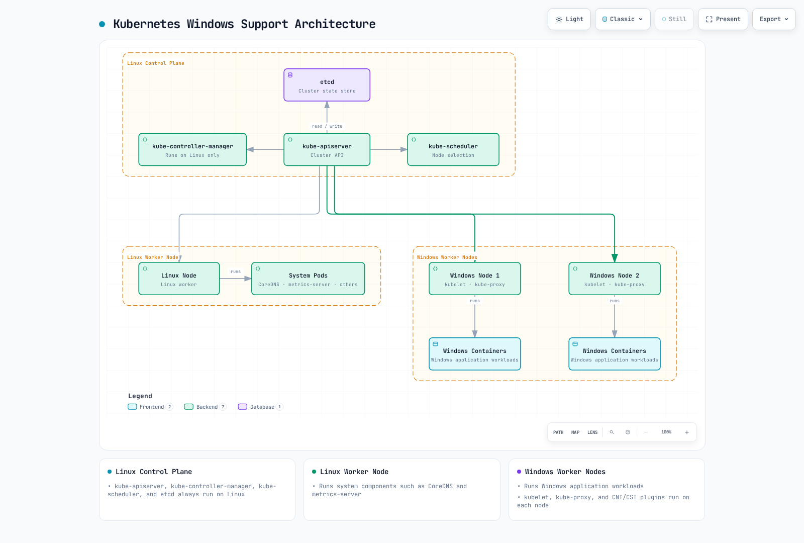
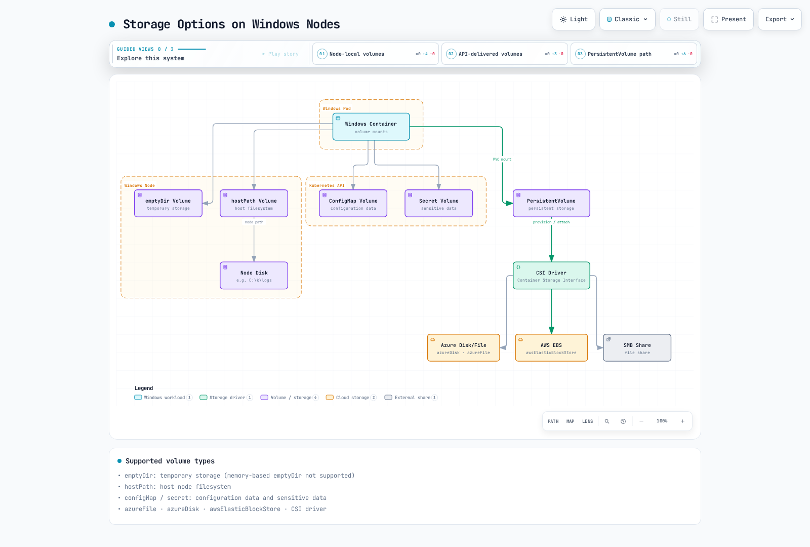

# Kubernetes における Windows

> **確認対象の Kubernetes バージョン**: Kubernetes 1.35、1.36、1.37
> **最終更新日**: 2026年9月11日

Kubernetes はもともと Linux コンテナ向けに設計されましたが、Windows コンテナの本番環境サポートはバージョン 1.14 から追加されました。この章では、Kubernetes で Windows ワークロードを実行する方法、そのアーキテクチャと制限事項、および Amazon EKS の Windows サポートについて説明します。

## 目次
1. [Windows コンテナの概要](#windows-container-overview)
2. [Kubernetes の Windows サポートアーキテクチャ](#kubernetes-windows-support-architecture)
3. [Windows ノードの制限事項](#windows-node-limitations)
4. [Windows ノードのセットアップ](#windows-node-setup)
5. [Windows コンテナのデプロイ](#deploying-windows-containers)
6. [ネットワーキング](#networking)
7. [ストレージ](#storage)
8. [モニタリングとロギング](#monitoring-and-logging)
9. [セキュリティ](#security)
10. [Amazon EKS の Windows サポート](#windows-support-in-amazon-eks)
11. [ベストプラクティス](#best-practices)
12. [まとめ](#conclusion)

## Windows コンテナの概要 {#windows-container-overview}

Windows コンテナは Windows オペレーティングシステム上で実行され、Windows アプリケーションのコンテナ化とデプロイを可能にします。

### Windows コンテナの種類

Windows には 2 種類の分離方式があります。Kubernetes がサポートするのは **プロセス分離のみ** です。以下の Hyper-V の説明は背景知識であり、Kubernetes でデプロイできる選択肢ではありません。

1. **Windows Server Containers**: Linux コンテナと同様に、ホスト OS カーネルを共有します。軽量で起動が速い一方、Microsoft がサポートするホストとイメージの組み合わせを使う必要があります。
2. **Hyper-V Isolation Containers**: 各コンテナは軽量 VM 内で実行され、より高い分離を提供します。ホストとは異なる Windows バージョンを実行できますが、より多くのリソースを使用します。

次の図は、2 種類の Windows コンテナのアーキテクチャの違いを示しています。


[🔍 インタラクティブな図を表示](https://www.atomai.click/kubernetes-docs/archmaps/en-core-10-windows-in-kubernetes-0.html)

### Windows コンテナイメージ

Windows コンテナイメージは Microsoft が提供するベースイメージを基にしています。

1. **Windows Server Core**: 必要最小限の Windows Server 環境を提供する軽量イメージ
2. **Nano Server**: フットプリントを小さくした超軽量イメージ
3. **Windows**: より広範な Windows API を提供しますが、コンテナイメージに完全なデスクトップ/GUI サーバーは含まれません。

Dockerfile の例:

```dockerfile
FROM mcr.microsoft.com/windows/servercore/iis:windowsservercore-ltsc2022
COPY website/ C:/inetpub/wwwroot/
EXPOSE 80
# Inherit the IIS image entrypoint (ServiceMonitor.exe).
```

## Kubernetes の Windows サポートアーキテクチャ {#kubernetes-windows-support-architecture}

Kubernetes の Windows サポートは、Linux と Windows が混在する環境を前提としています。コントロールプレーンのコンポーネントは常に Linux 上で動作し、ワーカーノードには Linux または Windows を使用できます。

### アーキテクチャの概要

Kubernetes の Windows サポートアーキテクチャは次のとおりです。

1. **Linux コントロールプレーン**: kube-apiserver、kube-controller-manager、kube-scheduler、etcd は常に Linux 上で動作します。
2. **Linux ワーカーノード**: CoreDNS、metrics-server などのシステムコンポーネントを実行します。
3. **Windows ワーカーノード**: Windows アプリケーションのワークロードを実行します。



[🔍 インタラクティブな図を表示](https://www.atomai.click/kubernetes-docs/archmaps/en-core-10-windows-in-kubernetes-1.html)

### Windows ノードのコンポーネント

Windows ノードで動作する Kubernetes コンポーネント:

1. **kubelet**: ノード上の Pod とコンテナを管理します。
2. **kube-proxy**: ネットワークルールを管理します。
3. **CNI プラグイン**: ネットワークを構成します。
4. **CSI プラグイン**: ストレージを管理します。

## Windows ノードの制限事項 {#windows-node-limitations}

Kubernetes で Windows ノードを使う際には、次の制限事項に注意してください。

### 機能上の制限

1. `privileged` はサポートされません。ノードエージェントには `hostProcess` と `hostNetwork` を有効にした **HostProcess コンテナ**を使用できますが、ホスト権限を慎重に制限してください。
2. 通常の Windows Pod は `hostNetwork` を使えません。HostProcess は例外です。
3. `spec.os.name: windows` を指定する Pod では、`runAsUser`、`fsGroup`、`seccomp`、capabilities、`readOnlyRootFilesystem` など Linux 専用のフィールドを設定しないでください。
4. OS ごとにイメージと `nodeSelector` を分けて、別々の DaemonSet を使用してください。
5. メモリを使う `emptyDir`、raw block の `volumeDevices`、PIDPressure、Linux 形式の OOM eviction はサポートされません。
6. CPU とメモリの制限には Windows 固有の仕組みが使われます。Windows に Linux の OOM killer はありません。メモリが枯渇すると、割り当てエラーやページング、性能低下が発生する可能性があります。

### ネットワークの制限

L2bridge や overlay などのモードについて、Windows HNS/CNI のサポートマトリックスを確認してください。同じ Pod のコンテナはネットワークと localhost を共有しますが、プロセス名前空間やルートファイルシステムは共有しません。選択した OS、CNI、クラスターの組み合わせで NetworkPolicy、Service、DSR がサポートされるか確認してください。

### オペレーティングシステムのバージョン互換性

Kubernetes v1.37 は Windows Server 2022 と 2025 のワーカーノードをサポートします。この章の例では **Windows Server 2022 + ltsc2022** を使用します。Microsoft の互換性マトリックスとディストリビューションのサポートポリシーを確認し、毎月のセキュリティ更新を適用してください。Hyper-V 分離を使っても、Kubernetes の互換性要件を回避することはできません。

## Windows ノードのセットアップ {#windows-node-setup}

Kubernetes クラスターに Windows ノードを追加する手順を説明します。

### 前提条件

サポート対象の Kubernetes/Windows の組み合わせ、Linux コントロールプレーン、Windows 対応 CNI、CRI 互換の containerd が必要です。Docker Engine だけでは CRI を実装しません。組み込みの dockershim は Kubernetes 1.24 で削除されました。EKS ノードを使う場合は、後述する EKS の手順に従ってください。

### Windows ノードの準備

管理者権限の PowerShell で Containers 機能を有効にし、必要に応じて再起動します。以下は **kubeadm で自己管理するワーカーノード**向けの手順です。公式 sig-windows-tools のレビュー済み commit から `hostprocess/Install-Containerd.ps1` と `hostprocess/PrepareNode.ps1` を取得し、実行前に内容を確認してチェックサムを検証してください。サポート対象の containerd patch と、クラスターに適合する kubelet バージョンを選びます。インストーラーが追加する firewall rule を確認し、port 10250 への通信を必要なコントロールプレーン送信元に制限してください。

```powershell
$ErrorActionPreference = "Stop"
$ContainerdVersion = Read-Host "Validated containerd version (without v)"
$KubernetesVersion = Read-Host "Cluster-compatible Kubernetes version (vX.Y.Z)"
if (-not $ContainerdVersion -or -not $KubernetesVersion) { throw "Versions required" }
.\Install-Containerd.ps1 -ContainerDVersion $ContainerdVersion
.\PrepareNode.ps1 -KubernetesVersion $KubernetesVersion
```

### kubeadm を使って Windows ノードを参加させる

Linux コントロールプレーンで join token を生成します。

```bash
kubeadm token create --print-join-command
```

Windows ノードで join command を実行します。

```powershell
# Run kubeadm join command
kubeadm join <control-plane-host>:<control-plane-port> --token <token> --discovery-token-ca-cert-hash sha256:<hash>

```

### Windows ノードのラベル設定

kubelet が設定する OS、アーキテクチャ、build のラベルを確認してください。スケジューリングを強制するために OS ラベルを上書きしてはいけません。`spec.os.name` は Pod の OS を宣言しますが、scheduler selector の代わりにはなりません。`nodeSelector` も使用してください。

```bash
kubectl get nodes -L kubernetes.io/os,kubernetes.io/arch,node.kubernetes.io/windows-build
```

## Windows コンテナのデプロイ {#deploying-windows-containers}

Kubernetes に Windows コンテナをデプロイする方法を説明します。

### Node Selector の使用

Windows ワークロードが Windows ノードにスケジュールされるよう、node selector を使用してください。

```yaml
apiVersion: apps/v1
kind: Deployment
metadata:
  name: iis-deployment
spec:
  replicas: 2
  selector:
    matchLabels:
      app: iis
  template:
    metadata:
      labels:
        app: iis
    spec:
      os:
        name: windows
      nodeSelector:
        kubernetes.io/os: windows
      containers:
      - name: iis
        image: mcr.microsoft.com/windows/servercore/iis:windowsservercore-ltsc2022
        resources:
          limits:
            cpu: 1
            memory: 800Mi
          requests:
            cpu: .1
            memory: 300Mi
        ports:
        - containerPort: 80
```

### Resource Requests と Limits

Windows コンテナの resource requests と limits は Linux コンテナとは異なる方法で扱われます。

1. **CPU limits**: Windows では CPU limit の適用方法が異なります。たとえば CPU limit を 1 にすると、単一の CPU コアの 100% を使用できます。
2. **メモリ limits**: Windows コンテナはメモリ limits を守りますが、システムプロセスによる追加のオーバーヘッドが発生することがあります。

### コンテナのカスタマイズ

Windows コンテナでカスタムスクリプトを実行する例:

```yaml
apiVersion: v1
kind: Pod
metadata:
  name: windows-custom-script
spec:
  os:
    name: windows
  nodeSelector:
    kubernetes.io/os: windows
  containers:
  - name: windows-container
    image: mcr.microsoft.com/windows/servercore:ltsc2022
    command:
    - powershell.exe
    - -Command
    - |
      while ($true) {
        Write-Host "Hello from Windows container"
        Start-Sleep -Seconds 10
      }
```

### マルチコンテナ Pod

Windows は複数コンテナの Pod もサポートしますが、いくつか制限があります。

```yaml
apiVersion: v1
kind: Pod
metadata:
  name: windows-multi-container
spec:
  os:
    name: windows
  nodeSelector:
    kubernetes.io/os: windows
  containers:
  - name: writer
    image: mcr.microsoft.com/windows/servercore:ltsc2022
    command: [powershell.exe, -Command, 'while ($true) { Add-Content C:\shared-logs\app.log "Log at $(Get-Date)"; Start-Sleep 10 }']
    volumeMounts:
    - name: logs
      mountPath: C:\shared-logs
  - name: logger
    image: mcr.microsoft.com/windows/servercore:ltsc2022
    command: [powershell.exe, -Command, 'while (-not (Test-Path C:\shared-logs\app.log)) { Start-Sleep 2 }; Get-Content C:\shared-logs\app.log -Wait']
    volumeMounts:
    - name: logs
      mountPath: C:\shared-logs
      readOnly: true
  volumes:
  - name: logs
    emptyDir: {}
```

## ネットワーキング {#networking}

Windows ノードのネットワークには、Linux ノードとは異なる特性があります。

次の図は、Windows と Linux のノードが混在する Kubernetes クラスターのネットワークアーキテクチャを示しています。


[🔍 インタラクティブな図を表示](https://www.atomai.click/kubernetes-docs/archmaps/en-core-10-windows-in-kubernetes-2.html)

### サポートされるネットワークプラグイン

Windows ノードでサポートされるネットワークプラグイン:

1. **Flannel**: VXLAN または host-gw モード
2. **Calico**: VXLAN モード
3. **Antrea**: OVS ベースのネットワーク
4. **Azure CNI**: Azure 環境で使用
5. **AWS VPC CNI**: AWS 環境で使用

### Flannel のセットアップ例

Linux 用 Flannel manifest を Windows DaemonSet にコピーしても動作しません。Windows バイナリ、HNS、CNI のパス、RBAC、HostProcess の設定が必要です。ディストリビューションが提供する Windows 向けのインストール手順を使い、Linux 側のネットワーク設定を Windows の win-overlay/win-bridge 設定と調整してください。Flannel Windows VXLAN に必要な VNI 4096/UDP 4789 も確認します。通常のアプリケーション Pod に `hostNetwork` を追加しても、インストール手順の代わりにはなりません。

### Service の公開

Windows ノード上の Service を公開する方法:

```yaml
apiVersion: v1
kind: Service
metadata:
  name: iis-service
spec:
  selector:
    app: iis
  ports:
  - port: 80
    targetPort: 80
  type: LoadBalancer
```

### NetworkPolicy

Windows ノードで NetworkPolicy を使うには、Calico など NetworkPolicy に対応した CNI プラグインが必要です。

```yaml
apiVersion: networking.k8s.io/v1
kind: NetworkPolicy
metadata:
  name: allow-frontend-to-backend
  namespace: default
spec:
  podSelector:
    matchLabels:
      app: backend
      os: windows
  ingress:
  - from:
    - podSelector:
        matchLabels:
          app: frontend
    ports:
    - protocol: TCP
      port: 80
```

## ストレージ {#storage}

Windows ノードで利用できるストレージオプションを説明します。

次の図は、Windows ノードで利用できるさまざまなストレージを示しています。



[🔍 インタラクティブな図を表示](https://www.atomai.click/kubernetes-docs/archmaps/en-core-10-windows-in-kubernetes-3.html)

### サポートされる Volume Type

Windows ノードでサポートされる volume type:

1. **emptyDir**: 一時ストレージ（メモリベースの emptyDir は非対応）
2. **hostPath**: ホストノードのファイルシステム
3. **configMap**: 構成データ
4. **secret**: 機密データ
5. **CSI/PVC**: Windows 対応の Azure Files、Azure Disk、EBS、SMB CSI driver によるファイルシステム volume。各 driver の OS とファイルシステムの対応を確認してください。

### emptyDir Volume の例

```yaml
apiVersion: v1
kind: Pod
metadata:
  name: windows-emptydir
spec:
  os:
    name: windows
  nodeSelector:
    kubernetes.io/os: windows
  containers:
  - name: windows-container
    image: mcr.microsoft.com/windows/servercore:ltsc2022
    volumeMounts:
    - name: temp-volume
      mountPath: C:\temp
    command:
    - powershell.exe
    - -Command
    - |
      Set-Content -Path C:\temp\test.txt -Value "Hello from Windows"
      while ($true) {
        Get-Content -Path C:\temp\test.txt
        Start-Sleep -Seconds 10
      }
  volumes:
  - name: temp-volume
    emptyDir: {}
```

### hostPath Volume の例

```yaml
apiVersion: v1
kind: Pod
metadata:
  name: windows-hostpath
spec:
  os:
    name: windows
  nodeSelector:
    kubernetes.io/os: windows
  containers:
  - name: windows-container
    image: mcr.microsoft.com/windows/servercore:ltsc2022
    volumeMounts:
    - name: logs-volume
      mountPath: C:\logs
    command:
    - powershell.exe
    - -Command
    - |
      Set-Content -Path C:\logs\app.log -Value "Application log"
      while ($true) {
        Add-Content -Path C:\logs\app.log -Value "Log entry at $(Get-Date)"
        Start-Sleep -Seconds 10
      }
  volumes:
  - name: logs-volume
    hostPath:
      path: C:\k\logs
      type: DirectoryOrCreate
```

### ConfigMap と Secret Volume の例

```yaml
apiVersion: v1
kind: ConfigMap
metadata:
  name: windows-config
data:
  config.json: |
    {
      "setting1": "value1",
      "setting2": "value2"
    }
---
apiVersion: v1
kind: Secret
metadata:
  name: windows-secret
type: Opaque
data:
  username: YWRtaW4=  # admin
  password: cGFzc3dvcmQ=  # password
---
apiVersion: v1
kind: Pod
metadata:
  name: windows-config-secret
spec:
  os:
    name: windows
  nodeSelector:
    kubernetes.io/os: windows
  containers:
  - name: windows-container
    image: mcr.microsoft.com/windows/servercore:ltsc2022
    volumeMounts:
    - name: config-volume
      mountPath: C:\config
    - name: secret-volume
      mountPath: C:\secret
      readOnly: true
    command:
    - powershell.exe
    - -Command
    - |
      Get-Content -Path C:\config\config.json
      if (-not (Test-Path C:\secret\username) -or -not (Test-Path C:\secret\password)) { throw "Secret files missing" }
      while ($true) { Start-Sleep -Seconds 10 }
  volumes:
  - name: config-volume
    configMap:
      name: windows-config
  - name: secret-volume
    secret:
      secretName: windows-secret
```

### CSI Driver の使用

前提条件: Windows 対応の CSI driver とファイルシステムを導入した `windows-csi` を作成します（例: NTFS と WaitForFirstConsumer を使う EBS CSI）。この名前の StorageClass を作るだけでは driver はインストールされません。EBS volume は AZ に結び付くため、raw block ではなくファイルシステムモードを使います。

例:

```yaml
apiVersion: v1
kind: PersistentVolumeClaim
metadata:
  name: windows-pvc
spec:
  accessModes:
  - ReadWriteOnce
  resources:
    requests:
      storage: 10Gi
  storageClassName: windows-csi
---
apiVersion: v1
kind: Pod
metadata:
  name: windows-csi-pod
spec:
  os:
    name: windows
  nodeSelector:
    kubernetes.io/os: windows
  containers:
  - name: windows-container
    image: mcr.microsoft.com/windows/servercore:ltsc2022
    volumeMounts:
    - name: data-volume
      mountPath: C:\data
    command:
    - powershell.exe
    - -Command
    - |
      Set-Content -Path C:\data\file.txt -Value "Persistent data"
      while ($true) { Start-Sleep -Seconds 10 }
  volumes:
  - name: data-volume
    persistentVolumeClaim:
      claimName: windows-pvc
```

## モニタリングとロギング {#monitoring-and-logging}

Windows ノードとコンテナのモニタリングおよびロギング方法を説明します。

### モニタリング

Windows ノードのモニタリングに使うツール:

1. **Prometheus Windows Exporter**: Windows ノードのメトリクスを収集
2. **metrics-server**: 基本的なリソース使用量メトリクスを提供
3. **Datadog、Dynatrace、New Relic**: 商用モニタリングソリューション

Windows ノードへの Prometheus Windows Exporter のインストール:

```powershell
# Download a supported release MSI, verify its checksum, then install locally.
$ExporterMsi = (Resolve-Path .\windows_exporter.msi).Path
Start-Process msiexec.exe -ArgumentList "/i `"$ExporterMsi`" ENABLED_COLLECTORS=cpu,memory,logical_disk,net,service,os,system REMOVE=FirewallException /quiet" -Wait
# Restrict any separately configured port 9182 firewall rule to Prometheus sources.
```

Prometheus の設定:

```yaml
scrape_configs:
  - job_name: 'windows-nodes'
    static_configs:
      - targets: ['windows-node-1:9182', 'windows-node-2:9182']
```

### ロギング

Windows コンテナのログ収集に使うツール:

1. **Fluent Bit**: 軽量ログコレクター
2. **Fluentd**: ログの収集と転送
3. **Elasticsearch**: ログの保存と検索
4. **Azure Monitor**: Azure 環境で使用
5. **CloudWatch Logs**: AWS 環境で使用

Windows ノードに Fluent Bit をインストールする例:

実際の Elasticsearch endpoint、認証方式、信頼済み CA を設定してください。ServiceAccount には Security event log の読み取り権限と checkpoint path への書き込み権限が必要です。

```powershell
# Install a supported Windows Fluent Bit release, verify its checksum,
# and arrange bin/ and conf/ under C:\fluent-bit before continuing.

# Create configuration file
@"
[SERVICE]
    Flush        5
    Daemon       Off
    Log_Level    info

[INPUT]
    Name         winlog
    Channels     Application,System,Security
    DB           C:\fluent-bit\winlog.db

[OUTPUT]
    Name         es
    Match        *
    Host         elasticsearch-host
    Port         9200
    Index        windows_logs
    Suppress_Type_Name On
    tls          On
    tls.verify   On
"@ | Out-File -FilePath C:\fluent-bit\conf\fluent-bit.conf -Encoding ascii

# Register service
sc.exe create fluent-bit binPath= "C:\fluent-bit\bin\fluent-bit.exe -c C:\fluent-bit\conf\fluent-bit.conf"
Start-Service fluent-bit
```

### アプリケーションログの収集

アプリケーションイメージに Microsoft LogMonitor を組み込み、LogMonitorConfig.json で実際のファイル、ETW、Event Log の情報源を指定して IIS ログを stdout に出力します。ServiceMonitor と IIS のライフサイクルが保たれるよう、entrypoint をテストしてください。上の共有ファイル sidecar は volume 共有の例であり、ファイルローテーションや再起動時の重複/欠落レコードには対応しません。本番用 collector には checkpoint とローテーション処理が必要です。`kubectl logs` が取得するのは stdout/stderr であり、IIS のファイルを自動収集するものではありません。

## セキュリティ {#security}

Windows ノードとコンテナのセキュリティ上の考慮事項を説明します。

### Windows ノードのセキュリティ

Windows ノードのセキュリティに関する推奨事項:

1. **最新の更新プログラムを適用する**: Windows のセキュリティ更新を定期的に適用します。
2. **Firewall を構成する**: Windows Defender Firewall を適切に構成します。
3. **最小権限の原則**: 必要最小限の権限だけを付与します。
4. **ウイルス対策ソフトウェア**: 適切なソフトウェアをインストールします。
5. **Group Policy**: セキュリティを強化するポリシーを適用します。

### Windows コンテナのセキュリティ

Windows コンテナのセキュリティに関する推奨事項:

1. **最小のベースイメージ**: Nano Server など、必要最小限のベースイメージを使います。
2. **イメージスキャン**: コンテナイメージの脆弱性をスキャンします。
3. **ファイルシステム権限**: NTFS ACL を制限し、対応する場合は読み取り専用データ mount を使います。Windows では `readOnlyRootFilesystem` はサポートされません。
4. **非特権ユーザー**: アプリケーションを非特権ユーザーとして実行します。
5. **NetworkPolicy**: 適切なネットワークポリシーを適用します。

### RunAsUsername

Windows コンテナ内で実行するユーザーを指定するには、`runAsUser` の代わりに `securityContext.windowsOptions.runAsUserName` を使用できます。

```yaml
apiVersion: v1
kind: Pod
metadata:
  name: windows-runasusername
spec:
  os:
    name: windows
  nodeSelector:
    kubernetes.io/os: windows
  securityContext:
    windowsOptions:
      runAsUserName: "ContainerUser"
  containers:
  - name: windows-container
    image: mcr.microsoft.com/windows/servercore:ltsc2022
    command:
    - powershell.exe
    - -Command
    - |
      whoami
      while ($true) { Start-Sleep -Seconds 10 }
```

### Group Managed Service Accounts (gMSA)

`gmsaCredentialSpecName` が参照するのは、Secret ではなくクラスター範囲の **GMSACredentialSpec** です。CRD、mutating/validating webhook、ServiceAccount の `use` RBAC 権限を設定してください。例のドメイン名とホスト名を置き換え、CredentialSpec module で AD SID/GUID/NetBIOS/DNS の値を生成します。この例はドメイン参加済みホストを使います。ドメイン非参加ホスト向けのサポート対象のポータブルな ID 設定には、別途構成が必要です。

最初に `Get-KdsRootKey` を確認します。新しいキーが必要な場合は、AD 管理者が `Add-KdsRootKey -EffectiveImmediately` を実行し、レプリケーション時間（最大 10 時間）を待ちます。10 時間の過去時刻を指定する方法は、単一 DC のテスト環境に限られます。gMSA はネットワーク資格情報を提供しますが、コンテナをドメイン参加させるものではなく、`whoami` の結果を gMSA 名に変えるものでもありません。実際のサービスで Kerberos 認証を検証し、`klist` を確認してください。

```powershell
# On an authorized AD administration host, after KDS readiness is confirmed:
Import-Module ActiveDirectory
New-ADGroup -Name 'WebAppHosts' -SamAccountName 'WebAppHosts' -GroupScope DomainLocal
Add-ADGroupMember -Identity 'WebAppHosts' -Members 'ContainerHost01$'
New-ADServiceAccount -Name WebApp1 -DNSHostName WebApp1.contoso.com -ServicePrincipalNames http/WebApp1.contoso.com -PrincipalsAllowedToRetrieveManagedPassword WebAppHosts
# Install/review the official CredentialSpec PowerShell module first.
Import-Module CredentialSpec
New-CredentialSpec -AccountName WebApp1 -Path C:\gmsa-credspec.json
$spec = Get-Content C:\gmsa-credspec.json -Raw | ConvertFrom-Json
@{ apiVersion='windows.k8s.io/v1'; kind='GMSACredentialSpec'; metadata=@{name='gmsa-cred-spec'}; credspec=$spec } |
    ConvertTo-Json -Depth 20 | Set-Content C:\gmsa-resource.json -Encoding utf8
```

```bash
# Requires the GMSA CRD and mutating/validating webhooks installed by an administrator.
kubectl apply -f gmsa-resource.json
```

```yaml
apiVersion: v1
kind: ServiceAccount
metadata:
  name: windows-app
  namespace: default
---
apiVersion: rbac.authorization.k8s.io/v1
kind: ClusterRole
metadata:
  name: use-webapp-gmsa
rules:
- apiGroups: [windows.k8s.io]
  resources: [gmsacredentialspecs]
  resourceNames: [gmsa-cred-spec]
  verbs: [use]
---
apiVersion: rbac.authorization.k8s.io/v1
kind: RoleBinding
metadata:
  name: use-webapp-gmsa
  namespace: default
roleRef:
  apiGroup: rbac.authorization.k8s.io
  kind: ClusterRole
  name: use-webapp-gmsa
subjects:
- kind: ServiceAccount
  name: windows-app
  namespace: default
---
apiVersion: v1
kind: Pod
metadata:
  name: windows-gmsa
  namespace: default
spec:
  os:
    name: windows
  serviceAccountName: windows-app
  nodeSelector:
    kubernetes.io/os: windows
  securityContext:
    windowsOptions:
      gmsaCredentialSpecName: gmsa-cred-spec
      runAsUserName: 'NT AUTHORITY\NETWORK SERVICE'
  containers:
  - name: windows-container
    image: mcr.microsoft.com/windows/servercore:ltsc2022
    command: [powershell.exe, -Command, 'whoami; Start-Sleep -Seconds 3600']
```

## Amazon EKS の Windows サポート {#windows-support-in-amazon-eks}

Amazon EKS で Windows ワークロードを実行する方法を説明します。

次の図は、Amazon EKS の Windows サポートアーキテクチャを示しています。


[🔍 インタラクティブな図を表示](https://www.atomai.click/kubernetes-docs/archmaps/en-core-10-windows-in-kubernetes-4.html)

### EKS で Windows サポートを有効にする

EKS は Windows IPAM を担当する VPC resource controller を管理します。古い release-1.11 の controller/webhook manifest をインストールしないでください。クラスター IAM role に `AmazonEKSVPCResourceController` 権限を付与し、現在の AWS 手順に従って `kube-system/amazon-vpc-cni` に `enable-windows-ipam: "true"` を設定します。既存のキーを保持し、該当する場合は管理元の Helm/add-on 手順で構成してください。

CoreDNS 用に Linux ノード、またはサポートされる Fargate 構成を用意します。Windows は EKS Auto Mode、Fargate workload、Hybrid Nodes、IPv6、custom networking、Pod 用 security group をサポートしません。Windows ノードロールの access entry type は `EC2_WINDOWS` です。従来の aws-auth mapping を使う場合は `eks:kube-proxy-windows` group が必要です。

### Windows Node Group の作成

eksctl で Windows node group を作成します。

```bash
eksctl create nodegroup \
  --cluster my-cluster \
  --region us-west-2 \
  --name windows-ng \
  --node-type t3.large \
  --nodes 2 \
  --nodes-min 1 \
  --nodes-max 4 \
  --managed \
  --node-ami-family WindowsServer2022FullContainer
```

AWS Management Console で Windows node group を作成する手順:

1. EKS コンソールでクラスターを選択します。
2. 「Compute」タブを選択します。
3. 「Add node group」をクリックします。
4. node group の詳細を入力します。
5. AMI type として「Windows」を選択します。
6. 残りの設定を構成して作成します。

### EKS への Windows アプリケーションのデプロイ

EKS に Windows アプリケーションをデプロイする例:

```yaml
apiVersion: apps/v1
kind: Deployment
metadata:
  name: windows-server-iis
spec:
  selector:
    matchLabels:
      app: windows-server-iis
      tier: backend
      track: stable
  replicas: 2
  template:
    metadata:
      labels:
        app: windows-server-iis
        tier: backend
        track: stable
    spec:
      os:
        name: windows
      nodeSelector:
        kubernetes.io/os: windows
      containers:
      - name: windows-server-iis
        image: mcr.microsoft.com/windows/servercore/iis:windowsservercore-ltsc2022
        ports:
        - name: http
          containerPort: 80
        resources:
          limits:
            cpu: 1
            memory: 800Mi
          requests:
            cpu: .1
            memory: 300Mi
---
apiVersion: v1
kind: Service
metadata:
  name: windows-server-iis-service
  labels:
    app: windows-server-iis
spec:
  ports:
  - port: 80
    protocol: TCP
  selector:
    app: windows-server-iis
  type: LoadBalancer
```

### EKS の Windows コンテナロギング

Windows Container Insights は CloudWatch Observability EKS add-on 1.5.0 以降でサポートされます。クラスターと互換性のある add-on バージョンを選び、IAM 権限と Windows agent の構成を確認してください。Windows Application Signals はサポートされません。

kubelet の CRI log path（通常は `C:\var\log\pods` と `C:\var\log\containers`）から Windows の stdout/stderr を収集します。Linux の `/var/log` や Docker parser の設定をコピーせず、ディストリビューション固有のパスを確認してください。EKS は kubelet/kube-proxy のログを **EKS Windows** event log に出力します。.evtx ファイルを通常のコンテナに mount しても、ホストの event API を winlog で取得できるようにはなりません。ホストサービスまたはレビュー済みの HostProcess collector を使用してください。

## ベストプラクティス {#best-practices}

Kubernetes で Windows ワークロードを実行するためのベストプラクティスを説明します。

### クラスター設計

1. **混在ノードプール**: Linux と Windows のノードを適切に組み合わせます。
2. **ノードラベルと taint**: ワークロードを分離するため、適切なラベルと taint を使います。
3. **バージョン互換性**: Kubernetes と Windows のバージョンの互換性を確認します。
4. **ネットワークプラグインの選定**: Windows に対応したプラグインを選びます。
5. **高可用性**: 重要なワークロードに高可用性を構成します。

### アプリケーション設計

1. **コンテナイメージの最適化**: 小さく効率的なイメージを使います。
2. **Resource Requests と Limits**: 適切な値を設定します。
3. **ステートレス設計**: 可能な場合はステートレスなアプリケーションを設計します。
4. **ロギングとモニタリング**: 効果的なロギングとモニタリングを構成します。
5. **セキュリティ強化**: 適切な security context とネットワークポリシーを適用します。

### 運用

1. **定期更新**: Windows ノードとコンテナイメージを定期的に更新します。
2. **自動化**: デプロイと管理作業を自動化します。
3. **バックアップと復旧**: 重要なデータを定期的にバックアップします。
4. **トラブルシューティングツール**: 適切なツールと手順を用意します。
5. **ドキュメント化**: 構成と手順を記録します。

### EKS 固有のベストプラクティス

1. **マネージド Node Group**: 可能な場合はマネージド node group を使います。
2. **IAM Roles for Service Accounts (IRSA)**: Pod 単位で IAM 権限を管理します。
3. **VPC CNI の構成**: ネットワーク要件に応じて設定します。
4. **Security Group**: 適切な security group を構成します。
5. **コスト最適化**: 適切なインスタンスタイプとサイズを選択します。

## まとめ {#conclusion}

Kubernetes の Windows サポートは進化を続けており、Windows ワークロードを本番環境で実行できます。Windows ノードは Linux ノードと同じクラスター内で動作でき、多様なワークロードを 1 つのクラスターで管理できます。

Windows コンテナを使うと、.NET Framework アプリケーション、Windows サービスなど、Windows 固有のワークロードをコンテナ化して Kubernetes のオーケストレーション機能を活用できます。一方、Linux コンテナとは異なる制限があるため、その内容を把握し、適切に対処する必要があります。

Amazon EKS は Windows ノードをマネージドサービスとして提供し、Windows ワークロードのデプロイと管理を容易にします。EKS の Windows サポートを活用すると、Windows アプリケーションの最新のコンテナ環境への移行を簡素化できます。

Kubernetes で Windows を導入するには、適切な計画、設計、運用のベストプラクティスに従ってください。これにより Windows と Linux のワークロードを効率よく管理し、Kubernetes の利点を活用できます。

## クイズ

この章で学んだ内容を確認するには、[Kubernetes の Windows クイズ](../quizzes/core/10-windows-in-kubernetes-quiz.md)に挑戦してください。

## 検証用リファレンス

- https://kubernetes.io/docs/concepts/windows/intro/
- https://kubernetes.io/docs/tasks/administer-cluster/kubeadm/adding-windows-nodes/
- https://kubernetes.io/docs/tasks/configure-pod-container/create-hostprocess-pod/
- https://kubernetes.io/docs/tasks/configure-pod-container/configure-gmsa/
- https://learn.microsoft.com/en-us/virtualization/windowscontainers/deploy-containers/version-compatibility
- https://github.com/microsoft/windows-container-tools/tree/main/LogMonitor
- https://docs.aws.amazon.com/eks/latest/userguide/windows-support.html
- https://docs.aws.amazon.com/AmazonCloudWatch/latest/monitoring/install-CloudWatch-Observability-EKS-addon.html
