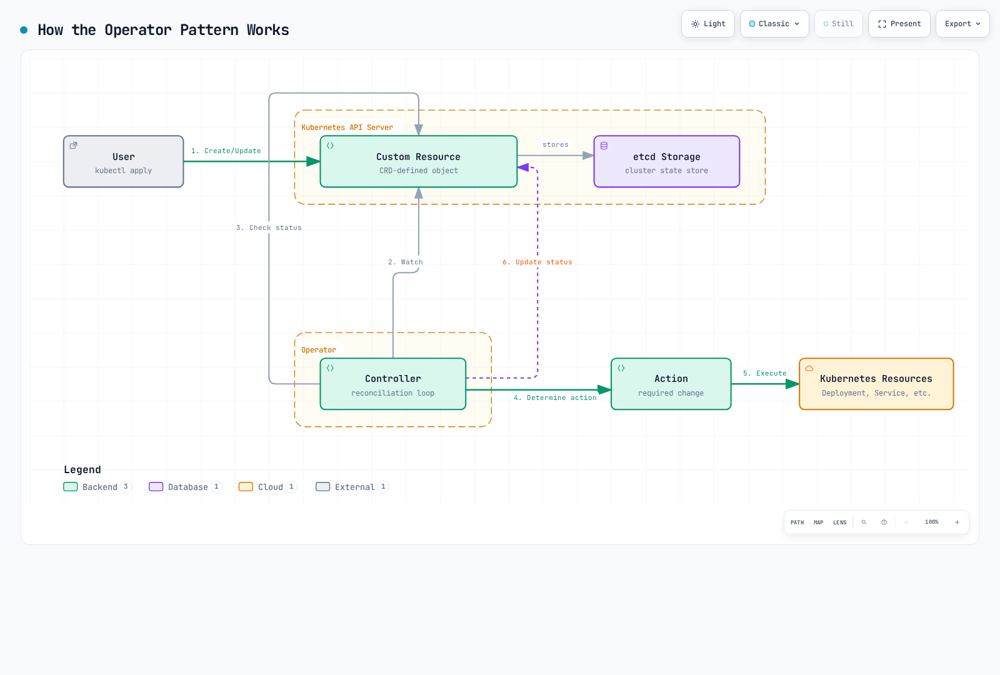

# Kubernetes の拡張

> **レビュー済みのアップストリーム Kubernetes バージョン**: Kubernetes 1.35, 1.36, 1.37
> **最終更新**: October 12, 2026

Kubernetes は拡張性を念頭に設計されたプラットフォームであり、さまざまな方法で機能を拡張できます。この章では、Kubernetes を拡張する各種方法と、Amazon EKS で拡張機能を活用する方法を説明します。

## 目次
1. [Kubernetes 拡張の概要](#kubernetes-extension-overview)
2. [Custom Resources](#custom-resources)
3. [Operator パターン](#operator-pattern)
4. [Admission Controller](#admission-controllers)
5. [API Server の拡張](#api-server-extensions)
6. [Scheduler の拡張](#scheduler-extensions)
7. [Cloud Controller Manager](#cloud-controller-manager)
8. [CSI (Container Storage Interface)](#csi-container-storage-interface)
9. [CNI (Container Network Interface)](#cni-container-network-interface)
10. [Device Plugin](#device-plugins)
11. [Amazon EKS の拡張機能](#extension-features-in-amazon-eks)
12. [ベストプラクティス](#best-practices)
13. [まとめ](#conclusion)

## Kubernetes 拡張の概要

Kubernetes には、基本機能を拡張およびカスタマイズするための多様な拡張ポイントがあります。主な拡張ポイントは次のとおりです。

1. **Custom Resources**: 新しい API オブジェクトタイプを定義する
2. **Operators**: Custom Resources と Controller を組み合わせ、複雑なアプリケーションを管理する
3. **Admission Controllers**: API リクエストをインターセプト、変更、または検証する
4. **API Server Extensions**: API Server に新しいエンドポイントを追加する
5. **Scheduler Extensions**: Pod のスケジューリングロジックをカスタマイズする
6. **Cloud Controller Manager**: クラウドプロバイダー固有の機能を統合する
7. **CSI (Container Storage Interface)**: ストレージシステムを統合する
8. **CNI (Container Network Interface)**: ネットワーキングソリューションを統合する
9. **Device Plugins**: 特殊なハードウェアを統合する

次の図は、Kubernetes の主な拡張ポイントを示しています。


[🔍 インタラクティブ図を表示](https://www.atomai.click/kubernetes-docs/archmaps/en-core-11-extending-kubernetes-0.html)

### 拡張方法の選択

適切な拡張方法を選択する際の考慮事項は次のとおりです。

1. **ユースケース**: 拡張したい機能の種類
2. **複雑さ**: 実装および保守の複雑さ
3. **パフォーマンスへの影響**: 拡張がクラスターのパフォーマンスに与える影響
4. **アップグレード互換性**: Kubernetes バージョンアップグレードとの互換性
5. **コミュニティサポート**: 拡張方法に対するコミュニティサポートの水準

## Custom Resources

Custom Resources は、Kubernetes API を拡張して新しいオブジェクトタイプを定義するための方法です。

次の図は、Custom Resources の動作を示しています。


[🔍 インタラクティブ図を表示](https://www.atomai.click/kubernetes-docs/archmaps/en-core-11-extending-kubernetes-1.html)

### Custom Resource Definitions (CRD)

CRD は新しいリソースタイプを定義する最も簡単な方法です。

```yaml
apiVersion: apiextensions.k8s.io/v1
kind: CustomResourceDefinition
metadata:
  name: backups.example.com
spec:
  group: example.com
  names:
    kind: Backup
    listKind: BackupList
    plural: backups
    singular: backup
    shortNames:
    - bk
  scope: Namespaced
  versions:
  - name: v1
    served: true
    storage: true
    schema:
      openAPIV3Schema:
        type: object
        properties:
          spec:
            type: object
            properties:
              source:
                type: string
              destination:
                type: string
              schedule:
                type: string
            required:
            - source
            - destination
          status:
            type: object
            properties:
              phase:
                type: string
              lastBackupTime:
                type: string
                format: date-time
    subresources:
      status: {}
    additionalPrinterColumns:
    - name: Status
      type: string
      jsonPath: .status.phase
    - name: Age
      type: date
      jsonPath: .metadata.creationTimestamp
```

上記の例では、`Backup` という新しいリソースタイプを定義し、リソースのスキーマと追加の表示列を指定しています。

### Custom Resource インスタンスの作成

CRD の Established 条件が true になった後に、インスタンスを作成します。CRD はデータを保存・検証しますが、Controller なしにバックアップを実行することはありません。

```yaml
apiVersion: example.com/v1
kind: Backup
metadata:
  name: daily-backup
spec:
  source: /data
  destination: s3://my-bucket/backups
  schedule: "0 0 * * *"
```

### Custom Resource の検証

CRD の OpenAPI v3 スキーマを使用して Custom Resources を検証できます。

```yaml
openAPIV3Schema:
  type: object
  properties:
    spec:
      type: object
      properties:
        replicas:
          type: integer
          minimum: 1
          maximum: 10
        image:
          type: string
          minLength: 1
      required:
      - replicas
      - image
```

上記の例では、`replicas` フィールドは 1 から 10 の整数である必要があり、`image` フィールドは空であってはなりません。イメージの可用性および署名チェックには、別途ポリシーが必要です。

### バージョン管理

CRD は API の進化を可能にするため、複数のバージョンをサポートします。

```yaml
versions:
- name: v1alpha1
  served: true
  storage: false
- name: v1beta1
  served: true
  storage: false
- name: v1
  served: true
  storage: true
```

上記の例では、`v1alpha1`、`v1beta1`、`v1` の 3 バージョンが提供されますが、新規の書き込みには `v1` が使用されます。これは versions のフラグメントです。各バージョンに構造化スキーマを含めてください。既存オブジェクトは自動的に書き換えられないため、古い storedVersions エントリを削除する前にストレージを移行してください。

### Conversion Webhook

Conversion Webhook を使用して、異なるバージョン間の変換を処理できます。

```yaml
# Merge this spec fragment into the complete CRD above.
spec:
  conversion:
    strategy: Webhook
    webhook:
      clientConfig:
        service:
          namespace: default
          name: example-conversion-webhook
          path: /convert
        caBundle: <base64-encoded-ca-cert>
      conversionReviewVersions:
      - v1
```

## Operator パターン

Operator パターンは、Custom Resources と Controller を組み合わせて、複雑なアプリケーションの運用知識を自動化する方法です。

次の図は、Operator パターンの動作を示しています。



[🔍 インタラクティブ図を表示](https://www.atomai.click/kubernetes-docs/archmaps/en-core-11-extending-kubernetes-2.html)

### Operator の概念

Operator は次のコンポーネントで構成されます。

1. **Custom Resource Definition (CRD)**: 管理対象リソースのスキーマを定義する
2. **Controller**: Custom Resources を監視し、望ましい状態に調整するロジック
3. **Kubernetes API Client**: Kubernetes API とやり取りするためのクライアント

### Operator の例

データベース Operator の例です。

```yaml
# Custom Resource Definition
apiVersion: apiextensions.k8s.io/v1
kind: CustomResourceDefinition
metadata:
  name: databases.example.com
spec:
  group: example.com
  names:
    kind: Database
    listKind: DatabaseList
    plural: databases
    singular: database
    shortNames:
    - db
  scope: Namespaced
  versions:
  - name: v1
    served: true
    storage: true
    schema:
      openAPIV3Schema:
        type: object
        properties:
          spec:
            type: object
            properties:
              engine:
                type: string
                enum:
                - mysql
                - postgresql
              version:
                type: string
              storageSize:
                type: string
              replicas:
                type: integer
                minimum: 1
            required:
            - engine
            - version
            - storageSize
          status:
            type: object
            properties:
              phase:
                type: string
              endpoint:
                type: string
    subresources:
      status: {}
```

```yaml
# Database Instance
apiVersion: example.com/v1
kind: Database
metadata:
  name: my-db
spec:
  engine: postgresql
  version: "17"
  storageSize: 10Gi
  replicas: 3
```

### Operator 開発ツール

Operator 開発用のツールは次のとおりです。

1. **Operator SDK**: Go、Ansible、または Helm を使用して Operator を開発する
2. **KUDO (Kubernetes Universal Declarative Operator)**: 宣言的に Operator を開発する
3. **Kubebuilder**: Go ベースの Operator 開発フレームワーク
4. **Metacontroller**: Webhook ベースの Operator 開発

#### Operator SDK の例

Operator SDK を使用して Operator を作成します。

```bash
: "${OPERATOR_IMAGE:?Set a registry image tag or digest you control}"
# Install a reviewed supported Operator SDK release and verify its checksum first.

# Create new operator project
operator-sdk init --domain example.com --repo github.com/example/database-operator

# Create API
operator-sdk create api --group database --version v1 --kind Database --resource --controller

# Implement controller (main.go, controllers/database_controller.go, etc.)

# Build and deploy operator
make docker-build docker-push IMG="$OPERATOR_IMAGE"
make deploy IMG="$OPERATOR_IMAGE"
```

### 一般的な Operator

一般的なオープンソース Operator は次のとおりです。

1. **Prometheus Operator**: Prometheus モニタリングスタックを管理する
2. **Elasticsearch Operator**: Elasticsearch クラスターを管理する
3. **CoreOS etcd Operator (archived)**: 過去の etcd 自動化の例であり、現在のインストール推奨ではありません。
4. **PostgreSQL Operator**: PostgreSQL データベースを管理する
5. **OpenTelemetry Operator**: Jaeger v2 をデプロイします。旧 Jaeger Operator は廃止された Jaeger v1 のみをサポートします。
6. **Strimzi Kafka Operator**: Apache Kafka クラスターを管理する
7. **Istio in-cluster Operator (removed in 1.24)**: 過去の例です。サポートされている Helm/istioctl のインストールワークフローを使用してください。
## Admission Controller

Admission Controller は、Kubernetes API Server へのリクエストをインターセプトし、変更または検証する Plugin です。

次の図は、Admission Controller の動作を示しています。


[🔍 インタラクティブ図を表示](https://www.atomai.click/kubernetes-docs/archmaps/en-core-11-extending-kubernetes-3.html)

### Admission Controller の種類

Kubernetes には 2 種類の Admission Controller があります。

1. **Mutating Admission Controllers**: リソースを変更できる
2. **Validating Admission Controllers**: リソースを検証のみできる

### 組み込み Admission Controller

Kubernetes には複数の組み込み Admission Controller があります。

1. **NamespaceLifecycle**: 削除中の Namespace でのリソース作成を防止する
2. **LimitRanger**: Pod および Container のデフォルトリソース制限を設定する
3. **ServiceAccount**: Pod の ServiceAccount をデフォルト設定・検証し、automount が無効でない限り Projected Token Volume を注入します。デフォルト Account は別の Controller が作成します。
4. **DefaultStorageClass**: PVC にデフォルト Storage Class を割り当てる
5. **ResourceQuota**: Namespace ごとのリソース使用量を制限する
6. **PodSecurity**: Namespace の Pod Security Standards を適用します。PodSecurityPolicy は 1.25 で削除されました。
7. **NodeRestriction**: Node が変更できるリソースを制限する

### Webhook Admission Controller

Webhook Admission Controller を使用してカスタムロジックを実装できます。

```yaml
# Mutating Webhook Configuration
apiVersion: admissionregistration.k8s.io/v1
kind: MutatingWebhookConfiguration
metadata:
  name: pod-mutating-webhook
webhooks:
- name: pod-mutator.example.com
  clientConfig:
    service:
      namespace: default
      name: pod-mutating-webhook
      path: "/mutate"
    caBundle: <base64-encoded-ca-cert>
  rules:
  - apiGroups: [""]
    apiVersions: ["v1"]
    resources: ["pods"]
    operations: ["CREATE"]
    scope: "Namespaced"
  admissionReviewVersions: ["v1"]
  sideEffects: None
  timeoutSeconds: 5
```

```yaml
# Validating Webhook Configuration
apiVersion: admissionregistration.k8s.io/v1
kind: ValidatingWebhookConfiguration
metadata:
  name: pod-validating-webhook
webhooks:
- name: pod-validator.example.com
  clientConfig:
    service:
      namespace: default
      name: pod-validating-webhook
      path: "/validate"
    caBundle: <base64-encoded-ca-cert>
  rules:
  - apiGroups: [""]
    apiVersions: ["v1"]
    resources: ["pods"]
    operations: ["CREATE", "UPDATE"]
    scope: "Namespaced"
  admissionReviewVersions: ["v1"]
  sideEffects: None
  timeoutSeconds: 5
```

### Webhook Server の実装

これらの Go スニペットは 1 つのファイルに属し、v1 AdmissionReview Handler を実装しています。/mutate と /validate を、Service に一致する証明書および CA Bundle を持つ HTTPS に接続してください。外部副作用を実行しないため dry-run に安全です。Webhook 設定は意図した Namespace に限定してください。タグチェックはポリシー例であり、完全なイメージ参照または署名検証ではありません。

```go
package main

import (
    "encoding/json"
    "net/http"
    "strings"
    admissionv1 "k8s.io/api/admission/v1"
    corev1 "k8s.io/api/core/v1"
    metav1 "k8s.io/apimachinery/pkg/apis/meta/v1"
)

func readPodReview(w http.ResponseWriter, r *http.Request) (*admissionv1.AdmissionRequest, *corev1.Pod, bool) {
    if r.Method != http.MethodPost || r.Body == nil {
        http.Error(w, "POST body required", http.StatusBadRequest)
        return nil, nil, false
    }
    var review admissionv1.AdmissionReview
    if err := json.NewDecoder(http.MaxBytesReader(w, r.Body, 2<<20)).Decode(&review); err != nil {
        http.Error(w, "Invalid AdmissionReview JSON", http.StatusBadRequest)
        return nil, nil, false
    }
    req := review.Request
    if review.APIVersion != "admission.k8s.io/v1" || review.Kind != "AdmissionReview" || req == nil || req.UID == "" {
        http.Error(w, "AdmissionReview v1 request and UID required", http.StatusBadRequest)
        return nil, nil, false
    }
    if req.Kind.Group != "" || req.Kind.Version != "v1" || req.Kind.Kind != "Pod" ||
        (req.Operation != admissionv1.Create && req.Operation != admissionv1.Update) {
        http.Error(w, "Only Pod CREATE/UPDATE is supported", http.StatusBadRequest)
        return nil, nil, false
    }
    var pod corev1.Pod
    if err := json.Unmarshal(req.Object.Raw, &pod); err != nil {
        http.Error(w, "Invalid Pod JSON", http.StatusBadRequest)
        return nil, nil, false
    }
    return req, &pod, true
}

func writeReview(w http.ResponseWriter, response admissionv1.AdmissionResponse) {
    review := admissionv1.AdmissionReview{
        TypeMeta: metav1.TypeMeta{APIVersion: "admission.k8s.io/v1", Kind: "AdmissionReview"},
        Response: &response,
    }
    data, err := json.Marshal(review)
    if err != nil {
        http.Error(w, "Response encoding failed", http.StatusInternalServerError)
        return
    }
    w.Header().Set("Content-Type", "application/json")
    _, _ = w.Write(data)
}

func writePatch(w http.ResponseWriter, req *admissionv1.AdmissionRequest, patches []map[string]interface{}) {
    response := admissionv1.AdmissionResponse{UID: req.UID, Allowed: true}
    if len(patches) > 0 {
        data, err := json.Marshal(patches)
        if err != nil {
            http.Error(w, "Patch encoding failed", http.StatusInternalServerError)
            return
        }
        patchType := admissionv1.PatchTypeJSONPatch
        response.PatchType, response.Patch = &patchType, data
    }
    writeReview(w, response)
}

func deny(w http.ResponseWriter, req *admissionv1.AdmissionRequest, message string) {
    writeReview(w, admissionv1.AdmissionResponse{
        UID: req.UID, Allowed: false,
        Result: &metav1.Status{Status: "Failure", Reason: metav1.StatusReasonForbidden, Code: 403, Message: message},
    })
}
func mutateHandler(w http.ResponseWriter, r *http.Request) {
    req, pod, ok := readPodReview(w, r)
    if !ok { return }
    if pod.Labels["injected-by"] == "mutating-webhook" {
        writePatch(w, req, nil)
        return
    }
    if pod.Labels == nil { pod.Labels = map[string]string{} }
    pod.Labels["injected-by"] = "mutating-webhook"
    // Add the whole map, preserving existing labels. Works when labels was absent.
    writePatch(w, req, []map[string]interface{}{{"op": "add", "path": "/metadata/labels", "value": pod.Labels}})
}
```

```go
func validateHandler(w http.ResponseWriter, r *http.Request) {
    req, pod, ok := readPodReview(w, r)
    if !ok { return }
    images := []string{}
    for _, c := range pod.Spec.Containers { images = append(images, c.Image) }
    for _, c := range pod.Spec.InitContainers { images = append(images, c.Image) }
    for _, c := range pod.Spec.EphemeralContainers { images = append(images, c.Image) }
    for _, image := range images {
        if strings.Contains(image, "@") { continue } // Digest references have no implicit latest tag.
        last := image[strings.LastIndex(image, "/")+1:]
        if !strings.Contains(last, ":") || strings.HasSuffix(last, ":latest") {
            deny(w, req, "Use an explicit non-latest tag or digest for every container")
            return
        }
    }
    writeReview(w, admissionv1.AdmissionResponse{UID: req.UID, Allowed: true})
}
```

### 一般的な Admission Controller プロジェクト

1. **OPA Gatekeeper**: Open Policy Agent を使用したポリシー適用
2. **Kyverno**: YAML ベースのポリシーエンジン
3. **Istio**: Service Mesh の Sidecar 注入
4. **cert-manager**: TLS 証明書管理

## API Server の拡張

API Server 拡張は、Kubernetes API Server に新しいエンドポイントを追加する方法です。

### Extension API Server

Extension API Server は、Kubernetes API Server とは別に実行され、カスタム API を提供する Server です。

```yaml
# APIService Definition
apiVersion: apiregistration.k8s.io/v1
kind: APIService
metadata:
  name: v1.example.com
spec:
  group: example.com
  version: v1
  groupPriorityMinimum: 1000
  versionPriority: 15
  service:
    name: example-api
    namespace: default
  caBundle: <base64-encoded-ca-cert>
```

### Extension API Server の実装

Extension API Server は次のコンポーネントで構成されます。

1. **API Server**: Kubernetes API Server に似たインターフェイスを提供する
2. **Resource Handler**: 特定のリソースタイプへのリクエストを処理する
3. **Storage Backend**: リソースデータを保存する

これは実装の概要であり、スタンドアロンプログラムではありません。k8s.io 依存関係に一致するバージョンの公式 sample-apiserver から開始してください。セキュアな serving、委任認証・認可、実際の example.com/v1 タイプ、ストレージ、および shutdown context を設定します。APIService の group/version は Server と一致させる必要があります。

```go
// Extension API Server Example
func main() {
    // Server configuration
    config := genericapiserver.NewRecommendedConfig(apiserver.Codecs)
    config.OpenAPIConfig = genericapiserver.DefaultOpenAPIConfig(
        sampleopenapi.GetOpenAPIDefinitions,
        openapi.NewDefinitionNamer(apiserver.Scheme),
    )
    config.EnableIndex = true
    config.EnableDiscovery = true

    // Create server
    server, err := config.Complete().New("sample-apiserver", genericapiserver.NewEmptyDelegate())
    if err != nil {
        log.Fatalf("Error creating server: %v", err)
    }

    // Set API group info
    apiGroupInfo := genericapiserver.NewDefaultAPIGroupInfo(
        samplev1.GroupName,
        apiserver.Scheme,
        metav1.ParameterCodec,
        apiserver.Codecs,
    )

    // Set storage
    apiGroupInfo.VersionedResourcesStorageMap["v1"] = map[string]rest.Storage{
        "widgets": NewWidgetStorage(),
    }

    // Install API group
    if err := server.InstallAPIGroup(&apiGroupInfo); err != nil {
        log.Fatalf("Error installing API group: %v", err)
    }

    // Run server
    if err := server.PrepareRun().Run(stopCh); err != nil {
        log.Fatalf("Error running server: %v", err)
    }
}
```

### Aggregation Layer

Aggregation Layer により、複数の API Server が単一の API Server として表示されます。

```
                                   +-----------------+
                                   |                 |
                                   |  kube-apiserver |
                                   |                 |
                                   +-------+---------+
                                           |
                                           v
                      +--------------------+--------------------+
                      |                                         |
                      |                                         |
          +-----------v-----------+               +------------v------------+
          |                       |               |                         |
          |  metrics-server       |               |  example-apiserver      |
          |                       |               |                         |
          +-----------------------+               +-------------------------+
```

## Scheduler の拡張

Scheduler 拡張は、Kubernetes Scheduler の動作をカスタマイズする方法です。

### Scheduler Framework

Kubernetes 1.15 で導入された Scheduler Framework は、Plugin を介してスケジューリングパイプラインのさまざまなステージを拡張できます。

1. **Queue Sort**: スケジューリングキューの Pod をソートする
2. **Pre-filter**: フィルタリング前に Pod とクラスターの状態を確認する
3. **Filter**: Pod を実行できない Node を除外する
4. **Post-filter**: フィルタリング後にアクションを実行する
5. **Pre-score**: スコア計算前にアクションを実行する
6. **Score**: Node にスコアを割り当てる
7. **Normalize Score**: スコアを正規化する
8. **Reserve**: Pod 用にリソースを予約する
9. **Permit**: Pod のスケジューリングを許可、拒否、または遅延する
10. **Pre-bind**: バインド前にアクションを実行する
11. **Bind**: Pod を Node にバインドする
12. **Post-bind**: バインド後にアクションを実行する

### Scheduler 設定

Scheduler 設定例です。

```yaml
apiVersion: kubescheduler.config.k8s.io/v1
kind: KubeSchedulerConfiguration
leaderElection:
  leaderElect: true
profiles:
- schedulerName: custom-scheduler
  pluginConfig:
  - name: NodeResourcesFit
    args:
      scoringStrategy:
        type: MostAllocated
        resources:
        - name: cpu
          weight: 1
        - name: memory
          weight: 1
```

### Custom Scheduler

次の Deployment には、ビルド済みの custom-scheduler イメージ、前述の config.yaml を含む custom-scheduler-config という ConfigMap、およびレビュー済みの scheduling/Lease RBAC を持つ ServiceAccount が必要です。クラスター内認証を使用してください。worker はマネージド Control Plane の scheduler.conf をマウントできません。schedulerName は Pod と一致させる必要があります。

```yaml
apiVersion: apps/v1
kind: Deployment
metadata:
  name: custom-scheduler
  namespace: kube-system
spec:
  replicas: 1
  selector:
    matchLabels:
      app: custom-scheduler
  template:
    metadata:
      labels:
        app: custom-scheduler
    spec:
      serviceAccountName: custom-scheduler
      nodeSelector:
        kubernetes.io/os: linux
      containers:
      - name: custom-scheduler
        image: example/custom-scheduler:REPLACE_WITH_TESTED_RELEASE
        command: [/custom-scheduler, --config=/etc/scheduler/config.yaml]
        volumeMounts:
        - name: config
          mountPath: /etc/scheduler
          readOnly: true
      volumes:
      - name: config
        configMap:
          name: custom-scheduler-config
```

Pod に Custom Scheduler を指定します。

```yaml
apiVersion: v1
kind: Pod
metadata:
  name: custom-scheduled-pod
spec:
  schedulerName: custom-scheduler
  containers:
  - name: container
    image: nginx:1.30.4
```

## Cloud Controller Manager

Cloud Controller Manager は、Kubernetes とクラウドプロバイダーの間のインターフェイスを提供します。

### Cloud Controller Manager のコンポーネント

Cloud Controller Manager は次の Controller で構成されます。

1. **Node Controller**: クラウドプロバイダー API を通じて Node 情報を更新する
2. **Route Controller**: クラウドネットワークに Route を設定する
3. **Service Controller**: クラウド Load Balancer を作成、更新、削除する

### AWS Cloud Controller Manager

外部 AWS CCM は、**AWS 上のセルフマネージド Kubernetes** 向けです。Kubernetes と互換性のある cloud-provider-aws リリースを選択し、ServiceAccount/RBAC、IAM、クラスタータグ、Node 命名、および `--cloud-provider=external` 移行の前提条件について、その既存クラスター手順に従ってください。イメージリポジトリは `registry.k8s.io/provider-aws/cloud-controller-manager` です。任意の cloud.conf エントリで VPC/Subnet のタグ付けを置き換えることはできません。

この DaemonSet を AWS 管理の EKS Control Plane にインストールしたり、その scheduler.conf をマウントしたりすることはできません。EKS では、サービス管理のクラウド統合と、サポートされる AWS Load Balancer Controller または Auto Mode 機能を使用し、リソースごとに Controller の所有者を 1 つにしてください。

## CSI (Container Storage Interface)

CSI は、Kubernetes とストレージシステムの間に標準インターフェイスを提供します。

次の図は、CSI のアーキテクチャと動作を示しています。


[🔍 インタラクティブ図を表示](https://www.atomai.click/kubernetes-docs/archmaps/en-core-11-extending-kubernetes-4.html)

### CSI アーキテクチャ

CSI は次のコンポーネントで構成されます。

1. **CSI Controller Plugin**: ボリューム作成、削除、Snapshot などを処理する
2. **CSI Node Plugin**: ボリュームのマウント、アンマウントなどを処理する
3. **CSI Driver**: 特定のストレージシステムと統合する実装

```
+-------------------+
|                   |
|  Kubernetes       |
|  (External        |
|   Provisioner)    |
|                   |
+--------+----------+
         |
         | gRPC
         v
+--------+----------+
|                   |
|  CSI Driver       |
|                   |
+--------+----------+
         |
         | Storage Protocol
         v
+--------+----------+
|                   |
|  Storage System   |
|                   |
+-------------------+
```

### CSI Driver のデプロイ

以下は Driver 作成者向けのテンプレートであり、完全なインストールではありません。Driver イメージ・引数、互換性のある Sidecar リリース、ServiceAccount/RBAC、および Vendor の CSIDriver 登録を用意してください。NodePlugin は Linux 上で実行され、文書化された host path と権限を必要とします。

```yaml
# CSI Controller Service
apiVersion: apps/v1
kind: Deployment
metadata:
  name: csi-controller
spec:
  replicas: 1
  selector:
    matchLabels:
      app: csi-controller
  template:
    metadata:
      labels:
        app: csi-controller
    spec:
      serviceAccountName: csi-controller
      nodeSelector:
        kubernetes.io/os: linux
      containers:
      - name: csi-provisioner
        image: registry.k8s.io/sig-storage/csi-provisioner:REPLACE_WITH_COMPATIBLE_RELEASE
        args:
        - "--csi-address=$(ADDRESS)"
        - "--v=5"
        env:
        - name: ADDRESS
          value: /var/lib/csi/sockets/pluginproxy/csi.sock
        volumeMounts:
        - name: socket-dir
          mountPath: /var/lib/csi/sockets/pluginproxy/
      - name: csi-attacher
        image: registry.k8s.io/sig-storage/csi-attacher:REPLACE_WITH_COMPATIBLE_RELEASE
        args:
        - "--csi-address=$(ADDRESS)"
        - "--v=5"
        env:
        - name: ADDRESS
          value: /var/lib/csi/sockets/pluginproxy/csi.sock
        volumeMounts:
        - name: socket-dir
          mountPath: /var/lib/csi/sockets/pluginproxy/
      - name: csi-driver
        image: example/csi-driver:v1.0.0
        args:
        - "--endpoint=$(CSI_ENDPOINT)"
        - "--nodeid=$(NODE_ID)"
        env:
        - name: CSI_ENDPOINT
          value: unix:///var/lib/csi/sockets/pluginproxy/csi.sock
        - name: NODE_ID
          valueFrom:
            fieldRef:
              fieldPath: spec.nodeName
        volumeMounts:
        - name: socket-dir
          mountPath: /var/lib/csi/sockets/pluginproxy/
      volumes:
      - name: socket-dir
        emptyDir: {}

---
# CSI Node Service
apiVersion: apps/v1
kind: DaemonSet
metadata:
  name: csi-node
spec:
  selector:
    matchLabels:
      app: csi-node
  template:
    metadata:
      labels:
        app: csi-node
    spec:
      serviceAccountName: csi-node
      nodeSelector:
        kubernetes.io/os: linux
      hostNetwork: true
      containers:
      - name: csi-node-driver-registrar
        image: registry.k8s.io/sig-storage/csi-node-driver-registrar:REPLACE_WITH_COMPATIBLE_RELEASE
        args:
        - "--csi-address=$(ADDRESS)"
        - "--kubelet-registration-path=$(DRIVER_REG_SOCK_PATH)"
        - "--v=5"
        env:
        - name: ADDRESS
          value: /csi/csi.sock
        - name: DRIVER_REG_SOCK_PATH
          value: /var/lib/kubelet/plugins/example.csi.k8s.io/csi.sock
        volumeMounts:
        - name: plugin-dir
          mountPath: /csi
        - name: registration-dir
          mountPath: /registration
      - name: csi-driver
        image: example/csi-driver:v1.0.0
        args:
        - "--endpoint=$(CSI_ENDPOINT)"
        - "--nodeid=$(NODE_ID)"
        env:
        - name: CSI_ENDPOINT
          value: unix:///csi/csi.sock
        - name: NODE_ID
          valueFrom:
            fieldRef:
              fieldPath: spec.nodeName
        securityContext:
          privileged: true
        volumeMounts:
        - name: plugin-dir
          mountPath: /csi
        - name: pods-mount-dir
          mountPath: /var/lib/kubelet/pods
          mountPropagation: "Bidirectional"
      volumes:
      - name: plugin-dir
        hostPath:
          path: /var/lib/kubelet/plugins/example.csi.k8s.io
          type: DirectoryOrCreate
      - name: registration-dir
        hostPath:
          path: /var/lib/kubelet/plugins_registry
          type: Directory
      - name: pods-mount-dir
        hostPath:
          path: /var/lib/kubelet/pods
          type: Directory
```

### Storage Class と PVC

CSI Driver を使用する Storage Class と PVC の例です。

```yaml
# Storage Class
apiVersion: storage.k8s.io/v1
kind: StorageClass
metadata:
  name: example-csi
provisioner: example.csi.k8s.io
parameters:
  type: ssd
  csi.storage.k8s.io/fstype: ext4
reclaimPolicy: Delete
allowVolumeExpansion: true
volumeBindingMode: WaitForFirstConsumer

---
# PVC
apiVersion: v1
kind: PersistentVolumeClaim
metadata:
  name: example-pvc
spec:
  accessModes:
  - ReadWriteOnce
  resources:
    requests:
      storage: 10Gi
  storageClassName: example-csi
```

### 一般的な CSI Driver

1. **AWS EBS CSI Driver**: AWS EBS ボリューム管理
2. **AWS EFS CSI Driver**: AWS EFS ファイルシステム管理
3. **GCE PD CSI Driver**: Google Compute Engine 永続ディスク管理
4. **Azure Disk CSI Driver**: Azure ディスク管理
5. **Ceph RBD CSI Driver**: Ceph RBD ボリューム管理
6. **NFS CSI Driver**: NFS ボリューム管理

## CNI (Container Network Interface)

CNI は、Kubernetes とネットワーキングソリューションの間に標準インターフェイスを提供します。

次の図は、CNI のアーキテクチャと動作を示しています。


[🔍 インタラクティブ図を表示](https://www.atomai.click/kubernetes-docs/archmaps/en-core-11-extending-kubernetes-5.html)

### CNI アーキテクチャ

CNI は次のコンポーネントで構成されます。

1. **CNI Plugin**: Container ネットワークインターフェイスを設定する
2. **IPAM Plugin**: IP アドレスの割り当てと管理
3. **Meta Plugin**: 複数の Plugin を組み合わせる

```
+-------------------+
|                   |
|  Kubernetes       |
|  CRI runtime      |
|  (via kubelet)    |
+--------+----------+
         |
         | CNI Spec
         v
+--------+----------+
|                   |
|  CNI Plugin       |
|                   |
+--------+----------+
         |
         | Network Configuration
         v
+--------+----------+
|                   |
|  Network          |
|                   |
+-------------------+
```

### CNI Plugin 設定

この単一 Node の bridge/host-local の例は CNI 契約を示すものです。クラスターには Node ごとに一意の Subnet と Node 間ルーティングが必要です。CNI は、現在の kubelet から直接ではなく、CRI Runtime によって呼び出されます。

```json
{
  "cniVersion": "0.4.0",
  "name": "example-network",
  "type": "bridge",
  "bridge": "cni0",
  "isGateway": true,
  "ipMasq": true,
  "ipam": {
    "type": "host-local",
    "subnet": "10.244.0.0/24",
    "routes": [
      { "dst": "0.0.0.0/0" }
    ]
  }
}
```

### 一般的な CNI Plugin

1. **Calico**: 強化された Network Policy およびセキュリティ機能を備える CNI
2. **Flannel**: シンプルな Overlay Networking を提供する
3. **Cilium**: eBPF ベースのネットワーキングおよびセキュリティソリューション
4. **Weave Net (archived)**: 過去のマルチホストネットワーキングプロジェクトです。保守されている代替手段を評価してください。
5. **AWS VPC CNI**: AWS VPC と統合された CNI
6. **Azure CNI**: Azure Virtual Network と統合された CNI
7. **Antrea**: Open vSwitch ベースのネットワーキングソリューション

### CNI Plugin のインストール

Calico CNI Plugin のインストール例です。

```bash
# Use the official Calico installation guide for your distribution.
# Select a supported release and inspect the operator/custom-resources manifests.
# Do not install a second primary CNI over an existing cluster network.
kubectl get nodes -o wide
kubectl -n kube-system get daemonsets
```

## Device Plugin

Device Plugin は、Kubernetes と特殊なハードウェアの間にインターフェイスを提供します。

### Device Plugin アーキテクチャ

Device Plugin は次のコンポーネントで構成されます。

1. **Device Plugin Server**: デバイスの検出、割り当て、初期化などを処理する
2. **kubelet**: Device Plugin と通信して Pod にデバイスを割り当てる

```
+-------------------+
|                   |
|  Kubernetes       |
|  (kubelet)        |
|                   |
+--------+----------+
         |
         | Device Plugin API
         v
+--------+----------+
|                   |
|  Device Plugin    |
|                   |
+--------+----------+
         |
         | Device Management
         v
+--------+----------+
|                   |
|  Hardware Device  |
|                   |
+-------------------+
```

### NVIDIA GPU Device Plugin

NVIDIA GPU Device Plugin のデプロイ例です。

まず、互換性のある NVIDIA Driver、Container Toolkit、および Container Runtime を設定してください。テスト済みの公式 NVIDIA Device Plugin Helm Chart リリースを固定し、Linux GPU Node を選択します。GPU Operator または Auto Mode がすでに Plugin を所有している場合は、重複インストールを避けてください。

### GPU リクエスト Pod

GPU をリクエストする Pod の例です。

```yaml
apiVersion: v1
kind: Pod
metadata:
  name: gpu-pod
spec:
  restartPolicy: Never
  nodeSelector:
    kubernetes.io/os: linux
  containers:
  - name: cuda-container
    image: nvidia/cuda:REPLACE_WITH_DRIVER_COMPATIBLE_TAG
    command: ["nvidia-smi"]
    resources:
      limits:
        nvidia.com/gpu: 1
```

### 一般的な Device Plugin

1. **NVIDIA GPU Device Plugin**: NVIDIA GPU 管理
2. **AMD GPU Device Plugin**: AMD GPU 管理
3. **FPGA Device Plugin**: FPGA デバイス管理
4. **InfiniBand Device Plugin**: InfiniBand デバイス管理
5. **SR-IOV Network Device Plugin**: SR-IOV ネットワークデバイス管理

## Amazon EKS の拡張機能

EKS のバージョンサポートはアップストリームと異なります。2026-10-12 時点で、EKS の標準サポートは 1.34～1.37 を対象としています。各 Add-on/Controller の互換性マトリクスも確認してください。

Amazon EKS は、Kubernetes クラスターの機能を拡張するための各種拡張機能をサポートしています。

次の図は、Amazon EKS の拡張機能アーキテクチャを示しています。


[🔍 インタラクティブ図を表示](https://www.atomai.click/kubernetes-docs/archmaps/en-core-11-extending-kubernetes-6.html)

### EKS Add-on

Amazon EKS は次の Add-on を提供します。

1. **Amazon VPC CNI**: AWS VPC と統合されたネットワーキング
2. **CoreDNS**: クラスター内の DNS Service
3. **kube-proxy**: Network Proxy
4. **Amazon EBS CSI Driver**: EBS ボリューム管理
5. **AWS Load Balancer Controller**: サポートされる Helm/Manifest を使用して別途インストールします。すべての拡張機能が EKS マネージド Add-on であると想定しないでください。

```bash
set -euo pipefail
: "${CLUSTER_NAME:?Set cluster name}"
KUBERNETES_VERSION=$(aws eks describe-cluster --name "$CLUSTER_NAME" --query cluster.version --output text)
aws eks list-addons --cluster-name "$CLUSTER_NAME"
aws eks describe-addon-versions --addon-name amazon-ebs-csi-driver --kubernetes-version "$KUBERNETES_VERSION"
# Choose a compatible version and prepare the controller's scoped IAM role first.
: "${ADDON_VERSION:?Set reviewed compatible add-on version}"
: "${EBS_ROLE_ARN:?Set EBS CSI IRSA role ARN}"
aws eks create-addon --cluster-name "$CLUSTER_NAME" --addon-name amazon-ebs-csi-driver \
  --addon-version "$ADDON_VERSION" --service-account-role-arn "$EBS_ROLE_ARN"
# For an existing installation, use update-addon instead of create-addon.
# To stop EKS management while retaining the workload (not uninstall it):
# aws eks delete-addon --cluster-name "$CLUSTER_NAME" --addon-name amazon-ebs-csi-driver --preserve
```

### AWS Controllers for Kubernetes (ACK)

ACK は、Kubernetes から AWS リソースを管理できるようにする Operator のコレクションです。

```bash
set -euo pipefail
: "${ACK_VERSION:?Set a reviewed S3 controller chart version}"
: "${AWS_REGION:?Set target service region}"
# First prepare ack-s3-controller ServiceAccount with scoped IRSA/Pod Identity permissions.
helm upgrade --install ack-s3-controller oci://public.ecr.aws/aws-controllers-k8s/s3-chart \
  --version "$ACK_VERSION" --namespace ack-system --create-namespace \
  --set aws.region="$AWS_REGION" --set serviceAccount.create=false \
  --set serviceAccount.name=ack-s3-controller
# Creating a Bucket CR provisions a real AWS resource: review IAM, naming and retention first.
```

次の Bucket 例は、Controller と IAM 権限が設定されている場合、実際の AWS リソースをプロビジョニングします。名前をグローバルに一意な値に置き換え、ライフサイクルおよび保持設定を確認してください。Kubernetes オブジェクトを削除すると Bucket が削除される場合があります。データ保持要件に合わせて Controller の削除ポリシーを設定してください。

```yaml
apiVersion: s3.services.k8s.aws/v1alpha1
kind: Bucket
metadata:
  name: example-bucket
spec:
  name: replace-with-your-globally-unique-bucket-name
```

### AWS Load Balancer Controller

AWS Load Balancer Controller は、Kubernetes Service および Ingress を AWS Load Balancer と統合します。

```yaml
# ALB Ingress example
apiVersion: networking.k8s.io/v1
kind: Ingress
metadata:
  name: example-ingress
  annotations:
    alb.ingress.kubernetes.io/scheme: internet-facing
    alb.ingress.kubernetes.io/target-type: ip
spec:
  ingressClassName: alb
  rules:
  - host: example.com
    http:
      paths:
      - path: /
        pathType: Prefix
        backend:
          service:
            name: example-service
            port:
              number: 80
```

### IAM Roles for Service Accounts (IRSA)

IRSA は、AWS IAM Role を Kubernetes Service Account に関連付けることで、Pod が AWS Service に安全にアクセスできるようにします。

```bash
# Create OIDC provider
: "${S3_READ_POLICY_ARN:?Set a customer-managed policy restricted to your bucket/prefix}"
eksctl utils associate-iam-oidc-provider \
  --cluster my-cluster \
  --approve

# Create IAM role and service account
eksctl create iamserviceaccount \
  --cluster my-cluster \
  --namespace default \
  --name my-service-account \
  --attach-policy-arn "$S3_READ_POLICY_ARN" \
  --approve

# Pod using service account
cat <<EOF | kubectl apply -f -
apiVersion: v1
kind: Pod
metadata:
  name: s3-reader
spec:
  serviceAccountName: my-service-account
  restartPolicy: Never
  containers:
  - name: aws-cli
    image: public.ecr.aws/aws-cli/aws-cli:REPLACE_WITH_TESTED_RELEASE
    command: [aws]
    args: [sts, get-caller-identity]
EOF
```

## ベストプラクティス

Kubernetes 拡張機能の実装時に考慮すべきベストプラクティスを見ていきましょう。

### 設計のベストプラクティス

1. **標準インターフェイスを使用する**: 可能な限り CSI、CNI などの標準インターフェイスを使用する
2. **宣言的 API 設計**: 命令型ではなく宣言的 API を設計する
3. **Kubernetes 設計原則に従う**: Controller パターン、レベル駆動などの原則に従う
4. **バージョン管理**: API バージョンを管理し、互換性を維持する
5. **最小権限の原則**: 必要最小限の権限のみを付与する

### 実装のベストプラクティス

1. **再利用可能なライブラリを活用する**: client-go、controller-runtime などのライブラリを活用する
2. **適切なエラー処理**: エラー発生時に適切な処理とログ記録を行う
3. **指数バックオフ**: リトライに指数バックオフを使用する
4. **リソース制限を設定する**: メモリおよび CPU 制限を設定する
5. **Status の報告**: リソース Status を正確に報告する

### デプロイのベストプラクティス

1. **段階的ロールアウト**: すべてを一度に変更するのではなく、段階的にロールアウトする
2. **バージョン管理**: イメージに latest タグを使用しない
3. **ヘルスチェック**: 適切な liveness および readiness Probe を設定する
4. **ログとモニタリング**: 包括的なログとモニタリングを設定する
5. **ドキュメント化**: API と使用方法を文書化する

### セキュリティのベストプラクティス

1. **最小権限の原則**: 必要最小限の権限のみを付与する
2. **RBAC を使用する**: 適切な RBAC ポリシーを設定する
3. **Network Policy**: 適切な Network Policy を設定する
4. **イメージスキャン**: Container Image の脆弱性をスキャンする
5. **Secret 管理**: Secret を安全に管理する

### EKS 固有のベストプラクティス

1. **Managed Add-on を使用する**: 可能な場合は EKS Managed Add-on を使用する
2. **IRSA を使用する**: Pod ごとの IAM 権限管理に IRSA を使用する
3. **VPC CNI 設定**: ネットワーク要件に応じて VPC CNI を設定する
4. **Security Group**: 適切な Security Group を設定する
5. **コスト最適化**: 適切なインスタンスタイプとサイズを選択する

## まとめ

Kubernetes には、基本機能を拡張およびカスタマイズするためのさまざまな拡張ポイントがあります。Custom Resources、Operator、Admission Controller、API Server 拡張、Scheduler 拡張、CSI、CNI、および Device Plugin により、Kubernetes をさまざまな環境や要件に適応させることができます。

Amazon EKS はこれらの拡張機能をサポートし、さらに EKS Add-on、ACK、AWS Load Balancer Controller、IRSA などの AWS 固有の機能を提供することで、Kubernetes と AWS Service の統合を簡素化します。

Kubernetes 拡張機能を実装する際は、標準インターフェイスの使用、宣言的 API 設計、最小権限の原則などのベストプラクティスに従うことが重要です。これにより、安定性とスケーラビリティに優れた Kubernetes 環境を構築できます。

## クイズ

この章で学んだ内容を確認するには、[Kubernetes 拡張クイズ](../quizzes/core/11-extending-kubernetes-quiz.md)に挑戦してください。

## 検証用リファレンス

- https://kubernetes.io/releases/
- https://kubernetes.io/docs/reference/access-authn-authz/admission-controllers/
- https://kubernetes.io/docs/reference/access-authn-authz/extensible-admission-controllers/
- https://kubernetes.io/docs/tasks/extend-kubernetes/custom-resources/custom-resource-definitions/
- https://kubernetes.io/docs/tasks/extend-kubernetes/custom-resources/custom-resource-definition-versioning/
- https://kubernetes.io/docs/tasks/extend-kubernetes/configure-aggregation-layer/
- https://kubernetes.io/docs/concepts/scheduling-eviction/scheduling-framework/
- https://github.com/kubernetes/kubernetes/blob/v1.37.0/pkg/scheduler/apis/config/types.go
- https://github.com/kubernetes/cloud-provider-aws/blob/master/docs/prerequisites.md
- https://github.com/kubernetes/cloud-provider-aws/blob/master/examples/existing-cluster/base/aws-cloud-controller-manager-daemonset.yaml
- https://github.com/kubernetes-sigs/kubebuilder/blob/master/README.md
- https://github.com/operator-framework/operator-sdk/blob/master/README.md
- https://github.com/NVIDIA/k8s-device-plugin/blob/main/README.md
- https://github.com/jaegertracing/jaeger-operator/blob/main/README.md
- https://istio.io/latest/blog/2024/in-cluster-operator-deprecation-announcement/
- https://docs.aws.amazon.com/eks/latest/userguide/eks-add-ons.html
- https://docs.aws.amazon.com/eks/latest/userguide/lbc-helm.html
- https://docs.aws.amazon.com/eks/latest/userguide/kubernetes-versions-standard.html
- https://github.com/aws-controllers-k8s/community/blob/main/docs/content/docs/user-docs/install.md
- https://github.com/aws-controllers-k8s/s3-controller/blob/main/helm/values.yaml
