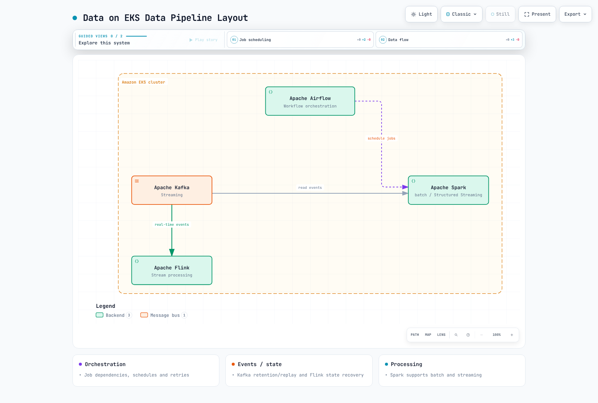

# Data on EKS

> **最終更新日**: 2026 年 9 月 12 日

## 概要

このセクションでは、Amazon EKS 上で Kafka、Spark、Airflow、Flink を運用し、AWS のマネージドサービスと接続する方法を扱います。Helm chart、Kubernetes Operator、executor は、デプロイ、可観測性、スケーリング、所有関係の異なるモデルを提供します。

セルフマネージド運用と、Amazon MSK、EMR、MWAA などのマネージドサービスを比較する際は、運用能力、必要な機能、可用性、総コストを評価してください。EMR on EKS は job の実行を管理しますが、その基盤となる EKS cluster の運用責任は残ります。SageMaker Unified Studio は、マネージド型の data／AI workspace と governance の統合機能であり、EKS にデプロイする software ではありません。

## データ workload のカテゴリー

実行 workload を 4 つのカテゴリーに分け、これらをつなぐマネージド型の governance 領域と区別してください。1 つの tool が複数の役割を担う場合もあります。

| カテゴリー | 解決する課題 | 代表的な tool | Data on EKS での対応状況 |
|----------|--------------------|----------------------|------------------------|
| **Streaming** | event をリアルタイムに publish／subscribe し、system 間の非同期通信を確実に接続する | Apache Kafka | 利用可能: [Kafka on EKS](kafka/README.md) |
| **Batch & Analytics** | ETL、aggregation、ML pipeline 向けに大規模 dataset を分散処理する | Apache Spark | 利用可能: [Spark on EKS](spark/README.md) |
| **Orchestration** | data job 間の依存関係と schedule を定義し、その実行を管理する | Apache Airflow | 利用可能: [Airflow on EKS](airflow/README.md) |
| **Stream Processing** | streaming data に対してリアルタイムの aggregation、transformation、stateful computation を行う | Apache Flink | 利用可能: [Flink on EKS](flink/README.md) |
| **Governed data and AI workspace** | マネージドな境界内で data asset、project profile、tool、member を共有する | SageMaker Unified Studio | 利用可能: [Unified Studio governance](sagemaker-unified-studio/README.md) |

[🔍 インタラクティブ図を表示](https://www.atomai.click/kubernetes-docs/archmaps/en-data-on-eks-readme-0.html)

## これらを EKS 上で実行する理由

EKS 上で直接運用する場合は、次の機会と制約を評価してください。

- **運用と可観測性の統合**: 既存の `kubectl`、GitOps、Prometheus／Grafana の運用を再利用できます。data quality、lineage、query performance、consumer lag には、引き続き各領域に応じた可観測性が必要です。
- **Autoscaling**: [Karpenter](../autoscaling/02-karpenter.md) は node 容量を調整し、HPA／KEDA や engine 固有の autoscaler は、対応する worker／job を調整します。Kafka broker の変更時には、partition reassignment、quorum、storage、Operator の対応も確認してください。
- **コスト効率**: restart、checkpoint、replication の要件が許す場合は、Spot と bin-packing を適用します。[EKS のコスト最適化](../eks/07-eks-cost-optimization.md)を storage、network、運用コストと併せて評価し、broker と stateful job に一律で適用しないでください。
- **マルチテナンシー**: namespace、ResourceQuota、NetworkPolicy は分離を構成する要素です。実際の data permission、信頼レベル、authentication、storage、networking を検証してください。namespace だけでは tenant の完全な分離になりません。

この方法にはトレードオフもあります。Operator の管理、storage 設計、upgrade 戦略をチームが直接担うことになります。後続の各 deep dive では、そのバランスを詳しく扱います。

## 現在取り上げている内容

- [現代的な data pipeline の構造](01-data-pipeline-anatomy.md): pipeline 全体を source から利用までの 5 層で示す入門マップ。各 deep dive がどの層を扱うかを説明します。
- [Kafka on EKS](kafka/README.md): Strimzi Operator を使った Apache Kafka の EKS へのデプロイと運用を扱う 8 部構成の解説と、gp3 上の 3 broker RF3 cluster の ingest 上限を測定した Part 9 benchmark。
- [Spark on EKS](spark/README.md): Spark-on-Kubernetes の基礎、Spark Operator の選択肢、Amazon EMR on EKS、性能とコストの調整を扱う 5 部構成の解説。
- [Airflow on EKS](airflow/README.md): Airflow 3 の architecture、Helm によるデプロイと executor の選択、KubernetesPodOperator を使う DAG pattern、Amazon MWAA との統合を扱う 5 部構成の解説。
- [Flink on EKS](flink/README.md): Kubernetes 上の Flink architecture、Flink Kubernetes Operator、state／checkpoint、運用／HA を扱う 4 部構成の解説。
- [SageMaker Unified Studio governance](sagemaker-unified-studio/README.md): domain、project profile、project、catalog asset、member、削除時の lifecycle。

## 次のステップ

1. [Kafka on EKS](kafka/README.md): Strimzi ベースの Kafka deep dive
2. [Spark on EKS](spark/README.md): Spark Operator と EMR on EKS の deep dive
3. [Airflow on EKS](airflow/README.md): Helm ベースの Airflow deployment と DAG pattern の deep dive
4. [Flink on EKS](flink/README.md): Flink Kubernetes Operator と streaming pattern の deep dive
5. [SageMaker Unified Studio governance](sagemaker-unified-studio/README.md): マネージド data／AI workspace と EKS pipeline をつなぐ governance guidance
