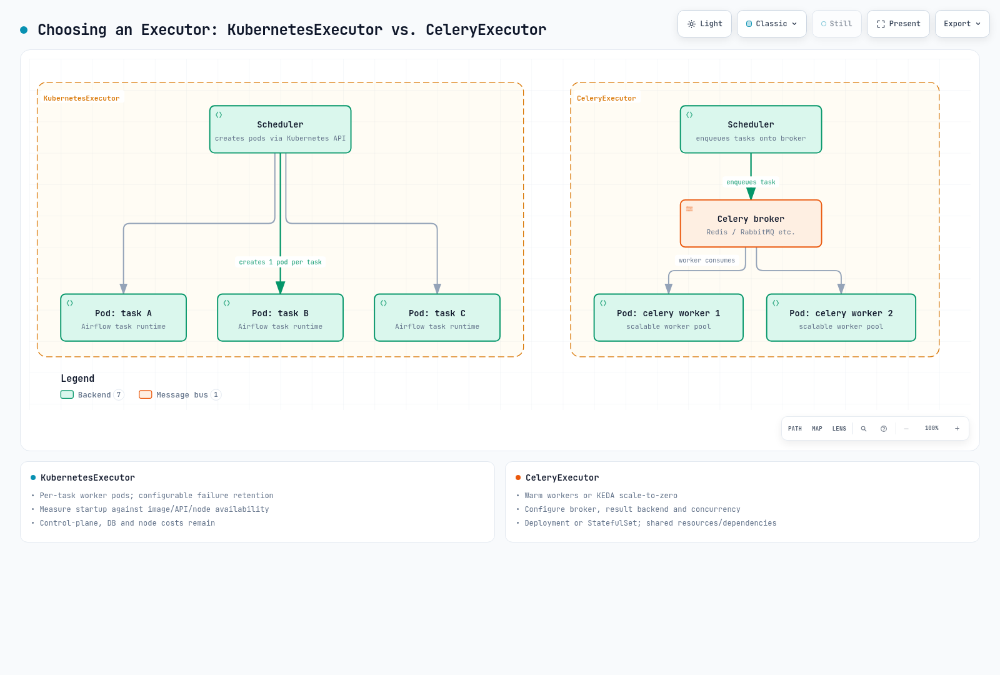

# パート2: Helm によるデプロイと Executor の選択

> **レビュー基準**: chart 1.22.0／Airflow 3.3.1／KEDA 2.20
> **確認した最新の上流パッチ**: Airflow 3.3.2。chart の例は3.3.1のまま · 2026年10月12日

## 1. Chart の識別と実際の既定値

このガイドでは Apache Airflow repository の公式 chart を使います。Repository alias に `apache-airflow` を登録すると、Helm chart 名は **`apache-airflow/airflow`** です。`airflow-helm/charts` など別の chart の values を混在させないでください。利用可能な chart はこれだけではありません。

Chart 1.22.0 の既定値は **Airflow 3.2.2 と CeleryExecutor** であり、KubernetesExecutor ではありません。以下の例では image tag と `airflowVersion` を3.3.1に明示的に合わせ、executor も選択します。Version field の不一致や digest の上書きによって、chart が生成した設定と実際の image が食い違うことがあります。

Helm 3.19.0以降を使ってください。Packaged README に古い Helm 3.0+ の記載が残っていますが、release の変更履歴ではこの最小バージョンが指定されています。Airflow 3.3.1 でテスト済みの Kubernetes version は1.30–1.35です。Chart 1.16.0 の README は1.29以降を指定していたため、1.30以降の必須条件を追加したわけではありません。Chart.yaml が記載されたすべての最小要件を検証するとは限りません。レビューでは1.29向けの template が render されましたが、それだけでサポート対象とは言えません。

## 2. Connection と Secret を準備する

この lab は、namespace の permission、準備済みの外部 PostgreSQL database、EKS networking／capacity を前提とします。Database schema／user、migration privilege、検証済みの connection URI／TLS、backup／retention policy を準備してください。KEDA が必要なのは Celery scaling profile のみです。

以下の values では password を埋め込まず、Secret を参照します。Database URI は保護された file に1行で保存し、password などの field にある予約文字は URI encode してください。RDS などの remote database には検証済み TLS を使います。`sslrootcert` path は実際の database client が読み取れる必要があります。**KEDA も database client です。** Airflow だけに CA、DNS、network、access を設定しても足りません。Chart が CA file を KEDA に自動的に copy することもありません。

これは**新規インストール**の手順です。既存 Secret を上書きしません。通常の upgrade で Fernet／API／JWT key を再生成しないでください。Backup と rotation は別途管理します。

```bash
set -euo pipefail
# Fresh installation only. Keep existing Fernet/API/JWT keys during an ordinary upgrade.
# AIRFLOW_DB_URI_FILE contains the tested, single-line PostgreSQL URI; do not commit it.
: "${AIRFLOW_DB_URI_FILE:?Set the path to your protected database connection file}"
kubectl create namespace airflow --dry-run=client -o yaml | kubectl apply -f -
kubectl -n airflow create secret generic airflow-metadata \
  --from-file="connection=$AIRFLOW_DB_URI_FILE"

umask 077
AIRFLOW_SECRET_TMP_DIR="$(mktemp -d)"
trap 'rm -rf "$AIRFLOW_SECRET_TMP_DIR"' EXIT
python3 - "$AIRFLOW_SECRET_TMP_DIR" <<'PY'
import base64
from pathlib import Path
import secrets
import sys
folder = Path(sys.argv[1])
(folder / "fernet-key").write_text(base64.urlsafe_b64encode(secrets.token_bytes(32)).decode())
(folder / "api-secret-key").write_text(secrets.token_urlsafe(48))
(folder / "jwt-secret").write_text(secrets.token_urlsafe(48))
PY
kubectl -n airflow create secret generic airflow-fernet \
  --from-file="fernet-key=$AIRFLOW_SECRET_TMP_DIR/fernet-key"
kubectl -n airflow create secret generic airflow-api-secret \
  --from-file="api-secret-key=$AIRFLOW_SECRET_TMP_DIR/api-secret-key"
kubectl -n airflow create secret generic airflow-jwt \
  --from-file="jwt-secret=$AIRFLOW_SECRET_TMP_DIR/jwt-secret"
```

`metadataSecretName` を設定すると、`metadataConnection` は権威ある接続元ではなくなります。Bundled PostgreSQL を無効にするだけでは外部 database は設定されません。Airflow と KEDA が共有する PostgreSQL URI には、両方が解釈できる `postgresql://` のような scheme を確認してください。SQLAlchemy 専用の `+driver` scheme は KEDA で動作しない場合があります。

## 3. KubernetesExecutor を明示してインストールする

`kubernetes-values.yaml` として保存します。この lab では triggerer の persistence を無効にしています。一時的な local log は永続的な履歴ではありません。DAG 配信はパート3、remote log／storage はパート5で扱います。本番利用の前に、task 後も log を参照できることを確認してください。

```yaml
airflowVersion: 3.3.1
defaultAirflowTag: 3.3.1
executor: KubernetesExecutor
postgresql:
  enabled: false
redis:
  enabled: false
data:
  metadataSecretName: airflow-metadata
  metadataConnection:
    protocol: postgresql
fernetKeySecretName: airflow-fernet
apiSecretKeySecretName: airflow-api-secret
jwtSecretName: airflow-jwt
createUserJob:
  enabled: false
triggerer:
  persistence:
    enabled: false
config:
  core:
    auth_manager: airflow.providers.fab.auth_manager.fab_auth_manager.FabAuthManager
```

```bash
helm repo add apache-airflow https://airflow.apache.org
helm repo update apache-airflow
helm install airflow apache-airflow/airflow \
  --namespace airflow --version 1.22.0 \
  --values kubernetes-values.yaml --wait --timeout 10m
kubectl -n airflow get deployments,statefulsets,pods,jobs
helm list -n airflow
```

`--wait` の成功や Pod の `Running` 状態だけでは DAG 実行を確認できません。Migration job の成功と、長時間稼働する component の `Ready` を確認してから、パート3の smoke DAG を使い、worker の起動、Execution API との通信、結果、log を検証してください。

### 初期 user

既定の `createUserJob` は `admin/admin` を作成できるため、この profile では無効にします。現在の values は `createUserJob.defaultUser` の下にあります。`webserver.defaultUser` は互換用の経路です。`values.yaml` や Helm `--set` に password を保存する代わりに、選択した FAB auth manager に対して次の対話的 command を使います。別の auth manager や SSO には、それぞれの user 管理手順が必要です。

```bash
# FAB auth manager, as selected in these values. Password is prompted twice.
kubectl -n airflow exec -it deployment/airflow-api-server -c api-server -- \
  airflow users create --username airflow-admin --role Admin \
  --email admin@example.com --firstname Airflow --lastname Admin
kubectl -n airflow port-forward --address 127.0.0.1 service/airflow-api-server 8080:8080
```

Port-forward を実行した状態で、local port 8080 の UI を確認します。本番 access には、適切な認証／認可／TLS 経路が必要です。この command は public endpoint を作りません。API と task-JWT Secret は役割が異なるため、安定した lifecycle 管理が必要です。Fernet key を紛失したり不用意に置き換えたりすると、既存の暗号化済み connection／variable を読み取れなくなることがあります。

## 4. Workload と運用に合わせて executor を選ぶ

| 観点 | KubernetesExecutor | CeleryExecutor |
|---|---|---|
| Worker の単位 | Task instance ごとに Pod | Broker の work を処理する pool |
| 起動 | Image cache、API／scheduler latency、node 利用状況を測定 | Warm capacity で起動時間を短縮できる。Scale-to-zero では cold start が再発する |
| Idle 時の費用 | Control plane、database、node、log の費用は残る | Worker 数がゼロでも broker／database／node の費用は残る |
| Resource／隔離 | Pod spec、quota、サービスアカウント、network、node に依存 | 並行 task が worker resource／dependency を共有 |
| 追加要件 | Task runtime／image、DAG 配信、Kubernetes API 権限 | Broker、result backend、worker lifecycle、queue、concurrency |

起動に常に1～2分かかる、または大量処理でどちらかが普遍的に優れると決めつけないでください。KubernetesExecutor の worker image には互換性のある **Airflow task runtime と DAG dependency** が必要です。任意の GPU／CLI image ではありません。KubernetesPodOperator は workload image を使う別の child Pod を起動する機能であり、異なる経路です。失敗 Pod の保持／削除も provider 設定によります。

Concurrent executor も利用できますが、ほとんどの deployment で混在が必須なわけではありません。実際の workload に対する測定結果と、追加 policy を導入する負担を比べ、単一 executor の単純さと比較してください。



[インタラクティブ図](https://www.atomai.click/kubernetes-docs/archmaps/en-data-on-eks-airflow-02-helm-deployment-0.html)

## 5. Celery worker を scale する

最初に外部 broker と result backend を準備します。以下の Secret が必要なのは Celery profile のみです。実際の service に対して protocol、TLS、permission を確認してください。Celery の SQLAlchemy database result backend は `db+postgresql://` のような URI を使うため、metadata connection URI をそのまま copy しないでください。

```bash
# Use protected URI files for the chosen external broker and result backend.
: "${AIRFLOW_BROKER_URI_FILE:?Set the protected broker URI file}"
: "${AIRFLOW_RESULT_URI_FILE:?Set the protected Celery result-backend URI file}"
kubectl -n airflow create secret generic airflow-broker \
  --from-file="connection=$AIRFLOW_BROKER_URI_FILE"
kubectl -n airflow create secret generic airflow-result-backend \
  --from-file="connection=$AIRFLOW_RESULT_URI_FILE"
```

`celery-values.yaml` として、独立した**完全な profile**で保存します。新規 deployment では、install command でこの file を選択してください。稼働中 deployment の切り替えには、drain、migration、recovery 計画が必要です。

```yaml
airflowVersion: 3.3.1
defaultAirflowTag: 3.3.1
executor: CeleryExecutor
postgresql:
  enabled: false
redis:
  enabled: false
data:
  metadataSecretName: airflow-metadata
  metadataConnection:
    protocol: postgresql
  brokerUrlSecretName: airflow-broker
  resultBackendSecretName: airflow-result-backend
fernetKeySecretName: airflow-fernet
apiSecretKeySecretName: airflow-api-secret
jwtSecretName: airflow-jwt
createUserJob:
  enabled: false
triggerer:
  persistence:
    enabled: false
config:
  core:
    auth_manager: airflow.providers.fab.auth_manager.fab_auth_manager.FabAuthManager
  celery:
    worker_concurrency: 4
workers:
  celery:
    persistence:
      enabled: false
    keda:
      enabled: true
      minReplicaCount: 0
      maxReplicaCount: 20
      pollingInterval: 10
      cooldownPeriod: 300
      advanced:
        horizontalPodAutoscalerConfig:
          behavior:
            scaleDown:
              stabilizationWindowSeconds: 300
```

`concurrency=4` と `maxReplicaCount=20` は例として設定した上限であり、throughput や cost の保証ではありません。Worker resource、task memory、database／broker load、node 上限を一緒に調整してください。`persistence=false` ではこの profile は Deployment を対象にします。`persistence=true` では StatefulSet が生成されることがありますが、KEDA は StatefulSet にも対応しています。

Chart の実際の既定値は `pollingInterval=5s` と `cooldownPeriod=30s` です。この例では**明示的に10秒／300秒を選んでいます。** Cooldown は scale-to-zero を制御します。ゼロより上での HPA polling／stabilization と区別してください。実際の database polling は KEDA activity、HPA request、metric cache にも左右され、常に正確な10秒間隔になるわけではありません。

この profile で render される PostgreSQL query は次のとおりです。

```sql
SELECT ceil(COUNT(*)::decimal / 4) FROM task_instance WHERE (state='running' OR state='queued') AND queue IN ('default')
```

`worker_concurrency` は database column ではありません。Chart が**数値の4**を挿入します。これはこの worker queue の実行中／待機中 work を数え、必要な replica 数を計算します。Query の結果が25でも `maxReplicaCount=20` が上限となり、backlog が残る可能性があります。Query や認証の失敗を「work がゼロ」と解釈せず、ScaledObject／HPA の状態を調べてください。

### Mixed executor と alias

Executor を混在させるときは、Celery が実行しない work を除外してください。Chart の既定 query は `KubernetesExecutor` という文字列を除外しますが、`k8s` などの保存済み alias は集計に含まれる場合があります。TaskInstance は `task.executor` の値を保持します。

次の query override の例は、既定の CeleryExecutor と KubernetesExecutor を併用する想定です。Queue、alias、完全修飾 class 名を変更する場合は、実際に保存された値に合わせて filter を更新してください。この設定では NULL が既定の Celery executor を示します。

```yaml
executor: CeleryExecutor,KubernetesExecutor
workers:
  celery:
    keda:
      query: >-
        SELECT ceil(COUNT(*)::decimal / {{ .Values.config.celery.worker_concurrency }})
        FROM task_instance
        WHERE state IN ('running', 'queued')
        AND queue = 'default'
        AND (executor IS NULL OR executor = 'CeleryExecutor')
```

この fragment を完全な Celery profile に merge し、deployment を変更する前に render 後の SQL と対象を確認してください。KubernetesExecutor の task Pod は、同じ方法で scale する replica pool ではありません。Karpenter／Cluster Autoscaler による node capacity、Airflow parallelism／pool／DAG concurrency、API throughput は別々の上限として残ります。これは、KEDA が Deployment にしか対応せず、KubernetesExecutor 環境で使えないという意味ではありません。

## 6. 検証と resource lifecycle

```bash
kubectl -n airflow rollout status deployment/airflow-api-server --timeout=180s
kubectl -n airflow rollout status deployment/airflow-scheduler --timeout=180s
kubectl -n airflow rollout status deployment/airflow-dag-processor --timeout=180s
kubectl -n airflow get jobs
kubectl -n airflow logs deployment/airflow-scheduler -c scheduler --tail=100
kubectl -n airflow logs deployment/airflow-dag-processor -c dag-processor --tail=100
# Celery/KEDA profile only:
kubectl -n airflow get scaledobjects,hpa
kubectl -n airflow describe scaledobject airflow-worker
kubectl -n airflow get deployments,statefulsets -l component=worker
```

UI へのアクセスに一度成功したり、Deployment が healthy だったりしても、migration、DAG 配信、task 実行、remote log、scale-to-zero のすべてを検証したことにはなりません。既知の workload を実行し、worker 数／結果／log を確認してから、idle に戻ることと復旧をテストしてください。

この profile では bundled PostgreSQL を使いません。Chart の既定では古い `bitnamilegacy` PostgreSQL image が使われます。既定値のままインストールするのは本番向けの基準ではありません。Helm uninstall で database Pod を削除しても、PVC／PV のデータが直ちに消えるとは限りません。PVC retention、StorageClass reclaim policy、外部 database の削除／backup を個別に確認し、namespace、Secret、database をまとめて不用意に削除しないでください。

このレビューでは、chart／KEDA resource の形、public image manifest、実 PostgreSQL engine での SQL case 24件を確認しました。EKS／database 接続、container workload、user 作成、KEDA controller による scale は実行していません。

- [公式 chart 1.22.0 の parameter](https://airflow.apache.org/docs/helm-chart/1.22.0/parameters-ref.html)
- [公式 chart 1.22.0 の本番運用ガイド](https://airflow.apache.org/docs/helm-chart/1.22.0/production-guide.html)
- [Chart での KEDA 設定](https://airflow.apache.org/docs/helm-chart/1.22.0/keda.html)
- [Chart 1.22.0 の source](https://github.com/apache/airflow/tree/helm-chart/1.22.0/chart)
- [KubernetesExecutor の要件](https://airflow.apache.org/docs/apache-airflow-providers-cncf-kubernetes/stable/kubernetes_executor.html)
- [Concurrent executor](https://airflow.apache.org/docs/apache-airflow/3.3.1/core-concepts/executor/index.html)
- [KEDA PostgreSQL scaler](https://keda.sh/docs/2.20/scalers/postgresql/)
- [KEDA ScaledObject の timing と target](https://keda.sh/docs/2.20/reference/scaledobject-spec/)

[パート3: DAG パターン](03-dag-patterns.md)

[README](README.md)

[クイズ](../../quizzes/data-on-eks/airflow/02-helm-deployment-quiz.md)
