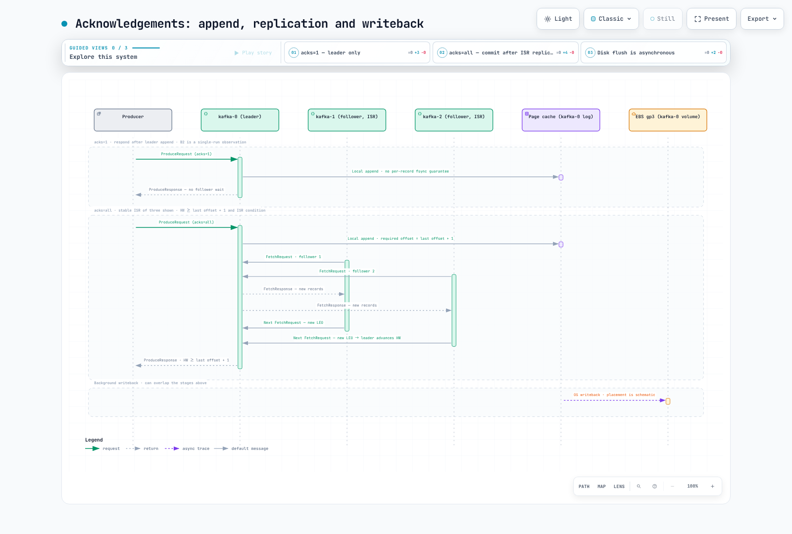

# Part 9: EKS 上の Kafka ベンチマーク（報告結果と再現上の制約）

> **報告された実験**: 2026 年 9 月 2 日 02:07–02:36 UTC\
> **レビュー更新日**: 2026 年 9 月 12 日\
> **実験時のバージョン**: Kafka 4.3.1、EKS Kubernetes 1.36、broker/controller 兼用 Pod 3 個

このページでは、PR #166 で報告された単一実行の表を掲載し、単位、比較方法、再現手順を確認します。元の生 telemetry と payload hash は、リポジトリ内のレポートには含まれていません。このレビューでは AWS 実験を再実行しておらず、過去の測定値を独立に確認していません。

データからは、検証すべきストレージ、cache、client の制約が示唆されます。しかし、**RF3 で 130〜135 MiB/s が普遍的に、または数時間にわたり維持される上限だと示すものではありません**。特に RF の比較では `acks` も変わり、batch の比較では linger と実行時間も変わっています。観測された比率を、単独要因の因果効果として提示してはいけません。


[インタラクティブ図](https://www.atomai.click/kubernetes-docs/archmaps/en-data-on-eks-kafka-09-kafka-benchmark-0.html)

## 主な観測結果と、そこからは証明できないこと

| 報告された比較 | 記録された値 | 解釈上の制約 |
| --- | --- | --- |
| F1 RF3 / acks=all | client throughput 134.74 MiB/s、broker のサンプリング時間は約 75 秒 | 短時間の client rate であり、持続可能な disk-write rate の認定値ではない |
| F4 と F1 | 337.81 / 134.74 = 2.507× | RF、acks／暗黙の idempotence、実行時間、cache 状態が異なる |
| F6 と F1 | 148.38 対 134.74 MiB/s、+10.12%。報告された broker CPU は低下 | batch、linger、record 数がすべて変わり、反復測定によるばらつきの推定はない |
| B1 と B2 | p50 はどちらも 3 ms、p99 は 126 対 17 ms | rate 制限下での 1 組の結果であり、普遍的な「tail だけのコスト」ではない |
| E4 と E0 | producer は 57.37 対 103.36 MiB/s、−44.49% | read／write 競合が考えられるが、client の共有も競合を生む |

## 報告された環境

| 項目 | 値 |
|---|---|
| Cluster | Amazon EKS、Kubernetes 1.36、ap-northeast-2（ソウル）、Karpenter 管理下の node |
| Broker | `apache/kafka:4.3.1` 3 台（Kafka 4.3.1 distribution、報告上の OpenJDK 21.0.11）、**KRaft 兼用 mode**（各 Pod が broker と controller を兼ねる）、StatefulSet、operator なし |
| Broker node | **m5.xlarge** の On-Demand 3 台（4 vCPU、16 GiB）、すべて ap-northeast-2b、1 node に broker 1 台（`podAntiAffinity`）、Karpenter の `system` NodePool から起動した新規 node |
| Broker Pod resource | request 3 vCPU／10 Gi、limit 4 vCPU／12 Gi。`KAFKA_HEAP_OPTS=-Xms4G -Xmx4G`（残りの memory は off-heap／native allocation と page cache にも使用） |
| Broker storage | broker ごとに **gp3 100 GiB** の PVC 1 個（EBS CSI、StorageClass `gp3`）。gp3 の既定性能は **3,000 IOPS／125 MiB/s**（size に依存しない） |
| Broker 設定 | `num.partitions=6`、`default.replication.factor=3`、`min.insync.replicas=2`、`log.segment.bytes=1 GiB`、`num.network.threads=4`、`num.io.threads=8`、`num.replica.fetchers=2`、`log.retention.hours=2` |
| Kernel | Amazon Linux 2023、6.18.41-94.142.amzn2023.x86_64。`vm.dirty_ratio=20`、`vm.dirty_background_ratio=10`、`vm.dirty_expire_centisecs=3000` |
| m5.xlarge EC2 の上限 | network baseline 1.25 Gbps（burst 10 Gbps）。EBS baseline 1,150 Mbps = 143.75 MB/s（約 137 MiB/s）、6,000 IOPS。これは baseline であり burst の最大値ではない |
| Load generator | 同じ image の `kafka-client` Pod 1 個を、同じ AZ の **m5.large** node（2 vCPU、8 GiB）上で実行。cgroup の **CPU limit は 1.9**、`KAFKA_HEAP_OPTS=-Xms2G -Xmx2G`。m5.large の network baseline は 0.75 Gbps（burst 10 Gbps） |
| Tool | apache/kafka 4.3.1 に含まれる `kafka-producer-perf-test.sh` と `kafka-consumer-perf-test.sh` |
| Network 経路 | 同一 AZ 内の Pod 間通信、PLAINTEXT（TLS なし、SASL なし） |
| Topic | 各 test で新規作成、6 partition。特記がなければ RF3／`min.insync.replicas=2`（RF1 test は RF1／min.isr=1）。`retention.bytes=-1` |
| Producer test 設定 | `linger.ms=5`、`batch.size=65536`、`buffer.memory=67108864`（64 MiB）。特記がなければ `compression.type=none` |
| 1 時間あたりの費用 | m5.xlarge On-Demand 3 台 × $0.236/h + gp3 100 GiB 3 個 × $0.0912/GB-month（ソウルリージョン、Pricing API、2026-09） |

レポートでは、最初の測定前の 02:05:22Z に `kafka-1` が 1 回再起動し、test 中の再起動はなかったとしています。「startup race」という説明の根本原因は特定されていません。この区別を維持してください。

すべての broker と load generator は 1 つの AZ に配置され、PLAINTEXT を使用し、SASL と Strimzi Operator は使っていなかったと報告されています。これは 3 AZ の本番構成との比較ではありません。TLS、AZ 間通信、異なる node／storage 上限、controller の分離については、それぞれ別に測定する必要があります。

## Payload と tool の仕様

報告された file には、合成 JSON の 20,000 行が含まれ、各行の **payload は 1,008 byte** でした。その約 63.2% は圧縮しやすい `x` padding です。改行 separator は生成する各 value に含まれません。この value を 1,000 万個使うと payload は **9.388 GiB** です。報告された disk 上の 1 record あたり 1,018 byte で計算すると、1 copy あたり約 **9.481 GiB** です。

E2／E3 workload は **30,000,000 × 1,024 B = 28.610 GiB** の payload です。以前の「30 GiB」または「29.3 GiB」という表記は、正確な GiB 換算ではありません。1,024 byte の value が 300 万個なら 2.861 GiB です。

Kafka 4.3.1 では:

- `--record-size` は各 record に A〜Z の byte を生成するため、client CPU の処理が増えます。`--payload-file` は事前に読み込んだ value を指定します。payload の生成は、tool が計測対象の send latency timer を開始する**前**に行われます。
- 出力の “MB/sec” は byte 数を 1,024² で割るため、単位は **MiB/s** です。圧縮時も uncompressed payload byte 数を数えており、NIC や volume の byte 数ではありません。
- send latency は `send()` の直前に計測を開始し、callback までの同期的な send／buffer 待ちを含みます。事前の payload 生成は含まず、後続処理も測定しません。`acks=0` では callback 完了は broker による耐久性確認ではありません。
- 大規模 test では、整数ミリ秒単位の latency を定期的にサンプリングします。両方の p50 が 3 ms でも、基礎となる latency が同一とは証明できません。
- 失敗した callback は出力されますが、正常に送信した record 数には含まれません。process の終了 status だけではなく、最終的な成功件数と stderr を確認してください。
- consumer の total-time、fetch-time（group join を除く）、選択した interval rate は分母が異なります。最後の poll batch により、指定 record 数を超えることがあります。

以前の `--producer-props` と consumer の `--messages` option はこの version でも動作しますが、非推奨です。改訂後の例では `--command-property` と `--num-records` を使います。

## 1. RF、acknowledgement、サンプリング時間

payload-file mode、圧縮なし。以下は元の報告に記録された値です。

| Test | acks | RF | producer 数 | record 数 | rec/s | MiB/s | 平均 ms | p50 | p95 | p99 | p99.9 | 最大 |
|---|---|---|---|---|---|---|---|---|---|---|---|---|
| F1 | all | 3 | 1 | 10 M | 140,164 | **134.74** | 443.89 | 321 | 1,276 | 2,689 | 4,026 | 4,038 |
| F2 | 1 | 3 | 1 | 6 M | 248,221 | 238.62 | 222.66 | 230 | 321 | 398 | 426 | 650 |
| F3 | 0 | 3 | 1 | 6 M | 241,138 | 231.81 | 235.02 | 191 | 333 | 1,977 | 4,327 | 4,340 |
| F4 | 1 | 1 | 1 | 10 M | 351,407 | **337.81** | 159.51 | 138 | 290 | 358 | 515 | 642 |
| F5 | all | 3 | 2 | 2 × 5 M | 67,694 + 67,360 = 135,054 | 65.07 + 64.75 = **129.82** | 893.88 / 889.22 | 639 / 630 | 2,536 / 2,493 | 3,270 / 3,301 | 4,284 / 4,228 | 4,662 / 4,660 |
| F6 | all | 3 | 1 | 6 M | 154,349 | 148.38 | 395.82 | 238 | 1,142 | 2,094 | 2,594 | 2,621 |

F4／F1 の算術比は 2.507 ですが、F4 は RF1／acks=1、F1 は RF3／acks=all です。省略されている idempotence 設定も含め、Kafka 4.3.1 ではこの acknowledgement 設定間で既定値が異なります。この測定は replication のみを制御した比較ではありません。F4 の実行時間は約 32 秒で、データの約 3 分の 1 ずつしか各 broker に書き込まれません。cache と client の制約による影響も大きい可能性があります。

F5 の 129.82 は、個別に報告された 2 つの rate の合計です。厳密な合計 rate は、共通の開始・終了時間における成功 byte 数の合計を時間で割って求めます。異なる時間幅の rate を加算しても、その値になるとは限りません。

### 報告された broker counter

| Window | write MiB/s 平均（peak 10 秒） | wIOPS | read MiB/s（rIOPS） | broker CPU core | NIC tx／rx MiB/s |
|---|---|---|---|---|---|
| F1 RF3 acks=all 10 M（75 秒） | 115.2–117.5（134.9–135.1） | 495–505 | 0 | 0.64–0.84 | 80.2–108.1／134.2–135.8 |
| F2 RF3 acks=1 6 M（28 秒） | 92.8–100.4（124.1–127.6） | 397–427 | 0 | 0.53–0.62 | 64.4–80.4／123.7–125.0 |
| F3 RF3 acks=0 6 M（28 秒） | 97.2–120.5（123.5–124.1） | 414–514 | 0 | 0.80–0.81 | 87.3–94.4／163.5–170.6 |
| F4 RF1 acks=1 10 M（32 秒） | 72.5–80.4（117.6–129.1） | 312–346 | 0 | 0.30–0.31 | 0.3／119.9–125.4 |
| F5 producer 2 台 RF3 acks=all（81 秒） | 99.9–102.2（134.8–135.5） | 431–439 | 0 | 0.59–0.81 | 66.5–89.7／113.8–115.6 |
| F6 RF3 acks=all batch 256 KiB（43 秒） | 102.3–107.7（134.8–135.4） | 426–445 | 0 | **0.40–0.50** | 68.7–110.4／124.2–124.5 |
| E2 fill 30M × 1,024 B、random mode（262 秒） | 110.0–111.5（134.5–135.0） | 468–473 | 0 | 0.72–0.80 | 74.9–77.5／114.3 |

元の sampler は kubectl call を順番に実行し、その間 10 秒 sleep していたため、実際の interval は約 12 秒でした。3 broker のサンプリング前に、1 回分の timestamp を記録していました。そのため実行遅延、timestamp の精度、window の境界が影響します。最大 sample は定常状態の推定値ではありません。また、約 135 MiB/s の値から、gp3 の provision 済み throughput 125 MiB/s を 135 とモデル化すべきだとは言えません。

レポートの CloudWatch E2 window は 7,008〜7,257 MiB/min、すなわち 116.8〜121.0 MiB/s で、write は 29,637〜30,730 回/min、約 494〜512 IOPS でした。これらの集計値は、かなりの sequential I/O が発生したことと整合します。ただし、volume limit、instance の EBS limit、buffer、短時間のサンプリング誤差を単独では切り分けられません。broker CPU が低くても client bottleneck は否定できません。

### ストレージの収支モデル。測定で確認された普遍的な上限ではない

`Xlog` を encoded log byte rate、`R` を replication factor、`B` を broker 数、`D` を broker ごとの持続可能な storage budget とします。配置が均衡している場合、各 broker の平均 write は概ね `R × Xlog / B` に他の I/O を加えた値です。broker がちょうど 3 台で RF3 の場合、各 broker はすべての partition の copy を 1 つずつ持ちます。leader traffic も均衡すれば、broker ごとの replica transmit traffic は約 `2 × Xlog / 3`、cluster 全体の replica traffic は約 `2 × Xlog` です。

この計算は仮説を立てるのに役立ちますが、payload rate の benchmark と同じではありません。encoding、compression、cache／writeback、read、metadata は、それぞれ別の budget を消費します。broker／volume throughput を増やした場合に bottleneck が解消するかを、単独で特定する前に、ほかの条件を揃えて検証してください。
## 2. Acknowledgement latency



[インタラクティブ図](https://www.atomai.click/kubernetes-docs/archmaps/en-data-on-eks-kafka-09-kafka-benchmark-1.html)

rate 制限下の B test は、20,000 record/s、RF3、1,024 byte のランダム value を使用しました。

| Test | acks | linger.ms | 平均 ms | p50 | p95 | p99 | p99.9 | 最大 |
|---|---|---|---|---|---|---|---|---|
| B1 | all | 5 | 5.27 | 3 | 6 | **126** | 173 | 771 |
| B2 | 1 | 5 | 2.58 | 3 | 5 | **17** | 40 | 642 |
| B3 | all | 0 | 3.23 | 3 | 5 | 25 | 59 | 752 |

報告された p99 の B1／B2 比は 7.412 です。平均 latency も異なるため（5.27 対 2.58 ms）、「tail だけが異なる」という説明は過大です。B3 は linger を変更していますが、batch が小さいことを原因とする説明には、request size、request 数、反復実行による根拠が必要です。rate 制限下で `acks=0` にした結果は報告されていません。

以下の A run には、ランダム payload の生成 overhead も含まれています。

| Test | acks | RF | rec/s | MiB/s | 平均 ms | p50 | p95 | p99 | p99.9 | 最大 |
|---|---|---|---|---|---|---|---|---|---|---|
| A1 | all | 3 | 107,150 | 104.64 | 11.38 | 3 | 50 | 164 | 263 | 871 |
| A2 | 1 | 3 | 105,955 | 103.47 | 3.00 | 1 | 11 | 38 | 79 | 812 |
| A3 | 0 | 3 | 112,461 | 109.82 | 1.48 | 0 | 6 | 26 | 52 | 636 |
| A4 | 1 | 1 | 109,926 | 107.35 | 1.57 | 1 | 6 | 11 | 36 | 662 |

A の各設定で throughput が似ていることは、共通の制約がある可能性を示しますが、それだけでは CPU profile の証拠になりません。`acks=0` でも client／buffer／socket の backpressure は発生します。broker acknowledgement がないからといって、あらゆる backpressure がなくなるわけではありません。また、callback の成功は replica に record が格納された証明ではありません。

sequence diagram では、high watermark は **next offset** です。最後の record が `r` の batch に必要な offset は `r+1` です。acknowledgement には、適切な HW check と ISR 条件が必要です。図は安定した ISR に 3 replica がすべて参加した状態を示しますが、`minISR=2` でも follower 2 台が常に ISR に残ることを必須とするものではありません。

## 3. Batch size と producer 数

| Test | F1 からの変更 | MiB/s | 平均 ms | p99 ms | broker CPU core |
|---|---|---|---|---|---|
| F1 | baseline: producer 1 台、`batch.size=65536`、`linger.ms=5`、10 M record | 134.74 | 443.89 | 2,689 | 0.64–0.84 |
| F5 | producer 2 台（各 5 M record）、同一 props | 65.07 + 64.75 = 129.82 | 893.88 / 889.22 | 3,270 / 3,301 | 0.59–0.81 |
| F6 | `batch.size=262144`、`linger.ms=10`、6 M record | 148.38 | 395.82 | 2,094 | **0.40–0.50** |

F6 では batch size、linger、record 数が変わっています。報告上の throughput は 10.12% 高く、broker CPU の範囲は低くなっています。中間値を使った `1 − 0.45/0.74 = 39.19%` の計算は、報告された範囲を説明するものです。batch size が原因で CPU が単独で 40% 減ったことを示すものではありません。反復測定がないため、throughput の差を「noise の範囲内」と分類することもできません。

この構成では F5 の記録 rate は改善しませんでした。また、同じ制約のある client Pod で producer を 2 台実行しています。producer の追加が決して有効でないと結論づける前に、それぞれに独立した容量を与え、共通の時間幅で再測定してください。

## 4. Padding した corpus での compression

| codec | rec/s | MiB/s（報告値、uncompressed） | 平均 ms | p50 | p95 | p99 | p99.9 | disk 上の byte／record（replica ごと） | none との比率 |
|---|---|---|---|---|---|---|---|---|---|
| none | 203,887 | 196.00 | 259.59 | 266 | 370 | 425 | 458 | 1,018 | 1.00× |
| lz4 | 275,356 | 264.70 | 4.38 | 3 | 11 | 24 | 60 | 113.1 | **9.0×** 小さい |
| snappy | 198,557 | 190.87 | 5.07 | 3 | 10 | 35 | 205 | 141.7 | 7.2× |
| zstd | 160,274 | 154.07 | 5.39 | 5 | 10 | 18 | 47 | 61.3 | **16.6×** |
| gzip | 53,418 | 51.35 | 6.01 | 6 | 10 | 17 | 45 | 60.7 | 16.8× |

元の 1 copy あたりの log size は、none／lz4／snappy／zstd／gzip の順に 2,912.4／323.5／405.3／175.3／173.8 MiB でした。これを 300 万 record で割ると、丸め後の byte／record の値を再現できます。これは報告された Kafka log size であり、すべての index、filesystem、provision 済み volume の byte 数を示すものではありません。

padding によって、この結果は多くの実データを代表しないものになっています。**比率も codec の順位も普遍的な値や数学的な上限ではありません。** 元レポートの corpus 全体の zlib-6 値は、padding ありで 18.5×、なしで 7.8×でした。このレビューで GNU Awk 5.1.0 を用いて公表済み AWK generator を再生成すると、padding が 63.17% の有効な 1,008 byte の行が 20,000 個作られましたが、比率は 15.92× と 6.53×でした。これは新しい corpus であり、過去の測定値を置き換えるものではありません。image と AWK の実装を固定し、payload hash を記録してください。

topic の compression を `producer` にすると、codec の選択は保持され、ほかの指定済み codec で意図的に再圧縮されることはありません。それでも broker の検証などに CPU が必要です。compression 時に latency が低く報告されたことは、保存／転送 byte 数が減ったことと整合します。ただし bottleneck が専ら移動したと主張するには、client CPU と各 phase の I/O の根拠が必要です。

## 5. Record size

| Test | record size | record 数 | rec/s | MiB/s | 平均 ms | p50 | p95 | p99 | p99.9 |
|---|---|---|---|---|---|---|---|---|---|
| D1 | 100 B | 10,000,000 | 506,380 | 48.29 | 3.18 | 2 | 9 | 15 | 33 |
| A1 | 1,024 B | 3,000,000 | 107,150 | 104.64 | 11.38 | 3 | 50 | 164 | 263 |
| D2 | 10,240 B | 300,000 | 12,326 | 120.37 | 17.40 | 5 | 84 | 157 | 223 |

これらは、record 生成方法と record 数が異なる test です。100 byte の場合、rec/s は約 4.73 倍ですが、payload rate は 1,024 byte の場合の 46.15% です。records/s と bytes/s の両方が重要であることを示しますが、broker の record ごとの処理負荷と、client の生成、batch、cache の影響を切り分けるものではありません。aggregation は、その latency、key、failure の仕様がアプリケーションに合う場合にのみ評価してください。
## 6. 本番 workload と並行した replay

報告された E0 producer rate は 103.36 MiB/s、p99 は 82 ms でした。E1 で選択された高負荷 interval は 434.11 MiB/s です。E2 は 1,024 byte の value を 3,000 万個生成し（28.610 GiB）、112.84 MiB/s、p99 は 1,531 ms と報告されました。遅い interval が繰り返し観測されましたが、dirty page の writeback は仮説に留まります。

E2 で記録されたほかの latency は、平均 60.17 ms、p50 2、p95 125、p99.9 5,034、最大 5,258 ms でした。報告された 51 interval のうち、rate が 60 MiB/s 未満のものは 5 回でした: 56.8、36.3、45.3、40.8、45.8。これらの観測から停止の原因は特定できません。

E3 の全 13 interval rate の算術平均は **438.615 MiB/s** です: 337.6、431.3、414.2、495.7、454.9、452.1、387.9、458.7、439.9、452.4、447.7、491.0、438.6。replay 時の cache は一部しか cold ではなく、完全な cold-cache 状態は確認されていません。異なる時間幅で測った disk と NIC の平均値を引き算して、page cache の byte rate を正確に算出しないでください。

| | 単独実行 | replay 中 | Test |
|---|---|---|---|
| Producer throughput | 103.36 MiB/s（105,843 rec/s） | **57.37 MiB/s**（58,746 rec/s） | E0 → E4 |
| Producer 平均／p50 | -／- | 294.06 ms／18 ms | E4 |
| Producer p95／p99／p99.9／最大 | p99 82 ms | **1,587／2,147／2,425／2,569 ms** | E0 → E4 |
| Consumer throughput（全 5 秒 interval の平均 対 fetch-time rate） | 438.6 MiB/s | fetch time の **299.62 MiB/s**、295,726 msg/s（join 中の 3,666 ms を含む全体では 288.79 MiB/s、101.4 秒で 29,297.33 MiB／30,000,466 msg） | E3 → E4 |
| broker ごと（produce window） | write 60.4–67.4 MiB/s（残りは page cache が吸収）、read 0 | write 39.4–47.2 + read 28.6–37.7 MiB/s、tx 92.6–106.0 MiB/s、CPU 0.36–0.42 core | E0 → E4 |

E4 の producer rate は **44.49%** 低下しています。read と write が各 volume を共有しているため storage contention は考えられますが、producer と consumer は 1.9 CPU の client Pod と NIC も共有していました。session 全体の throttling 合計や低い **broker** CPU だけでは、phase ごとの **client** 競合を否定できません。

レポートは E4 の consumer 値として、29,297.33 MiB、30,000,466 record、全体 288.79 MiB/s、join time を除いて 299.62 MiB/s を記録しています。最終 poll batch によって指定件数を超えることはあります。余分な record 数だけでは重複の証明になりません。

E1 の選択 interval、E3 の各 interval の非加重平均、E4 の fetch／total rate は同じものさしでは比較できません。特に「438.6 → 299.62」は、同じ分母で測定した制御済みの throughput 低下ではありません。共通 interval で比較するため、生の timestamp、総 byte 数、phase ごとの resource counter を保持してください。

## 7. どのくらいの時間測定すればよいか？

Kafka の acknowledgement は、各 replica が record ごとに fsync することを意味しません。append は page cache に蓄積され、writeback は非同期に行われることがあります。これは、あらゆる相関障害に対する replication の保証を意味するものではありません。

レポートには、理想化した volume budget `3 × 125 = 375 MiB/s` を上回る F4 interval と、E0 終了後の writeback が含まれています。これらは buffer と測定 window の整合性を検証すべき理由です。**disk が定常状態になったと証明できる、普遍的な 10 GiB や 1 分という閾値はありません。** F1 の約 9.5 GiB の encoded data も、その証明にはなりません。

warmup の長さと定常測定時間を固定し、test 終了後の drain を記録してください。dirty memory と EBS／network credit の動作を観察し、順序をランダム化して test を反復します。因果関係を比較する場合は、一度に 1 要因だけを変更します。他の条件を一定にしたまま storage throughput を増やすのは、有用な追加実験です。

### Network と EBS の正しい比較

EC2 では inbound と outbound の network credit bucket が**別々に**管理されます。rx と tx を加算し、その合計を一方向の baseline と比較しないでください。F1 で報告された最大 rx 136 MiB/s は約 **1.141 Gbps**、tx 108 MiB/s は約 **0.906 Gbps** で、どちらも m5.xlarge の 1.25 Gbps baseline 未満です。この F1 の値は、broker が network burst した証拠にはなりません。

F4 の client payload rate 337.81 MiB/s は約 2.834 Gbps で、m5.large の 0.75 Gbps baseline を超えています。credit に依存した client performance は、重要な制約として残ります。packet rate、flow limit、node 上の他の通信も観察してください。

m5.xlarge の EBS bandwidth は baseline 1,150 Mbps、最大 4,750 Mbps、すなわち約 **137.09／566.24 MiB/s** です。baseline は瞬間的な絶対上限ではありません。現行 gp3 の最大値は **2,000 MiB/s** で、IOPS／volume の条件と instance limit が適用されます。以前の 1,000 MiB/s という説明は古くなっています。volume や broker を大型化しても、報告された test の制約要因がどれだったかが自動的に証明されるわけではありません。

## コスト計算の例。請求額でも、現行価格の提示でもない

過去のレポートの料金 `$0.236/broker-hour` と `$0.0912/GB-month`、および費用配賦の前提を使うと:

| 計算 | 結果 |
| --- | --- |
| broker 3 台 × 50 分 | $0.590 |
| 100 GiB volume 3 個 × 39 分、730 時間で按分 | $0.02436 |
| 1 回の実行で配賦した上記項目 | 約 $0.614 |
| broker 3 台 × 730 時間 + 300 GiB-month の storage | $544.20 |

730 時間の計算は計画上の慣例であり、9 月の請求書ではありません。元の client node、EKS／control plane の料金、network、ほかの共有インフラは含まれていません。他の workload に使い続ける node では、実行時間の費用配賦も推定になります。provision 前に現行のリージョン価格を確認してください。このレビューでは請求情報を照会しておらず、新しい価格記録も取得していません。

broker CPU が低いというだけで、compute 費用が無駄とは言えません。memory、network、EBS bandwidth、障害時の余裕、配置要件により、その instance size が必要な場合があります。
## 改訂した再現例

記載した instance type／AZ に必要な容量と、標準の EBS CSI に対応した**新しい専用 test 環境／namespace**を使用してください。既存の Kafka／PVC data に適用しないでください。新しい run では、例の cluster ID を新規の `kafka-storage.sh random-uuid` の値に置き換え、実際の image digest と runtime version を記録します。

以下の manifest は**修正版の再現 template**であり、当時の manifest をそのまま掲載したものではありません。指定 AZ を固定し、gp3 IOPS／throughput／encryption を明示します。readiness の前に headless DNS を公開し、TCP startup／readiness check を追加し、broker ingress は benchmark Pod に限定しています。API token の自動 mount は無効です。NetworkPolicy の適用には CNI の enforcement が必要です。PLAINTEXT と role 兼用の構成は、この隔離 test 用に残しており、本番向け設計として推奨するものではありません。

```yaml
apiVersion: v1
kind: Namespace
metadata:
  name: bench-kafka
---
apiVersion: storage.k8s.io/v1
kind: StorageClass
metadata:
  name: bench-kafka-gp3
provisioner: ebs.csi.aws.com
volumeBindingMode: WaitForFirstConsumer
reclaimPolicy: Delete
parameters:
  type: gp3
  iops: '3000'
  throughput: '125'
  encrypted: 'true'
---
apiVersion: v1
kind: Service
metadata:
  name: kafka-hs
  namespace: bench-kafka
spec:
  clusterIP: None
  selector:
    app: kafka
  ports:
  - name: broker
    port: 9092
  - name: controller
    port: 9093
  publishNotReadyAddresses: true
---
apiVersion: apps/v1
kind: StatefulSet
metadata:
  name: kafka
  namespace: bench-kafka
spec:
  serviceName: kafka-hs
  replicas: 3
  podManagementPolicy: Parallel
  selector:
    matchLabels:
      app: kafka
  template:
    metadata:
      labels:
        app: kafka
      annotations:
        karpenter.sh/do-not-disrupt: 'true'
    spec:
      terminationGracePeriodSeconds: 60
      nodeSelector:
        node.kubernetes.io/instance-type: m5.xlarge
        karpenter.sh/capacity-type: on-demand
        topology.kubernetes.io/zone: ap-northeast-2b
      affinity:
        podAntiAffinity:
          requiredDuringSchedulingIgnoredDuringExecution:
          - labelSelector:
              matchLabels:
                app: kafka
            topologyKey: kubernetes.io/hostname
      securityContext:
        fsGroup: 1000
      containers:
      - name: kafka
        image: apache/kafka:4.3.1
        command:
        - /bin/bash
        - -c
        - |
          set -e
          ORD=${HOSTNAME##*-}
          export KAFKA_NODE_ID=$ORD
          export KAFKA_ADVERTISED_LISTENERS="PLAINTEXT://${HOSTNAME}.kafka-hs.bench-kafka.svc.cluster.local:9092"
          exec /etc/kafka/docker/run
        env:
        - name: CLUSTER_ID
          value: UdHYY7YQRrunSRromZFozw
        - name: KAFKA_PROCESS_ROLES
          value: broker,controller
        - name: KAFKA_CONTROLLER_QUORUM_VOTERS
          value: 0@kafka-0.kafka-hs.bench-kafka.svc.cluster.local:9093,1@kafka-1.kafka-hs.bench-kafka.svc.cluster.local:9093,2@kafka-2.kafka-hs.bench-kafka.svc.cluster.local:9093
        - name: KAFKA_LISTENERS
          value: PLAINTEXT://0.0.0.0:9092,CONTROLLER://0.0.0.0:9093
        - name: KAFKA_LISTENER_SECURITY_PROTOCOL_MAP
          value: PLAINTEXT:PLAINTEXT,CONTROLLER:PLAINTEXT
        - name: KAFKA_INTER_BROKER_LISTENER_NAME
          value: PLAINTEXT
        - name: KAFKA_CONTROLLER_LISTENER_NAMES
          value: CONTROLLER
        - name: KAFKA_LOG_DIRS
          value: /var/lib/kafka/data/kafka
        - name: KAFKA_NUM_PARTITIONS
          value: '6'
        - name: KAFKA_DEFAULT_REPLICATION_FACTOR
          value: '3'
        - name: KAFKA_OFFSETS_TOPIC_REPLICATION_FACTOR
          value: '3'
        - name: KAFKA_TRANSACTION_STATE_LOG_REPLICATION_FACTOR
          value: '3'
        - name: KAFKA_TRANSACTION_STATE_LOG_MIN_ISR
          value: '2'
        - name: KAFKA_MIN_INSYNC_REPLICAS
          value: '2'
        - name: KAFKA_LOG_RETENTION_HOURS
          value: '2'
        - name: KAFKA_LOG_SEGMENT_BYTES
          value: '1073741824'
        - name: KAFKA_NUM_NETWORK_THREADS
          value: '4'
        - name: KAFKA_NUM_IO_THREADS
          value: '8'
        - name: KAFKA_NUM_REPLICA_FETCHERS
          value: '2'
        - name: KAFKA_HEAP_OPTS
          value: -Xms4G -Xmx4G
        ports:
        - containerPort: 9092
        - containerPort: 9093
        resources:
          requests:
            cpu: '3'
            memory: 10Gi
          limits:
            cpu: '4'
            memory: 12Gi
        volumeMounts:
        - name: data
          mountPath: /var/lib/kafka/data
        startupProbe:
          tcpSocket:
            port: 9092
          periodSeconds: 5
          failureThreshold: 60
        readinessProbe:
          tcpSocket:
            port: 9092
          periodSeconds: 5
      automountServiceAccountToken: false
  volumeClaimTemplates:
  - metadata:
      name: data
    spec:
      accessModes:
      - ReadWriteOnce
      storageClassName: bench-kafka-gp3
      resources:
        requests:
          storage: 100Gi
---
apiVersion: v1
kind: Pod
metadata:
  name: kafka-client
  namespace: bench-kafka
  labels:
    app: kafka-client
spec:
  restartPolicy: Never
  nodeSelector:
    node.kubernetes.io/instance-type: m5.large
    topology.kubernetes.io/zone: ap-northeast-2b
    karpenter.sh/capacity-type: on-demand
  containers:
  - name: client
    image: apache/kafka:4.3.1
    command:
    - sleep
    - infinity
    env:
    - name: KAFKA_HEAP_OPTS
      value: -Xms2G -Xmx2G
    resources:
      requests:
        cpu: 500m
        memory: 2500Mi
      limits:
        cpu: 1900m
        memory: 4Gi
  automountServiceAccountToken: false
---
apiVersion: networking.k8s.io/v1
kind: NetworkPolicy
metadata:
  name: benchmark-brokers
  namespace: bench-kafka
spec:
  podSelector:
    matchLabels:
      app: kafka
  policyTypes:
  - Ingress
  ingress:
  - from:
    - podSelector:
        matchExpressions:
        - key: app
          operator: In
          values:
          - kafka
          - kafka-client
    ports:
    - protocol: TCP
      port: 9092
    - protocol: TCP
      port: 9093
```

`bench-kafka.yaml` として保存し、resource と利用可能な容量を確認してから、次を実行してください。

```bash
kubectl apply -f bench-kafka.yaml
kubectl -n bench-kafka rollout status statefulset/kafka --timeout=600s
kubectl -n bench-kafka wait --for=condition=Ready pod/kafka-client --timeout=600s
kubectl -n bench-kafka get pods -o wide
kubectl -n bench-kafka get pods -o jsonpath='{range .items[*]}{.metadata.name}{"\t"}{.status.containerStatuses[*].imageID}{"\n"}{end}'
```

公表済みの generator を `payload.awk` として保存し、**client Pod 内で**実行してください。比較用に残した generator では、圧縮しやすい padding が意図的に使われています。

```awk
BEGIN{srand(42); split("payments orders inventory auth search checkout shipping catalog notify gateway",ns," ");
     split("INFO INFO INFO INFO WARN ERROR DEBUG",lv," ");
     for(i=0;i<20000;i++){
       n=ns[int(rand()*10)+1]; l=lv[int(rand()*7)+1]; d=int(rand()*900)+5; u=int(rand()*100000);
       msg=sprintf("{\"ts\":\"2026-09-02T02:%02d:%02d.%03dZ\",\"level\":\"%s\",\"namespace\":\"%s\",\"pod\":\"%s-7d9f8b6c4-%05x\",\"trace_id\":\"%08x%08x%08x%08x\",\"http\":{\"method\":\"POST\",\"path\":\"/api/v1/%s/%d\",\"status\":%d,\"duration_ms\":%d,\"bytes\":%d},\"user_id\":%d,\"region\":\"ap-northeast-2\",\"msg\":\"request completed upstream=%s-svc:8080 retries=%d cache=%s\"",
         int(rand()*60),int(rand()*60),int(rand()*1000),l,n,n,int(rand()*1048576),int(rand()*4294967296),int(rand()*4294967296),int(rand()*4294967296),int(rand()*4294967296),n,u,(l=="ERROR"?500:200),d,int(rand()*20000),u,n,int(rand()*3),(rand()<0.7?"hit":"miss"));
       pad=1000-length(msg)-2; if(pad<0)pad=0; p=""; for(k=0;k<pad;k++)p=p "x";
       printf "%s,\"pad\":\"%s\"}\n", msg, p }}
```

```bash
mkdir -p /tmp/results
LC_ALL=C awk -f payload.awk > /tmp/results/payload-1k.txt
sha256sum /tmp/results/payload-1k.txt
wc -l -c /tmp/results/payload-1k.txt
```

次の `runs.sh` も client Pod 内で実行します。この script は事前に topic を作成して data を投入し、log を分けて記録し、producer の最終成功件数を確認します。また、20 分の wall timeout と 30 秒の kill grace を使います。consumer の `--timeout` は無通信状態の上限であり、wall-time の上限ではありません。

```bash
#!/bin/bash
set -euo pipefail
BIN=/opt/kafka/bin
BS="kafka-0.kafka-hs.bench-kafka.svc.cluster.local:9092,kafka-1.kafka-hs.bench-kafka.svc.cluster.local:9092,kafka-2.kafka-hs.bench-kafka.svc.cluster.local:9092"
BENCH_RESULTS=/tmp/results
mkdir -p "$BENCH_RESULTS"
RUN_ID="$(date -u +%Y%m%dT%H%M%SZ)-$$"

new_topic() {
  "$BIN/kafka-topics.sh" --bootstrap-server "$BS" --create --topic "$1" \
    --partitions 6 --replication-factor "$2" \
    --config "min.insync.replicas=$3" --config retention.bytes=-1
}
produce() {
  local topic="$1" count="$2" mode="$3" value="$4" rate="$5" acks="$6" codec="$7"
  shift 7
  local result="$BENCH_RESULTS/$topic-$BASHPID.log"
  date -u +%Y-%m-%dT%H:%M:%SZ > "$result.start"
  timeout -k 30 1200 "$BIN/kafka-producer-perf-test.sh" \
    --bootstrap-server "$BS" --topic "$topic" --num-records "$count" \
    --throughput "$rate" "$mode" "$value" --print-metrics \
    --command-property "acks=$acks" "compression.type=$codec" \
      linger.ms=5 batch.size=65536 buffer.memory=67108864 "$@" 2>&1 | tee "$result"
  date -u +%Y-%m-%dT%H:%M:%SZ > "$result.end"
  # The tool can print callback errors without making every failure a nonzero exit.
  # This check is for warmup-records=0 and the final, non-window summary.
  awk -v expected="$count" '/ms 99[.]9th[.]/ {seen=1; actual=$1}
    END {if (!seen || actual != expected) exit 1}' "$result"
}

# Historical F1-shaped workload: a new topic and the published padded payload.
F_TOPIC="bench-f1-$RUN_ID"
new_topic "$F_TOPIC" 3 2
produce "$F_TOPIC" 10000000 --payload-file "$BENCH_RESULTS/payload-1k.txt" -1 all none

# Historical B1-shaped workload: pre-create the latency topic.
B_TOPIC="bench-b1-$RUN_ID"
new_topic "$B_TOPIC" 3 2
produce "$B_TOPIC" 1200000 --record-size 1024 20000 all none

# E2/E3-shaped replay: populate before consuming; 30M*1024 B = 28.61 GiB.
E_TOPIC="bench-e2-$RUN_ID"
new_topic "$E_TOPIC" 3 2
produce "$E_TOPIC" 30000000 --record-size 1024 -1 all none
timeout -k 30 1200 "$BIN/kafka-consumer-perf-test.sh" --bootstrap-server "$BS" \
  --topic "$E_TOPIC" --num-records 30000000 --group "bench-e3-$RUN_ID" \
  --timeout 600000 --show-detailed-stats --reporting-interval 5000 --print-metrics \
  2>&1 | tee "$BENCH_RESULTS/$E_TOPIC-consumer.log"

printf '%s\n' "$F_TOPIC" "$B_TOPIC" "$E_TOPIC" > "$BENCH_RESULTS/topics-$RUN_ID.txt"
# Preserve logs and validate success/readback before deleting this run's topics.
```

この template は F1、B1、E2／E3 に相当する workload の例を示します。他の行を再現するには、新しい topic を作成し、表の RF／minISR、件数、acks、codec、batch／linger 設定を使ってください。`produce` helper では、必須の 7 引数の後に Kafka property を追加できます。F6 では `batch.size=262144 linger.ms=10` を指定します。F5 では 500 万 record の producer を 2 台、別々の log で実行し、共通の時間区間を記録します。E4 では client 共有時の再現に加えて、独立した load-generator 容量を使う制御 variant も記録してください。run 間に writeback／drain の時間を取り、特に `acks=0` では topic の内容と error を確認します。指定件数に達したという理由だけで、有限時間の実行を定常状態として扱ってはいけません。

### 正しい block device と実際の時間区間を測る

各 benchmark PVC を PV／EBS volume に対応付けて、`devices.txt` に記録する前に該当する block device を確認してください。`nvme1n1` が常に EBS data device の名前になるわけではありません。script は cgroup v2 の CPU counter、sysfs の可視性、`eth0` を前提としています。実環境を確認してから調整してください。

kubectl を実行する machine 上で `sample-broker.sh` として保存してください。

```sh
#!/bin/sh
set -eu
device="${1:?Pass the verified data-volume block-device name}"
interface="${2:-eth0}"
case "$device" in *[!a-zA-Z0-9_-]*|'') echo "Invalid block-device name" >&2; exit 2;; esac
case "$interface" in *[!a-zA-Z0-9_.-]*|'') echo "Invalid network interface" >&2; exit 2;; esac
read -r start_uptime ignored < /proc/uptime
read -r read_ios read_merges read_sectors read_ms write_ios write_merges write_sectors write_ms rest \
  < "/sys/class/block/$device/stat"
cpu_usage="$(awk '$1=="usage_usec" {print $2}' /sys/fs/cgroup/cpu.stat)"
cpu_throttled="$(awk '$1=="throttled_usec" {print $2}' /sys/fs/cgroup/cpu.stat)"
: "${cpu_usage:?Missing cgroup v2 CPU usage counter}"
: "${cpu_throttled:?Missing cgroup v2 CPU throttling counter}"
net_tx="$(cat "/sys/class/net/$interface/statistics/tx_bytes")"
net_rx="$(cat "/sys/class/net/$interface/statistics/rx_bytes")"
read -r end_uptime ignored < /proc/uptime
printf '{"device":"%s","interface":"%s","start_uptime_s":%s,"end_uptime_s":%s,"read_ios":%s,"read_sectors":%s,"write_ios":%s,"write_sectors":%s,"cpu_usage_usec":%s,"cpu_throttled_usec":%s,"net_tx_bytes":%s,"net_rx_bytes":%s}\n' \
  "$device" "$interface" "$start_uptime" "$end_uptime" "$read_ios" "$read_sectors" "$write_ios" "$write_sectors" \
  "$cpu_usage" "$cpu_throttled" "$net_tx" "$net_rx"
```

wrapper を `sampler.sh` として保存します。`devices.txt` には、1 行ごとに確認済みの `kafka-N device-name [interface]` を記載します。interface を省略した場合は `eth0` です。

```bash
#!/bin/bash
set -euo pipefail
# devices.txt: "pod block-device [interface]" per line; interface defaults to eth0.
# Example only: kafka-0 nvme1n1. Verify PVC -> PV -> EBS volume -> device first.
while true; do
  while read -r pod device interface; do
    [[ "$pod" =~ ^kafka-[0-2]$ ]] || { echo "Invalid benchmark pod" >&2; exit 2; }
    utc="$(date -u +%Y-%m-%dT%H:%M:%SZ)"
    sample="$(kubectl -n bench-kafka exec -i "$pod" -- sh -s -- "$device" "${interface:-eth0}" < sample-broker.sh)"
    printf '%s\t%s\t%s\n' "$utc" "$pod" "$sample" >> broker-samples.tsv
  done < devices.txt
  sleep 10
done
```

各 Pod で実際に測定された monotonic interval を使い、開始／終了時刻の幅を計測誤差として扱ってください。sector の差分 × 512 ÷ 経過秒数で byte/s、I/O の差分で IOPS、`usage_usec` の差分 ÷ 1,000,000 ÷ 経過秒数で CPU core 数を求めます。counter reset、負の差分、sample 欠落があれば、その値を除外してください。同じ phase について **client** CPU／NIC と producer buffer／request metric も取得します。検証済み volume ID によって、CloudWatch の VolumeReadBytes／VolumeWriteBytes／VolumeWriteOps の window を対応付けます。

後片付けの前に結果を export してください。namespace の削除は破壊的な操作であり、node や cluster-scoped StorageClass は自動で削除されません。この template は Delete reclaim policy を使います。PVC／PV／EBS が削除されたことと、残存する node の費用を確認してください。

```bash
kubectl delete namespace bench-kafka
# After confirming this run's PVs/volumes are gone and no claims use the class:
kubectl delete storageclass bench-kafka-gp3
```

## レビューの根拠と関連資料

このレビューでは算術、公開済み payload generator、Kafka の native performance tool の option parsing と callback 動作、resource schema、shell syntax、diagram rendering を確認しました。新たな AWS throughput benchmark は実施していません。

- [元の benchmark レポート、PR #166](https://github.com/Atom-oh/kubernetes-docs/pull/166)
- [Kafka 4.3.1 ProducerPerformance source](https://github.com/apache/kafka/blob/4.3.1/tools/src/main/java/org/apache/kafka/tools/ProducerPerformance.java)
- [Kafka 4.3.1 ConsumerPerformance source](https://github.com/apache/kafka/blob/4.3.1/tools/src/main/java/org/apache/kafka/tools/ConsumerPerformance.java)
- [Kafka 4.3.1 required produce offset](https://github.com/apache/kafka/blob/4.3.1/core/src/main/scala/kafka/server/ReplicaManager.scala)
- [Kafka 4.3.1 high-watermark check](https://github.com/apache/kafka/blob/4.3.1/core/src/main/scala/kafka/cluster/Partition.scala)
- [Kafka image の公式定義](https://github.com/apache/kafka/blob/4.3.1/docker/jvm/Dockerfile)
- [gp3 の性能と provision 条件](https://docs.aws.amazon.com/ebs/latest/userguide/general-purpose.html)
- [EC2 の方向別 network credit](https://docs.aws.amazon.com/AWSEC2/latest/UserGuide/ec2-instance-network-bandwidth.html)
- [EC2 general-purpose instance の network／EBS 仕様](https://docs.aws.amazon.com/ec2/latest/instancetypes/gp.html)
- [Linux block I/O counter](https://www.kernel.org/doc/html/latest/admin-guide/iostats.html)

- [EBS gp2／gp3 benchmark](../../storage/01-ebs-gp2-gp3-benchmark.md)
- [EKS 上の ClickHouse](../../database/01-clickhouse-on-eks.md)
- [Kafka の基礎](./01-kafka-fundamentals.md)
- [Kafka の運用](./03-kafka-operations.md)
- [ベストプラクティス](./08-best-practices.md)
- [Topic クイズ](../../quizzes/data-on-eks/kafka/09-kafka-benchmark-quiz.md)
