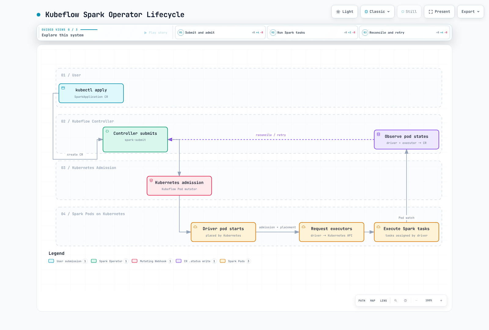

# パート2: Spark Operator

> **レビュー基準**: Kubeflow operator/chart 2.5.2; Apache operator 1.0.0 / chart 1.8.0\
> **例のランタイム**: Kubeflowラボでは、コントローラーイメージのサブミット用ランタイムと一致するSpark 4.0.4を使用; Apacheの例ではSpark 4.2.0を使用\
> **最終レビュー日**: 2026年9月12日

## 2つのプロジェクトと異なるAPI

これらは別々に保守されているプロジェクトであり、1つのマニフェストを使う相互交換可能な実装ではありません。必要なAPI／ライフサイクル、既存リソース、サポートされるランタイムの組み合わせ、運用テストに基づいて選択してください。歴史の長さや、測定されていない人気度の主張は、互換性を保証しません。

| 項目 | Kubeflow Spark Operator | Apache Spark Kubernetes Operator |
| --- | --- | --- |
| レビュー対象リリース | 2.5.2 | 1.0.0 |
| Helm chart | 2.5.2 | **1.8.0**; chartとアプリケーションのバージョンは異なる |
| ここで使用するアプリケーションAPI | `sparkoperator.k8s.io/v1beta2` | `spark.apache.org/v1` |
| 主なワークロード種別 | SparkApplication、ScheduledSparkApplication; 別途SparkConnect API | SparkApplication、SparkCluster |
| 設定モデル | type/mode/driver/executor/restartPolicy | runtimeVersions/driverSpec/executorSpec/applicationTolerations/sparkConf |
| これらのchartでのAdmission方式 | 変更と検証を行うWebhook | このchartでは同等のPod変更Webhookをインストールしない |

ApacheのSparkClusterは常駐Sparkクラスターを管理できます。これはネイティブなKubernetes SparkApplicationフローとは異なる実行モデルです。Comet／Glutenの例では、適切なプラグインバイナリ／イメージ、クラスパス、設定、ランタイム／アーキテクチャの互換性が引き続き必要です。Operatorをインストールしてもアクセラレーションが自動的に有効になるわけではなく、これらのプラグインがあるからといって常に一方のOperatorが優れているとは限りません。

両方のAPIグループを共存させることはできますが、監視対象のスコープ、名前、Webhookセレクター、RBACを慎重に設計する必要があります。以下のラボでは**どちらか1つのインストール経路**を選びます。`sparkapp`のような曖昧な短縮名を避け、完全修飾されたリソース名を使ってください。

## Reconciliationによって追加されるもの

通常の`spark-submit`も完了を待ち、Pod／ログ／UI／イベントログの状態を確認できます。スクリプト、properties、PodテンプレートもGitでバージョン管理できます。これは必ずしもfire-and-forgetではありません。一方、Operator管理のSparkApplication CR、スケジュールされたリソースのコントローラー、自動的なアプリケーション再試行を、それだけで追加するものではありません。

Kubeflowは意図的に`spark.kubernetes.submission.waitAppCompletion=false`でサブミットし、その後Pod／アプリケーションの状態をReconcileします。エグゼキューターPodも監視し、ライフサイクルのクリーンアップを行います。「Operatorが触るのはdriverだけ」という説明は誤りです。Sparkのdriverは引き続きエグゼキューターのキャパシティを要求し、Sparkタスクを割り当てます。

## ラボのnamespaceとアイデンティティを準備する

クラスターと互換性のあるkubectl／Helmを使ってください。chartの例はKubernetes 1.36に対してレンダリングされています。Apache Spark 4.2のワークロードにはKubernetes 1.34以降が必要です。古いREADMEの表から、現在推奨されるKubernetesの下限を推測しないでください。

Kubeflowコントローラーの固定Dockerfileは、サブミット用にSpark **4.0.4**を使います。この章のラボワークロードはそれに合わせて4.0.4を使います。パート1のSpark 4.2直接サブミットとは別です。SparkApplicationの`sparkVersion`フィールドを設定しても、コントローラー内のSparkインストールはアップグレードされません。別のサブミッター／ワークロードの組み合わせを採用する前に、明示的にテストしてください。

どちらかのchartをインストールする前に`job-rbac.yaml`を保存して適用します。これはパート1のnamespaceスコープのジョブ権限に合わせ、driverとexecutorのアイデンティティを分離しています。すでに同じ名前を使用している場合は、既存リソースを確認してください。

```yaml
apiVersion: v1
kind: Namespace
metadata:
  name: spark-jobs
---
apiVersion: v1
kind: ServiceAccount
metadata:
  name: spark-driver
  namespace: spark-jobs
---
apiVersion: v1
kind: ServiceAccount
metadata:
  name: spark-executor
  namespace: spark-jobs
automountServiceAccountToken: false
---
apiVersion: rbac.authorization.k8s.io/v1
kind: Role
metadata:
  name: spark-driver
  namespace: spark-jobs
rules:
- apiGroups:
  - ''
  resources:
  - pods
  - services
  - configmaps
  verbs:
  - create
  - get
  - list
  - watch
  - delete
  - patch
---
apiVersion: rbac.authorization.k8s.io/v1
kind: RoleBinding
metadata:
  name: spark-driver
  namespace: spark-jobs
roleRef:
  apiGroup: rbac.authorization.k8s.io
  kind: Role
  name: spark-driver
subjects:
- kind: ServiceAccount
  name: spark-driver
  namespace: spark-jobs
```

```bash
kubectl apply -f job-rbac.yaml
```

SparkPiにAWSデータアクセスは必要ありません。Operator API、driver API、AWSデータの各権限は、別々に扱います。

## オプションA: Kubeflowのインストール

`kubeflow-values.yaml`として保存します。chartの既定では自身のインストールnamespaceではなく`default`を監視します。**監視するnamespaceとジョブのnamespaceを一致**させる必要があります。ここではジョブを`spark-jobs`で実行し、上記で用意したジョブ用RBACをchartでも使います。リソースサイズとサブミット並列度は、計測して調整するためのラボの初期値です。

```yaml
spark:
  jobNamespaces:
  - spark-jobs
  jobNamespaceSelector: ''
  serviceAccount:
    create: false
  rbac:
    create: false
webhook:
  enable: true
  resources:
    requests:
      cpu: 100m
      memory: 128Mi
    limits:
      cpu: '1'
      memory: 512Mi
controller:
  workers: 2
  resources:
    requests:
      cpu: 500m
      memory: 1Gi
    limits:
      cpu: '2'
      memory: 2Gi
```

2.5.2では`webhook.enable`は既定で**true**です。フラグを省略するとWebhookが無効になるためではなく、選択を明記するために設定しています。カスタマイズによってAdmissionを使うものもあれば、ネイティブSpark設定に変換されるものもあります。Webhookを無効にしても、すべての設定が無視されるとは限りません。

以下のチェックサムは、ダウンロードした**GitHubリリースアセット**に一致します。今回のレビューでは、このバージョンのリポジトリインデックスに記載されたdigestが、アセットのメタデータ／ダウンロード結果と異なっていました。そのため、この例では直接検証したリリースアーカイブを使います。

```bash
# Fresh installation after reviewing/applying job-rbac.yaml.
curl --fail --location --silent --show-error 'https://github.com/kubeflow/spark-operator/releases/download/v2.5.2/spark-operator-2.5.2.tgz' -o spark-operator-2.5.2.tgz
printf '%s\n' '762be5b8632ecfe12eb20fff54450ddae0427f09506422107c508a0d1d38655b  spark-operator-2.5.2.tgz' | sha256sum --check -
helm install spark-operator ./spark-operator-2.5.2.tgz \
  --namespace spark-operator --create-namespace \
  --values kubeflow-values.yaml --wait --timeout 5m
kubectl -n spark-operator get deployments,pods
```

これは新規インストールの例です。アップグレードする場合は、CRDの移行手順を確認してください。通常のHelmアップグレードでは`crds/`内のCRDは自動的に置き換わらず、このchartの`hook.upgradeCrd`は明示的なオプトインです。共有CRDを通常のアップグレード手順として削除しないでください。関連するカスタムリソースにも影響します。

EKSでは、Webhook Service／エンドポイントへのコントロールプレーンアクセス、サービング証明書／CAバンドル、セレクターを検証してください。このchartではサーバーは9443で待ち受けます。`failurePolicy=Fail`の場合、Webhookが利用できないと、該当するAdmissionがブロックされることがあります。DeploymentがReadyになっただけでは、SparkワークロードがAdmissionを通過できる証拠にはなりません。

## Kubeflow SparkApplication

`spark-pi.yaml`として保存します。S3上の不明なオブジェクトや存在しないカスタムETLクラスを避け、固定イメージに実際に含まれる例を使います。

```yaml
apiVersion: sparkoperator.k8s.io/v1beta2
kind: SparkApplication
metadata:
  name: spark-pi
  namespace: spark-jobs
spec:
  type: Scala
  mode: cluster
  image: apache/spark:4.0.4@sha256:94ad730f7510002d8a1615de269f27cdeca4d4eef51657384db3fa9246b5a4d8
  imagePullPolicy: IfNotPresent
  mainClass: org.apache.spark.examples.SparkPi
  mainApplicationFile: local:///opt/spark/examples/jars/spark-examples_2.13-4.0.4.jar
  arguments:
  - '10'
  sparkVersion: 4.0.4
  restartPolicy:
    type: OnFailure
    onFailureRetries: 3
    onFailureRetryInterval: 30
    onSubmissionFailureRetries: 3
    onSubmissionFailureRetryInterval: 30
  driver:
    cores: 1
    coreLimit: '1'
    memory: 1g
    serviceAccount: spark-driver
    podSecurityContext: &id001
      runAsNonRoot: true
      runAsUser: 185
      seccompProfile:
        type: RuntimeDefault
    securityContext: &id002
      allowPrivilegeEscalation: false
      capabilities:
        drop:
        - ALL
  executor:
    cores: 1
    coreLimit: '1'
    instances: 2
    memory: 1g
    serviceAccount: spark-executor
    terminationGracePeriodSeconds: 60
    podSecurityContext: *id001
    securityContext: *id002
```

このバージョンでは`driver.serviceAccount`と`executor.serviceAccount`の**両方**が有効なフィールドです。再試行設定が適用されるのは、サブミット／アプリケーションの試行であり、その場でのコンテナ再起動だけではありません。再実行によって出力の副作用が繰り返されることがあります。実際のジョブでは、冪等またはトランザクションを考慮した出力設計を使ってください。

executorの猶予時間フィールドはKubeflowのPod Mutatorによって適用されます。パート1で説明したネイティブSpark 4.2のテンプレート上書きとは異なります。Sparkのdecommissionや独自のライフサイクルフックを有効にする場合は、選択したOperator、Sparkランタイム、Webhookがどう連携するかを確認してください。

```bash
kubectl apply -f spark-pi.yaml
kubectl -n spark-jobs get sparkapplications.sparkoperator.k8s.io spark-pi \
  -o jsonpath='{.status.applicationState.state}{"\n"}'
kubectl -n spark-jobs describe sparkapplications.sparkoperator.k8s.io spark-pi
DRIVER_POD="$(kubectl -n spark-jobs get sparkapplications.sparkoperator.k8s.io spark-pi \
  -o jsonpath='{.status.driverInfo.podName}')"
: "${DRIVER_POD:?Driver pod name is not available yet; inspect submission events}"
kubectl -n spark-jobs logs "$DRIVER_POD"
```

サブミット失敗を含む現在のstatusとeventsを確認し、実際のdriver Pod名も確認します。`kubectl get -w`は中断するまで継続するwatchであり、「成功するまで待つ」有限の手順ではありません。COMPLETEDはプロセスが完了したことを示すもので、外部データセットが正しいことを証明しません。

### UTCを明示したスケジュール

`scheduled-spark-pi.yaml`として保存します。ここでは無害なPiの例を同じようにスケジュールします。実際のデータ処理では、パッケージ化してテストしたETLプログラムに置き換えてください。

```yaml
apiVersion: sparkoperator.k8s.io/v1beta2
kind: ScheduledSparkApplication
metadata:
  name: daily-spark-pi
  namespace: spark-jobs
spec:
  schedule: 0 2 * * *
  timeZone: UTC
  concurrencyPolicy: Forbid
  successfulRunHistoryLimit: 2
  failedRunHistoryLimit: 2
  template:
    type: Scala
    mode: cluster
    image: apache/spark:4.0.4@sha256:94ad730f7510002d8a1615de269f27cdeca4d4eef51657384db3fa9246b5a4d8
    imagePullPolicy: IfNotPresent
    mainClass: org.apache.spark.examples.SparkPi
    mainApplicationFile: local:///opt/spark/examples/jars/spark-examples_2.13-4.0.4.jar
    arguments:
    - '10'
    sparkVersion: 4.0.4
    restartPolicy:
      type: OnFailure
      onFailureRetries: 3
      onFailureRetryInterval: 30
      onSubmissionFailureRetries: 3
      onSubmissionFailureRetryInterval: 30
    driver:
      cores: 1
      coreLimit: '1'
      memory: 1g
      serviceAccount: spark-driver
      podSecurityContext: &id001
        runAsNonRoot: true
        runAsUser: 185
        seccompProfile:
          type: RuntimeDefault
      securityContext: &id002
        allowPrivilegeEscalation: false
        capabilities:
          drop:
          - ALL
    executor:
      cores: 1
      coreLimit: '1'
      instances: 2
      memory: 1g
      serviceAccount: spark-executor
      terminationGracePeriodSeconds: 60
      podSecurityContext: *id001
      securityContext: *id002
```

2.5.2では`timeZone`がサポートされています。それ以外の場合、既定はコントローラーのLocalタイムゾーンです。ここでのスケジュールは**UTC**の02:00を意味します。Forbidが確認するのはこのScheduledSparkApplicationの直前の実行であり、再試行、手動実行、別のスケジューラーによる重複の副作用は防ぎません。履歴の上限は子実行の履歴保持を制限するもので、データのバックアップではありません。

```bash
kubectl apply -f scheduled-spark-pi.yaml
kubectl -n spark-jobs get scheduledsparkapplications.sparkoperator.k8s.io daily-spark-pi -o yaml
# Stop future schedule triggers; this does not itself terminate an active child run.
kubectl -n spark-jobs patch scheduledsparkapplications.sparkoperator.k8s.io daily-spark-pi \
  --type=merge -p '{"spec":{"suspend":true}}'
```

## オプションB: Apache Operator、別の経路

このラボでは、オプションA**の代わりに**`apache-values.yaml`を使います。`spark-jobs`を監視し、Operatorにはnamespace内のRoleを使い、既存のジョブアイデンティティを再利用します。chartのコメントでは古いプロパティ名が使われる場合がありますが、レンダリング後の設定では`spark.kubernetes.operator.watchedNamespaces=spark-jobs`になります。

```yaml
workloadResources:
  namespaces:
    create: false
    overrideWatchedNamespaces: true
    data:
    - spark-jobs
  serviceAccount:
    create: false
  role:
    create: false
  clusterRole:
    create: false
  roleBinding:
    create: false
operatorRbac:
  clusterRole:
    create: false
  clusterRoleBinding:
    create: false
  role:
    create: true
  roleBinding:
    create: true
```

```bash
# Fresh installation after reviewing/applying job-rbac.yaml.
curl --fail --location --silent --show-error 'https://github.com/apache/spark-kubernetes-operator/releases/download/1.0.0/spark-kubernetes-operator-1.8.0.tgz' -o spark-kubernetes-operator-1.8.0.tgz
printf '%s\n' '7536a8849b8a7c242283d0e393b5e0ec56365f34ec93717b158c76dfa1036a06  spark-kubernetes-operator-1.8.0.tgz' | sha256sum --check -
helm install asf-spark-operator ./spark-kubernetes-operator-1.8.0.tgz \
  --namespace spark-operator-asf --create-namespace \
  --values apache-values.yaml --wait --timeout 5m
kubectl -n spark-operator-asf get deployments,pods
```

ApacheリリースはKubeflowとは異なるライフサイクルモデルとランタイムイメージを使います。公開済みのイメージを使ってください。ワークロードのJavaバージョンからOperatorイメージのJava要件を推測しないでください。

このv1の例ではSpark 4.2.0を使用し、調査用にリソースを短時間保持します。

```yaml
apiVersion: spark.apache.org/v1
kind: SparkApplication
metadata:
  name: spark-pi-asf
  namespace: spark-jobs
spec:
  runtimeVersions:
    sparkVersion: 4.2.0
  mainClass: org.apache.spark.examples.SparkPi
  jars: local:///opt/spark/examples/jars/spark-examples.jar
  driverArgs:
  - '10'
  sparkConf:
    spark.kubernetes.namespace: spark-jobs
    spark.kubernetes.container.image: spark:4.2.0-scala2.13-java21-ubuntu
    spark.kubernetes.authenticate.driver.serviceAccountName: spark-driver
    spark.kubernetes.authenticate.executor.serviceAccountName: spark-executor
    spark.executor.instances: '2'
  applicationTolerations:
    resourceRetainPolicy: Always
    ttlAfterStopMillis: 600000
```

`ttlAfterStopMillis: 600000`により、最後の停止後にコントローラーがアプリケーションと関連リソースを削除できます。`resourceRetainPolicy: Always`では、クリーンアップされるまでOperatorが作成したリソースを保持します。driver自身のexecutor／Service削除設定を上書きするものでも、再試行を超えてリソースを保持するものでもありません。

```bash
kubectl apply -f apache-spark-pi.yaml
kubectl -n spark-jobs get sparkapplications.spark.apache.org spark-pi-asf -o yaml
```

このリリースでは古いv1beta1スキーマも提供されますが、ここでの新しい例はv1を使います。Kubeflowリソースの`apiVersion`だけを変更しても、フィールド、status、再試行／保持の動作は移行されません。KubeflowのScheduledSparkApplicationやrestartPolicyのスキーマをApache APIに適用しないでください。

## Pod作成時の動作



[インタラクティブ図](https://www.atomai.click/kubernetes-docs/archmaps/en-data-on-eks-spark-02-spark-operator-0.html)

WebhookはKubernetes Admissionの一部であり、ノードスケジューリングやSparkのタスクスケジューリングに代わるものではありません。2つのOperatorには、それぞれ独自にアーキテクチャ／APIの評価が必要です。このフローは**Kubeflow**を示しています。

## ストレージ、アイデンティティ、メトリクス

### スクラッチボリュームを正しい場所に設定する

Kubeflow APIでは、**ボリュームは`spec.volumes`に置き**、マウントはdriver／executor配下に設定します。`spec.driver.volumes`と`spec.executor.volumes`はこのCRDのフィールドではありません。これはKubeflowの例全体に対するmerge patchです。

```yaml
spec:
  volumes:
  - name: spark-local-dir-scratch
    emptyDir:
      sizeLimit: 8Gi
  driver:
    volumeMounts:
    - name: spark-local-dir-scratch
      mountPath: /var/data/spark-local
  executor:
    volumeMounts:
    - name: spark-local-dir-scratch
      mountPath: /var/data/spark-local
```

```bash
kubectl -n spark-jobs patch sparkapplications.sparkoperator.k8s.io spark-pi \
  --type=merge --patch-file scratch.patch.yaml
```

実際のワークロードを実行する前にストレージのカスタマイズを適用してください。アプリケーションの更新によって再サブミットが発生することがあります。JSON merge patchは配列を置き換えるため、別のアプリケーションに適用するときは既存のvolume／mountリストもこのpatchにマージしてください。

`spark-local-dir-`接頭辞には特別な処理があります。Operatorはこれらのローカルボリューム／マウントをネイティブSparkのボリューム設定へ変換し、汎用Pod volume mutatorはそれらをスキップします。ほかのカスタムボリュームにはWebhook経路を使えます。すべてのフィールドが同じ仕組みで実装されていると考えないでください。

追加のemptyDirを作っても、別の物理ディスクが作られたりNVMeが選択されたりするわけではありません。メモリを使う設定でなければ、ノードに設定されたファイルシステムを使います。kubelet／コンテナのファイルシステムは、EBS、インスタンスストア、または別の設定済みストレージ上にある場合があります。ノードストレージまたは適切な永続ボリュームを設定／検証し、ephemeral-storageのrequests、limits、ディスク圧迫時の動作を計画してください。

### IRSAとPod Identityは別の仕組み

S3ジョブでは、driver／executorのアイデンティティに実際のデータ権限と信頼設定／関連付けを構成し、互換性のあるHadoop S3A／AWSライブラリと認証情報プロバイダーを使ってください。標準イメージ、ARNアノテーション、`s3a://`という文字列だけでは不十分です。アーティファクト／テンプレートを取得するプロセスにも、対応するアクセス権が必要です。

- **IRSA**はServiceAccountのロールアノテーション、OIDC信頼、Web Identity認証情報の交換を使います。
- **EKS Pod Identity**は関連付けとPod Identity Agent／コンテナ認証情報経路を使います。IRSAロールアノテーションは関連付けに使いません。
- Kubernetes RBACはS3権限を付与しません。一時認証情報を使い、実際のPod内で有効なアイデンティティとデータアクセスをテストしてください。

完全なデータアクセスとセキュリティの例はパート5を参照してください。静的AWSキーをアプリケーション仕様やイメージに含めないでください。

### コントローラーのメトリクスはワークロードのJMXではない

chartの既定Prometheusエンドポイントは8080で**Operator**のメトリクスを公開します。すべてのSpark JVMにJMX Java Agentを自動で追加するわけではありません。ワークロードの監視はアプリケーションごとに明示的な設定が必要です。イメージには適切なexporter JAR／設定を含め、スクレイピング／検出も構成してください。ネイティブSparkメトリクスのエンドポイントとイベント／履歴ログも追加の仕組みです。詳しい設定は[パート5](./05-best-practices.md)を参照してください。

## クリーンアップと検証の範囲

デモ実行を削除する前にスケジュールを一時停止し、親リソースの削除が子リソースに連鎖するか確認してください。適切なAPIグループを使います。

```bash
# Kubeflow demo resources, if installed:
kubectl -n spark-jobs delete scheduledsparkapplications.sparkoperator.k8s.io daily-spark-pi
kubectl -n spark-jobs delete sparkapplications.sparkoperator.k8s.io spark-pi
# Apache demo resource, if installed:
kubectl -n spark-jobs delete sparkapplications.spark.apache.org spark-pi-asf
```

chartのレンダリングと公開CRDの検査で確認できるのは、リソース形式、namespace、設定パスです。稼働中のWebhook、コントローラー／ランタイムの組み合わせ、S3アクセス、データの正しさ、再試行からの復旧までは証明できません。本番のワークロードへ進む前に、生成されたPod、status、出力を確認してください。

- [Kubeflow Spark Operator 2.5.2](https://github.com/kubeflow/spark-operator/releases/tag/v2.5.2)
- [Kubeflow 2.5.2アプリケーションAPI](https://github.com/kubeflow/spark-operator/blob/v2.5.2/api/v1beta2/sparkapplication_types.go)
- [Kubeflow 2.5.2スケジュールAPI](https://github.com/kubeflow/spark-operator/blob/v2.5.2/api/v1beta2/scheduledsparkapplication_types.go)
- [Kubeflowのサブミット／設定変換](https://github.com/kubeflow/spark-operator/blob/v2.5.2/internal/controller/sparkapplication/submission.go)
- [Kubeflow Pod Mutator](https://github.com/kubeflow/spark-operator/blob/v2.5.2/internal/webhook/sparkpod_defaulter.go)
- [Apache operator 1.0.0](https://github.com/apache/spark-kubernetes-operator/releases/tag/1.0.0)
- [Apache operatorの設定](https://github.com/apache/spark-kubernetes-operator/blob/1.0.0/docs/configuration.md)
- [Apache Cometの例と前提条件](https://github.com/apache/spark-kubernetes-operator/blob/1.0.0/examples/pi-with-comet.yaml)
- [Apache Glutenの例と前提条件](https://github.com/apache/spark-kubernetes-operator/blob/1.0.0/examples/pi-with-gluten.yaml)
- [Spark Kubernetesの設定](https://spark.apache.org/docs/4.2.0/running-on-kubernetes.html)

## 次のステップ

[パート3: EKS上のEMR](./03-emr-on-eks.md)

[メインページに戻る](./README.md)

## クイズ

[トピック別クイズ](../../quizzes/data-on-eks/spark/02-spark-operator-quiz.md)
