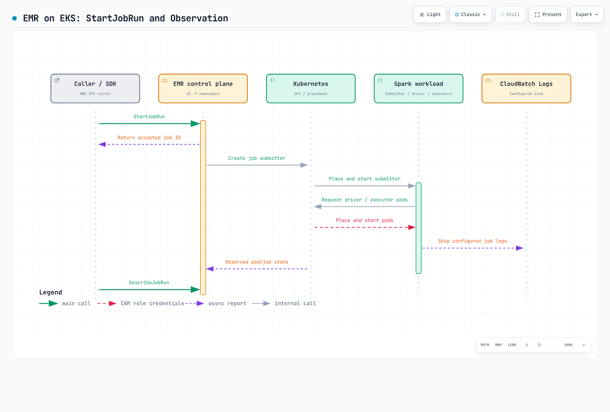

# パート3: Amazon EMR on EKS

> **最終レビュー**: 2026年10月16日 · API の例: `emr-spark-8.0.0-20260421`

## ランタイムとジョブ送信の経路

EMR on EKS は、AWS が提供する Spark ランタイムとジョブ送信サービスを、既存の EKS 基盤に追加します。EKS のキャパシティ、ネットワーク、ストレージ、ノードは引き続き運用します。次の経路を区別してください。

| 経路 | 送信とライフサイクル | 管理するもの |
| --- | --- | --- |
| StartJobRun | EMR 仮想クラスター ID と実行ロールを使う AWS API | EMR ジョブの状態、権限、ログ設定 |
| EMR ランタイム + Spark Operator | インストール済み EMR operator に送信する SparkApplication CR | Helm／CRD、controller、Kubernetes RBAC、CR のライフサイクル |
| 直接 `spark-submit` | Spark から Kubernetes API に送信 | 送信元、Spark 設定、状態、再実行 |

EMR 6.10.0 以降の Spark Operator 対応は、StartJobRun に operator へ内部委譲するオプションがあるという意味では**ありません**。公式の operator 経路では、operator を別途インストールし、`kubectl apply` を使います。これらの CR 適用が StartJobRun の ID を自動的に受け取ったり、EMR のジョブ API によって管理されたりするとは考えないでください。EMR ランタイムと CR ベースの操作を組み合わせることはできますが、送信、監視、再試行は選択した経路に従います。EMR の chart は、パート2で扱う現在の upstream chart とも別物です。

## 現行リリースと再現性

| EMR on EKS リリース | Spark ランタイム |
| --- | --- |
| emr-7.14.0 | 3.5.8-amzn-0 |
| emr-spark-8.1.0 | 4.1.1-amzn-0。LTS、2026年9月リリース |
| emr-spark-8.0.0 | 4.0.2-amzn-0。Spark 4.x GA、2026年5月リリース |

Spark 4 はすでに利用できます。8.0.0 は EMR ランタイムのリリース名であり、Apache Spark 8 を意味しません。ほかの EMR デプロイ方法では、バージョンと機能を個別に確認してください。`-latest` エイリアスにはセキュリティ更新が反映されますが、同一の image bytes に固定されるわけではありません。日付付きの suffix は再現性の助けになりますが、それでも更新内容の確認が必要です。以下の日付付きの例は再現性の基準であり、最新のセキュリティパッチレベルだという主張ではありません。

## 環境を準備する

Kubernetes 1.30を一律に推奨する古い案内ではなく、サポート対象の EKS リリース、互換性のある kubectl、現行の AWS CLI v2 を使ってください。Pod Identity CLI helper には2.24.0以降が必要です。管理者に次の準備を依頼します。

1. `emr-spark` namespace、ノードキャパシティ／ネットワーク、quota、admission policy。
2. EMR service-linked role と EKS API アクセス。新規仮想クラスターでは Access Entry 連携を使います。公式の CAM 手順では `API_AND_CONFIG_MAP` が使われます。現行モードを確認し、API-only クラスターをダウングレードしようとしないでください。既存の仮想クラスターは自動移行されません。
3. `docs-emr-job` 実行ロール。以下の script オブジェクトを読み取れるようにし、必要最小限のデータ／KMS 権限と CloudWatch の log group／stream 権限を付与します。
4. 既存の S3 artifact bucket と、保持ポリシーを設定した `/emr-containers/docs-spark` log group。アップロード側とジョブ実行側の権限は別々です。
5. 許可された実行ロールを使ってジョブを開始、確認、キャンセルする呼び出し元の権限。`emr-containers:ExecutionRoleArn` でロールを制限してください。Pod Identity の場合は `PassRole` の対象を選択したロールと `pods.eks.amazonaws.com` に限定します。

仮想クラスターは EKS namespace を登録するものであり、コンピュートキャパシティは作成しません。ただし、登録時に初期 service-linked role が作成されたり、CAM Access Entry／policy が設定されたりすることがあります。「登録ではリソースも権限も変更されない」という説明は広すぎます。分離のため、namespace に RBAC、ネットワーク、Pod Security の制御も必要です。

## 実行ロール: IRSA または Pod Identity

IRSA では、クラスターの IAM OIDC provider と、audience、namespace、EMR 管理のサービスアカウント ID に対象を絞った trust が必要です。`update-role-trust-policy` はこの trust を変更しますが、データ権限や呼び出し元権限は付与しません。

StartJobRun は **EMR 7.3.0 以降の EKS Pod Identity** にも対応します。Agent、ノードの EKS Auth 権限、`pods.eks.amazonaws.com` に対する `sts:AssumeRole`／`sts:TagSession` trust、EMR サービスアカウントの関連付けを準備してください。helper は submitter、driver、executor 用の3つの関連付けを準備します。IRSA の注釈は、これらの関連付けの代わりにはなりません。

クラスター／ロール／namespace の値を置き換え、**選択した経路だけ**を実行してください。これらの helper は IAM／EKS の設定を変更します。

```bash
# Option A: IRSA, after creating the cluster IAM OIDC provider and job role.
aws emr-containers update-role-trust-policy \
  --region "$AWS_REGION" \
  --cluster-name my-eks-cluster --namespace emr-spark --role-name docs-emr-job

# Option B: Pod Identity, after configuring the agent/node permissions and job-role trust.
# Choose the appropriate path; these are not two mandatory consecutive steps.
aws emr-containers create-role-associations \
  --region "$AWS_REGION" \
  --cluster-name my-eks-cluster --namespace emr-spark --role-name docs-emr-job
```

## 仮想クラスターを登録する

`create-virtual-cluster.json` として保存し、例の名前を置き換えてください。

```json
{
  "name": "docs-spark-vc",
  "containerProvider": {
    "id": "my-eks-cluster",
    "type": "EKS",
    "info": {
      "eksInfo": {
        "namespace": "emr-spark"
      }
    }
  }
}
```

現在のサービスドキュメントでは `maxConcurrentJobRuns` と `maxInQueueJobRuns` を持つ `schedulerConfiguration` も定義されています。このレビューで使用した AWS CLI 2.35.11 の service model にはこのフィールドがないため、基準の例からは省略しています。使用する前に CLI／SDK の対応状況を確認してください。ジョブ数の上限は CPU／メモリ quota や executor 上限の代わりにはなりません。

```bash
# Replace the cluster/name/namespace in create-virtual-cluster.json first.
: "${AWS_REGION:?Set the region of the EKS cluster}"
aws emr-containers create-virtual-cluster \
  --region "$AWS_REGION" \
  --cli-input-json file://create-virtual-cluster.json \
  --query id --output text
# Copy the returned id into start-job-run.json; verify state before submitting.
: "${EMR_VIRTUAL_CLUSTER_ID:?Set the returned virtual cluster ID}"
aws emr-containers describe-virtual-cluster \
  --region "$AWS_REGION" --id "$EMR_VIRTUAL_CLUSTER_ID" \
  --query 'virtualCluster.{state:state,provider:containerProvider}'
```

`CreateVirtualCluster` は **`id`** を返します。`StartJobRun` の `virtualClusterId` として使い、`RUNNING` 状態と対象 namespace を確認してください。

## smoke job を送信する

`smoke.py` として保存します。外部データセットを変更せず、`rows=10` と `total=45` を確認します。

```python
from pyspark.sql import SparkSession
from pyspark.sql import functions as F

spark = SparkSession.builder.appName("docs-emr-smoke").getOrCreate()
try:
    result = spark.range(10).agg(F.count("*").alias("rows"), F.sum("id").alias("total")).first()
    if result.rows != 10 or result.total != 45:
        raise RuntimeError(f"Unexpected result: {result}")
    print("SMOKE_OK rows=10 total=45")
finally:
    spark.stop()
```

`start-job-run.json` として保存し、`virtualClusterId`、account、role、bucket を置き換えてください。送信前に script の読み取り権限と log group へのアクセスを準備します。

```json
{
  "name": "docs-spark-smoke",
  "virtualClusterId": "abcd1234efgh5678ijkl9012mnop",
  "executionRoleArn": "arn:aws:iam::111122223333:role/docs-emr-job",
  "releaseLabel": "emr-spark-8.0.0-20260421",
  "jobDriver": {
    "sparkSubmitJobDriver": {
      "entryPoint": "s3://my-existing-artifact-bucket/docs-emr/smoke.py",
      "sparkSubmitParameters": "--conf spark.executor.instances=2 --conf spark.executor.cores=1 --conf spark.executor.memory=1g --conf spark.driver.cores=1 --conf spark.driver.memory=1g"
    }
  },
  "configurationOverrides": {
    "monitoringConfiguration": {
      "cloudWatchMonitoringConfiguration": {
        "logGroupName": "/emr-containers/docs-spark",
        "logStreamNamePrefix": "smoke"
      }
    }
  }
}
```

```bash
# Replace the bucket in this command and start-job-run.json with the same existing bucket.
aws s3 cp smoke.py s3://my-existing-artifact-bucket/docs-emr/smoke.py \
  --region "$AWS_REGION"

# Keep this token for retries of the same request. Use a new token for a new intended run.
EMR_REQUEST_TOKEN="$(python3 -c 'import uuid; print(uuid.uuid4())')"
aws emr-containers start-job-run \
  --region "$AWS_REGION" \
  --cli-input-json file://start-job-run.json \
  --client-token "$EMR_REQUEST_TOKEN" --query id --output text

: "${EMR_JOB_ID:?Set the returned job ID}"
aws emr-containers describe-job-run \
  --region "$AWS_REGION" --virtual-cluster-id "$EMR_VIRTUAL_CLUSTER_ID" \
  --id "$EMR_JOB_ID" --query 'jobRun.{state:state,details:stateDetails,reason:failureReason}'
```

API がリクエストを受け付けても、ジョブ完了を意味しません。最終状態が `COMPLETED` であることと、driver log に `SMOKE_OK rows=10 total=45` が出力されていることを確認します。request token は API リクエストの重複を防ぎますが、アプリケーション再試行をまたいだ外部副作用を exactly-once にするものではありません。失敗時は `stateDetails`、`failureReason`、submitter／driver／executor のログを調べてください。



[インタラクティブ図](https://www.atomai.click/kubernetes-docs/archmaps/en-data-on-eks-spark-03-emr-on-eks-0.html)

## Pod 設定、監視、対話型開発

EMR の Pod は namespace 内で `kubectl` を使って確認できます。サポート対象の Pod template と custom image の経路を利用してカスタマイズできます。「Pod の設定を一切作成できない」という説明は正しくありません。StartJobRun が管理する namespace、サービスアカウント、Pod 名の設定をむやみに上書きしないでください。リリースと送信方法ごとにサポートされるフィールド、および custom image の検証手順に従います。

CloudWatch Logs には `monitoringConfiguration` と実行ロールの権限が必要です。ジョブ状態の metric と、Spark executor の完全な telemetry を区別してください。Step Functions は StartJobRun の request／response と `.sync` 連携に対応しますが、設定済みの state machine と role が必要です。EventBridge のジョブイベントにも rule、target、失敗時の処理が必要です。連携機能が存在しても、収集や自動化がすべて有効になるわけではありません。

EMR Studio は **`CreateManagedEndpoint` で作成した対話型 endpoint** に接続します。Jupyter Enterprise Gateway が kernel のライフサイクルを管理し、private subnet、ALB controller、ネットワーク、role の準備が必要です。Notebook の cell は通常の StartJobRun batch 呼び出しではありません。endpoint を共有するユーザー／kernel は endpoint の実行ロールを共有します。アクセス境界を見直し、必要であれば endpoint を分離してください。仮想クラスターを登録するだけの場合とは異なり、endpoint と kernel には費用が発生します。

## 選択とクリーンアップ

AWS API によるジョブ送信ライフサイクルには StartJobRun を選び、CR ベースの操作には適切な operator を評価します。必要な upstream のバージョン／plugin、可搬性、測定した性能、総コストを比較してください。EMR を使っても、EKS／コンピュート、ストレージ、ログの費用や基盤の運用責任はなくなりません。

仮想クラスターの削除は、ジョブ、データ、role をすべて消す汎用 cleanup コマンドではありません。稼働中のジョブ／endpoint を確認し、対象のリソースを個別に cleanup してください。

```bash
# Inspect active work/endpoints before cleanup.
aws emr-containers list-job-runs \
  --region "$AWS_REGION" --virtual-cluster-id "$EMR_VIRTUAL_CLUSTER_ID"
aws emr-containers list-managed-endpoints \
  --region "$AWS_REGION" --virtual-cluster-id "$EMR_VIRTUAL_CLUSTER_ID"
# If this demo job is still active and should stop:
aws emr-containers cancel-job-run \
  --region "$AWS_REGION" --virtual-cluster-id "$EMR_VIRTUAL_CLUSTER_ID" --id "$EMR_JOB_ID"
# After reviewing/cleaning the relevant jobs and any managed endpoints:
aws emr-containers delete-virtual-cluster \
  --region "$AWS_REGION" --id "$EMR_VIRTUAL_CLUSTER_ID"
aws emr-containers describe-virtual-cluster \
  --region "$AWS_REGION" --id "$EMR_VIRTUAL_CLUSTER_ID" --query virtualCluster.state
```

非同期の削除状態を監視してください。権限エラーにより `ARRESTED` になることがあります。namespace、EKS クラスター、S3 artifact、log group、IAM role、Pod Identity 関連付けはそれぞれ確認します。namespace／SA を削除しても関連付けが残る場合があります。使われなくなった関連付けだけを削除してください。このデモで共有リソースを削除しないでください。

例の検査では、ローカル CLI 入力の形式と構文を確認しています。AWS へのデプロイや EMR ランタイムの実行テストを完了したものではありません。対象環境で権限、quota、ネットワーク、リリースの利用可否を検証してください。

- [EMR on EKS のリリースラベル](https://docs.aws.amazon.com/emr/latest/EMR-on-EKS-DevelopmentGuide/emr-eks-releases.html)
- [EMR Spark 8.0.0 on EKS のリリースノート](https://docs.aws.amazon.com/emr/latest/EMR-on-EKS-DevelopmentGuide/emr-eks-spark-8.0.0.html)
- [EKS クラスターのアクセス設定](https://docs.aws.amazon.com/emr/latest/EMR-on-EKS-DevelopmentGuide/setting-up-cluster-access.html)
- [ジョブ実行ロールと実行ロールの condition](https://docs.aws.amazon.com/emr/latest/EMR-on-EKS-DevelopmentGuide/iam-execution-role.html)
- [StartJobRun の Pod Identity 設定](https://docs.aws.amazon.com/emr/latest/EMR-on-EKS-DevelopmentGuide/setting-up-enable-IAM.html)
- [仮想クラスターと scheduler 上限](https://docs.aws.amazon.com/emr/latest/EMR-on-EKS-DevelopmentGuide/virtual-cluster.html)
- [StartJobRun API](https://docs.aws.amazon.com/emr-on-eks/latest/APIReference/API_StartJobRun.html)
- [EMR Spark Operator のインストールと CR 送信](https://docs.aws.amazon.com/emr/latest/EMR-on-EKS-DevelopmentGuide/spark-operator-gs.html)
- [対話型 endpoint のアーキテクチャ](https://docs.aws.amazon.com/emr/latest/EMR-on-EKS-DevelopmentGuide/how-it-works.html)
- [Custom image](https://docs.aws.amazon.com/emr/latest/EMR-on-EKS-DevelopmentGuide/docker-custom-images.html)
- [CloudWatch Logs の設定](https://docs.aws.amazon.com/emr/latest/EMR-on-EKS-DevelopmentGuide/emr-eks-jobs-cloudwatch.html)

## 次のステップ

[パート4: パフォーマンス調整](./04-performance-tuning.md)

[README](./README.md)

[クイズ](../../quizzes/data-on-eks/spark/03-emr-on-eks-quiz.md)
