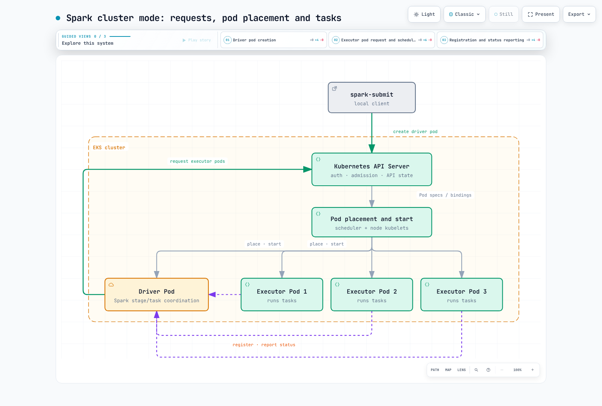

# EKS 上の Spark 詳細ガイド

> **レビュー基準**: Apache Spark 4.2.0、Kubernetes 1.34 以降\
> **最終レビュー日**: 2026年9月12日

Apache Spark は、バッチ、SQL、ストリーミングなどの分散データワークロードを実行します。
Kubernetes のネイティブサポートは Spark 2.3 で導入され、クライアントモードのサポートは
2.4 で追加されました。Spark 4.2.0 では、前提条件として Kubernetes **1.34 以降**が記載されています。
固定の古い最小バージョンではなく、実際の EKS バージョンと互換性のある kubectl を使用してください。

Spark は、別個の Spark Standalone master や YARN ResourceManager を用意せずに、
すでに運用している Kubernetes のキャパシティとコントロールプレーンを利用できます。
ただし、ノード容量、イメージ、ID、ネットワーク、ストレージ、オブザーバビリティの運用または
プロビジョニングは引き続き必要です。YARN ResourceManager/NodeManager は YARN のコンポーネントであり、
Spark 固有のデーモンではありません。

## 実行に関する責任

**クラスターデプロイモード**では、送信側クライアントが Kubernetes API にドライバーポッドの作成を要求します。
Kubernetes のアドミッション、スケジューリング、ノードの kubelet が、ポッドの配置と起動を処理します。
Spark ドライバーはエグゼキューターポッドを要求し、Spark のステージとタスクを調整します。
Kubernetes スケジューラーの代わりになるわけではありません。

エグゼキューターはドライバーに登録し、Spark の処理のためにドライバーと直接通信します。
Kubernetes は引き続きエグゼキューターポッドのライフサイクルを管理します。
**クライアントモード**では、ドライバーは送信側アプリケーションとともに、ポッド内または別のホスト上で実行されます。
この場合、ドライバーがエグゼキューターから到達可能である必要があります。どちらのモードも Spark アプリケーションをサポートします。

[インタラクティブ図](https://www.atomai.click/kubernetes-docs/archmaps/en-data-on-eks-spark-readme-0.html)

## 章

1. [Kubernetes 上の Spark の基礎](01-spark-fundamentals.md): クラスター/クライアント送信、リソースのマッピング、動的割り当て、デコミッショニングの条件。
2. [Spark Operator](02-spark-operator.md): Apache と Kubeflow の各 Operator、その API、ジョブのライフサイクル、送信、監視の違い。
3. [EMR on EKS](03-emr-on-eks.md): 仮想クラスター、ジョブの送信、実行 ID。マネージドランタイムの機能と EKS キャパシティ運用の違い。
4. [パフォーマンスとコスト](04-performance-tuning.md): shuffle/ストレージ/CPU/メモリのボトルネック、適切なノード機能、Spot からの復旧、エグゼキューターとノードのスケーリング。
5. [ベストプラクティスとセキュリティ](05-best-practices.md): Kubernetes と AWS の ID、データアクセス、イベントログ/履歴、メトリクス、ネットワークポリシー、復旧。

Spark の**動的リソース割り当て**は、アプリケーション内のエグゼキューター数を調整します。
これはデバイス用の Kubernetes Dynamic Resource Allocation や、ノードのオートスケーリングとは別の機能です。
デコミッショニングによって再計算を減らせることがありますが、強制終了時にすべてのブロックが保持される保証はありません。

## 参考資料

- [Kubernetes 上の Spark 4.2.0](https://spark.apache.org/docs/4.2.0/running-on-kubernetes.html)
- [Spark 4.2.0 の構成](https://spark.apache.org/docs/4.2.0/configuration.html)
- [Spark 4.2.0 の動的割り当ての代替策](https://spark.apache.org/docs/4.2.0/job-scheduling.html#dynamic-resource-allocation)
- [ドライバーのリソースマッピング](https://github.com/apache/spark/blob/v4.2.0/resource-managers/kubernetes/core/src/main/scala/org/apache/spark/deploy/k8s/features/BasicDriverFeatureStep.scala)
- [エグゼキューターのリソースとデコミッショニングフック](https://github.com/apache/spark/blob/v4.2.0/resource-managers/kubernetes/core/src/main/scala/org/apache/spark/deploy/k8s/features/BasicExecutorFeatureStep.scala)
- [公式デコミッショニングスクリプト](https://github.com/apache/spark/blob/v4.2.0/resource-managers/kubernetes/docker/src/main/dockerfiles/spark/decom.sh)
- [公式 Spark イメージタグ](https://github.com/docker-library/official-images/blob/master/library/spark)

- [Apache Spark Kubernetes Operator](https://github.com/apache/spark-kubernetes-operator)
- [Kubeflow Spark Operator](https://github.com/kubeflow/spark-operator)
- [EMR on EKS の概念](https://docs.aws.amazon.com/emr/latest/EMR-on-EKS-DevelopmentGuide/emr-eks-concepts.html)

## クイズ

[Spark の基礎クイズ](../../quizzes/data-on-eks/spark/01-spark-fundamentals-quiz.md)
