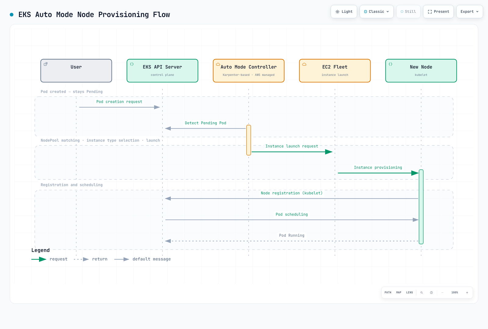

# EKS Auto Mode 運用ガイド

> **サポート対象バージョン**: EKS Auto Mode GA。例のベースラインは EKS 1.36
> **最終更新日**: 2026年10月12日

Amazon EKS Auto Mode は、ワークロード要件に応じたノードのプロビジョニングと最適化を含め、Kubernetes ノード管理を自動化します。このガイドでは Auto Mode の概念、設定、運用を扱います。Auto Mode のインフラストラクチャは AWS が管理しますが、アプリケーションの可用性、リソースリクエスト、セキュリティ、モニタリング、クラスター／VPC の設定は引き続き利用者の責任です。本番環境で使う前に、例を自身の環境で検証してください。

### 2026年10月の更新: EKS 1.37 のデフォルト

EKS 1.37 は2026年10月1日に利用可能になりました。新しく作成するカスタム NodePool で consolidation ポリシーを省略すると、デフォルトは `Balanced` になります。組み込みの `general-purpose` および `system` NodePool も `Balanced` を使用し、これらのポリシーは変更できません。カスタム NodePool でその動作を意図する場合は、`WhenEmptyOrUnderutilized` を明示的に設定してください。このガイドの NodePool 例にはこのフィールドを設定していないものもあるため、EKS 1.37 で作成すると `Balanced` が適用されます。詳しくは[EKS 標準サポートのリリースノート](https://docs.aws.amazon.com/eks/latest/userguide/kubernetes-versions-standard.html)の Kubernetes 1.37 の項を参照してください。

### 2026年7月の更新: EFA と Placement Group のサポート

2026年7月22日、AWS は EKS Auto Mode とオープンソース Karpenter の NodePool が、Elastic Fabric Adapter (EFA) のネットワークデバイス設定と EC2 placement group をサポートすると発表しました。

EFA 対応インスタンスでは、ネットワークインターフェイスを EFA 専用または標準 ENI として設定できます。EFA 専用インターフェイスは、完全なインターコネクト帯域幅を提供しながら VPC IP アドレスを消費しません。NodePool の設定では、cluster、spread、partition の placement strategy も指定できます。これらの機能は、高スループットまたは障害分離を必要とする分散トレーニング／推論ワークロードを対象としています。詳しくは[発表](https://aws.amazon.com/about-aws/whats-new/2026/07/amazon-eks-efa-placement-groups/)を参照してください。

### 2026年7月の更新: ARC Zonal Shift のサポート

2026年7月10日時点で、EKS Auto Mode クラスターは Amazon Application Recovery Controller (ARC) の zonal shift と autoshift をサポートしています。クラスターで ARC zonal shift を有効にしてください。Auto Mode では追加のフラグや Karpenter バージョン管理は不要です。

zonal shift 中、Auto Mode は障害のある AZ でのキャパシティのプロビジョニングを停止し、その AZ のノードに対する consolidation や drift などの自発的な中断を停止します。また、代替ノードのスケジューリングが障害のある AZ に依存する場合は、正常な AZ での自発的な中断もブロックします。クラスター登録後に ARC zonal autoshift を別途設定してください。

zonal shift によって、AZ に紐付いたボリュームや AZ 固定のワークロードが移動可能になるわけではありません。ARC に zonal shift の追加料金はありませんが、代替キャパシティと通常のインフラストラクチャ料金は発生します。詳しくは[発表](https://aws.amazon.com/about-aws/whats-new/2026/07/eks-auto-mode-arc-zonal-shift)と[ARC zonal shift のドキュメント](https://docs.aws.amazon.com/eks/latest/userguide/zone-shift-enable.html)を参照してください。

## 目次

1. [Auto Mode を始める](./01-getting-started.md) - クラスターの作成と Auto Mode の有効化
2. [NodePool の設定と最適化](./02-nodepool-configuration.md) - デフォルトおよびカスタム NodePool
3. [スケーリング動作を理解する](./03-scaling-behavior.md) - プロビジョニング、consolidation、drift の検出
4. [Spot Instance の活用戦略](./04-spot-strategies.md) - 混合キャパシティと中断への対応
5. [運用と管理](./05-operations.md) - 中断予算、ローリング置換、モニタリング
6. [コスト管理と最適化](./06-cost-management.md) - コスト分析、Spot による節約、適正サイジング
7. [ノードライフサイクル管理](./07-node-lifecycle.md) - 期限、AMI 管理、鮮度ポリシー
8. [ワークロード別の最適化](./08-workload-optimization.md) - Web、バッチ、GPU、AI/ML ワークロード
9. [Managed Node Groups からの移行](./09-migration-guide.md) - 移行手順と共存

---

## EKS Auto Mode の概要

### Auto Mode とは

EKS Auto Mode は、AWS が管理するノード管理ソリューションです。内部では Karpenter を基盤とし、AWS がマネージドインフラストラクチャのコントローラーを運用します。利用者は Auto Mode 用の Karpenter コントローラーを別途インストールするのではなく、ワークロードの制約、カスタム NodePool／NodeClass、中断予算を設定します。

```
+-----------------------------------------------------------------------------+
|                           EKS Auto Mode Architecture                         |
+-----------------------------------------------------------------------------+
|                                                                              |
|  +---------------------------------------------------------------------+    |
|  |                    EKS Control Plane (AWS Managed)                   |    |
|  |  +------------+  +------------+  +------------+  +------------+    |    |
|  |  | API Server |  |   etcd     |  | Controller |  |  Karpenter |    |    |
|  |  |            |  |            |  |  Manager   |  | Controller |    |    |
|  |  +------------+  +------------+  +------------+  +------------+    |    |
|  +---------------------------------------------------------------------+    |
|                                    |                                         |
|                                    v                                         |
|  +---------------------------------------------------------------------+    |
|  |                        NodePool Resources                            |    |
|  |  +------------------+  +------------------+  +------------------+  |    |
|  |  |  general-purpose |  |      system      |  |   custom-pool    |  |    |
|  |  | (Default Provided)|  | (Default Provided)|  |  (User Defined)  |  |    |
|  |  +------------------+  +------------------+  +------------------+  |    |
|  +---------------------------------------------------------------------+    |
|                                    |                                         |
|                                    v                                         |
|  +---------------------------------------------------------------------+    |
|  |                     EC2 Instances (Auto Managed)                     |    |
|  |  +--------------+  +--------------+  +--------------+              |    |
|  |  |   m6i.2xl    |  |   c7g.xl     |  |   r6i.4xl    |   ...        |    |
|  |  |  (On-Demand) |  |   (Spot)     |  |  (On-Demand) |              |    |
|  |  +--------------+  +--------------+  +--------------+              |    |
|  +---------------------------------------------------------------------+    |
|                                                                              |
+-----------------------------------------------------------------------------+
```

### 既存の管理方式との比較

| 機能 | Managed Node Groups | Fargate | Auto Mode |
|---------|---------------------|---------|-----------|
| ノード管理 | AWS がノードグループを管理し、利用者がキャパシティと更新を設定 | AWS が Pod ごとのインフラストラクチャを管理 | AWS が起動したノードとインフラストラクチャコントローラーを管理 |
| スケーリング | Cluster Autoscaler をインストールするか、ノードグループを明示的にスケール | Fargate profile による Pod ごとのプロビジョニング | スケジュール不能な Pod に対する Karpenter ベースのプロビジョニング |
| プロビジョニング時間 | キャパシティ、ブートストラップ、ワークロードによる | キャパシティ、イメージ、ワークロードによる。即時ではない | キャパシティ、ブートストラップ、イメージ、制約による。固定時間の保証はない |
| インスタンスの選択 | 設定済みのインスタンスタイプ | マネージドコンピューティングサイズ | NodePool とワークロードの制約内で選択 |
| Spot | Managed Node Groups でサポート | EKS Fargate では非対応 | NodePool で許可されている場合にサポート |
| GPU ワークロード | 適切なノードでサポート | 非対応 | 互換性のあるアクセラレーターインスタンスでサポート。ワークロード／ランタイム要件も適用される |
| DaemonSet | サポート | 非対応 | マネージドノードの制約内でサポート |
| コスト管理 | リクエスト、インスタンスの選択、オートスケーラーポリシー | Pod のリソースサイズとレプリカ数 | リクエスト、許可するキャパシティ、consolidation ポリシー。コスト削減の保証はない |
| ホストのカスタマイズ | AMI／launch template の選択肢 | ホストのカスタマイズ不可 | AWS 管理の Bottlerocket バリアントと、サポート対象の NodeClass 設定 |

### 内部アーキテクチャと運用原則

Karpenter ベースのコントローラーは AWS がワーカーノードの外部で運用します。図は概念を示しています。スケジューラーがスケジュール不能な Pod を特定し、その後ノードにバインドします。API サーバーはオブジェクトを保存します。Pod が Pending であることだけでは、ノードを追加すれば問題が解決するとは限りません。



[🔍 インタラクティブ図を表示](https://www.atomai.click/kubernetes-docs/archmaps/en-eks-auto-mode-readme-0.html)

### サポート対象リージョンと制限

#### リージョンとサポート対象バージョン

[EKS FAQ](https://aws.amazon.com/eks/faqs/) には、中国リージョンを除く EKS リージョンで Auto Mode を利用できると記載されています。これには GovCloud (US) も含まれます。リージョンごとのインスタンス／機能の提供状況は別途確認してください。以前の短いリージョン一覧は網羅的ではありませんでした。

FAQ に記載された当初の機能下限 `1.29+` は、そのバージョンがすべて現在も作成可能、または標準サポート中であることを意味しません。2026年10月12日時点で EKS 1.34～1.37 は標準サポート中です。例では引き続きレビュー済みの 1.36 をベースラインにしています。ライフサイクルの日付と延長サポート料金は[最新の EKS バージョンカレンダー](https://docs.aws.amazon.com/eks/latest/userguide/kubernetes-versions.html)で確認してください。

#### 確認すべき制約

| 項目 | ガイダンス |
|------|----------|
| キャパシティとスケール | 適用される EKS／EC2 クォータ、サブネットの IP キャパシティ、ワークロードの制約を確認し、想定する規模を自身の環境で検証する |
| NodePool の上限 | 利用者が定義するリソース上限は AWS アカウント／サービスのクォータとは異なる。スケールと置換用の余力を検証する |
| オペレーティングシステム | AWS がマネージド Bottlerocket バリアントを選択する。AL2023 や任意のカスタム AMI は Auto Mode の AMI として選択できない |
| Windows | Auto Mode は Windows ノードを提供しない。必要な場合は互換性のある別のノードグループを使う |
| DNS とストレージ | Auto Mode ノードはローカル CoreDNS を提供し、混在クラスターでは他のノード向けに CoreDNS が残る。マネージドノードディスクの暗号化だけでは、すべての動的 PVC の暗号化が確立されるわけではないため、StorageClass を明示する |

関連する制約を確認するには、[Service Quotas](https://docs.aws.amazon.com/eks/latest/userguide/service-quotas.html) と[NodeClass リファレンス](https://docs.aws.amazon.com/eks/latest/userguide/create-node-class.html)を使ってください。この監査では実際のアカウントクォータとインスタンスキャパシティを照会していません。

---

## 次のステップ

EKS Auto Mode の設定後は、次のトピックも学習してください。

1. **[EKS のコスト最適化](../eks/07-eks-cost-optimization.md)**: Spot、Savings Plans、リソースの最適化
2. **[EKS のモニタリングとログ](../eks/06-eks-monitoring-logging.md)**: CloudWatch、Prometheus、Grafana
3. **[EKS セキュリティ](../eks/05-eks-security.md)**: IAM、ネットワークポリシー、Pod セキュリティ
4. **[Karpenter の詳細](../autoscaling/02-karpenter.md)**: Karpenter の直接インストールと高度な機能

## 関連クイズ

学習内容を確認するには、[EKS Auto Mode クイズ](../quizzes/eks-auto-mode/01-getting-started-quiz.md)に取り組んでください。

---

## 参考資料

- [AWS EKS Auto Mode 公式ドキュメント](https://docs.aws.amazon.com/eks/latest/userguide/automode.html)
- [Karpenter 公式ドキュメント](https://karpenter.sh/)
- [EKS ベストプラクティスガイド](https://docs.aws.amazon.com/eks/latest/best-practices/)
- [AWS コスト最適化ガイド](https://aws.amazon.com/pricing/cost-optimization/)
- [セキュリティ、ネットワーク制御、パフォーマンスを強化する新しい EKS Auto Mode 機能 (AWS Containers Blog、2025-10-16)](https://aws.amazon.com/blogs/containers/new-amazon-eks-auto-mode-features-for-enhanced-security-network-control-and-performance/)
- [セルフマネージド Karpenter から EKS Auto Mode への移行](https://docs.aws.amazon.com/eks/latest/userguide/auto-migrate-karpenter.html)

- [Auto Mode のアーキテクチャと責任範囲](https://docs.aws.amazon.com/eks/latest/userguide/automode.html)
- [EKS Fargate の制約](https://docs.aws.amazon.com/eks/latest/userguide/fargate.html)

---

< [EKS トピック一覧に戻る](../README.md) | [次へ: はじめに](./01-getting-started.md) >
