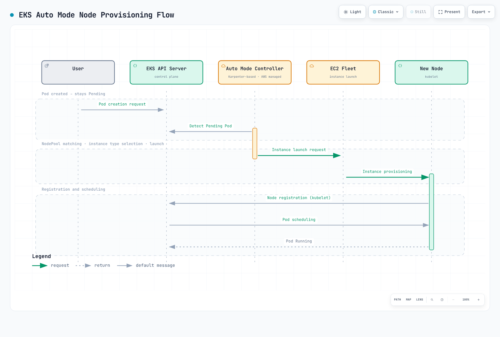

# EKS Auto Mode 運用ガイド

> **サポート対象バージョン**: EKS Auto Mode GA、例で使用するベースラインは EKS 1.36
> **最終更新日**: 2026年11月16日

Amazon EKS Auto Mode は、ワークロードの要件に応じたプロビジョニングや最適化を含む、Kubernetes ノード管理を自動化します。このガイドでは、Auto Mode の概念、設定、運用について説明します。AWS が Auto Mode のインフラストラクチャを管理しますが、アプリケーションの可用性、リソースリクエスト、セキュリティ、モニタリング、クラスター/VPC の設定については、引き続きお客様が責任を負います。本番環境で使用する前に、ご利用の環境で例を検証してください。

### 2026年11月の更新: Pod 用セキュリティグループのサポート

2026年11月11日現在、EKS Auto Mode は Pod 用セキュリティグループをサポートしており、個々の Pod に専用の EC2 セキュリティグループルールを適用できます。同じノード上の異なるワークロードに異なるセキュリティグループを割り当てることができるため、アプリケーションごとに別々のノードプールを作成しなくても、ネットワークレベルで Pod をセグメント化できます。詳細は[発表](https://aws.amazon.com/about-aws/whats-new/2026/11/amazon-eks-auto-mode-security-groups-for-pods/)を参照してください。

### 2026年11月の更新: 動的リソース割り当て（DRA）のサポート

2026年11月9日、AWS は EKS Auto Mode と Karpenter における、NVIDIA GPU および Elastic Fabric Adapter（EFA）ネットワークデバイス向けの Kubernetes 動的リソース割り当て（DRA）のサポートを発表しました。ワークロードは DRA を通じて必要なデバイス属性を宣言でき、Pod 間で GPU デバイスを共有できます。Karpenter はすべての Kubernetes バージョンで DRA をサポートします。EKS Auto Mode は Kubernetes 1.36 以降でサポートしますが、AWS GovCloud（米国）および中国リージョンは対象外です。詳細は[発表](https://aws.amazon.com/about-aws/whats-new/2026/11/amazon-eks-auto-mode-karpenter-dra/)を参照してください。

### 2026年10月の更新: EKS 1.37 のデフォルト

EKS 1.37 は2026年10月1日に利用可能になりました。新しく作成するカスタム NodePool で統合ポリシーを省略すると、デフォルトで `Balanced` が設定されます。組み込みの `general-purpose` および `system` プールも `Balanced` を使用し、これらのポリシーは変更できません。この動作を意図する場合は、カスタムプールで `WhenEmptyOrUnderutilized` を明示的に設定してください。このガイドの NodePool の例には、このフィールドを設定していないものもあるため、EKS 1.37 で作成すると `Balanced` が設定されます。[EKS 標準サポートのリリースノート](https://docs.aws.amazon.com/eks/latest/userguide/kubernetes-versions-standard.html)の Kubernetes 1.37 のセクションを参照してください。

### 2026年7月の更新: EFA とプレイスメントグループのサポート

2026年7月22日、AWS は EKS Auto Mode とオープンソースの Karpenter ノードプールが、Elastic Fabric Adapter（EFA）ネットワークデバイスの設定と EC2 プレイスメントグループをサポートすることを発表しました。

EFA 対応インスタンスでは、ネットワークインターフェイスを EFA 専用インターフェイスまたは標準 ENI として設定できます。EFA 専用インターフェイスは、フル帯域幅のインターコネクトを提供しながら、VPC IP アドレスを消費しません。ノードプールの設定では、クラスター、スプレッド、またはパーティションのプレイスメント戦略も指定できます。これらのオプションは、高いスループットや障害分離を必要とする分散トレーニングおよび推論ワークロードを対象としています。詳細は[発表](https://aws.amazon.com/about-aws/whats-new/2026/07/amazon-eks-efa-placement-groups/)を参照してください。

### 2026年7月の更新: ARC ゾーンシフトのサポート

2026年7月10日現在、EKS Auto Mode クラスターは Amazon Application Recovery Controller（ARC）のゾーンシフトと自動ゾーンシフトをサポートしています。クラスターで ARC ゾーンシフトを有効にしてください。Auto Mode では追加のフラグ設定や Karpenter のバージョン管理は必要ありません。

ゾーンシフト中、Auto Mode は障害のある AZ でのキャパシティのプロビジョニングを停止し、その AZ のノードに対する統合やドリフトなどの自発的な中断を停止します。また、代替ノードのスケジューリングが障害のある AZ に依存する場合は、正常な AZ での自発的な中断もブロックします。クラスターの登録後、ARC の自動ゾーンシフトは別途設定してください。

ゾーンシフトによって、ゾーンボリュームや AZ に厳密に紐づいたワークロードが移動可能になるわけではありません。ARC にゾーンシフト料金はかかりませんが、代替キャパシティと通常のインフラストラクチャ料金は引き続き発生します。詳細は[発表](https://aws.amazon.com/about-aws/whats-new/2026/07/eks-auto-mode-arc-zonal-shift)と[ARC ゾーンシフトのドキュメント](https://docs.aws.amazon.com/eks/latest/userguide/zone-shift-enable.html)を参照してください。

## 目次

1. [Auto Mode の使用開始](./01-getting-started.md) - クラスターの作成と Auto Mode の有効化
2. [NodePool の設定と最適化](./02-nodepool-configuration.md) - デフォルトおよびカスタムの NodePool
3. [スケーリング動作の理解](./03-scaling-behavior.md) - プロビジョニング、統合、ドリフト検出
4. [Spot インスタンスの利用戦略](./04-spot-strategies.md) - 混合キャパシティと中断への対応
5. [運用と管理](./05-operations.md) - 中断バジェット、ローリング置換、モニタリング
6. [コスト管理と最適化](./06-cost-management.md) - コスト分析、Spot による節約、適正サイズ化
7. [ノードのライフサイクル管理](./07-node-lifecycle.md) - 有効期限、AMI 管理、鮮度ポリシー
8. [ワークロード別の最適化](./08-workload-optimization.md) - Web、バッチ、GPU、AI/ML ワークロード
9. [マネージドノードグループからの移行](./09-migration-guide.md) - 移行手順と共存

---

## EKS Auto Mode の概要

### Auto Mode とは

EKS Auto Mode は、AWS が管理する完全自動化されたノード管理ソリューションです。内部では Karpenter を基盤としており、AWS がマネージドインフラストラクチャコントローラーを運用します。ユーザーは Auto Mode 用の別個の Karpenter コントローラーをインストールする代わりに、ワークロードの制約、カスタム NodePool/NodeClass、中断バジェットを設定します。

```
+-----------------------------------------------------------------------------+
|                           EKS Auto Mode Architecture                         |
+-----------------------------------------------------------------------------+
|                                                                              |
|  +---------------------------------------------------------------------+    |
|  |                    EKS Control Plane (AWS Managed)                   |    |
|  |  +------------+  +------------+  +------------+  +------------+    |    |
|  |  | API Server |  |   etcd     |  | Controller |  |  Karpenter |    |    |
|  |  |            |  |            |  |  Manager   |  | Controller |    |    |
|  |  +------------+  +------------+  +------------+  +------------+    |    |
|  +---------------------------------------------------------------------+    |
|                                    |                                         |
|                                    v                                         |
|  +---------------------------------------------------------------------+    |
|  |                        NodePool Resources                            |    |
|  |  +------------------+  +------------------+  +------------------+  |    |
|  |  |  general-purpose |  |      system      |  |   custom-pool    |  |    |
|  |  | (Default Provided)|  | (Default Provided)|  |  (User Defined)  |  |    |
|  |  +------------------+  +------------------+  +------------------+  |    |
|  +---------------------------------------------------------------------+    |
|                                    |                                         |
|                                    v                                         |
|  +---------------------------------------------------------------------+    |
|  |                     EC2 Instances (Auto Managed)                     |    |
|  |  +--------------+  +--------------+  +--------------+              |    |
|  |  |   m6i.2xl    |  |   c7g.xl     |  |   r6i.4xl    |   ...        |    |
|  |  |  (On-Demand) |  |   (Spot)     |  |  (On-Demand) |              |    |
|  |  +--------------+  +--------------+  +--------------+              |    |
|  +---------------------------------------------------------------------+    |
|                                                                              |
+-----------------------------------------------------------------------------+
```

### 既存の管理方式との比較

| 機能 | マネージドノードグループ | Fargate | Auto Mode |
|---------|---------------------|---------|-----------|
| ノード管理 | AWS がノードグループを管理し、キャパシティと更新はユーザーが設定 | AWS が Pod ごとのインフラストラクチャを管理 | AWS が起動したノードとインフラストラクチャコントローラーを管理 |
| スケーリング | インストールされている場合は Cluster Autoscaler を使用。そうでない場合は、グループのスケーリングを明示的に行う | Fargate プロファイルを使用して Pod ごとにプロビジョニング | スケジュールできない Pod を Karpenter ベースでプロビジョニング |
| プロビジョニング時間 | キャパシティ、ブートストラップ、ワークロードによって異なる | キャパシティ、イメージ、ワークロードによって異なり、即時ではない | キャパシティ、ブートストラップ、イメージ、制約によって異なり、所要時間の保証はない |
| インスタンスの選択 | インスタンスタイプを設定 | マネージドコンピューティングサイズ | NodePool とワークロードの制約の範囲内で選択 |
| Spot | マネージドノードグループでサポート | EKS Fargate では非対応 | NodePool で許可されている場合にサポート |
| GPU ワークロード | 適切なノードでサポート | 非対応 | 互換性のあるアクセラレーテッドインスタンスでサポート。ワークロードやランタイムの要件は引き続き適用 |
| DaemonSet | サポート | 非対応 | マネージドノードの制約内でサポート |
| コスト管理 | リクエスト、インスタンスの選択、オートスケーラーのポリシー | Pod のリソースサイズとレプリカ数 | リクエスト、使用可能なキャパシティ、統合ポリシー。節約の保証はない |
| ホストのカスタマイズ | AMI/起動テンプレートのオプション | ホストのカスタマイズなし | AWS 管理の Bottlerocket バリアント。サポート対象の NodeClass 設定 |

### 内部アーキテクチャと運用原則

Karpenter ベースのコントローラーは、ワーカーノードの外部で AWS によって運用されます。図は概念を示したものです。スケジューラーがスケジュールできない Pod を特定し、その後ノードにバインドします。API サーバーはオブジェクトを保存します。Pod が Pending であるというだけでは、ノードを追加すれば問題が解決するとは限りません。



[🔍 インタラクティブな図を表示](https://www.atomai.click/kubernetes-docs/archmaps/en-eks-auto-mode-readme-0.html)

### サポート対象リージョンと制約

#### リージョンとサポート対象バージョン

[EKS FAQ](https://aws.amazon.com/eks/faqs/) には、中国リージョンを除く GovCloud（米国）を含む EKS リージョンで Auto Mode が利用できると記載されています。リージョンごとのインスタンスや機能の提供状況は、別途確認してください。以前掲載されていた短いリージョン一覧は網羅的なものではありません。

FAQ にある機能の最低バージョン `1.29+` は、そのバージョン以降のすべてのバージョンで現在もクラスターを作成できる、あるいは標準サポート対象であることを意味しません。2026年10月12日時点で、EKS 1.34～1.37 は標準サポート対象です。このガイドの例では、レビュー済みの 1.36 をベースラインとして引き続き使用します。ライフサイクルの日程と延長サポート料金については、[最新の EKS バージョンカレンダー](https://docs.aws.amazon.com/eks/latest/userguide/kubernetes-versions.html)を参照してください。

#### 確認すべき制約

| 項目 | ガイダンス |
|------|----------|
| キャパシティとスケール | 適用される EKS/EC2 クォータ、サブネットの IP キャパシティ、ワークロードの制約を確認し、意図するスケールを自分の環境で検証してください |
| NodePool の上限 | ユーザー定義のリソース上限は AWS アカウント/サービスクォータとは異なります。スケールと置換用の余裕を検証してください |
| オペレーティングシステム | AWS がマネージド Bottlerocket バリアントを選択します。AL2023 や任意のカスタム AMI は Auto Mode の AMI として選択できません |
| Windows | Auto Mode は Windows ノードを提供しません。必要に応じて互換性のある別のノードグループを使用してください |
| DNS とストレージ | Auto Mode のノードはローカルの CoreDNS を提供します。混在クラスターでは、他のノード用に CoreDNS が維持されます。マネージドノードディスクの暗号化だけでは、すべての動的 PVC が暗号化されるとは限りません。StorageClass を明示的に設定してください |

該当する制約を確認するには、[Service Quotas](https://docs.aws.amazon.com/eks/latest/userguide/service-quotas.html) と [NodeClass リファレンス](https://docs.aws.amazon.com/eks/latest/userguide/create-node-class.html)を参照してください。この監査では、実際のアカウントクォータとインスタンスキャパシティを照会していません。

---

## 次のステップ

EKS Auto Mode の設定が完了したら、次のトピックを学習することをお勧めします。

1. **[EKS のコスト最適化](../eks/07-eks-cost-optimization.md)**: Spot、Savings Plans、リソース最適化
2. **[EKS のモニタリングとログ記録](../eks/06-eks-monitoring-logging.md)**: CloudWatch、Prometheus、Grafana
3. **[EKS のセキュリティ](../eks/05-eks-security.md)**: IAM、ネットワークポリシー、Pod セキュリティ
4. **[Karpenter の詳細](../autoscaling/02-karpenter.md)**: Karpenter の直接インストールと高度な機能

## 関連クイズ

学習内容を確認するには、[EKS Auto Mode クイズ](../quizzes/eks-auto-mode/01-getting-started-quiz.md)に挑戦してください。

---

## 参考資料

- [AWS EKS Auto Mode 公式ドキュメント](https://docs.aws.amazon.com/eks/latest/userguide/automode.html)
- [Karpenter 公式ドキュメント](https://karpenter.sh/)
- [EKS ベストプラクティスガイド](https://docs.aws.amazon.com/eks/latest/best-practices/)
- [AWS コスト最適化ガイド](https://aws.amazon.com/pricing/cost-optimization/)
- [セキュリティ、ネットワーク制御、パフォーマンスを強化する EKS Auto Mode の新機能（AWS Containers Blog、2025-10-16）](https://aws.amazon.com/blogs/containers/new-amazon-eks-auto-mode-features-for-enhanced-security-network-control-and-performance/)
- [セルフマネージド Karpenter から EKS Auto Mode への移行](https://docs.aws.amazon.com/eks/latest/userguide/auto-migrate-karpenter.html)

- [Auto Mode のアーキテクチャと責任範囲](https://docs.aws.amazon.com/eks/latest/userguide/automode.html)
- [EKS Fargate の制約](https://docs.aws.amazon.com/eks/latest/userguide/fargate.html)

---

< [EKS トピックに戻る](../README.md) | [次へ: 使用開始](./01-getting-started.md) >
