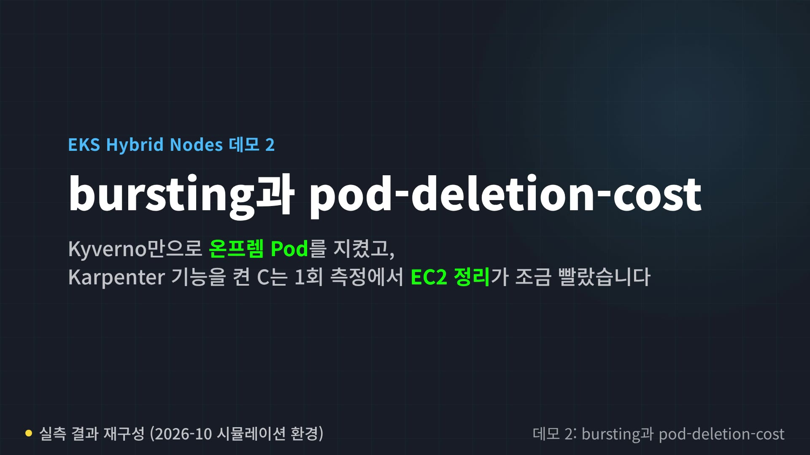

# ワークロード配置戦略

< [前へ: GPU Server の統合](./05-gpu-integration.md) | [目次](./README.md) | [次へ: Node ライフサイクル管理](./07-node-lifecycle.md) >

> **サポート対象バージョン**: Karpenter と互換性のあるサポート対象 EKS バージョン。確認時の基準として、Kubernetes 1.36.5 および Karpenter/provider 1.14.1（バージョンを固定したレビュー基準）のインターフェイスを確認しています。
> **最終更新**: 2026年10月18日

この章では、Hybrid node と cloud node へのワークロード配置に加え、cloud bursting と Pod deletion cost の限界を説明します。例は、ローカルで検証した設定およびパッチのパターンです。この監査では、cloud capacity、node の変更、アプリケーション、GPU workload は作成していません。

## 配置制約と権限

| 仕組み | できること | 保証しないこと |
|---|---|---|
| `nodeSelector` / 必須の node affinity | スケジューリング時に配置可能な node を絞り込む | データの存在、依存サービスの正常性、ラベル変更後に既存 Pod を移動すること |
| 優先 node affinity | スケジューリングの優先度を加える | 常にオンプレミスを優先すること、固定比率で配置すること、稼働中の Pod を自動で移動すること |
| taint / toleration | 対応する toleration を持たない Pod を除外する | 一致する toleration によって Pod が誘導されることや、GPU を使用する証明 |
| Pod anti-affinity / topology spread | 対象となる障害ドメイン間での分散を制御または評価する | 物理ホスト、電源、ストレージ、ネットワークの共有障害に対する完全な可用性 |
| PDB | 対応する自発的な退避要求を制約する | 全般的な可用性や配置、あらゆる削除・スケールダウン経路からの保護 |

`eks.amazonaws.com/compute-type=hybrid` ラベルと、所有者が管理するロケーションラベルを併用してください。compute-type ラベルが `DoesNotExist` であることは「cloud」の定義にはなりません。有効な cloud node に compute-type ラベルが付く場合があり、ラベルのない node も承認済みの cloud 配置先である証拠にはなりません。

この章の例では、[Node Bootstrap](./04-node-bootstrap.md) と同様、Hybrid node に `workload.example.com/location=onprem` を、以下の Karpenter pool に属する node に `cloud` を設定します。ラベルは運用上の入力であり、それだけでデータ所在要件やセキュリティを保証するものではありません。ストレージのトポロジー、egress、IAM、信頼できる node 管理も引き続き重要です。

ロケーションラベルは、実際の node 所有者の設定を通じて付与してください。たとえば、nodeadm の `--node-labels=workload.example.com/location=onprem` kubelet flag、または対応する Bottlerocket node-label 設定を使います。認証情報だけを設定する最小限の NodeConfig では、このカスタムラベルは自動的に追加されません。

### 任意の taint

Hybrid taint は任意です。追加する前に、必要な CNI、DNS、GPU 基盤、アプリケーション Pod が必要な toleration を持つことを確認してください。前の GPU の例は、新たに独自設定したあらゆる taint を自動的に許容するわけではありません。

```bash
# Identified node only; owner-approved scheduling-policy change.
set -euo pipefail
: "${KUBECONFIG:?}" "${CONTEXT:?}" "${NODE_NAME:?}"
kubectl --kubeconfig "$KUBECONFIG" --context "$CONTEXT" \
  taint node "$NODE_NAME" eks.amazonaws.com/compute-type=hybrid:NoSchedule
```

GPU 専用 taint には、`nvidia.com/gpu=present:NoSchedule` のようにレビュー済みの規則を使い、基盤 Pod と workload の toleration を整合させてください。CPU のみを使う Pod もこの taint を許容できます。admission と resource request に関するポリシーは別途必要です。

`NoSchedule` は新規スケジューリングに影響し、`PreferNoSchedule` は回避を優先するソフトな指定です。`NoExecute` は、Pod の toleration および `tolerationSeconds` に従って既存 Pod を退避させることがあります。ラベルを変更しても、`IgnoredDuringExecution` を指定した必須 affinity ルールを変更しても、稼働中の Pod が自動的に移動することはありません。

## cloud burst pool を準備する

Karpenter は条件を満たす pending Pod 向けに EC2 capacity を作成します。オンプレミスサーバーを追加するものではありません。HPA/KEDA またはアプリケーションコントローラーが replica の需要を調整し、node provisioner は別の制御ループとして動作します。AWS quota、instance の提供状況、subnet の IP、IAM、node bootstrap、workload の依存関係などにより、capacity を拡張できないことがあります。

クラスターの Kubernetes minor version でサポートされる Karpenter バージョンを使用してください。現在の互換性マトリックスでは、Kubernetes 1.36 に少なくとも **1.13** が必要です。この例は、レビュー基準として固定した **1.14.1** の CRD に照らして確認しています。2026年10月10日の 1.15.0 の変更は反映していません。これはセルフマネージド Karpenter の `EC2NodeClass` の例であり、Auto Mode の `NodeClass` ではありません。

```yaml
apiVersion: karpenter.sh/v1
kind: NodePool
metadata:
  name: cloud-burst-pool
spec:
  template:
    metadata:
      labels:
        workload.example.com/location: cloud
    spec:
      taints:
        - key: workload.example.com/cloud-burst
          value: "true"
          effect: NoSchedule
      requirements:
        - key: kubernetes.io/arch
          operator: In
          values: [amd64]
        - key: kubernetes.io/os
          operator: In
          values: [linux]
        - key: topology.kubernetes.io/zone
          operator: In
          values: [ap-northeast-2a, ap-northeast-2b]
        - key: karpenter.sh/capacity-type
          operator: In
          values: [spot, on-demand]
        - key: node.kubernetes.io/instance-type
          operator: In
          values: [m6i.xlarge, m6i.2xlarge, m6i.4xlarge]
      nodeClassRef:
        group: karpenter.k8s.aws
        kind: EC2NodeClass
        name: hybrid-cloud-burst
  limits:
    cpu: "1000"
    memory: 4000Gi
  disruption:
    consolidationPolicy: WhenEmpty
    consolidateAfter: 30s
    budgets:
      - nodes: "1"
---
apiVersion: karpenter.k8s.aws/v1
kind: EC2NodeClass
metadata:
  name: hybrid-cloud-burst
spec:
  amiFamily: AL2023
  amiSelectorTerms:
    - id: ami-0123456789abcdef0
  subnetSelectorTerms:
    - id: subnet-0123456789abcdef0
    - id: subnet-0fedcba9876543210
  securityGroupSelectorTerms:
    - id: sg-0123456789abcdef0
  instanceProfile: REPLACE_WITH_APPROVED_EC2_NODE_INSTANCE_PROFILE
```

適用前に、サンプルの AWS resource ID と instance profile をすべて置き換えてください。リージョン、アーキテクチャ、Kubernetes バージョンに合う、承認済みで不変な AL2023 AMI を選びます。AMI ID で選択する場合も、`amiFamily: AL2023` が bootstrap family を指定します。ここで使う instance profile は、準備済みの **EC2 node profile** であり、SSM/IAM Roles Anywhere の Hybrid role ではありません。subnet と security group が、意図する private networking と AZ に実際に適合することを確認してください。

AZ の制限は `requirements` に指定してください。template label に AWS zone を記述して偽装してはいけません。この pool の opt-in taint によって、対応する toleration を持つ workload のみが配置対象になります。これによってデータや registry へのアクセス権が付与されるわけではありません。

維持している `1000` CPU / `4000Gi` の limit は、大きな**計画用の例**であり、推奨割り当てや支出上限ではありません。使用前に適切な値へ調整してください。Karpenter の limit 確認には結果整合性があるため、短時間に provisioning が続くと値を超えることがあります。`budgets: [{nodes: "1"}]` は対象となる任意 disruption の同時実行数を制限します。最低 capacity を予約する設定ではありません。

NodePool 定義は完全なものを 1 つ使用してください。同じ名前で部分的な object をもう 1 つ適用し、「上記の設定を継承」するのは安全な方法ではありません。expiry、AMI 選択、disruption policy の変更には、それぞれレビュー済みの rollout が必要です。

## ローカル、cloud 専用、burst 対象の workload

`hybrid-placement-lab` などの承認済み lab namespace を作り、workload の実行前に実際の image digest、アプリケーションのセキュリティ設定、probe、ストレージ、registry access を準備してください。次の例は **replica 数 0** で開始し、意図的に使用できない image を指定しています。以前の replica 数 3/5/10 は sizing の想定例であり、測定済み capacity やアプリケーションの稼働保証ではありません。

```yaml
apiVersion: apps/v1
kind: Deployment
metadata:
  name: hybrid-local-processor
  namespace: hybrid-placement-lab
spec:
  replicas: 0
  selector:
    matchLabels:
      app: hybrid-local-processor
  template:
    metadata:
      labels:
        app: hybrid-local-processor
    spec:
      nodeSelector:
        eks.amazonaws.com/compute-type: hybrid
        workload.example.com/location: onprem
      tolerations:
        - key: eks.amazonaws.com/compute-type
          operator: Equal
          value: hybrid
          effect: NoSchedule
      automountServiceAccountToken: false
      securityContext:
        runAsNonRoot: true
        runAsUser: 65532
        seccompProfile:
          type: RuntimeDefault
      containers:
        - name: processor
          image: registry.example.invalid/approved/data-processor:replace-with-approved-digest
          securityContext:
            allowPrivilegeEscalation: false
            capabilities:
              drop: ["ALL"]
          resources:
            requests:
              cpu: "2"
              memory: 4Gi
            limits:
              cpu: "4"
              memory: 8Gi
---
apiVersion: apps/v1
kind: Deployment
metadata:
  name: hybrid-cloud-api
  namespace: hybrid-placement-lab
spec:
  replicas: 0
  selector:
    matchLabels:
      app: hybrid-cloud-api
  template:
    metadata:
      labels:
        app: hybrid-cloud-api
    spec:
      nodeSelector:
        workload.example.com/location: cloud
        karpenter.sh/nodepool: cloud-burst-pool
      tolerations:
        - key: workload.example.com/cloud-burst
          operator: Equal
          value: "true"
          effect: NoSchedule
      automountServiceAccountToken: false
      securityContext:
        runAsNonRoot: true
        runAsUser: 65532
        seccompProfile:
          type: RuntimeDefault
      containers:
        - name: api
          image: registry.example.invalid/approved/inference-api:replace-with-approved-digest
          securityContext:
            allowPrivilegeEscalation: false
            capabilities:
              drop: ["ALL"]
          resources:
            requests:
              cpu: "2"
              memory: 4Gi
            limits:
              cpu: "4"
              memory: 8Gi
---
apiVersion: apps/v1
kind: Deployment
metadata:
  name: hybrid-burst-app
  namespace: hybrid-placement-lab
spec:
  replicas: 0
  selector:
    matchLabels:
      app: hybrid-burst-app
  template:
    metadata:
      labels:
        app: hybrid-burst-app
    spec:
      tolerations:
        - key: eks.amazonaws.com/compute-type
          operator: Equal
          value: hybrid
          effect: NoSchedule
        - key: workload.example.com/cloud-burst
          operator: Equal
          value: "true"
          effect: NoSchedule
      affinity:
        nodeAffinity:
          requiredDuringSchedulingIgnoredDuringExecution:
            nodeSelectorTerms:
              - matchExpressions:
                  - key: eks.amazonaws.com/compute-type
                    operator: In
                    values: [hybrid]
                  - key: workload.example.com/location
                    operator: In
                    values: [onprem]
              - matchExpressions:
                  - key: workload.example.com/location
                    operator: In
                    values: [cloud]
                  - key: karpenter.sh/nodepool
                    operator: In
                    values: [cloud-burst-pool]
          preferredDuringSchedulingIgnoredDuringExecution:
            - weight: 100
              preference:
                matchExpressions:
                  - key: workload.example.com/location
                    operator: In
                    values: [onprem]
      topologySpreadConstraints:
        - maxSkew: 2
          topologyKey: topology.kubernetes.io/zone
          whenUnsatisfiable: ScheduleAnyway
          labelSelector:
            matchLabels:
              app: hybrid-burst-app
      automountServiceAccountToken: false
      securityContext:
        runAsNonRoot: true
        runAsUser: 65532
        seccompProfile:
          type: RuntimeDefault
      containers:
        - name: app
          image: registry.example.invalid/approved/latency-app:replace-with-approved-digest
          securityContext:
            allowPrivilegeEscalation: false
            capabilities:
              drop: ["ALL"]
          resources:
            requests:
              cpu: "1"
              memory: 2Gi
            limits:
              cpu: "2"
              memory: 4Gi
```

ローカル processor の配置には、Hybrid とオンプレミスの両方のラベルが必要です。cloud API は、所有者が明示的に指定した cloud-burst pool を対象にします。他の承認済み EC2 group には、それぞれ明示的な選択ルールを設定してください。ラベルがないことを代替の認可条件にしてはいけません。

burst application には、2 つの **OR** 条件からなる node affinity を設定します。承認済みのオンプレミス node 群、または承認済みの cloud pool のいずれかです。1 つの条件内の各式は **AND** で評価されます。オンプレミス配置を優先しますが、scheduler のスコア、resource request、taint、topology の優先設定も影響します。新規 node を計画する際、Karpenter がスケジューリングの優先設定を緩和する場合があります。これは飽和状態を検知する仕組みでも、オンプレミスの全 slot を必ず先に使い切る保証でもありません。

100 と 50 のような weight はスケジューリングスコアであり、capacity の 2:1 割り当てではありません。1 つの node に複数の Pod を配置できる場合も、互換性のある Pod が 1 つも配置されない場合もあります。そのため「8 node なら Pod 1～8 はローカル、Pod 9 以降は無制限の cloud capacity」という考え方は適切ではありません。

オンプレミス capacity が戻っても、稼働中の cloud Pod が自動的に戻るわけではありません。再配置には、データと可用性を考慮した、別途制御された rollout/eviction policy が必要です。

オンプレミスで GPU training を行い、cloud で CPU API を動かす場合は、GPU 要件とデータ移動を明示してください。[GPU Integration](./05-gpu-integration.md) にある、上限を設けた Job と allocation のパターンを使います。以前の **4 GPU / 16 CPU / 64Gi** の training request は sizing の例です。実際の GPU capacity、互換性のある device、永続的な入力データと checkpoint へのアクセスが必要です。有限時間で終わる training process を Deployment で繰り返し再起動する方法は、Job や適切な training controller の代わりにはなりません。

### topology とデータ局所性

`topology.kubernetes.io/zone` を使う前に、実際の障害ドメインに合ったラベルを設定してください。cloud node には実際の AWS AZ 値を、オンプレミスには意味のある障害ドメインを指定します。selector を満たすために、すべての Hybrid host を AWS AZ としてラベル付けしてはいけません。

`ScheduleAnyway` の burst 例で使う spread rule は、スコア上の優先設定であり、`maxSkew` を超えることがあります。`DoNotSchedule` では、設定されていれば `minDomains` も考慮し、**対象となる domain 全体の最小値**を基準に skew を判定します。クラスター内のすべての zone について単純に最大値と最小値を比較するとは限りません。

厳密な spread や anti-affinity により、条件を満たす node/domain が十分でない場合、Pod が Pending のままになることがあります。node の適格性は affinity、taint、topology policy にも依存します。分散の強さとオンプレミス利用率の最大化が競合する場合があります。意図するトレードオフを選んでください。

必須の hostname anti-affinity は、capacity が十分であれば、該当する replica が同じ Kubernetes Node に配置されるのを防げます。ただし、残った replica の正常性、十分な serving capacity、物理障害の共有回避までは保証しません。

データ局所性を示すラベルを付けても、データの作成や複製は行われません。ローカル永続データには、PV node affinity を持つ適切に管理された local PV/PVC と、対応する `WaitForFirstConsumer` binding workflow を使用してください。`hostPath: /mnt/data` を指定しても、dataset は検証されず、移植可能な永続性も得られません。ローカルストレージに bind 済みの Pod は EC2 node に単純に切り替えられません。複製、アクセス可能なストレージ、または別のアプリケーション経路を計画してください。

## Pod deletion cost は優先設定

`controller.kubernetes.io/pod-deletion-cost` は Pod に付ける整数 annotation です。有効範囲は **−2147483648～2147483647** で、指定しない場合は 0 です。負の値も使えます。ReplicaSet の scale-down では、**best effort** で値の低い Pod を優先して削除します。

レビュー対象の Kubernetes 1.36.5 controller では、deletion cost の比較より先に、次の順で削除候補の優先順位が決まります。

1. 割り当て済み Pod より未割り当て Pod を先に削除候補とする。
2. Pending、Unknown、Running の順に、より前の状態を先に削除候補とする。
3. Ready より NotReady を先に削除候補とする。
4. その後に初めて、cost の高い Pod より低い Pod を先に削除候補とする。

さらに、replica の同居状態、Ready になってからの経過時間、再起動回数、作成時刻なども比較されます。そのため、cost が 1000 の不健全なオンプレミス Pod が、cost が 0 の健全な cloud Pod より先に削除される場合があります。cost 1000 を指定しても、eviction、rollout、node failure、手動削除、その他の controller による削除を防げません。

元の「replica 10 個から 4 個へ減らすと、cloud Pod 6 個をすべて削除し、オンプレミス Pod 4 個をすべて残す」という例は、**条件付きの例示**に限られます。すべての Pod が同じ ReplicaSet に属し、より優先度の高い比較条件が一致し、状態が安定している必要があります。特に Deployment の revision をまたぐ場合、保証される結果ではありません。

オンプレミス capacity には、電力、保守、機会費用もあります。オンプレミス側に保持することは評価すべき運用目標であり、あらゆる環境に当てはまる経済原則ではありません。deletion-cost の値だけでは、支出上限も可用性目標も適用されません。

## 所有する単一 Pod に bind 後で cost を設定する

通常、Pod の `CREATE` admission request には割り当て後の `spec.nodeName` が含まれません。そのため、CREATE のみを対象にする mutating webhook では、最終的な node の場所を確実に判断できません。以前の webhook 例には、動作する Service/TLS/backend/RBAC 設定もなく、failure policy によって Pod 作成が阻害される可能性もありました。本番向けの解決策として導入しないでください。

小規模で制御された運用では、スケジューリング後に cost を判定してください。次の script は、指定された 1 つの Pod を読み込み、controller ReplicaSet UID と node 区分を確認して、レビュー用の非公開 JSON Patch を書き出します。全 namespace を走査したり変更したりはしません。

`NAMESPACE`、`POD_NAME`、`EXPECTED_RS_UID` には、共有ラベルだけでなく、アプリケーション所有者が確認した実際の Deployment/ReplicaSet の所有関係を設定します。この章で定めたロケーション規則と cloud pool のみを認識します。

```bash
#!/usr/bin/env bash
# Read one owned, scheduled ReplicaSet Pod and write a reviewable JSON Patch.
# This script does not mutate the cluster.
set -euo pipefail
umask 077
: "${KUBECONFIG:?}" "${CONTEXT:?}" "${NAMESPACE:?}" "${POD_NAME:?}"
: "${EXPECTED_RS_UID:?UID of the ReplicaSet owned by the application operator}"
[[ "$NAMESPACE" =~ ^[a-z0-9]([-a-z0-9]*[a-z0-9])?$ && ${#NAMESPACE} -le 63 ]]
[[ "$POD_NAME" =~ ^[a-z0-9]([-a-z0-9.]*[a-z0-9])?$ && ${#POD_NAME} -le 253 ]]
PLAN_DIR=$(mktemp -d ./deletion-cost-review.XXXXXXXX)
kubectl --kubeconfig "$KUBECONFIG" --context "$CONTEXT" \
  get pod "$POD_NAME" -n "$NAMESPACE" -o json |
  jq '{metadata: {name: .metadata.name, namespace: .metadata.namespace,
      uid: .metadata.uid, resourceVersion: .metadata.resourceVersion,
      ownerReferences: .metadata.ownerReferences,
      deletionTimestamp: .metadata.deletionTimestamp},
    nodeName: .spec.nodeName,
    hasAnnotations: (.metadata.annotations | type == "object"),
    currentCost: .metadata.annotations["controller.kubernetes.io/pod-deletion-cost"]}' \
    > "$PLAN_DIR/pod.json"
jq -e --arg ns "$NAMESPACE" --arg pod "$POD_NAME" --arg owner "$EXPECTED_RS_UID" '
  .metadata.namespace == $ns and .metadata.name == $pod and
  (.metadata.uid | type == "string" and length > 0) and
  (.metadata.resourceVersion | type == "string" and length > 0) and
  .metadata.deletionTimestamp == null and
  ([.metadata.ownerReferences[]? | select(.controller == true)] | length == 1) and
  any(.metadata.ownerReferences[]?; .controller == true and
    .apiVersion == "apps/v1" and .kind == "ReplicaSet" and .uid == $owner) and
  (.nodeName | type == "string" and length > 0)' "$PLAN_DIR/pod.json" > /dev/null
NODE_NAME=$(jq -er '.nodeName' "$PLAN_DIR/pod.json")
[[ "$NODE_NAME" =~ ^[a-z0-9]([-a-z0-9.]*[a-z0-9])?$ ]]
kubectl --kubeconfig "$KUBECONFIG" --context "$CONTEXT" \
  get node "$NODE_NAME" -o json |
  jq '{metadata: {name: .metadata.name, uid: .metadata.uid, labels: {
    compute: .metadata.labels["eks.amazonaws.com/compute-type"],
    location: .metadata.labels["workload.example.com/location"],
    nodepool: .metadata.labels["karpenter.sh/nodepool"]}}}' > "$PLAN_DIR/node.json"
desired=$(jq -er --arg node "$NODE_NAME" '
  if .metadata.name != $node or (.metadata.uid | type != "string" or length == 0) then
    error("unexpected Node identity")
  elif .metadata.labels.compute == "hybrid" and .metadata.labels.location == "onprem" then "1000"
  elif .metadata.labels.compute != "hybrid" and .metadata.labels.location == "cloud"
       and .metadata.labels.nodepool == "cloud-burst-pool" then "0"
  else error("unknown or conflicting node classification") end' "$PLAN_DIR/node.json")
jq --arg cost "$desired" '
  [{op:"test",path:"/metadata/uid",value:.metadata.uid},
   {op:"test",path:"/metadata/resourceVersion",value:.metadata.resourceVersion},
   {op:"test",path:"/spec/nodeName",value:.nodeName}]
  + (if .hasAnnotations then [] else
       [{op:"add",path:"/metadata/annotations",value:{}}] end)
  + (if .currentCost == $cost then [] else
       [{op:"add",path:"/metadata/annotations/controller.kubernetes.io~1pod-deletion-cost",
         value:$cost}] end)' "$PLAN_DIR/pod.json" > "$PLAN_DIR/patch.json"
printf 'Review private snapshots and patch in %s; nothing was applied.\n' "$PLAN_DIR"
```

適用前に、snapshot と設定予定の annotation を確認してください。patch は Pod UID、resourceVersion、bind 済み node を検査します。Pod の置き換えや同時更新があった場合、新しい Pod を上書きせずに失敗します。追加するのは deletion-cost key だけで、他の annotation は保持します。

script が表示したディレクトリを、shell で `PLAN_DIR` に設定してください。子プロセスが設定した変数は、呼び出し元の shell には設定されません。

```bash
# Cluster write, only after the named Pod/owner and generated patch are reviewed.
set -euo pipefail
: "${KUBECONFIG:?}" "${CONTEXT:?}" "${NAMESPACE:?}" "${POD_NAME:?}" "${PLAN_DIR:?}"
kubectl --kubeconfig "$KUBECONFIG" --context "$CONTEXT" \
  patch pod "$POD_NAME" -n "$NAMESPACE" --type=json \
  --patch-file "$PLAN_DIR/patch.json"
```

test の失敗や node 区分の変更があった場合は、最新の状態から plan を再生成してレビューしてください。test を削除したり、無関係な Pod に `--overwrite` を使ったりしないでください。annotation の所有者は、既存 controller があれば調整してください。

変化の速い metric に基づいて cost を継続的に更新するのは避けてください。Kubernetes は API 更新の overhead を説明しています。本番の post-binding controller には、対象を絞った権限、所有者確認、回数を制限した retry、競合処理が必要です。以前の、未実装の全 namespace CronJob、ServiceAccount/ConfigMap の欠落、可変 tag の `bitnami/kubectl:latest` image は、そのような controller ではありません。

namespace RBAC で Pod patch の範囲を制限できますが、通常の RBAC では任意の Pod label selector を認可条件にできません。node metadata の reader とアプリケーション namespace の writer は、適切に分離してください。この単一 Pod を対象にした管理例では、クラスター全体への書き込み権限は付与しません。

## Karpenter との連携

Karpenter 1.14.1 も、Pod priority とともに `pod-deletion-cost` を**正規化した eviction-cost heuristic**で参照します。「ReplicaSet しか使わない」という説明は誤りです。Karpenter は Pod cost と node/disruption の情報を組み合わせます。値 1000 を設定しても、保持される保証が 1000 倍になるわけではありません。

| 制御 | 範囲 |
|---|---|
| ReplicaSet deletion cost | ReplicaSet の scale-down 候補間の優先設定 |
| Karpenter disruption cost | 候補評価に使う heuristic。eviction を禁止しない |
| `WhenEmpty` | delay/check の経過後に、対象となる workload Pod がない node を consolidate できる |
| `WhenEmptyOrUnderutilized` | 適用される制約のもと、consolidation の一環として workload を移動できる |
| PDB / disruption budget / lifecycle 設定 | それぞれ範囲が異なる制御。いずれも cost annotation で代替できない |

empty node がすぐ削除される保証はありません。reconciliation、disruption budget、finalizer、cloud 側の終了処理が関係します。affinity/spread の優先設定によって consolidation の機会が減ることもあります。HPA が scale-down するたびに対応する cloud node も削除されると考えず、これらを総合的に評価してください。


[🔍 インタラクティブ図を表示](https://www.atomai.click/kubernetes-docs/archmaps/en-eks-hybrid-nodes-06-workload-placement-0.html)

> **図の修正:** cloud-first の Pod 削除と、オンプレミス Pod をすべて保持することは best-effort の目標であり、不変条件ではありません。“Empty” でも DaemonSet Pod が残る場合があります。以前の `WhenUnderutilized` というラベルは、v1 の例では `WhenEmptyOrUnderutilized` と読む必要があります。上記の順序とライフサイクル条件を確認してください。

### デモ動画: cloud bursting と pod-deletion-cost

[](https://presentation.atomai.click/eks-hybrid-nodes-1h/media/v2-bursting.mp4)

この無音動画では、Hybrid node が満杯になると workload が Karpenter の burst node にあふれ、scale-down 時には Kyverno が Hybrid Pod に `pod-deletion-cost` を設定したため cloud Pod が先に終了します。2026年10月18日に、シミュレーション環境で記録されました（TGW 経由でオンプレミスを模した EC2 host を使用。本番でサポートされる構成ではありません）。scenario B（Kyverno 有効、Karpenter feature 無効、Pod request 910m）を実行しています。記録では、scale-out の35秒後に全15 replica が Ready（Hybrid 8、burst 7）となり、10 replica へ減らすと Hybrid 8 と cloud 2 が残り、3 replica へ減らすとすべて Hybrid node 上に残りました。動画後半の A/B/C 比較は、2026年10月15日に各 scenario を 1 回ずつ実行した結果です（Pod request 930m）。小さな差は測定誤差の可能性があります。`pod-deletion-cost` は best-effort であり、node failure や eviction には適用されません。全手順は[1時間セッションの資料](https://presentation.atomai.click/eks-hybrid-nodes-1h/index.html)を参照してください。

## 主な参照資料

- [Pod を node に割り当てる](https://kubernetes.io/docs/concepts/scheduling-eviction/assign-pod-node/)
- [Taint と toleration](https://kubernetes.io/docs/concepts/scheduling-eviction/taint-and-toleration/)
- [Pod topology spread](https://kubernetes.io/docs/concepts/scheduling-eviction/topology-spread-constraints/)
- [ReplicaSet deletion cost](https://kubernetes.io/docs/concepts/workloads/controllers/replicaset/#pod-deletion-cost)
- [Kubernetes 1.36.5 の scale-down 比較](https://github.com/kubernetes/kubernetes/blob/v1.36.5/pkg/controller/controller_utils.go)
- [Pod disruption と PDB の対象範囲](https://kubernetes.io/docs/concepts/workloads/pods/disruptions/)
- [Local volume と PV node affinity](https://kubernetes.io/docs/concepts/storage/volumes/#local)
- [StorageClass の volume binding](https://kubernetes.io/docs/concepts/storage/storage-classes/#volume-binding-mode)
- [Karpenter NodePools](https://karpenter.sh/docs/concepts/nodepools/) と[互換性](https://karpenter.sh/docs/upgrading/compatibility/)
- [Karpenter disruption](https://karpenter.sh/docs/concepts/disruption/)
- [Karpenter 1.14.1 の eviction-cost 実装](https://github.com/kubernetes-sigs/karpenter/blob/v1.14.1/pkg/utils/disruption/disruption.go)

< [前へ: GPU Server の統合](./05-gpu-integration.md) | [目次](./README.md) | [次へ: Node ライフサイクル管理](./07-node-lifecycle.md) >
