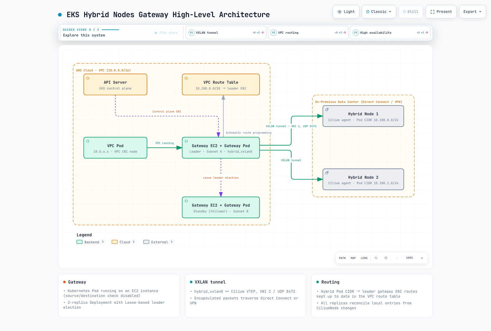
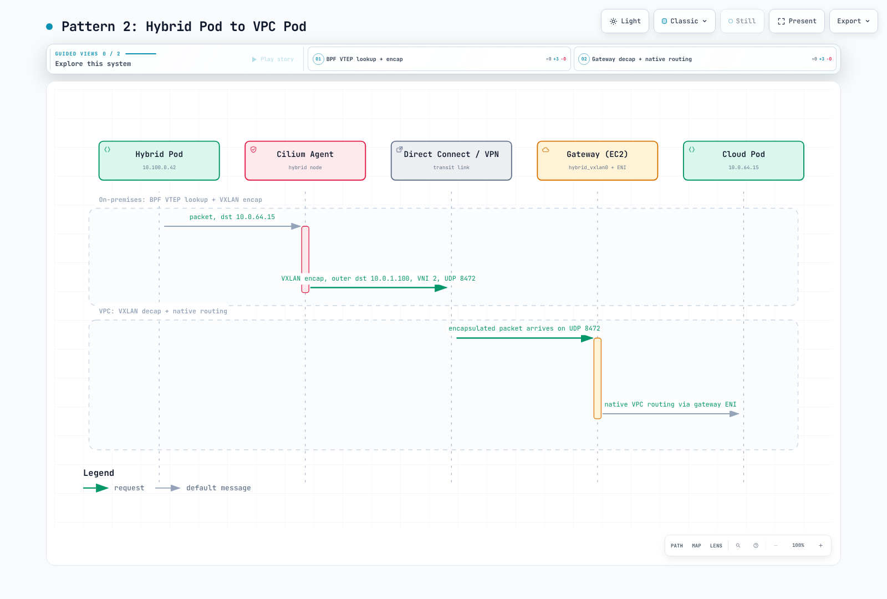

# EKS Hybrid Nodes Gateway

< [前へ: Bare Metal OS Setup](./09-bare-metal-os-setup.md) | [目次](./README.md) >

> **検証基準**: Gateway/chart 1.0.2。EKS がサポートする Kubernetes バージョンと、gateway の前提条件を満たす AWS 管理の Cilium release を使用してください。
> **最終更新**: 2026年10月18日

---

## 概要

EKS Hybrid Nodes Gateway は、Amazon VPC と、オンプレミスまたは edge 環境の Hybrid Node 上で稼働する Kubernetes Pod 間の接続を自動化するオープンソースのネットワークコンポーネントです。2026年4月21日に一般提供（GA）が発表されました。Gateway が自動管理するのは、所有対象の Pod route と VXLAN forwarding state です。underlay の到達性、route の所有権、firewall/MTU の計画、rollout、cleanup には引き続き明示的な設定が必要です。

Gateway は、VPC 内の専用 EC2 gateway instance とオンプレミスの Cilium 管理 Hybrid Node の間に VXLAN tunnel を確立します。VPC route table を自動設定し、forwarding database（FDB）entry を管理するとともに、Cilium VTEP（VXLAN Tunnel Endpoint）連携を設定して、VPC 内の Pod と Hybrid Node 上の Pod が直接通信できるようにします。通信の成功には、レビュー済みの underlay、CNI、IAM、security rule、アプリケーションの通信経路が引き続き必要です。

**主な特徴:**

- **オープンソース**: [github.com/aws/eks-hybrid-nodes-gateway](https://github.com/aws/eks-hybrid-nodes-gateway) で全ソースが公開されています。
- **Gateway ソフトウェアの利用料なし**: EC2、storage、Auto Mode 料金（gateway node を Auto Mode 上で動かす場合のみ。管理型・セルフマネージド型 node group も利用可能）、AZ 間通信、接続、observability には引き続き費用がかかります。
- **route 管理の自動化**: leader が設定済みの集約 VPC Pod route を設定します。各 replica は CiliumNode ごとのローカル tunnel state を個別に調整します。
- **高可用性**: lease による leader election を使用し、2 replica の Deployment で failover に対応します。
- **Cilium 連携**: Cilium の VTEP 機能を利用して、VXLAN tunnel を介した透過的な Pod 間 routing を実現します。

### 学習目標

このドキュメントを読み終えると、次のことができるようになります。

1. VXLAN tunnel、leader election、VPC route 管理を含む EKS Hybrid Nodes Gateway の**アーキテクチャを説明する**。
2. IAM role、security group、Cilium VTEP 連携を含め、Helm で gateway を**デプロイして設定する**。
3. VPC Pod と Hybrid Node Pod の間で双方向に流れる traffic を**追跡する**。
4. 複数 replica の gateway deployment で**高可用性を実現し**、failover の動作を理解する。
5. 監視、scaling、一般的な障害シナリオを含め、gateway deployment を**運用・トラブルシューティングする**。
6. Hybrid Node の networking 方式を**比較し**、gateway と手動 routing のどちらを使うか判断する。
7. 本番 gateway deployment の security、performance、cost optimization に関する**ベストプラクティスを適用する**。

### 課題: Hybrid 環境での Pod routing の手作業

Gateway が登場する前は、VPC と Hybrid Node の間で Pod 単位の通信を有効にするために、多くの手作業が必要でした。

```
Before Gateway (Manual Approach):
=================================

1. Configure BGP peering between on-prem routers and VPC (or use static routes)
2. Manually manage VPC route table entries for every hybrid Pod CIDR
3. Set up and maintain VPN tunnels or Direct Connect with proper route propagation
4. Handle route updates when nodes join/leave the cluster
5. Troubleshoot routing asymmetries and MTU issues across multiple hops
6. Maintain custom scripts or controllers to keep routes in sync

After Gateway (Automated Approach):
====================================

1. Deploy gateway via Helm chart
2. Gateway automatically:
   - Creates VXLAN tunnels to hybrid nodes
   - Programs VPC route table entries
   - Configures Cilium VTEP for transparent routing
   - Handles failover via leader election
   - Updates routes as nodes come and go
```

Gateway は、複雑で誤りやすく複数チームにまたがる networking 作業を、少数の設定値を指定する単一の Helm install に変えます。

---

## アーキテクチャの詳細

### 全体アーキテクチャ

EKS Hybrid Nodes Gateway は、VPC とオンプレミス network の境界に配置され、Pod traffic を中継する VXLAN bridge として機能します。次の図に全体構成を示します。



[🔍 インタラクティブ図を表示](https://www.atomai.click/kubernetes-docs/archmaps/en-eks-hybrid-nodes-10-hybrid-nodes-gateway-0.html)

### VXLAN tunnel の仕組み

Gateway は VXLAN（Virtual Extensible LAN）で VPC とオンプレミス環境間の Pod traffic をカプセル化します。tunnel の確立と維持の仕組みを説明します。

#### Gateway 側の VXLAN interface

Gateway Pod が EC2 instance 上で起動すると、次の設定を持つ `hybrid_vxlan0` network interface を作成します。

| Parameter | Value | Description |
|-----------|-------|-------------|
| **Interface name** | `hybrid_vxlan0` | Gateway 上の VXLAN tunnel interface |
| **VNI (VXLAN Network Identifier)** | 2 | Cilium VTEP 経路で使用する gateway の既定値。CiliumVTEPConfig の field ではありません |
| **UDP port** | 8472 | Gateway/Cilium の VXLAN port。VXLAN の IANA 割り当て port は 4789 です |
| **Local IP** | Gateway EC2 instance の private IP | VXLAN encapsulated packet の送信元 IP |
| **Learning** | Disabled | FDB entry は gateway が静的に設定します |

Gateway は netlink を使ってこの interface を作成します。次の内容は概念を示すものであり、controller と併せて実行する command ではありません。version 1.0.2 はこの interface に IP address を割り当てません。外側の tunnel では gateway node の private IP を使用します。

```bash
# Conceptual equivalent of what the gateway does programmatically
ip link add hybrid_vxlan0 type vxlan \
    id 2 \
    local <gateway-private-ip> \
    dstport 8472 \
    nolearning

ip link set hybrid_vxlan0 up
```

#### FDB、ARP、route の設定

Node reconciler は `eks.amazonaws.com/compute-type: hybrid` label が付いた `CiliumNode` object を監視します。すべての gateway replica 上で動作し、node の internal IP と割り当て済み Pod CIDR から、次の 3 種類のローカル entry を設定します。

```text
Per Hybrid Node, the gateway programs:
=======================================

1. FDB (Forwarding Database) Entry:
   deterministic node MAC → hybrid node's internal IP
   → Tells the VXLAN interface where to send encapsulated frames for this node

2. ARP Entry:
   hybrid node's internal IP → deterministic node MAC
   → Pre-populates ARP so the gateway can immediately forward packets without ARP discovery

3. Route Entry:
   hybrid node's Pod CIDR via its internal IP, dev hybrid_vxlan0, onlink
   → Directs Pod traffic for this node's CIDR through the VXLAN tunnel
```

Controller は Cilium interface の MAC を検出するのではなく、node の IPv4 address から remote MAC を導出します。この経路では、動的学習に頼らないよう静的 neighbor/FDB entry を使います。それでも reconciliation error、古い entry、underlay 障害によって forwarding が中断されることがあります。これらのローカル route は VPC route table の entry とは別です。

#### Hybrid Node 側（Cilium VTEP）

Hybrid Node 側では、Cilium の VTEP（VXLAN Tunnel Endpoint）機能が tunnel の終端を処理します。Gateway は `CiliumVTEPConfig` custom resource に自身を remote VTEP として登録し、各 Hybrid Node の Cilium agent に次の情報を伝えます。

1. VPC CIDR 宛ての traffic は VXLAN でカプセル化する。
2. カプセル化した traffic は gateway の IP address に送る。
3. VXLAN tunnel では VNI 2 と UDP port 8472 を使う。

```yaml
# CiliumVTEPConfig created and managed by the gateway
apiVersion: cilium.io/v2
kind: CiliumVTEPConfig
metadata:
  name: hybrid-gateway
spec:
  endpoints:
    - name: vpc-gateway
      tunnelEndpoint: "10.0.1.5"      # Actual leader node IP
      cidr: "10.0.0.0/16"            # One VPC prefix per endpoint
      mac: "82:36:6c:89:e6:ad"       # Illustrative; read the leader's actual VXLAN MAC
```

Hybrid Node 上の Pod が VPC IP address（たとえば cloud 側 Pod や AWS service endpoint）へ traffic を送ると、Cilium agent は次の処理を行います。

1. 宛先を `CiliumVTEPConfig` の `cidr` と照合する。
2. packet を VNI 2 で VXLAN encapsulate する。
3. 外側の UDP packet を port 8472 で gateway IP に送信する。
4. Gateway が decapsulate し、内側の packet を VPC に転送する。

### Leader election と高可用性

Chart の既定値は 2 replica の Deployment です。両 replica がローカル VXLAN/FDB/neighbor/route を維持します。AWS VPC route と controller が所有する `hybrid-gateway` という名前の `CiliumVTEPConfig` を更新するのは leader だけです。

#### Lease による leader election

Leader election には Kubernetes 標準の Lease resource を使用します。

```yaml
apiVersion: coordination.k8s.io/v1
kind: Lease
metadata:
  name: hybrid-gateway-leader
  namespace: eks-hybrid-nodes-gateway
spec:
  holderIdentity: "gateway-node-hostname_example-uuid"
  leaseDurationSeconds: 3
  acquireTime: "2026-06-28T10:00:00Z"
  renewTime: "2026-06-28T10:00:10Z"
  leaseTransitions: 3
```

この Lease は観測例であり、適用する manifest ではありません。holder identity が Pod 名とは限らないため、運用操作の前に対応する node/Pod を確認してください。次の binary flag が選挙の timing を制御します。Chart 1.0.2 は `leaderElection` values object を公開していません。

| Parameter | Default Value | Description |
|-----------|---------------|-------------|
| `--leader-election-lease-duration` | 3s | Lease の有効期間 |
| `--leader-election-renew-deadline` | 2s | leader が Lease を更新する期限 |
| `--leader-election-retry-period` | 1s | election の再試行間隔 |

#### Leader が行うこと

Leader Pod は次を担当します。

1. **VPC route table 管理**: 指定された VPC route table に route を作成・更新し、hybrid Pod CIDR を leader の EC2 instance ENI に向けます。
2. **CiliumVTEPConfig 管理**: `CiliumVTEPConfig` resource を作成・更新し、Hybrid Node の VTEP traffic を leader の EC2 instance IP に向けます。
3. **FDB/ARP/route 設定**: すべての Hybrid Node 用 entry をローカル VXLAN interface に設定します。
4. **Node 監視**: standby と同様に `CiliumNode` object を監視し、ローカル tunnel entry を更新します。node event ごとに AWS route を作成・削除することはありません。

#### Standby が行うこと

Standby Pod は次を行います。

1. **VXLAN tunnel を維持**: `hybrid_vxlan0` interface を active に保ち、FDB/ARP/route entry を設定します。
2. **VPC route は設定しない**: VPC route table を変更するのは leader だけです。
3. **CiliumVTEPConfig は更新しない**: VTEP 設定を更新するのは leader だけです。
4. **Lease を監視**: leader に障害が発生した場合に lease を取得できるよう、継続して試行します。

### VPC route table の自動管理

Leader を取得すると、gateway は設定された各 route table に、集約 `podCIDRs` の route を作成または置換します。まず AWS route を更新し、その後 `CiliumVTEPConfig` を upsert します。CiliumNode の reconciliation は別に動作し、各 replica 上の node ごとのローカル tunnel entry を維持します。


[🔍 インタラクティブ図を表示](https://www.atomai.click/kubernetes-docs/archmaps/en-eks-hybrid-nodes-10-hybrid-nodes-gateway-1.html)

Gateway は EC2 API を使って route を管理します。

| API Call | When Used | Purpose |
|----------|-----------|---------|
| `ec2:DescribeRouteTables` | access check、leader の初期処理 | 明示的に設定した route table を読み取る |
| `ec2:CreateRoute` | leader の初期処理。設定済み CIDR route がない場合 | 集約 Pod CIDR route を追加する |
| `ec2:ReplaceRoute` | leader の初期処理。target が異なる場合 | 設定済み route の宛先を現在の leader の primary ENI に変更する |
| `ec2:DescribeInstances` | 起動時、failover 時 | gateway EC2 instance の ENI ID を検出する |

Gateway runtime は `DeleteRoute` を呼び出しません。Helm で削除しても AWS route は cleanup されません。同じ CIDR の既存 route は、別の system が作成したものであっても置き換えられる場合があります。install 前に所有権と切替・rollback 計画を確認してください。

これらの仕様は、[version 1.0.2 の実装](https://github.com/aws/eks-hybrid-nodes-gateway/tree/v1.0.2/internal)と [AWS の運用ガイダンス](https://docs.aws.amazon.com/eks/latest/userguide/hybrid-nodes-gateway-operations.html)で確認しています。API read、readiness status、leader metric だけでは、end-to-end forwarding が動作する証明にはなりません。

### コンポーネント連携の概要

次の図に、各コンポーネントの連携を示します。


[🔍 インタラクティブ図を表示](https://www.atomai.click/kubernetes-docs/archmaps/en-eks-hybrid-nodes-10-hybrid-nodes-gateway-2.html)

---

## 前提条件

EKS Hybrid Nodes Gateway をデプロイする前に、次の前提条件がすべて満たされていることを確認してください。

### EKS クラスターの設定

| Requirement | Details |
|-------------|---------|
| **EKS version** | EKS と選択した add-on が現在サポートするバージョン |
| **Address family** | IPv4。VPC、Service、remote node、remote Pod の各 network が重複しないこと |
| **Hybrid Nodes** | 少なくとも 1 つの Hybrid Node を設定し、クラスターに参加させていること |
| **Authentication mode** | `API` または `API_AND_CONFIG_MAP` |
| **Endpoint access** | Public only または Private only（「Public and Private」は不可） |
| **Remote Pod Network** | クラスターで Hybrid Node 用の Pod CIDR を設定していること |

### CNI の要件

Gateway には、次の CNI 設定が必要です。

| Location | CNI | Version | VTEP Support |
|----------|-----|---------|--------------|
| **Managed/self-managed cloud node** | Amazon VPC CNI | サポート対象の add-on version。Hybrid ClusterIP の SNAT 除外を設定 | 不要 |
| **Auto Mode cloud node** | 組み込み networking | Auto Mode がサポートする設定を使用 | 不要 |
| **Hybrid node** | AWS 管理の Cilium | [CNI Configuration](#cni-configuration) の branch 下限を満たす | VTEP を有効、L7 proxy を無効 |

この gateway 実装には AWS Cilium VTEP 連携が必要です。Calico 互換の controller ではありません。CNI/L7 の要件が合わない場合は、別途サポート対象の routable Pod 設計を使ってください。[Hybrid cluster 作成の要件](https://docs.aws.amazon.com/eks/latest/userguide/hybrid-nodes-cluster-create.html)では、Hybrid Node に API/API_AND_CONFIG_MAP 認証、IPv4、public-only または private-only の endpoint 接続が必要です。

### ネットワーク接続

VPC とオンプレミス環境の private connectivity は、すでに確立されている必要があります。

| Connectivity Type | When to Use | Notes |
|-------------------|-------------|-------|
| **AWS Direct Connect** | 一貫した低 latency が必要な本番 workload | 専用接続。耐障害性と latency は実際の冗長構成に依存 |
| **AWS Site-to-Site VPN** | 標準的な hybrid 接続 | IPsec 接続。throughput は選択した tunnel、packet 構成、routing に依存 |
| **Transit Gateway + VPN** | 複数 VPC の環境 | VPN の終端を集約し、高 throughput 向け ECMP に対応 |
| **Custom VPN（例: WireGuard）** | 特殊な要件 | 自己管理 tunnel。AWS VPN の制約が問題になる場合に利用可能 |

> **注記**: Gateway は VPC とオンプレミス間の基本接続を確立しません。既存接続の上に VXLAN overlay を追加し、Pod 単位の routing を実現します。

### EC2 gateway instance

Gateway Pod を実行するため、VPC 内に少なくとも 2 台の EC2 instance が必要です。

```yaml
# Recommended EC2 instance configuration for gateway nodes
Instance type: c6i.large (2 vCPU, 4 GiB RAM) or larger
AMI: Amazon Linux 2023 (EKS optimized)
Placement: Spread across at least 2 Availability Zones
EBS: 20 GiB gp3 (minimal storage needed)
```

Gateway instance は次の条件を満たす必要があります。

1. cloud EC2 node として登録されていること。managed/self-managed AWS VPC CNI と Auto Mode の組み込み networking を区別してください。
2. 適切な node role と、別途スコープした Gateway workload role を持つこと（[IAM Configuration](#iam-configuration) を参照）。
3. gateway Pod の scheduling 用に label が付いていること（[Installation](#installation-and-configuration) を参照）。

### Security group の設定

実際の node/Pod CIDR と、レビュー済みの port を使用してください。UDP 8472 だけでは、すべてのアプリケーション経路や control-plane 経路を確立できません。次の通信を分けて確認してください。

| Flow | Required review |
|---|---|
| Gateway primary IP ↔ Hybrid node IP | 双方向の外側 VXLAN UDP 8472 |
| Cloud workload ↔ Hybrid Pod | 想定する内側の application protocol/port と戻り traffic |
| Node → Kubernetes API、AWS API/registry、DNS | 実際の endpoint/resolver、TCP 443、必要な DNS 経路 |
| Control plane → kubelet | 対象 node への TCP 10250。node からの API 443 outbound traffic とは別 |
| Prometheus → gateway | scrape 元を限定した TCP 10080 |

Security group、stateless NACL、オンプレミス firewall は別々に考慮してください。必要なアプリケーション通信の代わりに、VPC 全体からの無制限 ingress を追加してはいけません。置き換え後に使われる capacity を含む、すべての leader node IP を保護してください。

#### Terraform security group の例

承認済みの rule 表は、既存の node/network Terraform stack で管理してください。gateway 専用 UDP rule は断片であり、node security group 全体ではありません。cluster bootstrap、DNS、API、アプリケーションの要件を維持して、最終 plan を確認してください。制限のない duplicate SG を作成して、VXLAN rule があるから安全だと判断してはいけません。

### オンプレミス firewall の設定

Elastic IP ではなく、private underlay 経由で到達できる gateway の**private node IP**を使用してください。選択可能な leader/standby ごとに必要な UDP 8472 経路を許可し、Kubernetes API/kubelet、DNS、アプリケーション通信も別途確認します。Auto Mode などの node manager が gateway instance を置き換える場合は、firewall 設定も更新してください。この章や静的な SG 表だけでは、実際の firewall 経路を保証できません。

対象の primary ENI で source/destination check を確認してください。Auto Mode では NodeClass の forwarding 設定を使い、managed/self-managed provisioning では必要な ENI 変更をそれぞれの所有者が管理します。次の例は現在値を読み取るだけです。

```bash
: "${AWS_REGION:?Set the reviewed Region}"
: "${GATEWAY_PRIMARY_ENI_ID:?Set the verified gateway primary ENI}"
aws ec2 describe-network-interface-attribute --region "$AWS_REGION" \
  --network-interface-id "$GATEWAY_PRIMARY_ENI_ID" --attribute sourceDestCheck
```

### MTU の考慮事項

IPv4 VXLAN では通常、内側の Ethernet header を含めて 50 byte が追加されます。EC2 interface の最大値ではなく、経路全体で有効な underlay MTU を使用してください。次の MTU 値は当初の計画例であり、測定済みの経路結果でも、Direct Connect/VPN 全般に適用できる値でもありません。

| Component | Recommended MTU | Notes |
|-----------|----------------|-------|
| Gateway EC2 instance | 9001（jumbo frame） | VPC 内の多くの EC2 instance type の default |
| On-premises Hybrid Node | 1500 以上 | network infrastructure に依存 |
| VXLAN interface（実効値） | Path MTU - 50 | path MTU が 1500 の場合は例として 1450 |
| Direct Connect | 9001（jumbo frame） | DX 接続がサポートする場合 |
| VPN tunnel | 1399～1500 | VPN 設定によって変わる |

VPC とオンプレミス間の network path が標準の MTU 1500 を使う場合:

```
Effective Pod MTU calculation:
Physical MTU:        1500 bytes
VXLAN overhead:      - 50 bytes (outer IP + outer UDP + VXLAN header)
VPN overhead (IPsec): - 57-73 bytes (if applicable)
Effective Pod MTU:   ~1377-1450 bytes
```

Hybrid Node 上の Cilium には、適切な MTU を設定できます。

```yaml
# Cilium Helm values for hybrid nodes
mtu: 1400  # Illustrative only; replace using validated path MTU and chosen Cilium datapath.
```

---

## IAM 設定 {#iam-configuration}

### 必要な IAM 権限

Gateway workload role を EC2 node role、および operator の provisioning/cleanup 権限から分離してください。[AWS の getting-started guide](https://docs.aws.amazon.com/eks/latest/userguide/hybrid-nodes-gateway-getting-started.html) は EKS Pod Identity を推奨しています。その agent は対象となる managed/self-managed node 上で利用可能である必要があります。Auto Mode には Pod Identity support が含まれます。既存の installation に対して add-on を無確認で作成しないでください。

Gateway runtime が必要とする action は `ec2:DescribeRouteTables`、`ec2:DescribeInstances`、`ec2:CreateRoute`、`ec2:ReplaceRoute` です。Describe operation には `Resource: "*"` が必要です。Region を制限してください。route 書き込みには正確な route-table ARN と VPC condition を使用できます。不要になった route の削除は operator 作業であり、runtime 権限ではありません。

### IAM policy のスコープ設定（本番環境向けの推奨）

次の内容を `gateway-permissions.json` として保存し、account、Region、VPC、route-table ID をレビュー済みの inventory に置き換えてください。記載値は例示であり、この監査で resource を作成したものではありません。この policy は、指定 route table 内で role が変更できる宛先 CIDR を制限しません。これらの table を routing のセキュリティ境界とみなし、Gateway values を編集する権限と ServiceAccount の利用権限を管理してください。

```json
{
  "Version": "2012-10-17",
  "Statement": [
    {
      "Sid": "ReadGatewayRoutingMetadata",
      "Effect": "Allow",
      "Action": [
        "ec2:DescribeRouteTables",
        "ec2:DescribeInstances"
      ],
      "Resource": "*",
      "Condition": {
        "StringEquals": {
          "aws:RequestedRegion": "ap-northeast-2"
        }
      }
    },
    {
      "Sid": "ManageOnlyOwnedRouteTables",
      "Effect": "Allow",
      "Action": [
        "ec2:CreateRoute",
        "ec2:ReplaceRoute"
      ],
      "Resource": [
        "arn:aws:ec2:ap-northeast-2:111122223333:route-table/rtb-0abc123456789def0",
        "arn:aws:ec2:ap-northeast-2:111122223333:route-table/rtb-0def456789abc1230"
      ],
      "Condition": {
        "StringEquals": {
          "ec2:Vpc": "arn:aws:ec2:ap-northeast-2:111122223333:vpc/vpc-0123456789abcdef0"
        }
      }
    }
  ]
}
```

route-table ARN と `ec2:Vpc` による scope は、[EC2 route-table policy の例](https://docs.aws.amazon.com/AWSEC2/latest/UserGuide/ExamplePolicies_EC2.html)に沿っています。Describe request が成功しても、CreateRoute/ReplaceRoute の認可がある証明にはなりません。切替前に承認済み環境で権限と route 所有権をテストしてください。

### Terraform IAM 設定

Pod Identity を使う場合は、この trust policy を `gateway-trust.json` として保存し、正確な cluster ARN に置き換えてください。condition で cluster、namespace、ServiceAccount を固定するため、session tag を有効にしておく必要があります。Pod/ServiceAccount の作成権限と Pod Identity association の管理権限も制限してください。

```json
{
  "Version": "2012-10-17",
  "Statement": [
    {
      "Effect": "Allow",
      "Principal": {
        "Service": "pods.eks.amazonaws.com"
      },
      "Action": [
        "sts:AssumeRole",
        "sts:TagSession"
      ],
      "Condition": {
        "StringEquals": {
          "aws:RequestTag/eks-cluster-arn": "arn:aws:eks:ap-northeast-2:111122223333:cluster/hybrid-production",
          "aws:RequestTag/kubernetes-namespace": "eks-hybrid-nodes-gateway",
          "aws:RequestTag/kubernetes-service-account": "eks-hybrid-nodes-gateway"
        }
      }
    }
  ]
}
```

[Pod Identity trust policy](https://docs.aws.amazon.com/eks/latest/userguide/pod-id-role.html) と [session tag](https://docs.aws.amazon.com/eks/latest/userguide/pod-id-abac.html) がこれらの condition を定義します。次の HCL は連携部分の断片であり、provider/cluster 全体を構成するものではありません。各 resource は Terraform または CLI のどちらか一方で管理してください。

```hcl
# Fragment in the existing reviewed AWS provider/cluster stack.
# Declare and validate these variables; do not create duplicate CLI-managed resources.
resource "aws_iam_role" "gateway" {
  name               = var.gateway_role_name
  assume_role_policy = file("${path.module}/gateway-trust.json")
}
resource "aws_iam_role_policy" "gateway_routes" {
  name   = "GatewayOwnedRoutes"
  role   = aws_iam_role.gateway.id
  policy = file("${path.module}/gateway-permissions.json")
}
resource "aws_eks_pod_identity_association" "gateway" {
  cluster_name    = var.cluster_name
  namespace       = "eks-hybrid-nodes-gateway"
  service_account = "eks-hybrid-nodes-gateway"
  role_arn        = aws_iam_role.gateway.arn
}
```

### AWS CLI による IAM 設定

レビュー済みの trust/permission JSON を使い、IAM 管理者が role を準備してください。association の ServiceAccount 名は、render された chart と一致させる必要があります。Helm release 名などの override によって ServiceAccount 名が変わる場合があります。association の設定は chart values とは別です。Chart 1.0.2 は `serviceAccount.annotations` を無視します。

```bash
: "${AWS_REGION:?Set the reviewed Region}"
: "${CLUSTER_NAME:?Set the reviewed cluster}"
: "${GATEWAY_ROLE_ARN:?Set the prepared, scoped Pod Identity role ARN}"
# Inspect existing associations; do not create a duplicate or replace another owner.
aws eks list-pod-identity-associations --region "$AWS_REGION" \
  --cluster-name "$CLUSTER_NAME" --namespace eks-hybrid-nodes-gateway \
  --service-account eks-hybrid-nodes-gateway
# Run only for the reviewed new association; keep session tags enabled:
aws eks create-pod-identity-association --region "$AWS_REGION" \
  --cluster-name "$CLUSTER_NAME" --namespace eks-hybrid-nodes-gateway \
  --service-account eks-hybrid-nodes-gateway --role-arn "$GATEWAY_ROLE_ARN" \
  --no-disable-session-tags
```

IRSA も選択肢ですが、実際の OIDC trust policy と、render された ServiceAccount への annotation が必要です。これらはレビュー済みの patch/overlay で管理してください。Helm が無視する value では IRSA を設定できません。route 書き込み権限をすべての node workload に広く付与しないでください。binary が node identity を調べる EC2 metadata lookup と、SDK の credential chain は別の仕組みです。必要な node identity の入力を与えて検証しないまま、metadata を無効にしないでください。

Auto Mode では `NodeClass.spec.advancedNetworking.sourceDestCheck: DisabledPrimaryENI` を使って forwarding を設定します。managed/self-managed node の bootstrap では、別途スコープされた node/operator 権限で対象の primary ENI の source/destination check を無効にする必要があります。`ModifyNetworkInterfaceAttribute`、cluster/role/add-on の作成権限は、上記の gateway workload policy に含まれません。

---

## インストールと設定 {#installation-and-configuration}

### Step 1: Gateway node に label を付ける

先に対象となる cloud EC2 node を用意します。managed/self-managed node では `autoMode.enabled=false` を使い、Auto Mode では準備済みの NodeClass/NodePool と `autoMode.enabled=true` が必要です。forwarding、security group、IAM の前提条件を確認した node だけに label を付けてください。provider が管理する instance-type/AZ label を偽造してはいけません。可能なら AZ の異なる対象 node を 2 台用意してください。

```bash
: "${KUBE_CONTEXT:?Set the reviewed Kubernetes context}"
: "${GW_NODE_A:?Set the first eligible gateway node}"
: "${GW_NODE_B:?Set the second eligible gateway node}"
kubectl --context "$KUBE_CONTEXT" get node "$GW_NODE_A" "$GW_NODE_B" \
  -L topology.kubernetes.io/zone,eks.amazonaws.com/compute-type
# Apply only after source/destination check, IAM and network prerequisites are met:
kubectl --context "$KUBE_CONTEXT" label node "$GW_NODE_A" "$GW_NODE_B"   hybrid-gateway-node=true
```

### Step 2: 設定値を集める

AWS account、cluster VPC、remote Pod CIDR、実際の gateway ENI、影響する subnet/control-plane route table を確認してください。この routing 設計が所有する route table のみを選択します。VPC 内のすべての table を指定しても、変更権限を得たことにはなりません。`remoteNetworkConfig` は `cluster` の直下にあり、`kubernetesNetworkConfig` の中ではありません。

```bash
: "${AWS_REGION:?Set the reviewed AWS Region}"
: "${CLUSTER_NAME:?Set the reviewed EKS cluster}"
: "${VPC_ID:?Set the cluster VPC ID}"
aws sts get-caller-identity --query Account --output text
aws eks describe-cluster --region "$AWS_REGION" --name "$CLUSTER_NAME" \
  --query 'cluster.{VpcId:resourcesVpcConfig.vpcId,RemotePodCIDRs:remoteNetworkConfig.remotePodNetworks[].cidrs[]}' \
  --output json
aws ec2 describe-vpcs --region "$AWS_REGION" --vpc-ids "$VPC_ID" \
  --query 'Vpcs[].CidrBlockAssociationSet[].{CIDR:CidrBlock,State:CidrBlockState.State}' \
  --output json
aws ec2 describe-route-tables --region "$AWS_REGION" \
  --filters "Name=vpc-id,Values=$VPC_ID" \
  --query 'RouteTables[].{ID:RouteTableId,Associations:Associations,Routes:Routes}' \
  --output json
```

### Step 3: Helm でインストールする

インストール前に CNI、node、workload IAM の設定を完了してください。Leader は設定された CIDR の既存 route を直ちに置き換える場合があります。次の values file を使う前に、所有権、戻り経路、rollback を確認してください。この章では設定をローカルで検証しており、稼働中の deployment は報告していません。

### Helm values 全項目

公開 chart 1.0.2 の `podCIDRs` と `routeTableIDs` は YAML array ではなく **CSV string** で指定します。Helm `--set` の comma/list parsing で型が変わらないよう、values file を使ってください。

```yaml
# values.yaml: replace CIDRs/table IDs from the reviewed network inventory.
vpcCIDR: "10.0.0.0/16"
podCIDRs: "10.85.0.0/16"
routeTableIDs: "rtb-0abc123456789def0,rtb-0def456789abc1230"
replicas: 2
nodeLabel: hybrid-gateway-node
autoMode:
  enabled: false  # MNG/self-managed. Set true only for prepared Auto Mode nodes.
```

Chart は `image.repository`、`image.tag`、`image.pullPolicy`、命名 helper もサポートします。一方、template は `replicaCount`、`nodeSelector`、`resources`、`affinity`、`topologySpreadConstraints`、`serviceAccount.annotations`、`leaderElection`、`logLevel`、`metrics`、`extraEnv`、独自 volume values を Deployment に反映しません。YAML が受け付けられたことを、その設定が適用された意味に解釈しないでください。workload identity は別に設定します。他の値に保守対象の post-renderer が必要な場合は、最終的な Deployment と upgrade 時の挙動を明示的にレビューしてください。

どちらの mode も host networking、NET_ADMIN、必須の host anti-affinity、優先度付きの AZ anti-affinity を使います。Chart は Service、ServiceMonitor、PDB を作成しません。Auto Mode は maxSurge=1/maxUnavailable=0、それ以外の node は 0/1 を使います。どちらも leader を認識する strategy ではなく、forwarding の無停止を保証しません。Auto Mode の surge では host anti-affinity のため、もう 1 台の対象 node が必要です。

```bash
: "${KUBE_CONTEXT:?Set the reviewed Kubernetes context}"
# Local rendering first; it does not prove API admission, IAM or network readiness.
helm template eks-hybrid-nodes-gateway \
  oci://public.ecr.aws/eks/eks-hybrid-nodes-gateway \
  --version 1.0.2 --namespace eks-hybrid-nodes-gateway \
  --values values.yaml > gateway-rendered.yaml
# Creates/changes cluster resources and can redirect existing VPC routes:
helm upgrade --install eks-hybrid-nodes-gateway \
  oci://public.ecr.aws/eks/eks-hybrid-nodes-gateway \
  --version 1.0.2 --namespace eks-hybrid-nodes-gateway --create-namespace \
  --kube-context "$KUBE_CONTEXT" --values values.yaml
```

### Step 4: インストールを検証する

実際の lease holder、gateway Pod の node/IP、VTEP endpoint/MAC、route ENI を取得し、すべて同じ leader を示していることを確認してください。`holderIdentity` は node hostname と UUID の場合があるため、その値をそのまま `kubectl logs` や `kubectl delete pod` に渡してはいけません。

```bash
: "${KUBE_CONTEXT:?Set the reviewed Kubernetes context}"
: "${AWS_REGION:?Set the reviewed AWS Region}"
: "${ROUTE_TABLE_ID:?Set one reviewed route table ID}"
kubectl --context "$KUBE_CONTEXT" -n eks-hybrid-nodes-gateway \
  rollout status deployment/eks-hybrid-nodes-gateway --timeout=180s
kubectl --context "$KUBE_CONTEXT" -n eks-hybrid-nodes-gateway get pods -o wide
kubectl --context "$KUBE_CONTEXT" -n eks-hybrid-nodes-gateway   get lease hybrid-gateway-leader -o yaml
kubectl --context "$KUBE_CONTEXT" get ciliumvtepconfig hybrid-gateway -o yaml
aws ec2 describe-route-tables --region "$AWS_REGION" \
  --route-table-ids "$ROUTE_TABLE_ID" --query 'RouteTables[].Routes' --output json
kubectl --context "$KUBE_CONTEXT" -n eks-hybrid-nodes-gateway logs \
  -l app.kubernetes.io/name=eks-hybrid-nodes-gateway --all-containers=true --tail=50
```

Pod が Running であること、readiness response、leader gauge だけでは forwarding の成功は確認できません。双方向通信、Pod IP への直接通信、Hybrid endpoint を持つ ClusterIP service、実際の webhook 呼び出し、明示的に選択した cloud/Hybrid workload からの戻り traffic をテストしてください。対象 port で server が実際に listen している必要があります。log は非公開にし、共有する前に機密性のある workload data を取り除いてください。

---

## CNI の設定 {#cni-configuration}

### Hybrid Node 上の Cilium VTEP 設定

AWS が管理する Cilium build を使用してください。[Gateway CNI の前提条件](https://docs.aws.amazon.com/eks/latest/userguide/hybrid-nodes-gateway-cni.html)で定める branch の下限は **1.17.13-1、1.18.8-1、1.19.2-1** です。これらは機能を使うための最低バージョンであり、downgrade や branch support の無視を推奨するものではありません。既存の node selector、IPAM range、その他レビュー済み release values を維持してください。

必要な変更は `vtep.enabled=true` と **`l7Proxy=false`** です。[Operations](./08-operations.md) に記載する Cilium Ingress/Gateway API の L7 profile は、同じ Cilium installation では有効化できません。この制約は、routed path を使う通常の HTTP application を禁止するものではありません。VXLAN が暗号化されていると考えたり、無関係な例に記載があるというだけで WireGuard を有効にしたりしないでください。サポート対象の datapath/encryption の組み合わせを個別に検証してください。

#### Hybrid Node 上の Cilium VTEP を検証する

```bash
: "${KUBE_CONTEXT:?Set the reviewed Kubernetes context}"
: "${CILIUM_VERSION:?Choose an AWS-maintained Cilium version meeting the gateway minimum}"
# Apply to the existing reviewed Hybrid Cilium release during a maintenance window.
helm upgrade cilium oci://public.ecr.aws/eks/cilium/cilium \
  --version "$CILIUM_VERSION" --namespace kube-system \
  --kube-context "$KUBE_CONTEXT" --reuse-values \
  --set vtep.enabled=true --set l7Proxy=false
kubectl --context "$KUBE_CONTEXT" -n kube-system rollout restart daemonset/cilium
kubectl --context "$KUBE_CONTEXT" -n kube-system   rollout status daemonset/cilium --timeout=300s
kubectl --context "$KUBE_CONTEXT" -n kube-system get configmap cilium-config \
  -o jsonpath='{.data.enable-vtep}{"\n"}{.data.enable-l7-proxy}{"\n"}'
```

表示された 2 つの ConfigMap 値が、順に `true`、`false` である必要があります。各 Hybrid Node の Cilium health と、controller が所有する VTEP object も確認してください。選択した Cilium image に含まれる CLI を使い、特定の `bpf vtep` command に依存する前に help を確認してください。1 DaemonSet の Pod だけを選んで確認しても、すべての node を検証したことにはなりません。

### Cloud Node 上の VPC CNI 設定

AWS VPC CNI を実行する cloud node では、**Hybrid endpoint 宛ての ClusterIP traffic** に対して Hybrid Pod CIDR を SNAT 対象から除外する必要があります。この設定がなくても Pod IP への直接通信は動く場合があるため、直接 IP だけの test では十分ではありません。他の除外設定を維持し、add-on 設定の所有者と変更内容を調整してください。

```bash
: "${KUBE_CONTEXT:?Set the reviewed Kubernetes context}"
# MNG/self-managed cloud nodes using the aws-node DaemonSet:
kubectl --context "$KUBE_CONTEXT" -n kube-system get daemonset aws-node
# Preserve existing exclusions; use the complete reviewed CSV union, not just a new CIDR.
: "${SNAT_EXCLUDE_CIDRS:?Set existing exclusions plus all Hybrid Pod CIDRs}"
kubectl --context "$KUBE_CONTEXT" -n kube-system set env daemonset/aws-node \
  AWS_VPC_K8S_CNI_EXCLUDE_SNAT_CIDRS="$SNAT_EXCLUDE_CIDRS"
```

Auto Mode は `aws-node` DaemonSet ではなく、組み込み networking を提供します。この DaemonSet の手順で Auto Mode の networking を導入・置換しないでください。Auto Mode がサポートする Hybrid service path は個別に検証してください。混在クラスターでは、aws-node が実際に管理している cloud node にだけ aws-node 設定を適用します。prefix delegation/custom networking は別の設計事項であり、gateway の前提条件ではありません。

### CiliumVTEPConfig CRD の詳細

Controller の [1.0.2 upsert code](https://github.com/aws/eks-hybrid-nodes-gateway/blob/v1.0.2/internal/cilium/vtep.go) は次の API shape を使います。Gateway が所有するのは `hybrid-gateway` という名前の object です。クラスター内で CiliumVTEPConfig object を 1 つしか作成できないという意味ではありません。

```yaml
# Illustrative controller-owned observation; do not apply over the running controller.
apiVersion: cilium.io/v2
kind: CiliumVTEPConfig
metadata:
  name: hybrid-gateway
spec:
  endpoints:
  - name: vpc-gateway
    tunnelEndpoint: "10.0.1.5"
    cidr: "10.0.0.0/16"
    mac: "82:36:6c:89:e6:ad"  # Read the actual leader VXLAN MAC.
```

Leader の切り替わり時に `tunnelEndpoint` と `mac` が更新されます。各 endpoint は 1 つの `cidr` を持ちます。複数の VPC prefix を設定すると entry も複数になります。MAC は実際の leader の VXLAN interface MAC であり、任意の dummy constant ではありません。伝播が一律 1～5 秒で完了すると仮定せず、Cilium の収束とアプリケーションの復旧を観測してください。以前のその時間幅は未検証の例示であり、測定結果ではありません。

---

## Traffic flow のパターン

Gateway を通る traffic の流れを理解することは、troubleshooting と capacity planning に不可欠です。この節では、代表的な通信パターンごとに packet の経路を追います。過去の図では説明用に別の Pod range `10.100.0.0/20` を使っています。実際の CIDR をすべて調整せずに install 例と組み合わせないでください。

### パターン 1: VPC Pod から Hybrid Pod

最も一般的なパターンです。VPC 内の cloud node で動作する Pod から、オンプレミスの Hybrid Node で動作する Pod に通信します。


[🔍 インタラクティブ図を表示](https://www.atomai.click/kubernetes-docs/archmaps/en-eks-hybrid-nodes-10-hybrid-nodes-gateway-3.html)

**Packet の経路:**

1. Cloud Pod（`10.0.64.15`）が Hybrid Pod（`10.100.0.42`）へ packet を送信します。
2. Packet が VPC network に入り、VPC route table は設定済みの集約 route `10.100.0.0/20 -> gateway ENI` に一致します。
3. Packet が gateway EC2 instance の primary ENI に到着します。
4. Gateway の Linux routing table で route `10.100.0.0/24 via <hybrid-node-internal-ip> dev hybrid_vxlan0 onlink` に一致します。
5. Gateway が packet を VXLAN encapsulate します（outer src: gateway IP、outer dst: Hybrid Node IP、VNI: 2、outer UDP dst: 8472）。
6. Encapsulate された packet が Direct Connect/VPN を通ってオンプレミス network に届きます。
7. Hybrid Node の Cilium agent が port 8472 で UDP packet を受信します。
8. Cilium が VXLAN packet を decapsulate し、内側の packet を宛先 Pod に届けます。

### パターン 2: Hybrid Pod から VPC Pod

Hybrid Node 上の Pod から、VPC 内の Pod または任意の IP address に到達する場合です。



[🔍 インタラクティブ図を表示](https://www.atomai.click/kubernetes-docs/archmaps/en-eks-hybrid-nodes-10-hybrid-nodes-gateway-4.html)

**Packet の経路:**

1. Hybrid Pod（`10.100.0.42`）が Cloud Pod（`10.0.64.15`）へ packet を送信します。
2. Hybrid Node 上の Cilium agent が BPF lookup を行い、`10.0.64.15` が VTEP endpoint の `cidr` `10.0.0.0/16` に一致することを確認します。
3. Cilium が packet を VXLAN encapsulate します（outer dst: gateway IP `10.0.1.100`、VNI: 2、outer UDP dst: 8472）。
4. Encapsulate された packet が Direct Connect/VPN を通って VPC に到達します。
5. Gateway EC2 instance が port 8472 で UDP packet を受信します。
6. Gateway が VXLAN packet を decapsulate し、内側の packet（dst: `10.0.64.15`）を取り出します。
7. 内側の packet が gateway EC2 instance の ENI を通って VPC に転送されます。
8. 通常の VPC routing が packet を cloud Pod に届けます。

Gateway の primary ENI では、node provisioning の所有者が source/destination check を無効にする必要があります。Auto Mode と managed/self-managed の要件は上記を参照してください。route を読むだけでは、この設定を検証したことになりません。

### パターン 3: Control plane から Hybrid Node 上の webhook

Mutating または validating webhook が Hybrid Node 上で動作する場合、EKS control plane から到達できる必要があります。

```text
Webhook invocation → resolved remote Pod endpoint
  → control-plane VPC network path / matching route table
  → gateway primary ENI → VXLAN → Hybrid node → webhook listener
  → verified reverse path for the response
```

設定済みの remote Pod network、control-plane subnet route、webhook Service/endpoint/TLS、security rule、戻り経路がすべて整合している必要があります。管理された control plane 内部が kube-proxy/iptables で実装されていると仮定しないでください。routable Pod の標準設計でも Hybrid webhook をサポートできます。この機能は gateway 専用ではありません。

### パターン 4: AWS service から Hybrid Pod

| Path | Required configuration |
|---|---|
| ALB/NLB IP target | 対象 Pod IP を意図した controller に登録し、LB subnet route、health check、application port、送信元 identity、戻り traffic を確認 |
| AMP managed collector | scraper が VPC/remote Pod route と許可済み firewall port 経由で metric endpoint に到達する。Hybrid add-on guidance では private cluster endpoint access も必要 |
| Prometheus remote_write | Prometheus/ADOT collector が AMP workspace ingestion endpoint に sample を送信する。workspace 自体が inbound scraper になるわけではない |
| CloudWatch / trace export | 適切に設定した agent/collector が service endpoint に送信する。必要な IAM/API/DNS/egress 経路は、受信 Pod routing とは別 |
| PrivateLink | 利用側 endpoint → provider service/LB → target。一般的な AWS service が endpoint 経由で Hybrid Pod に任意の接続を開始するわけではない |

[Hybrid add-on guide](https://docs.aws.amazon.com/eks/latest/userguide/hybrid-nodes-add-ons.html) では、endpoint と network の前提条件を満たす場合に AMP managed collection が明示的にサポートされています。この scraper を self-managed remote_write と混同しないでください。いずれも gateway を install しただけで自動的に導入されるものではありません。

#### 測定結果: Hybrid Pod を ALB IP target にする（2026年10月18日）

シミュレーション環境で測定しました（オンプレミスの代わりに TGW 経由の別 VPC を使用。gateway 1.0.2、AWS Load Balancer Controller chart 3.6.0、internal ALB）。本番でサポートされる構成ではなく、数値も保証値ではありません。

| Check | Result |
|---|---|
| Target 登録 | LBC が Hybrid Pod IP（`172.17.0.202`、`172.17.0.48`）を `ip` target として登録しました。VPC 外のため `AvailabilityZone` は `all` となり、gateway 経路を通る health check は成功しました |
| Request | VPC client → internal ALB → VPC route `172.17.0.0/16`（leader ENI）→ VXLAN → Hybrid Pod。20/20 成功 |
| Pod 置換 | 負荷をかけたまま rollout restart を実施。新しい Pod IP への target 収束に54秒かかり、276 request 中の失敗は0件（preStop 15秒、deregistration delay 10秒） |
| Leader 交代 | 負荷をかけた状態で leader Pod を削除。引き継ぎに4秒かかり、191 request 中1件が失敗（client に retry なし） |

Pod IP が変わった際に target を更新するのは gateway ではなく **AWS Load Balancer Controller** です。Gateway は VPC 外の Pod IP への経路を提供するだけなので、Pod CIDR は VPC から routable である必要があります。Install 時に LBC 3.6.0 chart の `kind: List` object（IngressClassParams と IngressClass）は、client-side OpenAPI validation で `the server is currently unable to handle the request` と失敗しました。`--disable-openapi-validation` が回避策になりました。Health check interval を5秒に下げる場合は、target group の作成失敗を避けるため timeout も5秒未満にしてください。

### パターン 5: オンプレミス client から Region Pod（逆方向）

オンプレミス client が load balancer 経由で Region（VPC）node 上の Pod に到達する場合です。この方向の既定経路は VPC 自身の routing であり、gateway ではありません。

| Path | Behavior | Measured (2026-10-18) |
|---|---|---|
| On-premises → internal ALB → VPC CNI Pod | オンプレミス DNS が ALB 名を private IP に解決します（Route 53 Resolver inbound endpoint）。traffic は DX/VPN/TGW 経由で VPC に入り、ALB が VPC CNI Pod IP に転送します。gateway は経由しません | 20/20 成功 |
| On-premises → internal ALB → Hybrid Pod | 同じ経路に加え、gateway 経由でオンプレミスへ hairpin します。DX を2回通るため latency と転送費用が増えます | 20/20 成功 |
| On-premises → Hybrid NodePort → VPC CNI Pod | kube-proxy が node IP に SNAT し、host routing が underlay 経由で送信します。gateway（VTEP）は使いません。Region node security group で remote node CIDR からの app port を許可する必要があります | 失敗（cluster SG は remote node CIDR からの 443 のみ許可） |

[AWS Ingress guide](https://docs.aws.amazon.com/eks/latest/userguide/hybrid-nodes-ingress.html) は、Region 起点の traffic には Load Balancer Controller を使う ALB を、オンプレミス起点の traffic にはオンプレミス Ingress を推奨しています。Gateway では `l7Proxy=false` が必要なため、同じ installation では Cilium Ingress と Gateway API は利用できません。オンプレミスからの ingress には L4 `LoadBalancer` Service（Cilium LB IPAM/BGP）または既存の hardware LB と NodePort を検討してください。

#### デモ動画: ALB IP target と逆方向の通信経路

[](https://presentation.atomai.click/eks-hybrid-nodes-1h/media/v3-alb-reverse.mp4)

この無音動画では、負荷をかけたまま Hybrid Pod の rollout restart を行い、ALB の `ip` target が新しい Pod IP に切り替わる様子を示した後、オンプレミス host を起点とする 3 経路を試します。2026年10月18日に、シミュレーション環境で記録しました（TGW 経由でオンプレミスを模した EC2 host を使用。本番でサポートされる構成ではありません）。記録では rollout restart の50秒後に新しい Pod IP だけが healthy となり、174 request の失敗は0件でした。オンプレミスからの `/cloud` は3/3、`/hybrid` は3/3 成功し、NodePort 経路は3回すべて失敗しました。上表にある54秒、276 request、4秒、191件中1件の値は、同じ日の02:11 UTC に行った以前の測定です。全手順は[1時間セッションの資料](https://presentation.atomai.click/eks-hybrid-nodes-1h/index.html)を参照してください。

### パターン 6: Gateway あり・なしの比較

Native/BGP/static routing とこの gateway は、所有者の異なる datapath です。Gateway は active-standby VXLAN hop と集約 route の自動化を追加しますが、underlay、CIDR、firewall、IAM、アプリケーションに関する責任は残ります。以下の比較と移行の節で両者の境界を説明します。どちらの方式も webhook/LB の可用性を自動的に保証しません。

---

## 高可用性と failover


### Deployment architecture

本番環境では、Availability Zone をまたいで 2 つの gateway replica を配置することを推奨します。


[🔍 インタラクティブ図を表示](https://www.atomai.click/kubernetes-docs/archmaps/en-eks-hybrid-nodes-10-hybrid-nodes-gateway-5.html)

### Failover の順序

Leader gateway Pod が利用できなくなると（node failure、Pod crash、network partition など）、次の failover が発生します。


[🔍 インタラクティブ図を表示](https://www.atomai.click/kubernetes-docs/archmaps/en-eks-hybrid-nodes-10-hybrid-nodes-gateway-6.html)

### Failover のタイムライン

**過去の例示であり、測定結果ではありません:** 以下の元の表には再現可能なテスト記録がありません。値は参考情報として扱い、SLO として扱わないでください。AWS の現行 guidance はおよそ 3～5 秒と見積もっていますが、tag 付き project README には異なる見積もりがあります。実際の route/API/Cilium/application の収束時間をテストしてください。Leader は並行ではなく、VPC route を更新してから VTEP object を更新します。node、AZ、control plane の障害時にどちらの時間も復旧を保証しません。

| Phase | Duration | Description |
|-------|----------|-------------|
| **Detection** | 0～3秒 | 現在の leader が lease を更新できず、`leaseDuration` の経過後に lease が期限切れになる |
| **Election** | 0～1秒 | standby が次の `retryPeriod` の周期で lease を取得する |
| **Route update** | 1～3秒 | 新しい leader が `ec2:ReplaceRoute` を呼び出し、VPC route を更新する |
| **VTEP update** | 1～5秒 | 新しい leader が `CiliumVTEPConfig` を更新し、Cilium agent が BPF map を再読み込みする |
| **合計** | **約5～10秒** | end-to-end failover 時間 |

Failover 中の動作:

- **VPC から Hybrid への traffic**: VPC route が更新されるまで途切れます（packet は停止した gateway の ENI に向かいます）。
- **Hybrid から VPC への traffic**: `CiliumVTEPConfig` が更新されるまで途切れます（Cilium は旧 gateway IP に送信します）。
- **Hybrid 内部および node/control-plane 経路**: gateway を通らない経路は、underlay、CNI、DNS、依存関係が正常な場合に限って継続できます。共有 AZ/network の障害がそれらにも影響する可能性があります。

#### デモ動画: gateway leader failover

[](https://presentation.atomai.click/eks-hybrid-nodes-1h/media/v1-gateway-failover.mp4)

この無音動画では、leader gateway Pod を削除し、Lease の引き継ぎ、VPC route の ENI 切替、1秒間隔の probe 結果を示します。2026年10月18日に、シミュレーション環境で実際の terminal を録画しました（TGW 経由でオンプレミスを模した EC2 host を使用。本番でサポートされる構成ではありません）。記録では Lease の引き継ぎに5秒かかり、60 probe 中2件が失敗しました。動画の最後に示す10月15日の以前の3回の実行では、引き継ぎに3秒、5秒、5秒かかり、probe の失敗はそれぞれ60件中1件、60件中1件、45件中2件でした。AWS documentation のおよそ3～5秒という見積もりと同様、これらは保証値ではありません。全手順は[1時間セッションの資料](https://presentation.atomai.click/eks-hybrid-nodes-1h/index.html)を参照してください。

### 単一 gateway の障害と複数データセンター

Gateway 1.0.2 はクラスターごとに 1 組をデプロイし、active leader は 1 つです。Leader は `podCIDRs`（CSV）にある**各 CIDR**について、設定済みの各 route table に route を作成します。tunnel entry は Hybrid の `CiliumNode` ごとに管理されます。異なる Pod CIDR を持つ複数データセンター（例: DC A `10.85.0.0/16`、DC B `10.86.0.0/16`）も、それぞれの CIDR を cluster `remotePodNetworks` と gateway `podCIDRs` の両方に列挙すれば、1 つの gateway で処理できます。CIDR 範囲が連続している必要はありません。

| Item | Details |
|---|---|
| CIDR 数 | remote Pod network CIDR は最大 15 個（EKS 上限）。CIDR ごとに各 route table の route が増えるため、route-table あたりの quota（default 50）も確認してください |
| Throughput | すべてのデータセンターからの VPC↔Hybrid Pod traffic は 1 つの leader を通ります。active/standby では scale-out しません。instance と network performance を適切に選定してください |
| Firewall | 各データセンターの Hybrid Node から、leader と standby の両方の node IP に UDP 8472 で到達できる必要があります |
| データセンターごとの分離 | 1 クラスター内でデータセンターごとに別 gateway を稼働させる構成は文書化されていません。1.0.2 では Lease（`hybrid-gateway-leader`）と CiliumVTEPConfig（`hybrid-gateway`）の名前が固定されているため、複数 release は競合する可能性が高いものの、未検証です |

Gateway Pod が 1 つしかない場合や両方が停止した場合、VPC と**すべての**データセンターの Hybrid Pod CIDR 間の traffic が同時に停止します。runtime は `DeleteRoute` を呼び出さないため、VPC route は停止した ENI を指したままです。

| 影響を受ける経路 | 継続する経路（独自の network と DNS が正常な場合） |
|---|---|
| 双方向の VPC Pod ↔ Hybrid Pod、Hybrid Pod 上の webhook、Hybrid Pod を target とする ALB/NLB、AMP scraper から Hybrid endpoint | control plane ↔ kubelet（node CIDR 経路）、同一データセンター内の Hybrid 間通信、オンプレミス経路で routing するデータセンター間 Hybrid traffic、node IP 経路（NodePort、hostNetwork） |

したがって、異なる AZ の適格 node 上に 2 replica を置く構成が事実上必要です。同じ Service に VPC 内の Pod も含まれる場合、target group には cloud target も入ります。そのため Hybrid target の health が落ちた後も、load balancer は cloud target を使って応答を継続できる場合があります（この組み合わせは未測定です）。

### Multi-AZ 配置の推奨事項

Chart 1.0.2 は別々の host を要求しますが、異なる AZ への配置は必須ではなく優先設定にとどまります。AZ をまたいで適格 node を選択・provision し、実際の配置を確認してください。存在しない topology label を作ってはいけません。以前の例にある `affinity` と `topologySpreadConstraints` values は、この chart では反映されません。AZ/capacity が利用できない際に Pod が Pending となる場合も考慮し、厳密な AZ 制約が必要ならレビュー済み deployment overlay を維持してください。

### Pod Disruption Budget

次の任意 PDB は eviction API を使う自発的な eviction を制限します。Pod の直接削除、Deployment rollout、非自発的な障害は防ぎません。また、active leader を identity に基づいて維持することもありません。

```yaml
apiVersion: policy/v1
kind: PodDisruptionBudget
metadata:
  name: eks-hybrid-nodes-gateway
  namespace: eks-hybrid-nodes-gateway
spec:
  minAvailable: 1
  selector:
    matchLabels:
      app.kubernetes.io/name: eks-hybrid-nodes-gateway
```

### Gateway 全停止後の復旧

両方の gateway Pod、適格な cloud node、Lease、route target、VTEP state を確認してください。gateway の停止と、より広範な underlay/API/Cilium の障害を区別します。node IP と control plane 間の既存接続は別経路です。すべての workload で DNS や cloud 依存先が使えるとは限りません。

```bash
: "${KUBE_CONTEXT:?Set the reviewed Kubernetes context}"
kubectl --context "$KUBE_CONTEXT" -n eks-hybrid-nodes-gateway get pods -o wide
kubectl --context "$KUBE_CONTEXT" get nodes -l hybrid-gateway-node=true -o wide
kubectl --context "$KUBE_CONTEXT" -n eks-hybrid-nodes-gateway   get lease hybrid-gateway-leader -o yaml
kubectl --context "$KUBE_CONTEXT" get ciliumvtepconfig hybrid-gateway -o yaml
```

replacement node に label を付ける前に、IAM、primary ENI の forwarding、network、chart の配置要件を満たす必要があります。leader の復旧後、VPC route ENI と双方向の application probe を再確認してください。readiness/leader metric だけでは受け入れ基準を満たしません。破壊的な failover 試験は、承認済みの時間帯に、Pod/node identity、traffic probe、復旧責任者を確認したうえで実施してください。holderIdentity から削除対象 Pod を推測してはいけません。

---

## 運用

### 監視

#### 監視する主要メトリクス

Version 1.0.2 は port **10080** で `/metrics` を公開し、`/healthz` と `/readyz` は 8088 で公開します。[tag 付きのメトリクス定義](https://github.com/aws/eks-hybrid-nodes-gateway/blob/v1.0.2/internal/metrics/metrics.go) と [collector](https://github.com/aws/eks-hybrid-nodes-gateway/blob/v1.0.2/internal/metrics/collector.go) では、次の名前と型が定義されています。

| Metric | Type | 意味 |
|---|---|---|
| `hybrid_gateway_leader_is_active` | Gauge | この replica の leader 状態。route 設定が成功したことを示すものではありません |
| `hybrid_gateway_hybrid_nodes_configured` | Gauge | この replica がローカルに設定した node 数 |
| `hybrid_gateway_vxlan_tx_bytes_total`, `hybrid_gateway_vxlan_rx_bytes_total` | Counter | kernel interface の byte counter。rate を使い、reset を考慮します |
| `hybrid_gateway_vxlan_tx_packets_total`, `hybrid_gateway_vxlan_rx_packets_total` | Counter | packet counter。application の成功を示すものではありません |
| `hybrid_gateway_vxlan_interface_up` | Gauge | interface の状態。end-to-end の到達性を示すものではありません |
| `hybrid_gateway_vxlan_fdb_entries`, `hybrid_gateway_vxlan_route_count` | Gauge | ローカルで観測された table の件数 |
| `hybrid_gateway_aws_route_table_update_total`, `hybrid_gateway_aws_route_table_update_errors_total` | Counter | route 操作の成功・エラー event |
| `hybrid_gateway_aws_route_table_update_duration_seconds`, `hybrid_gateway_leader_setup_duration_seconds` | Histogram | 処理時間の観測値。event がなければ有用な latency 推定にはなりません |

コードでは network の `_total` メトリクスは Counter として出力されますが、説明用の表では Gauge と記載されているものがあります。`LeaderIsActive` は route/VTEP の設定完了前に true になります。また、readiness は application probe ではありません。leader が継続して不在または複数存在する場合は、scrape の状態と API error も合わせて調査してください。一時的な単一 sample だけでは split-brain の証拠になりません。

#### Prometheus ServiceMonitor

chart は Service を作成しません。この別個の例では Service を作成し、ServiceMonitor を**名前付き Service port**に結び付けます。Prometheus Operator/CRD、namespace の選択、実際の `serviceMonitorSelector` はあらかじめ設定されている必要があります。例の `release` label は、利用中の stack に合わせて置き換えてください。host network の metrics port へのアクセスは、node/network control で制限します。

```yaml
apiVersion: v1
kind: Service
metadata:
  name: hybrid-gateway-metrics
  namespace: eks-hybrid-nodes-gateway
  labels:
    app.kubernetes.io/name: eks-hybrid-nodes-gateway
    app.kubernetes.io/instance: eks-hybrid-nodes-gateway
spec:
  selector:
    app.kubernetes.io/name: eks-hybrid-nodes-gateway
    app.kubernetes.io/instance: eks-hybrid-nodes-gateway
  ports:
  - name: metrics
    port: 10080
    targetPort: metrics
---
apiVersion: monitoring.coreos.com/v1
kind: ServiceMonitor
metadata:
  name: hybrid-gateway-metrics
  namespace: eks-hybrid-nodes-gateway
  labels:
    release: kube-prom  # Must match the existing Prometheus serviceMonitorSelector.
spec:
  namespaceSelector:
    matchNames: [eks-hybrid-nodes-gateway]
  selector:
    matchLabels:
      app.kubernetes.io/name: eks-hybrid-nodes-gateway
      app.kubernetes.io/instance: eks-hybrid-nodes-gateway
  endpoints:
  - port: metrics
    interval: 30s
    scrapeTimeout: 10s
    path: /metrics
```

#### Grafana dashboard query の例

```promql
# Expected steady-state leader count, scoped to this one Service scrape job.
sum(hybrid_gateway_leader_is_active{namespace="eks-hybrid-nodes-gateway",service="hybrid-gateway-metrics"})

# Per-target VXLAN TX/RX byte rates; do not sum duplicate scrape jobs.
rate(hybrid_gateway_vxlan_tx_bytes_total{namespace="eks-hybrid-nodes-gateway",service="hybrid-gateway-metrics"}[5m])
rate(hybrid_gateway_vxlan_rx_bytes_total{namespace="eks-hybrid-nodes-gateway",service="hybrid-gateway-metrics"}[5m])

# Failures in the observation window, not a cumulative nonzero counter alert.
increase(hybrid_gateway_aws_route_table_update_errors_total{namespace="eks-hybrid-nodes-gateway",service="hybrid-gateway-metrics"}[5m])

# Per-replica local configuration counts; summing leader and standby double-counts nodes.
hybrid_gateway_hybrid_nodes_configured{namespace="eks-hybrid-nodes-gateway",service="hybrid-gateway-metrics"}

# Target scrape health is separate from leader/traffic metrics.
up{namespace="eks-hybrid-nodes-gateway",service="hybrid-gateway-metrics"}
```

time series が欠落する場合は、target/scrape の欠落を検知する alert が必要です。series がないとき、sum が自動的に 0 になるとは限りません。alert の期間と想定 node 数は、実際の deployment に基づいて設定してください。traffic の低下は application が idle であることを示す場合があり、障害とは限りません。また、累積 error は過去の incident 後も 0 には戻りません。

#### CloudWatch との統合

EC2 の `NetworkIn`/`NetworkOut` は instance 単位の counter であり、VXLAN 専用の ENI metric ではありません。gateway の独自 metric を CloudWatch で使うには、まず namespace、dimension、unit、累積 counter の扱いを明示した collector を設定し、sample が発行されていることを確認します。put-metric-alarm command は metric を作成せず、traffic failure の証拠にもなりません。alert の設計では exporter の欠落、idle 期間、counter reset を考慮してください。

### ログ

取得範囲を制限してログを非公開で収集し、API/permission failure は failure として扱います。label selector では leader だけでなく両方の replica が選択されます。`holderIdentity` は必ずしも Pod 名ではありません。Version 1.0.2 で役立つ message には `Processing CiliumNode`、`Adding hybrid node to gateway`、`Remote VTEP added`、`Reconciling CiliumVTEPConfig` があります。runtime が実行しない AWS DeleteRoute 操作を想定した文言ではなく、実際の structured log を確認してください。

#### debug logging の有効化

Chart 1.0.2 では `logLevel=debug` は接続されていないため、この Helm value で debug logging を有効にはできません。選択した binary がサポートする logging flag を調べ、必要な deployment overlay は明示的に管理してください。verbosity を上げる際、credential や workload payload を露出させないようにしてください。

### トラブルシューティング

#### 問題: gateway をまたぐ Pod 間通信ができない

この収集 script は API/log query に失敗すると停止します。認証または transport error を resource が存在しない状態として扱いません。共有する前に、非公開情報を含む artifact を確認し、必要に応じて redact してください。

```bash
#!/usr/bin/env bash
set -euo pipefail
umask 077
: "${KUBE_CONTEXT:?Set the reviewed Kubernetes context}"
: "${AWS_REGION:?Set the reviewed AWS Region}"
: "${ROUTE_TABLE_ID:?Set one reviewed route table ID}"
OUT_DIR=$(mktemp -d "${TMPDIR:-/tmp}/gateway-diagnose.XXXXXX")
kubectl --context "$KUBE_CONTEXT" -n eks-hybrid-nodes-gateway get pods -o json > "$OUT_DIR/pods.json"
kubectl --context "$KUBE_CONTEXT" -n eks-hybrid-nodes-gateway \
  get lease hybrid-gateway-leader -o json > "$OUT_DIR/lease.json"
kubectl --context "$KUBE_CONTEXT" get ciliumvtepconfig hybrid-gateway -o json > "$OUT_DIR/vtep.json"
kubectl --context "$KUBE_CONTEXT" get ciliumnodes -o json > "$OUT_DIR/ciliumnodes.json"
aws ec2 describe-route-tables --region "$AWS_REGION" \
  --route-table-ids "$ROUTE_TABLE_ID" --output json > "$OUT_DIR/routes.json"
kubectl --context "$KUBE_CONTEXT" -n eks-hybrid-nodes-gateway logs \
  -l app.kubernetes.io/name=eks-hybrid-nodes-gateway \
  --all-containers=true --prefix=true --tail=100 > "$OUT_DIR/gateway.log"
printf 'Private diagnostic files: %s\n' "$OUT_DIR"
```

実際の leader の Pod node/IP、VTEP IP/MAC、primary ENI route、CiliumNode CIDR を照合します。往路・復路全体と、必須の VTEP=true/L7=false 設定を確認してください。map が見当たらないという理由だけで Cilium を再起動せず、先に version、設定、reconciliation error を調べます。

#### 問題: Security Group の設定ミス

UDP には接続 handshake がありません。`nc -uz` が成功を返しても、VXLAN traffic が到着または decapsulation された証拠にはなりません。security group、stateless NACL、オンプレミス firewall を確認し、承認された範囲で上限を設けて capture/counter を使い、underlay の両方向を調べます。物理 interface 上の capture filter は外側の UDP8472 を確認しますが、`hybrid_vxlan0` 上では内側の traffic が見えます。そのため、この interface で外側の UDP8472 を filter すると、調査対象の traffic を見落とす可能性があります。

#### 問題: VPC route がない

設定した table ID、正確な Pod prefix、gateway の primary ENI、workload の IAM identity を確認します。operator が実行した `sts get-caller-identity` だけでは、gateway SDK がどの role を使うか分かりません。DryRun test では `DryRunOperation` と `UnauthorizedOperation` を区別し、意図した principal/parameter を使う必要があります。これは route 変更の成功を意味しません。node の属性を推定するだけではなく、実際の primary ENI の source/destination check を確認してください。

#### 問題: leader が頻繁に切り替わる

名前付き Lease、API latency/到達性、gateway node の状態、resource pressure を調べます。leader の喪失は、別の replica で route 設定が完了した証拠ではありません。readiness handler はローカルの boolean check です。API server への認証なし `wget` が TLS/authentication により失敗しても、network が停止しているとは限りません。

#### 問題: MTU に関する問題

iproute2/iputils が実際に含まれる diagnostic image/environment を使います。BusyBox ping が iputils の `-M do` option を常にサポートするわけではありません。packet 数と timeout に上限を設け、両方の endpoint を明示して選びます。また、IPv4 ICMP payload には encapsulation の前に IP/ICMP header 用の 28 byte が必要です。ICMP reply が遮断されても、MTU を確定できるとは限りません。EC2 NIC から一律に 50 を引くより、VPN/DX encapsulation を含む end-to-end の最小 underlay MTU が重要です。

#### トラブルシューティングの判断手順

1. control plane object の両方と、cloud/Hybrid node の実際の identity を確認します。API error を保持してください。
2. 集約 route の owner/target と、node ごとのローカル FDB/neighbor/route を別々に確認します。
3. 外側 UDP の到達性と、primary ENI の source/destination check を確認します。
4. AWS Cilium version、VTEP/L7 設定、現在の VTEP endpoint を確認します。
5. 実際の webhook/LB 経路を試す前に、直接 Pod IP と ClusterIP を個別に試験します。
6. 上限を設けた diagnostic で、MTU、packet loss、application listener/TLS、復路 routing を調べます。

### スケーリング

#### Hybrid Node の追加

各 gateway replica は、label 付けされた CiliumNode object を reconciliation し、ローカルの tunnel entry に反映します。leader は leader になった際に設定済みの集約 Pod CIDR route を管理しますが、node ごとに AWS route を追加するわけではありません。新しい node の address/CIDR と、両 replica のローカル件数を確認してください。node 数が増えただけでは throughput は決まりません。replica の追加は standby capacity を増やすものであり、active-active の負荷分散にはなりません。

#### Gateway instance のサイズ選定

peak byte rate、packets per second、同時 connection/tunnel 数、CPU、memory、障害時の余力に基づいてサイズを決めます。一度に gateway 管理下の traffic を転送するのは 1 replica だけです。

**過去のサイズ選定例:** 以下の表は元の推定値を残したもので、検証済みの node 数上限や throughput ではありません。現在の EC2 仕様を確認してください。特に c6in.2xlarge の 50 Gbps は、持続性能として確認されていない値です。

| Instance Type | vCPU | Memory | Network Bandwidth | 推奨用途 |
|---------------|------|--------|-------------------|-----------------|
| c6i.large | 2 | 4 GiB | Up to 12.5 Gbps | 開発/テスト、Hybrid node 10 台未満 |
| c6i.xlarge | 4 | 8 GiB | Up to 12.5 Gbps | 小規模な本番環境、10～50 node |
| c6i.2xlarge | 8 | 16 GiB | Up to 12.5 Gbps | 中規模な本番環境、50～100 node |
| c6i.4xlarge | 16 | 32 GiB | Up to 12.5 Gbps | 大規模な本番環境、100 node 以上 |
| c6in.2xlarge | 8 | 16 GiB | Up to 50 Gbps | 高 throughput workload |
| c6in.4xlarge | 16 | 32 GiB | Up to 50 Gbps | 非常に高い throughput |

> この表は capacity の保証ではありません。VXLAN 処理は CPU と memory を消費し、EC2 の burst/baseline bandwidth、PPS、traffic path の制限も適用されます。広告上の最大 network bandwidth だけで選定せず、実際の instance と packet の組み合わせを検証してください。

#### Gateway capacity の計画

次の元の計算は、**未測定の計画例**として残しています。800 Mbps の計算では decimal KB/MB を使い、request ごとに各方向 10 KB と仮定しています。10 KB に request と response の両方がすでに含まれている場合、2 倍すると二重計上になります。packet size、header、peak concurrency、retry は別途考慮してください。この例から、記載された instance に持続的な余力があるとは判断できません。

```
Throughput estimation:
======================
Number of hybrid Pods with cross-boundary traffic:   100
Average request/response size:                        10 KB
Average requests per second per Pod:                  50
VXLAN overhead per packet:                            ~3% (50 bytes / ~1500 bytes)

Required throughput:
  100 Pods × 50 req/s × 10 KB × 2 (bidirectional) = ~100 MB/s = ~800 Mbps

Recommendation: c6i.xlarge (12.5 Gbps) with comfortable headroom
```

### Gateway の upgrade

実際に公開された release と、その chart/application contract を確認してください。この audit で検証したのは 1.0.2 です。以前の 1.1.0 command は未検証の例であり、実行済みの upgrade ではありません。管理対象の values/manifest と route inventory を非公開で backup し、Helm history を確認してから、revision 1 が適切と決めつけず正確な rollback revision を選びます。

```bash
: "${KUBE_CONTEXT:?Set the reviewed Kubernetes context}"
: "${GATEWAY_VERSION:?Set an existing, reviewed release version}"
helm history eks-hybrid-nodes-gateway -n eks-hybrid-nodes-gateway   --kube-context "$KUBE_CONTEXT"
# OCI charts are inspected/pulled by an explicit version, not helm search repo.
helm show chart oci://public.ecr.aws/eks/eks-hybrid-nodes-gateway   --version "$GATEWAY_VERSION"
helm template eks-hybrid-nodes-gateway \
  oci://public.ecr.aws/eks/eks-hybrid-nodes-gateway \
  --version "$GATEWAY_VERSION" --namespace eks-hybrid-nodes-gateway \
  --values values.yaml > gateway-upgrade-rendered.yaml
# Run only after reviewing the rendered diff, IAM, routes and rollback plan:
helm upgrade eks-hybrid-nodes-gateway \
  oci://public.ecr.aws/eks/eks-hybrid-nodes-gateway \
  --version "$GATEWAY_VERSION" --namespace eks-hybrid-nodes-gateway \
  --kube-context "$KUBE_CONTEXT" --values values.yaml
kubectl --context "$KUBE_CONTEXT" -n eks-hybrid-nodes-gateway \
  rollout status deployment/eks-hybrid-nodes-gateway --timeout=300s
```

Deployment の rolling update は leader を考慮しないため、standby を先に置き換える保証はありません。Chart 1.0.2 では独自の `strategy` value は接続されていません。host anti-affinity/capacity、Lease の切り替え、route/VTEP の収束によって traffic が途切れる可能性があります。過去の 5～10 秒、40～55 秒という例は upgrade SLO ではありません。Helm rollback にも互換性のある CRD/configuration と application/route の検証が必要です。また、外部 AWS route がすべて自動で復元されるわけではありません。

### Cleanup

**Helm uninstall 後も AWS route は残ります。** install 前と削除前に table、CIDR、以前の target、現在の gateway ENI を記録します。まず gateway に依存する traffic を移行または drain してください。controller 管理下の VTEP object を変更する前に controller を停止し、object を再作成できないようにします。

```bash
: "${KUBE_CONTEXT:?Set the reviewed Kubernetes context}"
: "${AWS_REGION:?Set the reviewed AWS Region}"
: "${ROUTE_TABLE_ID:?Set one route table whose ownership was confirmed}"
# Snapshot/read current targets before deciding which routes to restore or delete.
aws ec2 describe-route-tables --region "$AWS_REGION"   --route-table-ids "$ROUTE_TABLE_ID" --output json
kubectl --context "$KUBE_CONTEXT" get ciliumvtepconfig hybrid-gateway -o yaml
# Disruptive: retire/migrate traffic and record the current leader/ENI before running.
helm uninstall eks-hybrid-nodes-gateway -n eks-hybrid-nodes-gateway   --kube-context "$KUBE_CONTEXT" --wait --timeout=180s
```

Gateway Pod の削除後、移行計画で必要なら以前の route target を復元します。route を削除するのは、table/CIDR/現在の target と所有者が廃止計画に一致する場合だけです。別の owner が target を変更している可能性があるため、設定済み CIDR をすべて無条件に削除してはいけません。承認された変更のたびに AWS の状態を再取得し、access/transport error と resource の不存在を区別してください。

controller が所有する `ciliumvtepconfig/hybrid-gateway` は、残る consumer/controller が所有していないことを確認してから削除します。この release の Pod Identity association/role、metrics resource、専用 capacity は、記録された infrastructure owner を通じて削除してください。Helm release を uninstall しても、課金対象 resource の削除を意味しません。namespace や node label を削除するのは、それらが専用の所有物であり、無関係な workload が残っていない場合だけです。最後に、application path、route、association、capacity の状態を検証します。

---

## Gateway あり・なしの比較

### 機能の比較

| 観点 | この gateway を使わず Pod を routing する場合 | Hybrid Nodes Gateway |
|---|---|---|
| Routing | BGP/static routing、または別途管理する自動化経路 | 集約 VPC route と Cilium VTEP/ローカル tunnel の reconciliation |
| 設定 | underlay/router/CNI/address の計画 | 同じ underlay 計画に加え、適格な gateway node、IAM、AWS Cilium VTEP/L7 profile、route の所有権管理 |
| Webhook と ALB/NLB IP target | 有効な route、remote Pod network、復路、security rule があれば利用可能 | 同じ application/control-plane の前提条件が必要。Helm を install するだけでは満たされません |
| CNI | routable Pod に対応した設計を選択 | AWS が保守する Cilium VTEP integration が必要。L7 proxy は無効にします |
| Capacity | 実際の router/link/CNI/host の上限 | 1 台の active gateway の capacity と、下位 link/path のすべての上限 |
| HA | 管理対象 network と収束の設計 | active-standby Lease と route/VTEP の収束。一時的に通信が中断する可能性があります |
| Cost | cluster/Hybrid Nodes、connectivity、infrastructure、運用 | それらに加え gateway EC2/storage、gateway node が Auto Mode 上の場合の Auto Mode fee、追加の cross-AZ traffic |
| 削除 | 管理対象 route/resource の調整 | Helm では外部 AWS route、IAM association、専用 capacity は削除されません |

### Gateway が適する場合

AWS Cilium/VTEP profile と active-standby の経路が workload に合い、Pod route の所有権管理を簡素化できる場合に使用します。private node の到達性、MTU、CIDR、security rule、障害復旧については、引き続き network team が責任を負います。既存の native routing、互換性のない CNI/L7 要件、異なる capacity/fault domain の必要性によっては、別の設計が適する場合があります。どちらの方式も latency、availability、cost で常に優位とは限りません。

### Performance の特性

**以下の元の推定値は未測定の例であり、現在の benchmark 結果ではありません。** native routing にも処理/queueing delay があり、VXLAN の負荷は packet size、CPU、link の上限、offload の動作によって変わります。jumbo frame を使っても、追加 hop が影響する場合があります。

| Metric | 元の native/BGP の例 | 元の VXLAN の例 |
|---|---|---|
| Latency overhead | 約 0 ms | 約 0.1～0.5 ms |
| Throughput | DX/VPN bandwidth 全体 | min(gateway instance BW, DX/VPN BW) |
| Packet overhead | この overlay では 0 byte | IPv4 VXLAN で約 50 byte |
| Jitter | DX/VPN に依存 | DX/VPN と VXLAN 処理に依存 |
| PPS | network により制限 | gateway CPU が上限になる場合があります |

throughput の式は burst/baseline、PPS、CPU、application の制約を含まず、保証値として扱ってはいけません。以前の 5～10 秒という failover の値や「低い複雑さ/単一 install」という主張にも、上記の運用上の条件が適用されます。

### 手動 routing から Gateway への移行

1. table/CIDR/現在の target の正確な所有権と、既存 BGP/static/NAT/CNI の状態を非公開で記録します。rollback を計画し、underlay、firewall、network overlap を検証します。
2. 適格な gateway node、workload IAM、レビュー済み AWS Cilium VTEP/L7 profile を準備します。CNI の変更自体で traffic が中断する可能性があります。
3. controller の install を**route を変更する切り替え**として扱います。leader が同じ CIDR に対する既存 route を置き換える可能性があります。CreateRoute が単に失敗し、古い target がそのまま残ると想定してはいけません。
4. cloud/Hybrid の直接 IP、ClusterIP、実際の webhook/LB traffic、両方向の復路を確認します。route controller 同士が互いの変更を繰り返し上書きしないよう調整してください。
5. 所有権を確認できた不要 resource だけを廃止します。gateway が同じ table/CIDR の route を再利用した後に、手動/BGP route をすべて削除してはいけません。

rollback では gateway controller を停止し、記録済みの以前の target と互換性のある Cilium/network configuration を復元して、traffic を再検証します。Helm rollback/uninstall だけでは外部 route の変更は元に戻りません。より具体的な route は longest-prefix の効果を伴う意図的な routing 設計であり、一般的な競合回避策ではありません。

---

## ベストプラクティス

### Security

#### 最小権限の IAM

上記の 4 つの runtime action と、所有する route table に限定した policy を使用します。DeleteRoute は承認済みの cleanup owner に保持させてください。Gateway values、ServiceAccount、node label、Pod Identity association へのアクセスを制御します。host-network の NET_ADMIN は、container に `privileged: true` が設定されていなくても、特権的な infrastructure access です。

#### Security Group のベストプラクティス

実際の Hybrid node の private CIDR、必要な application port、特定の API/DNS/metrics path を指定します。NACL は stateless です。inbound UDP8472 の allow rule を 1 つ設定しただけでは、双方向で機能する policy にはなりません。node の置き換え後の address と必要な復路 traffic を確認してください。

#### Network segmentation

Gateway は host networking を使用します。hostNetwork traffic に通常の Pod NetworkPolicy がどのように適用されるかは実装に依存し、node/ENI/firewall control の代わりにはなりません。実際の workload endpoint に対応する L3/L4 policy を適用し、NAT/encapsulation 後の source identity を検証します。CIDR selector は Kubernetes namespace を識別しません。Cilium L7 rule は、この gateway に必要な `l7Proxy=false` profile と競合します。

### Performance

#### Gateway instance のサイズ選定

持続 bandwidth と burst allowance、PPS、packet size、CPU/memory、障害時の余力を使って選定します。以前の「使用率が 60% を超えたら upgrade、20% 未満なら縮小、25 Gbps を超える場合は c6in、最大 100 Gbps」という規則は未測定の経験則であり、capacity の保証でも最新 instance family の仕様でもありません。AWS の現行 gateway operations table では c6in.2xlarge は**最大 40 Gbps**です。以前の 50 Gbps という値は、未検証の過去の値としてのみ残しています。

EC2 NetworkIn/NetworkOut の Sum を interval で集計すると byte 数になります。これを interval で割ると byte/s です。これらの instance metric には他の traffic も含まれ、単独では VXLAN/application throughput を測れません。Average/Maximum の data point を持続 bit rate の保証とみなさないでください。

#### Latency の監視

承認済みで既存の client workload を用意し、そこに curl が install 済みであることを確認します。probe の起動時に package を install したり、`compute-type=ec2` で cloud node が選択されると想定したりしないでください。target は実際に listen している必要があります。明示的に選んだ各地点から、直接 Pod IP と ClusterIP/実際の application endpoint を分けて、次の上限付き check を実行します。`time_total` には DNS、connection/TLS、server 処理が含まれ、network RTT 単独の測定や overhead benchmark ではありません。

```bash
#!/usr/bin/env bash
set -euo pipefail
: "${KUBE_CONTEXT:?Set the reviewed Kubernetes context}"
: "${PROBE_NAMESPACE:?Set the approved probe namespace}"
: "${PROBE_CLIENT_POD:?Set an existing client Pod with curl installed}"
: "${PROBE_URL:?Set the actual listening application URL}"
# Select and inspect the client node first; run separately from cloud and Hybrid clients.
kubectl --context "$KUBE_CONTEXT" -n "$PROBE_NAMESPACE" get pod "$PROBE_CLIENT_POD" -o wide
for attempt in 1 2 3; do
  kubectl --context "$KUBE_CONTEXT" -n "$PROBE_NAMESPACE" exec "$PROBE_CLIENT_POD" -- \
  curl --fail --show-error --silent --connect-timeout 3 --max-time 10 \
  --output /dev/null --write-out 'http_code=%{http_code} total_seconds=%{time_total}\n' \
  "$PROBE_URL"
done
```

### Cost

#### Gateway の cost

gateway software 自体の料金はありません。通常の cluster/Hybrid Nodes の cost に加え、EC2、storage、Auto Mode management fee（gateway node が Auto Mode 上で稼働する場合のみ）、cross-AZ data transfer、private connectivity、observability を見積もります。「同一 VPC 内」でも cross-AZ transfer が無料とは限りません。別の AZ を経由する routing で traffic charge が増える場合があります。gateway node を複数 AZ に置いても active leader は 1 台だけです。そのため、他の AZ にある Pod、ALB、scraper からの Hybrid traffic は leader の AZ に向かいます（[AWS operations guide](https://docs.aws.amazon.com/eks/latest/userguide/hybrid-nodes-gateway-operations.html)）。大量 traffic の経路では、Pod のある AZ 内から TGW/VGW 経由で出るよう、Cilium BGP で Pod CIDR を直接 routing し、webhook や低 volume の Pod-to-Pod traffic に gateway を使う方法があります。

**過去の推定値であり、現在の見積もりや実測 savings ではありません:** 以下の元の価格/割引には、確認可能な根拠がありません。参考情報として残しています。commitment 前に実使用状況と [EKS pricing page](https://aws.amazon.com/eks/pricing/)、EC2 の条件、data-transfer 経路から、日付と region を指定した見積もりを作り直してください。

| Component | 元の未検証月額見積もり (us-west-2) | 備考 |
|-----------|-------------------------|-------|
| 2x c6i.large (gateway instance) | ~$124 (各 $0.085/hr) | On-demand pricing |
| 2x c6i.large (Reserved 1yr) | ~$78 | upfront なしの RI |
| 2x c6i.large (Savings Plan 1yr) | ~$81 | Compute Savings Plan |
| EBS (20 GiB gp3 x 2) | ~$3.20 | 最小限の storage |
| Data transfer (元の仮定) | $0 | 常に正しいわけではありません。cross-AZ charge が発生する場合があります |
| **合計 (on-demand)** | **~$127/month** | gateway instance 2 台分 |

#### Cost の最適化

実測値と standby/障害時の要件に基づいて適正化します。利用量が安定しているか、実際の契約条件はどうかを確認してから commitment discount を評価し、一定の割引があると決めつけないでください。明示した中断許容度に応じて capacity type を選びます。replica が 2 つあるから Spot が安全、またはすべての gateway deployment で中断許容度が同じ、と推定してはいけません。

### 既存の Hybrid Nodes 機能との統合

| Feature | 必要な境界条件 |
|---|---|
| GPU workload | network 到達性と、driver/device plugin/GPU workload のサポートは別の要件です |
| Placement | 対象 node に label/taint を適用します。selector は capacity を provision しません |
| 制限された network | 必要な private/API/registry/DNS 経路を用意します。Hybrid node が AWS/control-plane dependency から完全に切り離されるわけではありません |
| SSM / IAM Roles Anywhere | Hybrid node の credential と cloud Gateway の workload role は別です |
| nodeadm lifecycle | node の参加と Gateway tunnel の reconciliation は別の責務です |
| Network policy | 対応する L3/L4 動作と host-network の例外を検証します。L7 全般がサポートされるわけではありません |
| Service と webhook | ClusterIP SNAT、route、endpoint 到達性、実際の request 経路を確認します |
| DNS | node type が混在する場合は適切な DNS 設定が必要です。Gateway を install しても DNS が利用可能になるわけではありません |

各 Gateway deployment は 1 つの EKS cluster に属します。追加 VPC からの access には、別途サポート対象の route/security/address 設計が必要です。単一の Helm release が multi-cluster や Transit Gateway routing を作ると推測してはいけません。設定した VPC prefix が VTEP の match 対象となり、Internet 向け default route が自動で作成されるわけではありません。基盤となる接続は gateway が作成しませんが、既存 DX/VPN の MTU、route、firewall を変更する必要がある場合があります。

---

## 参考資料

### AWS documentation

- [EKS Hybrid Nodes の概要](https://docs.aws.amazon.com/eks/latest/userguide/hybrid-nodes-overview.html)
- [EKS Hybrid Nodes の networking](https://docs.aws.amazon.com/eks/latest/userguide/hybrid-nodes-networking.html)
- [EKS Hybrid Nodes の CNI configuration](https://docs.aws.amazon.com/eks/latest/userguide/hybrid-nodes-cni.html)
- [EKS Hybrid Nodes の troubleshooting](https://docs.aws.amazon.com/eks/latest/userguide/hybrid-nodes-troubleshooting.html)
- [VPC route table](https://docs.aws.amazon.com/vpc/latest/userguide/VPC_Route_Tables.html)
- [Gateway の CNI 要件](https://docs.aws.amazon.com/eks/latest/userguide/hybrid-nodes-gateway-cni.html)

### Open source

- [EKS Hybrid Nodes Gateway GitHub repository](https://github.com/aws/eks-hybrid-nodes-gateway)
- [Cilium VTEP documentation](https://docs.cilium.io/en/stable/network/vtep/)
- [Linux VXLAN documentation](https://www.kernel.org/doc/html/latest/networking/vxlan.html)

### 関連する内部文書

- [前提条件とシステム要件](./01-prerequisites.md)
- [Network configuration](./02-network-configuration.md)
- [Node bootstrap](./04-node-bootstrap.md)
- [運用と保守](./08-operations.md)
- [Bare Metal OS のセットアップ](./09-bare-metal-os-setup.md)
- [Cilium deep dive](../networking/cilium/README.md)
- [VPC CNI](../networking/01-vpc-cni.md)

---

< [前へ: Bare Metal OS のセットアップ](./09-bare-metal-os-setup.md) | [目次](./README.md) >
