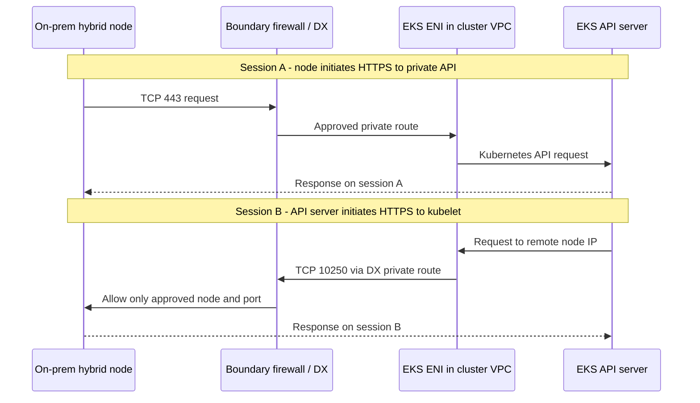

# Hybrid Nodesのネットワーク分離をセキュリティチームとレビューする

> **最終更新日**: 2026年9月16日

Direct Connect（DX）経由でオンプレミス環境につながるAWSコントロールプレーンがあるからといって、それだけでネットワーク分離違反になるわけではありません。同様に、「**private endpointを使っているから準拠している」という結論も妥当ではありません**。レビューでは、どの管理接続が信頼境界を越えるのか、どう制御されるのか、どのようなデータを運べるのかを明らかにする必要があります。

この記事は、**Kubernetes APIのprivate-only endpointとDX private routingを使う一般的なルーティング型Hybrid Nodes構成**の技術レビューを支援します。顧客の業界、システム分類、社内ポリシーに関するコンプライアンス判定や承認ではありません。以下の「条件付きで許容可能」とは、ネットワーク間の管理通信を制御した上で許可する組織ポリシーがあることを意味します。この記事のために顧客アカウント、DX接続、firewall、クラスターを調べたわけではありません。

AWS／Kubernetesの略語に不慣れな場合は[用語集](#glossary)を参照してください。

## セキュリティチームに説明する内容

> EKS Hybrid NodesはオンプレミスnodeをAWS管理のKubernetes control planeに接続します。レビュー対象の設計では、Kubernetes APIのpublic accessを無効にし、承認されたprivate経路と境界firewallを使います。control planeから開始される接続はクラスターVPC内のEKS ENIを通り、kubelet TCP 10250と、利用する場合は承認済みWebhookの宛先／portだけに制限します。API／kubeletの認証と認可、operator権限の制限、監査記録を組み合わせて適用します。
>
> したがって、セキュリティ上の根拠はAWSやendpointを信頼することではなく、**どのidentityがどのresourceに対してどの操作を実行できるかを制限し、検証すること**にあります。このアーキテクチャにはネットワーク間の管理接続が含まれます。完全な切断、またはクラウドから開始される接続の全面禁止が要件なら、ここで説明する設計とは両立しません。

設定とテストの証拠がある場合に限り、申請書で「制限済み」「適用済み」と表現してください。設計段階では「計画済み、検証予定」と記載します。AWSの[Hybrid Nodesネットワーク要件](https://docs.aws.amazon.com/eks/latest/userguide/hybrid-nodes-networking.html)には、オンプレミスfirewallで必要なinbound TCP 10250とWebhook portが明記されています。

## 「endpoint」の3つの異なる意味

| コンポーネント | 目的 | それだけでは確立しないこと |
|---|---|---|
| **Kubernetes API private endpoint** | kubelet、Pod、承認済みoperatorからクラスターAPIへのprivate HTTPS TCP 443アクセス | control planeからオンプレミスへの接続や、許可されたAPI操作経由のデータ移動をなくすものではない |
| **クラスターVPC内のEKS control plane ENI** | API serverとVPC／リモートnode／Pod network間のnetwork接続。付属security groupとroutingに従う | ENIはDLP装置、認証済みcross-domain solution、アプリケーションcommandの承認システムではない |
| **AWS service向けinterface VPC endpoint／PrivateLink** | `eks`、`ssm`、`rolesanywhere`など、対応するAWS service APIへのprivate addressアクセス | `com.amazonaws.<region>.eks`はKubernetes APIやcontrol-planeからkubeletへの通信を中継しない |

AWSの説明では、Kubernetes API private endpointは従来のAWS API PrivateLink endpointとは別で、VPC consoleのendpoint一覧にも表示されません。`eks` interface endpointが提供するのは`DescribeCluster`などの**AWS EKS管理API**です。endpointを混同すると、endpoint policyがTCP 10250接続を制御するという誤った説明につながります。[クラスターendpoint](https://docs.aws.amazon.com/eks/latest/userguide/cluster-endpoint.html)、[EKS PrivateLink](https://docs.aws.amazon.com/eks/latest/userguide/vpc-interface-endpoints.html)

`endpointPrivateAccess=true`だけではprivate-onlyになりません。この記事では`endpointPublicAccess=false`も前提とします。public／privateの両方を有効にすると、Hybrid Nodeがクラスターのhostnameをpublic IPに解決することがあります。`publicAccessCidrs`はprivate endpointを制限しません。private経路はクラスターsecurity group、routing、firewallで制御します。[endpoint access mode](https://docs.aws.amazon.com/eks/latest/userguide/cluster-endpoint.html)

## どちら側が各接続を開始するか

図には**別々の2つのTCP session**上のrequestを示しています。逆向きの矢印は、既存のoutbound接続に対する応答があらゆる操作をサポートする意味ではありません。境界firewallは顧客が設計する制御です。DXが自動で提供するわけではありません。

破線の応答は、承認済み経路を逆向きに通ります。この図ではTLS終端を変更するproxyを追加していません。実際のroutingはVPC route table、選択したVGWまたはTGW／DX gateway構成、オンプレミスのrouting／firewallに依存します。[AWSのpacket flow資料](https://docs.aws.amazon.com/eks/latest/userguide/hybrid-nodes-concepts-traffic-flows.html)

| 接続の開始元 → 宛先 | 宛先port | 目的とレビュー範囲 |
|---|---|---|
| Hybrid kubelet → Kubernetes API private endpoint | TCP 443 | node状態やPod仕様を含むクラスター管理 |
| API server → Hybrid Node kubelet | TCP 10250 | `logs`、`exec`、`attach`、`cp`、`port-forward`などに使う別個の接続 |
| API server → オンプレミスWebhook／aggregated API backend | 実backendのTCP port | これらをオンプレミスで実行する場合は個別に承認する。Service portと実際の宛先portを区別 |
| Hybrid Node → 選択したSSMまたはIAM Roles Anywhere endpoint | TCP 443 | nodeの一時credential発行／更新。SSM管理機能を使う場合の権限／接続も確認 |
| Pod → Kubernetes API／必要なAWS service | 通常TCP 443 | CNIのSNATはfirewallから見える送信元アドレスと戻り経路に影響する |
| DNS client → 承認済みresolver | UDP／TCP 53 | CoreDNSの配置とDNS forwardingを考慮し、DNS経路を別に定義する |
| アプリケーション、CNI、監視component | 機能ごとに異なる | 管理通信として一括承認せず、独立したflow inventoryを保つ |

この表はすべてのCNI／アプリケーションに対する完全なfirewall policyではありません。詳細は[ネットワーク設定](02-network-configuration.md)と[AWSの継続運用要件](https://docs.aws.amazon.com/eks/latest/userguide/hybrid-nodes-networking.html)を確認してください。Webhook port `8443`は一例であり、`8443`以上のすべてのportを許可する指示ではありません。

**nodeが開始したTCP 443のstatefulな戻り通信を許可しても、新しいinbound TCP 10250接続は許可されません**。この構成をoutbound-onlyのagent tunnelと説明すると、運用上もセキュリティ上も誤りになります。Security groupはstatefulですが、network ACLはstatelessのため、戻り通信を別途考慮します。NATやinspection deviceが介在する場合は、各境界で見えるアドレスと対称的な戻り経路を検証してください。[Hybrid traffic flow](https://docs.aws.amazon.com/eks/latest/userguide/hybrid-nodes-concepts-traffic-flows.html)、[security groupとnetwork ACL](https://aws.amazon.com/vpc/faqs/)

## ネットワーク分離ポリシーを設計要件にする

まず顧客の実際のpolicy文言を入手してください。この表は**要件との技術的な両立性**を確認するもので、法律や規制免除の解釈ではありません。

| 顧客要件 | この設計の評価 |
|---|---|
| Internet公開は禁止。承認されたprivate管理接続はネットワーク間で許可する | レビュー候補。API public access無効化、必要serviceへのprivate経路、最小権限、firewall制御、記録を示す |
| 物理的切断により外部control planeとのリアルタイム通信も禁止 | Hybrid Nodes接続要件と矛盾する。許可された内部境界内にcontrol planeを置くことを検討する |
| 内部発のsessionへの応答だけを許可し、クラウド開始の新規接続をすべて禁止 | 一般的なルーティング型Hybrid Nodesのkubelet／Webhook通信と矛盾する |
| workload domainに独立したネットワークだけでなく、独立した管理権限も必要 | VLANやnamespaceだけで満たすと結論しない。共有cluster administratorとcontrol planeを調べ、必要ならclusterを分離する |
| Kubernetes object、Secret、運用logもオンプレミス内だけに保管する | AWS hosted control planeと矛盾するデータを特定する。nodeの配置だけでは要件を満たせない |
| 指定されたcross-domain applianceと承認手順が必須 | DXやPrivateLinkがそれに代わると想定しない。適用可能性と機能上の互換性を確認する |

[インターネット制限設定](03-airgap-setup.md)では、インターネット制限とAWSからの完全切断を区別しています。Hybrid Nodesには信頼性のある双方向接続が必要です。[Hybrid Nodesの概要](https://docs.aws.amazon.com/eks/latest/userguide/hybrid-nodes-overview.html)

## 各制御を適切な境界に適用する

### Routingとnetwork access

Remote node／Pod CIDRはEKSに宛先networkを知らせます。登録だけではオンプレミスのroute、firewall、分離policyは完成しません。CIDR縮小後に残った古いruleを含め、EKSが作成したクラスターSGのinbound ruleも調べてください。AWSはremote networkを削除しても対応するsecurity group ruleが自動削除されないと明記しています。[networkingとSG設定](https://docs.aws.amazon.com/eks/latest/userguide/hybrid-nodes-networking.html)

ruleは**検証済みEKS ENIの送信元address range → 指定Hybrid Node address → TCP 10250**の形で提示してください。ENIのIPは変わることがあるため、現在の`/32`一覧を恒久固定しないでください。可能であれば専用control-plane subnetでaddressの所有範囲を絞り、ENI置換／クラスター更新に備えたallowlist更新と再検証手順を用意します。共有subnet全体を許可すると、送信元範囲に別resourceが含まれる場合があります。この残余リスクを記録してください。[EKS ENIのライフサイクルとnetwork計画](https://docs.aws.amazon.com/eks/latest/userguide/hybrid-nodes-networking.html)

Cluster SG egress、VPC／TGW route、オンプレミス境界／host firewallを一緒にレビューしてください。SG IDはオンプレミスfirewallまで届くidentityではありません。routeがあってもAPI操作が認可された証拠にはなりません。無関係な業務network prefixの伝播／アクセスを制限し、承認範囲外の宛先が拒否されることを検証します。これは設計推奨であり、顧客環境に既に適用済みという主張ではありません。

### 暗号化、identity、認可

**DXはデフォルトで通信を暗号化しません**。Kubernetes APIとkubelet HTTPS接続ではTLSと認証を維持してください。リンク暗号化が要件なら、DX上のIPsecまたはMACsecの対応と適用範囲を確認します。MACsecは対応するDX linkを保護しますが、その範囲はアプリケーションend-to-end TLSとは異なります。DXの利用だけで全アプリケーション／overlay flowが暗号化されている証明にはなりません。[DX暗号化](https://docs.aws.amazon.com/directconnect/latest/UserGuide/encryption-in-transit.html)

Private IP addressは呼び出し元の権限を示しません。OperatorのIAM identity、EKS access entry／access policy、Kubernetes RBAC、node identity、kubelet認証／認可を個別に確認してください。接続障害の解決策としてTLS検証を無効にしたり、kubeletをanonymous／AlwaysAllowにしたりしないでください。kubeletへの直接アクセスは別の認可経路であり、API server経由の操作と同等に扱ってはいけません。[EKS access管理](https://docs.aws.amazon.com/eks/latest/userguide/access-entries.html)、[kubelet認証／認可](https://kubernetes.io/docs/reference/access-authn-authz/kubelet-authn-authz/)

AWS service endpoint policyは、そのendpoint経由の該当service API callをfilterします。IAM権限を付与するものでも、Kubernetes RBACの代わりでもありません。SSMを使う場合はRun CommandやSession Managerなどの管理機能の認可を確認してください。nodeがHTTPS接続を開始するからといって、外部から指示される管理commandの可能性がなくなるわけではありません。[endpoint access制御](https://docs.aws.amazon.com/vpc/latest/privatelink/vpc-endpoints-access.html)、[SSM access制御](https://docs.aws.amazon.com/systems-manager/latest/userguide/security-iam.html)

### データと管理の境界

Hybrid NodesはオンプレミスPodが処理する業務datasetをすべて自動的にAWSへ複製するわけではありません。ただし、AWS control planeはKubernetes API objectを管理します。Pod仕様、ConfigMap、Kubernetes Secretに入れた機密情報も管理対象データになります。`logs`はアプリケーション出力を転送し、`exec`、`cp`、`port-forward`は許可された利用者にデータアクセス経路を提供します。管理通信に業務データが絶対に含まれないとは主張しないでください。API dataの保存時暗号化は、保管場所を変えず、許可されたread経由の移動も防ぎません。[Hybrid networkingの概念](https://docs.aws.amazon.com/eks/latest/userguide/hybrid-nodes-concepts-networking.html)、[EKS API data encryption](https://docs.aws.amazon.com/eks/latest/userguide/envelope-encryption.html)

`pods/log`、`pods/exec`、`pods/attach`、`pods/portforward`、`nodes/proxy`、workloadの作成／変更権限をまとめて確認します。別の手段でデータへアクセスできる新規Podやprivileged／hostPath workloadを作成できる主体が残るなら、`exec`だけを制限しても不十分です。Pod security、admission policy、host access制御もRBACを補完します。共有cluster administratorに対し、namespaceやNetworkPolicyだけで独立したsecurity boundaryは作れません。[Kubernetes RBACのベストプラクティス](https://kubernetes.io/docs/concepts/security/rbac-good-practices/)

特に`get nodes/proxy`を読み取り専用に分類しないでください。kubelet API経由でcontainer commandを実行する権限になり得て、そのアクセスはKubernetes audit／admission経路を迂回する場合があります。API audit logを集めるだけでは、管理者のあらゆる操作を記録できる証明になりません。[Node proxy権限のリスク](https://kubernetes.io/docs/concepts/security/rbac-good-practices/#access-to-proxy-subresource-of-nodes)

業務data、API object、streaming log、audit log、image／artifact、credentialを別々に分類します。保存場所、転送先、アクセス権限、保持期間を記録してください。「データはオンプレミスだけ」という説明の実際の範囲を明らかにするため、アプリケーションegressとSSM管理経路も含めます。

## セキュリティレビューに添付する証拠

以下は**証拠の要件**であり、実施済みの調査結果ではありません。顧客識別子、token、Secret値、実際の業務logを公開文書に添付しないでください。

| レビュー質問 | 証拠 | 受け入れ基準 |
|---|---|---|
| private-only accessは実際に適用されているか | 対象cluster endpoint設定、オンプレミスDNS応答、DX routing、境界flow記録 | public accessが無効で、実際のprivate address／経路を検証済み。DNS成功だけでは不十分 |
| AWSから内部の何に到達できるか | ENI／subnetの所有関係、remote CIDR、VPC／TGW／オンプレミスroute、対応SG／firewall rule | 承認済みnode、backend、portだけを許可し、別の業務domainへの制限を実証する |
| 許可／禁止操作を区別できるか | 隔離テスト環境でsynthetic dataを使った`logs`等の成功と、未承認identity／宛先の拒否 | 接続性と認可を別々にテストする。network障害で認可拒否テストを代用しない |
| 誰がいつどのAPI操作を行ったか | EKS Kubernetes audit／認証記録、AWS管理APIのCloudTrail、相関可能な時刻 | 2つのAPI層を区別し、テストidentity、時刻、操作、対象、結果を追跡する |
| 境界を何が越えたか | VPC Flow Logs、オンプレミスfirewall記録、独立したdata-flow inventory | IP／port／許可・拒否の証拠をdata分類と併せる。Flow LogsがTLS payload／command bodyを証明すると主張しない |
| 変更／障害後も境界を維持できるか | ENI置換、route変更、DX／VPN failover、credential更新／期限切れ時の再検証／復旧計画 | 代替経路でもpolicyを維持する。未テストfailoverを安全と分類しない |

必要なEKS control-plane log typeを有効にします。Kubernetes auditとCloudTrailの役割は異なります。Audit logはaudit policyとlevelに応じてAPI eventを記録しますが、すべての`exec`入出力や`port-forward` payloadを記録するものではありません。収集と併せて保持、アクセス制御、機密データの扱いを設計します。[control-plane log](https://docs.aws.amazon.com/eks/latest/userguide/control-plane-logs.html)、[EKS audit](https://docs.aws.amazon.com/eks/latest/best-practices/auditing-and-logging.html)、[EKS CloudTrail](https://docs.aws.amazon.com/eks/latest/userguide/logging-using-cloudtrail.html)、[Flow Logsの制約](https://docs.aws.amazon.com/vpc/latest/userguide/flow-logs.html)

設定済みcapture範囲外の通信は記録されない場合があり、記録が遅延／欠落する場合もあります。EKSのlog配信はbest effortです。Flow Logsの`SKIPDATA`など、収集設定と欠落データのsignalを確認します。**記録がないだけでは、その接続や操作が一度もなかった証明にはなりません**。firewall記録と明示的な許可／拒否テストを相関させてください。[Flow Logs収集の制限](https://docs.aws.amazon.com/vpc/latest/userguide/flow-logs-limitations.html)、[Flow Logs欠落のトラブルシューティング](https://docs.aws.amazon.com/vpc/latest/userguide/flow-logs-troubleshooting.html)

synthetic dataを使い、承認されたnon-production対象で検証してください。境界を確かめるために、業務network全体をscanしたり、本番firewallを広範囲に開放したり、`logs`や`cp`を通じて顧客データを取り出したりする必要はありません。

## セキュリティチームからよく聞かれる質問

### 「10250を開けるとAWS全体から内部serverへアクセスできますか?」

適切に制限した設計では、検証済みクラスターENIの送信元rangeと認証された呼び出し元だけを許可し、AWS address空間全体を許可するわけではありません。ただし、IP allowlistだけではcluster identityの証明にならず、共有subnetへの露出や過剰なadministrator権限も残余リスクです。network制限をTLS、認証、認可の証拠と一緒に提示してください。

### 「WebhookをAWSに移せばinbound接続はなくなりますか?」

オンプレミスWebhookへの直接接続は減らせる場合があります。kubelet TCP 10250要件は別途残り、クラウド上のWebhookにも依存関係がある場合があります。クラウドnode配置の選択肢は[AWSのWebhookガイダンス](https://docs.aws.amazon.com/eks/latest/userguide/hybrid-nodes-webhooks.html)を参照してください。

### 「Hybrid Nodes Gatewayでoutbound-only設計になりますか?」

[Hybrid Nodes Gateway](10-hybrid-nodes-gateway.md)はCilium VTEP／VXLANを使ってHybrid Pod接続を支援します。切断クラスター製品でも、一方向のsecurity gatewayでもありません。gateway／tunnelの外側address／portと内側Pod flowを別々にレビューしてください。この記事の直接routing表をそのまま流用しないでください。[AWS Gatewayの概要](https://aws.amazon.com/blogs/containers/simplify-hybrid-kubernetes-networking-with-amazon-eks-hybrid-nodes-gateway/)

### 「ネットワーク分離要件に違反しないと言えますか?」

接続方式だけからは判断できません。該当policyが制御された管理接続を許可し、証拠と組織承認が接続、権限、データ境界を対象にしているなら、結論には**レビュー範囲と条件**を記録してください。DXやprivate endpointを使っているというだけで、禁止された接続を許容扱いに変更しないでください。

## 用語集 {#glossary}

| 略語 | 正式名称とこの記事での意味 |
|---|---|
| VPC／ENI | Virtual Private Cloud／Elastic Network Interface: AWSの論理network境界と、その中に接続された仮想network interface |
| SG／NACL | Security Group／Network Access Control List: interfaceに付属するstateful allow ruleと、subnet境界のstateless allow／deny rule |
| DLP | Data Loss Prevention: 機密データの不適切な転送を検出／防止する制御。ENIの機能ではない |
| CNI／SNAT | Container Network Interface／Source Network Address Translation: Pod network用interface仕様／実装と、packetの送信元address変換 |
| VGW／TGW | Virtual Private Gateway／Transit Gateway: 選択されたAWS private connectivity構成で使うgateway |
| VXLAN／VTEP | Virtual Extensible LAN／VXLAN Tunnel Endpoint: network encapsulation方式とtunnel endpoint。一方向の制御ではない |
| IAM／RBAC | Identity and Access Management／Role-Based Access Control: AWSのidentity／権限管理とKubernetesのroleベース認可 |
| TLS／IPsec／MACsec | Transport Layer Security／Internet Protocol Security／Media Access Control Security: 適用protocol層と経路範囲の異なるsecurity技術 |
| SSM | AWS Systems Managerのservice識別子。この記事ではnode credential accessと、任意のsystem-management機能を区別する |

## さらに読む

- [ネットワーク設定とendpointの詳細](02-network-configuration.md)
- [インターネット制限と完全切断の違い](03-airgap-setup.md)
- [運用と保守](08-operations.md)
- [ネットワーク分離セキュリティレビューのクイズ](../quizzes/eks-hybrid-nodes/11-network-separation-security-quiz.md)

< [Hybrid Nodesの目次](README.md) | [前へ: Hybrid Nodes Gateway](10-hybrid-nodes-gateway.md) >
