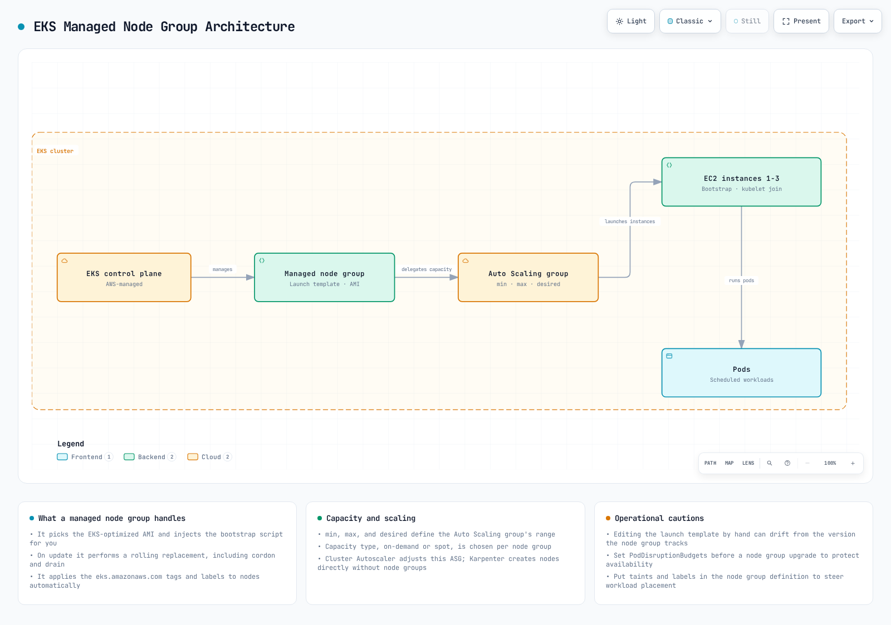

# パート2: eksctlでクラスターを作成する

> **最終更新日**: 2026年9月11日

[パート1の前提条件](02-eks-cluster-creation-part1.md)、専用のトレーニング用アカウント/クラスター、および一時的なプライベートkubeconfig (`EKS_KUBECONFIG`) を使用してください。以下の例はそれぞれ別の方法であり、一連のスクリプトとして順に実行するものではありません。確認済みの対象に合わせて`EKS_CLUSTER_NAME`と`EKS_REGION`を設定し、承認済みの既存IDを使用してください。AWSリソースを作成するコマンドには料金が発生します。このレビューではリソースを作成していません。例はeksctl 0.230.0とEKS 1.36を対象に確認しました。

## eksctlを使用したクラスターの作成

eksctlは、EKS用のコマンドラインおよび宣言的な設定インターフェイスを提供します。eksctlはCloudFormationを使ってEKSクラスターと関連リソースを作成します。

次の図は、eksctlを使ったEKSクラスターの作成プロセスを示しています。


[🔍 インタラクティブな図を表示](https://www.atomai.click/kubernetes-docs/archmaps/en-eks-02-eks-cluster-creation-part2-0.html)

この図は新しいVPCを作成するワークフローを示しています。既存のVPCも再利用できます。所要時間は環境によって異なり、kubeconfigを書き出しただけでは認可やクラスターの準備完了は保証されません。

### 基本的なクラスターの作成

確認済みの設定ファイルから基本的なクラスターを作成します。

```bash
eksctl create cluster --config-file cluster.yaml --kubeconfig "${EKS_KUBECONFIG:?}"
```

実行する前に、下記の`cluster.yaml`を読み、編集してください。このファイルではEKS 1.36、AL2023、既存のVPCサブネット、ノードグループの容量を明示的に選択しています。例のIDと説明用CIDRを、実際に承認された値に置き換えてください。これらは選択した設定例であり、すべてのeksctlバージョンに共通するデフォルト値を示すものではありません。

### 設定ファイルを使ったクラスターの作成

より複雑な設定では、YAMLファイルを使ってクラスターを定義できます。

```yaml
# cluster.yaml
apiVersion: eksctl.io/v1alpha5
kind: ClusterConfig
metadata:
  name: my-cluster
  region: us-west-2
  version: '1.36'
vpc:
  id: vpc-12345678
  subnets:
    private:
      us-west-2a:
        id: subnet-12345678
      us-west-2b:
        id: subnet-87654321
    public:
      us-west-2a:
        id: subnet-23456789
      us-west-2b:
        id: subnet-98765432
  clusterEndpoints:
    privateAccess: true
    publicAccess: true
  publicAccessCIDRs:
  - 203.0.113.10/32
managedNodeGroups:
- name: ng-1
  instanceType: m5.large
  desiredCapacity: 2
  minSize: 1
  maxSize: 3
  privateNetworking: true
  volumeSize: 80
  volumeType: gp3
  amiFamily: AmazonLinux2023
  disableIMDSv1: true
- name: ng-2
  instanceType: c5.xlarge
  desiredCapacity: 2
  privateNetworking: true
  spot: true
  amiFamily: AmazonLinux2023
  disableIMDSv1: true
cloudWatch:
  clusterLogging:
    enableTypes:
    - api
    - audit
    - authenticator
    - controllerManager
    - scheduler
fargateProfiles:
- name: fp-default
  selectors:
  - namespace: default
    labels:
      env: fargate
iam:
  withOIDC: true
accessConfig:
  authenticationMode: API
```

この設定ファイルでクラスターを作成するには、次のコマンドを実行します。

```bash
eksctl create cluster -f cluster.yaml --kubeconfig "${EKS_KUBECONFIG:?}"
```

上記の設定例はEC2ノードと、任意のアプリケーション用Fargateプロファイルを示しています。CoreDNSはEC2上に残ります。CoreDNSをFargateに移す場合は、プロファイルだけでなくCoreDNSのコンピューティング設定も確認してください。

この設定では、ノードロールに一律のアドオン権限を付与しません。`iam.withOIDC`を有効にしたときにeksctlが生成するCNI用IRSAとポリシーを確認し、AWSと連携するほかのコントローラーには別個のロールを設定してください。実際のアドオン設定と、従来型のノードロールを使うCNIフォールバックがないかを確認します。API認証には、オペレーターに適切なEKSアクセスエントリー/ポリシーも引き続き必要です。ノード数の最小値と最大値を設定しても、Cluster Autoscalerがインストールされるわけではありません。

### Managed Node Groupの作成

次の図は、EKSクラスターのManaged Node Groupアーキテクチャを示しています。



[🔍 インタラクティブな図を表示](https://www.atomai.click/kubernetes-docs/archmaps/en-eks-02-eks-cluster-creation-part2-1.html)

インフラストラクチャを管理するのは、AWS EKSのManaged Node GroupサービスとそのAuto Scalingグループです。この図はEKSが選択するAMIのデフォルト構成を示しています。カスタムAMIには、別途レビュー済みのブートストラップ設定が必要です。Kubernetesは作成されたノードにPodをスケジュールします。

既存クラスターにManaged Node Groupを追加するには、次のコマンドを実行します。

```bash
eksctl create nodegroup \
  --cluster my-cluster \
  --region us-west-2 \
  --name my-nodegroup \
  --node-type m5.large \
  --nodes 3 \
  --nodes-min 1 \
  --nodes-max 5 \
  --managed --node-ami-family AmazonLinux2023 --node-private-networking
```

または、設定ファイルを使うこともできます。

```yaml
# nodegroup.yaml
apiVersion: eksctl.io/v1alpha5
kind: ClusterConfig

metadata:
  name: my-cluster
  region: us-west-2

managedNodeGroups:
  - name: my-nodegroup
    instanceType: m5.large
    desiredCapacity: 3
    minSize: 1
    maxSize: 5
    volumeSize: 80
    volumeType: gp3
    amiFamily: AmazonLinux2023
    privateNetworking: true
    disableIMDSv1: true
    ssh:
      allow: false
```

```bash
eksctl create nodegroup -f nodegroup.yaml
```

### Fargateプロファイルの作成

プロファイルは条件に一致するPodを選択するものであり、Podを作成したり、アプリケーションのレプリカ数を増やしたりするものではありません。プライベートサブネット、Fargate Pod実行ロール、サポート対象のワークロード機能を確認してください。アプリケーション用プロファイルを作成しても、CoreDNSが自動的にFargateへ移動するわけではありません。以下のCLIとファイルの例は、どちらかを選んで使用します。

Fargateプロファイルは名前空間とラベルでPodを選択します。プロファイルが重複する場合は、`eks.amazonaws.com/fargate-profile`で一致するプロファイルを明示的に選択してください。複数のプロファイルが一致するとき、プロファイル名の英数字順で選択されることをAWSは説明しています。起動時間はイメージ、容量、環境によって異なります。

<!-- 監査用アセットの修正待ち: プロファイル選択の重複時の動作を正し、測定していない起動時間の比較を削除してください。親担当がアセットを修正した後、この埋め込みとリンクを復元してください。


[🔍 インタラクティブな図を表示](https://www.atomai.click/kubernetes-docs/archmaps/en-eks-02-eks-cluster-creation-part2-2.html)
-->

Fargateプロファイルを作成するには、次のコマンドを実行します。

```bash
eksctl create fargateprofile \
  --cluster my-cluster \
  --region us-west-2 \
  --name my-fargate-profile \
  --namespace default \
  --labels env=fargate
```

または、設定ファイルを使うこともできます。

```yaml
# fargate.yaml
apiVersion: eksctl.io/v1alpha5
kind: ClusterConfig

metadata:
  name: my-cluster
  region: us-west-2

fargateProfiles:
- name: my-fargate-profile
  selectors:
    - namespace: default
      labels:
        env: fargate
```

```bash
eksctl create fargateprofile -f fargate.yaml
```

### クラスターの更新

サポート対象のマイナーバージョンを一度に1つずつアップグレードしてください。先にEKS Upgrade Insights、削除されたAPI、kubeletのバージョンスキュー、アドオン、容量、ワークロードへの影響を確認します。EKSのサポート状況はアップストリームのリリースとは別です。最初のeksctlアップグレードコマンドは変更内容をプレビューします。`--approve`を付けるコマンドでアップグレードが開始されます。

```bash
aws eks describe-cluster-versions --region "${EKS_REGION:?}" --output table
aws eks describe-cluster --name "${EKS_CLUSTER_NAME:?}" --region "$EKS_REGION" \
  --query 'cluster.{version:version,status:status}' --output table

# Select the next supported minor after compatibility/readiness review.
eksctl upgrade cluster --name "$EKS_CLUSTER_NAME" --region "$EKS_REGION" \
  --version "${NEXT_MINOR_VERSION:?}"

# This separate command actually starts the reviewed control-plane upgrade.
eksctl upgrade cluster --name "$EKS_CLUSTER_NAME" --region "$EKS_REGION" \
  --version "$NEXT_MINOR_VERSION" --approve
```

コントロールプレーンの更新が成功するまで待ってから、レビュー済みの順序で互換性のあるアドオンとManaged Node Groupを更新します。このノードグループ用コマンドはEKSが選択したAMIの更新を適用します。カスタムAMIの場合は、同じ起動テンプレートを使ったレビュー済みのバージョンが必要です。Managed Node Groupの更新ではインスタンスが置き換えられ、コントロールプレーンの更新とは別に実施されます。PDBと余剰容量は中断の抑制に役立ちますが、可用性を保証するものではありません。

```bash
# After control-plane completion and add-on/workload compatibility checks.
eksctl upgrade nodegroup --cluster "${EKS_CLUSTER_NAME:?}" \
  --region "${EKS_REGION:?}" --name "${EKS_NODEGROUP_NAME:?}" --wait
```

### クラスターの削除

クラスター作成後、対象となるラボ用クラスターのARNを`EKS_EXPECTED_CLUSTER_ARN`として記録します。削除前に、コントローラーが稼働している間にラボのLoadBalancer Service/Ingressを削除し、AWS側のクリーンアップ完了を待ち、PVCのreclaim policyと保持データを確認してください。クラスターに、削除するつもりのリソースだけが含まれていることを確認します。次のARNチェックで検証するのは、記録したアカウント/リージョン/名前です。これはバックアップでも、作成時に固定された識別子でもありません。

```bash
if CURRENT_CLUSTER_ARN=$(aws eks describe-cluster \
  --name "${EKS_CLUSTER_NAME:?}" --region "${EKS_REGION:?}" \
  --query cluster.arn --output text) &&
  [ "$CURRENT_CLUSTER_ARN" = "${EKS_EXPECTED_CLUSTER_ARN:?Recorded lab cluster ARN required}" ]; then
  eksctl delete cluster --name "$EKS_CLUSTER_NAME" --region "$EKS_REGION" --wait
else
  printf '%s\n' 'Cluster lookup/identity mismatch; no deletion attempted.' >&2
fi
```

削除後にCloudFormationの削除イベントと、保持されたリソースや独立して作成されたリソースを確認してください。この例では、既存の共有VPCを所有していません。リソース間の依存関係については[クリーンアップの完全ガイド](02-eks-cluster-creation-part5.md)を参照してください。

## EKSクラスターのライフサイクル管理

ライフサイクルには、作成、設定、運用、レビュー済みのアップグレード、最終的なクリーンアップが含まれます。アプリケーションのロードバランサー関連リソースをコントローラーの稼働中に削除してから、ノードグループ/プロファイルとクラスターを削除します。専用VPCは、依存するリソースをすべて削除してから削除してください。

<!-- 監査用アセットの修正待ち: アップグレード先/承認とリソースのクリーンアップ順を修正してください。VPCは依存リソースを削除した後に削除します。親担当がアセットを修正した後、この埋め込みとリンクを復元してください。


[🔍 インタラクティブな図を表示](https://www.atomai.click/kubernetes-docs/archmaps/en-eks-02-eks-cluster-creation-part2-3.html)
-->

## クイズ

この章で学んだ内容を確認するには、[EKSクラスターの作成 - パート2のクイズ](../quizzes/eks/02-eks-cluster-creation-part2-quiz.md)に挑戦してください。

## 参考資料

- [eksctlスキーマ](https://schema.eksctl.io/)
- [EKSバージョン](https://docs.aws.amazon.com/eks/latest/userguide/kubernetes-versions.html)
- [AL2023](https://docs.aws.amazon.com/eks/latest/userguide/al2023.html)
- [Fargateプロファイル](https://docs.aws.amazon.com/eks/latest/userguide/fargate-profile.html)
- [EKSのアップグレード](https://docs.aws.amazon.com/eks/latest/userguide/update-cluster.html)
- [Managed Node Groupの更新](https://docs.aws.amazon.com/eks/latest/userguide/managed-node-update-behavior.html)
