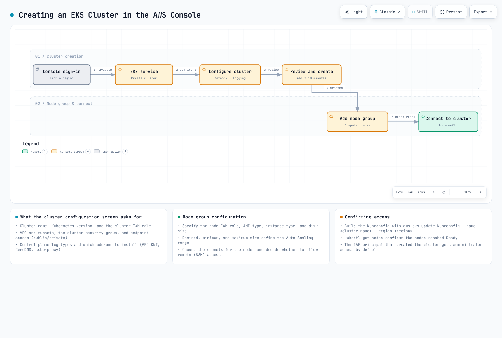

# パート3: AWS Management Console と CLI を使用したクラスターの作成

> **最終更新**: 2026年9月11日

[パート1の前提条件](02-eks-cluster-creation-part1.md)を完了してください。以下は課金対象の AWS リソースを作成する教育用手順です。この監査ではプロビジョニングも本番利用の認定も行っていません。

## AWS Management Console を使用したクラスターの作成

この手順では、一般的な EC2 managed node group のクラスターを作成します。**Custom configuration** を選び、**Use EKS Auto Mode** をオフにしてください。簡易 Auto Mode 手順では、IAM role とインフラストラクチャの管理方法が異なります。



[🔍 インタラクティブな図を表示](https://www.atomai.click/kubernetes-docs/archmaps/en-eks-02-eks-cluster-creation-part3-0.html)

図は手順の例であり、作成にかかる時間は状況により変わります。既定設定で要件を満たすと決めつけず、クラスター作成者のアクセス権と node の readiness を明示的に確認してください。

### クラスターの設定

使用するアカウント／Region で EKS console を開き、**Add cluster → Create** を選び、上記の custom configuration を指定します。

- 一意なクラスター名と、現在サポートされている EKS version を選びます。以下の CLI 例では **1.36** を使います。上流 Kubernetes のリリース一覧は EKS のサポート対象 version 一覧ではありません。
- `eks.amazonaws.com` の trust と `AmazonEKSClusterPolicy` を持つ、レビュー済みの cluster IAM role を選択します。プロビジョニングに使う identity にも、適切な EKS／IAM 権限が必要です。これには scope を絞った `iam:PassRole` や、必要に応じた service-linked role の作成権限が含まれます。
- Standard／extended support policy、tag、任意機能を確認します。EKS 1.28 以降では Kubernetes API data は AWS 所有 key で envelope encryption 済みです。Customer-managed KMS key は任意です。
- API access-entry authentication を選びます。このラボでは、cluster creator への自動 admin access を許可せず、既存の operator role 用に明示的な access entry を用意します。後で kubeconfig を作成しても、authorization は付与されません。

### ネットワークの指定

EKS の要件を満たす既存 VPC を選ぶか、完全な network 設計に基づいて先に準備してください。異なる AZ にある適切な subnet を少なくとも2つ選びます。各 cluster subnet には利用可能な IP address が最低6個必要で、AWS は最低16個を推奨しています。node／Pod と update 用の容量も別途計画してください。

VPC DNS、routing、IP family／service CIDR の重複、node から必要な AWS service／registry への接続を確認します。適切な NAT または VPC endpoint を用意した private node subnet を使ってください。API endpoint は次のいずれかを選びます:

- **Public:** public routing を使用します。`publicAccessCidrs` で許可する client の送信元範囲を制限してください。
- **Private:** 必要な route、DNS、security group、IAM／Kubernetes authorization を構成し、VPC または接続ネットワーク経由でアクセスします。
- **Public and Private:** 両方の経路を使います。Public CIDR を制限し、private path も検証してください。

EKS は cluster security group を作成します。追加 security group は任意で、cluster interface に関連付けられます。すべての node group に自動的に関連付けられるわけではありません。Public API endpoint を、この security group の一律な TCP 443 rule で制御するものではありません。

### ロギングの設定

**Configure observability** で必要な control-plane log type を選びます: `api`、`audit`、`authenticator`、`controllerManager`、`scheduler`。任意の metrics 機能は別途確認してください。CloudWatch の取り込み、保存、query には料金がかかり、log の配信はベストエフォートです。

### アドオンの選択

この一般的な EC2 cluster では、レビュー済みの置き換えを用意していない限り、互換性のある VPC CNI、CoreDNS、kube-proxy を使います。**Configure selected add-ons settings** で互換性のある version を選択し、必要な add-on IAM identity を設定します。任意の controller／storage driver には、個別のインストールと権限設定が必要です。

### 確認と作成

選択した role、access mode、network、add-on 設定を確認して cluster を作成し、状態が **ACTIVE** になるまで待ちます。kubectl でアクセスする前に、operator 用の access entry を設定してください。

### ノードグループの追加

cluster の **Compute** から managed node group を追加します:

1. 未使用の group 名と、レビュー済みの EC2 node IAM role を選びます。
2. **AL2023 x86_64**、互換性のある instance type、ワークロードに合う disk／scaling 値を選びます。CLI の `m5.large`、80 GiB、1～3台という min/max 設定は例であり、実測に基づくサイジング推奨ではありません。
3. 実際の private subnet を選びます。別途レビュー済みの接続方法が必要な場合を除き、SSH access は無効のままにします。
4. group を作成し、状態が **ACTIVE** になり、node が正常な **Ready** 状態になるまで待ちます。最小／最大台数を設定しても、ワークロードに応じて node を増やす autoscaler はインストールされません。

Node role には worker と image pull の権限が必要です。CNI workload 用には別の role を優先してください。以下の CLI 例では、より単純な IPv4 node-role fallback を明示しています。

## AWS CLI を使用したクラスターの作成

次の一般的な IPv4 の例では、EKS 1.36 と AL2023 managed node を使います。Console またはこの CLI のどちらか一方を選んでください。CLI の手順は1つの Bash session 内で実行し、未使用のラボ用名を使ってください。所有権と cleanup の確認用に、アクセス制限された response file を保管します。


[🔍 インタラクティブな図を表示](https://www.atomai.click/kubernetes-docs/archmaps/en-eks-02-eks-cluster-creation-part3-1.html)

図は一般的な手順を示します。EKS は cluster security group を自動作成します。以下に示す現行 role policy と明示的な access 設定を使ってください。この監査では AWS 操作を実行していません。

```bash
: "${EKS_CLUSTER_NAME:?Choose an unused training cluster name}"
: "${EKS_REGION:?For example us-west-2}"
: "${OPERATOR_ROLE_ARN:?Existing operator IAM role that this login may assume}"
: "${APPROVED_API_CIDR:?Actual approved administration egress CIDR}"
EKS_CREATE_DIR=$(mktemp -d /tmp/eks-console-cli.XXXXXX)
: "${EKS_CREATE_DIR:?}"
EKS_KUBECONFIG="$EKS_CREATE_DIR/kubeconfig"
aws sts get-caller-identity
```

### 1. クラスター IAM ロールの作成

以下の command は**新しい** role を作成し、作成に失敗した場合はそこで停止します。レビュー済みの role を再利用するには、`EKS_CLUSTER_ROLE_ARN` を設定し、偶然同じ名前の既存 role を変更するのではなく、作成／policy attachment の block をスキップしてください。

```bash
cat > "${EKS_CREATE_DIR:?}/cluster-trust.json" << 'EOF'
{
  "Version":"2012-10-17",
  "Statement":[{
    "Effect":"Allow",
    "Principal":{"Service":"eks.amazonaws.com"},
    "Action":"sts:AssumeRole"
  }]
}
EOF
aws iam create-role --role-name "${NEW_CLUSTER_ROLE_NAME:?Unused role name}" \
  --assume-role-policy-document "file://$EKS_CREATE_DIR/cluster-trust.json" \
  --query Role --output json > "$EKS_CREATE_DIR/created-cluster-role.json" || exit 1
EKS_CLUSTER_ROLE_ARN=$(jq -er '.Arn' "$EKS_CREATE_DIR/created-cluster-role.json") || exit 1
aws iam attach-role-policy --role-name "$NEW_CLUSTER_ROLE_NAME" \
  --policy-arn arn:aws:iam::aws:policy/AmazonEKSClusterPolicy || exit 1
```

### 2. VPC とサブネットの作成

レビュー済みの既存 VPC を使うか、以下の公式 template で完全なネットワーク例を作成します。template は2つの public／2つの private subnet を2つの AZ に作り、internet gateway と2つの NAT gateway／EIP も作成します。事前に CIDR の重複、route、料金を確認してください。template URL の日付は Kubernetes version ではありません。

```bash
# Optional new-network path; review the entire template and its CIDR/NAT costs first.
aws cloudformation create-stack --region "${EKS_REGION:?}" \
  --stack-name "${NEW_VPC_STACK_NAME:?Unused stack name}" \
  --template-url https://s3.us-west-2.amazonaws.com/amazon-eks/cloudformation/2020-10-29/amazon-eks-vpc-private-subnets.yaml \
  > "${EKS_CREATE_DIR:?}/vpc-stack.json" || exit 1
aws cloudformation wait stack-create-complete --region "$EKS_REGION" \
  --stack-name "$NEW_VPC_STACK_NAME" || exit 1
aws cloudformation describe-stacks --region "$EKS_REGION" \
  --stack-name "$NEW_VPC_STACK_NAME" --query 'Stacks[0].Outputs' --output table
```

stack の `SubnetIds` output には**4つすべての subnet**が含まれます。`EKS_PRIVATE_SUBNET_A/B` を設定する前に、route table と tag から private 側の2つを特定してください。明示的な route-table association がない subnet は VPC の main route table を使います。routing 自体がないわけではありません。

以下の check は AZ／VPC／IP／DNS の基本的な前提条件を確認します。実効 route、security control、registry／S3 access、必要な VPC endpoint は別途検証してください。VPC と subnet を2つ作るだけでは、node が使える egress path はできません。

```bash
# Set these IDs after identifying the actual private subnets and their routes.
aws ec2 describe-subnets --region "${EKS_REGION:?}" \
  --subnet-ids "${EKS_PRIVATE_SUBNET_A:?}" "${EKS_PRIVATE_SUBNET_B:?}" \
  --query Subnets --output json > "${EKS_CREATE_DIR:?}/subnets.json" || exit 1
jq -e 'length == 2 and
  (map(.VpcId) | unique | length) == 1 and
  (map(.AvailabilityZone) | unique | length) == 2 and
  all(.[]; .AvailableIpAddressCount >= 6)' \
  "$EKS_CREATE_DIR/subnets.json" >/dev/null || exit 1
EKS_VPC_ID=$(jq -er '.[0].VpcId' "$EKS_CREATE_DIR/subnets.json") || exit 1
aws ec2 describe-vpc-attribute --region "$EKS_REGION" --vpc-id "$EKS_VPC_ID" \
  --attribute enableDnsSupport --output json > "$EKS_CREATE_DIR/dns-support.json" || exit 1
aws ec2 describe-vpc-attribute --region "$EKS_REGION" --vpc-id "$EKS_VPC_ID" \
  --attribute enableDnsHostnames --output json > "$EKS_CREATE_DIR/dns-hostnames.json" || exit 1
jq -e '.EnableDnsSupport.Value == true' "$EKS_CREATE_DIR/dns-support.json" >/dev/null || exit 1
jq -e '.EnableDnsHostnames.Value == true' "$EKS_CREATE_DIR/dns-hostnames.json" >/dev/null || exit 1
```

### 3. クラスター security group の作成

EKS は cluster 作成時に cluster security group を自動作成します。この例では `0.0.0.0/0` に開いた別の group は必要ありません。Public API access は `publicAccessCidrs` で制限し、cluster security-group rule は private path と node 間の通信を制御します。

追加 group が必要なら、その rule をレビューし、ID を意図的に設定へ追加してください。cluster network request を JSON として作成します:

```bash
# EKS creates the cluster security group; public API restrictions use this CIDR list.
jq -n --arg a "${EKS_PRIVATE_SUBNET_A:?}" --arg b "${EKS_PRIVATE_SUBNET_B:?}" \
  --arg cidr "${APPROVED_API_CIDR:?}" '{
    subnetIds:[$a,$b],
    endpointPublicAccess:true,
    endpointPrivateAccess:true,
    publicAccessCidrs:[$cidr]
  }' > "${EKS_CREATE_DIR:?}/vpc-config.json" || exit 1
```

### 4. EKS クラスターの作成

`aws eks create-cluster` では `--kubernetes-version` を使います。`--version` は AWS CLI 自体の version を表示します。API の JSON field は `version` のままです。この例では cluster creator への自動 admin access を無効にし、5種類の control-plane log を有効にして、標準 core add-on を bootstrap します。CLI が bootstrap する add-on は self-managed です。EKS-managed add-on として採用するには、互換性のある version／configuration を別途確認する手順が必要です。

```bash
aws eks describe-cluster-versions --region "${EKS_REGION:?}" --output table
aws eks create-cluster --name "${EKS_CLUSTER_NAME:?}" --region "$EKS_REGION" \
  --kubernetes-version 1.36 --role-arn "${EKS_CLUSTER_ROLE_ARN:?}" \
  --resources-vpc-config "file://${EKS_CREATE_DIR:?}/vpc-config.json" \
  --access-config authenticationMode=API,bootstrapClusterCreatorAdminPermissions=false \
  --bootstrap-self-managed-addons \
  --logging '{"clusterLogging":[{"types":["api","audit","authenticator","controllerManager","scheduler"],"enabled":true}]}' \
  --query cluster --output json > "$EKS_CREATE_DIR/created-cluster.json" || exit 1
aws eks wait cluster-active --name "$EKS_CLUSTER_NAME" --region "$EKS_REGION" || exit 1
aws eks describe-cluster --name "$EKS_CLUSTER_NAME" --region "$EKS_REGION" \
  --query 'cluster.{arn:arn,status:status,version:version,vpc:resourcesVpcConfig}'
```

Waiter が失敗しても、すべての resource が rollback されたとは限りません。続行する前に cluster の状態と記録済み response を調べてください。Logging には CloudWatch の料金がかかります。

### 5. ノード IAM ロールの作成

EC2 を信頼する新しい role を作成します。`AmazonEC2ContainerRegistryPullOnly` は image pull の権限を与えます。この単純な **IPv4 ラボ**では、bootstrap 済みの VPC CNI が動作するよう、CNI 権限を node role に置きます。対応している場合は専用の CNI IRSA／Pod Identity role を優先し、その設定が動作してから fallback を削除してください。その他の application／controller の AWS 権限をすべての node に付与してはいけません。

```bash
cat > "${EKS_CREATE_DIR:?}/node-trust.json" << 'EOF'
{
  "Version":"2012-10-17",
  "Statement":[{
    "Effect":"Allow",
    "Principal":{"Service":"ec2.amazonaws.com"},
    "Action":"sts:AssumeRole"
  }]
}
EOF
aws iam create-role --role-name "${NEW_NODE_ROLE_NAME:?Unused role name}" \
  --assume-role-policy-document "file://$EKS_CREATE_DIR/node-trust.json" \
  --query Role --output json > "$EKS_CREATE_DIR/created-node-role.json" || exit 1
EKS_NODE_ROLE_ARN=$(jq -er '.Arn' "$EKS_CREATE_DIR/created-node-role.json") || exit 1
aws iam attach-role-policy --role-name "$NEW_NODE_ROLE_NAME" \
  --policy-arn arn:aws:iam::aws:policy/AmazonEKSWorkerNodePolicy || exit 1
aws iam attach-role-policy --role-name "$NEW_NODE_ROLE_NAME" \
  --policy-arn arn:aws:iam::aws:policy/AmazonEC2ContainerRegistryPullOnly || exit 1
# Simple IPv4 lab fallback only. Prefer a dedicated CNI workload role in production.
aws iam attach-role-policy --role-name "$NEW_NODE_ROLE_NAME" \
  --policy-arn arn:aws:iam::aws:policy/AmazonEKS_CNI_Policy || exit 1
```

### 6. ノードグループの作成

レビュー済みの private subnet に managed group を作成します。EKS は選択した AL2023 AMI の node 初期化と managed node access entry を用意します。この例では SSH access と独自の launch-template override は使いません。

```bash
aws eks create-nodegroup --cluster-name "${EKS_CLUSTER_NAME:?}" --region "${EKS_REGION:?}" \
  --nodegroup-name "${NEW_NODEGROUP_NAME:?}" --node-role "${EKS_NODE_ROLE_ARN:?}" \
  --subnets "${EKS_PRIVATE_SUBNET_A:?}" "${EKS_PRIVATE_SUBNET_B:?}" \
  --ami-type AL2023_x86_64_STANDARD --instance-types m5.large --capacity-type ON_DEMAND \
  --disk-size 80 --scaling-config minSize=1,maxSize=3,desiredSize=2 \
  --query nodegroup --output json > "${EKS_CREATE_DIR:?}/created-nodegroup.json" || exit 1
aws eks wait nodegroup-active --cluster-name "$EKS_CLUSTER_NAME" --region "$EKS_REGION" \
  --nodegroup-name "$NEW_NODEGROUP_NAME" || exit 1
aws eks describe-nodegroup --cluster-name "$EKS_CLUSTER_NAME" --region "$EKS_REGION" \
  --nodegroup-name "$NEW_NODEGROUP_NAME" \
  --query 'nodegroup.{status:status,health:health,ami:amiType,release:releaseVersion}'
```

### 7. kubeconfig の設定

現在の login から assume できる既存の operator IAM role を使います。プロビジョニング identity には、EKS access entry を作成し、ラボ用 access policy を関連付ける権限も必要です。これらの command はこの cluster 内での Kubernetes admin 権限を付与します。AWS account 全体の admin 権限ではありません。

```bash
# The named operator gets cluster-admin only on this training cluster.
aws eks create-access-entry --cluster-name "${EKS_CLUSTER_NAME:?}" --region "${EKS_REGION:?}" \
  --principal-arn "${OPERATOR_ROLE_ARN:?}" --type STANDARD || exit 1
aws eks associate-access-policy --cluster-name "$EKS_CLUSTER_NAME" --region "$EKS_REGION" \
  --principal-arn "$OPERATOR_ROLE_ARN" \
  --policy-arn arn:aws:eks::aws:cluster-access-policy/AmazonEKSClusterAdminPolicy \
  --access-scope type=cluster || exit 1
aws eks update-kubeconfig --name "$EKS_CLUSTER_NAME" --region "$EKS_REGION" \
  --role-arn "$OPERATOR_ROLE_ARN" --kubeconfig "${EKS_KUBECONFIG:?}" \
  --alias "$EKS_CLUSTER_NAME" || exit 1
```

### 8. クラスターの検証

意図した context、node の readiness、system Pod を確認します:

```bash
kubectl --kubeconfig "${EKS_KUBECONFIG:?}" config current-context
kubectl --kubeconfig "$EKS_KUBECONFIG" auth can-i get nodes
kubectl --kubeconfig "$EKS_KUBECONFIG" get nodes -o wide
kubectl --kubeconfig "$EKS_KUBECONFIG" get pods -n kube-system
```

インフラストラクチャが `ACTIVE` でも、application の readiness が証明されたわけではありません。`get nodes` で正常な Ready node が実際に表示されることを確認してください。本番で使う前に、workload の scheduling、DNS、image pull、application の依存先を検証します。この監査では workload の性能も可用性も測定していません。

cleanup には[レビュー済みのライフサイクル手順](02-eks-cluster-creation.md#cluster-deletion)を使います。先に application の cloud dependency を削除し、その後、該当する node group／profile と cluster を削除してください。依存先をすべて削除した後に限り、専用のラボ用 VPC を削除し、ラボ所有の role のみ削除します。cleanup に失敗した場合は response／所有権確認用 file を保管してください。

## クイズ

この章で学んだ内容を確認するには、[EKS クラスター作成パート3のクイズ](../quizzes/eks/02-eks-cluster-creation-part3-quiz.md)に挑戦してください。

## 参考資料

- [EKS クラスターの作成](https://docs.aws.amazon.com/eks/latest/userguide/create-cluster.html)
- [EKS のネットワーク要件](https://docs.aws.amazon.com/eks/latest/userguide/network-reqs.html)
- [API endpoint access](https://docs.aws.amazon.com/eks/latest/userguide/cluster-endpoint.html)
- [Node IAM role](https://docs.aws.amazon.com/eks/latest/userguide/create-node-role.html)
- [既定の envelope encryption](https://docs.aws.amazon.com/eks/latest/userguide/envelope-encryption.html)
- [EKS access entry](https://docs.aws.amazon.com/eks/latest/userguide/access-entries.html)
